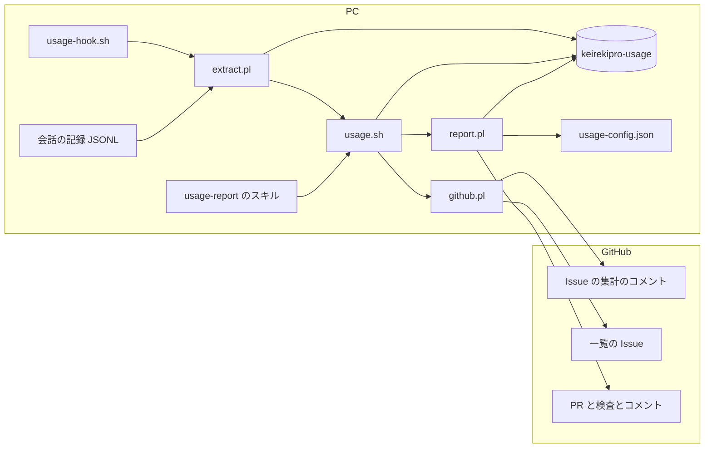
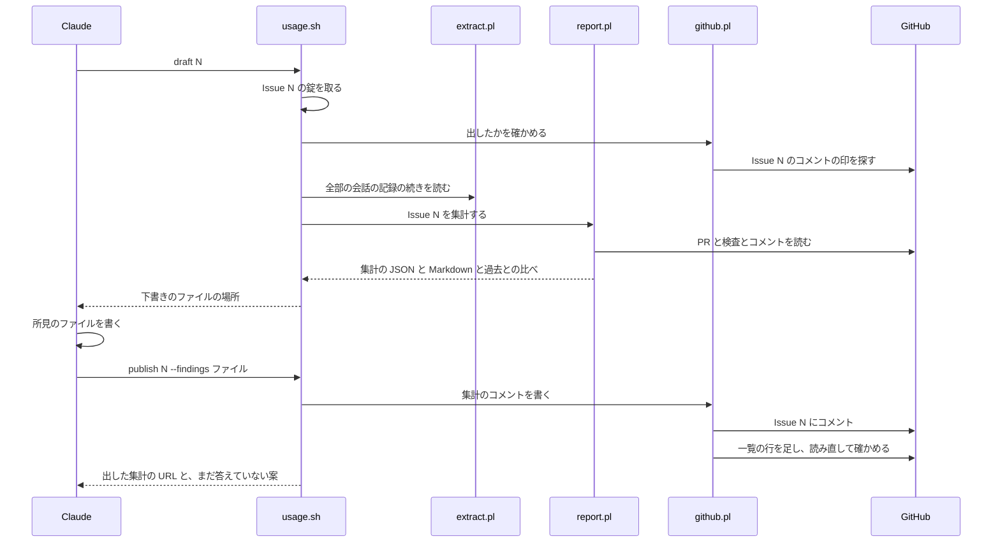
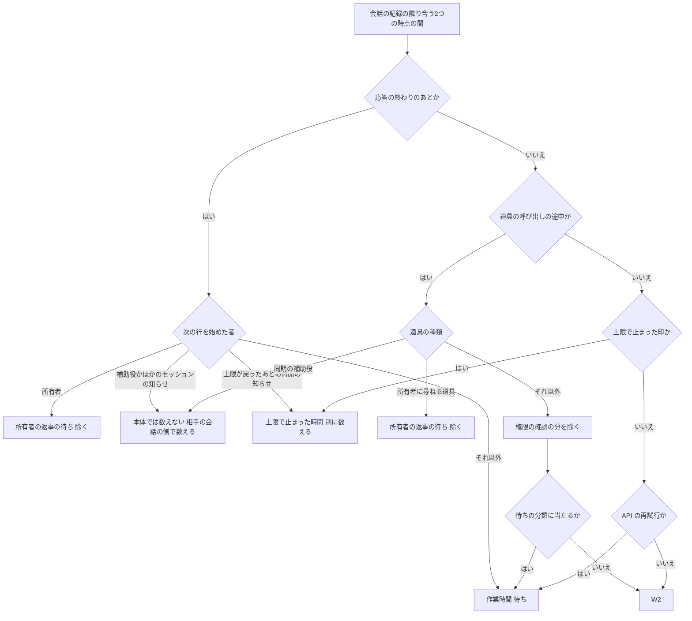

# 設計

## 概要

この設計は、Claude Code の会話の記録から数だけを手元に抜き出しておき、Issue を閉じる PR がマージされたあとに、抜き出した数と GitHub と spec.json から Issue ごとの集計を作り、GitHub に出す仕組みを足す。所有者は、Issue のコメントで Issue ごとの集計と所見を読み、決まった題名の Issue に置いた蓄積の一覧で Issue どうしを比べる。

この設計で足すフックとスクリプトと、集計を出す Claude は、次の2つの時点で動く。

- 会話の途中: フックのスクリプト `usage-hook.sh` が extract.pl を呼ぶ
- マージのあと: `/ship` か会話の始めのフックの知らせを受けた Claude が、スキル `usage-report` の手順で集計を出す

Claude は、並行作業のスクリプト `session.sh` と kiro-impl を変えない。

## 作るものと作らないもの

### 作るもの

- 本体の会話と、補助役の会話と、別に起こしたセッションの会話の記録から、数と名前だけを手元に抜き出して残す仕組み
- 手元に抜き出した数と、GitHub の PR・検査・コメントと、spec.json から、Issue ごとの集計を作る仕組み
- Issue ごとの集計のコメントと、蓄積の一覧の Issue と、まだ答えていない直す案の索引を、GitHub に書く仕組み
- マージのあとに、`/ship` の会話か、その PC の次の会話で集計を出す手順(スキル `usage-report` と、会話の始めのフック)
- 往復と手戻りのうち、今は記録が無い3つの出来事を残す印のコマンド。3つの出来事は、承認の前に所有者が spec の直しを求めたこと、同じ失敗を3回続けて直せず、AI が作業を止めて所有者に報告したこと、spec 無しで始めて実装の途中で spec に切り替えたことである
- 価格と、待ちの分類と、段階の印と、役割の名前を持つデータのファイル
- 蓄積の一覧の、Issue の列の次の題名の列 (#659)

### 作らないもの

- 抜き出しのテストを CI で流すこと。CI が流すテストは、`.github/scripts/tests/` の下のテストだけである。この spec は、`.github/` の下のファイルを変えない。Claude は、抜き出しのテストを CI で流す案を、所有者への提案として報告する
- さかのぼりの集計(要件10)のための指定、印、注記、手順、コマンド(PR #651 で変更済み)(PR #652 で変更済み)
- 並行作業の記録(`.git/keirekipro-parallel/`)の形の変更
- さかのぼりの集計を、会話の始めのフックや `/ship` から始めること
- さかのぼりの集計で GitHub に出せなかった集計を、会話の始めのフックで知らせて出し直すこと
- 蓄積の一覧の並べ替えや絞り込みの画面
- 行を足したあとに Issue の題名が変わったときの、一覧の題名の書き換え (#659)
- 題名の列を足す変更が main に入ったときに一覧にある行に、題名を書き足す手順とコマンド(要件11の5)(#659)
- 題名の全文を出すための、一覧の中の印。題名の全文の出し方は、「データの形」の節の「一覧の Issue」に書く (#659)

## 使う既存の仕組み

- Claude Code が形を決めているもの。この設計が使うのは、次の6つである。extract.pl は、会話の記録を読むだけで、書き換えない
  - 会話の記録(`~/.claude/projects/` の下の JSONL)
  - 補助役の `agent-<id>.meta.json`
  - 補助役が報告を返す `SubagentHandback` の道具の呼び出し
  - デスクトップアプリの手元の記録(`local_<uuid>.json`)。この記録は、デスクトップアプリを入れた PC にだけある
  - フックの入力(`hook_event_name` `session_id` `transcript_path` `cwd` `agent_transcript_path` `tool_use_id` `duration_ms`)
  - `SessionStart` のフックの出力(`hookSpecificOutput.additionalContext`)
- Claude Code は、ターミナルで動かしても、デスクトップアプリで動かしても、同じ設定のファイル(`.claude/settings.json`)のフックを動かす。Claude Code は、どちらで動かしても、会話の記録を同じ `~/.claude/projects/` の下に同じ形で残す(research.md の「ターミナルとデスクトップアプリの違い」)。この設計は、デスクトップアプリの手元の記録と、セッションを別に起こす道具の結果のほかは、ターミナルとデスクトップアプリのどちらにもあるものだけを使う
- gh。この設計は、開発者の PC でログイン済みの gh を使う。この設計で足すスクリプトとフックは、`gh issue view|comment|create|close|edit|lock`、`gh pr list|view`、`gh api` を呼ぶ。トークンに足す権限は無い
- ホストの bash と perl(JSON::PP)。この設計で足すスクリプトとフックは、jq を使わない
- `.claude/scripts/parallel/lib.sh` の考え方。この設計で足すスクリプトも、lib.sh と同じ作りで、記録を git の共通ディレクトリ(`git rev-parse --git-common-dir`)の下に置き、mkdir で錠を取る。錠とは、同じ記録を2つの呼び出しが同時に読み書きしないための印である。スクリプトは、決まった名前のディレクトリを mkdir で作れたときに錠を取れたとし、作れなければ、ほかの呼び出しが錠を持っているとみなす。この設計で足すスクリプトは、lib.sh の関数を呼ばない。並行作業の記録と、この設計で足すスクリプトの記録を分けておくためである
- 台帳の Issue の探し方の決まり。`.github/scripts/lib-ledger-issue.sh` は、題名が完全に一致する Issue のうち、開いているか閉じているかを問わず、番号が最も小さいものを台帳とする。lib-ledger-issue.sh は CI 向けで jq に頼るので、github.pl は、同じ決まりを perl で作り直す
- extract.pl と report.pl が読む、既存の記録の形。読むのは次の5つである
  - spec.json の `issue` `additional_issues` `approval_history` の欄
  - spec の審査役の依頼文の `STAGE` `CYCLE` `ROUND` の欄
  - タスクごとの確認役の報告の `- VERDICT:` の行
  - 原因を調べる補助役の報告の `NEXT_ACTION:` の行
  - Codex レビューのコメントの見出しと表
- `.claude/hooks/resume-after-usage-limit.sh` が会話を再開させるときの知らせの印 `[resume-after-usage-limit]`。このフックは、`Stop` と `StopFailure` のときに、使う量の上限が戻る時刻まで待ってから、この印を含む文を Claude に渡して会話を再開させる。会話の記録には、この文が、`turnOrigin` が `task_notification` の `user` の行として残る(research.md の「上限が戻ったあとの再開の知らせ」)

## 設計を見直すきっかけ

- Claude Code が形を決めているもの(「使う既存の仕組み」の節の1つ目の箇条)の欄の名前、置き場所、値が変わったとき。所有者か Claude が直すのは、extract.pl と、そのテストの作り物の記録だけである。ほかの部品は、extract.pl が書いた、この仕組みの中の値だけを読むためである
- extract.pl が抜き出す行か値を変えたとき。所有者か Claude が、extract.pl の版の番号を1つ上げる。版の番号が変わると、extract.pl は、会話の記録のファイルが残っている分を、最初から抜き出し直す(「extract.pl」の「状態の持ち方」)
- 集計に、extract.pl が見分けられなかった会話の再開が出たとき。Claude Code が `turnOrigin` に新しい値を書き始めたためである。所有者か Claude が、extract.pl の値の一覧に、その値と意味を足す
- フックの入力から `duration_ms` が無くなったときのように、Claude Code の記録から数の材料そのものが無くなったとき。このときは、extract.pl を直すだけでは足りないので、所有者か Claude が、report.pl の作業時間とトークン数と使用料の数え方を見直す
- 公表価格が変わったときと、新しいモデルが出たときは、所有者か Claude が、データのファイルの `prices` を直す
- `/start` `/ship` `/spec-review` の手順で、受け持ちのコマンド(`session.sh check-start|claim|takeover`)、まとめて閉じるコマンドの文面、審査役の依頼文の欄を変えたとき。所有者か Claude が、extract.pl の、受け持ちの出来事とまとめの出来事と補助役の情報の抜き出し方を直す
- `/kiro-impl` の確認役と原因を調べる補助役の依頼文の雛形と、`kiro-review` と `kiro-debug` のスキルで、確認役の `- VERDICT:` の行か、原因を調べる補助役の `NEXT_ACTION:` の行の形を変えたとき。所有者か Claude が、extract.pl の、補助役の報告の抜き出し方を直す
- resume-after-usage-limit.sh の知らせの印を変えたとき。所有者か Claude が、extract.pl の、上限が戻ったあとの再開の見分け方を直す
- 段階を表すスキルを足したり名前を変えたりしたとき。所有者か Claude が、データのファイルの `stage_marks` を直す
- 品質チェックか CI の検査の名前を変えたとき。所有者か Claude が、データのファイルの `wait_categories` と `ci_exclude_checks` を直す
- Codex レビューのコメントの見出しか表の形を変えたとき。所有者か Claude が、report.pl の、Codex レビューとの往復と、自動レビューが決めた方式から外れたとして PR を止めた回数の数え方を直す
- 開発に参加する人を増やすときと、Claude の gh がログインするアカウントを替えるとき。所有者は、新しいアカウントをこのリポジトリの共同作業者に加え、前のアカウントを共同作業者から外さない。前のアカウントを共同作業者から外すと、github.pl は、前のアカウントが書いた集計のコメントと一覧の Issue を読まなくなるためである。GitHub は、リポジトリとの関係の欄を、書いたときの値で残さず、読むたびにその時点の関係で返す(research.md の「共同作業者から外したアカウントの関係の欄」)。前のアカウントを共同作業者のまま残せば、関係の欄は `COLLABORATOR` を返す
- リポジトリを組織に移したとき。所有者か Claude が、github.pl の書き手の確認に、関係の値 `MEMBER` を足す
- 集計のコメントと一覧に置く、HTML のコメントの形の印(`keirekipro-usage-*:v1`)の形を変えたとき。所有者か Claude が、github.pl と report.pl を、古い形の集計のコメントと一覧の行も読めるように直す
- GitHub が、人が Issue の番号のリンクにマウスを置いたときに、Issue のカードを出さなくなったとき。題名の全文が出なくなるので(要件11の3)、所有者か Claude が、題名の全文の出し方を見直す (#659)
- GitHub が、表の中の「`\|`」の扱いか、コードの形の文字の扱いを変えたとき。題名の文字がそのまま出なくなるか、表の列がずれるので(要件11の6)、所有者か Claude が、github.pl の題名の書き方を直す (#659)
- GitHub が Issue の題名の長さの上限を変えたときと、一覧の1行が長くなる変更をしたとき。所有者か Claude が、一覧の1ページが「一覧の行の書き方」の大きさの上限に収まるかを確かめ直す (#659)
- 一覧の列を足すか減らす変更をするとき。所有者か Claude が、変更の前の形の行を新しい形で読めるようにする (#659)

## プロジェクトの決まりを守っているか

- 品質チェックの設定: この spec の PR には、`.claude/` の下に足すスクリプトとスキルとフックと、`.claude/settings.json` の変更が入る。`.claude/` は CODEOWNERS の対象なので、PR は所有者が承認するまでマージされない。Claude は、出荷の前に、CLAUDE.md が `check-claude-md-size.sh` の上限を超えないことを確かめる
- 使う外部の機能がこのリポジトリで使えるか: Issue のコメントと本文の編集は、公開リポジトリと個人のアカウントで使える。gh のトークンの `repo` の権限で足りることを、Claude は 2026-10-24 に確かめた。gh のトークンに `project` の権限が無いので、この設計は GitHub Projects v2 を使わない。
- 新しいライブラリの追加: 足さない。この設計で足す perl のスクリプトは、perl に標準で入っている JSON::PP と Time::Local と File::Spec だけを使う
- backend のコードを置く層: この設計は、backend のコードを変えないので、関係しない
- frontend の機能ごとの境界: この設計は、frontend のコードを変えないので、関係しない
- frontend の状態の持ち方: この設計は、frontend のコードを変えないので、関係しない
- データベースの表の形: この設計は、データベースを変えないので、関係しない

## 全体の構成



この設計は、会話の記録から数を抜き出す部品と、集計の部品を分ける。抜き出しの部品だけが会話の記録を読み、数と名前だけを手元の記録(`<git の共通ディレクトリ>/keirekipro-usage/`)に残す。集計の部品は、会話の記録を直接読まず、手元の記録だけを読む。こう分けるのは、Claude Code が30日たった会話の記録を消しても、数を集計に入れるためである。手元の記録は git の共通ディレクトリの下にあるので、worktree を消しても残る。同じリポジトリのどの作業フォルダで動かした部品も、同じ手元の記録を読む。

新しい部品が要るのは、既存の並行作業の記録が、新しい状態で前の状態を上書きする記録で、受け持ちの履歴も、会話ごとのトークン数も残さないためである。

**使う技術**:
- 実行環境: bash(Git for Windows の Git Bash か、macOS・Linux の標準)と perl 5(JSON::PP)。フックと入口は bash、抜き出しと集計と GitHub への書き込みは perl で書く
- 外部とのやり取り: gh。GitHub の REST と GraphQL は gh を通して呼ぶ
- データの保存: git の共通ディレクトリの下の JSON Lines と JSON のファイル。GitHub の Issue のコメントと本文

## ファイルの構成

Claude が新しく作るファイル:

- `.claude/scripts/usage/usage.sh`: 入口のコマンド。サブコマンド `mark` `pending` `session-context` `draft` `publish` `proposals` `proposal` `owner` を受け、錠を取り、perl の部品を呼ぶ(PR #652 で変更済み)
- `.claude/scripts/usage/extract.pl`: 抜き出しの部品
- `.claude/scripts/usage/report.pl`: 集計の部品
- `.claude/scripts/usage/github.pl`: GitHub に出す部品
- `.claude/scripts/usage/usage-config.json`: データのファイル
- `.claude/scripts/usage/tests/test-extract.sh` `test-report.sh` `test-github.sh` `test-usage.sh`: 部品ごとのテスト。テストは、gh を偽のコマンドに差し替えて動く
- `.claude/scripts/usage/tests/fixtures/`: テストに使う、作り物の会話の記録とフックの入力と gh の応答
- `.claude/skills/usage-report/SKILL.md`: 集計を出す手順のスキル
- `.claude/.state/ai-work-usage-report/place-1/hooks/usage-hook.sh`: 5つの時点に登録するフックのスクリプトの完成版
- `.claude/.state/ai-work-usage-report/place-1/settings.json`: フックの登録と、`usage.sh` の許可を足した `.claude/settings.json` の完成版

Claude が変えるファイルは、次の5つである。3つの SKILL.md と CLAUDE.md の変える中身は、「ship・spec-review・start の SKILL.md と CLAUDE.md」の節に書く。

- `.claude/skills/ship/SKILL.md`
- `.claude/skills/spec-review/SKILL.md`
- `.claude/skills/start/SKILL.md`
- `CLAUDE.md`
- `doc/開発フロー/基盤構築手順.md`: 「1. botアカウントの作成とPATの発行」の節に、Claude の gh がログインする bot のアカウントを別のアカウントに替えるときも、前のアカウントを共同作業者から外さないことと、外すと集計の一覧と集計のコメントを読まなくなることを足す(「設計を見直すきっかけ」の、アカウントを替えるときの箇条)

題名の列を足すために、Claude が変えるファイルは、次の3つである。仕組みの部品のうち、Claude が変えるのは github.pl だけである。report.pl は一覧の行の知らない欄を読まず、usage.sh は一覧の行の Issue の番号だけを読むためである。Claude は、テストで gh の代わりに動く `fake-gh.sh` も変えない。`fake-gh.sh` は、Issue を1つ読む呼び出し(`GET repos/{owner}/{repo}/issues/<N>`)に、今も題名を返すためである (#659)

- `.claude/scripts/usage/github.pl`: 一覧の行に題名の列を足し、足す行に題名を書く (#659)
- `.claude/scripts/usage/tests/test-github.sh`: 題名の列を確かめるテストを足し、一覧の形を確かめる既存のテストを8列の形に直す (#659)
- `.claude/scripts/usage/tests/test-usage.sh`: 題名の列を足すと結果が変わる、既存の2つの確認を直す (#659)
  - 一覧に過去の行を `list-add` で足す確認では、Claude は、足す行の Issue(Issue 150)を、偽の gh が返す Issue に足す。github.pl は、足す行の題名を読めなければ、一覧に書かないためである
  - 一覧の行の値を `report.md` の値と比べる確認では、Claude は、行を「|」で分けた欄の位置を、Issue の列のすぐ右に題名の列がある8列の形に直す

## 処理の流れ

Claude が `/ship` で PR のマージを見届けたときと、Claude が次の会話で集計を出すときの流れは、次のとおりである。



report.pl が会話の時間を「考える」時間と「待ち」の時間と「除く」時間に分ける流れは、次のとおりである。作業時間は、「考える」時間と「待ち」の時間を合わせたものである。



report.pl は、図の分け方を、次の9つの決まりで決める。

- report.pl は、この図の分け方を、extract.pl が書いた手元の記録の値だけで決める
- 応答の終わりは、`msg` の行の `end` が真の時点である
- 次の行を始めた者は、`turn` の行の `from` で、`owner`(所有者)、`peer`(ほかのセッションから届いた知らせ)、`notice`(仕組みからの知らせ)、`limit`(上限が戻ったあとに resume-after-usage-limit.sh が会話を再開させた知らせ)、`unknown`(extract.pl が見分けられなかった再開)のどれかである。report.pl は、`unknown` の行を、補助役の知らせでない `notice` の行と同じに扱い、その数を集計に書く
- 「補助役かほかのセッションの知らせ」は、`from` が `peer` の行と、`from` が `notice` で、知らせの元の仕事が補助役(`result` の行の `job_kind` が `agent`)の行である
- report.pl は、応答の終わりから、補助役の知らせでない `notice` の行までの時間を、外の仕組みを待っていた時間として待ちに入れる。補助役の知らせでない `notice` の行には、裏で動かしたコマンドの知らせ、CI の見張りの知らせ、Claude が時刻を決めて予約した、会話を再開させる知らせがある
- 道具の種類は、`tool` の行の `kind` である。所有者に尋ねる道具は `ask`、同期の補助役は `agent` である
- 権限の確認の分は、道具の呼び出しから結果までの時間から、道具の実行時間(`durations/` の記録)を引いた残りである。report.pl は、`tool` の行の `perm` が `user` でないときは、権限の確認の分を引かない。`perm` が `user` の行は、所有者が権限の確認に答えた呼び出しである。`perm` が `user` で、道具の実行時間の記録が無いときは、report.pl は、呼び出しから結果までの全部を所有者の返事の待ちとする。道具の実行時間の記録が無いのは、フックが入る前の会話である
- report.pl は、上限で止まった区間を、会話ごとに次の3つの決まりで作る。図の「上限で止まった時間」は、この区間の中の時間である
  - 上限の印の区間は、上限の印の時刻から、その会話の次の行の時刻までである。印のあとに行が無い会話では、report.pl は、その印から区間を作らない。補助役の会話は、上限の印で終わり、印のあとに行が無いことが多い。補助役が上限で止まったときは、親の会話の `from` が `limit` の行か上限の印が区間を作る
  - `from` が `limit` の行の区間は、その行の直前の時点から、その行の時刻までである。補助役か別に起こしたセッションが上限に当たり、本体の会話が応答を普通に終えたときは、本体の会話に上限の印が残らないので、この区間が上限で止まった時間を表す
  - 上限の印の直前の行が `from` が `limit` の行のときは、report.pl は、その印の区間の始まりを、その `limit` の行の時刻にする。resume-after-usage-limit.sh は、戻る時刻を読めないときに、上限が戻る前に会話を再開させることがある。再開させた会話の応答が上限で断られると、手元の記録には、`from` が `limit` の行、上限の印、もう一度 `from` が `limit` の行の順に残る。report.pl が区間の始まりをそろえるのは、この1回の上限を2つの区間に分けないためである
- report.pl は、その Issue のすべての会話の上限で止まった区間を重ね、重なる区間と接する区間を1つにまとめる。上限で止まった時間は、まとめた区間の長さの合計である。そのため、report.pl は、重なった時間を1回だけ数える。上限で止まった回数は、まとめた区間の数である。上限は所有者のアカウントに当たるので、本体の会話と補助役の会話と別に起こしたセッションの会話は、同じ時間に止まる。report.pl がまとめるのは、1回の上限を会話の数だけ数えないためである

## 部品

### extract.pl(会話の記録から数と名前だけを抜き出す部品)

対応する要件: 1.3, 1.6, 1.7, 1.8, 2.1, 2.7, 3.2, 3.3, 3.4, 3.5, 4.1, 4.2, 6.3, 9.2

**役割**: extract.pl は、Claude Code が形を決めているもの(「使う既存の仕組み」の節の1つ目の箇条)を読み書きする、ただ1つの部品である。extract.pl は、次の3つを受け持つ。

- 会話の記録の JSONL を、前回読んだ位置から最後まで読み、1行ごとに、集計に要る数と名前だけを、手元の記録 `extract/<記録の鍵>.jsonl` に追記する。記録の鍵は、本体の会話では `<sessionId>`、補助役では `<sessionId>.agent-<id>` である
- フックの入力を読み、時点ごとの仕事をする(下の「フックから呼ばれたとき」)
- デスクトップアプリの手元の記録を読み、別に起こしたセッションの `local_<uuid>` と会話の `sessionId` の対応を `extract/desktop.jsonl` に書く。デスクトップアプリの手元の記録が無い PC では、extract.pl は、この仕事をせず、ほかの2つの仕事を続ける

extract.pl は、Claude Code の値を、この仕組みの中の値(「データの形」の節の抜き出した行の表)に置き換えて書く。ほかの部品は、Claude Code の欄の名前と値を持たない。extract.pl は、会話の文、道具の引数の中身、コマンドの文字列、ファイルの中身、道具の結果の中身を書かない。extract.pl は、集計をしない。

extract.pl が会話の記録の1行から抜き出すものは、次のとおりである。抜き出した行の形は「データの形」の節に書く。

- `assistant` の行: 時刻、`message.id`、モデル、`usage` の4種類のトークン数、`server_tool_use.web_search_requests`。extract.pl は、キャッシュの書き込みのトークン数を、`ephemeral_5m_input_tokens` と `ephemeral_1h_input_tokens` の2つに分けて抜き出す。extract.pl は、`speed` が `fast` かを `fast` の真偽に、`inference_geo` が `us` かを `us` の真偽に、`stop_reason` が `end_turn` かを `end` の真偽に置き換える。モデルが `<synthetic>` の行は、トークン数を抜き出さず、`error` が `rate_limit` なら上限の印だけを抜き出す
- 道具の呼び出し: 時刻、`tool_use_id`、道具の種類、所有者が権限の確認に答えたかどうか、裏で動かしたかどうか(`run_in_background`)、待ちの分類の名前
  - 道具の種類は、`agent`(補助役を起こす `Agent`)、`ask`(所有者に尋ねる `AskUserQuestion` と `ExitPlanMode`)、`shell`(コマンドを動かす `Bash` と `PowerShell`)、`wait`(待つだけの `Monitor`)、`other`(それ以外)の5つである。道具の名前と種類の対応は、extract.pl が持つ
  - extract.pl は、所有者が権限の確認に答えたかどうかを、`permissionDecision.source` が `user_` で始まるかで決め、`perm` の `user` か `other` にする
  - extract.pl は、待ちの分類を、データのファイルの `wait_categories` の表で、道具の種類と、`shell` のときはコマンドの文字列を照らして決める。照らしたあと、extract.pl は、コマンドの文字列を捨てる
- 道具の結果: 時刻、`tool_use_id`、失敗したかどうか。裏で動かした仕事の識別子(`Agent` の結果の agentId か、裏で動かした Bash の結果の task id)があれば、識別子と仕事の種類(`agent` か `other`)を残す
- `user` の行: 時刻、その行を始めた者。extract.pl は、`turnOrigin` の値のうち、意味が分かっている値の一覧を持つ。extract.pl は、`turnOrigin` が `human` なら `owner`、`peer` なら `peer`、一覧にある知らせの値(`task_notification` `scheduled` `sdk` など)なら `notice` にする。`task_notification` のときは、知らせの元の仕事の識別子も残す
  - extract.pl は、`turnOrigin` が `task_notification` の行の文が resume-after-usage-limit.sh の知らせの印 `[resume-after-usage-limit]` を含むときは、その行を `notice` にせず `limit` にする。extract.pl は、印を含むかだけを見て、文を手元の記録に書かない。この知らせは、上限で止まった時間のあとに届く。extract.pl がこの行を `notice` にすると、report.pl が上限で止まった時間を作業時間の待ちに入れてしまうためである
  - extract.pl は、extract.pl の値の一覧に無い値を `notice` にしない。extract.pl は、その行を `unknown` にし、元の値を `raw` に残す。Claude Code が更新されて、所有者の書き込みを表す値が増えることがある。増えた値を `notice` にすると、report.pl は、所有者の返事を待っていた時間を作業時間に数える。そのとき、誰も、report.pl が作業時間を多く数えたことに気づけない。extract.pl が値の一覧に無い値を `unknown` にするのは、これを防ぐためである
  - extract.pl が `raw` に元の値を残すのは、値が英字と数字と `_` と `-` だけでできた40文字以内の値のときだけである。それ以外の値では、extract.pl は `raw` を空にする。会話の文が `raw` に入らないようにするためである
  - extract.pl は、`--all` で呼ばれるたびに、手元の記録の `unknown` の行のうち、`raw` の値がいまの extract.pl の値の一覧にある行を、extract.pl の値の一覧のとおりに書き直す。extract.pl は、書き直しを、その記録の鍵の錠の中で行う。Claude が extract.pl の値の一覧に値を足したあとは、Claude Code が会話の記録を消した古い会話の行も、この書き直しで正しく数え直される
- 段階の印: 所有者か開発者が打ったコマンド(`<command-name>`)と、`Skill` の道具の呼び出しの `skill`。データのファイルの `stage_marks` に載った名前だけを残し、引数からは Issue の番号(`#<数>`)と、`spec-review` の段階の名前(`requirements` `design` `tasks`)だけを取り出す
- 受け持ちの出来事: Bash のコマンドが `session.sh check-start <N>`、`session.sh claim <N>`、`session.sh takeover <N>` の形で、結果が失敗でないとき、種類と N と、`--branch` の値を残す。`/start` のコマンドとスキルの起動も、`start` の段階の印として残す
- まとめの出来事: Bash のコマンドが `gh issue close <M> --reason "not planned" --comment "#<K> に統合した。"` の形で、結果が失敗でないとき、M と K を残す
- 別に起こしたセッションの出来事: `mcp__ccd_session__start_session` の結果から、別に起こしたセッションの `local_<uuid>` を残す
- 補助役の情報: extract.pl は、補助役の会話から、次の3つだけを抜き出す
  - `agent-<id>.meta.json` の `agentType` の値とモデル。extract.pl は、`agentType` の値を `agent_type` の欄に書く
  - 最初の `user` の行である依頼文の、`STAGE:` `CYCLE:` `ROUND:` の欄の値
  - 補助役の報告の、`- VERDICT: APPROVED` か `- VERDICT: REJECTED` の行の値と、`NEXT_ACTION:` の行があるかどうか

  補助役の報告は、最後の `assistant` の行の文と、`SubagentHandback` の道具の呼び出しの `input.message` のうち、会話の記録で後にあるほうとする。このリポジトリの補助役は、auto mode では報告を `SubagentHandback` で返すためである。このことは、`.claude/hooks/record-spec-review.sh` の冒頭の注記に書かれている
- そのほか: `system` の行の `api_error` の `retryInMs`、`gitBranch` が変わった時刻と値、`prNumber`

**いつ動くか**: extract.pl は、`usage-hook.sh` から、5つのフックの時点で呼ばれる。extract.pl は、`usage.sh draft` から、集計の前に全部の会話の記録について呼ばれる。

**フックから呼ばれたとき**: extract.pl は、`perl extract.pl hook` の形で呼ばれ、標準入力のフックの入力の `hook_event_name` で、することを分ける。記録の置き場所は、入力の `cwd` から `git -C <cwd> rev-parse --path-format=absolute --git-common-dir` で決める。

| 時点 | extract.pl がすること |
|---|---|
| `Stop` `SessionEnd` | 入力の `transcript_path` の会話の記録の続きを読む |
| `SubagentStop` | 入力の `agent_transcript_path` の補助役の会話の記録の続きを読む |
| `PostToolUse` | 入力の `session_id` `tool_use_id` `duration_ms` を `durations/<session_id>.tsv` に1行で追記する |
| `SessionStart` | 下の箇条の3つのことをする |

- `PostToolUse` では、extract.pl は、入力を JSON として解かず、3つの欄を正規表現で取り出す。道具を使うたびに動くので、道具の結果の中身が大きい入力でも速く終えるためである。`duration_ms` が無い入力では、extract.pl は何も書かない
- `SessionStart` では、extract.pl は、次の3つのことをする
  1. extract.pl は、`extract.pl --all --skip-locked` を、標準入力と標準出力と標準エラーを閉じて裏で起動し、終わるのを待たない。閉じないと、Claude Code がフックの終わりを待ち続けるためである
  2. extract.pl は、自分と同じディレクトリの `usage.sh` を `bash <そのディレクトリ>/usage.sh session-context` の形で呼び、標準出力の文の行を受け取る
  3. extract.pl は、受け取った行を、Claude Code の `SessionStart` のフックの出力の形(`hookSpecificOutput.additionalContext`)に入れて、標準出力に書く。行が無ければ、何も書かない。行の合計が Claude Code の上限の10,000文字を超えるときは、extract.pl は、超える行を切り捨て、最後に「[usage] 知らせが多いので一部を省いた。`usage.sh pending` で残りを見る」の1行を置く
- extract.pl は、フックから呼ばれたときは、どの時点でも、会話を止めない。extract.pl は、`SessionStart` の時点で文脈を返すほかは、Claude に文脈を返さない

**呼び出し方**:
- `perl extract.pl hook`: フックの入力を標準入力で受ける(上の「フックから呼ばれたとき」)
- `perl extract.pl --state <記録の置き場所> --all --skip-locked|--wait --repo <本体の作業フォルダ>`: このリポジトリの全部の会話の記録の続きを読む。デスクトップアプリの手元の記録があれば、extract.pl は、その記録も読み直す
  - 会話の記録の置き場所(`~/.claude/projects`)と、デスクトップアプリの手元の記録の置き場所の OS ごとの候補は、extract.pl が持つ
  - デスクトップアプリの手元の記録の置き場所の候補が1つも無いときは、extract.pl は、デスクトップアプリの手元の記録を読まずに会話の記録を読み、`extract/desktop.jsonl` を作らない。extract.pl は、このときも、読み終えたら 0 で終わる。デスクトップアプリを入れていない PC が、これに当たる
  - `--skip-locked` と `--wait` は、錠を取れない記録の鍵の扱いを決める。扱いは「状態の持ち方」の欄に書く
  - このリポジトリの会話は、`~/.claude/projects` の下のディレクトリのうち、`cwd` の欄を持つ最初の行の `cwd` が本体の作業フォルダかその下にあるもの、または `git worktree list` に載った作業フォルダのものとする。会話の記録の最初の数行は `cwd` の欄を持たないので、extract.pl は、`cwd` の欄を持つ行まで読み進める(research.md の「ターミナルとデスクトップアプリの違い」)
  - Windows では、会話の記録の `cwd` は `\` で区切られ、`git worktree list` の場所は `/` で区切られる。extract.pl は、Windows では、`\` を `/` にそろえ、大文字と小文字を区別せずに比べる
  - worktree は本体の作業フォルダの下の `.claude/worktrees/` に作られるので、消した worktree の会話も、この決まりで入る
- 終了コード: extract.pl は、読み終えたら 0 で終わる。記録の置き場所に書けなかったとき、または `--wait` で錠を待つ上限を超えたときは、extract.pl は 1 で終わる。extract.pl は、知らない形の行と壊れた行を飛ばし、飛ばした数を `extract/<記録の鍵>.pos` に残して 0 で終わる
- extract.pl は、同じ記録を何度読まされても、前回の位置から先しか読まないので、抜き出した行は重ならない

**状態の持ち方**: extract.pl は、読んだ位置を `extract/<記録の鍵>.pos` に持つ。`.pos` は JSON で、読んだバイト数と、そのときのファイルの大きさと、飛ばした行の数と、抜き出した extract.pl の版の番号を持つ。extract.pl は、自分の版の番号を、スクリプトの中の定数で持つ。次の2つのときは、extract.pl は、その記録の鍵の抜き出した記録を消して、最初から読み直す。
- ファイルが前回より小さくなっていたとき。ファイルが小さくなるのは、Claude Code が会話の記録を書き直したときである
- `.pos` の版の番号が、今の extract.pl の版の番号と違うとき。版の番号が違うのは、所有者か Claude が抜き出し方を直したとき(「設計を見直すきっかけ」)である

会話の記録のファイルがもう無い記録の鍵では、extract.pl は、抜き出した記録と `.pos` を消さずに残す。読み直す元が無いためである。extract.pl は、1つの記録の鍵につき、錠 `locks/extract-<記録の鍵>` を取ってから読む。錠は mkdir で取る。錠を取れないときの扱いは、呼び出し方で分ける。
- extract.pl は、次の2つの呼ばれ方では、錠を取れない記録の鍵を飛ばす。1つ目は、`Stop` `SessionEnd` `SubagentStop` のフックから呼ばれたときである。2つ目は、`SessionStart` のフックの時点で `--all --skip-locked` で裏で起動したときである。錠を取れないのは、ほかの呼び出しがその記録を読んでいるためである
- `usage.sh draft` から `--all --wait` で呼ばれたときは、extract.pl は、その記録の鍵の錠が外れるまで待ってから、続きを読む。extract.pl が錠を待つのは、1つの記録の鍵につき600秒までである。600秒を超えたら、extract.pl は 1 で終わる。extract.pl が 1 で終わったら、usage.sh は集計を作らずに 1 で終わる。途中までしか抜き出していない記録で集計を作らないためである

extract.pl は、読んでいる間、10秒ごとに錠のディレクトリの時刻を今の時刻に直す。錠のディレクトリの時刻が60秒より古ければ、ほかの呼び出しは、錠の持ち主が止まったとみなして、錠を取り直す。この決まりは、lib.sh の `_kp_lock` の決まりと同じである。大きな記録を読むのに60秒より長くかかっても、extract.pl が錠のディレクトリの時刻を直し続けるので、ほかの呼び出しは錠を取り直さない。

**失敗したとき**: extract.pl は、フックから呼ばれたときは、失敗しても 0 で終わり、理由を `extract/errors.log` に1行で残す。Claude Code の会話を止めないためである。

### usage-hook.sh(5つの時点に登録するフックのスクリプト)

対応する要件: 2.7, 3.2, 6.3

**役割**: usage-hook.sh は、標準入力をそのまま `perl "${CLAUDE_PROJECT_DIR}/.claude/scripts/usage/extract.pl" hook` に渡し、extract.pl の標準出力をそのまま返す。Claude Code は、フックを、会話のそのときの作業フォルダで動かし、会話を始めた作業フォルダの場所を、環境変数 `CLAUDE_PROJECT_DIR` でフックに渡す(https://code.claude.com/docs/en/hooks)。Claude が Bash で `cd` した先は、次の Bash の呼び出しにも残る。そのため、usage-hook.sh は、extract.pl の場所を、作業フォルダからの相対の場所ではなく、`CLAUDE_PROJECT_DIR` から作る。usage-hook.sh は、フックの入力の欄を読まない。入力の欄の名前を知るのを extract.pl だけにして、Claude Code の入力の形が変わっても、所有者の承認が要る `.claude/hooks/` の下のファイルを直さずに済むようにするためである。この設計では、`SessionStart` の時点で動く usage-hook.sh を「会話の始めのフック」と呼ぶ。

**いつ動くか**: usage-hook.sh は、「settings.json の変更」の節に書いた登録のとおりに、5つの時点で動く。

**失敗したとき**: usage-hook.sh は、extract.pl が失敗しても 0 で終わる。会話を止めないためである。

### usage.sh session-context(会話の始めに、まだ出していない集計と、まだ答えていない案を Claude に知らせる文を作るサブコマンド)

対応する要件: 1.3, 1.6, 1.7, 7.5, 8.4

**役割**: `usage.sh session-context` は、会話の始めのフックが Claude への文脈に入れる文の行を作り、標準出力に1行ずつ書く。文の行を Claude Code の出力の形に入れるのは、extract.pl である。`usage.sh session-context` は集計を作らず、GitHub に書かない。集計は、Claude が `usage.sh` を呼んで作る。集計には時間がかかり、集計に失敗したときは Claude が会話の相手に理由を書く必要があるためである。`usage.sh session-context` は、次の2つの文を作る。

1. `usage.sh session-context` は、`usage.sh pending` と同じ手順で、集計をまだ出していない Issue と、一覧への書き込みが残った Issue を取り、Issue ごとに文を作る。あわせて、`usage.sh session-context` は、`usage.sh pending` が番号を出す対象の Issue のうち、この PC で集計を出してから7日の間の Issue があれば、`github.pl list-read` で一覧にその行があるかを確かめ、無ければ `issues/<N>.json` に `list_pending` を書き直して、その Issue の文も作る。`usage.sh pending` が番号を出す対象の Issue とは、仕組みが main に入った時刻より後に閉じ、集計しない印の無い Issue である
2. `usage.sh session-context` は、会話の相手が所有者かを、`state.json` の `owner` で確かめる。`owner` が真のときは、`[usage] 会話の相手: 所有者` の1行を作り、案の索引のコメントから、まだ答えていない直す案の ID と Issue の番号を読んで、文に足す。`owner` が無く、まだ答えていない案があるときは、`[usage] この PC で Claude と話す人が所有者かどうかが、まだ決まっていない` の1行を作る。`owner` が偽のときは、どちらの行も作らない

仕組みが main に入った時刻(「移行」の節)を取れないときは、`usage.sh session-context` は、gh を呼ばない。このとき、`usage.sh session-context` は、文の行を1つも出さずに 0 で終わる。仕組みが main に入った時刻を取れないのは、仕組みを main に入れる PR がまだマージされていないときである。

`usage.sh session-context` は、文を事実の形で書く。例: 「[usage] Issue #612 を閉じる PR がマージされ、集計がまだ GitHub に出ていない。usage-report のスキルの『次の会話で出すとき』の手順で出す。」

**権限**: `usage.sh session-context` は、gh を読み取りだけに使う。

**いつ動くか**: extract.pl が、会話の始めのフックの中で `usage.sh session-context` を呼ぶ。Claude は、「settings.json の変更」の節のとおり、settings.json の完成版で、会話の始めのフックを matcher を付けずに登録する。そのため、会話の始めのフックは、`startup` と `resume` と `compact` のどの始まりでも動く。

**使う部品**: `usage.sh session-context` は、github.pl で案の索引と一覧の行を読み、gh を呼び、手元の `issues/<N>.json` の `list_pending` を書く。

**状態の持ち方**: 会話の相手が所有者かどうかは、`state.json` の `owner`(真か偽)に置く。`owner` を書くのは、usage-report のスキルの「所有者かを尋ねるとき」の手順で Claude が呼ぶ `usage.sh owner` だけである。`usage.sh session-context` は、会話の相手が所有者かどうかを、gh のアカウント名では見分けない。Claude の gh がログインするアカウントは、`doc/開発フロー/参加者セットアップ手順.md` の「PR作成名義の固定」の節のとおり、所有者の PC でも bot のアカウント `DogisRiki-bot` のことがある。そのため、`usage.sh session-context` は、アカウントの名前では、会話の相手が所有者かどうかを見分けられない。`state.json` は git の共通ディレクトリの下にあるので、`owner` は、その PC のこのリポジトリの clone ごとに1回決まり、worktree を作り直しても残る。

**失敗したとき**: gh が失敗したか、10秒の中で終わらないときは、会話の始めのフックは、知らせを出さずに 0 で終わる。知らせなかった Issue は、手元で出し済みにならないので、会話の始めのフックは、次の会話の始めに、その Issue をまた知らせる。

### usage.sh(集計の入口のコマンド)

対応する要件: 1.3, 1.5, 1.7, 1.9, 6.3, 8.6, 10.7

**役割**: usage.sh は、記録の置き場所を決め、錠を取り、perl の部品を順に呼ぶ。usage.sh は、どの部品をどの順で呼ぶかと、錠と、下書きの新しさだけを判断し、集計の中身は判断しない。

**権限**: Claude は、所有者にも開発者にも確認を求めずに usage.sh を呼べる。

**呼び出し方**: 記録の置き場所は `<git rev-parse --path-format=absolute --git-common-dir>/keirekipro-usage/` である。サブコマンドは次のとおりである。どのサブコマンドも、`--session <ID>` を受ける。`<ID>` は、並行作業の仕組みが会話の始めに Claude への文脈で渡す `[parallel] このセッションのID` の値である。

| サブコマンド | すること | 標準出力 |
|---|---|---|
| `mark <種類> [--stage <段階>] [--issue <N>]` | 往復と手戻りの印を `marks.jsonl` に残す | なし |
| `pending` | まだ出していない Issue と、一覧か案の索引への書き込みが残った Issue の番号を出す | JSON 1行 |
| `session-context` | 会話の始めに Claude へ知らせる文を作る | 文の行 |
| `draft <N>` | 集計の下書きを作る(PR #651 で変更済み) | 下書きの場所、比較の要約、見分けられなかった再開 |
| `publish <N> --findings <ファイル>` | 集計を GitHub に出す | 集計のコメントの URL と、直す案の ID と、`owner` と、書けなかった書き込み |
| `proposals` | `github.pl proposals-open` を呼ぶ | まだ答えていない案の JSON 1行 |
| `proposal <案の ID> filed\|declined` | 案の索引と `proposals_pending` から、その案を外す | なし |
| `owner yes\|no` | `state.json` の `owner` を真か偽にする | なし |

- 終了コード: usage.sh は、成功したら 0 で、失敗したら 1 で終わる。usage.sh は、次の6つのどれかに当たって何もしなかったときは、2 で終わる。6つは、出し済みのとき、まだマージされていないとき、Issue を閉じる PR が無いまま閉じたとき、この PC に記録が無いとき、仕組みがまだ main に入っていないとき、マージのたびに出す集計の対象でないときである。1 のときは、理由を標準エラーに日本語の1文で出す(PR #651 で変更済み)
- `mark` は、`marks.jsonl` に、時刻・セッションのID・種類・段階・Issue の番号・いまのブランチの1行を追記する。`mark` は、種類に `spec-fix` `same-failure` `switch-to-spec` だけを受ける
- `proposal` は、`github.pl proposal-remove` を呼んで、案の索引からその案を外す。`proposal` は、`issues/<N>.json` の `proposals_pending` からも、その案を外す
- `pending` は、手元で受け持ちの出来事がある Issue のうち、`issues/<N>.json` が出し済みでなく、集計しない印も無いものの番号をまとめる。`pending` は、出し済みの Issue のうち、`issues/<N>.json` に `list_pending` か `proposals_pending` があるものの番号も出す。`pending` は、`gh issue list --state closed --search "closed:>=<仕組みが main に入った日>" --limit 200 --json number,closedAt` を1回だけ呼び、返った Issue のうち、`closedAt` が仕組みが main に入った時刻(「移行」の節)と同じかそれより後のものに絞る。検索の条件には日付だけを渡すので、同じ日に仕組みが入る前に閉じた Issue も返るためである。この絞り込みは候補を減らすだけで、集計するかどうかは、`draft` が下の「集計の対象か」の手順で決める
- 仕組みが main に入った時刻を取れないときは、`pending` は、gh を呼ばずに、番号を1つも持たない JSON の1行を出して 0 で終わる。仕組みが main に入った時刻を取れないのは、仕組みを main に入れる PR がまだマージされていないときである
- `pending` は、出し済みでない Issue の番号にも、`list_pending` か `proposals_pending` がある Issue の番号にも、上の閉じた時刻の絞り込みと、下の集計しない印の決まりを当てる。さかのぼりの集計の対象の Issue は、仕組みが main に入る前に閉じた Issue か、`draft` が集計しない印の `system-pr` を書く Issue(#501)なので、`pending` はその番号を出さない。会話の始めのフックが、さかのぼりの集計で出せなかった集計を知らせず、Claude が次の会話で出し直さないようにするためである(要件10の7)(PR #651 で変更済み)
- `draft` は、錠 `locks/issue-<N>` の中で、次の順に動く。まず、下の「集計の対象か」の手順1で、仕組みが main に入ったコミットを取る。次に、出し済みかを確かめる。次に、「集計の対象か」の手順2と手順3で、その Issue が仕組みを main に入れた Issue か、仕組みが main に入る前にマージされた Issue かを確かめる。最後に、`extract.pl --all --wait` を呼び、`report.pl` で集計を作り、下書きを `drafts/<N>/` に書く。手順1を出し済みかの確認より前に置くのは、出し済みかの確認が gh を呼ぶためである。仕組みが main に入る前の `draft` は、gh を呼ばずに終わる
- 集計の対象か: `draft` は、extract.pl を呼ぶ前に、次の3つの手順で確かめる
  1. `draft` は、`git fetch origin main` を呼び、仕組みが main に入ったコミット(「移行」の節)を取る。コミットが無ければ、`draft` は、gh を呼ばないまま、何も作らずに 2 で終わる。このとき、`draft` は、`issues/<N>.json` にも書かない。仕組みが main に入ったコミットが無いまま `draft` が呼ばれるのは、仕組みを main に入れる PR がマージされる前に、PR のブランチの作業フォルダで `draft` を呼んだときである。`git fetch` が失敗したら、`draft` は 1 で終わる
  2. `draft` は、report.pl の手順「Issue の PR を集める」と同じ gh の呼び出しで、Issue の PR を集める。集めた PR のどれかの `mergeCommit` が、仕組みが main に入ったコミットと同じなら、その Issue は、仕組みを main に入れた Issue である。このとき、`draft` は、`issues/<N>.json` に集計しない印(`skip: "system-pr"` と、そのときの `closedAt`)を書いてから 2 で終わる。Issue を閉じる PR(`Closes`)は、仕組みのファイルを足した PR と別の PR になることがある。2026-10-24 にマージした PR #620〜#624 は、どれも本文に `Refs: #614` を書き、`Closes #614` を書いたのは、最後の PR #624 だけだった。そのため、`draft` は、`Closes` の PR だけでなく、`Refs:` の PR も比べる
  3. `draft` は、Issue を閉じる PR のうち最も遅くマージされたものの `mergeCommit` が、仕組みが main に入ったコミットの祖先かを、`git merge-base --is-ancestor <その mergeCommit> <仕組みが main に入ったコミット>` で確かめる。このコマンドが 0 で終わったら、Issue は、仕組みが main に入る前にマージされている。このとき、`draft` は、集計しない印(`skip: "before-system"` と、そのときの `closedAt`)を書いてから 2 で終わる
- usage.sh は、さかのぼりの集計の対象の Issue を並べるサブコマンドと、さかのぼりの集計の指定を持たない。`draft` は、Issue の番号のほかの引数を受けない(PR #651 で変更済み)(PR #652 で変更済み)
- `publish` は、次の7つのとおりに動く
  - `publish` は、錠の中で、出し済みかと下書きの新しさを確かめ、所見のファイルを確かめ、`github.pl` で出す
  - `publish` は、`draft` が作った下書きが、同じ Issue の最新の下書きで、作ってから60分以内のときだけ出す
  - 下書きが古ければ、`publish` は、`draft` からやり直すよう返す
  - 集計のコメントを書けたら、`publish` は、手元の `issues/<N>.json` を出し済みにする
  - 集計のコメントを書けたあとに、案の索引か一覧に書けなかったときも、`publish` は 0 で終わり、所見に書いた直す案の ID と `owner` を出す。Claude がその会話で案を尋ねられるようにするためである
  - `publish` が出す `owner` は、`state.json` の `owner` の値で、`yes` `no` `unknown` のどれかである
  - `publish` は、一覧か案の索引に書けなかったときは、書けなかった書き込み(`list` か `proposals`、または両方)を出す。一覧と案の索引の両方に書けたときは、`publish` は、書けなかった書き込みを空にして出す。Claude が、書けなかったことと、次の会話で書き足されることを、会話の相手に書けるようにするためである(PR #651 で変更済み)
- Issue を閉じる PR とは、main に向けた、本文の行頭に `Closes #<N>` がある、マージ済みの PR である
- `draft` と `publish` は、Issue を閉じる PR が無ければ、2 で終わる
- Issue が閉じているのに(`gh issue view <N> --json state,closedAt`)、Issue を閉じる PR が無いときは、`draft` は、`issues/<N>.json` に集計しない印(`skip: "no-merged-pr"` と、そのときの `closedAt`)を書いてから 2 で終わる。まとめて閉じた Issue と、分けた元の Issue がこれに当たる
- `pending` は、印の `closedAt` と、いまの `closedAt` が同じ Issue の番号を出さない。閉じた Issue を開き直して、あとで PR のマージで閉じたときは、`closedAt` が変わるので、`pending` は、その Issue の番号をまた出す
- `draft` と `publish` は、GitHub に集計のコメントがあって「出し済み」と分かったときに、次の3つを行う。
  - 手元の `issues/<N>.json` に、まだ出し済みと書かれていなければ、集計のコメントの URL を書いて出し済みにする
  - `github.pl list-ensure <N>` を呼ぶ
  - `issues/<N>.json` に `proposals_pending` があれば、`github.pl proposals-ensure <N>` を呼ぶ
- `draft` と `publish` は、次の2つのときにも、この手順で一覧の行と案を足す。
  - 集計のコメントを書いた直後に止まったとき
  - 一覧か索引への書き込みが失敗したか、同時の書き込みで消えたとき
- `publish` は、所見のファイルに、ホームディレクトリの場所、`C:/Users/` `C:\Users\` `/Users/` `/home/` で始まる場所、PC のユーザー名、`git config user.email` の値のどれかがあれば、1 で終わり、GitHub に書かない
- 1つの Issue の集計が GitHub に1回だけ出るのは、`draft` と `publish` が、同じ錠の中で、Issue N のコメントに集計のコメントの印 `keirekipro-usage-report:v1` があるかを確かめるためである。usage.sh は、錠 `locks/issue-<N>` を mkdir で取り、錠が600秒より古ければ取り直す

**失敗したとき**: usage.sh は、gh の失敗を再試行しない。usage.sh は、理由を返して終わる。マージのたびに出す集計では、Claude は、次の会話の始めのフックの知らせを受けて、集計を出し直す(PR #651 で変更済み)。

### report.pl(Issue ごとの集計を作る部品)

対応する要件: 1.1, 1.4, 1.8, 2.1, 2.2, 2.3, 2.4, 2.5, 2.6, 2.8, 3.1, 3.2, 3.3, 3.4, 3.5, 3.6, 4.1, 4.2, 4.3, 4.4, 5.1, 5.2, 5.3, 5.4, 5.5, 6.1, 6.2, 6.3, 6.4, 9.1, 9.2, 10.5

**役割**: report.pl は、1つの Issue について、どの会話のどの時間がその Issue の作業かを決め、作業時間とトークン数と使用料と回数を数え、集計の JSON と Markdown を作る。report.pl は GitHub に書かず、所見を書かない。所見の欄は、Claude が書く場所として空けておく。

**使う部品**: report.pl は、手元の記録(`extract/` `marks.jsonl` `durations/`)とデータのファイルを読む。report.pl は、gh を読み取りだけに使い、git で main の spec.json と reviews のファイルを読む。

report.pl は、集計を次の手順で作る。

1. **Issue の PR を集める**: `gh pr list --state all --base main --limit 1000 --json number,state,body,headRefName,mergedAt,mergeCommit` から、本文の行頭に `Closes #<N>` か `Refs: #<N>` がある PR のうち、`state` が `MERGED` か `CLOSED` のものを集める。マージせずに閉じた PR も集めるのは、閉じた PR の検査とコメントも往復と手戻りに数えるためである。Claude は、`/start` の「途中で見立てが外れたとき」の手順で、200行の検査で止まった PR を閉じて作り直すことがある
2. **Issue のブランチを集める**: 「Issue の PR を集める」の手順で集めた PR の `headRefName` と、受け持ちの出来事の `--branch` の値を、Issue のブランチとする
3. **受け持ちの区切りを作る**: 会話ごとに、受け持ちの出来事を時刻の順に並べ、次の受け持ちまでを、その Issue の区切りとする。受け持ちの出来事は、Issue の番号がある `start` の段階の印と、`check-start` `claim` `takeover` の出来事である。ただし、次の2つは区切りを分けずに続ける
   - 分けた: Issue O を受け持った会話が、O と違う Issue P を `claim` し、GitHub の P の親(`gh issue view <P> --json parent`)が O で、P が O の子のうち最初に `claim` された Issue のとき。P の集計に O の区切りを含め、往復と手戻りの表の「実装の途中で、Issue を分けた」を「有」にする
   - まとめた: 会話に、M から K へのまとめの出来事があり、その会話が M を受け持ったあとに K を受け持ったとき。K の集計に M の区切りを含める
4. **1行ごとに Issue を決める**: 会話の記録から抜き出した1行は、次の順で1つの Issue に決める。どれにも当たらない行は、どの Issue にも入れない
   - 行の `gitBranch` が Issue のブランチで、行の時刻が、その Issue の開始の時刻から終了の時刻までにあるとき、その Issue
   - 行の会話が、その時刻にある Issue の受け持ちの区切りの中にあり、行の時刻が終了の時刻より前のとき、その Issue
   - 補助役の会話の行は、補助役の会話の `gitBranch` と、親の会話の区切りで、同じ決まりで決める
   - 別に起こしたセッションの会話は、`gitBranch` で決まらないとき、extract.pl が書いた `extract/desktop.jsonl` の対応で、親の会話の、別に起こしたセッションの出来事に結び付ける。結び付いたら、その会話の行は、親と同じ Issue にする
   - `/request` のスキルの段階の印のあとから次の受け持ちまでの行は、Issue に入れない
5. **開始日と終了日**: 終了の時刻は、手順「Issue の PR を集める」で集めた `Closes` の PR のうち、マージ済みで最も遅くマージされたものの `mergedAt` とする。閉じた PR は、終了の時刻を決めない。終了日は、その時刻を所有者の PC の時間帯の日付にしたものである。開始日は、その Issue の受け持ちの出来事のうち最も早い時刻の日付である。受け持ちの出来事が無いときは、開始日は、Issue のブランチで最初に動いた行の時刻の日付である。
6. **作業時間を数える**: 会話ごとに、「処理の流れ」の図のとおりに、隣り合う時点の間を「考える」「待ち」「除く」に分け、「考える」と「待ち」の区間を、その会話が動いていた区間とする。本体の会話が同期の補助役と補助役の知らせを待っている区間は、本体の区間にしない。同期の補助役を待っている区間とは、種類が `agent` の道具の呼び出しから、その結果までである。作業時間は、その Issue のすべての会話の区間を重ねたときに、1つ以上の会話が動いていた時間である。同時に動いた時間は、2つ以上の会話が動いていた時間である。待ち時間は、動いている会話がすべて「待ち」の区間にあった時間である。上限で止まった時間と回数は、「処理の流れ」の上限で止まった区間の決まりのとおりに、その Issue のすべての会話の上限で止まった区間を重ねて数える
7. **段階を決める**: 会話ごとに、その時点の直前の段階の印で段階を決める。段階の印とスキルの名前の対応は、データのファイルの `stage_marks` に持つ。次の決まりを足す
   - `spec-review` の段階は、引数の段階の名前で「要件の審査」「設計の審査」「タスクの審査」にする。spec の審査役と書き方の点検役の会話は、依頼文の `STAGE` で同じ段階にする。ほかの補助役の会話は、補助役を起動した時点の、親の会話の段階にする
   - Issue の会話に `kiro-impl` の段階の印が一度でも現れたあとの、要件・設計・タスクとその審査の印は、「実装中の spec の直し」にする。spec 無しで始めた Issue の `claim` のあとの「実装」は、`kiro-impl` の段階の印が現れたことに数えない。そのため、spec に切り替えたあとに作る spec の時間は、「実装中の spec の直し」にせず、要件・設計・タスクとその審査の段階にする
   - spec 無しの Issue では、`claim` の出来事のあとを「実装」にする
   - 印が無い時間は「その他」にする
   - 同じ時刻に2つ以上の会話が動いているときは、その時刻を、本体の会話の段階に入れる。本体の会話が動いていないときは、最も早く始まった会話の段階に入れる。この決まりで、段階ごとの作業時間の合計が、全体の作業時間と一致する
8. **トークン数と使用料を数える**: report.pl は、Issue に決めた `assistant` の行を、すべての会話をまたいで `message.id` で重なりを除いてから足す。report.pl は、使用料を次の4つの決まりで数える。
   - 1行の使用料は、データのファイルの価格で、入力・5分の書き込み・1時間の書き込み・読み込み・出力を別々に換算した合計である
   - report.pl は、次の3つの行に、条件の価格を当てる
     - `fast` が真の行
     - `us` が真の行
     - Haiku 5.5 の行のうち、入力・書き込み・読み込みの合計が10万トークンを超える行
   - report.pl は、Web 検索の使用料を、1,000回あたり10ドルで換算して足す
   - モデルの価格がデータのファイルに無いときは、report.pl は、そのモデルの行の使用料を「価格が分からない」にする。report.pl は、全体の使用料を分かる分の合計にし、「(価格が分からないモデルを除く)」を添える
9. **役割を決める**: 本体の会話は「本体の会話」、別に起こしたセッションの会話は「別に起こしたセッション」にする。report.pl は、補助役の役割の名前を、データのファイルの `roles` で、`meta` の行の `agent_type` と `verdict` の行から決める。report.pl が `verdict` の行から読むのは、報告に `VERDICT` の行があるかと、`NEXT_ACTION` の行があるかである。表に無い `agent_type` は、その値をそのまま役割の名前にする
10. **往復と手戻りを数える**: 次の表の行を数える。行ごとの数え方は、表の下の箇条に書く

| 行 | 仕組みが main に入る前に受け持った Issue で数えられるか |
|---|---|
| spec の審査役との往復 | 数えられる |
| 承認の前に、所有者が spec の直しを求めた | 数えられない |
| spec を作る途中で、前の段階に戻って直した | 数えられる |
| 実装の途中で、spec に戻って直した | 数えられる |
| 実装したコードに、タスクごとの確認役が問題を見つけ、コードを直した | 数えられる |
| PR の Codex レビューとの往復 | 数えられる |
| PR を出したあと、CI の自動チェックが失敗し、コードを直した | 数えられる |
| 同じ失敗を3回続けて直せず、AI が作業を止めて所有者に報告した | 数えられない |
| 実装の途中で、Issue を分けた | 数えられる |
| spec 無しで始め、実装の途中で spec に切り替えた | 数えられない |
| 200行の検査で PR が止まった | 数えられる |
| 自動レビューが、Issue の決めた方式から外れたとして PR を止めた | 数えられる |

   - spec の審査役との往復: report.pl は、Issue に決めた spec の審査役の会話の、`STAGE` ごとの `(CYCLE, ROUND)` の組を数える
   - 承認の前に、所有者が spec の直しを求めた: report.pl は、Issue に決めた `spec-fix` の印を段階ごとに数える。ただし、印の時刻にその段階が承認を取り消された状態にあったときは、report.pl はその印を数えない。承認を取り消された状態とは、spec.json の `approval_history` にその段階の要素があり、`revoked_at` が印より前で、その段階の次の承認が印より後にある状態である
   - spec を作る途中で、前の段階に戻って直した: report.pl は、spec.json の `approval_history` のうち、`revoked_at` が開始から終了までにあり、`revoked_for` が「Issue #<数> のための更新」でない要素を、`revoked_at` が同じものごとにまとめる。まとめた中に `tasks` の要素が無ければ、report.pl はそのまとまりを1回とする。戻った先は、まとめた要素のうち最も前の段階である。戻る前は、まとめた要素のうち最も後の段階の次の段階である
   - 実装の途中で、spec に戻って直した: report.pl は、上のまとまりのうち `tasks` の要素があるものを、最も前の段階ごとに数える
   - 実装したコードに、タスクごとの確認役が問題を見つけ、コードを直した: report.pl は、Issue に決めた補助役の会話のうち、報告が `- VERDICT: REJECTED` のものを数える
   - PR の Codex レビューとの往復: report.pl は、Issue の PR のコメントのうち、見出しが「## Codex Review(自動クロスレビュー)」のものを数える
   - PR を出したあと、CI の自動チェックが失敗し、コードを直した: report.pl は、Issue の PR のコミットのうち、PR の最後のコミットでないもので、検査の結果に失敗があるものを数える。検査の結果は `gh api repos/{owner}/{repo}/commits/<sha>/check-runs` で読む。report.pl は、データのファイルの `ci_exclude_checks` の検査と、`size-check` と `codex-review` と、取り消された検査を外す
   - 同じ失敗を3回続けて直せず、AI が作業を止めて所有者に報告した: report.pl は、Issue に決めた `same-failure` の印を数える
   - 実装の途中で、Issue を分けた: 「受け持ちの区切りを作る」の手順の「分けた」に当たれば、report.pl は「有」と書く
   - spec 無しで始め、実装の途中で spec に切り替えた: report.pl は、Issue に決めた `switch-to-spec` の印を数える
   - 200行の検査で PR が止まった: report.pl は、Issue の PR のコミットを順に見て、`size-check` が失敗したコミットのうち、同じ PR の直前のコミットでは失敗していなかったものを数える
   - 自動レビューが、Issue の決めた方式から外れたとして PR を止めた: report.pl は、Codex レビューのコメントのうち、表に「沿っていない」を含むものを数える
   - spec 無しの Issue とは、終了の時刻の main に、Issue の番号を `issue` か `additional_issues` に持つ spec.json が無い Issue である。spec に関わる5行は、「spec の審査役との往復」「承認の前に、所有者が spec の直しを求めた」「spec を作る途中で、前の段階に戻って直した」「実装の途中で、spec に戻って直した」「spec 無しで始め、実装の途中で spec に切り替えた」である。spec への切り替えの印がある Issue は、spec ありとする
   - report.pl は、表で「数えられない」とした行に、次の2つのときだけ「数えられない」と書く。1つ目は、仕組みが main に入った時刻(「移行」の節)より前に受け持った Issue を集計するときである。2つ目は、Issue に決めた本体の会話に、印の残らない会話があるときである。印の残らない会話とは、道具を使ったのに、`durations/` にその会話のセッションの ID の行が1つも無い会話である。その会話は、フックが動かない古い設定で始まった会話であり、その会話ではスキルも `usage.sh mark` を呼ばない(「移行」の節)。そのため、report.pl は、その会話から回数を読めない。2つ目は、要件6の4が挙げる、作業時間とトークン数と回数を読めない会話があったときに当たる
   - 読めない会話があったときは、report.pl は、その会話から数える5行を「数えられない」にする。5行は、「spec の審査役との往復」「承認の前に、所有者が spec の直しを求めた」「実装したコードに、タスクごとの確認役が問題を見つけ、コードを直した」「同じ失敗を3回続けて直せず、AI が作業を止めて所有者に報告した」「spec 無しで始め、実装の途中で spec に切り替えた」である
11. **読めない会話を見つける**: 次の4つのどれかがあれば、report.pl は、集計に「会話の記録の一部を読めなかった」を書き、読めた分だけで数える
   - `durations/` か `marks.jsonl` にセッションの ID があるのに、`extract/` にそのセッションの抜き出した記録が無い会話がある
   - `.pos` の飛ばした行の数が1以上の会話がある
   - 補助役の起動(種類が `agent` の道具の呼び出し)があるのに、その補助役の抜き出した記録が無い
   - 別に起こしたセッションの出来事があるのに、その会話を結び付けられない
     - report.pl は、この見つけ方に当たるかを、別に起こしたセッションの出来事の有無で決める。出来事が無いときは、`extract/desktop.jsonl` が無くても、この見つけ方に当たらない。ターミナルで動かした会話は、セッションを別に起こす道具を持たないので、出来事を残さない
     - 出来事があり、ブランチでも `extract/desktop.jsonl` でもその会話を結び付けられないときは、`extract/desktop.jsonl` が無いときも、この見つけ方に当たる。デスクトップアプリの手元の記録の置き場所がアプリの更新で変わったときに、別に起こしたセッションの作業が注記なしで集計から落ちないようにするためである
12. **記録が無い Issue**: Issue に決めた行が1行も無いときは、集計を作らず、`usage.sh` に「この PC に記録が無い」を返す。Issue を閉じる PR を出した PC と別の PC では、行が見つからないので、集計は作られない

**呼び出し方**: `perl report.pl --state <記録の置き場所> --config <データのファイル> --issue <N> --out <下書きのディレクトリ>`(PR #651 で変更済み)。report.pl は、github.pl から読んだ一覧の行を、過去の行として `--list <ファイル>` で受ける。report.pl は、下書きのディレクトリに、次の4つのファイルを書く。

- `report.json`: 数だけを持つ
- `report.md`: 集計のコメントの本文(見出し「## AIの作業の集計」から「### 注記」まで)である。形は「データの形」の節の「集計のコメント」のとおりである
- `compare.json`: 過去の行との比較である。形は「データの形」の節の「過去との比較」のとおりである
- `unknown.json`: 見分けられなかった再開の `raw` の値ごとの回数を持つ。usage.sh の `draft` は、このファイルから値と回数を標準出力に出す。github.pl は、このファイルを読まない

report.pl は、集計を作ったら 0 で、記録が無ければ 2 で、失敗したら 1 で終わる。

**失敗したとき**: report.pl は、gh の読み取りに失敗したら、集計を作らずに 1 で終わる。PR の検査の読み取りだけが失敗したときも、report.pl は、数えられない行を作らずに 1 で終わる。中途半端な集計を出さないためである。

### github.pl(GitHub に集計と一覧と案の索引を書く部品)

対応する要件: 1.5, 1.6, 7.1, 7.2, 7.3, 7.4, 7.5, 7.6, 7.7, 8.4, 8.5, 9.1, 9.2, 9.4, 11.1, 11.2, 11.3, 11.4, 11.5, 11.6

**役割**: github.pl は、集計のコメントを Issue に書き、蓄積の一覧の Issue に行を足し、まだ答えていない直す案の索引を直す。github.pl は、集計の中身を作らず、`report.json` と `report.md` と所見のファイルをそのまま組み立てて書く。github.pl は、書く前に、書く本文が「データの形」の節の形だけからなることを確かめる。

**権限**: github.pl は、開発者の PC の gh のトークンを使い、トークンの `repo` の権限で GitHub に書く。

**書き手の確認**: github.pl は、印で見つけるコメントと、題名で見つける一覧の Issue を、リポジトリとの関係の欄(`author_association`)が `OWNER` か `COLLABORATOR` のものに限る。関係の欄がほかの値のものは、印や題名が一致しても、github.pl は無いものとして扱い、読まず、編集しない。このリポジトリは公開で、誰でも Issue にコメントを書き、Issue を作れるので、印や題名だけでは、github.pl が書いたものと見分けられないためである(要件9の4)。github.pl が書き手のアカウントの名前でなく関係の欄で限るのは、開発に参加する人の PC の gh が、所有者と共同作業者のどのアカウントでログインしていても、github.pl が同じ一覧と同じ集計のコメントを読むようにするためである(要件7の6)。

- この決まりは、`reported` `publish` `proposals-ensure` `list-read` `list-add` `list-ensure` `proposals-open` `proposal-remove` のすべてと、一覧の Issue の探し方に当てる
- github.pl は、`state.json` の `list_issue` の番号の Issue を使うときも、関係の欄と、ロックしてあるか(`locked`)を確かめる。どちらかが合わなければ、github.pl は、「一覧の Issue」の探し方で一覧を探し直す
- `author_association` と `locked` は、GitHub の REST API が Issue とコメントの応答に入れる欄である。github.pl は、コメントと Issue を読む `gh api` の応答からこの欄を読むので、関係を確かめるために gh を余分に呼ばない
- github.pl は、書き込む呼び出し(`publish` `proposals-ensure` `list-add` `list-ensure` `proposal-remove`)では、最初に `gh api repos/{owner}/{repo}` を1回呼んで、`permissions.push` を読む。`permissions.push` が偽なら、github.pl は何も書かずに 1 で終わる。所有者と共同作業者でないアカウントで書いた集計のコメントと一覧の Issue は、どの github.pl も読まない。そのため、github.pl がそうしたアカウントで書くと、書くたびに集計のコメントと一覧の Issue が増えるからである
- `.github/workflows/codex-review.yml` も、見出しが一致するコメントを、書き手が `github-actions[bot]` のものだけに限って数えている。公開のリポジトリでは誰でもコメントを書けるので、見出しだけでは、ワークフローが書いたコメントとほかの人のコメントを見分けられないためである

**呼び出し方**:
- `perl github.pl reported <N>`: Issue N のコメントに、行頭が `<!-- keirekipro-usage-report:v1 issue=<N> ` で、関係の欄が `OWNER` か `COLLABORATOR` のコメントがあれば、そのコメントの URL を出して 0、無ければ 3 で終わる。コメントは `gh api --paginate repos/{owner}/{repo}/issues/<N>/comments` で読む
- `perl github.pl publish <N> --draft <下書きのディレクトリ> --findings <ファイル>`: 集計のコメントを `gh issue comment <N> --body-file <ファイル>` で書き、所見の中の案を索引に足し、一覧に行を足す。github.pl は、次の3つの決まりで動く
  - github.pl は、集計のコメントを書く前に、所見の中の案の ID を `issues/<N>.json` の `proposals_pending` に書き、索引に書けたら `proposals_pending` を消す
  - 索引に書けなかったときも、github.pl は続けて一覧に行を足す
  - 集計のコメントを書けたら、github.pl は、索引か一覧に書けなかったときも、`proposals_pending` か `list_pending` を残して 0 で終わる。usage.sh の `draft` と `publish` は、「出し済み」と分かったときの手順で、残した一覧の行と案を足す。マージのたびに出す集計では、Claude が、次の会話の始めのフックの知らせを受けて、残した一覧の行と案を足す(PR #651 で変更済み)(PR #652 で変更済み)
- `perl github.pl proposals-ensure <N>`: `issues/<N>.json` の `proposals_pending` の案のうち、索引に無いものを索引に足す。足せたら `proposals_pending` を消して 0、足せなければ `proposals_pending` を残して 1 で終わる
- `perl github.pl list-read`: 一覧のすべての行を JSON で出す。JSON は、行ごとに、一覧に書いた短い題名(`title`)を持つ。題名の無い行の `title` は `null` である(#659 で変更)。report.pl は、この出力を、過去の行と今回の集計との比較に使う。`usage.sh session-context` は、この出力で、出し済みの Issue の行が一覧にあるかを確かめる
- `perl github.pl list-add <行の JSON のファイル>`: 一覧に1行以上を足す。`list-add` を使うのは、行を足し直すときである。行の JSON に `title` があれば、github.pl は、その題名を書く。`title` が無ければ、github.pl は、足すときの Issue の題名を読んで書く(#659 で変更)
- `perl github.pl list-ensure <N>`: 一覧に Issue N の行が無ければ、Issue N の集計のコメントの最後の `keirekipro-usage-data:v1` の JSON から行を作り、足すときの Issue の題名を読んで、`list-add` と同じ手順で足す。行があれば何もしない。足せたか行があったら、`issues/<N>.json` の `list_pending` を消して 0、足せなければ `list_pending: true` を書いて 1 で終わる(#659 で変更)
- `perl github.pl proposals-open`: まだ答えていない案を JSON で出す。JSON は、案ごとに、案の ID と Issue の番号と、その Issue の集計のコメントの所見から読んだ案の文を持つ
- `perl github.pl proposal-remove <案の ID>`: 案の索引から、その案を外す

**一覧の Issue**: 題名は「AIの作業の集計の一覧」で、ラベルは付けない。github.pl は、`gh api --paginate "repos/{owner}/{repo}/issues?state=all&per_page=100"` の結果から、PR(`pull_request` の欄があるもの)を除き、題名が完全に一致し、関係の欄が `OWNER` か `COLLABORATOR` で、ロックしてある(`locked` が真)Issue のうち、最小の番号の Issue を一覧とする。github.pl は、検索(`--search`)を使わない。検索は部分一致で、作った直後の Issue が出ないことがあるためである。この理由は、lib-ledger-issue.sh が検索を使わない理由と同じである。github.pl は、見つけた一覧の Issue の番号を、`state.json` の `list_issue` に置いて使う。

- 一覧の Issue が無ければ、github.pl は、次の3つの順に一覧の Issue を用意する。書き込む呼び出しなので、github.pl は、`permissions.push` が真であることを先に確かめてある
  1. `gh issue create --title "AIの作業の集計の一覧" --body-file <ファイル>` で作る
  2. `gh issue close <番号> --reason "not planned"` で閉じる。閉じておくのは、開いた Issue の一覧に作業の Issue として出ず、`/start` のまとめる相手の候補に入らないようにするためである
  3. `gh issue lock <番号>` でロックする。ロックの理由は付けない。ロックは、GitHub の会話のロックの機能である。ロックした Issue には、リポジトリに書き込む権限を持つ人だけがコメントを書ける。ロックするのは、所有者と共同作業者のほかの人が一覧の Issue にコメントを書けないようにするためである(要件7の7)。Issue の本文は、もともと Issue を作った人とリポジトリに書き込む権限を持つ人だけが直せる
- ロックに失敗したときは、github.pl は一覧に行を足さず、一覧への書き込みが失敗したときと同じく `list_pending` を残す
- ロックしてある一覧の Issue が無いときは、github.pl は、ロックしていない Issue のうち、題名が完全に一致し、関係の欄が `OWNER` か `COLLABORATOR` のものを探す。github.pl は、見つかった Issue のうち最小の番号の Issue を、ロックに失敗した一覧の Issue とみなす。github.pl は、その Issue を新しく作らずに、閉じていなければ閉じ、`gh issue lock <番号>` でロックだけをやり直してから、一覧として使う

**一覧の行の書き方**: github.pl は、一覧の行を終了日の古い順に並べ、終了日が同じ行を Issue の番号の順に並べ、ページに分ける。github.pl は、1ページを300行までとし、ページの全文が UTF-8 で60,000バイトを超えるときは、超える行の前でページを分ける。1ページ目の全文は、見出しと説明の文を含む本文である(#659 で変更)。github.pl は、1ページ目を Issue の本文に、2ページ目からを、行頭が `<!-- keirekipro-usage-list:v1 page=<k> -->` のコメントに置く。行を足すときは、github.pl は、本文とページのコメントのすべての行を読み、足す行を入れ、並べ直し、ページに分け直し、変わった本文とコメントだけを書き直す。github.pl は、足りないページのコメントを新しく書く。github.pl は、本文を `gh issue edit <番号> --body-file` で、コメントを `gh api -X PATCH repos/{owner}/{repo}/issues/comments/<id> -F body=@<ファイル>` で書き直す。

- バイトの数で分けるのは、題名の欄があると、1行の長さが題名で大きく変わるためである。拡張書記素クラスタは、画面で1字に見えるまとまりである。拡張書記素クラスタの1字は、結合文字をいくつも持てる。結合文字とは、アクセントの記号のように、前の字に重ねて1字に見せる字である。そのため、20字の題名の欄が、GitHub の題名の上限の256文字の全部を持つことがある。そのような行が300行あると、1ページが GitHub の本文とコメントの上限の65,536文字を超える。GitHub が文字を Unicode の符号位置で数えても、UTF-16 の単位で数えても、文字の数は UTF-8 のバイトの数より大きくならない。符号位置は Unicode が字ごとに振った番号で、UTF-16 の単位は字を2バイトずつに区切った単位である。そのため、github.pl が60,000バイトで分ければ、どちらの数え方でも、1ページは上限の65,536文字に届かない。題名の無い行は約150バイトである。日本語の20字の題名を持つ行は約220バイトなので、その行だけの一覧は、約270行ごとに分かれる(#659)
- 1行は、多くても約1,300バイトで、60,000バイトに届かない。題名の欄が256文字の全部を持ち、その字がすべて4バイトの字のときも、1行はこの大きさに収まる。そのため、どのページにも1行以上が入る(#659)

**題名の書き方**: github.pl は、題名の欄を、Issue の題名から次の順に作る。github.pl は、Issue の題名を `gh api repos/{owner}/{repo}/issues/<N>` の `title` で読む(#659)

1. github.pl は、制御文字(Unicode の一般カテゴリの Cc)と、行の区切りと段落の区切り(Zl と Zp)を、空白に替える。表の1行が改行で切れないようにするためである(#659)
2. github.pl は、題名を拡張書記素クラスタで数え、初めの20字を取る。github.pl は、拡張書記素クラスタを perl の `\X` で数える。題名が21字以上なら、20字のあとに「…」(U+2026)を付ける。全角の字も半角の字も1字と数え、いくつかの絵文字を組み合わせた絵文字と国旗の絵文字も1字と数える(要件11の2)。github.pl は、この手順で作った短い題名を、行の `title` に持つ(#659)
3. github.pl は、「|」を「\|」に替える。github.pl は、「\」を替えない(#659)
4. github.pl は、ここまでで作った題名の欄の全体をコードの形にする。囲む「`」の数は、題名の中で続く「`」の最も長い数より1つ多くする。囲む「`」と題名の間には、空白を1つずつ置く(#659)

- コードの形にするのは、GitHub が、コードの形の中の文字を、そのまま文字として出すためである。「@」に続くアカウントの名前、「#」に続く番号、「<!--」、「:smile:」のような絵文字の名前、「*」のような書式の印は、コードの形の中では、通知も、ほかの Issue へのつながりも作らず、あとの文字を隠さない(要件11の6)(#659)
- GitHub は、表の中では、コードの形を読む前に、「\|」を「|」に戻す。そのため、github.pl が「\|」に替えた字は、画面にはもとの「|」で出る。表の列は、「\|」では区切られない。GitHub は、表の中のコードの形の、ほかの「\」をそのまま出すので、github.pl は「\」を替えない。題名の中の「\|」は、github.pl が「\\|」と書き、GitHub が後ろの「\|」だけを「|」に戻すので、画面に「\|」で出る(#659)
- 手順4で囲む「`」の数を増やすのは、題名の中の「`」で、コードの形が途中で終わらないようにするためである。囲む「`」と題名の間の空白は、題名が「`」で始まるか終わるときに、題名の「`」を囲む「`」と見分けるためである。GitHub は、コードの形の両端の空白を1つずつ除いて出す(#659)
- Claude は、GitHub がコードの形の中の文字をそのまま出すことと、表の中で「\|」を「|」に戻し、「\\」をそのまま出すことと、コードの形の両端の空白を1つずつ除くことを、2026-10-28 に、GitHub の Markdown を HTML にする API(`gh api -X POST markdown` の gfm の形)で確かめた。Claude は、「\\」をそのまま出すことを、2026-10-28 に同じ API で確かめ直した(research.md の「表の中の題名の出方」)(#659)
- github.pl は、題名の無い行の題名の欄を空にする。題名の無い行とは、題名の列を足す変更の前の形の行である。GitHub の Issue の題名は空にできないので、空の欄は題名が無いことを表す(#659)
- github.pl は、一覧を読むときに、題名の欄を「`」で囲んだコードの形として読み、「\|」を「|」に戻して、行の `title` にする。github.pl は、題名の欄が空の8列の行の `title` を `null` にする。囲む「`」の数は題名の中のどの「`」の続きよりも多いので、github.pl は、同じ数の「`」の続きで、題名の終わりを見分けられる。github.pl は、題名の列の無い7列の行も読み、その行の `title` を `null` にする(要件11の5)(#659)

**題名を書く行と、題名を読めなかったとき**: github.pl は、一覧を書くたびに、行の種類ごとに、次のとおりに題名を扱う。github.pl は、1回の呼び出しの中で読んだ題名を覚えておき、同じ Issue の題名を2回読まない(#659)

- 足す行: 行の JSON に `title` が無ければ、github.pl は、足すときの Issue の題名を読んで書く。読めなければ、github.pl は一覧に書かずに失敗し、`list_pending` を残す。足す行の題名は、要件11の4のとおり、足すときの題名でなければならないためである(#659)
- 題名の無い行: github.pl は、題名を読まず、題名の欄を空のまま書く。それらの行に題名を書き足すことは、「移行」の節に書く(#659)
- 題名のある行: github.pl は、題名を読み直さず、書き換えない(要件11の4)(#659)

**同時に行を足したとき**: github.pl は、書いたあと10秒待ってから一覧を読み直し、足した行がすべてあるかを確かめる。足した行のどれかが無ければ、github.pl は、一覧をもう一度読み、足す行を入れ、書き直す。3回やっても無ければ、github.pl は、`issues/<N>.json` に `list_pending: true` を書く。`list-add` と `list-ensure` は 1 で終わり、`publish` は `publish` の箇条のとおり 0 で終わる。

**案の索引**: 案の索引は、次の決まりで書く。

- github.pl は、案の索引を、一覧の Issue の、行頭が `<!-- keirekipro-usage-proposals:v1 page=<k> <JSON> -->` のコメントに置き、一覧の本文には置かない。本文は一覧の行だけで上限の65,536文字に近づくので、索引の分を本文に足さないためである
- JSON は、まだ答えていない案だけを、案ごとに `id`(`<Issue の番号>-<連番>`)と `issue` で持つ。JSON は、案の文と、集計のコメントの URL を持たない。案の文は集計のコメントの所見にあり、URL は Issue の番号から集計のコメントを探せば分かるためである
- 所有者が答えた案は、`proposal-remove` が索引から外す。起票した案は起票した Issue が、起票しない案は索引から無くなったことが、答えの記録になる
- github.pl は、1つのコメントに案を1,000件まで置き、1,000件を超えた案を、印の `page=<k>` の k を1つ増やした次のコメントに置く。1件はおよそ30文字なので、1つのコメントは約3万文字で、上限に届かない
- github.pl は、案の索引を書き換えたあとも、一覧の行と同じく、索引を読み直して、書いた案があるかを確かめる

**失敗したとき**: 集計のコメントを書けなければ、github.pl は一覧にも索引にも書かずに 1 で終わる。手元の `issues/<N>.json` は出し済みにならないので、マージのたびに出す集計では、Claude が次の会話で集計を出し直す(PR #651 で変更済み)。

### usage-config.json(価格と、待ちの分類と、段階と役割の名前と、CI の失敗の数から外す検査を持つデータのファイル)

対応する要件: 3.4, 4.2, 4.3, 4.4, 5.3, 5.5

**役割**: このファイルは、集計の決まりのうち、時間とともに変わるものを持つ。部品は、このファイルの値で動き、値を部品の中に持たない。欄は「データの形」の節に書く。

**状態の持ち方**: 価格を直すときは、所有者か Claude が、`prices.source` と `prices.checked_on` も同じ変更で直す。

### usage-report のスキル(集計を出す手順)

対応する要件: 1.2, 1.3, 1.6, 1.7, 5.6, 8.1, 8.2, 8.3, 8.4, 8.5, 8.6, 9.3

**役割**: このスキルは、Claude が集計を出すときの手順を定める。スキルは、`usage.sh` を呼ぶ順と、所見の書き方と、案の尋ね方と、失敗したときに Claude が会話の相手に書く中身を定める。数え方は定めない。

**いつ動くか**: 次の4つの時点で、Claude がこのスキルに従う(PR #651 で変更済み)。
- 「マージを見届けたとき」: `/ship` の CI 監視の手順で、PR の `state` が `MERGED` だと分かり、PR の本文の行頭に `Closes #<N>` があるとき
- 「次の会話で出すとき」: 会話の始めのフックが、まだ出していない Issue を知らせたとき。Claude は、会話の相手の最初の依頼に答える前に、集計を出す
- 「案を尋ねるとき」: 会話の始めのフックが、まだ答えていない案を知らせたとき。Claude は、`usage.sh proposals` を呼び、出力の案の文で、`usage.sh publish` の出力の `owner` が `yes` のときと同じく、案ごとに起票するかを尋ねる
- 「所有者かを尋ねるとき」: 会話の始めのフックが、この PC で所有者かどうかがまだ決まっていないと知らせたとき。または、案があるときに、`usage.sh publish` の出力の `owner` が `unknown` だったとき。Claude は、会話の相手に、このリポジトリの所有者かを1回だけ尋ね、答えに合わせて `usage.sh owner yes` か `usage.sh owner no` を呼ぶ。会話の相手が所有者だと答えたら、Claude は続けて「案を尋ねるとき」の手順に進む。会話の始めのフックは、所有者かどうかが決まっていない PC では案を文脈に足さないので、Claude は `usage.sh proposals` の出力で案を知る

**手順**:
1. Claude は、`usage.sh draft <N> --session <ID>` を呼ぶ。終了コード2のときは、Claude は、`usage.sh draft` が集計を作らなかったことを、会話の相手に1文で書いて、このスキルの手順を終える。出し済みのときは、`draft` が一覧の行と案の索引も確かめて足しているので、Claude はほかに何もしない
2. Claude は、下書きの `report.md` と `compare.json` を読み、所見のファイルを scratchpad に書く。スキルは、「データの形」の節の「所見」の決まりと見本を載せる。Claude は、スキルに載せた決まりと見本のとおりに所見を書く
   - `usage.sh draft` の出力に見分けられなかった再開があれば、Claude は、`usage.sh publish` を呼ぶ前に、その値と回数と、作業時間が実際より長く数えられたことがあることを、会話の相手にチャットで書く。Claude は、extract.pl の値の一覧にその値を足す案を、直す案に書く
3. Claude は、`usage.sh publish <N> --findings <ファイル> --session <ID>` を呼ぶ
4. 案があれば、Claude は、`usage.sh publish` の出力の `owner` の値ごとに、次にすることを分ける。`yes` のときは、案ごとに起票するかを、チャットの本文で尋ねる。所有者が起票すると答えた案を、Claude は file-issue のスキルで起票し、`usage.sh proposal <ID> filed` を呼ぶ。所有者が起票しないと答えた案では、Claude は `usage.sh proposal <ID> declined` を呼ぶ。`no` のときは尋ねない。`unknown` のときは、「所有者かを尋ねるとき」の手順に進む
5. 失敗したとき(終了コード1)は、Claude は、集計を出せなかったことと、標準エラーの理由を、会話の相手に書く。次の会話で出し直されることも書く
- Claude は、所見の文を、`.kiro/settings/rules/owner-writing.md` の決まりで書く
- スキルは、さかのぼりの集計の節と手順を持たない(PR #651 で変更済み)

### ship・spec-review・start の SKILL.md と CLAUDE.md(既存のスキルと CLAUDE.md の変更)

対応する要件: 1.2, 6.3

**役割**: 既存のスキルは、集計を出す時点と、印を残す時点だけを受け持つ。印を残すコマンドは、どれも `bash .claude/scripts/usage/usage.sh mark ...` の1回の呼び出しである。印を残すコマンドが失敗しても、Claude はスキルの手順を続ける。
- ship: CI 監視の手順の「`state` が `MERGED`: 見届けを終える」の行を、「`state` が `MERGED`: PR の本文の行頭に `Closes #<N>` があれば、usage-report のスキルの『マージを見届けたとき』の手順で集計を出してから、見届けを終える」に変える。「同じ失敗が3回続いたとき」に、見届けを終える前に `usage.sh mark same-failure` を呼ぶ
- spec-review: 3つ目の引数に `changed` が付いたとき、Claude は、Step 1 の準備の前に `usage.sh mark spec-fix --stage <STAGE>` を呼ぶ
- start: 「途中で見立てが外れたとき」の手順のうち、「spec に切り替えるとき」の箇条の最初で、Claude は `usage.sh mark switch-to-spec --issue <N>` を呼ぶ
- CLAUDE.md: 「同一の失敗が3回続いたら停止して人間に報告する」に、止まる前に `usage.sh mark same-failure` を呼ぶことを足す。ワークフローの節に「Issue を閉じる PR がマージされたあとの集計は `usage-report` のスキルに従う」を足す

### settings.json の変更(フックの登録と許可)

対応する要件: 1.7, 2.7

**役割**: Claude は、`.claude/.state/ai-work-usage-report/place-1/` に作る settings.json の完成版に、次のものを足す。Claude は、既存のフックと許可を変えない。
- `hooks.Stop`、`hooks.SubagentStop`、`hooks.SessionEnd`: `bash "${CLAUDE_PROJECT_DIR}/.claude/hooks/usage-hook.sh"`(`"async": true`)
- `hooks.PostToolUse`(matcher `*`): `bash "${CLAUDE_PROJECT_DIR}/.claude/hooks/usage-hook.sh"`(`"async": true`)
- `hooks.SessionStart`: `bash "${CLAUDE_PROJECT_DIR}/.claude/hooks/usage-hook.sh"`(timeout 10)。matcher は付けない

Claude は、フックのコマンドを、今の `.claude/settings.json` のフックと同じく、`"${CLAUDE_PROJECT_DIR}"` から始まる場所で書く。Claude が会話の途中で Bash で `cd` しても、Claude Code がフックのスクリプトを見つけられるようにするためである(「usage-hook.sh」の節)。
- `permissions.allow`: `Bash(bash .claude/scripts/usage/usage.sh *)`

## データの形

この節では、手元の記録と、GitHub に置くものと、データのファイルの形を書く。

**手元の記録**(`<git の共通ディレクトリ>/keirekipro-usage/`)

| ファイル | 形 | 書く部品 |
|---|---|---|
| `state.json` | `list_issue` `owner` | usage.sh、github.pl |
| `extract/<記録の鍵>.jsonl` | 抜き出した行(下の表) | extract.pl |
| `extract/<記録の鍵>.pos` | `offset` `size` `skipped` `version` | extract.pl |
| `marks.jsonl` | `ts` `session` `kind` `stage` `issue` `branch` | usage.sh mark |
| `durations/<session_id>.tsv` | 道具の呼び出しの識別子と、道具の実行時間(ミリ秒)のタブ区切り | extract.pl |
| `extract/desktop.jsonl` | `local` `session` | extract.pl |
| `issues/<N>.json` | `reported_at` `report_url` `list_pending` `proposals_pending` `list_checked_until` `skip` `closed_at` | usage.sh、github.pl |
| `drafts/<N>/` | `report.json` `report.md` `compare.json` `unknown.json` `created_at` | report.pl |
| `locks/` | mkdir の錠 | usage.sh、extract.pl |

`extract/desktop.jsonl` の `local` と `session` は、別に起こしたセッションの `local_<uuid>` と、その会話の記録の鍵の対応である。

抜き出した行は、1行が1つの JSON で、`k` の欄で種類を分ける。時刻 `ts` は UNIX 秒(小数3桁まで)で持つ。UNIX 秒とは、協定世界時の1970年1月1日0時から数えた秒数である。

| `k` | 欄 |
|---|---|
| `meta` | `session` `agent_id` `agent_type` `model` `stage` `cycle` `round` `cwd_is_repo` |
| `msg` | `ts` `id` `model` `in` `cw5` `cw1h` `cr` `out` `ws` `fast` `us` `end` |
| `limit` | `ts` `resets_at` |
| `retry` | `ts` `ms` |
| `turn` | `ts` `from` `job` `raw` |
| `tool` | `ts` `id` `kind` `cat` `perm` `bg` |
| `result` | `ts` `id` `err` `job` `job_kind`(`agent` か `other`)|
| `stage` | `ts` `name` `issue` `spec_stage` |
| `recv` | `ts` `how`(`check-start` `claim` `takeover`)`issue` `branch` |
| `merge` | `ts` `from` `to` |
| `spawn` | `ts` `child` |
| `branch` | `ts` `name` |
| `pr` | `ts` `number` |
| `verdict` | `value`(`APPROVED` か `REJECTED`)`next_action`(真か偽)|

- `msg` の `fast` と `us` と `end` は真偽で、`end` は応答の終わりかどうかを表す
- `turn` の `from` は、`owner` `peer` `notice` `limit` `unknown` のどれかである。`turn` の `job` は知らせの元の仕事の識別子である。`raw` は、`from` が `unknown` の行だけが持つ、`turnOrigin` の元の値か空である
- `tool` の `cat` は待ちの分類の名前か空である

**集計の JSON**(`report.json`)。github.pl は、この JSON を、集計のコメントの最後に置く HTML のコメント `<!-- keirekipro-usage-data:v1 … -->` にも入れる。

```json
{
  "v": 1,
  "issue": 501,
  "prs": [612, 618],
  "spec": true,
  "start_date": "2026-10-20",
  "end_date": "2026-11-02",
  "totals": {"work_sec": 0, "wait_sec": 0, "concurrent_sec": 0, "tokens": 0, "usd": 0.0, "usd_unknown_models": [], "limit_count": 0, "limit_sec": 0},
  "stages": [{"name": "要件", "work_sec": 0, "wait_sec": 0, "concurrent_sec": 0, "tokens": 0, "usd": 0.0}],
  "models": [{"model": "claude-opus-5-5", "role": "本体の会話", "in": 0, "cw": 0, "cr": 0, "out": 0, "usd": 0.0}],
  "rework": {"spec_review_rounds": {"requirements": 0, "design": 0, "tasks": 0}, "owner_fix": {"requirements": 0, "design": 0, "tasks": 0}, "spec_back": [{"from": "design", "to": "requirements"}], "impl_spec_back": {"requirements": 0, "design": 0, "tasks": 0}, "task_rejected": 0, "codex_rounds": 0, "ci_fix": 0, "same_failure": 0, "split": false, "switch_to_spec": 0, "size_check_stops": 0, "decided_method_stops": 0},
  "uncountable": [],
  "partial_records": false,
  "unknown_turns": 0,
  "prices": {"source": "https://platform.claude.com/docs/en/about-claude/pricing", "checked_on": "2026-10-24"}
}
```

- report.pl は、数えられない行の値を `null` にし、`uncountable` に、往復と手戻りの行の `rework` の欄の名前を入れる(PR #651 で変更済み)
- report.pl は、その Issue の `turn` の `from` が `unknown` の行の数を `unknown_turns` に入れる。見分けられなかった行が無ければ、`unknown_turns` は 0 である。report.pl は、`raw` の値を `report.json` に入れず、下書きの `unknown.json` にだけ書く。要件9の1が、GitHub に置く中身を回数などに限っているためである
- JSON に入れるのは、数と、日付と、Issue と PR の番号と、段階とモデルと役割の名前だけである。JSON は、ブランチの名前とセッションの ID を持たない

- spec 無しの Issue では、report.pl は、spec に関わる5行の値を 0 にし、`uncountable` に入れない

**数の書き方**

report.pl は `report.md` と `compare.json` の文字の値を、github.pl は一覧の行を、次の決まりで書く。2つの部品が同じ決まりで書くので、集計のコメントと一覧の行の値は同じ形になる。

| 値 | 書き方 | 例 |
|---|---|---|
| 時間 | 「<時>時間<分>分」か「<分>分」 | 14時間5分、45分、0分 |
| トークン数 | 3桁ごとに「,」で区切る | 123,456,789 |
| 使用料 | 「$」に続けて米ドルの額 | $1,234.56、$0.00 |
| 価格が分からないモデルがあるときの使用料の合計 | 額のあとに「(価格が分からないモデルを除く)」を付ける | $312.45(価格が分からないモデルを除く) |
| 回数 | 数字だけ | 3、0 |
| 倍率 | 小数1桁に四捨五入して「倍」を付ける | 2.5倍 |
| 日付 | 所有者の PC の時間帯の日付を「年-月-日」で書く | 2026-11-02 |

- 時間は、秒を四捨五入して分にする。report.pl と github.pl は、1時間以上を「<時>時間<分>分」、1時間未満を「<分>分」と書き、分を0で埋めない
- 使用料は、小数2桁に四捨五入した米ドルで書き、整数の部分を3桁ごとに「,」で区切る
- 回数は、起きなかったときも 0 と書く
- report.pl と github.pl は、値ごとに四捨五入する。そのため、段階ごとの表の各行を足した値は、合計の行とずれることがある。ずれは、spec ありの Issue では最大5分か5セント、spec 無しの Issue では最大2分か2セントである。ずれの最大がこの値になるのは、次の2つのためである。四捨五入のずれは、1行につき半分の分か半セントより小さい。合計の行を除く行は、spec ありの Issue では11行、spec 無しの Issue では4行ある。合計の行と全体の合計は、同じ値から書くので、同じになる

**集計のコメント**(Issue N に書く)

集計のコメントは、次の4つの部分からなる。

| 部分 | 中身 | 作る者 |
|---|---|---|
| 1行目 | `<!-- keirekipro-usage-report:v1 issue=<N> -->` | github.pl |
| 本文 | 見出し「## AIの作業の集計」から「### 注記」までで、`report.md` の中身である | report.pl |
| 所見 | 見出し「### 所見」と、所見のファイルの中身 | 見出しは github.pl、中身は Claude |
| 最後の行 | `<!-- keirekipro-usage-data:v1 <report.json を1行にしたもの> -->` | github.pl |

github.pl は、この順に、間に空の行を1行ずつ挟んで組み立てる。spec ありの Issue の集計のコメントは、次の見本の形である。見本の数は作り物である。

```markdown
<!-- keirekipro-usage-report:v1 issue=501 -->

## AIの作業の集計

| 開始日 | 終了日 | spec | PR |
|---|---|---|---|
| 2026-10-20 | 2026-11-02 | あり | #612、#618 |

### 全体の合計

| 項目 | 値 |
|---|---|
| AIの作業時間 | 14時間5分 |
| トークン数 | 123,456,789 |
| 使用料 | $312.45 |
| 使う量の上限で止まった回数 | 1 |
| 使う量の上限で止まっていた時間 | 2時間30分 |

### 段階ごと

| 段階 | AIの作業時間 | そのうち待ち時間 | 審査役などが同時に動いた時間 | トークン数 | 使用料 |
|---|---|---|---|---|---|
| 着手の判断 | 12分 | 0分 | 3分 | 1,234,567 | $3.10 |
| 要件 | 1時間2分 | 0分 | 10分 | 8,765,432 | $20.12 |
| 要件の審査 | 1時間40分 | 0分 | 1時間20分 | 15,432,109 | $38.40 |
| 設計 | 2時間5分 | 0分 | 15分 | 16,543,210 | $41.25 |
| 設計の審査 | 3時間10分 | 0分 | 2時間40分 | 30,123,456 | $76.80 |
| タスク | 40分 | 0分 | 5分 | 5,432,100 | $13.55 |
| タスクの審査 | 50分 | 0分 | 40分 | 6,123,456 | $15.30 |
| 実装 | 2時間30分 | 50分 | 1時間10分 | 25,678,901 | $66.20 |
| 実装中の spec の直し | 20分 | 0分 | 5分 | 3,456,789 | $8.63 |
| 出荷とレビュー対応 | 1時間20分 | 1時間10分 | 0分 | 9,876,543 | $24.70 |
| その他 | 16分 | 10分 | 0分 | 790,226 | $4.40 |
| 合計 | 14時間5分 | 2時間10分 | 6時間28分 | 123,456,789 | $312.45 |

### モデルごと

| モデル | 役割 | 入力 | キャッシュの書き込み | キャッシュの読み込み | 出力 | 使用料 |
|---|---|---|---|---|---|---|
| claude-opus-5-5 | 本体の会話 | 100,456 | 2,856,789 | 61,123,456 | 376,789 | $155.20 |
| claude-opus-5-5 | spec の審査役 | 30,123 | 1,234,567 | 30,456,789 | 123,456 | $95.15 |
| claude-opus-5-5 | タスクごとの確認役 | 20,000 | 600,000 | 9,000,000 | 80,000 | $25.00 |
| claude-opus-5-5 | 書き方の点検役 | 10,234 | 456,789 | 8,765,432 | 45,678 | $20.60 |
| claude-haiku-5-5 | Explore | 5,678 | 345,678 | 7,801,419 | 23,456 | $16.50 |

### 往復と手戻り

| 項目 | 回数 |
|---|---|
| spec の審査役との往復 | 要件 3、設計 5、タスク 2 |
| 承認の前に、所有者が spec の直しを求めた | 要件 0、設計 1、タスク 0 |
| spec を作る途中で、前の段階に戻って直した | 1(設計から要件へ 1) |
| 実装の途中で、spec に戻って直した | 要件 0、設計 1、タスク 0 |
| 実装したコードに、タスクごとの確認役が問題を見つけ、コードを直した | 2 |
| PR の Codex レビューとの往復 | 3 |
| PR を出したあと、CI の自動チェックが失敗し、コードを直した | 1 |
| 同じ失敗を3回続けて直せず、AI が作業を止めて所有者に報告した | 0 |
| 実装の途中で、Issue を分けた | 無し |
| spec 無しで始め、実装の途中で spec に切り替えた | 0 |
| 200行の検査で PR が止まった | 0 |
| 自動レビューが、Issue の決めた方式から外れたとして PR を止めた | 0 |

### 価格

使用料は、https://platform.claude.com/docs/en/about-claude/pricing の公表価格で換算した。価格を確かめた日は 2026-10-24 である。

### 注記

- 会話が再開したきっかけのうち、仕組みが種類を見分けられなかったものが 3回あった。仕組みは、見分けられなかったきっかけの前の時間を、外の仕組みを待っていた時間として、作業時間と待ち時間に数えた。そのため、作業時間と待ち時間は、実際より長いことがある。

### 所見

- AIの作業時間は 14時間5分で、過去 12件の中央値 5時間40分の 2.5倍だった。設計の審査の段階が 3時間10分だった。
- トークン数は 123,456,789 で、過去 12件の中央値 60,123,456 の 2.1倍だった。設計の審査の段階が 30,123,456 だった。
- 使用料は $312.45 で、過去 12件の中央値 $120.30 の 2.6倍だった。設計の審査の段階が $76.80 だった。
- 実装中に spec へ戻った回数は 1 で、過去 10件の中央値は 0 だった。

### 直す案

- [501-1] <案の文>
- [501-2] extract.pl の、会話の再開のきっかけの値の一覧に、値 `example_value` を足す。

<!-- keirekipro-usage-data:v1 {"v":1,"issue":501,"prs":[612,618],"spec":true,…} -->
```

report.pl は、本文の各部分を、次の決まりで書く。

- 最初の表: spec の欄には「あり」か「無し」を書く。PR の欄には、report.pl が集めた PR の番号を、小さい順に「、」で区切って書く
- 全体の合計の表: 5行をいつも書く。上限で止まらなかったときは、回数に 0、時間に「0分」を書く
- 段階ごとの表: spec ありの Issue では、見本の12行をいつも書く。spec 無しの Issue では、「着手の判断」「実装」「出荷とレビュー対応」「その他」「合計」の5行をいつも書く。spec 無しの Issue で、この3つの段階のほかの段階の印がある時間は、「その他」に入れる。作業が無い段階の行には、「0分」と 0 と「$0.00」を書く
- モデルごとの表: モデルと役割の組ごとに1行を書く。モデルの欄には、会話の記録のモデルの ID を書く。役割の欄には、「本体の会話」「別に起こしたセッション」か、データのファイルの `roles` の役割の名前を書く。`roles` に無い補助役は、`agent_type` の値を書く(見本の Explore)。行は使用料の大きい順に並べ、価格が分からないモデルの行は最後に置く。価格が分からないモデルの行の使用料の欄には、「価格が分からない」と書く
- 往復と手戻りの表: 次の6つの決まりで書く
  - spec ありの Issue では、見本の12行を書く。spec 無しの Issue では、report.pl の手順「往復と手戻りを数える」で挙げた、spec に関わる5行を書かず、7行を書く
  - 要件・設計・タスク別の行は「要件 <数>、設計 <数>、タスク <数>」と書く
  - 前の段階に戻った行は、回数のあとに、括弧の中に「<戻る前の段階>から<戻った先の段階>へ <数>」を、組が初めて現れた順に「、」で区切って書く
  - 前の段階に戻った行で、0回のときは 0 だけを書く
  - Issue を分けた行は「有」か「無し」と書く
  - 数えられない行は、行の全部を「数えられない」と書く
- 価格: `prices.source` と `prices.checked_on` を見本の文で書く
- 注記: 次の条件に当たる注記だけを、次の順に箇条で書く。どれにも当たらないときは、見出し「### 注記」も書かない(PR #651 で変更済み)
  - 仕組みが main に入った時刻より前に受け持った Issue を集計するとき
    - この Issue は、仕組みが入る前に着手した。「数えられない」と書いた項目は、数えるための印を作業の途中で残す仕組みが、着手のときにまだ無かった項目である。
  - 印の残らない会話があったとき(report.pl の手順「往復と手戻りを数える」の、印の残らない会話の箇条)
    - 会話の記録の一部を読めなかった。Claude は、この Issue の作業の一部を、仕組みが入る前の設定で始めた会話で行った。「数えられない」と書いた項目は、その会話では、数えるための印が残らなかった項目である。
  - 読めない会話があったとき(report.pl の手順「読めない会話を見つける」)
    - 会話の記録の一部を読めなかった。仕組みは、この集計を、読めた分だけで数えた。そのため、作業時間とトークン数と使用料は、実際より少ないことがある。往復と手戻りの表の「数えられない」の項目は、読めなかった会話から数える項目である。
  - 価格が分からないモデルがあったとき
    - <モデルの ID を「、」で区切ったもの>の公表価格が分からないため、仕組みは、このモデルの使用料を数えていない。全体の合計と段階ごとの表の使用料は、このモデルの分を除いた額である。
  - `unknown_turns` が1以上のとき
    - 見本の注記の文。report.pl は、見本の注記の文の「3回」を、`unknown_turns` の数に替えて書く

**所見**(所見のファイルに Claude が書く中身)

Claude は、所見のファイルに、目立つ点の箇条と、直す案の節だけを書く。Claude は、目立つ点を、下書きの `compare.json` から、次の決まりで書く。

- `compare.json` の `past_rows` が 0 のときは、目立つ点の箇条に「- 比べる過去の集計が無い。」の1行だけを書く
- `ratio` が1.5以上か0.67以下の値ごとに、「- <name>は <value_text> で、過去 <rows>件の中央値 <median_text> の <倍率>倍だった。」の1行を書く。倍率は、`ratio` を「数の書き方」の倍率の形にしたものである
- `median` が 0 で `value` が1以上の値ごとに、「- <name>は <value_text> で、過去 <rows>件の中央値は 0 だった。」の1行を書く
- 作業時間とトークン数と使用料の行には、その値が最も大きい段階か、モデルと役割の組を、「<段階の名前>の段階が <数> だった。」か「<モデル> の <役割>が <数> だった。」の1文で添えてよい。Claude は、この1文の数に、`report.md` の表の値を写す
- 目立つ点が1つも無いときは、「- 過去 <past_rows>件と比べて、中央値の1.5倍以上か0.67倍以下の値は無かった。」の1行を書く
- 直す案は、目立つ点の箇条のあとに、見出し「### 直す案」を置き、その下に「- [<Issue の番号>-<連番>] <案の文>」の形で書く。連番は、その Issue の案の中で1から振る。案が無ければ、見出しも書かない
- スキル `usage-report` は、所見と案の文の決まりとして、要件9「公開しているリポジトリに置く中身と、Claude が読むもの」の2と3を載せる。2は、会話の文、ファイルの中身、コマンドの出力、PC の中のファイルの場所とユーザー名を書かない決まりで、3は、作業に触れるときに会話の文を引かない決まりである。スキル `usage-report` は、所見と案の文で作業に触れるときに使う言葉として、段階と表の項目とモデルと役割の名前と数を載せる

**過去との比較**(`compare.json`)

report.pl は `compare.json` を下書きのディレクトリにだけ書き、github.pl は `compare.json` を GitHub に出さない。

```json
{
  "past_rows": 12,
  "values": [
    {"name": "AIの作業時間", "value": 50700, "value_text": "14時間5分", "median": 20400, "median_text": "5時間40分", "ratio": 2.4853, "rows": 12},
    {"name": "トークン数", "value": 123456789, "value_text": "123,456,789", "median": 60123456, "median_text": "60,123,456", "ratio": 2.0534, "rows": 12},
    {"name": "使用料", "value": 312.45, "value_text": "$312.45", "median": 120.30, "median_text": "$120.30", "ratio": 2.5973, "rows": 12},
    {"name": "実装中に spec へ戻った回数", "value": 1, "value_text": "1", "median": 0, "median_text": "0", "ratio": null, "rows": 10}
  ]
}
```

- `past_rows` は、一覧の行のうち、この Issue より前に終わった行の数である。この Issue より前に終わった行は、終了日がこの Issue の終了日より前の行と、終了日が同じで Issue の番号がこの Issue より小さい行である。この Issue より前に終わった行の決め方は、一覧の行を終了日の古い順に並べ、終了日が同じなら Issue の番号の順に並べる並べ方と同じである。さかのぼりの集計では、一覧に、この Issue よりあとに終わった Issue の行がすでにある。report.pl は、その行を比べる相手に入れない。要件10の4のとおり、Claude が、所見で、この Issue より前に終わった Issue の行とだけ比べるようにするためである
- `rows` は、`past_rows` の行のうち、その値を数えられた行の数である。report.pl は、中央値を、その `rows` の行だけで求める
- `ratio` は `value` を `median` で割った値である。`median` が 0 のとき、`value` を数えられないとき、`rows` が 0 のときは、report.pl は `ratio` を `null` にする
- `value_text` と `median_text` は、「数の書き方」の決まりで書いた値である。Claude は、所見に、この文字の値を写す

**一覧の Issue**

一覧の Issue の本文は、次の見本の形である(#659 で変更)。

```markdown
## AIの作業の集計の一覧

この一覧は、Issue ごとの AI の作業の集計を、終了日の古い順に1行ずつ並べたものである。Issue の列の番号から、その Issue の集計のコメントを開ける。Issue の列の番号にマウスを置くと、GitHub が Issue の題名の全文を出す。「題名」は、行を足したときの Issue の題名の初めの20文字で、長い題名は「…」で切ってある。「AIの作業時間」は、AI の会話のどれかが動いていた時間で、所有者の返事を待っていた時間と、使う量の上限で止まっていた時間を含まない。「トークン数」は、入力、キャッシュの書き込み、キャッシュの読み込み、出力の合計である。「使用料」は、トークン数を公表価格で換算した米ドルの額である。「実装中に spec へ戻った回数」は、実装の途中で要件、設計、タスクに戻って直した回数の合計である。1ページに入らない行は、この Issue のコメントに続く。

| Issue | 題名 | spec | 終了日 | AIの作業時間 | トークン数 | 使用料 | 実装中に spec へ戻った回数 |
|---|---|---|---|---|---|---|---|
| [#480](https://github.com/DogisRiki/KeirekiPro/issues/480#issuecomment-1234567890) | ` Git Bash が引数のパスを書き換え… ` | 無し | 2026-09-30 | 1時間20分 | 3,456,789 | $8.90 | 0 |
| [#501](https://github.com/DogisRiki/KeirekiPro/issues/501#issuecomment-1234567891) | ` AIの作業時間とトークン使用料を Iss… ` | あり | 2026-11-02 | 14時間5分 | 123,456,789 | $312.45 | 1 |
```

- github.pl は、行の値を、`report.json` から「数の書き方」の決まりで書く。`list-ensure` では、集計のコメントの最後の行の JSON から書く
- Issue の列は、集計のコメントの URL への Markdown のリンクである
- 実装中に spec へ戻った回数は、`rework.impl_spec_back` の3つの合計である。spec 無しの Issue では 0 になる。github.pl は、3つのどれかが `null` のときは、「数えられない」と書く
- github.pl は、`usd_unknown_models` が空でないときに、使用料の値に「(価格が分からないモデルを除く)」を付ける
- github.pl は、題名の列を、「github.pl」の節の「題名の書き方」のとおりに書く(#659)
- Issue の列のリンクの URL は Issue の URL で始まるので、GitHub は、Issue の列の番号にマウスを置いた人に、その Issue のカードを出す。カードには、その時点の Issue の題名の全文が出る(要件11の3)。GitHub は、カードを、GitHub にログインしている人に出す。Claude は、2026-10-28 に、内蔵のブラウザで、一覧の Issue(#654)の Issue の列の番号にマウスを置き、カードに題名の全文が出ることを確かめた(research.md の「Issue のカード」)(#659)

一覧の続きのコメントは、次の見本の形である(#659 で変更)。

```markdown
<!-- keirekipro-usage-list:v1 page=2 -->

### 一覧の続き(2ページ目)

| Issue | 題名 | spec | 終了日 | AIの作業時間 | トークン数 | 使用料 | 実装中に spec へ戻った回数 |
|---|---|---|---|---|---|---|---|
| [#812](https://github.com/DogisRiki/KeirekiPro/issues/812#issuecomment-1234567892) | ` 職務経歴書を PDF で出す ` | あり | 2027-05-10 | 6時間30分 | 54,321,000 | $140.00 | 0 |
```

案の索引のコメントは、次の見本の形である。2行目の文は、GitHub の画面でコメントを開いた人に、このコメントの用途を示す。

```markdown
<!-- keirekipro-usage-proposals:v1 page=1 [{"id":"501-1","issue":501},{"id":"501-2","issue":501}] -->
このコメントは、所有者がまだ起票するかを答えていない直す案の番号を、AI が覚えておくためのものである。案の文は、番号の頭の Issue の集計のコメントの所見にある。
```

- 答えていない案が無くなったページのコメントは、github.pl が JSON を `[]` にして残す

**データのファイル**(`usage-config.json`)

| 欄 | 中身 |
|---|---|
| `prices.source` `prices.checked_on` | 価格の出どころの URL と確かめた日 |
| `prices.models` | モデルごとの価格 |
| `prices.geo_us_multiplier` | 1.1 |
| `prices.web_search_per_1000` | 10 |
| `wait_categories` | 待ちの分類の名前、道具の種類、コマンドの正規表現 |
| `stage_marks` | スキルとコマンドの名前ごとの段階の名前 |
| `roles` | 補助役の種類の名前(`agent_type`)と報告の印ごとの役割の名前 |
| `ci_exclude_checks` | CI の失敗の数から外す検査の名前 |

- `prices.models` は、モデルの ID の頭(例 `claude-opus-5-5`)ごとに、`in` `cw5` `cw1h` `cr` `out` の価格を、米ドル/100万トークンで持つ。条件ごとの上書きは、`fast` と `long_input` の名前で持つ
- `ci_exclude_checks` は、`rerun-approval-gated-checks` と `update-pr-branches` と、所有者の承認を待つ検査 `escape-hatch` `dependency-gate` `pre-merge-check` の名前を持つ。承認を待つ3つの検査は、所有者が承認する前に一度失敗するのが正しい動きなので、report.pl は CI の失敗に数えない

- `wait_categories` の道具の種類は、抜き出した行の `tool` の `kind` の値である。コマンドの正規表現は、種類が `shell` の分類だけが持つ
- `wait_categories` は、たとえば次の分類を持つ。品質チェック(`run-check\.sh`)、CI の待ち(`gh (pr checks.*--watch|run watch)`)、Docker(`docker`)、待つだけのコマンド(`(^|[;&| ])sleep `)、種類が `wait` の道具である
- `stage_marks` は、スキルとコマンドの名前を、次の7つの段階に対応させる。`request` は、どの段階にも対応させず、Issue に入れない時間の始まりの印にする
  - 着手の判断: `start`
  - 要件: `kiro-spec-init` `kiro-spec-requirements`
  - 設計: `kiro-validate-gap` `kiro-spec-design`
  - タスク: `kiro-spec-tasks`
  - 引数の段階の審査: `spec-review`
  - 実装: `kiro-impl` `kiro-validate-impl` `kiro-review` `kiro-debug` `verify-*` `goal-*`
  - 出荷とレビュー対応: `ship` `review-loop`
- `roles` は、補助役を次のとおりに役割の名前に対応させる。`agent_type` が `spec-reviewer` の補助役は spec の審査役、`spec-style-checker` の補助役は書き方の点検役である。報告に `VERDICT` の行がある補助役はタスクごとの確認役、`NEXT_ACTION` の行がある補助役は原因を調べる補助役である

## 失敗したときの扱い

部品ごとの失敗の扱いは、各部品の節の「失敗したとき」の欄に書く。

- 失敗の追跡: extract.pl は `extract/errors.log` に、github.pl は標準エラーに、日本語の1文で理由を残す

## テストの方針

- 単体テスト(`test-extract.sh`): 作り物の会話の記録で、次のことを確かめる
  - 同じ `message.id` の2行と `<synthetic>` の行から、トークン数が1回だけ抜き出され、書き込みが5分と1時間に分かれる。対応する要件: 4.1, 4.2
  - 抜き出した記録に、会話の文、コマンドの文字列、ファイルの中身が入らない。対応する要件: 9.2
  - `session.sh claim 42 --branch feat/x` と `/start #42` と `gh issue close 7 --reason "not planned" --comment "#9 に統合した。"` から、受け持ちとまとめの出来事が抜き出される。対応する要件: 2.4
  - extract.pl を2回続けて呼んでも抜き出した行が重ならず、会話の記録のファイルが短くなったら、extract.pl が最初から読み直す。対応する要件: 2.7
  - `.pos` の版の番号が今の extract.pl の版の番号と違う記録の鍵では、extract.pl が抜き出した記録を消して最初から読み直し、`.pos` の版の番号を今の番号に書き直す。会話の記録のファイルが無い記録の鍵では、版の番号が違っても、抜き出した記録と `.pos` が残る。対応する要件: 2.7
  - 確認役の報告の `- VERDICT: REJECTED` と、審査役の依頼文の `STAGE: design` `CYCLE: 1` `ROUND: 2` が抜き出される。報告を最後の `assistant` の行の文で返した記録と、`SubagentHandback` の呼び出しで返した記録の両方で、`- VERDICT: REJECTED` と `NEXT_ACTION:` が抜き出される。対応する要件: 6.3
  - 錠を持つ呼び出しがあるとき、`--skip-locked` はその記録の鍵を飛ばし、`--wait` は錠が外れてから最後まで読む。`--wait` は600秒を超えると 1 で終わる。読んでいる間に錠の時刻が直り、60秒を過ぎても、ほかの呼び出しが錠を取り直さない。対応する要件: 1.5, 2.7
  - 値の置き換えでは、次の7つのことを確かめる。対応する要件: 1.3, 3.2, 4.4
    - `stop_reason` が `end_turn` の行で `msg.end` が真になる
    - `turnOrigin` の `human` が `owner` に、`peer` が `peer` に、`task_notification` が `notice` になる
    - extract.pl の値の一覧に無い値が `unknown` になり、元の値が `raw` に残る
    - 英字と数字と `_` と `-` のほかの文字を含む値と、41文字以上の値では、`raw` が空になる
    - 道具の名前が `tool.kind` に置き換わり、知らない名前が `other` になる
    - `speed` と `inference_geo` が `fast` と `us` になる
    - 抜き出した記録に、Claude Code の元の欄の名前が残らない
  - フックの時点ごとの動き: `hook_event_name` が `PostToolUse` の入力で、`durations/<session_id>.tsv` に1行足し、JSON として解かずに3つの欄を取り出す。欄が足りない入力では何も書かずに 0 で終わる。`Stop` `SubagentStop` `SessionEnd` で、その会話の記録の鍵だけを読み、錠を持つ呼び出しがあれば飛ばす。知らない `hook_event_name` では何もせずに 0 で終わる。対応する要件: 1.6, 2.7, 3.2
  - `SessionStart` の出力: `usage.sh session-context` が出した行が、`hookSpecificOutput.additionalContext` に入った1つの JSON として標準出力に出る。行が無いときは何も出さない。行の合計が10,000文字を超えるときは、超える行が省かれ、省いたことを知らせる1行が最後に付く。対応する要件: 1.3, 1.6
  - `from` が `unknown` の行がある手元の記録で、extract.pl の値の一覧にその `raw` の値を足してから `--all` で呼ぶと、その行が extract.pl の値の一覧のとおりの `from` に書き直される。元の会話の記録のファイルを消したあとでも、書き直される。対応する要件: 3.2
  - デスクトップアプリの記録の `cliSessionId` から、`extract/desktop.jsonl` に `local` と `session` の対応が書かれる。対応する要件: 2.3
  - デスクトップアプリの手元の記録の置き場所が無い PC で `--all` を呼ぶと、extract.pl は、会話の記録を読み、`extract/desktop.jsonl` を作らずに 0 で終わる。対応する要件: 1.8
  - 最初の数行に `cwd` の欄が無い会話の記録でも、extract.pl は、`cwd` の欄を持つ最初の行で、このリポジトリの会話と見分ける。extract.pl は、Windows の `\` で区切った `cwd` と、`git worktree list` の `/` で区切った場所を、同じ作業フォルダとして見分ける。対応する要件: 1.8, 2.1
  - `entrypoint` が `cli` の会話の記録(ターミナルで動かした会話)と、`entrypoint` が `claude-desktop` の会話の記録から、extract.pl は、同じ形の行を抜き出す。対応する要件: 1.8
  - `turnOrigin` が `task_notification` で、文が `[resume-after-usage-limit]` を含む行を、extract.pl は `turn.from` が `limit` の行にし、文を手元の記録に書かない。対応する要件: 3.3
- 単体テスト(`test-report.sh`): 作り物の手元の記録と、偽の gh の応答で、次のことを確かめる
  - `msg.end` が真の応答のあと、`turn.from` が `owner` の行までの時間と、種類が `ask` の道具の時間と、`perm` が `user` の道具の確認の時間(`durations/` の実行時間を引いた残り)が作業時間に入らない。対応する要件: 3.2
  - `turn.from` が `unknown` の行までの時間が、補助役でない `notice` の行と同じく待ち時間に入り、`unknown_turns` に回数が出る。下書きの `unknown.json` に `raw` の値ごとの回数が出て、`report.json` と `report.md` には `raw` の値が出ない。集計のコメントの注記に、回数と、作業時間が実際より長く数えられたことがあることが出る。対応する要件: 3.2
  - 上限の印のあとの時間が作業時間に入らず、上限で止まった回数と時間が全体の合計に別に出る。`msg.end` が真の応答のあとに `turn.from` が `limit` の行が来た記録でも、その間の時間が作業時間と待ち時間に入らず、上限で止まった回数と時間に入る。次の4つの記録では、上限で止まった回数は1回である。対応する要件: 3.3
    - 上限の印のすぐあとに `turn.from` が `limit` の行が来た記録
    - 補助役の会話が上限の印で終わり、本体の会話に `msg.end` が真の応答と `turn.from` が `limit` の行がある記録。補助役の会話の上限の印は区間を作らない
    - 1つの会話に、`msg.end` が真の応答、`turn.from` が `limit` の行、上限の印、`turn.from` が `limit` の行の順に並ぶ記録
    - 本体の会話と別に起こしたセッションの会話が、同じ時間に上限で止まった記録。上限で止まった時間は、重なった時間を1回だけ数えた長さになる
  - 品質チェックの分類に当たる道具の時間と、裏で動かした Bash の知らせを待った時間と、API の再試行の時間が待ち時間に入る。対応する要件: 3.4
  - 同期の補助役を待つ本体の時間が、本体にも同時に動いた時間にも入らず、補助役の側に入る。補助役が品質チェックを待った時間は待ち時間に入る。対応する要件: 3.5, 3.6
  - 2つの会話が重なった時間が作業時間に1回だけ入り、同時に動いた時間に入る。対応する要件: 3.1, 3.6
  - ターミナルで動かした会話だけの手元の記録で、`extract/desktop.jsonl` が無くても、report.pl は集計を作り、集計に「会話の記録の一部を読めなかった」を書かない。対応する要件: 1.8
  - 別に起こしたセッションの出来事があり、`extract/desktop.jsonl` が無く、ブランチでもその会話を結び付けられないときは、report.pl は、集計に「会話の記録の一部を読めなかった」を書く。対応する要件: 1.8, 2.8
  - 段階ごとの表の合計が全体の合計と一致し、印の無い時間が「その他」に入る。対応する要件: 5.4
  - 1つの会話が2つの Issue を続けて受け持ったとき、report.pl が、その会話の行を受け持ちの区切りで2つの Issue に分け、同じ行が2つの集計に重ならない。対応する要件: 2.3
  - 分けた Issue で、親の区切りが子に入り「有」になる。対応する要件: 2.4
  - まとめた Issue で、M の区切りが K に入る。対応する要件: 2.4
  - PR が2つの Issue で、2つのブランチの作業が1つの集計に入り、終了日が `Closes` の PR のマージの日になる。対応する要件: 1.1
  - 価格がデータのファイルに無いモデルの使用料が「価格が分からない」になる。Haiku 5.5 の10万トークンを超える応答と、`fast` と `us` の価格が当たる。対応する要件: 4.2, 4.4
  - spec 無しの Issue で、往復と手戻りの表に spec に関わる行が無い。対応する要件: 6.1
  - 仕組みが main に入る前に受け持った Issue で、表で「数えられない」とした行が「数えられない」になる。対応する要件: 6.4
  - 仕組みが main に入ったあとに受け持った Issue で、道具を使ったのに `durations/` に行が無い本体の会話があると、印から数える3行が「数えられない」になり、注記が付く。すべての本体の会話に `durations/` の行があり、印が無いときは、3行が 0 になる。対応する要件: 6.3, 6.4
  - 補助役の起動があるのに補助役の記録が無いとき、注記が付く。対応する要件: 2.8
  - `approval_history` の、「Issue #N のための更新」でない要素から、前の段階に戻った回数と、実装中に戻った回数が分かれて数えられる。対応する要件: 6.1
  - マージせずに閉じた PR の `size-check` の失敗が「200行の検査で PR が止まった」に1と数えられ、閉じた PR の CI の失敗と Codex レビューも数えられる。閉じた PR は終了日を決めない。対応する要件: 1.1, 6.1
  - 作り物の記録から作った `report.md` が、「集計のコメント」の見本と同じ見出しと表の列と行の並びを持ち、数が「数の書き方」の形で書かれる。spec 無しの Issue では、段階ごとの表が5行、往復と手戻りの表が7行になる。注記は、条件に当たるものだけが「集計のコメント」の注記の箇条の順に出て、どれにも当たらないときは見出し「### 注記」も出ない。対応する要件: 2.8, 4.3, 4.4, 5.1, 5.2, 5.3, 5.5, 6.1, 6.2, 6.4
  - `compare.json` で、過去の行が無いと `past_rows` が 0 になり、中央値が 0 の値の `ratio` が `null` になり、数えられない過去の行が中央値から除かれる。対応する要件: 8.1
  - 一覧に、この Issue より終了日の新しい行と、終了日が同じで番号の大きい行があっても、その行は `past_rows` にも中央値にも入らない。対応する要件: 8.1, 10.4
- 結合テスト(`test-github.sh`、`test-usage.sh`): 偽の gh で、次のことを確かめる
  - `draft` を2つ同時に動かしても、集計のコメントは1つだけ書かれる。対応する要件: 1.5
  - マージ済みの `Closes` の PR が無い Issue で、`draft` が何も作らずに 2 で終わる。対応する要件: 8.6
  - 作り物の git のリポジトリの `origin/main` に、`usage-config.json` を足したコミットが無いとき、`pending` が番号の無い JSON の1行を出して 0 で終わる。このとき、`session-context` は、何も出さないまま 0 で終わる。`draft` は、何も作らないまま 2 で終わり、`issues/<N>.json` にも書かない。3つとも偽の gh を呼ばない。対応する要件: 1.3
  - `usage-config.json` を足したコミットと同じ日の、そのコミットより前の時刻に閉じた Issue を偽の gh が返しても、`pending` がその番号を出さない。対応する要件: 1.3
  - `usage-config.json` を足した PR が `Refs:` に書いた Issue で、その Issue を閉じる PR が別のあとの PR でも、`draft` が `skip: "system-pr"` の印を書いて 2 で終わり、次の `pending` がその番号を出さない。Issue を閉じる PR が `usage-config.json` を足したコミットより前にマージされた Issue で、`draft` が `skip: "before-system"` の印を書いて 2 で終わる。Issue を閉じる PR がそのコミットよりあとにマージされた Issue では、`draft` が集計を作る。対応する要件: 1.3, 1.9
  - github.pl は、書いたあとの読み直しで足した行が無いとき行を足し直し、3回やっても無ければ `list_pending` を書く。対応する要件: 7.5
  - 一覧が301行になると2ページ目のコメントができ、終了日が古い行を足すと、ページの境目の行がずれて並ぶ。対応する要件: 7.4
  - 所見に `C:/Users/` を含むと、`publish` が書かずに 1 で終わる。対応する要件: 9.2
  - 集計のコメントが、1行目の印、`report.md`、「### 所見」と所見のファイル、最後の数字の行の順に組み立てられる。一覧の行の値が、同じ Issue の `report.md` の値と同じ形で書かれ、`list-ensure` が最後の行の JSON から作った行が、`publish` が足した行と同じになる。一覧の本文と続きのコメントと案の索引のコメントが、「一覧の Issue」の見本の形で書かれる。対応する要件: 7.2, 7.3, 8.2
  - 会話の始めのフックが、閉じた Issue だけを知らせ、gh が失敗したら何も知らせずに 0 で終わる。対応する要件: 1.3, 1.6
  - 裏の `extract.pl --all --skip-locked` が記録を読んでいる間に `draft` を呼んでも、集計の数が、裏の読み込みが終わってから `draft` を呼んだときの数と同じになる。対応する要件: 1.5, 2.8
  - まとめて閉じた Issue と、分けた元の Issue で、`draft` が集計しない印を書いて 2 で終わり、次の会話の始めのフックが知らせない。その Issue を開き直して閉じ直すと、また知らせる。対応する要件: 1.3
  - 集計のコメントがあって一覧に行が無い Issue で、`draft` が一覧に行を足して 2 で終わる。対応する要件: 7.1
  - 案の索引が一覧の本文に入らず、1,000件ごとに索引のコメントが分かれる。一覧の本文と、どのページのコメントと、1,000件の索引のコメントが、それぞれ65,536文字に届かない。所有者が答えた案が索引から外れる。対応する要件: 7.4, 8.4, 8.5(#659 で変更)
  - 題名の欄の作り方では、次の6つのことを確かめる。対応する要件: 11.2, 11.6(#659)
    - 20字の題名がそのまま入り、21字の題名が20字と「…」になる
    - 全角の字と半角の字と、ZWJ で組み合わせた絵文字と国旗の絵文字が、どれも1字と数えられる
    - 改行とタブと U+2028 を含む題名が、空白に替わって1行に収まる
    - 「|」「\」「`」「``」「@x」「#12」「<!--」「:smile:」「*a*」を含む題名と、「`」で始まり「`」で終わる題名で、行が8つの欄に分かれ、読み直した `title` が書いた短い題名と同じになる
    - 「@x」を含む題名の欄が、コードの形の中にあり、コードの形の外に「@」が無い
    - 256文字の題名を持つ行が、約1,300バイトに収まる
  - 題名の列の無い7列の行と、題名の欄が空の8列の行と、題名のある8列の行を、`list-read` が読み、前の2つの `title` が `null` になる。対応する要件: 11.5(#659)
  - 題名の無い行がある一覧に行を足すと、題名の無い行の題名の欄が空のままで、ほかの欄の値が変わらない。github.pl が、題名の無い行の題名を gh で読まない。対応する要件: 11.5(#659)
  - 一覧に行を書いたあとに偽の gh が返す Issue の題名を変えても、次に行を足したときに、その行の題名が書き換わらない。題名のある行の題名を、github.pl が gh で読まない。対応する要件: 11.4(#659)
  - 足す行の題名を読めないとき、github.pl が一覧に書かずに `list_pending` を残す。対応する要件: 11.4(#659)
  - 一覧の本文の見出しが8つの列を持ち、題名の列が Issue の列のすぐ右にある。対応する要件: 7.2, 11.1(#659)
  - 1行が約1,300バイトの行を並べると、300行に届く前にページが分かれ、どのページの全文も60,000バイトを超えない。1行が約150バイトの行を並べると、ページは300行ごとに分かれる。対応する要件: 7.4(#659)
  - `test-usage.sh` の、一覧に過去の行を足す確認と、一覧の行の値を `report.md` と比べる確認が、8列の一覧のもとで、題名の列を足す変更の前と同じ結果になる。対応する要件: 7.2, 11.1(#659)
  - `state.json` に `owner` が無いと、`publish` が `owner` に `unknown` を出し、会話の始めのフックが、所有者かどうかがまだ決まっていないと知らせる。`owner` が偽の PC では、フックが案を知らせない。対応する要件: 8.3, 8.4
  - 書き手の確認では、次の8つのことを確かめる。対応する要件: 1.5, 7.1, 7.6, 7.7, 8.4, 9.1, 9.4
    - 関係の欄が `OWNER` でも `COLLABORATOR` でもない、印の付いたコメントと、題名が「AIの作業の集計の一覧」の Issue を、github.pl が読まず、編集しない。印の付いたコメントは、集計のコメント、一覧のページのコメント、案の索引のコメントである
    - マージした Issue に関係の欄の違う集計のコメントがあっても、`draft` は出し済みとせずに集計を作る
    - 関係の欄が `OWNER` のアカウントで作った一覧の Issue に、関係の欄が `COLLABORATOR` のアカウントの github.pl が行を足し、一覧の Issue が1つのままである
    - 関係の欄の違う一覧の Issue しか無いときは、github.pl が一覧の Issue を作り、閉じ、ロックする
    - ロックしていない一覧の Issue しか無いときは、github.pl がその Issue をロックしてから行を足し、新しい Issue を作らない
    - ロックに失敗したときは、`list_pending` が残る
    - `permissions.push` が偽のときは、`publish` が集計のコメントを書かずに 1 で終わり、一覧の Issue を作らない
    - 関係の欄の違う案の索引のコメントの案を、`usage.sh proposals` と会話の始めのフックが出さない
  - `owner` が無い PC で `usage.sh owner yes` を呼んだあと、`usage.sh proposals` が、まだ答えていない案の ID と Issue の番号と案の文を出す。対応する要件: 8.4
  - settings.json の完成版の、この spec が足したフックのコマンドが、どれも `bash "${CLAUDE_PROJECT_DIR}/.claude/hooks/usage-hook.sh"` である。usage-hook.sh を、作業フォルダの最上位でないディレクトリから、`CLAUDE_PROJECT_DIR` に作業フォルダの最上位を入れて動かすと、extract.pl が動き、`durations/` に行が足される。対応する要件: 2.7, 3.2
  - report.pl、github.pl、usage.sh、usage-config.json、usage-hook.sh に、test-usage.sh が持つ一覧の、Claude Code が決めている欄の名前と値が、文字列として現れない。Claude は、test-usage.sh が持つ、Claude Code が決めている欄の名前と値の一覧に、`stop_reason` `turnOrigin` `hook_event_name` `cliSessionId` `AskUserQuestion` などを載せる。このテストは、Claude Code の形を知る部品が extract.pl だけであることを確かめる
  - 集計のコメントを書いたあとに索引か一覧の書き込みが失敗しても、`publish` が 0 で終わって案の ID と `owner` を出す。次の会話で、`pending` がその Issue を知らせ、`draft` が案を索引に、行を一覧に足す。`usage.sh proposal` で答えた案は、足し直しで索引に戻らない。対応する要件: 7.1, 8.3, 8.4
  - `draft` に Issue の番号のほかの引数を渡すと、`draft` が 1 で終わる。数えられない行がある集計を、`publish` が GitHub に書ける(PR #651 で変更済み)(PR #652 で変更済み)
- 手で確認すること: Claude は、仕組みが入ったあと、所有者の PC で最初の Issue のマージを見届けたときに、集計のコメントと一覧の行が GitHub に出ることを確かめる
- 手で確認すること: Claude は、実装のときに、ターミナルの Claude Code で、所有者が権限の確認に答える道具の呼び出しと、補助役の起動を1つずつ含む会話を動かす。Claude は、その会話の記録で、`permissionDecision.source` が `user_` で始まることと、補助役の記録の形がデスクトップアプリの会話と同じことを確かめる。research.md の「ターミナルとデスクトップアプリの違い」のとおり、ターミナルの会話で確かめたのは、道具を使わない会話1つだけだからである。対応する要件: 1.8, 3.2
- 手で確認すること: Claude は、実装のときに、「|」「\」「`」「@x」「#12」「<!--」を含む題名の行を、`gh api -X POST markdown` の gfm の形で HTML にし、表の列が8つで、題名がもとの字のまま出ることを確かめる。Claude は、題名の列を足す変更がマージされて最初に一覧に行を足したときに、一覧の Issue の画面で、題名の列が出ることと、Issue の列の番号にマウスを置くと題名の全文のカードが出ることを確かめる。対応する要件: 11.1, 11.3, 11.6(#659)

## 安全

- github.pl が書くのは、Issue のコメントの作成と編集、一覧の Issue の作成と閉じることとロックと本文の編集だけである。github.pl が読み、編集するコメントと一覧の Issue の範囲は、「github.pl」の「書き手の確認」の欄に書く。
- この設計で足すスクリプトは、手元の記録を git の共通ディレクトリの下に置く。手元の記録は、コミットされない

## 性能

- `extract.pl --all` の最初の1回は、仕組みが入ったあとの最初の `usage.sh draft` の中で動く。所有者の PC では会話の記録が 1.18GB あるので、最初の1回は数分かかる見込みである。extract.pl の版の番号を上げたあとの最初の `usage.sh draft` も、会話の記録を最初から読み直すので、同じくらいかかる見込みである。
- `PostToolUse` のフックは、道具を使うたびに perl を1回起こす。Claude Code は、settings.json の `"async": true` の設定で、このフックを裏で動かすので、Claude の応答はフックの終わりを待たない
- 会話の始めのフックは、gh を、`pending` で1回、出してから7日の間の Issue があるときに一覧の読み取りで1回、`owner` が偽でない PC で索引の読み取りで1回だけ呼ぶ。このほかに、github.pl は、書き込む呼び出しのたびに、書き込む権限を確かめるために `gh api repos/{owner}/{repo}` を1回呼ぶ
- github.pl は、一覧に行を足すたびに、足す行の数だけ、Issue の題名を読むために gh を呼ぶ。github.pl は、題名のある行と題名の無い行の題名を読まないので、ふつうは、題名を読むために gh を1回だけ呼ぶ(#659)

## 移行

- 仕組みが main に入ったコミットは、データのファイルを足したコミット(`git log origin/main --first-parent --diff-filter=A --format=%H -1 -- .claude/scripts/usage/usage-config.json`)とする。仕組みが main に入った時刻は、同じコミットの時刻(`--format=%cI`)とする。usage.sh は、このコミットで、Issue が集計の対象かを決める(「usage.sh」の「集計の対象か」)。report.pl は、この時刻で、「数えられない」を書くかを決める
- 所有者は、`.claude/.state/ai-work-usage-report/place-1/` の完成版を、PR のブランチの `.claude/hooks/` と `.claude/settings.json` に写す。写したあとは、マージの前から、PR のブランチの作業フォルダの会話でフックが動き、会話の記録を抜き出す。マージの前の、会話の始めのフックと `usage.sh pending` と `usage.sh draft` の動きは、「usage.sh session-context」と「usage.sh」の節に書く。PR がマージされたあと、それぞれの PC で main を取り込んだ作業フォルダの会話から、フックが動く
- main を取り込んでいない古い作業フォルダの会話では、フックが動かず、スキルも `usage.sh mark` を呼ばないので、道具の実行時間の記録と、往復と手戻りの印が残らない。`usage.sh draft` が呼ぶ `extract.pl --all` は、その会話の記録が残っている間なら、フックが抜き出さなかった数と名前を抜き出す。その会話がある Issue の集計の扱いは、report.pl の手順「往復と手戻りを数える」に書く。
- この設計で足すスクリプトは、手元の記録の置き場所 `keirekipro-usage/` を、そこに最初に記録を書くときに作る。古い形の記録は無いので、移す手順は無い
- 所有者は、仕組みを main に入れる PR と、#501 を閉じる PR がマージされたあとに、会話でさかのぼりの集計(要件10)を頼む(PR #651 で変更済み)(PR #652 で変更済み)。この PC の会話の記録は、2026-10-25 の時点で 2026-08-11 の分から残っている
- 題名の列を足す変更が main に入ったときに一覧にある行には、題名が無い。Claude は、その変更が main に入ったあとに、会話の中で一度だけ、それらの行の題名の欄に、そのときの Issue の題名を「題名の書き方」のとおりに書き足す(要件11の5)(#659)
