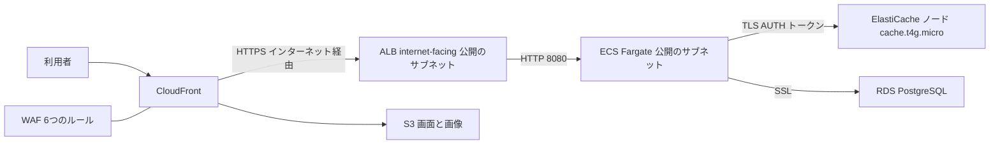
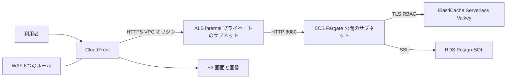
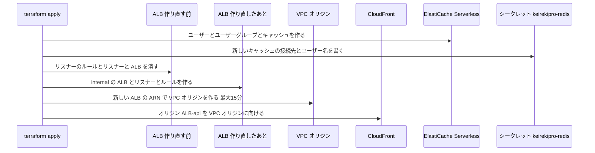
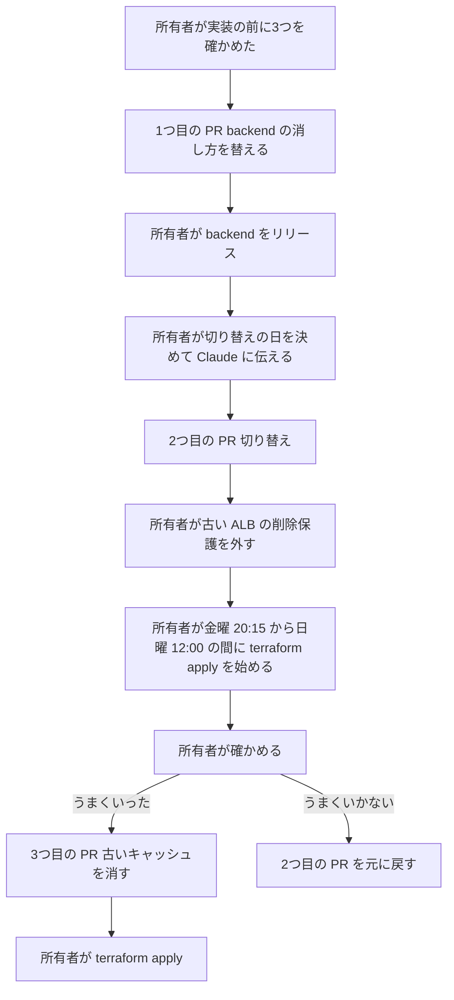

# 設計

## 概要

この設計は、本番環境の AWS の月額の利用料金を、税込で1万円未満に下げる。料金を下げるために、この設計は本番環境の2か所を変える。1つ目に、この設計は、インターネットに向いた ALB を、VPC の中からだけ届く ALB(internal の ALB)に作り直し、CloudFront から VPC オリジンでつなぐ。VPC オリジンとは、CloudFront が VPC の中の ALB に、インターネットを通らずにつなぐ仕組みである。これで、ALB が持つ2つの公開の IPv4 アドレスの料金が無くなる。この料金は、月 $7.44 である。2つ目に、この設計は、毎日24時間動くキャッシュのノードを、使った分だけ課金される ElastiCache Serverless for Valkey に替える。今のノードは ElastiCache の cache.t4g.micro で、月 $14.88 かかる。ElastiCache Serverless for Valkey の見積もりは、月 $7.52 である。

この設計は、アプリの稼働時間と、DB と backend の起動と停止の予定を変えない。WAF は今と同じく CloudFront に付いたままで、キャッシュの通信の暗号化とパスワードの認証も続く。

キャッシュを ElastiCache Serverless に替えると、backend は、キャッシュにクラスターの形でつなぎ、ユーザー名とパスワードで認証する必要がある。クラスターの形とは、キャッシュがキーを複数の置き場所に分けて持ち、backend がキーごとに置き場所を選んでつなぐ形である。この設計は、そのための接続の設定を、Secrets Manager のシークレット `keirekipro/redis` のキーで backend に渡す。backend のコードで変えるのは、OIDC のログインの途中の情報を消す1か所だけである。この設計は、変更を3つの PR に分けて本番に入れる。

## 作るものと作らないもの

### 作るもの

- `terraform/modules/alb/` の ALB を、同じ資源の名前(`aws_lb.main`)のまま internal に作り直し、プライベートのサブネットに置く変更
- `terraform/modules/cloudfront/` の VPC オリジン(`aws_cloudfront_vpc_origin`)と、API のオリジンを VPC オリジンに向ける変更
- `terraform/modules/elasticache/` の ElastiCache Serverless for Valkey と、RBAC のユーザーとユーザーグループ。RBAC とは、ユーザー名とパスワードでキャッシュの利用者を見分ける認証のしかたである
- `terraform/modules/vpc/` の、キャッシュの口 6379 と 6380 を通すセキュリティグループのルール
- `terraform/main.tf` の、シークレット `keirekipro/redis` のキーと、モジュールへの渡し方の変更
- `terraform/modules/cloudwatch/` の、キャッシュのメモリのアラームとダッシュボードの変更
- backend の `RedisOidcAuthorizationSessionStore.remove` が、3つのキーを1つずつ消す変更と、そのテスト
- 古いキャッシュの資源の片付け(3つ目の PR)
- この design.md の月額の見積もりの表と、セキュリティの対策と異常のメールの表
- 3つの PR の本文の「マージのあとにすること」に書く、所有者の確認の手順と元に戻す手順
- `doc/インフラ設計` の設計書と本番環境の構成図の更新

### 作らないもの

- アプリの稼働時間の変更と、DB と backend の起動と停止の予定の変更
- メンテ画面の時間外の案内の変更
- WAF の6つのルールの変更。この設計は、`terraform/modules/waf/` のファイルを変えない
- シークレットを1つにまとめる変更と、Fargate のメモリを減らす変更。この設計は、この2つの変更を、判定の月に1万円を超えたときに Claude が所有者に示す候補として残す
- ECS のタスクの置き場所(公開のサブネット)と、タスクの公開の IPv4 アドレスの変更
- backend を Lambda Web Functions に移すことと、Python と Django に移すこと
- `application-prod.yaml` の変更
- checkov が失敗にしないように今ある指摘を登録した一覧(`terraform/.checkov.baseline`)、`terraform/.checkov.yaml`、`.github/` の変更
- ALB の削除保護(`enable_deletion_protection = true`)の変更

## 使う既存の仕組み

- CloudFront のディストリビューションと、それに付いた WAF の Web ACL(`terraform/modules/waf/`)。この設計は、Web ACL の付け方(`web_acl_id`)を変えない
- ALB のセキュリティグループ `keirekipro-alb-sg` の、CloudFront のオリジン向けのプレフィックスリスト `com.amazonaws.global.cloudfront.origin-facing` から 443 を許すルール。VPC オリジンの公式文書は、このプレフィックスリストを許す形を、ALB に届く通信の許し方の1つとして挙げている
- ALB のリスナーの、ヘッダー `X-Origin-Verify` と経路 `/api/*` がそろったときだけ backend に渡すルール
- ターゲットグループ `aws_lb_target_group.backend` と、それにつながる ECS のサービス `keirekipro-backend-service`
- Secrets Manager のシークレット `keirekipro/redis` と、パスワードの値 `random_password.redis`。`random_password.redis` は `terraform/modules/secrets-manager/main.tf` にあり、英数字32文字の値を作る
- backend の Spring Cloud AWS による、シークレットの JSON のキーを設定の名前として読む仕組み(`application-prod.yaml` の `spring.config.import`)
- CloudWatch の SNS のトピック `aws_sns_topic.alerts` と、所有者のメールの宛先
- GitHub Actions のワークフロー `terraform-apply.yaml` と `release.yaml`。所有者は、2つのワークフローを起動する。`terraform-apply.yaml` では、所有者は production environment で承認もする

依存の向きは、`terraform/main.tf` が各モジュールの出力を別のモジュールに渡す形のまま変えない。CloudFront のモジュールは ALB のモジュールの出力 `alb_arn` を受け取り、ALB のモジュールは CloudFront のモジュールを参照しない。

## 設計を見直すきっかけ

- 切り替えの apply が、アベイラビリティーゾーン、Valkey の版、terraform apply のロールの権限のどれかのために失敗したとき。所有者は、2026-10-24 にこの3つを確かめた。この設計がこの失敗を見直すきっかけにするのは、apply までに、AWS がサービスを提供する範囲や、ロールの設定が変わることがあるためである
- Spring Cloud AWS が、点を含むシークレットのキーを設定の名前として読まないと分かったとき。Claude は、backend をクラスターの形につなぐ設定の渡し方を、所有者と決め直す
- 判定の月の請求に154を掛けた額が10,000円以上になったとき
- AWS が、ElastiCache Serverless の保存量の最低の課金、公開の IPv4 アドレスの料金、ALB の料金を変えたとき
- backend を Lambda Web Functions に移す spec を始めたとき。ALB とキャッシュの扱いが変わる

## プロジェクトの決まりを守っているか

- backend のコードを置く層: 変えるのは `infrastructure/store/auth/` の既存のクラス `RedisOidcAuthorizationSessionStore` の中身だけで、クラスの追加と、パッケージの依存の向きの変更は無い。ArchUnit のルールに当たる変更は無い
- 新しいライブラリの追加: ライブラリを足さない。この設計は、Terraform の AWS provider を今の 5.100.0 のままにする。`aws_cloudfront_vpc_origin` は、AWS provider の 5.82 以降で使える。`aws_elasticache_serverless_cache` は、AWS provider の 5.100.0 で使える。backend のビルドスクリプトと `libs.versions.toml` は変えない
- 品質チェックの設定: `.github/`、`terraform/.checkov.yaml`、`terraform/.checkov.baseline` を変えない。checkov は、見つけた指摘を、`terraform/.checkov.baseline` に登録した指摘と、ファイルと資源の名前の組で照らし合わせる。そのため、この設計は、ALB(`module.alb.aws_lb.main`)とターゲットグループ(`module.alb.aws_lb_target_group.backend`)の資源の名前を変えない。新しく足す資源の種類(`aws_cloudfront_vpc_origin` `aws_elasticache_serverless_cache` `aws_elasticache_user` `aws_elasticache_user_group`)には、checkov 3.3.29 の検査が無い。ALB の削除保護は Terraform のコードで外さない。外すと、checkov の CKV_AWS_150(ロードバランサーの削除保護)が、`terraform/.checkov.baseline` に登録されていない指摘を出し、品質チェックが失敗するためである
- 使う外部の機能がこのリポジトリで使えるか: 次の3つは、Claude がこのリポジトリの材料から確かめられない。そのため、所有者が 2026-10-24 に AWS のコマンドで確かめた。コマンドは移行の節の「実装の前に所有者が確かめたこと」にあり、出力は `research.md` にある
  - VPC オリジンは、アベイラビリティーゾーンの ID が apne1-az3 のゾーンでは使えない。このアカウントでは、ap-northeast-1a が apne1-az4、ap-northeast-1c が apne1-az1 なので、今のサブネットのゾーンで使える
  - 東京リージョンで、ElastiCache Serverless の Valkey の 8.0 から 8.2 を選べる
  - terraform apply に使うロール `keirekipro-github-actions-role` は、VPC オリジン、サービスにリンクされたロール、ElastiCache Serverless、ALB を作る9つの操作を、どれも許されている
- Claude は、2026-10-24 に、次の2つを公式文書で確かめた
  - ElastiCache Serverless は、Spring Boot がクラスターの形のキャッシュの死活の確認に送る `CLUSTER INFO` を受け付ける(https://docs.aws.amazon.com/AmazonElastiCache/latest/dg/SupportedCommands.html)
  - Spring Cloud AWS は、JSON のシークレットの最上位のキーを、すべて設定の名前として Spring の環境に足す(https://docs.awspring.io/spring-cloud-aws/docs/3.4.0/reference/html/index.html の「Using Key-Value (JSON) Secrets」)。ただし、この文書には、点を含むキーの例が無い
- 関係のない項目: frontend の機能ごとの境界、frontend の状態の持ち方、データベースの表の形

## 全体の構成

今の構成:

変更のあとの構成:

この設計は、ALB を残したまま internal にする構成を選ぶ。1つ目の理由は、ALB を API Gateway に置き換えると、WAF を付けられない経路ができることである。2つ目の理由は、CloudFront の定額のプランの無料の版では、WAF のルールが5つまでに減ることである。ALB を internal にすると、インターネットから ALB に届く経路が無くなり、CloudFront の VPC オリジンだけが ALB に届く。

この設計は、ALB を別の資源として足して切り替えるのではなく、同じ資源の名前のまま作り直す。別の資源の名前で足すと、`terraform/.checkov.baseline` に登録した指摘が新しい資源に当てはまらず、品質チェックが失敗する。また、ターゲットグループは同時に1つのロードバランサーにしかつなげないので、並べる間は新しいターゲットグループと ECS のサービスのつなぎ先の変更も要る。同じ資源の名前のまま作り直すと、ターゲットグループと ECS のサービスを変えずに済む。その代わり、作り直しの間は、要求が API に届かない。作り直しには、数分から15分ほどかかる。そのため、所有者は、アプリの稼働時間の外に本番に入れる。

キャッシュは、ElastiCache Serverless for Valkey に替える。この設計は、キャッシュを DynamoDB か RDS に替える案を採らない。どちらの案も、backend のストア5つの作り直しになるためである。RDS に替える案は、RDS が夜と週末に止まるためにも採らない。ElastiCache Serverless は、通信の暗号化(TLS)と保存の暗号化が常に有効で、RBAC のパスワードで認証する。パスワードには今の AUTH トークンと同じ値を使うので、シークレットを足さずに済む。

**使う技術**:
- CDN: CloudFront。VPC オリジン(`aws_cloudfront_vpc_origin`)で internal の ALB に HTTPS でつなぐ
- ロードバランサー: Application Load Balancer(internal)。TLS の終端と、ヘッダーと経路による振り分けを受け持つ
- キャッシュ: ElastiCache Serverless for Valkey の主な版 8。ログインの状態と、パスワードの再設定と二段階認証と OIDC の途中の情報を置く
- サーバー: Spring Boot と Spring Data Redis(Lettuce)。キャッシュにクラスターの形でつなぐ
- 実行環境の定義: Terraform 1.x と AWS provider 5.100.0

## ファイルの構成

Claude が新しく作るファイル(1つ目の PR):

- `backend/src/test/java/com/example/keirekipro/unit/infrastructure/config/SecretsManagerDottedKeyTest.java`: Spring Cloud AWS の Secrets Manager の設定の読み込みに、`spring.data.redis.cluster.nodes` と `spring.data.redis.username` のキーを持つ JSON を渡し、2つのキーがその名前の設定として読まれることを確かめる。Secrets Manager への問い合わせは、テストの中の偽物で置き換える

Claude が変えるファイル(1つ目の PR。backend だけを変える):

- `backend/src/main/java/com/example/keirekipro/infrastructure/store/auth/RedisOidcAuthorizationSessionStore.java`: `remove` を、3つのキーを1つずつ消す形にする
- `backend/src/test/java/com/example/keirekipro/unit/infrastructure/store/auth/RedisOidcAuthorizationSessionStoreTest.java`: 消したあとに3つのキーがどれも残っていないことを確かめる

Claude が変えるファイル(2つ目の PR):

- `terraform/modules/alb/main.tf`: `aws_lb.main` を `internal = true` にし、`subnets` を変数 `subnet_ids` にする
- `terraform/modules/alb/variables.tf`: 変数 `public_subnet_ids` を `subnet_ids` に改める
- `terraform/modules/cloudfront/main.tf`: `aws_cloudfront_vpc_origin` を足し、オリジン `ALB-api` の `custom_origin_config` を `vpc_origin_config` に替える
- `terraform/modules/cloudfront/variables.tf`: 変数 `alb_arn` を足す
- `terraform/modules/elasticache/main.tf`: `aws_elasticache_serverless_cache` `aws_elasticache_user` `aws_elasticache_user_group` を足す。古い `aws_elasticache_replication_group.main` とその付属の資源は残す
- `terraform/modules/elasticache/variables.tf`: 変数 `app_user_password` を足す
- `terraform/modules/elasticache/outputs.tf`: 出力 `endpoint` `port` `cluster_id` を ElastiCache Serverless に向け、出力 `username` を足す
- `terraform/modules/vpc/main.tf`: `redis_ingress_ecs` と `ecs_egress_redis` の口を 6379〜6380 にする
- `terraform/modules/cloudwatch/main.tf`: アラーム `redis_memory_high` と、ダッシュボードのキャッシュの2つの図を、ElastiCache Serverless の指標にする
- `terraform/main.tf`: ALB のモジュールにプライベートのサブネットを渡し、CloudFront のモジュールに `alb_arn` を渡し、ElastiCache のモジュールに `app_user_password` を渡し、シークレット `keirekipro/redis` のキーを変える
- `doc/インフラ設計/AWS設計/ALB設計.md` `CloudFront設計.md` `CloudWatch設計.md` `ElastiCache Redis設計.md` `VPCネットワーク設計.md` `Route 53・ACM設計.md` `Secrets Manager設計.md`、`doc/インフラ設計/Terraform設計/バックエンド・モジュール設計.md`、`doc/インフラ設計/構成図/本番環境構成/本番環境構成図.drawio.svg`: 変更のあとの本番環境に合わせる

Claude が変えるファイル(3つ目の PR):

- `terraform/modules/elasticache/main.tf`: `aws_elasticache_replication_group.main` `aws_elasticache_parameter_group.main` `aws_elasticache_subnet_group.main` を消す
- `terraform/modules/elasticache/variables.tf`: 変数 `auth_token` を消す
- `terraform/main.tf`: ElastiCache のモジュールに `auth_token` を渡す行を消す

ファイルを作らないもの:

- 月額の見積もりと、セキュリティの対策と異常のメールの表は、この design.md(`.kiro/specs/aws-monthly-cost-reduction/design.md`)に置く
- 3つの PR の本文は、Claude が `/ship` で書く。リポジトリのファイルにはしない

## 処理の流れ

2つ目の PR の terraform apply で、資源は次の順に変わる。

- terraform は、`aws_lb.main` の `internal` が変わると、資源を作り直す。terraform は、既定のとおり、古い ALB を消してから新しい ALB を作る。古い ALB を消してから CloudFront のオリジンが VPC オリジンに向くまでの間、API は 502 か 504 を返す
- terraform は、ElastiCache Serverless とシークレットの変更を、ALB の作り直しと同時に進める。ElastiCache Serverless とシークレットの変更と、ALB の作り直しの間には、順番の決まりが無いためである
- backend は、起動したときにシークレットを読む。週末は backend が止まっているので、backend は、月曜の 8:00 に起動したときに新しいシークレットを読み、ElastiCache Serverless につなぐ

## 部品

### ALB(terraform/modules/alb の aws_lb.main)

対応する要件: 3.3, 3.5, 3.9, 4.1, 4.4

**役割**: ALB は、CloudFront の VPC オリジンから HTTPS で届いた要求のうち、ヘッダー `X-Origin-Verify` の値が合い、経路が `/api/*` のものだけを、ターゲットグループ `keirekipro-backend-tg` に渡す。ALB は、それ以外の要求に 403 を返す。この振り分けは今と同じで、この設計は変えない。この設計が変えるのは、ALB をインターネットから届かない形にすることだけである。

**設定の値**:
- 資源の名前は `aws_lb.main`、ALB の名前は `keirekipro-alb` のままにする
- `internal = true` にする。`subnets` には、プライベートのサブネット2つ(10.0.11.0/24 と 10.0.12.0/24。ゾーンは ap-northeast-1a と ap-northeast-1c)を、`terraform/main.tf` から `module.vpc.private_subnet_ids` で渡す
- セキュリティグループ、アクセスログ(接頭辞 `alb`)、HTTPS のリスナー(`ELBSecurityPolicy-TLS13-1-2-2021-06`、api の証明書と app の証明書)、リスナーのルールは、今のまま残す。ターゲットグループ `aws_lb_target_group.backend`(口 8080、HTTP)も変えない
- `enable_deletion_protection = true` は変えない

**使う部品**: ALB のモジュールの出力(`alb_arn` `alb_dns_name` `alb_zone_id` `alb_arn_suffix`)は、作り直したあとの ALB を指す。Route 53 の `api.keirekipro.click` のエイリアスのレコード、CloudWatch の ALB の2つのアラーム、ダッシュボードは、出力を通して新しい ALB に向く。Route 53 のレコードは、作り直したあとは ALB のプライベートの IP アドレスを返す。この設計は、このレコードを残す。CloudFront のオリジンのドメインの欄と ALB の証明書の名前を合わせるためである。

**失敗したとき**: ALB の作り直しが途中で失敗したら、API に届かないまま止まる。

### VPC オリジン(terraform/modules/cloudfront の aws_cloudfront_vpc_origin)

対応する要件: 3.1, 3.3, 3.5, 3.9

**役割**: VPC オリジンは、CloudFront から internal の ALB への、インターネットを通らない経路を作る。WAF は今と同じく CloudFront のディストリビューションに付いているので、ALB に届く要求は、どれも WAF を通ったものである。VPC オリジンは、要求を選ばない。要求を選ぶのは WAF と ALB のリスナーのルールである。

**設定の値**:
- `aws_cloudfront_vpc_origin` の `vpc_origin_endpoint_config`: `name = "keirekipro-alb-vpc-origin"`、`arn = var.alb_arn`、`http_port = 80`、`https_port = 443`、`origin_protocol_policy = "https-only"`、`origin_ssl_protocols { items = ["TLSv1.2"], quantity = 1 }`
- ディストリビューションのオリジン `ALB-api`: `custom_origin_config` を消し、`vpc_origin_config { vpc_origin_id = aws_cloudfront_vpc_origin.alb.id, origin_keepalive_timeout = 5, origin_read_timeout = 30 }` にする。`domain_name = var.api_domain_name`(`api.keirekipro.click`)と、`custom_header` の `X-Origin-Verify` は今のまま残す
- 変数 `alb_arn` を足し、`terraform/main.tf` から `module.alb.alb_arn` を渡す
- ディストリビューションの `web_acl_id` は変えない

**権限**: VPC オリジンを作ると、CloudFront はサービスにリンクされたロールと、管理されたセキュリティグループ `CloudFront-VPCOrigins-Service-SG` を作る。そのため、terraform apply のロールには、`cloudfront:CreateVpcOrigin` と `iam:CreateServiceLinkedRole` の権限が要る。

**失敗したとき**: VPC オリジンの作成には最大15分かかる。terraform が既定の待ち時間の中で VPC オリジンを作れなかったときは、apply が失敗する。そのとき、ディストリビューションは今のオリジンを指したまま残る。

### セキュリティグループ(terraform/modules/vpc)

対応する要件: 3.5, 3.6

**役割**: セキュリティグループは、ALB とキャッシュに届く通信を、今と同じ相手に限る。

**設定の値**:
- ALB のセキュリティグループ `keirekipro-alb-sg` のルールは変えない。443 を CloudFront のオリジン向けのプレフィックスリストからだけ許し、ECS のタスクの口 8080 にだけ送る
- キャッシュのセキュリティグループ `keirekipro-redis-sg` のルール `redis_ingress_ecs` を、口 6379〜6380 にする。ElastiCache Serverless は、書き込みと読み取りに 6379、読み取り専用に 6380 を使う。許す相手は、今と同じく ECS のセキュリティグループだけである
- ECS のセキュリティグループのルール `ecs_egress_redis` を、口 6379〜6380 にする
- RDS のセキュリティグループは変えない

**失敗したとき**: terraform は、口を変えたルールを作り直す。作り直しの間は、backend の通信がキャッシュに届かない。ただし、週末は backend が止まっているので、通信が届かなくても利用者には影響しない。

### ElastiCache Serverless(terraform/modules/elasticache)

対応する要件: 3.3, 3.4, 3.6, 3.8, 4.2

**役割**: ElastiCache Serverless は、backend のログインの状態と、パスワードの再設定と二段階認証と OIDC の途中の情報を置く。ElastiCache Serverless は、RBAC のユーザー `keirekipro-app` のパスワードを知っている接続からの読み書きだけを受け付ける。ElastiCache Serverless は、データを残さない。スナップショットを作らないので、キャッシュの中身は、作り直すと消える。

**設定の値**:
- `aws_elasticache_user.app`: `user_id = "keirekipro-app"`、`user_name = "keirekipro-app"`、`engine = "valkey"`、`access_string = "on ~* &* +@all"`、`authentication_mode { type = "password", passwords = [var.app_user_password] }`
- `aws_elasticache_user_group.app`: `user_group_id = "keirekipro-app"`、`engine = "valkey"`、`user_ids = [aws_elasticache_user.app.user_id]`。Valkey のユーザーグループには default のユーザーを入れない
- `aws_elasticache_serverless_cache.main`: `name = "keirekipro-cache"`、`engine = "valkey"`、`major_engine_version = "8"`、`subnet_ids = var.private_subnet_ids`(2つ)、`security_group_ids = [var.security_group_id]`、`user_group_id = aws_elasticache_user_group.app.user_group_id`
- `cache_usage_limits`: `data_storage { maximum = 1, unit = "GB" }`、`ecpu_per_second { maximum = 1000 }`。最低の使用量は決めない。最低の使用量を決めると、使わなくてもその分が課金されるためである
- 保存の暗号化には、AWS が持つ鍵を使う。`kms_key_id` を書かない
- 変数 `app_user_password` には、`terraform/main.tf` から `module.secrets_manager.redis_password`(今の AUTH トークンと同じ値)を渡す
- 出力: `endpoint` は `aws_elasticache_serverless_cache.main.endpoint[0].address`、`port` は `endpoint[0].port`、`cluster_id` は `name`、`username` は `aws_elasticache_user.app.user_name`
- 2つ目の PR では、古い `aws_elasticache_replication_group.main` とその付属の資源と変数 `auth_token` を残す。3つ目の PR で消す

**状態の持ち方**: キャッシュの中身は、ノードの形のキャッシュから移さない。ノードの形から ElastiCache Serverless へ、データをそのまま移す方法が無いためである。切り替えたあとは、空のキャッシュから始まる。

**失敗したとき**: 保存量が上限の 1GB に達すると、ElastiCache Serverless は期限付きのキーから追い出す。backend のキーはどれも期限付きなので、書き込みが止まることは無い。要求が毎秒 1000 ECPU を超えると、ElastiCache Serverless は要求を絞る。ECPU とは、ElastiCache Serverless が、読み書きの命令に使った処理の量を数える単位である。今の利用はこの上限よりずっと少ない。

### シークレット keirekipro/redis(terraform/main.tf の aws_secretsmanager_secret_version.redis)

対応する要件: 3.7

**役割**: シークレットは、backend がキャッシュにつなぐための接続先とユーザー名とパスワードを持つ。この設計は、シークレットの数と、シークレットを読める役割(ECS のタスクの実行のロール)を変えない。Secrets Manager は、今と同じく、シークレットを既定の鍵で暗号化して保存する。

**呼び出し方**: シークレットの JSON は、次の5つのキーを持つ。

| キー | 値 |
|---|---|
| `redis-host` | ElastiCache Serverless の接続先の名前 |
| `redis-port` | ElastiCache Serverless の口(6379) |
| `redis-password` | 今と同じパスワード |
| `spring.data.redis.cluster.nodes` | 接続先の名前と口を `:` でつないだ1つの値 |
| `spring.data.redis.username` | `keirekipro-app` |

- Spring Boot は、`spring.data.redis.cluster.nodes` があると、`host` と `port` より優先してクラスターの形でつなぐ。この設計は、`host` `port` `password` と `ssl.enabled: true` を持つ `application-prod.yaml` を変えない
- `spring.data.redis.cluster.nodes` と `spring.data.redis.username` のキーが無い古いシークレットを読んだ backend は、今までどおり1台の形でつなぐ。そのため、元に戻すときに backend を作り直さずに済む

**失敗したとき**: Spring Cloud AWS が点を含むキーを設定の名前として読まないと、backend は1台の形で ElastiCache Serverless につなごうとする。このとき、backend はユーザー名を ElastiCache Serverless に渡せないので、認証に失敗する。1つ目の PR のテスト `SecretsManagerDottedKeyTest` が通らなければ、Claude は2つ目の PR を作らず、設定の渡し方を所有者と決め直す。

### OIDC のログインの途中の情報のストア(backend の RedisOidcAuthorizationSessionStore)

対応する要件: 4.1, 4.2

**役割**: このストアは、OIDC のログインの途中の情報(state、プロバイダー、PKCE の code_verifier)を、キャッシュに10分だけ置く。このストアの `remove(String state)` は、使い終わった3つのキー(`oidc:state:` `oidc:provider:` `oidc:code_verifier:` に state を付けたもの)を消す。

**呼び出し方**: `remove` は、`redisTemplate.delete(List.of(...))` の1回の呼び出しをやめ、`redisTemplate.delete(String)` を3つのキーに1回ずつ呼ぶ。クラスターの形のキャッシュは、キーの名前からスロットを決め、キーをスロットごとに分けて置く。スロットとは、キーの置き場所の区分である。そのため、3つのキーが別々のスロットに入りうる。1回の命令で別々のスロットのキーを消すと、キャッシュは `CROSSSLOT` のエラーを返す。`remove` が1つずつ消すのは、このエラーを避けるためである。1つずつ消す形は、1台の形のキャッシュでも同じに動く。そのため、Claude は、この変更を1つ目の PR に入れる。所有者は、1つ目の PR の変更を、切り替えより先に本番に入れる。`remove` の引数と戻り値と、ほかのメソッドは変えない。ほかの4つのストアの操作は、どれも1つのキーだけを扱うので変えない。

**失敗したとき**: 3つのうち途中のキーを消すときに失敗しても、残ったキーは10分で期限が切れて消える。`remove` は失敗を握りつぶさず、今と同じく例外を呼び出し元に返す。

### キャッシュのメモリのアラーム(terraform/modules/cloudwatch)

対応する要件: 5.1, 5.2

**役割**: アラーム `keirekipro-redis-memory-high` は、キャッシュが使っているメモリが多いときに、SNS のトピック `aws_sns_topic.alerts` を通して所有者にメールを送る。ElastiCache Serverless には、今のアラームが見ている指標 `DatabaseMemoryUsagePercentage`(ノードの最大メモリに対する割合)が無い。そのため、このアラームは、代わりに、使っているバイト数の指標 `BytesUsedForCache` を見る。

**設定の値**:
- `metric_name = "BytesUsedForCache"`、`namespace = "AWS/ElastiCache"`、`dimensions = { clusterId = var.redis_cluster_id }`、`threshold = 300000000`(300MB)
- `comparison_operator`、`evaluation_periods = 2`、`period = 300`、`statistic = "Average"`、`treat_missing_data = "missing"`、`alarm_actions` は今と同じにする
- ダッシュボードのキャッシュの2つの図は、`BytesUsedForCache` と `CurrConnections` を、次元 `clusterId` で描く。メモリの図の縦軸の上限(100)は外す
- ほかの8つのアラームは変えない。アラームの数は9つのままで、無料で使える10個の範囲に収まる

**閾値を 300MB にした理由**: 今のアラームは、cache.t4g.micro の最大メモリである約0.5GiB から、予約分の25%を除いた量の80%で鳴る。予約分の数え方によって、今のアラームが鳴るのは約322MB から約429MB の間である。300MB はそのどれよりも小さいので、新しいアラームは、同じ量のメモリを使ったときに今より遅く鳴ることはない。期間と評価の回数は同じなので、異常が起きてからメールを送るまでの時間も今より長くならない。300MB は保存量の上限 1GB より十分小さいので、上限に近づく前に所有者に知らせられる。

**失敗したとき**: 指標のデータが来ないとき、アラームは今と同じく状態を変えない(`missing`)。

### 月額の見積もり(この design.md の見積もりの表)

対応する要件: 1.1, 1.2, 1.3, 1.4, 2.1, 2.2, 2.3, 2.4, 2.5

**役割**: 見積もりの表(下の「月額の見積もり」の節)は、料金を下げる変更のあとの AWS の月額を、サービスごとに示す。見積もりは、アプリの稼働時間を今のままにした場合のものである。見積もりの節の税込の合計に154を掛けた額が10,000円未満なので、この設計はアプリの稼働時間を短くしない。アプリの稼働時間を変えないので、本番環境の起動の時刻とメンテ画面の案内も変わらない。

**判定の月の請求と比べるとき**: Claude は、内訳を見積もりと比べるときに、サービスごとの額を見積もりの表の同じ行と比べ、上回った額をドルで示す。合計に154を掛けた額が10,000円以上なら、Claude は、あわせて、シークレットを1つにまとめる案と、Fargate のメモリを 2GB から 1GB に減らす案を示す。シークレットを1つにまとめる案は、月に約 $1.60、約270円を減らす。Fargate のメモリを減らす案は、月に約 $1.22、約200円を減らす。

### セキュリティの対策と異常のメールの表(この design.md の安全の節)

対応する要件: 3.2, 7.1

**役割**: この設計は、安全の節に、セキュリティの対策の表と異常のメールの表の2つを置く。この設計は、GuardDuty に触れない。

### 3つの PR の本文(マージのあとにすること)

対応する要件: 3.9, 4.2, 4.3, 4.4, 4.5, 6.1, 6.2, 7.2

**役割**: Claude は、3つの PR の本文の「マージのあとにすること」に、所有者が打つコマンドと、うまくいったかの見分け方を書く。中身は移行の節のとおりである。Claude は、2つ目の PR の本文に、確認の手順と、元に戻す手順と、WAF の6つのルールの設定を変えていないことと、`terraform/modules/waf/` のファイルを変えていないことを書く。

### 設計書(doc/インフラ設計)

対応する要件: 8.1

**役割**: Claude は、2つ目の PR で、設計書と構成図を変更のあとの本番環境に合わせる。直す中身は次のとおりである。

- `ALB設計.md`: ALB が internal であることと、ALB をプライベートのサブネットに置くことと、ALB に VPC オリジンからつなぐこと
- `CloudFront設計.md`: API のオリジンが VPC オリジンを使うこと
- `ElastiCache Redis設計.md`: キャッシュが ElastiCache Serverless であること。あわせて、RBAC のユーザー、使用量の上限、使う口の 6379 と 6380、保存の暗号化のそれぞれを、変更のあとの設定に直す
- `CloudWatch設計.md`: キャッシュのメモリのアラームの指標と閾値、ダッシュボードの図
- `VPCネットワーク設計.md`: ALB の置き場所と、キャッシュのセキュリティグループの口
- `Route 53・ACM設計.md`: `api.keirekipro.click` のレコードがプライベートの IP アドレスを返すこと
- `Secrets Manager設計.md`: シークレット `keirekipro/redis` のキー
- `バックエンド・モジュール設計.md`: ALB と CloudFront と ElastiCache のモジュールの変数と出力
- `本番環境構成図.drawio.svg`: ALB の置き場所とキャッシュの種類

設計書は、3つ目の PR まで終えたあとの状態(古いキャッシュが無い状態)を書く。

## データの形

この設計は、DB の表の形を変えない。キャッシュのキーの組み立て方と有効期限も変えない。変わるのは、シークレット `keirekipro/redis` の JSON のキーだけで、その形は「シークレット keirekipro/redis」の部品の節に書いた。

キャッシュの中身は、切り替えのときに消える。消えるのは、ログインの状態と、パスワードの再設定の印と、二段階認証のコードと、OIDC の途中の情報である。ログインの状態の有効期限は7日で、ほかの3つの有効期限はどれも10分である。アカウントと職務経歴書は RDS にあり、画像は S3 にある。この設計は、RDS と S3 に触れない。

## 月額の見積もり

見積もりは、料金が最も高くなる月で出す。料金が最も高くなる月とは、31日、つまり744時間あり、そのうち平日が23日ある月である。backend は平日に12時間ずつ動き、この月に合わせて276時間動く。DB は平日に12.25時間ずつ動き、この月に合わせて281.75時間動く。

| サービス | 月額(ドル) | 出し方 |
|---|---|---|
| ALB | 18.10 | 時間 $0.0243 × 744 と LCU |
| Fargate の公開の IPv4 | 1.38 | $0.005 × 276 |
| ElastiCache Serverless | 7.52 | 0.1GB × $0.101 × 744 と ECPU |
| WAF | 11.01 | Web ACL $5、ルール6つ $6、要求 |
| RDS のインスタンス | 7.04 | $0.025 × 281.75 |
| RDS の gp3 | 2.76 | 20GB × $0.138 |
| RDS のバックアップ | 1.00 | 9月の実績 $0.69 に余裕を足した額 |
| Fargate | 5.23 | ($0.04045 × 0.25 + $0.00442 × 2) × 276 |
| Secrets Manager | 2.41 | 6つ × $0.40 と API の呼び出し |
| GuardDuty | 1.35 | 9月の実績 |
| Route 53 | 0.51 | ホストゾーン $0.50 と問い合わせ |
| ECR | 0.11 | 9月の実績 |
| S3 | 0.12 | 9月の実績 |
| そのほか | 0.02 | 9月の実績 |
| 税抜の合計 | 58.56 | |
| 税込の合計 | 64.42 | 消費税 10% |

- 税込の合計に154を掛けると約9,920円で、10,000円より約80円少ない
- 変える前の構成で同じ月を見積もると、税込 $80.70、約12,430円になる。変える前の構成では、ALB の公開の IPv4 の $7.44 とキャッシュのノードの $14.88 が加わり、ElastiCache Serverless の $7.52 が無くなるためである
- CloudFront、SES、SQS、SNS、CloudWatch は、2026年9月の請求で料金が出ていないので、0とした
- 「9月の実績」は、所有者が貼った2026年9月の請求の内訳の額である

単価の出どころは次のとおりである。Claude は、どの単価も 2026-10-24 に確かめた。

| 単価 | 出どころ |
|---|---|
| ALB の時間と LCU | https://pricing.us-east-1.amazonaws.com/offers/v1.0/aws/AWSELB/current/ap-northeast-1/index.json |
| 公開の IPv4 | https://pricing.us-east-1.amazonaws.com/offers/v1.0/aws/AmazonVPC/current/ap-northeast-1/index.json |
| ElastiCache Serverless の保存量と ECPU | https://pricing.us-east-1.amazonaws.com/offers/v1.0/aws/AmazonElastiCache/current/ap-northeast-1/index.json |
| ElastiCache Serverless の最低の課金 100MB | https://aws.amazon.com/elasticache/pricing/ |
| RDS のインスタンスと gp3 | https://pricing.us-east-1.amazonaws.com/offers/v1.0/aws/AmazonRDS/current/ap-northeast-1/index.json |
| RDS のバックアップ | https://aws.amazon.com/rds/postgresql/pricing/ |
| Fargate | https://pricing.us-east-1.amazonaws.com/offers/v1.0/aws/AmazonECS/current/ap-northeast-1/index.json |
| WAF | https://pricing.us-east-1.amazonaws.com/offers/v1.0/aws/awswaf/current/index.json |
| Secrets Manager | https://pricing.us-east-1.amazonaws.com/offers/v1.0/aws/AWSSecretsManager/current/ap-northeast-1/index.json |
| Route 53 | https://pricing.us-east-1.amazonaws.com/offers/v1.0/aws/AmazonRoute53/current/index.json |
| CloudWatch のアラーム | https://aws.amazon.com/cloudwatch/pricing/ |
| 日本の消費税 | https://aws.amazon.com/tax-help/japan/ |

## 失敗したときの扱い

- 2つ目の PR の terraform apply が途中で失敗したとき: 所有者は、失敗した apply の出力を Claude に貼る。資源が途中まで変わっていても、古いキャッシュは残っている。そのため、所有者は、移行の節の元に戻す手順で、本番環境を2つ目の PR の前の状態に戻せる
- apply のあとに backend がキャッシュにつなげないとき: backend の死活の確認(`/actuator/health`)が失敗する。すると、ALB は backend を振り分けの先から外し、API は 502 か 503 を返す。CloudWatch のアラーム `keirekipro-alb-unhealthy` が所有者にメールを送る。所有者は、移行の節の確認の手順を進めるときに、backend がキャッシュにつなげないことに気づき、本番環境を元に戻す
- 切り替えのあとにキャッシュのメモリが増えたとき: アラーム `keirekipro-redis-memory-high` が 300MB でメールを送る
- backend の失敗の追跡は今と同じく CloudWatch Logs のロググループ `/ecs/keirekipro-backend` で行う。この設計はログの仕組みを変えない

## テストの方針

- 単体テスト: `RedisOidcAuthorizationSessionStoreTest` の削除のテスト(`test3`)で、`remove` のあとに `find` が空を返すことに加え、3つのキー(`oidc:state:` `oidc:provider:` `oidc:code_verifier:` に state を付けたもの)がどれもキャッシュに残っていないことを確かめる。開発環境のキャッシュは1台の形なので、クラスターの形での `CROSSSLOT` の起きないことは、このテストでは確かめられない。所有者は、2つ目の PR のあとの確認で Google のログインを通し、クラスターの形での動きを確かめる
- 単体テスト: `SecretsManagerDottedKeyTest` で、点を含むシークレットのキーが、その名前の設定として読まれることを確かめる
- Terraform の検査: `/verify-terraform`(fmt、validate、tflint、checkov)を、2つ目と3つ目の PR で通す。checkov が `terraform/.checkov.baseline` に登録されていない指摘を出さないことで、ALB とターゲットグループの資源の名前が変わっていないことと、ALB の削除保護が有効のままであることを確かめる
- 差分の読み取り: PR で動く `terraform-plan.yaml` は、本番の状態を読まないので、plan を出さない。plan が出るのは `terraform-apply.yaml` の中だけである。`terraform-apply.yaml` のジョブは、plan を出したあと、すぐに apply する。そのため、Claude も所有者も、apply の前に plan を読めない。Claude は、その代わりに、2つ目の PR の差分で、`aws_lb.main` と `aws_lb_target_group.backend` の資源の名前が変わっていないこと、`terraform/modules/ecs/` と `terraform/modules/waf/` のファイルが変わっていないことを確かめる
- apply のあとの plan の読み取り: Claude は、切り替えの apply のあとに、`gh run view <実行の番号> --log` で `terraform-apply.yaml` のログを読み、plan で `module.alb.aws_lb.main` が作り直しになり、`module.alb.aws_lb_target_group.backend` と `module.ecs.aws_ecs_service.backend` が作り直しにならず、`module.waf` に変更が無かったことを確かめる。これは apply のあとの確認で、apply を止める手段ではない。食い違いがあれば、Claude は所有者に知らせる
- 本番での確認: 所有者が、2つ目の PR の apply のあとに、移行の節の確認の手順で、アプリの機能と、WAF を通らない経路が無いことと、異常のメールが届くことを確かめる

## 安全

セキュリティの対策の表:

| 対策 | 今受け持つ | 変更のあとに受け持つ |
|---|---|---|
| 3.1 WAF の6つのルール | CloudFront に付いた WAF | 同じ(変えない) |
| 3.2 不審な動きの検知 | GuardDuty | 同じ(変えない) |
| 3.3 利用者とアプリの間の暗号化 | CloudFront と ALB の HTTPS | CloudFront の HTTPS と、VPC オリジンから ALB への HTTPS |
| 3.3 backend と DB の間の暗号化 | RDS の SSL | 同じ(変えない) |
| 3.3 backend とキャッシュの間の暗号化 | ElastiCache ノードの TLS | ElastiCache Serverless の TLS(常に有効) |
| 3.4 DB の中身とバックアップの暗号化 | RDS の保存の暗号化 | 同じ(変えない) |
| 3.4 画像の暗号化 | S3 の保存の暗号化 | 同じ(変えない) |
| 3.5 WAF を通らない経路を作らない | インターネット向けの ALB と3つのルール | internal の ALB と同じ3つのルール |
| 3.6 DB に届くのは backend だけ | RDS のセキュリティグループ | 同じ(変えない) |
| 3.6 キャッシュに届くのは backend だけ | キャッシュのセキュリティグループと AUTH トークン | キャッシュのセキュリティグループと RBAC のパスワード |
| 3.7 シークレットの保管 | Secrets Manager と読める役割の限定 | 同じ(シークレットの数も変えない) |
| 3.8 替えたサービスにも同じ対策 | なし | ElastiCache Serverless に TLS、保存の暗号化、RBAC、セキュリティグループ |
| 3.9 切り替えの途中 | なし | CloudFront に付いた WAF |

- WAF を通らない経路を作らない対策は、今は、インターネット向けの ALB と、CloudFront のオリジン向けのプレフィックスリストを許す ALB のセキュリティグループと、ヘッダー `X-Origin-Verify` のルールと、ECS のセキュリティグループが受け持つ。変更のあとは、ALB が公開の IP アドレスを持たない internal の ALB に替わり、ほかの3つは今と同じである
- 切り替えの途中も、WAF は CloudFront に付いたままである。古い ALB を消してから CloudFront のオリジンが VPC オリジンに向くまでの間は、backend に届く経路そのものが無い

異常のメールの表は次のとおりである。どの行の異常のメールも、SNS のトピック `keirekipro-alerts` から同じ宛先に送る。

| 異常 | 今メールを送る | 変更のあとにメールを送る |
|---|---|---|
| backend の CPU | CloudWatch のアラーム `keirekipro-ecs-cpu-high` | 同じ(変えない) |
| backend のメモリ | CloudWatch のアラーム `keirekipro-ecs-memory-high` | 同じ(変えない) |
| backend のエラーの応答 | CloudWatch のアラーム `keirekipro-alb-5xx-high` | 同じ。作り直した ALB を見る |
| backend が応答しない | CloudWatch のアラーム `keirekipro-alb-unhealthy` | 同じ。作り直した ALB を見る |
| DB の CPU | CloudWatch のアラーム `keirekipro-rds-cpu-high` | 同じ(変えない) |
| DB の空き容量 | CloudWatch のアラーム `keirekipro-rds-storage-low` | 同じ(変えない) |
| キャッシュのメモリ | CloudWatch のアラーム `keirekipro-redis-memory-high`(割合) | 同じアラーム(バイト数 `BytesUsedForCache`) |
| DB の朝の起動の失敗と異常 | CloudWatch のアラーム `keirekipro-db-start-failed` と `keirekipro-db-instance-failure` | 同じ(変えない) |

- WAF を通らずに backend に届く経路が無いかを見ると、ECS のタスクは今と同じく公開のサブネットにあり、公開の IP アドレスを持つ。ECS のセキュリティグループは、ALB のセキュリティグループからの口 8080 だけを許すので、インターネットからタスクに直接届く経路は無い。この設計はこのルールを変えない
- VPC オリジンの公式文書は、ALB のセキュリティグループで、CloudFront のオリジン向けのプレフィックスリストを許す形と、`CloudFront-VPCOrigins-Service-SG` を許す形の2つを挙げている。この設計は、今のルールを変えずに済む前者を使う。ALB に届いた要求は、さらにヘッダー `X-Origin-Verify` のルールで選ばれる

## 性能

ElastiCache Serverless の使用量の上限は、保存量 1GB、ECPU 毎秒1000である。backend のキーは小さく、有効期限が7日以下なので、保存量は 100MB の最低の課金の範囲に収まる見込みである。VPC オリジンは、CloudFront から ALB までの経路を変える。ただし、この設計は、オリジンの待ち時間の `origin_read_timeout = 30` と `origin_keepalive_timeout = 5` を今と同じにする。

## 移行

### 実装の前に所有者が確かめたこと

所有者は、2026-10-24 に、次の3つのコマンドを打ち、出力を Claude に貼った。3つのコマンドの出力は、どれも、下の各項目に書いた合っているときの形だった。Claude は、出力と確かめた日を `research.md` に書いた。

1. 所有者は、`aws ec2 describe-availability-zones --region ap-northeast-1 --query "AvailabilityZones[].[ZoneName,ZoneId]" --output table` を打つ。ap-northeast-1a と ap-northeast-1c の ID が、どちらも apne1-az3 でなければ合っている
2. 所有者は、`aws elasticache describe-cache-engine-versions --engine valkey --region ap-northeast-1 --query "CacheEngineVersions[].EngineVersion" --output text` を打つ。出力に 8 で始まる版があれば合っている
3. 所有者は、terraform apply のロールの権限を、次の2つのコマンドで確かめる
   - 所有者は、`aws sts get-caller-identity --query Account --output text` を打ち、アカウントの番号を得る
   - 所有者は、`aws iam simulate-principal-policy --policy-source-arn arn:aws:iam::<アカウントの番号>:role/keirekipro-github-actions-role --action-names cloudfront:CreateVpcOrigin cloudfront:UpdateDistribution iam:CreateServiceLinkedRole elasticache:CreateServerlessCache elasticache:CreateUser elasticache:CreateUserGroup ec2:CreateVpcEndpoint elasticloadbalancing:CreateLoadBalancer elasticloadbalancing:DeleteLoadBalancer --query "EvaluationResults[].[EvalActionName,EvalDecision]" --output table` を打つ。どの行も `allowed` なら合っている

### 1つ目の PR(準備)のマージのあとにすること

1. 所有者は、`gh workflow run release.yaml --ref main -f deploy_backend=true -f deploy_frontend=false` を打つ。うまくいくと、ジョブが緑で終わる

1つ目の PR は backend だけを変え、Terraform を変えないので、terraform apply は要らない。1つ目の PR の変更は今の構成のままで動き、利用者から見える動きを変えない。そのため、所有者は、1つ目の PR の変更を、アプリの稼働時間の中に本番に入れてよい。

### 2つ目の PR(切り替え)の作り方とマージのあとにすること

Claude は、所有者が切り替えの日を決めて伝えたあとに、2つ目の PR を作る。2つ目の PR は auto-merge でマージされる。そのため、所有者も Claude も、マージの時刻を選べない。マージの時刻を選べないので、マージから切り替えの apply までの間を短くする。2つ目の PR のマージから切り替えの apply までの間、所有者は、ほかの目的で `terraform-apply.yaml` を動かさない。この間に動かすと、その apply が ALB を作り直すので、アプリの稼働時間の中に API に届かなくなるためである。

所有者は、切り替えの apply を、金曜の 20:15 から日曜の 12:00 までの間に始める。

- 20:15 より後にするのは、backend が 20:00 に止まり、backend がそれまでに送ったパスワードの再設定のリンクと二段階認証のコードが、10分の期限を過ぎて 20:10 までに使えなくなるためである
- 日曜の 12:00 までにするのは、うまくいかなかったときに、月曜の 7:50 の DB の起動より十分前に元に戻し終えるためである。apply と確認に約1時間半、元に戻す手順に約3時間かかる見込みである。元に戻す手順の時間は、元に戻す PR の CI とマージに約1時間、apply に約30分、backend のリリースと確認に約30分と、待ちの余裕を足したものである
- 元に戻す手順が月曜の 7:50 までに終わらないと分かったときは、所有者は元に戻す手順を続ける。Claude は、要件4の4(アプリの稼働時間の中にアプリは止まらない)を守れなかったことを、所有者に知らせ、元に戻す PR の本文に書く

所有者は、apply の直前に、古い ALB の削除保護を、次の2つのコマンドで外す。Terraform のコードでは削除保護が有効なままなので、外さないと、terraform は古い ALB を消せずに止まる。

1. 所有者は、`aws elbv2 describe-load-balancers --names keirekipro-alb --query "LoadBalancers[0].LoadBalancerArn" --output text` を打ち、ALB の ARN を得る
2. 所有者は、`aws elbv2 modify-load-balancer-attributes --load-balancer-arn <ALB の ARN> --attributes Key=deletion_protection.enabled,Value=false` を打つ。出力の `deletion_protection.enabled` が `false` なら、削除保護が外れている

所有者は、削除保護を外したあとに、`gh workflow run terraform-apply.yaml --ref main` を打ち、production environment の承認を押す。apply は、VPC オリジンの作成を含むので、20分ほどかかる。

所有者は、apply のあとに、次の5つの手順を進める。5つのうち、利用者として今と同じ機能を使えるか、WAF を通らずに backend に届く経路が無いか、異常のメールが届くかの3つが、確かめることである。週末は DB と backend が止まっている。そのため、所有者は、確かめる前に DB と backend を起動し、確かめたあとに DB と backend を止める。あわせて、Claude は、テストの方針のとおり、apply のログの plan を読む。

1. DB と backend を起動する
   - 所有者は、`aws rds start-db-instance --db-instance-identifier keirekipro-db` を打ち、`aws rds wait db-instance-available --db-instance-identifier keirekipro-db` が戻るまで待つ
   - 所有者は、`gh workflow run release.yaml --ref main -f deploy_backend=true -f deploy_frontend=false` を打つ。ジョブが緑で終われば、backend が動いている
2. 利用者として今と同じ機能を使えるか
   - 所有者は、https://app.keirekipro.click を開き、メールアドレスとパスワードでログインし、職務経歴書を1つ開いて保存する。次に、ログアウトして、Google のログインでもう一度ログインする。どれもエラーにならずに終われば、うまくいっている。Google のログインが通れば、backend は、クラスターの形のキャッシュでも OIDC の途中の情報を消せている
3. WAF を通らずに backend に届く経路が無いか
   - 所有者は、`nslookup api.keirekipro.click` を打つ。返る IP アドレスが、どれも 10.0. で始まれば、インターネットから ALB に届く経路は無い
   - 所有者は、ECS のタスクの公開の IP アドレスを、次の3つのコマンドで調べる
     - 所有者は、`aws ecs list-tasks --cluster keirekipro-cluster --service-name keirekipro-backend-service --query "taskArns[0]" --output text` を打ち、タスクの ARN を得る
     - 所有者は、`aws ecs describe-tasks --cluster keirekipro-cluster --tasks <タスクの ARN> --query "tasks[0].attachments[0].details[?name=='networkInterfaceId'].value" --output text` を打ち、ネットワークのインターフェースの ID を得る
     - 所有者は、`aws ec2 describe-network-interfaces --network-interface-ids <インターフェースの ID> --query "NetworkInterfaces[0].Association.PublicIp" --output text` を打ち、公開の IP アドレスを得る
   - 所有者は、`curl -m 10 http://<公開の IP アドレス>:8080/actuator/health` を打つ。10秒たって時間切れのエラーになれば、インターネットからタスクに直接届く経路は無い
4. 異常のメールが届くか
   - 所有者は、`aws cloudwatch set-alarm-state --alarm-name keirekipro-redis-memory-high --state-value ALARM --state-reason "切り替えのあとの確認"` を打つ。数分のうちに、件名に `keirekipro-redis-memory-high` を含むメールが今の宛先に届けば、うまくいっている。アラームは、5分ごとの次の評価で元の状態に戻る
5. DB と backend を止める
   - 所有者は、`aws ecs update-service --cluster keirekipro-cluster --service keirekipro-backend-service --desired-count 0` を打つ
   - 所有者は、`aws rds stop-db-instance --db-instance-identifier keirekipro-db` を打つ

元に戻す手順は次のとおりである。所有者は、確認のどれかがうまくいかないときと、apply が失敗したときに、この手順で、本番環境を2つ目の PR の前の状態に戻す。

1. 所有者は、Claude に、2つ目の PR を元に戻す PR を作るよう頼む。Claude は、`git revert` で、2つ目の PR を元に戻す PR を作る。所有者は、その PR がマージされるのを待つ
2. 所有者は、`aws elbv2 describe-load-balancers --names keirekipro-alb --query "LoadBalancers[0].[LoadBalancerArn,Scheme]" --output text` を打つ。出力の2つ目の値が `internal` なら、作り直した ALB が残っている。そのときは、所有者は、出力の1つ目の値(ALB の ARN)で `aws elbv2 modify-load-balancer-attributes --load-balancer-arn <ALB の ARN> --attributes Key=deletion_protection.enabled,Value=false` を打ち、削除保護を外す。出力が `internet-facing` か、ALB が見つからないというエラーなら、所有者は削除保護を外すコマンドを打たなくてよい
3. 所有者は、`gh workflow run terraform-apply.yaml --ref main` を打ち、production environment の承認を押す。古いキャッシュは残っているので、apply は ALB をインターネット向けに作り直し、シークレットを古いキャッシュに向け直す
4. 所有者は、`gh workflow run release.yaml --ref main -f deploy_backend=true -f deploy_frontend=false` を打ち、古いキャッシュに向け直したシークレットで backend を起動し直す
5. 見分け方: `nslookup api.keirekipro.click` が 10.0. で始まらない IP アドレスを返し、https://app.keirekipro.click でログインできれば、元に戻っている

元に戻したあとに利用者がログインし直す必要があるかどうかは、所有者が戻し終えた時刻で変わる。

- 月曜の 8:00 より前に戻し終えたとき: 利用者は、まだ新しいキャッシュでログインしていない。利用者のブラウザが持つログインの状態は、手を付けていない古いキャッシュに残っている。そのため、利用者はログインし直さずに済む
- 利用者が新しいキャッシュでログインし直したあとに戻したとき: 利用者のブラウザが持つログインの状態は新しいキャッシュにしか無い。そのため、利用者はもう一度ログインし直す。要件4の2は、元に戻したときのこのログインし直しを認めている。また、元に戻す apply の間は API に届かないので、所有者はアプリの稼働時間の外に戻す

### 3つ目の PR(片付け)のマージのあとにすること

Claude は、所有者が2つ目の PR の確認が済んだと伝えたあとに、3つ目の PR を作る。

1. 所有者は、`gh workflow run terraform-apply.yaml --ref main` を打ち、production environment の承認を押す。うまくいくと、ジョブが緑で終わり、AWS マネジメントコンソールの ElastiCache の画面から `keirekipro-redis` が消える

3つ目の PR が消すのは、どの部品からも使われていない古いキャッシュだけで、利用者から見える動きは変わらない。そのため、所有者は、3つ目の PR の変更を、アプリの稼働時間の中に本番に入れてよい。
