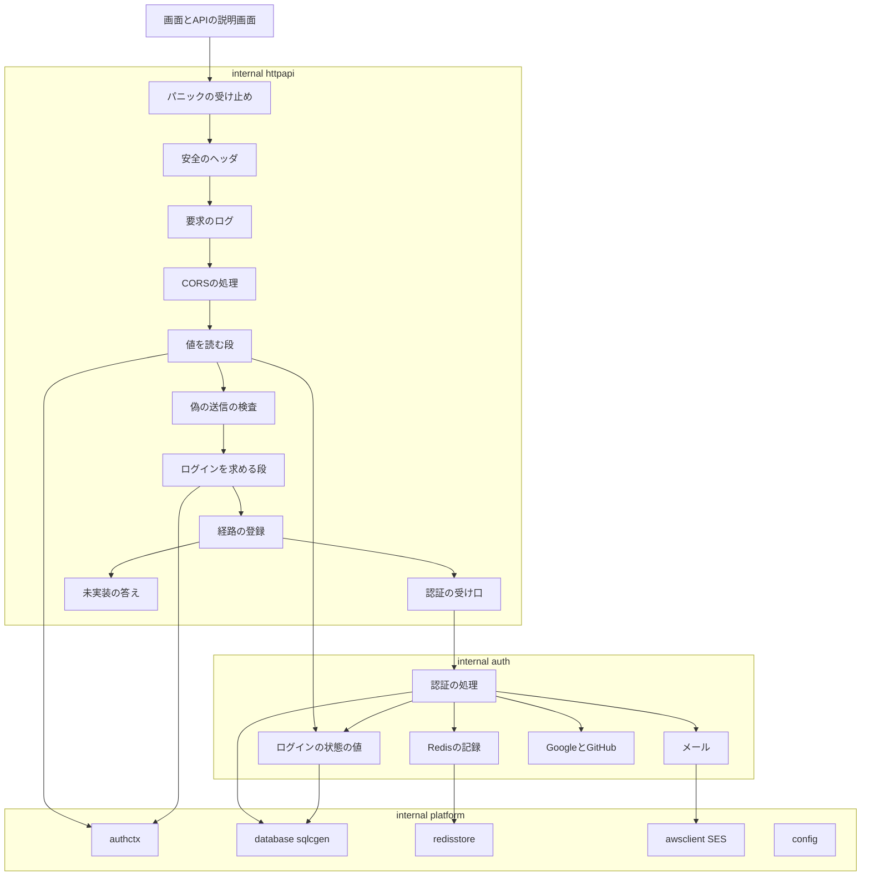
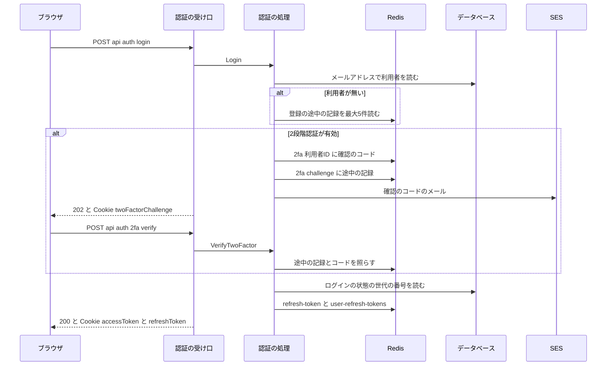
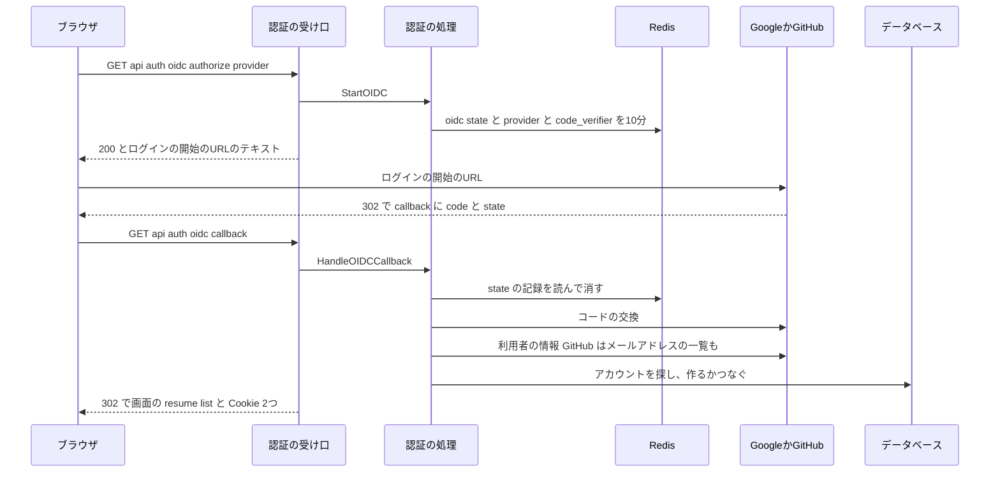

# 設計

## 概要

この設計は、Go 版に、認証の13の操作と、ログインの状態の検査を足す。

Go 版は、Java 版と同じデータベースの表と同じ Redis のキーを、Java 版と同じ値の形で読み書きする。Claude は、Java 版の受け口と処理(`presentation/auth/` `usecase/auth/` `presentation/security/` `infrastructure/auth/` `infrastructure/shared/`)を写す元とし、Go 版の部品ごとに、写す元の Java のクラスを書く。Claude は、Java 版と Go 版を比べる検査のうち、筋書きで値を取り出す部分と、比べる前に値を正規化する部分を広げ、偽のログインのサービスも広げる。正規化とは、要求のたびに違う値を、比べる前に決まった文字列に置き換えるか、比べる項目から外すことである。

この設計は、置き換えの spec の段階2で作った `internal/httpapi` の、HTTP の要求を受ける部分に、3つの変更を加える。1つ目は、Spring Security がすべての応答に付ける6つのヘッダを付ける中間処理である。中間処理とは、すべての要求に共通する処理を、操作ごとの受け口の前で行う部品である。2つ目は、ログインの状態の検査を、偽の送信の検査の前で値を読む段と、偽の送信の検査のあとでログインを求める段の2つに分けることである。3つ目は、認証の操作の応答を、生成した型の代わりに、Cookie を2つ書ける自分で書いた型で返すことである。

## 作るものと作らないもの

### 作るもの

- 認証の13の操作の Go 版。Claude は、受け口を `internal/httpapi/auth.go` に置き、処理を機能のパッケージ `internal/auth` に置く
- ログインの状態の検査。値を読む段(`auth.Identify`)と、ログインを求める段(`auth.RequireLogin`)の2つの中間処理である
- ログインした利用者の ID と役割の受け渡し(`internal/platform/authctx`)
- Spring Security と同じ6つのヘッダをすべての応答に付ける中間処理(`internal/httpapi/middleware/securityheaders.go`)
- 認証の操作が使う SQL の問い合わせ(`backend/db/queries/auth.sql`)と、sqlc が生成するコード
- Java 版のメールのひな形を Go 版に埋め込む指定(`backend/mailtemplates.go`)
- Java 版と Go 版を比べる検査の広げ方。広げる中身は、部品の節の「Java 版と Go 版を比べる検査の広げ方(harness)」と「偽のログインのサービスの広げ方(fakeoidc)」に書く
- 認証の操作の筋書き(`backend/compat/scenarios/auth/*.yaml`)。Claude は、この筋書きを、Java 版と Go 版を比べる検査と、版をまたいで確かめる検査と、応答の時間を Java 版と Go 版で測って比べることの3つに使う
- 変えた動きの一覧の、認証の操作の項目(CB-011 から)
- 置き換えの spec の進み具合の表(`progress.md`)の、認証のまとまりの行と、表の下の決まりの書き直し

### 作らないもの

- ほかのまとまりの操作の Go 版。ただし、メールアドレスの確認の操作が受け持つ、目的が `PENDING_EMAIL` のリンクの確認は、この spec で作る。確認のリンクを受ける操作が、認証の操作の `verifyEmail` だけであるためである
- 偽の送信の検査と CORS の処理。CORS の処理とは、ほかのサイトの画面から届いた要求を受け付けるかを決め、受け付けない要求を断る処理である。どちらも置き換えの spec で作ってあり、この spec は中間処理の順だけを変える
- 本番の設定の変更
- Java 版のメールのひな形のファイルの移動。Claude は、このファイルを、置き換えの spec の段階6で Java 版を削除するときに、マイグレーションのファイルと同じく移す
- データベースの表の形の変更(マイグレーション)
- Java 版のコードの変更。Java 版と Go 版を比べる検査で Java 版の誤りが見つかったときは、Claude は、置き換えの spec の決まりのとおり、同じ PR で両方の版を直すかを所有者に報告する

## 使う既存の仕組み

- 置き換えの spec の段階2で作った Go 版の土台: この設計は、土台のうち次の6つのパッケージを使う。
  - `internal/httpapi`: 経路の登録と、中間処理と、未実装の答えを持つ
  - `database`: pgx の接続の束と、sqlc の出力 `sqlcgen` を持つ
  - `redisstore`: Redis の接続と、Lua のスクリプト `ConsumeIfEqual` を持つ
  - `awsclient`: SES と Secrets Manager を扱う
  - `internal/platform/config`
  - `logging`
- API の仕様書 `backend/api/openapi.yaml` と、そこから生成した `internal/httpapi/gen`。この spec は仕様書を変えない
- Java 版と Go 版を比べる検査 `backend/compat/harness`、偽の AWS(`fakeaws`)、偽のログインのサービス(`fakeoidc`)、変えた動きの一覧 `changed-behaviors.yaml`
- Java 版のメールのひな形 `backend/src/main/resources/mail/*.ftl`
- 依存の向き: `cmd/keirekipro` から `internal/httpapi`、`internal/httpapi` から `internal/auth`、`internal/auth` から `internal/platform` の一方向とする。`internal/auth` は `internal/httpapi` と生成した型 `internal/httpapi/gen` を読まない。ほかのまとまりのパッケージは `internal/auth` を読まず、`internal/platform/authctx` を読む

## 設計を見直すきっかけ

- `authctx` の関数の形(`UserID` `Roles`)を変えたとき。ほかのまとまりの spec で Claude が作るパッケージが、ログインした利用者の ID をこの関数で得るためである
- 中間処理の順か、ログインを求めない経路の一覧を変えたとき。ほかのまとまりの操作の 401 と 403 の答えが変わる
- Redis のキーの頭か値の形、Cookie の名前と性質、JWT の項目のどれかを変えたとき。JWT は、項目を JSON で書き、署名を付けた文字列である。切り替えの途中で、Java 版と Go 版が互いの記録を読めなくなる
- Java 版のメールのひな形に、`${名前}` のほかの FreeMarker の書き方が足されたとき。Go 版は、`${名前}` のほかの `$` と `{{` を含むひな形を、読み込みのときに誤りにするためである
- Java 版の `SecurityConfig` の、許す経路かヘッダの設定が変わったとき。Go 版の `RequireLogin` のログインを求めない経路の一覧と、`securityheaders.go` が付ける6つのヘッダは、この設定に合わせて作るためである
- Java 版と Go 版を比べる検査の筋書きの形のうち、取り出しの元か、差し込みか、絶対の URL の段の書き方を変えたとき。ほかのまとまりの筋書きも同じ形で書くためである

## プロジェクトの決まりを守っているか

- backend のコードを置く層: Go 版の層の決まりは depguard が検査する。depguard は、Go のパッケージが読んでよいパッケージを決まりのとおりに限る、静的な検査の道具である。この設計は、認証のコードを1つの機能のパッケージ `internal/auth` に置き、受け口を `internal/httpapi` に置くので、depguard の規則を変えずに済む。ログインした利用者の ID の受け渡しは `internal/platform/authctx` に置くので、ほかのまとまりのパッケージは規則を変えずに読める。ArchUnit は Java 版だけを検査する。この spec は Java 版のコードを変えない
- データベースの表の形: マイグレーションを含まない。Go 版は今の表に、Java 版と同じ行を書く
- 新しいライブラリの追加: golang-jwt v5.3.1 を足し、google/uuid v1.6.0 を間接の依存から直接の依存に変える。どちらも置き換えの spec の「使う技術」に挙げた部品か、すでに `go.sum` にある部品である。変えるファイルは `backend/go.mod` と `backend/go.sum` だけで、置き換えの spec の決めたとおり、所有者の承認の対象の外である。置き換えの spec が挙げた x/oauth2 と go-oidc は足さない。x/oauth2 と go-oidc を使う案と、標準の `net/http` と `encoding/json` で書く案を比べた結果は、research.md の「設計で決めたこと」に書いた
- 品質チェックの設定: `.golangci.yml` `.testcoverage.yml` `Makefile` `.github/` を変えない。カバレッジの下限は、置き換えの spec の決めた全体の 93% のまま守る
- 使う外部の機能がこのリポジトリで使えるか: 新しく使う外部のサービスは無い。Google と GitHub の OAuth のクライアントと、SES は、Java 版が今使っているものを、同じ秘密の値で使う
- 関係のない項目: frontend の機能ごとの境界と、frontend の状態の持ち方。この spec は画面を変えないので、どちらもこの spec に関係しない

## 全体の構成

Claude は、認証のコードを、1つの機能のパッケージ `internal/auth` のファイルに分ける。1つのパッケージにするのは、depguard が、機能のパッケージから、`internal/platform` のほかの `internal` の下のパッケージを読むことを断るためである。`internal/auth` の下に小さなパッケージを作ると、depguard は、それらの小さなパッケージが互いを読むことも断る。`internal/auth` の関数は、Go の普通の型で値を受けて返す。生成した型と `internal/auth` の間の変換と、応答の書き方は、`internal/httpapi/auth.go` が受け持つ。

**使う技術**:
- HTTP の受け口: 標準の `net/http` と、oapi-codegen v2.8.2 の `strict-server` で生成した型。認証の操作の応答は、`Visit<操作の名前>Response` を持つ自分で書いた型で返す
- ログインの状態の値: golang-jwt v5.3.1(HMAC-SHA256)
- パスワードのハッシュ: golang.org/x/crypto v0.58.0 の bcrypt
- 識別子: google/uuid v1.6.0
- データベース: pgx v5.11.0 と sqlc v1.31.1
- Redis: go-redis v9.23.0 の `UniversalClient`
- メール: AWS SDK for Go v2 の SES v1(`SendEmail`)と、標準の `text/template`
- Google と GitHub とのやり取り: 標準の `net/http` と `encoding/json`
- Java 版と Go 版を比べる検査: 置き換えの spec の段階2の harness と testcontainers-go。`api.github.com` の TLS の証明書は標準の `crypto/x509` で作る。TLS は、通信を暗号にし、通信の相手が本物かを証明書で確かめる仕組みである

## ファイルの構成

Claude が新しく作るファイル:

- `backend/internal/auth/service.go`: 認証の処理の入口の型 `Service` と、使う部品の束(`Deps`)と、組み立ての関数 `New`
- `backend/internal/auth/errors.go`: 操作の誤りの型(`Error`)と、Java 版の文言の定数
- `backend/internal/auth/validate.go`: 要求の入力の検査
- `backend/internal/auth/accesstoken.go`: ログインの状態の値(JWT)の発行と検証と、ログインの状態の世代の番号の読み書き
- `backend/internal/auth/middleware.go`: 値を読む段 `Identify` と、ログインを求める段 `RequireLogin`
- `backend/internal/auth/cookies.go`: Cookie の書き方
- `backend/internal/auth/redisjson.go`: Redis に JSON の値として書いて読む部品
- `backend/internal/auth/refreshtoken.go`: ログインを続けるための値の発行と読み出しと削除と、利用者のログインの状態をまとめて使えなくする処理
- `backend/internal/auth/twofactor.go`: 2段階認証の確認のコードと途中の記録
- `backend/internal/auth/registration.go`: 登録の途中の記録
- `backend/internal/auth/emailverification.go`: メールアドレスの確認のリンクの値、今のリンクの記録、送り直せる間隔の制限、確認のメールの送り出し、リンクの分類
- `backend/internal/auth/passwordreset.go`: パスワードの再設定の値と、申し込みと確認と再設定
- `backend/internal/auth/login.go`: ログイン、2段階認証の確認、ログインを続けるための作り直し、ログアウト
- `backend/internal/auth/register.go`: 新規の登録、メールアドレスの確認、確認のメールの送り直し(2つの操作)
- `backend/internal/auth/oidc.go`: Google と GitHub のログインの開始の URL、戻ったあとの処理、Google と GitHub の API の呼び出し
- `backend/internal/auth/spring_query.go`: URL の問い合わせの部分を、Spring の `UriComponentsBuilder.encode()` と同じ規則でエスケープする処理。エスケープとは、URL の中で別の意味に読まれる文字を、`%` と16進の数字の書き方に置き換えることである
- `backend/internal/auth/mail.go`: メールのひな形の差し込みと、SES での送り出し
- `backend/internal/auth/random.go`: 32バイトの乱数の base64url の値と、6桁の確認のコード。base64url は、バイトの並びを、URL にそのまま書ける英数字と `-` と `_` の文字に置き換える書き方である
- `backend/internal/auth/*_test.go`: 上のファイルごとの単体テスト。データベースと Redis を使うテストは、ファイル名を `_integration_test.go` で終わる形にし、ビルドタグを付けない。ビルドタグとは、ファイルの先頭に書いて、指定したときだけそのファイルをビルドとテストに含める印である。このテストは、既存の `redisstore_integration_test.go` と `database_integration_test.go` と同じく、testcontainers-go で Postgres と Valkey のコンテナをテストの中で起動する。Valkey は、Redis と同じ命令で読み書きできるデータの保存先である。そのため、このテストは `make test` と CI の Go 版の検査で毎回動き、カバレッジの計算にも入る
- `backend/internal/platform/authctx/authctx.go`: ログインした利用者の ID と役割を `context.Context` に入れる関数と取り出す関数
- `backend/internal/platform/authctx/authctx_test.go`: 単体テスト
- `backend/internal/httpapi/auth.go`: 認証の13の操作の受け口。生成した要求の型を `internal/auth` の呼び出しに変える。要求の `Host` と `Accept` を受け口に渡す、生成したコードの中間処理(`gen.StrictMiddlewareFunc`)も置く
- `backend/internal/httpapi/authresponses.go`: 認証の操作の応答の型(`Visit<操作の名前>Response` を持つ型)
- `backend/internal/httpapi/auth_test.go`: 受け口の単体テスト
- `backend/internal/httpapi/middleware/securityheaders.go`: 安全のヘッダの中間処理
- `backend/internal/httpapi/middleware/securityheaders_test.go`: 単体テスト
- `backend/db/queries/auth.sql`: 認証の操作が使う SQL の問い合わせ。sqlc が `internal/platform/database/sqlcgen/` にコードを生成する
- `backend/mailtemplates.go`: `//go:embed src/main/resources/mail/*.ftl` でメールのひな形を埋め込み、`MailTemplates() (fs.FS, error)` で公開する
- `backend/compat/scenarios/auth/*.yaml`: 認証の操作の筋書き。ファイルは操作の流れごとに分ける(`login.yaml` `two-factor.yaml` `refresh-logout.yaml` `register.yaml` `email-verification.yaml` `password-reset.yaml` `oidc-google.yaml` `oidc-github.yaml` `require-login.yaml` `validation.yaml`)。応答の時間を測る筋書きは、ほかの場面と別のファイルに置く(`login-perf.yaml` `two-factor-perf.yaml` `refresh-perf.yaml` `register-perf.yaml`)。今の harness は、1つのファイルから1つの筋書きだけを読み、応答の時間を筋書きの最後の段だけで測る。そのため、測る操作ごとに、その操作を最後の段に持つ筋書きのファイルが要る
- `backend/compat/harness/capture.go` `capture_test.go`: 取り出しの元ごとの値の読み方
- `backend/compat/harness/tlsalias.go` `tlsalias_test.go`: `api.github.com` の証明書と、Java 版に渡す信頼の束と、Go 版に渡す認証局の証明書の作り方。信頼の束とは、プログラムが信頼する認証局の証明書をまとめたファイルである
- `backend/compat/fakeoidc/deny.go`: ログインを断る動き
- `backend/compat/harness/expire.go` `expire_test.go`: 値を期限切れにする段の、JWT の書き換えと署名し直し
- `backend/compat/fixtures/users/auth-users.sql`: 確認の済んでいない利用者と、2段階認証を有効にした利用者の初期のデータ
- `backend/mailtemplates_test.go`: 埋め込んだひな形から4つのファイル名が読めることを確かめる単体テスト
- `backend/internal/auth/testdata/mail/`: 4種類のメールの件名と本文の正解のファイル。Claude は、開発環境の Java 版に4種類のメールを送らせ、LocalStack の SES が受けたメールの件名と本文から作る。`mail_test.go` は、`mail.go` が作るメールをこの正解のファイルと比べる

Claude が変えるファイル:

- `backend/internal/httpapi/server.go` と `server_test.go`: 部品の節の「httpapi.New の変更」のとおりに変え、中間処理の順と安全のヘッダを確かめるテストを足す
- `backend/cmd/keirekipro/main.go`: 部品の節の「httpapi.New の変更」の使う部品の欄のとおりに変える
- `backend/internal/platform/config/config.go` と `config_test.go`: `App.ApplicationName`(値 `keirekipro`)を足す。この設定は、Java 版の Spring の `spring.application.name` にあたる。`mail.go` は、この設定の値を、メールアドレスの確認とパスワードの再設定のメールの `siteName` に使う
- `backend/go.mod` `backend/go.sum`: golang-jwt v5.3.1 を足し、google/uuid を直接の依存にする
- `docker/backend-go/Dockerfile.prod`: 組み立ての段に、`mailtemplates.go` と `src/main/resources/mail` をコピーする手順を、`migrations.go` とマイグレーションのファイルをコピーする手順の隣に足す。足さないと、`cmd/keirekipro` が読む `backend.MailTemplates` の埋め込みの元のファイルがイメージの中に無く、イメージの組み立てが失敗する。このイメージは、Java 版と Go 版を比べる検査と本番の両方が使う
- `backend/compat/harness/scenario.go` `send.go` `normalize.go` `stack.go` `compare.go` `compareenv.go` `cross.go` `crossenv.go` `perf.go` `perfenv.go` と、それぞれのテスト: Java 版と Go 版を比べる検査の広げ方の節のとおりに広げる
- `backend/compat/harness/env.go`: `api.github.com` の証明書と信頼の束をコンテナに写すために、`ContainerSpec` に、testcontainers の `Files` でファイルを写す欄を足す
- `backend/compat/harness/versions.go` `versions_test.go`: `Backing` と `JavaEnv` と `GoEnv` に、Java 版の信頼の束と Go 版の認証局の証明書の置き場を渡す値を足す
- `backend/compat/fakeoidc/fakeoidc.go` `oauth.go` `fakeoidc_test.go` `cmd/fakeoidc/main.go`: 偽のログインのサービスの広げ方の節のとおりに広げる
- `backend/compat/changed-behaviors.yaml`: CB-011 からの、認証の操作の項目を足す
- `.kiro/specs/backend-go-replacement/progress.md`: 認証のまとまりの行の spec と状態を書き、表の下の、API の説明画面での確認の決まりを書き直す
- `.kiro/specs/backend-go-auth/research.md`: 試作の記録と、設計で決めたこと。実装で Java 版の値の形を確かめた結果も書き足す

## 処理の流れ

### ログインと2段階認証

- 2段階認証の確認が通ると、`Service` は、途中の記録と確認のコードを消す。そのあと、認証の受け口は、ログインの状態の Cookie 2つと、Cookie `twoFactorChallenge` を消す `Set-Cookie` を、この順に応答に付ける

### Google か GitHub のアカウントでのログイン

- 戻ったあとの処理のどの段で失敗しても、認証の受け口は画面の `/login?error=<文言>` に 302 で移す。確認の済んでいないメールアドレスのアカウントでは、`/login?error=unverified_email` に移す。認証の受け口は、どの 302 の応答にも、`Location` のほかに本文と `Content-Type` を書かない
- 認証の受け口は、戻り先の URL(`redirect_uri`)を、設定 `App.APIBaseURL` が空でなければその値に、空なら要求の `http://` と `Host` に、`/api/auth/oidc/callback` を足して作る。認証の受け口は、Java 版の `DevBaseUrlResolver` と同じく、ポートが 80 なら、ポートを URL に書かない

## 部品

### Service(認証の処理の入口)

対応する要件: 1.1, 1.2, 4.2

**役割**: `internal/auth` の型 `Service` は、認証の13の操作の処理を、Java 版の `usecase/auth/` のユースケースと同じ順で行う。`Service` は、HTTP の要求と応答を扱わない。`Service` は、操作ごとのメソッドで Go の普通の型を受け、結果の型か `*auth.Error` を返す。`Service` は、Cookie に書く値を結果の型で返す。Cookie の書き方は、認証の受け口が決める。

**使う部品**: `Service` は、`Deps` に次の8つの部品を受ける。

- `*pgxpool.Pool`。`Service` は、これを sqlcgen の `Queries` とトランザクションに使う。トランザクションとは、データベースへのいくつかの書き換えを、すべて行うか、1つも行わないかのどちらかにするまとまりである
- `redis.UniversalClient`
- SES のクライアントの小さなインタフェース。このインタフェースは `SendEmail` だけを持つ
- `config.Config` の `App` `JWT` `OIDC`
- メールのひな形の `fs.FS`
- `http.Client`。`Service` は、これで Google と GitHub を呼び出す。呼び出しの打ち切りは10秒である
- 現在の時刻を返す関数
- 乱数を返す関数
時刻と乱数を受けるのは、単体テストで値を決めるためである。

**呼び出し方**: 操作ごとのメソッドと、写す元の Java のクラスは次のとおりである。

| メソッド | 写す元 | 返すもの |
|---|---|---|
| `Login(ctx, email, password)` | `LoginController` `LoginUseCase` `TwoFactorAuthIssueUseCase` | 2段階認証が有効なら途中の記録の値、そうでなければ発行したログインの状態の値2つ |
| `VerifyTwoFactor(ctx, challenge, code)` | `TwoFactorAuthController` `TwoFactorAuthVerifyUseCase` | ログインの状態の値2つ |
| `Refresh(ctx, refreshToken)` | `RefreshAccessTokenController` | 新しい `accessToken` の値 |
| `Logout(ctx, refreshToken, accessToken)` | `LogoutController` | なし |
| `Register(ctx, RegisterInput)` | `UserRegistrationController` `UserRegistrationUseCase` | なし |
| `VerifyEmail(ctx, token)` | `VerifyEmailController` `VerifyEmailUseCase` | 結果の名前と、再設定の値 |
| `ResendEmailVerification(ctx, token)` | `ResendEmailVerificationUseCase` | なし |
| `ResendEmailVerificationForLogin(ctx, email, password)` | `ResendEmailVerificationForLoginUseCase` | なし |
| `RequestPasswordReset(ctx, email)` | `RequestPasswordResetUseCase` | なし |
| `VerifyPasswordResetToken(ctx, token)` | `VerifyPasswordResetTokenUseCase` | なし |
| `ResetPassword(ctx, token, password)` | `ResetPasswordUseCase` | なし |
| `StartOIDC(ctx, provider, redirectURI)` | `OidcAuthorizationController` `StartOidcAuthorizationUseCase` | ログインの開始の URL |
| `HandleOIDCCallback(ctx, code, state, errParam, redirectURI)` | `OidcCallbackController` `HandleOidcCallbackUseCase` `OidcLoginUseCase` | 成功ならログインの状態の値2つ、失敗なら移る先の種類 |

`Service` は、入力の検査を通った値だけを受ける。入力の検査は、認証の受け口が `Validate` の部品で先に行う。

**状態の持ち方**: `Service` は、要求をまたぐ状態をメモリに持たない。要求をまたぐ記録は、すべて Redis とデータベースに置く。そのため、Java 版と Go 版が同じ Redis とデータベースを使えば、利用者は、版をまたいで手順を続けられる。

**失敗したとき**: `Service` は、業務の決まりで断るときは、`*auth.Error` に状態の番号と文言を入れて返す。`Service` は、データベースと Redis と SES の誤りを、そのまま包んで返す。包むとは、元の誤りをあとから取り出せる形のまま、別の誤りの中に入れることである。認証の受け口は、その誤りを 500 にする。`Register` は、メールの送り出しに失敗したら、Java 版と同じく、置いた登録の途中の記録を消してから誤りを返す。

### Error(操作の誤りの型)

対応する要件: 1.4, 3.6

**役割**: `auth.Error` は、状態の番号、文言、項目ごとの文言の束(`map[string][]string`)、確認の済んでいないメールアドレスの種類(`Kind`)を持つ。`errors.go` は、Java 版の `AppExceptionHandler` が `UseCaseException` と `EmailNotVerifiedUseCaseException` を状態の番号と本文に変える決まりを写し、Java 版の文言を定数で持つ。

**呼び出し方**: 認証の受け口は、`errors.As` で `*auth.Error` を取り出し、次の形の本文を書く。

- 業務の決まりで断るとき: 400 と `{"message": 文言, "errors": 項目ごとの文言}`。Java 版で `BaseException` を受け止めて答えを作る処理にあたる。項目ごとの文言は、ふつう空である
- 確認の済んでいないメールアドレスのとき: 409 と `{"message": "メールアドレスの確認が済んでいません。", "errors": {}, "kind": "UNVERIFIED_ACCOUNT_EMAIL" か "PENDING_REGISTRATION"}`
- 入力の誤りのとき: 400 と `{"message": "入力エラーがあります。", "errors": {項目: [文言]}}`
- ログインを続けるための値が無いか無効なとき: 401 と `{"message": "認証に失敗しました。", "errors": {}}`。Java 版で `JWTVerificationException` を受け止めて答えを作る処理にあたる
- 操作の相手の利用者が居ないとき: 401 と `{"message": 文言, "errors": {}}` と、`accessToken` と `refreshToken` を消す Cookie を2つ。Java 版で `AuthenticationCredentialsNotFoundException` を受け止めて答えを作る処理にあたる。`auth.Error` は、Cookie を消すかを示す項目 `ClearSession` を持つ。認証の受け口は、この項目が真のときに `DeleteCookie("accessToken", "/", secure)` と `DeleteCookie("refreshToken", "/", secure)` をこの順に書く。利用者のまとまりの操作も同じ例外で断るので、Claude は、ほかのまとまりの spec でも、この形を使う

本文の項目の名前と並びは、Java 版の `ErrorResponse` と `EmailNotVerifiedErrorResponse` と同じにする。ログインに失敗したときの文言と状態の番号は、アカウントが無いときもパスワードが違うときも同じにし、文言は「メールアドレスまたはパスワードが正しくありません。」の1つにする。

### Validate(要求の入力の検査)

対応する要件: 1.4, 5.5

**役割**: `validate.go` は、Java 版の要求の型の注釈(`@NotBlank` `@Size` `@Email` `@Pattern` `@MaxUtf8Bytes` `@PasswordMatches`)を、操作ごとの検査の関数に写す。検査の関数は、項目ごとに文言を集め、誤りがあれば入力の誤りの `*auth.Error` を返す。

**呼び出し方**: 検査は次のとおりに写す。

- `@NotBlank`: 空白の文字だけの値も誤りにする。Java の `Character.isWhitespace` と同じ文字を空白とする
- `@Size(max)`: UTF-16 の単位の文字の数で数える。Java の `String.length()` と同じ数え方である
- `@Email`: Hibernate Validator の `EmailValidator` と同じ判定を書く。空の値は誤りにしない。空の値を誤りにするのは、`@NotBlank` の検査である
- `@MaxUtf8Bytes`: UTF-8 のバイトの数で数える
- `@Pattern`: `^(?=.*[a-z])(?=.*[A-Z])(?=.*\d).+$` は、Go の正規表現が先読みを持たないので、小文字と大文字と数字が1つ以上ずつあるかの3つの判定で書く。先読みとは、文字列のその位置から先に、ある形の文字が現れるかを確かめる正規表現の書き方である。Go 版も、行の終わりの文字を1つでも含む値を誤りにする。Java の `.` は行の終わりの文字(`\n` `\r` `\u0085` `\u2028` `\u2029`)に当たらず、`@Pattern` は値の全体が当たることを求めるためである
- `@PasswordMatches`: 2つの値が違えば、Java 版の注釈と同じ項目の名前に文言を付ける。Claude は、実装のときに、項目の名前を `PasswordMatchesValidator` で確かめる
- `verifyPasswordResetToken` の要求の型は注釈を持たないので、検査しない

1つの項目に2つ以上の文言があるとき、Go 版は、注釈を書いた順に並べる。Java 版は、文言の並びを要求ごとに入れ替える。そのため、Java 版と Go 版を比べる検査は、変えた動きの一覧の、並びの順だけを許す項目に従って、文言の並びの違いを許す。

**失敗したとき**: 要求の本文が JSON として読めないときと、値の型が違うときは、生成したコードの誤りの受け口が、置き換えの spec で作ったとおり 400 を返す。この部品は呼ばれない。

### AccessToken(ログインの状態の値)

対応する要件: 2.2, 3.1, 4.1

**役割**: `accesstoken.go` は、Java 版の `JwtProvider` と `UserTokenVersionStore` を写す。発行する値は、HMAC-SHA256 で署名した JWT で、ヘッダは `{"alg":"HS256","typ":"JWT"}`、項目は `sub`(利用者の ID)、`roles`(役割の名前の並び)、`tokenVersion`(数)、`iat`、`exp` である。有効な時間は、設定 `JWT.AccessTokenValidity` の値の10分である。署名の鍵は、設定 `JWT.Secret` の文字列の UTF-8 のバイトである。

**呼び出し方**:

- `IssueAccessToken(ctx, userID, roles) (string, error)`: データベースの `user_token_versions` からログインの状態の世代の番号を読み、値を作る。行が無いときの世代の番号は、Java 版の `MyBatisUserTokenVersionStore` と同じく 0 とする
- `VerifyAccessToken(ctx, token) (Principal, error)`: 署名と `exp` を確かめ、`sub` を UUID として読み、`tokenVersion` をデータベースの今の世代の番号と比べる。どれかが合わなければ `ErrInvalidToken` を返す。データベースの誤りは `ErrInvalidToken` にせず、包んで返す。`Principal` は利用者の ID と役割の並びを持つ
- `BumpTokenVersion(ctx, q, userID) error`: `UPDATE` で世代の番号を1つ上げ、`updated_at` を今の時刻にする。行が無ければ何もしない。Java 版の `incrementByUserId` と同じである。`q` は sqlcgen の `Queries` である。`BumpTokenVersion` は、トランザクションの中でも外でも呼べる

`VerifyAccessToken` は、golang-jwt で値を検証するときに、署名の方式を HS256 に限り(`jwt.WithValidMethods`)、`exp` を必須にする。Java 版の `java-jwt` は時刻のずれの猶予を持たないので、Go 版も猶予を持たない。

### Middleware(ログインの状態の検査)

対応する要件: 2.1, 2.2, 2.3, 2.4, 6.2

**役割**: `middleware.go` は、2つの中間処理を作る。どちらも、利用者がまだ居るかを確かめない。

- `Identify(svc) func(http.Handler) http.Handler`: Java 版の `JwtAuthenticationFilter` にあたる。メソッドが `OPTIONS` の要求と、経路が `/api/auth` で始まる要求では何もしない。ほかの要求で Cookie `accessToken` があれば `VerifyAccessToken` で確かめ、通れば `authctx.With` で利用者の ID と役割を `context` に入れる。通らなければ、`Set-Cookie: accessToken=; Path=/; Max-Age=0` を応答に足し、ログインしていない要求として次に渡す。データベースが読めないときは、次に渡さず 500 で答える。Java 版のフィルタも `JWTVerificationException` だけを受け止め、データベースの誤りでは要求を止めるためである
- `RequireLogin() func(http.Handler) http.Handler`: Java 版の `authorizeHttpRequests` にあたる。`RequireLogin` は、次の5つの要求を、ログインを求めずに通す。
  - メソッドが `OPTIONS` の要求
  - 経路が `/api/auth/` の下か `/api/auth` の要求
  - `/actuator/` の下の要求
  - `/swagger-ui/` の下と `/swagger-ui.html` と `/v3/api-docs` と `/v3/api-docs/` の下の要求
  - Go 版だけが受ける `/healthz` への要求

  `RequireLogin` は、ほかの要求で `context` に利用者が無ければ、本文の無い 401 を返す。経路が `/api/admin/` の下で、利用者の役割に `ADMIN` が無ければ、403 と `{"message":"アクセス権限がありません。"}` を返す。`RequireLogin` は、403 の応答の `Content-Type` を、Java 版の `accessDeniedHandler` と同じ `application/json;charset=UTF-8` にする。

**いつ動くか**: `httpapi.New` が、`Identify` と `RequireLogin` を、「httpapi.New の変更」の節の順に置く。どちらも、仕様書に無い経路への要求にも動く。この順では、`Identify` が偽の送信の検査より前に動く。そのため、無効な Cookie `accessToken` を持つ書き込みの要求を偽の送信の検査が断ったときにも、Java 版と同じく、`Identify` が足した、Cookie を消す `Set-Cookie` が応答に付く。`Identify` と `RequireLogin` が仕様書に無い経路への要求にも動くのは、Java 版も、仕様書に無い経路への要求を先にログインの状態で断るためである。

**使う部品**: `AccessToken`、`authctx`。

**失敗したとき**: `Identify` は、`VerifyAccessToken` の誤りのうち、`ErrInvalidToken` だけを Cookie の削除にする。データベースの誤りの 500 の本文は、置き換えの spec の土台のパニックの受け止めと同じ決まった本文にする。パニックとは、Go のプログラムが処理を続けられない誤りに当たったときに、関数の呼び出しを途中で打ち切って戻っていく動きである。この場面は Java 版と Go 版を比べる検査では作れないので、Claude は、この 500 の本文を Java 版の本文と比べない。

### authctx(ログインした利用者の受け渡し)

対応する要件: 2.4

**役割**: `internal/platform/authctx` は、ログインした利用者の ID と役割を `context.Context` に入れ、取り出す。ほかのまとまりのパッケージは、depguard の規則を変えずに、このパッケージを読んで利用者の ID を得る。このパッケージは、ログインの状態の値を確かめない。確かめるのは `Identify` だけである。

**呼び出し方**: `authctx` は、次の3つの関数を持つ。

- `With(ctx, userID uuid.UUID, roles []string) context.Context`: 利用者の ID と役割を `context` に入れる
- `UserID(ctx) (uuid.UUID, bool)`: `context` から利用者の ID を取り出す
- `Roles(ctx) []string`: `context` から利用者の役割を取り出す

ログインを求める段を通った要求では、`UserID` は必ず `true` を返す。

### Cookies(Cookie の書き方)

対応する要件: 1.1, 2.2

**役割**: `cookies.go` は、Java 版の `CookieUtil` と同じ文字列で `Set-Cookie` の値を作る。`cookies.go` は、Go の `http.Cookie.String()` を使わない。`http.Cookie.String()` は、属性の順と `Expires` の書き方が Java 版と違うためである。`cookies.go` は、設定 `App.CookieSecure` が真なら `Secure` を足す。

| 関数 | 作る値 |
|---|---|
| `SessionCookie(name, value, secure)` | `accessToken` と `refreshToken`。`HttpOnly`、`SameSite=Lax`、`Path=/` |
| `ChallengeCookie(value, secure)` | `twoFactorChallenge`。`Path=/api/auth/2fa`、`Max-Age=600`、`HttpOnly`、`SameSite=Lax` |
| `DeleteCookie(name, path, secure)` | `name=; Path=<path>; Max-Age=0; Expires=Thu, 01 Jan 1970 00:00:00 GMT; HttpOnly; SameSite=Lax` |
| `ExpiredAccessTokenCookie()` | `accessToken=; Path=/; Max-Age=0` |

`SessionCookie` は、`Max-Age` を付けない。`ExpiredAccessTokenCookie` は、`Identify` だけが使う。Claude は、実装のときに、属性の順と、`Secure` を置く位置を、Java 版の応答の文字列で確かめる。

### 認証の受け口(internal/httpapi/auth.go と authresponses.go)

対応する要件: 1.1, 1.2, 1.3, 1.4

**役割**: `auth.go` の型 `authHandlers` は、生成した `StrictServerInterface` のうち認証の13の操作のメソッドを持つ。メソッドは、生成した要求の型から値を取り、`Validate` で検査し、`Service` を呼び、結果を `authresponses.go` の応答の型に入れて返す。`authresponses.go` の型は、生成した応答のインタフェースを満たす `Visit<操作の名前>Response(w http.ResponseWriter) error` を持つ。

**呼び出し方**: 操作ごとの応答は次のとおりにする。

| 操作 | 成功の応答 |
|---|---|
| `login` で2段階認証が無効のとき | 200 と Cookie `accessToken` `refreshToken` |
| `login` で2段階認証が有効のとき | 202 と Cookie `twoFactorChallenge` |
| `verifyTwoFactorAuth` | 200 と Cookie `accessToken` `refreshToken` と、`twoFactorChallenge` を消す Cookie |
| `refreshToken` | 200 と Cookie `accessToken` |
| `logout` | 204 と、`accessToken` と `refreshToken` を消す Cookie |
| `registerUser` | 202 |
| `verifyEmail` | 200 と `{"result": 結果の名前, "passwordResetToken": 値か null}` |
| `resendEmailVerification` `resendEmailVerificationForLogin` `requestPasswordReset` `verifyPasswordResetToken` `resetPassword` | 204 |
| `startOidcAuthorization` | 200 と、Accept で決める `Content-Type` と、引用符を付けないログインの開始の URL の本文 |
| `handleOidcCallback` が成功したとき | 302 と `Location` と Cookie `accessToken` `refreshToken` |
| `handleOidcCallback` が失敗したとき | 302 と `Location` |

表に加えて、受け口が守ることを3つと、Claude が実装のときに確かめることを2つ、次に書く。

- `login` の応答は、2段階認証が有効でも無効でも本文を書かない
- Claude は、実装のときに、Cookie の値と順と、`verifyEmail` の `null` の書き方を、Java 版の応答で確かめる
- Claude は、実装のときに、Accept が無い要求、`*/*`、axios の既定、`text/plain`、`application/json` の5つで、`startOidcAuthorization` の Java 版の `Content-Type` の文字列を、charset が付くかどうかまで確かめ、下の規則と食い違えば Java 版に合わせる
- `verifyTwoFactorAuth` で Cookie `twoFactorChallenge` が無いときは、Java 版と同じく、入力の検査のあとに 400 と「認証セッションが無効または期限切れです。もう一度最初からお試しください。」を返す
- `startOidcAuthorization` で `provider` が無いときの答えは、「httpapi.New の変更」の節の `ErrorHandlerFunc` が返す

`startOidcAuthorization` の `Content-Type` は、Java 版の Spring が文字列の答えに型を選ぶ規則に合わせて、要求の `Accept` で決める。認証の受け口は、要求の Accept に書かれた型を、q の値の大きい順に見る。q の値は、Accept に書いた型ごとの優先の度合いである。q の値が同じ型は、Accept に書かれた順に見る。認証の受け口は、`text/plain` と `*/*` と `text/*` のどれよりも先に `application/json` に当たれば、`Content-Type` を `application/json` にし、そのほかのときは `text/plain;charset=UTF-8` にする。Accept が無いときは `text/plain;charset=UTF-8` にする。画面の axios が送る既定の Accept `application/json, text/plain, */*` では `application/json` になる。

受け口は、要求の `Accept` を、`auth.go` の生成したコードの中間処理から受け取る。この中間処理は、認証の操作のときに、要求の `Host` と `Accept` を `context` に入れる。認証の受け口は、戻り先の URL を作るときの `Host` も、同じ中間処理から受け取る。

**失敗したとき**: 認証の受け口は、`*auth.Error` を、`Error` の部品の節の形の本文にする。認証の受け口は、ほかの誤りを、生成したコードの誤りの受け口に返す。生成したコードの誤りの受け口は、置き換えの spec のとおり、その誤りを 500 と決まった本文にする。`handleOidcCallback` だけは、誤りを返さず、画面の `/login?error=` に移す 302 にする。

### Redis の JSON の読み書き(redisjson.go)

対応する要件: 4.1, 4.2

**役割**: `redisjson.go` は、Java 版の `RedisConfig` の直列化と同じ形で、Redis に値を書いて読む関数を持つ。直列化とは、プログラムの中の値を、Redis に置く文字列に変えることである。Java 版の `RedisConfig` は、キーを文字列にし、値とハッシュの値を Jackson の JSON にする。ハッシュとは、1つのキーの下に、項目の名前と値の組を複数置く Redis の値の形である。認証の処理の Redis の読み書きは、すべてこの部品を通す。

**呼び出し方**: `redisjson.go` は、`setJSON(ctx, key, v, ttl)`、`setJSONNX(ctx, key, v, ttl) (bool, error)`、`getJSON(ctx, key, &v) (bool, error)`、`hsetJSON(ctx, key, map[string]any)`、`hgetallJSON(ctx, key)`、`saddJSON`、`smembersJSON`、`sremJSON`、`consumeJSONIfEqual(ctx, key, v)` の関数を持つ。`consumeJSONIfEqual` は、`redisstore.ConsumeIfEqual` を使う。これらの関数は、JSON を、`encoding/json` の `Encoder` に `SetEscapeHTML(false)` を付けて書き、末尾の改行を取る。文字列の値は `"..."` で囲まれた JSON の文字列になる。

**状態の持ち方**: `redisjson.go` の関数は、Java 版と同じく、Redis に値を置くときに有効な時間を付ける。

### RefreshToken(ログインを続けるための値)

対応する要件: 3.1, 3.5, 4.1

**役割**: `refreshtoken.go` は、Java 版の `RedisRefreshTokenStore` と `AuthSessionInvalidator` を写す。

**呼び出し方**:

- `issueRefreshToken(ctx, userID, roles, version)`: 32バイトの乱数の base64url の値を作り、ハッシュ `refresh-token:<値>` に項目 `userId` `roles`(役割をコンマでつないだ文字列)`tokenVersion` を JSON の値で置き、集合 `user-refresh-tokens:<利用者の ID>` に値を足す。どちらも有効な時間は、設定 `JWT.RefreshTokenValidity` の値の7日である
- `findRefreshToken(ctx, value)`: ハッシュを読む。無ければ「無い」を返す
- `removeRefreshToken(ctx, value)`: ハッシュの `userId` を読み、ハッシュを消し、集合から値を除く
- `invalidateSessions(ctx, userID)`: Java 版の `AuthSessionInvalidator` と同じく、ログインの状態の世代の番号を1つ上げ、集合の値ごとにハッシュを消し、集合を消す

`Refresh` は、ハッシュの世代の番号がデータベースの今の世代の番号と違えば、その値を消して 401 で断る。

### TwoFactor(2段階認証)

対応する要件: 3.2, 4.2

**役割**: `twofactor.go` は、Java 版の `TwoFactorAuthIssueUseCase` `TwoFactorAuthVerifyUseCase` と、確認のコードと途中の記録の Redis の部品を写す。

**状態の持ち方**:

- 確認のコード: キー `2fa:<利用者の ID>`、値は6桁の数字の JSON の文字列、有効な時間は10分
- 途中の記録: キー `2fa:challenge:<値>`、値は `{"userId":"…","attempts":n}` を JSON の文字列にしたものを、さらに JSON の文字列にした形、有効な時間は10分
- 誤ったコードを受けたら、Go 版は、途中の記録の回数を1つ増やし、残りの有効な時間のまま置き直す。Go 版は、`TTL` で残りの有効な時間を読み、0 以下なら10分にして置き直す。回数が5に達したら、Go 版は、途中の記録と確認のコードを消し、上限の文言で断る。照らす順と、消す順と、文言は Java 版の `TwoFactorAuthVerifyUseCase` と同じにする

**使う部品**: `Mail`(確認のコードのメール)、`redisjson`、`random`。

### Registration(登録の途中の記録)

対応する要件: 4.2

**役割**: `registration.go` は、Java 版の `PendingRegistrationStore` の Redis の実装を写す。記録は `id`(UUID)、`email`、`passwordHash`、`username`、`createdAt` を持つ。

**状態の持ち方**: `registration.go` は、記録を `pending-registration:<id>` に JSON で置き、メールアドレスごとの集合を `pending-registration:email:<メールアドレス>` に置く。どちらも有効な時間は24時間である。Claude は、`createdAt` の書き方(Jackson の `Instant` の形)と、集合の要素の形と、`findByEmail` が最大5件を読む順を、実装のときに Java 版が置いた値で確かめ、Go 版でも同じにする。`extend` は、記録と集合の有効な時間を24時間に置き直す。

### EmailVerification(メールアドレスの確認)

対応する要件: 3.3, 3.4, 4.2

**役割**: `emailverification.go` は、Java 版の `JwtEmailVerificationTokenCodec`、`EmailVerificationCurrentTokenStore`、`EmailVerificationLinkClassifier`、`EmailVerificationMailer`、`EmailVerificationCompletion` を写す。

**呼び出し方**:

- リンクの値: HS256 の JWT で、ヘッダは `{"alg":"HS256","typ":"JWT"}`、鍵は HMAC-SHA256(設定 `JWT.Secret`, `keirekipro-email-verification-v1`)である。項目は `aud`(`keirekipro-email-verification`)、`jti`(UUID)、`sub`(登録の途中の記録か利用者の ID)、`purpose`、`email`、`lexp`(リンクの期限の秒)である。リンクは `<設定 App.FrontendBaseURL>/email/verify#<値>` である
- 目的ごとの有効な時間: `REGISTRATION` `ACCOUNT_EMAIL` `PENDING_EMAIL` は24時間、`PASSWORD_RESET` は10分
- 今のリンクの記録: `email-verification:current:` に `jti` を JSON の文字列で、リンクの有効な時間で置く。新しいリンクを送ると上書きされるので、前のリンクは使えなくなる。確認は `consumeJSONIfEqual` で消し込み、Java 版と同じく、分類と消し込みを最大2回くり返す。消し込みとは、Redis の記録の値が渡した値と同じときだけ、その記録を消すことである
- 送り直せる間隔の制限: `email-verification:rate:<メールアドレス>` に `"1"` を `setJSONNX` で60秒置く。置けなければ送らず、送り直しの2つの操作は 400 と「確認のメールは1分に1回まで送れます。少し待ってからもう一度お試しください。」で断る
- 結果の名前: `VERIFIED` `ALREADY_VERIFIED` `EXPIRED` `INVALID` `REGISTRATION_GONE` `EMAIL_TAKEN` と、再設定の値を返す結果。名前は Java 版の `EmailVerificationResult` の名前と同じにする

**状態の持ち方**: 登録を完了するとき、`emailverification.go` は、利用者の行と、役割の行と、ログインの状態の世代の番号の行を足し、登録の途中の記録を消す。`emailverification.go` は、この登録の完了と、確認済みにする書き換えを、1つのトランザクションで行う。メールアドレスが一意の制約に当たったときの扱いは、Java 版の `DataIntegrityViolationException` の扱いと同じにする。Go 版は、登録の完了のメールを、Java 版と同じ時点で送る。

### PasswordReset(パスワードの再設定)

対応する要件: 3.3, 3.5, 3.6

**役割**: `passwordreset.go` は、Java 版の `RequestPasswordResetUseCase` `VerifyPasswordResetTokenUseCase` `ResetPasswordUseCase` と `PasswordResetTokenStore` を写す。

**状態の持ち方**: `passwordreset.go` は、再設定の値ごとに、キー `password-reset:<値>` に利用者の ID を JSON の文字列で10分置く。Go 版は、パスワードの再設定の申し込みに、アカウントが無いメールアドレスでも、確認の済んでいないアカウントでも、同じ 204 で答える。確認の済んでいないアカウントには、再設定のメールの代わりに、目的が `PASSWORD_RESET` の確認のメールを送る。`ResetPassword` は、パスワードのハッシュの書き換えと世代の番号の繰り上げを1つのトランザクションで行い、再設定の値を消し、`invalidateSessions` を呼ぶ。`passwordreset.go` は、新しいパスワードを bcrypt の強さ10でハッシュにする。Java 版の `SecurityConfig` の `BCryptPasswordEncoder` の既定の強さと同じである。

**失敗したとき**: 再設定の値が無いか期限が切れていれば、`passwordreset.go` は、400 と「リセットリンクが無効または期限切れです。もう一度最初からお試しください。」で断る。値は有効だが、値が指す利用者が居なければ、Java 版の `ResetPasswordUseCase` と同じく、`ClearSession` を真にした 401 と「不正なアクセスです。」で断る。

### Login(ログインとログアウト)

対応する要件: 1.2, 3.1, 3.5, 3.6

**役割**: `login.go` は、`Login` `VerifyTwoFactor` `Refresh` `Logout` を持つ。`Login` は、利用者が無いときに登録の途中の記録を最大5件読み、パスワードが合えば 409 の `PENDING_REGISTRATION` にする。パスワードの照合は bcrypt で行う。`Logout` は、Java 版の `LogoutController` と同じく、ログインを続けるための値から、無ければログインの状態の値から利用者を特定し、特定できたら `invalidateSessions` を呼ぶ。

### OIDC(Google と GitHub のアカウントでのログイン)

対応する要件: 1.3, 3.7, 4.2

**役割**: `oidc.go` は、Java 版の `StartOidcAuthorizationUseCase` `HandleOidcCallbackUseCase` `OidcLoginUseCase` `OidcClient` と、`provider/` の Google と GitHub の部品を写す。`spring_query.go` は、問い合わせの部分を、Spring の `UriComponentsBuilder.encode()` と同じ規則でエスケープして書く。

**呼び出し方**:

- 開始: `state`(32バイトの乱数の base64url)と `code_verifier` を作り、`oidc:state:<state>` `oidc:provider:<state>` `oidc:code_verifier:<state>` に10分置いてから、URL を作る。項目の順は `client_id` `response_type` `scope` `redirect_uri` `state` `code_challenge` `code_challenge_method` である。`code_challenge` は `code_verifier` の SHA-256 の base64url である。Redis のキーの組み立てと値の形は、試作で確かめた形と同じにする
- 対象の外の `provider`: Claude は、実装のときに、対象の外の `provider` を受けた Java 版が返す状態の番号と、Redis に残るものを確かめる。Java 版が 500 で答え、Redis に記録を残すなら、Go 版は 400 で答え、記録を残さない。この違いは変えた動きの一覧に載せる
- 戻ったあと: `error` があれば失敗、`code` か `state` が無ければ失敗、`state` の記録が無ければ失敗とする。コードの交換は、設定 `OIDC.<provider>.TokenURL` に `application/x-www-form-urlencoded` で送る。利用者の情報は `UserInfoURL` から読む。GitHub のメールアドレスは、Java 版と同じく `https://api.github.com/user/emails` から読み、主で確認済みのものだけを使う
- アカウントの決め方: Google か GitHub の利用者の ID でつないだアカウントがあればそのアカウントにする。無ければ、確認済みのメールアドレスと同じアカウントがあり、そのアカウントが確認済みならつなぎ、確認の済んでいないアカウントなら `unverified_email` の失敗にする。どちらも無ければ新しいアカウントを作る。行の書き方は Java 版の `OidcLoginUseCase` と同じにする

**権限**: `oidc.go` は、Google と GitHub のクライアントの ID と秘密の値に、置き換えの spec の土台が起動のときに Secrets Manager から読んだ設定の値を使う。

**失敗したとき**: `oidc.go` は、Google か GitHub の呼び出しの誤りと、打ち切りの10秒を超えたときを、Java 版と同じ文言の失敗にする。利用者の情報が読めないときだけ「ユーザー情報の取得に失敗しました。しばらく時間を置いてから再度お試しください。」にし、ほかは「認証に失敗しました。しばらく時間を置いてから再度お試しください。」にする。Go 版は、移る先の URL に入れる文言を、`url.QueryEscape` ではなく Java の `URLEncoder.encode` と同じ規則でエスケープし、空白を `+` にする。

### Mail(メールの送り出し)

対応する要件: 1.5

**役割**: `mail.go` は、Java 版の `SesFreeMarkerNotificationDispatcher` を写す。`backend/mailtemplates.go` が埋め込んだひな形を `text/template` で読み、`${名前}` を差し込む。差し込みの前に、ひな形の `${名前}` を `{{.名前}}` に置き換える。`${名前}` のほかの `$` と `{{` を含むひな形は、読み込みのときに誤りにする。

**呼び出し方**: 4種類のメールの件名と、差し込む値は次のとおりにする。件名の【】の中は、差し込む `siteName` と同じ値である。

| メール | ひな形 | 件名 | `siteName` と `siteUrl` |
|---|---|---|---|
| メールアドレスの確認 | `email-verification.ftl` | 【siteName】メールアドレスの確認 | `App.ApplicationName` と `App.FrontendBaseURL` |
| パスワードの再設定 | `password-reset.ftl` | 【siteName】パスワードリセットのご案内 | `App.ApplicationName` と `App.FrontendBaseURL` |
| 2段階認証の確認のコード | `two-factor-auth.ftl` | 【siteName】2段階認証コードのお知らせ | `App.SiteName` と `App.SiteURL` |
| 新規の登録の完了 | `user-registered.ftl` | 【siteName】新規登録完了のお知らせ | `App.SiteName` と `App.SiteURL` |

`mail.go` は、送り主を `App.SESFromAddress` にし、本文をテキストだけにし、文字の符号を UTF-8 にする。ほかの差し込む値(リンク、有効な時間の文、確認のコード)の名前と書き方は、Java 版の通知の型(`usecase/auth/notification/`)と同じにする。

**失敗したとき**: `mail.go` は、SES の誤りを包んで返す。送り出しの再試行はしない。Java 版も再試行しないためである。

### SecurityHeaders(安全のヘッダの中間処理)

対応する要件: 1.1

**役割**: `securityheaders.go` は、次の処理に渡す前に、応答のヘッダに次の6つを置く。`Cache-Control: no-cache, no-store, max-age=0, must-revalidate`、`Pragma: no-cache`、`Expires: 0`、`X-Content-Type-Options: nosniff`、`X-Frame-Options: DENY`、`X-XSS-Protection: 0`。次の処理がヘッダを上書きしたときは、上書きした値を残す。

**いつ動くか**: `httpapi.New` が、この中間処理を、「httpapi.New の変更」の節の順に置く。この中間処理は、すべての要求に動く。6つのヘッダは、`/actuator/health` と `/healthz` と、CORS の処理と偽の送信の検査が返す 403 と、パニックの 500 にも付く。

### httpapi.New の変更(中間処理の順と、認証の受け口と未実装の答えを1つの型にまとめる方法)

対応する要件: 2.1, 2.4, 6.1

**役割**: Claude は、`server.go` の `Options` に、`Identify func(http.Handler) http.Handler` と、認証の受け口 `AuthHandlers` を足す。Claude は、既存の `Auth` を、ログインを求める段の差し込み口として残す。`New` は、`AuthHandlers` を深さ1に、未実装の答えを深さ2に埋め込んだ型で `StrictServerInterface` を満たす。深さとは、Go の構造体の埋め込みが何段目にあるかを指す。Go は、同じ名前のメソッドが複数の深さにあるとき、浅い深さのメソッドを使う。そのため、認証の受け口のメソッドが、未実装の答えの同じ名前のメソッドより先に使われる。Claude は、ほかのまとまりの spec で作る受け口を、同じ型に深さ1で足す。

`New` は、中間処理を、外から、パニックの受け止め、安全のヘッダ、要求のログ、CORS の処理、値を読む段、偽の送信の検査、ログインを求める段、経路の登録の順に並べる。

`New` は、問い合わせの誤りの受け口 `ErrorHandlerFunc` を、経路が `/api/auth/` の下のときだけ 400 と `{"message": "入力エラーがあります。", "errors": {}}` を返す形に変える。ほかの経路は、今までどおり 500 と決まった本文を返す。Claude は、ほかのまとまりの spec で、問い合わせの誤りに 400 で答える操作を作るときは、その操作の経路を、この経路の条件に足す。`New` は、`NewStrictHandlerWithOptions` の中間処理の並びに、`auth.go` の、要求の `Host` と `Accept` を `context` に入れる中間処理を渡す。

**使う部品**: `main.go` は、`auth.New(auth.Deps{...})` で `Service` を作り、`httpapi.Options{Identify: auth.Identify(svc), Auth: auth.RequireLogin(), AuthHandlers: svc, ...}` を渡す。`main.go` は、`Deps` に、`newAWS` の結果の SES のクライアントと、Redis と、接続の束と、設定と、メールのひな形を渡す。

### Java 版と Go 版を比べる検査の広げ方(harness)

対応する要件: 5.1, 5.2, 5.4, 5.6

**役割**: この部品は、置き換えの spec の段階2の harness を、認証の操作の筋書きを書ける形に広げる。

**呼び出し方**: Claude は、筋書きの段を、次の4種類にする。1つの段は、どれか1つの種類だけを持つ。harness は、筋書きを読むときに、段ごとに種類に要る欄があるかと、ほかの種類の欄が無いかを確かめ、外れた段の名前を誤りとして返す。

| 段の種類 | 要る欄 | 送り先 |
|---|---|---|
| 版に送る段 | `request.method` と `request.path` | 版 |
| 絶対の URL の段 | `request.method` と `request.url` | 偽のログインのサービス |
| Redis を書き換える段 | `redis` | 版の Redis |
| 値を期限切れにする段 | `expire` | 筋書きの中の値 |

- 版に送る段: 今の段のままである。版をまたいで確かめる検査は、この種類の段に `expect.status` を求める
- 絶対の URL の段: `request.url` に書いた絶対の URL へ送る。ホストが `fakeoidc` のときは、harness がテストの処理から届くアドレスに書き換える。harness は、リダイレクトを追わず、302 の `Location` を次の段のために取り出す。Java 版と Go 版を比べる検査では、harness は、この段を、Java 版の番と Go 版の番に1回ずつ送り、それぞれの版の筋書きの値で差し込みと取り出しを行う。harness は、この段の応答を比べない。この段の応答は偽のログインのサービスが作るもので、版の動きではないためである。harness は、`expect.status` があれば、状態の番号だけを確かめる
- Redis を書き換える段: 要求を送らずに、版の Redis を書き換える。`redis.del` は消すキーの並び、`redis.set` はキーと JSON の値と有効な時間の秒の並びである。キーと値には `{名前}` を差し込める。Java 版と Go 版を比べる検査では、harness は、Java 版の Redis には Java 版の筋書きの値を差し込んだキーを書き、Go 版の Redis には Go 版の筋書きの値を差し込んだキーを書く。ログインを続けるための値と再設定の値は版ごとに違う乱数なので、版ごとの値で差し込まないと、harness は消すキーの名前を組み立てられないためである。版をまたいで確かめる検査では、Redis が1つなので、harness は1回だけ書き換える
- 値を期限切れにする段: 要求を送らずに、筋書きの中の JWT の値を、期限の過ぎた値に書き換える。`expire.cookie` に Cookie の名前を書くと、Cookie の束のその Cookie を書き換える。`expire.var` に取り出した値の名前を書くと、その取り出した値を書き換える。harness は、JWT の項目を写し、期限の項目だけを過去にして、その回の検査の鍵で署名し直す。ログインの状態の値では、`iat` を今の11分前に、`exp` を今の1分前にし、鍵は設定 `JWT.Secret` の値にする。メールアドレスの確認のリンクの値では、`lexp` を今の1分前にし、鍵は HMAC-SHA256(`JWT.Secret` の値, `keirekipro-email-verification-v1`)にする。harness は、JWT の項目に `aud` があるかで、2つの値を見分ける。2つの値は、どちらもヘッダの `alg` が `HS256` なので、`alg` では見分けられない。harness は、検査を始めるたびに鍵を乱数で作り、両方の版に同じ鍵を渡す。そのため、harness は鍵を知っている。harness が JWT の項目を写すので、書き換えた値でも、利用者の ID と世代の番号と `jti` は有効なまま残る。そのため、版は、期限だけを理由に、書き換えた値を断る。Java 版と Go 版を比べる検査では、harness は、版ごとの Cookie の束と取り出した値の両方を書き換える。書き換える値が無いときは、harness は、その段の誤りとして筋書きを失敗にする

Claude は、段の種類のほかに、筋書きの形に次のものを足す。

- 取り出しの元: `capture` の値の頭で、取り出しの元を選ぶ。`$` で始まる値は今までどおり JSON の本文から読む。`text` は本文の全体、`header:<名前>` はヘッダの値、`header:<名前>?<項目>` はヘッダの URL の問い合わせの項目である。`cookie:<名前>` は、その段の応答の `Set-Cookie` のうち、その名前の Cookie の値である。`mail:<正規表現>` は、その段のあとに届いた最後のメールの本文で、正規表現の1つ目の組に当たった文字列である。Java 版と Go 版を比べる検査では、harness は、版ごとの偽の AWS の記録からメールを読む。版をまたいで確かめる検査では、2つの版が1つの偽の AWS に送るので、harness は、その1つの記録からメールを読む。応答の時間を Java 版と Go 版で測って比べることでは、`perfenv.go` の `StartPerfEnv` が版ごとに環境を作る。偽の AWS は、環境ごとに1つずつある。そのため harness は、その段を送った版の環境の偽の AWS の記録からメールを読む
- 差し込み: `{名前}` の差し込みを、経路に加えて、JSON の本文の文字列の値と、ヘッダの値にも行う。取り出した値は、`Cookie` ヘッダにも差し込める。そのため、筋書きは、ログアウトで使えなくなった値のように、Cookie の束から消えた値を、もう一度送れる
- 版に送る要求の Host: harness は、Java 版と Go 版に送るすべての要求の `Host` を `compat.test` にする。Go の `net/http` は、ヘッダの欄に書いた `Host` を送らずに、要求の `Host` の項目の値を送る。そのため、harness は、要求の `Host` の項目に `compat.test` を入れる。harness は、要求を送る先のアドレスを今のまま版のポートにする。Java 版の `DevBaseUrlResolver` と Go 版の認証の受け口は、どちらも `Host` から戻り先の URL を作り、ポート80ではポートを書かない。そのため、戻り先の URL は、どちらの版でも `http://compat.test/api/auth/oidc/callback` になる。版をまたいで確かめる検査では、偽のログインのサービスが、コードの交換のときに、ログインを始めた版と違う版から届いた戻り先の URL を、始めのときと同じと確かめられる。harness は、偽のログインのサービスに、版ごとの URL の代わりに `http://compat.test` を戻り先として登録する。戻り先の URL に要求を送るのは harness だけで、harness はコードと `state` を `Location` から取り出して版のポートに送る。そのため、`compat.test` の名前を引ける必要は無い
- 回ごとに準備の段を送り直す測り方: 筋書きに真偽の欄 `prepare_each` を足す。応答の時間を測る処理は、`prepare_each` が真の筋書きでは、慣らしの回と測る回のそれぞれの前に、最後の段より前の段を送り直し、最後の段の時間だけを測る。`prepare_each` が偽か無い筋書きは、今のとおり準備の段を1回だけ送る。慣らしの回数と測る回数は、置き換えの spec の測り方のまま変えない。2段階認証の確認のコードと途中の記録は1回使うと消えるので、Claude は、`two-factor-perf.yaml` の `prepare_each` を真にする。応答の時間を測る処理は、この筋書きで、回ごとにログインの段を送り、その段のあとに届いたメールから確認のコードを `mail:` で取り出す。harness は、応答の時間を測るときにも、メールを読む部品を筋書きの実行に渡す。`prepare_each` が真の筋書きには、同時に送ってメモリを測る欄 `measure_memory` を付けない。同時に送る要求が、1つの確認のコードを取り合うためである

Claude は、比べ方と送り先の決め方を、次のとおりに広げる。

- 文字の本文の正規化: 文字の本文を比べる処理は、今の UUID と日時の置き換えに加えて、`Location` と同じ URL の置き換えを通す。Java 版のログインの開始の応答は、ログインの開始の URL をそのまま本文にした文字列で、`state` と `code_challenge` に版ごとに違う乱数を含むためである。`Content-Type` が `application/json` でも、本文を JSON として読めないときは、今のとおり文字の本文として比べるので、Accept を付けた開始の要求の応答も、同じ置き換えを通る
- URL の `#` のあとの値の正規化: URL を置き換える処理は、`#` のあとで `=` を持たない部分も、JWT と UUID と乱数の値を置き換える処理に渡す。メールアドレスの確認のリンク `/email/verify#<値>` の値を、下の JWT の正規化で比べるためである。今の処理は、`=` を持たない部分をそのまま残す
- 2段階認証の確認のコードの正規化: メールの件名が「2段階認証コードのお知らせ」の本文の1行目と、Redis のキー `2fa:<UUID>` の値だけで、6桁の数字を `<code:N>` に置き換える。ほかの場所の6桁の数字は置き換えない
- JWT の正規化: Java 版と Go 版を比べる検査は、置き換えの spec の段階2のとおり、JWT の `iat` `exp` `jti` のほかの項目を比べる。メールアドレスの確認のリンクの値は JWT なので、`aud` `sub` `purpose` `email` を比べ、`lexp` を時刻の差として比べる
- 版をまたいで確かめる検査の送り先: 送り先の版を決める処理は、版に送る段だけに版を割り当て、ほかの3種類の段を数えない。`to` は版に送る段にだけ書ける。最後の段は、版に送る段でなければならない。最後の段を、その前の版に送る段と違う版へ送る今の決まりは、版に送る段の中で当てはめる
- 今のままで使うもの: 置き換えの spec の段階2のとおり、1つの筋書きの Cookie の束が、版から受け取った Cookie を次の段で送る。Java 版と Go 版を比べる検査は、Cookie の名前と性質だけを比べる。Redis の残りの有効な時間は、段階2のとおり5秒のずれを許して比べる。Claude は、Cookie の束の扱いと Cookie の比べ方と、Redis の残りの有効な時間の比べ方を広げない

**状態の持ち方**: harness は、取り出した値を、筋書きの1回の実行の中だけで持つ。Java 版と Go 版を比べる検査では、Cookie の束と取り出した値を版ごとに持つ。版をまたいで確かめる検査では、1つの Cookie の束と取り出した値を、次の段の送り先の版に送る。

**失敗したとき**: 取り出しの元に値が無いときと、正規表現が当たらないときは、harness は、その段の誤りとして筋書きを失敗にし、段の名前と取り出しの名前を報告に書く。

### 偽のログインのサービスの広げ方(fakeoidc)

対応する要件: 5.3

**役割**: この部品は、偽のログインのサービスに3つの働きを足す。

- ログインを断る動き: 偽のログインのサービスは、提供元ごとに、断る残りの回数を持つ。`PUT /_compat/deny/{provider}` を受けるたびに、その提供元の断る残りの回数を1増やす。断る残りの回数が1以上のときは、次のログインの開始の要求に、`redirect_uri` へ `error=access_denied&state=<state>` で戻し、断る残りの回数を1減らす。筋書きは、この要求を絶対の URL の段で送る。Java 版と Go 版を比べる検査では、絶対の URL の段が版ごとに1回ずつ送られるので、断る残りの回数は2になり、Java 版と Go 版のログインの開始が1回ずつ断られる。版をまたいで確かめる検査では、1回だけ送られるので、1回だけ断られる
- 利用者の設定: 既存の `PUT /_compat/users/google` と `/github` を、筋書きの `oidc_users` の欄から harness が筋書きの始めに呼ぶ。筋書きは、途中で利用者を替えるときは、同じ要求を絶対の URL の段で送る。`oidc-google.yaml` は、初めての利用者、登録済みのアカウントへのつなぎ、確認の済んでいないアカウントの順に、利用者を替えながら場面を並べる。筋書きの終わりに、harness が利用者の設定を空に戻す
- `api.github.com` として TLS で要求を受ける働き: 偽のログインのサービスを、ネットワークの別名 `api.github.com` でも呼べるようにし、ポート 443 で TLS を受ける。証明書と鍵は harness が検査のたびに作り、起動のときにファイルで渡す。偽のログインのサービスは、ポート 443 では `/user/emails` への要求だけを受ける

**使う部品**: harness は、`tlsalias.go` で、自己署名の認証局と `api.github.com` の証明書を作る。Java 版には、Java 版のイメージの `keytool` で作った PKCS12 の信頼の束を、環境変数 `JAVA_TOOL_OPTIONS` の `-Djavax.net.ssl.trustStore` と `-Djavax.net.ssl.trustStorePassword` で渡す。Go 版には、認証局の証明書を環境変数 `SSL_CERT_FILE` で渡す。証明書と信頼の束は、検査の作業用のフォルダに置き、検査の外に出さない。

### 認証の操作の筋書き(scenarios/auth)

対応する要件: 4.3, 5.1, 5.3, 5.6

**役割**: `backend/compat/scenarios/auth/*.yaml` は、`group: 1` の筋書きである。どの筋書きも、置き換えの spec の段階2の利用者の初期のデータ(`fixtures/users/basic.sql`)と、この spec で足す初期のデータ `fixtures/users/auth-users.sql` を使う。`auth-users.sql` は、確認の済んでいない利用者と、2段階認証を有効にした利用者の2人を置く。どちらも、`basic.sql` の利用者と同じパスワードを持ち、`basic.sql` の利用者と違うメールアドレスを持つ。この spec の範囲の Go 版は、2段階認証を有効にする操作を未実装の答えで返すので、筋書きの段では2段階認証の利用者を作れないためである。初期のデータは SQL だけを置けるので、Claude は、Redis の値を初期のデータで置かない。

**呼び出し方**: 筋書きと動かし方は次のとおりにする。

| ファイル | 中身 | 動かし方 |
|---|---|---|
| `login.yaml` | ログイン | compare、cross |
| `two-factor.yaml` | 2段階認証 | compare、cross |
| `refresh-logout.yaml` | 作り直しとログアウト | compare、cross |
| `register.yaml` | 新規の登録 | compare、cross |
| `email-verification.yaml` | 確認のメールの送り直し | compare、cross |
| `password-reset.yaml` | パスワードの再設定 | compare、cross |
| `oidc-google.yaml` | Google のアカウントでのログイン | compare、cross |
| `oidc-github.yaml` | GitHub のアカウントでのログイン | compare、cross |
| `require-login.yaml` | ログインの状態の検査 | compare |
| `validation.yaml` | 入力の誤り | compare |
| `login-perf.yaml` | 正しいログインを最後の段に持つ筋書き | perf |
| `two-factor-perf.yaml` | ログインと、成功する2段階認証の確認の2つの段だけを持つ筋書き | perf |
| `refresh-perf.yaml` | ログインと、作り直しを最後の段に持つ筋書き | perf |
| `register-perf.yaml` | 新規の登録を最後の段に持つ筋書き | perf |

筋書きごとの場面と、場面の前の状態の作り方は次のとおりにする。Claude は、時間が過ぎるのを待つ場面を作らない。

- `login.yaml`: 正しいログイン、パスワードの誤り、アカウントが無い、確認の済んでいないアカウント、登録の途中のアカウント、ログインした利用者の管理者の経路への要求。管理者の経路への要求は、正しいログインのあとに `GET /api/admin/users` を送り、403 と `{"message":"アクセス権限がありません。"}` になることを確かめる。確認の済んでいないアカウントは `auth-users.sql` の利用者で作る。登録の途中のアカウントは、先に登録の段を送り、同じパスワードでログインして作る
- `two-factor.yaml`: 2段階認証のログインと確認、誤ったコード、5回目で上限、Cookie の無い確認。2段階認証の利用者は `auth-users.sql` の利用者で作り、確認のコードは `mail:` で取り出す。Cookie の無い確認は、ログインより前の段に置く
- `refresh-logout.yaml`: 作り直し、ログアウト、ログアウトのあとの作り直しとログインの要る操作、ログインの状態の値の期限が切れたあとの作り直し、ログインを続けるための値の期限が切れたあとの作り直し、ログアウトのあとと、ログインの状態の値の期限が切れたあとの、管理者の経路への要求。管理者の経路への要求は、`GET /api/admin/users` を送り、どちらも 401 になることを確かめる。ログアウトのあとの場面は、ログアウトの前に `cookie:accessToken` と `cookie:refreshToken` で値を取り出し、ログアウトのあとに `Cookie` ヘッダに差し込んで送る。こうすると、Cookie の無い要求ではなく、ログアウトで使えなくなった値を断ることを確かめられる。ログインの状態の値の期限切れは、値を期限切れにする段の `expire.cookie: accessToken` で作る。ログインを続けるための値の期限切れは、ログインの段で `cookie:refreshToken` で値を取り出し、Redis を書き換える段で `refresh-token:{取り出した値}` を消して作る
- `register.yaml`: 新規の登録、確認のリンクでの登録の完了、使い終わったリンク、登録の完了のメール。確認のリンクの値は `mail:` で取り出す。使い終わったリンクは、同じ値をもう一度送って作る
- `email-verification.yaml`: 期限の切れたリンクでの送り直し、ログインの画面からの送り直し、送り直せる間隔の制限、前のリンクが使えないこと。期限の切れたリンクは、取り出したリンクの値を、値を期限切れにする段の `expire.var` で書き換えて作る。送り直せる間隔の制限は、登録の直後に送り直して作る。ログインの画面からの送り直しと前のリンクの場面は、Redis を書き換える段で `email-verification:rate:<メールアドレス>` を消してから送る。メールアドレスは筋書きに書いた値なので、どちらの版でも同じキーになる
- `password-reset.yaml`: 申し込み、確認、再設定、アカウントが無いメールアドレス、確認の済んでいないアカウント、期限の切れた値、使い終わった値、値は有効だが利用者が居ない、再設定のあとのほかの端末のログインの状態。再設定の値は `mail:` で取り出す。確認の済んでいないアカウントは `auth-users.sql` の利用者で作る。期限の切れた値は、Redis を書き換える段で `password-reset:{取り出した値}` を消して作る。値は有効だが利用者が居ない場面は、Redis を書き換える段で、筋書きに書いた値のキーに、居ない利用者の ID を置いて作る。ほかの端末のログインの状態は、再設定の前のログインで `cookie:accessToken` で取り出した値を、再設定のあとに `Cookie` ヘッダに差し込んで送る
- `oidc-google.yaml`: 初めての利用者、登録済みのアカウントへのつなぎ、確認の済んでいないアカウント、断られたとき、`state` の記録が無いとき。開始の要求は、Accept が無いものと、画面の axios の既定の Accept `application/json, text/plain, */*` を付けたものの2つを送る。どの場面も、開始の応答から `text` でログインの開始の URL を取り出し、絶対の URL の段で偽のログインのサービスに送り、`header:Location?code` と `header:Location?state` で取り出した値を、版に送る段で戻り先に送る。確認の済んでいないアカウントは `auth-users.sql` の利用者のメールアドレスで作る。断られたときは、絶対の URL の段で `PUT /_compat/deny/google` を送ってから始める。`state` の記録が無いときは、筋書きに書いた `state` で戻り先に送る
- `oidc-github.yaml`: `oidc-google.yaml` と同じ4つの場面と、確認済みのメールアドレスが無い利用者
- `require-login.yaml`: ログインの要る操作への、Cookie の無い要求、値を期限切れにする段で期限を切らした値、書き換えた値、ログアウトで使えなくなった値、無効な値での書き込みの要求、`OPTIONS` と `/actuator/health`。書き換えた値は、筋書きに書いた署名の合わない JWT を `Cookie` ヘッダで送る。ログアウトで使えなくなった値は、`refresh-logout.yaml` と同じく、取り出した値を `Cookie` ヘッダに差し込んで送る
- `validation.yaml`: 13の操作の入力の誤り、偽の送信の検査のヘッダを付けない要求、形の誤った要求

筋書きは、ログインの状態の値を版が受け入れたかを、管理者の経路 `GET /api/admin/users` への要求の答えで確かめる。この spec の範囲の Go 版は、管理者の経路のほかのログインの要る操作に、未実装の答えを返す。この答えは Java 版の 200 と必ず違うので、筋書きは、管理者の経路のほかのログインの要る操作を使わない。管理者の経路への要求は、どちらの版でも、ログインの状態の値を受け入れて役割が `USER` だけなら 403、受け入れなければ 401 になる。初期のデータの利用者は役割 `USER` だけを持つ。そのため、版をまたいで確かめる検査は、ログインした版と違う版にこの要求を送り、ある版が作ったログインの状態の値をもう1つの版が受け入れることを、3つの向きのすべてで確かめる。Claude は、ログインした利用者がログインの要る操作を呼んで 200 になる場面を、`Identify` と `RequireLogin` の単体のテストで確かめる。テストの中身は、テストの方針の節の `middleware.go` の項目に書く。Claude は、ほかのまとまりの spec でログインの要る操作を作るときは、その操作をログインした利用者が呼ぶ場面を、`login.yaml` に足す。

### 変えた動きの一覧の項目(changed-behaviors.yaml)

対応する要件: 5.5

**役割**: Claude は、`changed-behaviors.yaml` に次の項目を `group: 1` で足す。どの項目も、所有者が受け入れた日を、受け入れたあとに「画面に影響が無い理由」に書く。

- CB-011 から: 入力の誤りの文言の並び。操作と項目ごとに、`target: body`、`path: $.errors.<項目>[*]`、`order_only: true` の match を書く。2つ以上の文言を持ちうる項目だけを並べる
- 次の番号: `startOidcAuthorization` の `provider` が無い要求に、Java 版の 500 の代わりに 400 と `{"message": "入力エラーがあります。", "errors": {}}` を返す。経路が `/api/auth/` の下の、ほかの問い合わせの誤りも同じ扱いになるが、今の仕様書では `startOidcAuthorization` のほかに当たる操作は無い
- 次の番号: 「OIDC」の節の、対象の外の `provider` の要求への答えの違い。Java 版が 500 で答えたときだけ足す
- 実装で、Java 版が 500 で答えるほかの形の誤った要求が見つかったら、Claude は、要求ごとに1つの項目を足す

### API の説明画面での確認(実装の終わりに Claude が Playwright で行う確認)

対応する要件: 6.1, 6.2, 6.3

**役割**: Claude は、実装の終わりに、開発環境の compose の `api-docs`(ポート 8082)を Playwright で開いて確かめる。Claude は、この作業フォルダのコードを動かす `backend-go` のコンテナで確かめる。開発環境のデータベースには利用者の初期のデータが無いので、Claude は、確かめる前に、Go 版の `registerUser` と `verifyEmail` の操作で利用者を作る。確認のリンクの値は、開発環境の LocalStack の SES が受けたメールから読む。

Claude は、次の3つを確かめ、結果を PR の本文に書く。

1. ログインの要る `GET /api/users/me` の「Try it out」が 401 を返す
2. `POST /api/auth/login` の「Try it out」で、確かめる前に作った利用者でログインすると 200 が返る
3. そのあとの `GET /api/users/me` が 501 と「未実装です。」を返す

Claude は、`progress.md` の表の下の決まりを、「認証のまとまりの spec で、Claude は、ログインした開発者の要求がログインの状態の検査を通ることを、未実装の答えに変わることで確かめる。ログインした開発者への応答が返ることは、利用者のまとまりの spec で確かめる」の形に書き直す。

### 進み具合の表と試作の記録(`progress.md` の認証のまとまりの行と、research.md の試作の記録)

対応する要件: 7.1, 7.2, 7.3

**役割**: Claude は、試作の方法と結果を、research.md の「試作の記録」に書いた。Java 版と同じにできない動きは見つからなかったので、Claude は止まらずに設計を書いた。Claude は、`progress.md` のまとまりの表の認証の行の spec の列に `.kiro/specs/backend-go-auth` を書く。状態の列は、この spec の最初の PR で `spec の作成中` にし、すべての操作を作り終えた PR で `作り終えた` にし、Java 版と Go 版を比べる検査が CI で通った PR で `比べる検査に通った` にする。

## データの形

### Cookie

| 名前 | 値 |
|---|---|
| `accessToken` | ログインの状態の JWT |
| `refreshToken` | 43文字の base64url |
| `twoFactorChallenge` | 43文字の base64url |

### Redis のキー

| キー | 型 | 値 | 有効な時間 |
|---|---|---|---|
| `refresh-token:<値>` | ハッシュ | `userId` `roles` `tokenVersion`(それぞれ JSON の値) | 7日 |
| `user-refresh-tokens:<利用者の ID>` | 集合 | ログインを続けるための値の JSON の文字列 | 7日 |
| `2fa:<利用者の ID>` | 文字列 | 6桁の数字の JSON の文字列 | 10分 |
| `2fa:challenge:<値>` | 文字列 | `{"userId","attempts"}` の JSON を JSON の文字列にしたもの | 10分 |
| `password-reset:<値>` | 文字列 | 利用者の ID の JSON の文字列 | 10分 |
| `pending-registration:<id>` | 文字列 | 登録の途中の記録の JSON | 24時間 |
| `pending-registration:email:<メールアドレス>` | 集合 | 記録の ID | 24時間 |
| `email-verification:current:` | 文字列 | `jti` の JSON の文字列 | リンクの有効な時間 |
| `email-verification:rate:<メールアドレス>` | 文字列 | `"1"` | 60秒 |
| `oidc:state:<state>` `oidc:provider:<state>` `oidc:code_verifier:<state>` | 文字列 | JSON の文字列 | 10分 |

Claude は、値の細かい形を、実装のときに Java 版が置いた値で確かめる。Java 版と Go 版を比べる検査は、両方の版の Redis の中身を比べる。

### データベースの表

この spec は表の形を変えない。認証の操作が読み書きする表は、`users`、`roles`、`user_roles`、`user_auth_providers`、`user_token_versions` である。`auth.sql` の問い合わせは、Java 版の MyBatis の問い合わせと同じ列を同じ値で書く。Claude は、`users` の確認の済んでいるかの列と、V7 のマイグレーションで足した列の書き方を、Java 版の `EmailVerificationCompletion` の問い合わせで確かめる。

## 失敗したときの扱い

- システムの失敗: データベースと Redis と SES の誤りは、置き換えの spec の土台の誤りの受け口で 500 と決まった本文にし、誤りの型をログに書く。Google か GitHub の誤りだけは、500 にせず、画面のログインの画面へ 302 で移す
- 途中で止まったとき: Redis の書き込みとデータベースの書き換えをまたぐ処理の順は、Java 版と同じにする。Java 版と同じ順にすると、途中で止まったときに残るものも Java 版と同じになる

## テストの方針

- 単体テスト:
  - `cookies.go`: 4つの関数が、`Secure` の有無ごとに Java 版の `CookieUtil` と同じ文字列を作ること
  - `accesstoken.go`: 発行した値を golang-jwt で読むと、5つの項目と HS256 のヘッダを持つこと。署名の誤り、期限切れ、世代の番号の違い、`sub` が UUID でない値、`alg: none` の値を断ること
  - `validate.go`: 13の操作の要求の型の注釈ごとに、境界の値(空白だけ、50文字と51文字、UTF-8 の72バイトと73バイト、全角の文字、改行を含むパスワード)で、Java 版と同じ文言を返すこと
  - `spring_query.go`: 空白、`+`、`/`、`:`、`!$'()*+,;:@/?`、日本語を含む値を、Spring の `encode()` と同じにエスケープすること
  - `mail.go`: 4種類のメールの件名と本文が、試作で Java 版と一致した文字列と同じになること。`${名前}` のほかの書き方を含むひな形を読み込みで断ること
  - `middleware.go`: ログインを求めない経路の一覧の境界(`/api/auth`、`/api/authx`、`/actuator`、`/healthz`、`OPTIONS`)で、ログインを求めるかどうかが「Middleware」の節のとおりになること。`/api/admin/` の下の要求を、役割に `ADMIN` が無いときに 403 で断ること。無効な値の Cookie `accessToken` を持つ要求に、Cookie を消す `Set-Cookie` を付けること。Java 版の `JwtProvider` と同じ項目と鍵で作った JWT を Cookie `accessToken` に持つ要求が、ログインを求める段を通って次の処理に届くこと
  - `securityheaders.go`: 200、404、403、500 の応答に6つのヘッダが付くこと
- 結合テスト:
  - `redisjson.go`: Java 版の Jackson と同じ JSON の文字列を書き、読めること。`<` `>` `&` のような HTML の文字を、`<` のような書き方に置き換えないこと
  - 2段階認証の誤ったコードで、途中の記録の残りの有効な時間が保たれること
  - パスワードの再設定で、世代の番号の繰り上げとログインを続けるための値の削除が、その利用者のすべての値に及ぶこと
- Java 版と Go 版を比べる検査(`make compat`): 認証の操作の筋書きの10のファイルを compare で動かし、答え、Cookie、ヘッダ、データベース、Redis、メールを比べる。この検査で、要件5のうち、筋書きに含める要求、答えと残したものの比べ方、Google か GitHub のアカウントでのログインの比べ方、要求のたびに違う値の扱いの4つの受入基準を確かめる。ログインを断る場面と、偽のログインのサービスが `api.github.com` として TLS で要求を受ける場面を含む
- 版をまたいで確かめる検査(`make compat-cross`): cross の筋書きを、Java 版から Go 版、Go 版から Java 版、交互の3つの向きで動かす。この検査で、両方の向きの筋書きを版をまたいで確かめる検査に足すという、要件4の受入基準3を確かめる。途中の手順をまたぐ5つの操作と、ログインした版と違う版への管理者の経路への要求を含む
- 応答の時間を Java 版と Go 版で測って比べること(`make compat-perf`): ログイン、2段階認証の確認、作り直し、登録の4つを、置き換えの spec の測り方で測り、2段階認証の確認は回ごとに準備の段を送り直す測り方で測り、結果を `progress.md` の決まりのとおりに書く。この測り方で、主な操作の応答の時間を測るという、要件5の受入基準6を確かめる
- Java 版と Go 版を比べる検査そのもののテスト: Claude は、段の種類ごとの欄の確認、取り出しの元ごとの値の読み方、差し込み、絶対の URL の書き換え、版に送る要求の `Host`、Redis を書き換える段の版ごとの差し込み、値を期限切れにする段の2種類の JWT の書き換え、文字の本文と URL の `#` のあとの正規化、版をまたいで確かめる検査の送り先の決め方、確認のコードの正規化、偽のログインのサービスの3つの働きのそれぞれに、単体テストを書く
- 画面を通しで操作するテスト: 画面は変えない。API の説明画面での確認は、部品の節の「API の説明画面での確認」のとおり Claude が Playwright で行う

## 安全

- Go 版は、乱数を `crypto/rand` で作る。ログインを続けるための値、2段階認証の途中の記録の値、再設定の値、`state`、`code_verifier` は32バイト、確認のコードは `crypto/rand` の一様な0から999999である
- Go 版は、ログに秘密を書かない。ログに、Cookie の値、パスワード、確認のコード、リンクの値を書かない。要求のログは、置き換えの spec の土台のとおり、Cookie と本文を書かない。認証の処理のログには、利用者の ID だけを書く
- `api.github.com` の TLS の証明書と信頼の束は、Java 版と Go 版を比べる検査の中だけで作り、本番と開発環境の Go 版の設定には入れない

## 性能

- 応答の時間の目標には、置き換えの spec が決めた幅をそのまま使う。この幅は、Java 版の応答の時間の 95 パーセンタイルに対する上限である。95 パーセンタイルとは、測った応答の時間を短い順に並べたときに、短いほうから 95% の位置にある時間である
- bcrypt の照合が、ログインと登録の時間の大半を占める。Go 版は Java 版と同じ強さを使うので、Claude は、ログインと登録にかかる時間の、Java 版と Go 版の差は小さいと見込む
- `Identify` は、ログインの要る要求ごとにデータベースからログインの状態の世代の番号を1回読む。Java 版も同じく毎回読む。そのため、Go 版はキャッシュを足さない
