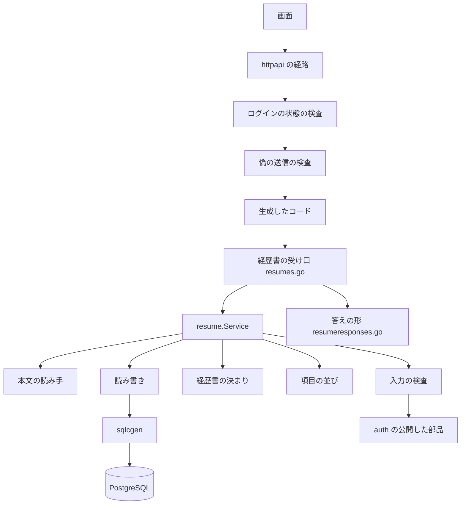
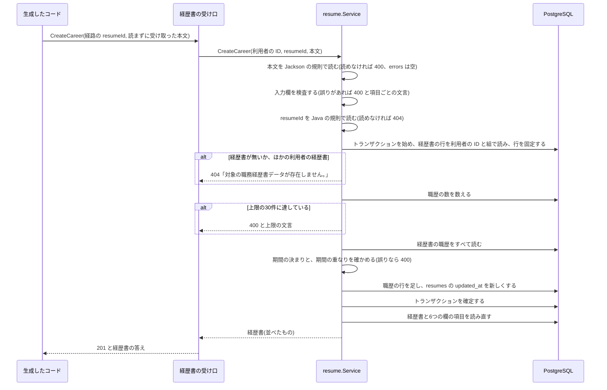
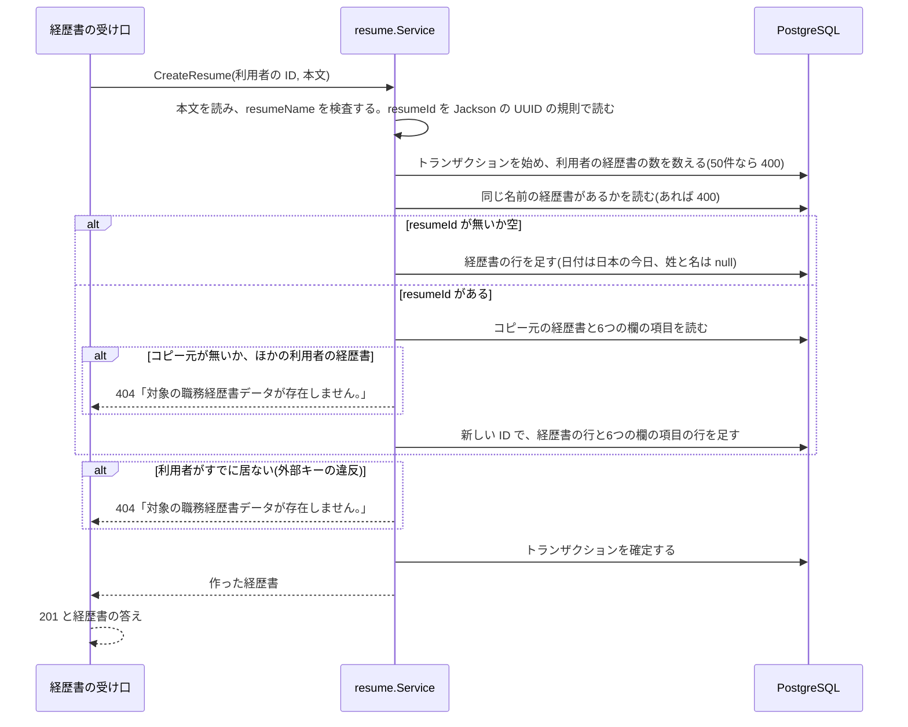

# 設計

## 概要

この設計は、Go 版に、マスタと経歴書の26の操作を足す。

Go 版は、Java 版と同じデータベースの表を、Java 版と同じ値の形で読み書きする。Claude は、Java 版の `presentation/resume/` と `presentation/certification/` `presentation/snsplatform/` `presentation/techstack/` の受け口と、`usecase/resume/` と `usecase/query/` の処理と、`domain/model/resume/` の変更の決まりを写す元とし、Go 版の部品ごとに、写す元の Java のクラスを書く。

マスタと経歴書の処理は、新しい機能のパッケージ `internal/resume` に置く。`internal/resume` は、認証の spec で公開した `internal/auth` の誤りの型と入力の検査の部品を使う。

Go 版が Java 版と同じ答えを返すには、要求の本文を、Java 版が JSON の読み書きに使うライブラリ Jackson と同じ規則で読む必要がある。生成したコードが本文を読む規則は、鍵の大文字と小文字を区別しない点などで Jackson と違う。そこで、この設計は、API の仕様書 `backend/api/openapi.yaml` の要求の本文の型を、読まずに受け取る型にする。`internal/resume` は、受け取った本文を Jackson と同じ規則で読む。この設計は、項目の ID の経路の値を、生成したコードが文字列のまま受け取る型にする。`internal/resume` は、受け取った文字列を Java 版と同じ規則で読む。

この設計は、Java 版と Go 版を比べる検査を広げる。広げる中身は、部品の節の「Java 版と Go 版を比べる検査の広げ方(harness)」に書く。

## 作るものと作らないもの

### 作るもの

- マスタと経歴書の26の操作の Go 版。Claude は、受け口を `internal/httpapi/resumes.go` に置き、処理を新しい機能のパッケージ `internal/resume` に置く
- 要求の本文を Java 版の Jackson と同じ規則で読む部品と、年月と日付と ID とリンクを Java 版と同じ規則で読む部品(`internal/resume` の中)
- 単体テストが Go 版の部品の答えと比べる、Java 版の答えの正解のファイル。中身は、部品の節の「Java 版の答えの正解のファイル(testdata)」に書く
- マスタと経歴書の SQL の問い合わせ(`backend/db/queries/resumes.sql` と `masters.sql`)と、sqlc が生成するコード
- API の仕様書の、要求の本文の8つの型と、項目の ID の6つの経路の値の書き換えと、生成したコードの作り直し
- 経路の値の誤りを扱う関数を、名前の付いた関数に出す変更と、その関数のテストの移し替え(`internal/httpapi/server.go` と `server_test.go` と、新しい `server_internal_test.go`)
- Java 版と Go 版を比べる検査の広げ方。広げる中身は、部品の節の「Java 版と Go 版を比べる検査の広げ方(harness)」に書く
- マスタと経歴書の操作の筋書き(`backend/compat/scenarios/resumes/*.yaml`)と、初期のデータ(`backend/compat/fixtures/resumes/resume-ops.sql` と `resume-limits.sql`)
- 変えた動きの一覧に載せる、マスタと経歴書の操作の違い(CB-047 から)
- 置き換えの spec の進み具合の表(`progress.md`)の、マスタと経歴書のまとまりの行

### 作らないもの

- ほかのまとまりの操作の Go 版。経歴書を PDF と Markdown で書き出す操作と、経歴書のバックアップと戻しは、それぞれのまとまりの spec で作る
- ログインの状態の検査と、偽の送信の検査。どちらも認証の spec と置き換えの spec で作ってあり、この spec はそのまま使う
- データベースの表の形の変更(マイグレーション)
- 品質チェックの設定の変更。`backend/.golangci.yml` と、生成の設定 `backend/api/oapi-codegen.yaml` と `backend/sqlc.yaml` は変えない
- Java 版のコードの変更。Java 版の答えで、プロジェクトの作業の工程の `systemTest` と `maintenance` の値が入れ替わる誤りを、Claude は試作で見つけた。Claude は、Go 版をこの答えに合わせ、Java 版の誤りは所有者に報告する。直すかどうかは所有者が決める
- 画面の変更

## 使う既存の仕組み

- 置き換えの spec の段階2である、Go 版の品質チェックと Java 版と Go 版を比べる検査をそろえる段階で作った Go 版の土台: この設計は、土台のうち次の3つのパッケージを使う。
  - `internal/httpapi`: 経路の登録と、中間処理と、未実装の答えを持つ。中間処理とは、要求が受け口に届く前に動き、要求を調べるか読む処理である
  - `database`: pgx の接続の束と、日本の時間帯の接続の設定と、sqlc の出力 `sqlcgen` を持つ
  - `internal/platform/authctx`: ログインした利用者の ID を受け渡す
- 認証の spec で作った `internal/auth` の公開した部品(`exported.go`): 誤りの型 `auth.Error`、入力の誤りを項目ごとに集める `FieldErrors`、業務の決まりで断る誤りを作る `ErrBusiness`、入力の誤りを作る `ErrInvalidInput`、Java の `@NotBlank` と同じ判定の `NotBlank`、UTF-16 の単位で長さを数える `UTF16Len`、Java の空白の判定 `IsJavaWhitespace`
- 認証の spec で作った `internal/httpapi/authresponses.go` の応答の型 `authResponse` と、応答を作る `authJSON` と `authErrorResponse` と、Jackson と同じく `<>&` を別の書き方に置き換えずにそのまま書く `jacksonJSON`
- API の仕様書 `backend/api/openapi.yaml` と、そこから生成した `internal/httpapi/gen`
- Java 版と Go 版を比べる検査 `backend/compat/harness`、変えた動きの一覧 `changed-behaviors.yaml`、初期のデータ `fixtures/users/basic.sql` と `fixtures/resumes/fonts.sql`
- 利用者の spec で作った退会の操作 `DELETE /api/users/me`。退会してすでに居ない利用者の筋書きは、この操作で利用者を退会させる
- `golang.org/x/text/collate`: 変えた動きの一覧の CB-001 のとおり、ポートフォリオと SNS と自己PR の名前を日本語の規則で並べる。`go.mod` に間接の依存として v0.43.0 が入っている
- 依存の向き: `cmd/keirekipro` から `internal/httpapi`、`internal/httpapi` から `internal/resume`、`internal/resume` から `internal/auth` と `internal/platform` の一方向とする。`internal/resume` は `internal/httpapi` と生成した型 `internal/httpapi/gen` を読まない。`internal/auth` と `internal/users` は `internal/resume` を読まない

## 設計を見直すきっかけ

- `internal/auth` の `exported.go` で公開した関数か型の形を変えたとき。`internal/resume` が、誤りの型と入力の検査の部品をこの関数と型で使うためである
- 認証の spec の設計は、ほかのまとまりのパッケージが `internal/auth` を読まず、`internal/platform/authctx` だけを読むと決めている。利用者の spec は、depguard の規則で機能のパッケージに `internal/auth` を読むことを許し、認証の spec の設計のこの決まりを守るかどうかを、まとまりごとの spec の設計で確かめると決めた。depguard は、Go のパッケージが読んでよいパッケージを決まりのとおりに限る、静的な検査の道具である。この設計は、`internal/resume` に `exported.go` の誤りの型と入力の検査の部品だけを読ませ、利用者の行とログインの状態を読ませない。`internal/resume` に、ほかの `internal/auth` の部品を読ませるときは、Claude は認証の spec の設計を見直す
- Java 版の経歴書の要求の型(`presentation/resume/dto/` の `*Request.java`)の項目か注釈を変えたとき。`internal/resume` の本文の読み手と入力の検査は、今の項目と注釈に合わせて本文を読むためである
- Java 版の経歴書の答えの型 `ResumeInfoResponse.java` か、マスタの答えの型を変えたとき。とくに、作業の工程の `systemTest` と `maintenance` の入れ替わりを Java 版で直したときは、Claude は Go 版も同じ PR で直す
- 経歴書の6つの欄の表か、マスタの表の列を、マイグレーションで変えたとき
- 仕様書の要求の本文の8つの型か、項目の ID の6つの経路の値を、仕様書の生成で作り直したとき。Claude は、この設計で足した `x-go-type` が残っていることを確かめる
- Java 版と Go 版を比べる検査の日時の比べ方の対象の鍵か表を変えたとき。日時の比べ方とは、この設計で足す `<wallclock:形:+秒>` の置き換えである。ほかのまとまりの筋書きも、経歴書の日時を同じ比べ方で比べるためである

## プロジェクトの決まりを守っているか

- backend のコードを置く層: Go 版の層の決まりは depguard が検査する。この設計は、マスタと経歴書の処理を1つの機能のパッケージ `internal/resume` に置き、受け口を `internal/httpapi` に置く。`internal/resume` が読む `internal/auth` と `internal/platform` は、今の depguard の規則の機能のパッケージの許す一覧にあるので、規則を変えずに済む。ArchUnit は Java 版だけを検査する。この spec は Java 版のコードを変えない
- データベースの表の形: 変えない。マイグレーションを足さない
- 新しいライブラリの追加: 無い。`golang.org/x/text` は `go.mod` に間接の依存として入っている。`internal/resume` が直接読むので、`go mod tidy` が `go.mod` の `// indirect` の印を外す。版は変わらない
- 品質チェックの設定: 変えない。仕様書 `backend/api/openapi.yaml` は品質チェックの設定ではないので、Claude が変える
- 使う外部の機能がこのリポジトリで使えるか: 新しいものは無い。マスタと経歴書の操作は、データベースだけを読み書きし、メールを送らず、Redis と画像の置き場所を使わない
- frontend の機能ごとの境界: この spec は画面を変えない
- frontend の状態の持ち方: この spec は画面を変えない

## 全体の構成



**使う技術**: net/http と oapi-codegen v2.8.2 の strict-server、pgx v5.11.0、sqlc v1.31.1、google/uuid v1.6.0、golang.org/x/text v0.43.0、Go 1.27.0、testcontainers-go v0.45.0。どれも `go.mod` と `Makefile` にすでにある版である。

`internal/resume` の中の部品の分け方は次のとおりである。

- `resume.Service` は、本文を読み、入力を検査し、経歴書を読み、経歴書の決まりを確かめ、変わる行をデータベースに書き、経歴書を読み直して返す
- `resume.Service` は、6つの欄の項目の追加と更新と削除に共通の流れを1つの関数 `editResume` にまとめる。欄ごとに違うのは、本文の読み方と、検査と、書く SQL の3つであり、`resume.Service` は、この3つだけを欄ごとの関数に分ける

## ファイルの構成

Claude が新しく作るファイル:

- `backend/internal/resume/service.go`: `Service` と `Deps` と `New`。26の操作のメソッドと、6つの欄の項目の変更をまとめる `editResume`
- `backend/internal/resume/masters.go`: 3つのマスタの読み出しと、技術スタックのマスタの振り分け
- `backend/internal/resume/body.go`: 要求の本文を Jackson と同じ規則で読む部品と、8つの要求の型
- `backend/internal/resume/jackdate.go`: 年月と日付を Jackson と同じ規則で読む部品
- `backend/internal/resume/javauuid.go`: ID を `java.util.UUID.fromString` と Spring と Jackson と同じ規則で読む部品と、UUID を Java と同じ順に比べる関数
- `backend/internal/resume/validate.go`: 8つの要求の型の、入力欄ごとの検査
- `backend/internal/resume/link.go`: リンクが https の形かを Hibernate Validator と同じ規則で判定する部品
- `backend/internal/resume/rules.go`: 経歴書と項目の数の上限、経歴書の名前の重なり、名前と姓と名の文字、期間の決まり
- `backend/internal/resume/order.go`: 6つの欄の項目の並べ方
- `backend/internal/resume/store.go`: 経歴書と項目の読み書き(sqlc の問い合わせを呼ぶ)
- `backend/internal/resume/model.go`: 経歴書と6つの欄の項目と技術スタックのマスタの型
- `backend/internal/resume/errors.go`: マスタと経歴書の操作の文言と、誤りを作る関数
- `backend/internal/resume/*_test.go`: 上の各ファイルの単体テスト(`body_test.go` `jackdate_test.go` `javauuid_test.go` `validate_test.go` `link_test.go` `rules_test.go` `order_test.go` `errors_test.go`)
- `backend/internal/resume/main_integration_test.go`: 結合テストのデータベースを testcontainers-go で用意する入口
- `backend/internal/resume/service_integration_test.go`: `Service` の結合テスト
- `backend/internal/resume/store_integration_test.go`: 読み書きの結合テスト
- `backend/internal/resume/testdata/`: 実装のはじめに Java 版から控える6つの正解のファイル。中身は、部品の節の「Java 版の答えの正解のファイル(testdata)」に書く
- `backend/internal/httpapi/testdata/resumebody/`: 本文の全体の扱いへの Java 版の答えの正解のファイル。中身は、部品の節の「Java 版の答えの正解のファイル(testdata)」に書く
- `backend/db/queries/resumes.sql`: 経歴書と6つの欄の項目の問い合わせ
- `backend/db/queries/masters.sql`: 3つのマスタの問い合わせ
- `backend/internal/platform/database/sqlcgen/` の下の、sqlc が生成する `resumes.sql.go` と `masters.sql.go`
- `backend/internal/httpapi/resumes.go`: 経歴書とマスタの26の操作の受け口と、`ResumeService` のインタフェース
- `backend/internal/httpapi/resumeresponses.go`: 経歴書の答えとマスタの答えの JSON の型と、`internal/resume` の値から答えを作る関数
- `backend/internal/httpapi/resumes_test.go`: 受け口の単体テスト
- `backend/internal/httpapi/server_internal_test.go`: 経路の値の誤りを扱う関数のテスト(`package httpapi`)
- `backend/compat/scenarios/resumes/*.yaml`: マスタと経歴書の操作の筋書き(部品の節の「マスタと経歴書の操作の筋書き」の表のファイル)
- `backend/compat/fixtures/resumes/resume-ops.sql`: 筋書きの利用者と経歴書の初期のデータ
- `backend/compat/fixtures/resumes/resume-limits.sql`: 上限に達した利用者と経歴書の初期のデータ

Claude が変えるファイル:

- `backend/api/openapi.yaml`: 要求の本文の8つの型と、項目の ID の6つの経路の値に `x-go-type` を足し、6つの経路の値の説明を Go 版の答えに合わせて書き直す
- `backend/internal/httpapi/gen/` の生成したコード: `make generate` で作り直す
- `backend/internal/httpapi/server.go`: `Options` に `ResumeHandlers` を足し、`routes` と `New` で経歴書の受け口を組み込む。経路の値の誤りを扱う無名の関数を、名前の付いた関数 `paramErrorHandler` に出す
- `backend/internal/httpapi/server_test.go`: 項目の ID に `not-a-uuid` を入れた経路を使う2つの副テストを消し、同じことを `server_internal_test.go` で確かめる
- `backend/cmd/keirekipro/main.go`: `resume.New` で `Service` を作り、`httpapi.Options` に渡す
- `backend/cmd/keirekipro/main_test.go`: 入口が経歴書の処理を受け口に渡すことを確かめるテスト `TestRun_PassesResumeHandlers` を足す。中身は、部品の節の「main.go」に書く
- `backend/go.mod`: `golang.org/x/text` の `// indirect` の印が外れる
- `backend/compat/harness/normalize.go`: 経歴書の作成と更新の日時を `<wallclock:形:+秒>` に置き換える処理を足す
- `backend/compat/harness/compare.go`: `<wallclock:形:+秒>` の秒の差を幅で比べる処理を、JSON の比べ方とデータベースの比べ方に足す
- `backend/compat/harness/versions.go`: Java 版の環境の値 `JavaEnv` に `TZ=Asia/Tokyo` を足す
- `backend/compat/harness/normalize_test.go` と `compare_test.go`: 足した処理の単体テスト
- `backend/compat/harness/versions_test.go`: `TestJavaEnv_DevProfileAndOIDCEndpoints` の期待する環境の値に `TZ=Asia/Tokyo` を足す。`assertEnv` が環境の値の数も確かめるので、足さないとこのテストが落ちる
- `backend/compat/harness/cross_test.go`: 版をまたいで確かめる筋書きの送り先を確かめるテスト `TestCrossRoute_ResumeSteps` を足す。中身は、部品の節の「マスタと経歴書の操作の筋書き」に書く
- `backend/compat/compat_test.go`、`backend/compat/cross_test.go`、`backend/compat/perf_test.go`: 未実装の答えを前提にした要求を、経歴書の削除から、経歴書の復元 `POST /api/resumes/restore` に移す
- `backend/compat/changed-behaviors.yaml`: CB-047 からの違いを足す
- `.kiro/specs/backend-go-replacement/progress.md`: マスタと経歴書のまとまりの行の spec の列と状態の列を書く

この設計の段階で Claude が書いたファイル:

- `.kiro/specs/backend-go-master-resumes/research.md`: 試作の記録と、設計の段階で調べたこと。実装のときに確かめた危うい点の結果を書き足す

## 処理の流れ

### 項目の追加(職歴の例)



### 経歴書をコピーして作る



経歴書をコピーして作るときに Go 版が処理する順は、Java 版の `CopyCreateResumeUseCase` のとおり、上限、名前の重なり、コピー元の読み出し、コピー元が利用者のものかの確認の順である。Go 版は、コピーした経歴書の日付と姓と名を、コピー元の値にする。Go 版は、コピーした項目に、新しい ID を付ける。

## 部品

### Service(マスタと経歴書の処理の入口)

対応する要件: 1.1, 1.2, 3.1, 3.2, 3.3, 3.4, 5.1

**役割**: `internal/resume.Service` は、マスタと経歴書の26の操作の処理を持つ。写す元は、`usecase/resume/` の各ユースケースと、`usecase/query/` の3つのマスタの問い合わせ(`CertificationListQuery` `SnsPlatformListQuery` `TechStackListQuery`)である。`Service` は答えの JSON を作らない。答えの JSON は受け口が作る。

**呼び出し方**: `New(Deps) *Service`。`Deps` は次の2つを持つ。

- `Pool *pgxpool.Pool`: データベースの接続の束
- `Now func() time.Time`: 今の時刻を返す関数。本番では、`main.go` が `time.Now` を渡す。テストは決まった時刻を返す関数を渡す

| メソッド | 写す元 | 返すもの |
|---|---|---|
| `ListCertificationNames(ctx)` | `CertificationListQuery` | 資格の名前の並び |
| `ListSnsPlatformNames(ctx)` | `SnsPlatformListQuery` | SNS の名前の並び |
| `ListTechStacks(ctx)` | `TechStackListQuery` | 技術スタックの名前の振り分け |
| `ListResumes(ctx, userID)` | `GetResumeListUseCase` | 経歴書の ID と名前と作成と更新の日時の並び |
| `CreateResume(ctx, userID, body)` | `CreateResumeUseCase`、`CopyCreateResumeUseCase` | 作った経歴書 |
| `GetResume(ctx, userID, resumeID)` | `GetResumeInfoUseCase` | 経歴書 |
| `DeleteResume(ctx, userID, resumeID)` | `DeleteResumeUseCase` | 無し |
| `UpdateResumeBasic(ctx, userID, resumeID, body)` | `UpdateResumeBasicUseCase` | 直した経歴書 |
| `CreateCareer` `UpdateCareer` `DeleteCareer` ほか、6つの欄ごとに3つ | 欄ごとの `Create*UseCase` `Update*UseCase` `Delete*UseCase` | 作成と更新は直した経歴書、削除は無し |

引数の `body` は読まずに受け取った本文のバイトの並びで、`resumeID` と項目の ID は経路の値の文字列である。

`editResume(ctx, userID, resumeID, fn)` は、6つの欄の18のメソッドが呼ぶ共通の流れである。トランザクションとは、データベースへの複数の読み書きを1つにまとめ、すべてを確定するか、すべてを取り消すかのどちらかにする仕組みである。`editResume` は、トランザクションの中で、経歴書の行を `user_id` と組で `FOR UPDATE` を付けて読み、無ければ無い経歴書の誤りを返す。`FOR UPDATE` は、読んだ行を、トランザクションを確定するまで、ほかのトランザクションが書き換えることも `FOR UPDATE` で読むこともできないように固定する、SQL の指定である。経歴書の行を読めれば、`editResume` は、欄ごとの関数 `fn` を呼び、`fn` が誤りを返さなければ、`resumes` の `updated_at` を新しくする。`editResume` は、確定したあとで経歴書を読み直して返す。行の固定は、同じ経歴書への2つの要求が、上限と期間の重なりの確認を同時に通らないようにするためである。

作成と変更の操作が返す経歴書の日時: Java 版は、作成と変更の答えに、`LocalDateTime.now()` の丸める前の値を返す(research.md の P2)。そこで、`Service` は、次のとおりに日時を返す。

- 経歴書の作成とコピーした作成: 作成の日時と更新の日時の両方に、`Now` から得た丸める前の値を返す
- 基本の情報の更新と、6つの欄の項目の作成と更新: 更新の日時に、`Now` から得た丸める前の値を返す。作成の日時には、データベースから読んだ値を返す。`editResume` は、読み直した経歴書の更新の日時を、丸める前の値に置き換えて返す
- データベースには、どの操作も、読み書きの節のとおりマイクロ秒に丸めた値を書く

**失敗したとき**:

- 経歴書が無いとき、ほかの利用者の経歴書のとき、経歴書の ID が読めないとき: 404 と「対象の職務経歴書データが存在しません。」
- 項目が無いとき、項目が別の経歴書の項目のとき、項目の ID が読めないとき: 404 と欄ごとの文言。文言は、「対象の職歴が存在しません。」「対象のプロジェクトが存在しません。」「対象の資格が存在しません。」「対象のポートフォリオが存在しません。」「対象のSNSプラットフォームが存在しません。」「対象の自己PRが存在しません。」である。項目の ID が読めない要求に Java 版は 500 で答えるので、Go 版は、要件4の受入基準4のとおり、無い項目と同じ答えにする。項目の ID が読めないかは、経歴書の確認のあとに確かめる
- 退会してすでに居ない利用者の、コピーしない経歴書の作成: Java 版は、`resumes.user_id` の外部キーの違反で 500 と答える。外部キーとは、`resumes.user_id` の値が `users` の表にある利用者の ID でなければならないという、データベースの決まりである。Go 版は、経歴書の行を足すときの外部キーの違反(PostgreSQL の誤りのコード 23503)を見分け、404 と「対象の職務経歴書データが存在しません。」で答える。Go 版は、上限と名前の重なりを、経歴書の行を足す前に確かめる。退会した利用者の経歴書は消えているので、上限と名前の重なりには当たらない
- 退会してすでに居ない利用者のほかの要求: 試作の P13 のとおり、Java 版と同じ答えになる。マスタは 200、一覧は 200 と空の並び、それ以外は無い経歴書と同じ 404 である。Go 版は利用者の行を読まずに経歴書の行を利用者の ID と組で読むので、Java 版と同じ答えになる

### マスタの読み出し(masters.go)

対応する要件: 1.1, 1.2, 6.1

**役割**: `masters.go` は、3つのマスタを読む。写す元は、`infrastructure/query/` の `certification/CertificationQueryMapper.xml`、`snsplatform/SnsPlatformQueryMapper.xml`、`techstack/TechStackQueryMapper.xml` と `techstack/MyBatisTechStackListQuery.java` である。

- 資格と SNS: Java 版と同じく、並べ方を指定しない SQL で名前を読む。Claude は、試作の P1 で、`ORDER BY` を付けずに読むと Java 版と同じ並びになることを確かめた
- 技術スタック: `ORDER BY c.main_category, c.sub_category, m.id` で読み、大分類(`frontend` `backend` `infrastructure` `tools`)と小分類で振り分ける。小分類の名前と、答えの鍵の名前の対応は、`MyBatisTechStackListQuery.java` の対応を写す。たとえば、小分類 `framework` は答えの鍵 `frameworks` になる。対応の無い小分類の行は、Java 版と同じく捨てる

### 本文の読み手(body.go、jackdate.go、javauuid.go)

対応する要件: 1.1, 2.1, 6.1

**役割**: 本文の読み手は、要求の本文を、Java 版の Jackson と同じ規則で読み、8つの要求の型(経歴書の作成、基本の情報の更新、6つの欄の項目)の値にする。

**呼び出し方**: `decodeBody(body []byte, fields []fieldSpec) (values, error)`。`fieldSpec` は、鍵の名前と、値の種類(文字列、真偽、年月、日付、文字列の並び、UUID)の組である。読み手は、`encoding/json` の `Decoder` を `UseNumber` にし、`Token` で鍵と値を1つずつ読む。構造体への読み込みは、鍵の大文字と小文字を区別しないので使わない。

読み方の規則は、試作の P10 から P12 で Java 版と比べた次のとおりである。

- 本文の全体: 本文の全体の扱いは、`decodeBody` より前に、生成したコードが呼ぶ `runtime.BindJSONBody`(oapi-codegen/runtime v1.8.0 の `bindjson.go` 36-45行)が決める。Go 版には要求を仕様書で検査する中間処理が無いので、`BindJSONBody` は `json.NewDecoder(r.Body).Decode` で、本文の最初の JSON の値だけを `json.RawMessage` に読む。最初の値のあとの余りは読まない。空の本文と空白だけの本文と、最初の値が JSON として誤った本文は、`BindJSONBody` が誤りを返し、生成したコードが 400 と `errors` が空の答えにする。`decodeBody` は、`BindJSONBody` が渡した最初の値がオブジェクトでなければ、読めない。オブジェクトでない値とは、並び、`null`、文字列、数、真偽である
- 鍵: 大文字と小文字を区別する。知らない鍵と、職歴の `active` の鍵は読み飛ばす。同じ鍵が2つあれば、あとの値を使う
- 文字列の欄: 文字列はそのまま使う。数は `json.Number` の元の書き方のまま文字列にする。真偽は `true` か `false` の文字列にする。並びとオブジェクトは読めない。`null` と、鍵が無いことは、値が無いことにする
- 真偽の欄: `true` と `false` はそのまま使う。文字列は、Java の空白を前後から除き、`true` `True` `TRUE` `false` `False` `FALSE` を受ける。空の文字列と `null` の文字列は値が無いことにする。整数は 0 と -0 を偽、ほかを真にする。小数の書き方の数と、ほかの文字列と、並びとオブジェクトは読めない
- 年月と日付の欄: `jackdate.go` が、試作で Jackson の `YearMonth` と `LocalDate` の読み方を写した規則で読む。前後の空白を除き、`[2024,1]` の並びの形を読む。日付は `T` の付いた日時と、1970年1月1日からの日数の整数も読む
- 文字列の並びの欄(技術スタック): 並びの要素の文字列はそのまま、数と真偽は文字列に、`null` は値の無い要素にする。並びでない値は読めない。欄の値が `null` なら、値の無い並びにする
- UUID の欄(経歴書の作成の `resumeId`): `javauuid.go` の `jacksonUUID` が、Jackson の UUID の読み方で読む。24文字の base64 の値も読む。空の文字列は、コピーしない作成にする

1つでも読めない値があれば、読み手は誤り `errUnreadableBody` を返す。`Service` は、この誤りを、入力の検査より先に、400 と `{"message":"入力エラーがあります。","errors":{}}` にする。

`javauuid.go` は、ほかに次の3つを持つ。

- `javaUUIDFromString(s)`: `java.util.UUID.fromString` の写し。区切りの `-` の間の桁が足りない値と、大文字の値を読む
- `springPathUUID(s)`: Spring の経路の値の読み方の写し。前後の空白を除いてから `javaUUIDFromString` で読む。経歴書の ID と項目の ID の読み方である
- `compareJavaUUID(a, b)`: `java.util.UUID.compareTo` の写し。上位の64ビットと下位の64ビットを、それぞれ符号付きの整数として比べる

### 入力の検査(validate.go、link.go)

対応する要件: 2.1, 6.1

**役割**: `validate.go` は、8つの要求の型の入力欄を、Java 版の要求の型(`presentation/resume/dto/*Request.java`)の注釈のとおりに検査し、項目ごとの文言を `auth.FieldErrors` に集める。写す元は、`CreateResumeRequest`、`UpdateResumeBasicRequest`、`CreateCareerRequest`、`UpdateCareerRequest`、`CreateProjectRequest`、`UpdateProjectRequest`、`CreateCertificationRequest`、`UpdateCertificationRequest`、`CreatePortfolioRequest`、`UpdatePortfolioRequest`、`CreateSnsPlatformRequest`、`UpdateSnsPlatformRequest`、`CreateSelfPromotionRequest`、`UpdateSelfPromotionRequest` である。

- `validate.go` は、入力が要るかを `auth.NotBlank` と、値が無いことで判定する。`validate.go` は、長さを `auth.UTF16Len` で数える。Go 版は、入力の前後の空白を取り除かずに保存する(試作の P3)
- 作業の工程の真偽の欄が無いときの文言は、Java 版の `@NotNull` の文言「null は許可されていません」にする
- 年月と日付の範囲: 読めた年月か日付が1900年より前か2100年より後なら、Java 版と同じ文言で断る(試作の P5)
- `link.go` の `isHibernateHTTPSURL(s)`: Hibernate Validator 9.1.5 の `@URL(protocol = "https")` の写しである。`new URI(値).toURL()` で読めるかと、プロトコルが `https` かを、`java.net.URI` の読み方を写して判定する(試作の P4)
- 1つの入力欄に2つ以上の文言が付くときの並びは、Java 版の Bean Validation の並びと同じとは限らない。Bean Validation は、Java 版が要求の型の注釈に従って入力欄を検査する仕組みである。この違いは、変えた動きの一覧の、入力の誤りの文言の並びの違いで許す

### 経歴書の決まり(rules.go)

対応する要件: 2.1, 3.3

**役割**: Claude は、`rules.go` に、Java 版の `domain/model/resume/` の値の決まりと、`usecase/resume/policy/ResumeLimitChecker` と `ResumeLimits` と、`domain/service/resume/ResumeNameDuplicationCheckService` を写す。

- 数の上限: 経歴書は利用者ごとに50件、職歴は30件、プロジェクトは100件、資格は50件、SNS は10件、ポートフォリオは50件、自己PR は5件である。文言は `ResumeLimitChecker` の文言を写す
- 経歴書の名前: `ResumeName` の使えない文字と長さの決まりを写す
- 姓と名: `FullName` の使える文字の決まりを写す
- 名前の重なり: 経歴書の作成のときと、基本の情報の更新で名前を変えたときだけ、同じ利用者の中に同じ名前の経歴書があるかを確かめる
- 期間: `Period` の決まりと、`Resume` の職歴どうしの期間の重なりの決まりを写す。`Period` の決まりは、継続中なら終了の年月を持たない、継続中でなければ終了の年月が要る、終了が開始より前でない、の3つである。職歴の重なりは、Java 版と同じく 400 と `errors` が空の答えにする
- 上限と、経歴書が利用者のものかの確認の順: Go 版は、経歴書が利用者のものかを先に確かめる(要件3の受入基準3)

### 項目の並び(order.go)

対応する要件: 1.1, 6.1

**役割**: `order.go` は、6つの欄の項目を、Java 版の `domain/policy/resume/ResumeEntryOrderPolicy` のとおりに並べる。

- 職歴とプロジェクト: 継続中の項目を先に、終了の年月の新しい順、開始の年月の新しい順、ID の `compareJavaUUID` の順
- 資格: 取得の年月の新しい順、ID の `compareJavaUUID` の順
- ポートフォリオと SNS と自己PR: 名前(自己PR は題)を `golang.org/x/text/collate` の日本語の規則で並べ、同じなら ID の `compareJavaUUID` の順。日本語の規則の違いは変えた動きの一覧の CB-001 で受け入れてある

Claude は、試作の P8 で、6つの欄のどれでも、ID の比べ方が Java 版と同じになることを確かめた。

### 読み書き(store.go、db/queries/resumes.sql、db/queries/masters.sql)

対応する要件: 4.2, 5.1, 5.2, 6.1

**役割**: `store.go` は、経歴書と6つの欄の項目と、3つのマスタを、sqlc が生成した問い合わせで読み書きする。

- 経歴書の一覧: `resumes` の表だけを `WHERE user_id = $1 ORDER BY created_at` で読む。Java 版の `ResumeMapper.xml` の `selectAllByUserId` と同じ並べ方である。一覧の答えに項目を出さないので、項目を読まない
- 経歴書1件: `resumes` の行を `WHERE id = $1 AND user_id = $2` で読み、6つの欄の項目を `resume_id` で読む。プロジェクトは `project_tech_stacks` と組にして読む
- 書き方: 操作ごとに、変わる行だけを書く。職歴の更新なら、`careers` の1行と、`resumes` の `updated_at` だけを書く。経歴書の削除は、子の表の行をすべて消してから `resumes` の行を消す。Java 版は、経歴書の保存のたびに6つの欄の行をすべて消して書き直すが、残る行の中身は同じである。この違いは Java 版と Go 版を比べる検査の対象の外である(research.md の「設計で比べた案」)
- プロジェクト: `projects` と `project_tech_stacks` の行を、同じトランザクションで書く(試作の P7)。技術スタックの列 `TEXT[]` は `[]*string` で読み書きする(試作の P6)
- 日時: 作成と更新の日時は、`Deps.Now()` を日本の時間帯 `Asia/Tokyo` の時刻にし、`time.Round(time.Microsecond)` で丸めてから書く。pgjdbc がマイクロ秒に四捨五入して書くのと同じ値になる(試作の P2)。経歴書の日付は日本の日付で書く
- トランザクション: 書く操作は、`pgx.BeginFunc` で1つのトランザクションにする。誤りのときは、すべての書き込みを取り消す

### 経歴書の受け口(internal/httpapi/resumes.go と resumeresponses.go)

対応する要件: 1.1, 1.2, 3.1, 4.4

**役割**: Claude は、`resumes.go` に、生成したコードの26の操作のメソッドを持つ `resumeHandlers` を作る。手本は利用者の受け口 `userHandlers` である。受け口は、ログインした利用者の ID と、経路の値と、読まずに受け取った本文を `resume.Service` に渡し、`resume.Service` が返した値を答えの JSON にする。受け口は、本文を読まず、入力を検査しない。

- Claude は、`resumes.go` に `ResumeService` のインタフェースを置き、`var _ ResumeService = (*resume.Service)(nil)` で、`resume.Service` がこのインタフェースを満たすかを確かめる
- ログインした利用者の ID は `authctx.UserID` で得る。無ければ、利用者の受け口と同じく組み立ての誤りとして 500 にする。ログインの状態の検査が先に 401 で答えるので、この誤りは組み立ての誤りでだけ起きる
- 受け口は、失敗を `authErrorResponse` で答え、成功を `authJSON` で答える

| 操作 | 成功の応答 |
|---|---|
| 3つのマスタ | 200 と、資格と SNS は `{"names":[...]}`、技術スタックは `{"frontend":{...},"backend":{...},"infrastructure":{...},"tools":{...}}` |
| 経歴書の一覧 | 200 と `{"resumes":[{"id","resumeName","createdAt","updatedAt"}]}` |
| 経歴書の作成と、6つの欄の項目の作成 | 201 と経歴書の答え |
| 経歴書1件、基本の情報の更新、6つの欄の項目の更新 | 200 と経歴書の答え |
| 経歴書の削除と、6つの欄の項目の削除 | 204 と空の本文 |

`resumeresponses.go` は、`ResumeInfoResponse.java` の形を写す。

- `lastName` と `firstName` は、`null` なら鍵ごと書かない
- 6つの欄の並びは、空なら鍵ごと書かない
- プロジェクトの `techStack` の中の並びは、`null` と `[]` を書いたまま返す
- プロジェクトの `process` の `systemTest` には `maintenance` の値を、`maintenance` には `systemTest` の値を入れる。Java 版の `ResumeInfoResponse.java` が入れ替えて答えるためである
- 日時は、Java の `LocalDateTime` の書き方にする。`Service` が返した丸める前の値は、ナノ秒まで書き、末尾の 0 を落とす。データベースから読んだ値は、マイクロ秒まで書き、末尾の 0 を落とす。どの日時が丸める前の値かは、Service の節の「作成と変更の操作が返す経歴書の日時」のとおりである
- 年月は `YYYY-MM`、日付は `YYYY-MM-DD` で書く

### 仕様書の変更(backend/api/openapi.yaml と生成したコード)

対応する要件: 1.1, 4.4

**役割**: Claude は、仕様書を次のとおり書き換え、`make generate` で生成したコードを作り直す。

- 要求の本文の8つの型(`CreateResumeRequest` `UpdateResumeBasicRequest` `CareerRequest` `CertificationRequest` `PortfolioRequest` `SnsPlatformRequest` `SelfPromotionRequest` `ProjectRequest`)に、`x-go-type: json.RawMessage` と `x-go-type-import: {path: encoding/json}` を足す。生成したコードは、本文を読まずに `json.RawMessage` として受け口に渡す。項目の名前と型の説明は残すので、API の説明画面の見た目は変わらない
- 項目の ID の6つの経路の値(`CareerId` `ProjectId` `CertificationId` `PortfolioId` `SnsPlatformId` `SelfPromotionId`)に、`x-go-type: string` を足す。生成したコードは、型が文字列の経路の値を誤りにしない。説明の「Java 版は UUID として受け取り、UUID として読めない値には 500 を返す。」を、「UUID として読めない値には、無い項目と同じ 404 を返す。Java 版は 500 を返す(変えた動きの一覧の CB-047 から)。」の形に書き直す

### httpapi.New と paramErrorHandler(経歴書の受け口を経路に組み込む変更と、経路の値の誤りを扱う関数)

対応する要件: 1.1, 4.4

**役割**: Claude は、`server.go` の `Options` に `ResumeHandlers ResumeService` を足す。`routes` は、経歴書の受け口を、認証と利用者の受け口と同じ深さ1に埋め込む。深さとは、Go の構造体の埋め込みが何段目にあるかを指す。経歴書の受け口のメソッドは、未実装の答えの同じ名前のメソッドより先に使われる。`ResumeHandlers` が `nil` なら、`routes` は未実装の答えのままにする。

Claude は、`ErrorHandlerFunc` の無名の関数を、名前の付いた関数 `paramErrorHandler(logger *slog.Logger)` に出す。中身は変えない。`paramErrorHandler` は、今と同じく、`/api/auth/` の下の問い合わせの誤りだけを 400 にし、ほかを 500 にして、ログに誤りの型だけを書く。

項目の ID を文字列にすると、`server_test.go` の2つの副テストが使う `/careers/not-a-uuid` の経路は、この関数に届かなくなる。2つの副テストは、`TestBadJSONReturns400MessageErrors` の「経路の値の形の誤りは、Java 版と同じ 500 にし、ログに値を書かない」と、`TestNew_AuthQueryError400` の「ほかの経路の値の形の誤りは 500 のまま」である。Claude は、この2つを消し、`server_internal_test.go`(`package httpapi`)で、`paramErrorHandler` に `&gen.InvalidParamFormatError{}` を直接渡し、同じことを確かめる。

### main.go(Go 版を起動する入口で、経歴書の処理を作って受け口に渡す変更)

対応する要件: 1.2

**役割**: `main.go` は、`resume.New(resume.Deps{Pool: pool, Now: time.Now})` で `Service` を作り、`httpapi.Options{... ResumeHandlers: resumeService}` を渡す。

Claude は、`main_test.go` に `TestRun_PassesResumeHandlers` を足す。手本は、同じファイルの `TestRun_PassesUserHandlers` である。このテストは、入口を起動し、ログインした利用者の経歴書の一覧の要求が、未実装の答えでなく、200 と空の並びで答えられることを確かめる。`internal/httpapi` のテストは `httpapi.New` に自分で `ResumeHandlers` を渡すので、`main.go` が渡し忘れても通ってしまうためである。

### 試作の記録(research.md)

対応する要件: 6.1, 6.2

**役割**: Claude は、設計を書く前に、要件6の受入基準1の9つの動きと、ほかに確認が要る4つの動きを試しに作り、方法と結果を research.md の「試作の記録」に書いた。Java 版と同じにできない動きは見つからなかったので、Claude は、要件6の受入基準2のとおりには止まらず、設計を書いた。UTF-8 として誤ったバイトを含む本文の扱いは試作で確かめていないので、Claude は、実装のはじめに確かめて research.md に書き足す。Java 版と同じ答えにできないと分かったら、Claude は、要件6の受入基準2のとおりに止まり、所有者に報告する。

### Java 版の答えの正解のファイル(testdata)

対応する要件: 1.1, 6.1, 6.2

**役割**: 単体テストは、Java 版の答えを正解のファイルに置き、Go 版の部品の答えと比べる。試作で Java 版に送った入力はリポジトリに入っていない。そこで、Claude は、実装のはじめに、research.md の、リンクの P4、年月と日付の P5、項目の並びの P8、ID の P9、要求の本文の型の違う値の P10〜P12 の節に書いた書き方と値の種類を、すべて含む入力を作り直す。件数は、試作の件数と同じでなくてよい。テストが確かめるのは書き方と値の種類であり、件数ではないためである。

Claude は、research.md の「確かめた環境」と同じ設定で、開発環境の `spring` のコンテナの中に Java 版をもう1つ動かし、作り直した入力を送る。この Java 版は、データベース `keireki_proto` と Redis の DB 7 を使い、所有者の開発のデータベース `keireki_pro` と Redis の DB 0 に触れない。Claude は、答えを控え終えたら、この Java 版を止め、データベース `keireki_proto` を消し、Redis の DB 7 を空にする。

`backend/internal/resume/testdata/` に置く6つの正解のファイル:

| ファイルの中身 | 使うテスト |
|---|---|
| 年月と日付の書き方ごとの、Java 版が読んだ値か、読めなかったこと | `jackdate_test.go` |
| ID の書き方ごとの、経路の値として読んだ ID と、経歴書の作成の `resumeId` として読んだ ID か、読めなかったこと | `javauuid_test.go` |
| リンクごとの、Java 版の判定 | `link_test.go` |
| 型の違う値を入れた本文ごとの、Java 版の状態の番号と本文と、データベースに書いた値 | `body_test.go` |
| 期間か取得の年月か名前が同じ項目を持つ経歴書の、Java 版が返した6つの欄の項目の並び | `order_test.go` |
| UTF-8 として誤ったバイトを文字列の欄と技術スタックの並びの欄に入れた本文ごとの、Java 版の状態の番号と本文と、データベースに書いた値 | `body_test.go` |

項目の並びの正解のファイルの経歴書は、項目の ID に、`0` から `7` で始まる UUID と `8` から `f` で始まる UUID の両方を使う。

`backend/internal/httpapi/testdata/resumebody/` には、最初の値のあとに余りのある本文と、空の本文と、並びと `null` と文字列の本文を、Java 版の経歴書の作成と職歴の追加に送ったときの、状態の番号と本文を置く。`resumes_test.go` が、`httpapi.New` で作った経路の答えと比べる。本文の全体の扱いは、`internal/resume` の本文の読み手ではなく、生成したコードが決めるためである。

### Java 版と Go 版を比べる検査の広げ方(harness)

対応する要件: 4.2, 4.3, 5.2

**役割**: Claude は、harness を、経歴書の作成と更新の日時を、2つの版がそれぞれ保存した時刻の差で比べられる形に広げる。

- Java 版の時間帯: `versions.go` の `JavaEnv` に `"TZ": "Asia/Tokyo"` を足す。本番の ECS のタスクと同じ設定である。Java 版と Go 版を比べる検査と版をまたいで確かめる検査の Java 版は、どちらもこの値で動く
- 置き換える対象: 経歴書の答えと一覧の答えの JSON の鍵 `createdAt` と `updatedAt` と、データベースの `resumes` の表の `created_at` と `updated_at` の列である
- 置き換え方: `Normalizer` は、対象の値を `<wallclock:形:+秒>` に置き換える。形は、今の `<datetime:形>` と同じく、秒の小数を除いた書き方の形である。秒は、`Normalizer` が値を `Asia/Tokyo` の時刻として読み、その版の応答を受けた時刻(`Normalizer` の `received`)を引いた秒数である
- 比べ方: JSON の比べ方(`compareJSON`)とデータベースの比べ方(`CompareDB`)は、`<wallclock:形:+秒>` どうしを、秒を除いた文字が同じで、秒の差が5秒以内なら同じとする。5秒は、Redis の残りの時間の比べ方の幅 `RedisTTLTolerance` と同じである。データベースの行を組にするときは、秒を除いた文字で並べて組にし、組にしたあとで秒の差を比べる
- Java 版と Go 版を比べる検査は、段ごとに Java 版、Go 版の順に要求を送る(`compareenv.go` の段の繰り返し)。そのため、Go 版の応答を受けた時刻は、Java 版の応答を受けた時刻より、Go 版の段にかかった時間だけ遅い。秒の差は、値ごとに次のとおりになる
  - その段か前の段の要求で保存した日時: Java 版と Go 版を比べる検査は、版ごとに別のデータベースを使う(`compareenv.go` の `Stores`)。どちらの版も、自分のデータベースに、応答を受ける少し前の自分の時刻を書く。そのため、秒の差は、2つの版の処理の時間の違いと、段ごとの応答の時間の違いほどになる
  - 初期のデータの固定の日時: Java 版と Go 版を比べる検査は、2つの版のデータベースに同じ初期のデータを入れる。そのため、秒の差は、Java 版の応答を受けてから Go 版の応答を受けるまでの時間になる
  - Go 版が日本の時間帯でない時刻を書くと、秒の差は9時間になり、5秒の幅の外になる

未実装の答えを前提にした検査のテストの移し替え: `backend/compat/` の `compat_test.go`、`cross_test.go`、`perf_test.go` は、未実装の答えを確かめるために、経歴書の削除の要求(`DELETE /api/resumes/00000000-0000-4000-8000-000000000201` と `csrf: true`)を使う。この spec で経歴書の削除が Go 版で動き始めると、この3つのファイルのテストは失敗する。そこで、Claude は、経歴書の受け口を経路につなぐ前に、この要求を、経歴書の復元の要求 `POST /api/resumes/restore` に替える。経歴書の復元は、バックアップのまとまりの操作であり、この spec のあとも未実装のまま残る、偽の送信の検査が働く書き込みの操作である。生成したコードは本文を読んでから受け口を呼ぶので、Claude は、読める JSON の本文 `{}` と `csrf: true` を付け、答えの期待を 501 のまま残す。Claude は、3つのファイルの段の名前 `delete-with-token` を `restore-with-token` に替える。Claude は、`compat_test.go` で、Java 版と Go 版を比べる検査が報告した違いの段の名前と操作の名前 `deleteResume` を確かめる箇所と、テストが違いを許す範囲として書いた match の操作の名前も、`restore-with-token` と経歴書の復元の操作の名前 `restoreResume` に替える。

harness を変えたあと、Claude は、今ある認証と利用者の筋書きで `make compat` を流し、日時の置き換えと Java 版の時間帯の変更が、今ある筋書きを壊していないことを確かめる。

**失敗したとき**: 秒の差が幅の外のとき、harness は、鍵か列の名前と、2つの版の値を報告に書く。

### マスタと経歴書の操作の筋書き(scenarios/resumes)

対応する要件: 3.1, 3.2, 3.3, 3.4, 4.1, 4.2, 4.3, 4.5, 5.1, 5.3

**役割**: `backend/compat/scenarios/resumes/*.yaml` は、`group: 3` の筋書きである。初期のデータは、`fixtures/users/basic.sql` の利用者 user1 と user2 と、この spec で足す `fixtures/resumes/resume-ops.sql` と `resume-limits.sql` を使う。

| ファイル | 中身 | 動かし方 |
|---|---|---|
| `masters.yaml` | 3つのマスタ | compare |
| `resume-crud.yaml` | 経歴書の一覧、作成、コピーして作成、1件、基本の情報の更新、削除 | compare |
| `career.yaml` `project.yaml` `certification.yaml` `portfolio.yaml` `sns-platform.yaml` `self-promotion.yaml` | 欄ごとの項目の追加、更新、削除と、入力の誤り | compare |
| `resume-validation.yaml` | 経歴書の作成と基本の情報の更新の入力の誤り | compare |
| `limits.yaml` | 経歴書の数と、6つの欄の項目の数の上限 | compare |
| `not-found.yaml` | 無い経歴書、無い項目、別の経歴書の項目 | compare |
| `other-user.yaml` | ほかの利用者の経歴書と、その経歴書の項目 | compare |
| `deleted-user.yaml` | 退会してすでに居ない利用者 | compare |
| `cross-resume.yaml` | 版をまたいだ作成から削除まで | cross |
| `perf-*.yaml` | 応答の時間を測る5つの操作 | perf |

筋書きの場面は次のとおりである。

- 正しい要求: 26の操作のすべてを、画面が送るのと同じ本文で送る。プロジェクトは、技術スタックの4つの大分類のすべての並びに値を入れた本文と、`null` と `[]` の並びを含む本文を送る
- 入力の誤り: 入力欄ごとに、入力が要るかと、長さの上限の境界と、値の形(年月、日付、リンク)の誤りを送る。長さは、絵文字を含む値で、UTF-16 の単位の境界を送る。本文が読めない要求も送る。本文が読めない要求は、鍵を大文字で書いた要求、文字列の欄に並びを入れた要求、真偽の欄に読めない文字列を入れた要求、本文の全体が並びか文字列の要求の4つである
- 名前の重なりと名前の文字: 同じ利用者の中の同じ名前の経歴書の作成と、使えない文字を含む経歴書の名前と、姓と名を送る
- 期間: 終了が開始より前の期間、継続中で終了の年月を持つ期間、継続中でなく終了の年月の無い期間、職歴どうしの重なる期間を送る
- 上限: `resume-limits.sql` の、経歴書を50件持つ利用者の経歴書の作成と、6つの欄の項目が上限に達した経歴書への項目の追加を送る
- 無い経歴書と無い項目: 無い ID と、大文字の ID と、前後に空白のある ID と、ID の形でない経歴書の ID を送る。別の経歴書の項目の ID を組にした要求を送る(要件3の受入基準2)
- ほかの利用者の経歴書: user2 が、user1 の経歴書の取得、削除、基本の情報の更新、コピーして作成、6つの欄の項目の更新と削除を送る。項目の追加は、上限に達していない経歴書に送る。上限に達した経歴書に項目を足す要求は、Java 版と Go 版で答えが違うので送らない(変えた動きの一覧の CB-047)
- 退会してすでに居ない利用者: `resume-ops.sql` の退会用の利用者がログインし、ログインの状態の値を `cookie:accessToken` で取り出してから、`DELETE /api/users/me` で退会する。そのあとの段で、取り出した値を `headers: {Cookie: 'accessToken={名前}'}` で送り、3つのマスタと、経歴書の一覧と、コピーして作成と、退会の前に作った経歴書と項目への操作を送る。コピーしない作成は、Java 版が 500 で答えるので送らない(変えた動きの一覧)
  - 取り出した値が退会のあとも使える理由: ログインの状態の値は、`user_token_versions` の世代の番号を持つ。退会は、利用者の行と一緒に世代の番号の行を消し、行の無い利用者の世代の番号は 0 として読まれる。そのため、世代の番号が 0 のままの利用者(パスワードを変えていない利用者)の値は、退会のあとも、ログインの状態の検査を通る。退会のあとの `GET /api/users/me` が 401 になるのは、利用者の情報の取得が利用者の行を読むためである(`scenarios/users/delete-user.yaml`)
  - 偽の送信の検査の値: 退会の答えは、Cookie の `accessToken` と `refreshToken` だけを消し、`XSRF-TOKEN` を残す(Java 版の `DeleteUserController.java`)。そのため、退会のあとの `csrf: true` の段は、Cookie の束に残る `XSRF-TOKEN` を使う
- データベース: どの筋書きも、段ごとにデータベースの表を比べる。日時は `<wallclock:形:+秒>` で比べ、ID は今の UUID の置き換えで、前の段と同じ値かを比べる

`cross-resume.yaml` は、次の段を、Java 版から Go 版への向きと、Go 版から Java 版への向きの両方で動かす。

1. 一方の版で経歴書を作り、6つの欄に項目を1つずつ足す
2. 保存した版で `GET /api/resumes/{id}` を送り、経歴書の ID と項目の ID と、作成と更新の日時を `capture` で取り出す
3. もう一方の版(`to: other`)で同じ経歴書を読み、`expect.values` で、項目の値と、作成と更新の日時が、取り出した値と同じことを確かめる。Claude は、真偽と並びの値には、送った値をそのまま期待する値として書く
4. もう一方の版で項目を直し、消す。最初の版で読み直し、直した値が見えることを確かめる
5. もう一方の版で経歴書を消し、最初の版で 404 になることを確かめる

Claude は、`cross-resume.yaml` を書く前に、`backend/compat/harness/cross_test.go` に `TestCrossRoute_ResumeSteps` を足す。手本は、同じファイルの `TestCrossRoute_UserSteps` である。このテストは、`scenarios/resumes/` の、`modes` に `cross` を書いた筋書きを読み、Java 版から Go 版の向きと Go 版から Java 版の向きのそれぞれで、`expect.values` を持つ段が、その前の変える段と違う版に送られることを確かめる。`cross-resume.yaml` が無ければ、このテストは失敗する。筋書きの `to: other` の書き誤りで、保存した版と同じ版で読み直してしまうと、版をまたいで確かめたことにならないためである。

`perf-*.yaml` は、要件4の受入基準5が決めた5つの操作を測る。5つの操作は、経歴書の一覧、経歴書1件、基本の情報の更新、プロジェクトの項目の更新、技術スタックのマスタである。経歴書は、`fixtures/resumes/fonts.sql` の、6つの欄のすべてに項目を持つ経歴書を使う。

### 初期のデータ(fixtures/resumes)

対応する要件: 4.1, 4.5

**役割**:

- `resume-ops.sql`: 経歴書と6つの欄の項目を持つ user1 の経歴書と、退会用の利用者を置く。退会用の利用者のパスワードは、`basic.sql` の利用者のパスワードと同じにする。退会用の利用者の世代の番号の行は、`token_version` を 0 にする。退会用の利用者には、退会の前に経歴書と6つの欄の項目を置く。ID は `00000000-0000-4000-8000-0000000003xx` の範囲にする
- `resume-limits.sql`: 経歴書を50件持つ利用者と、6つの欄の項目がそれぞれ上限に達した経歴書を置く。上限の数は、「経歴書の決まり(rules.go)」の節の数の上限のとおりである

### 変えた動きの一覧に載せる違い(changed-behaviors.yaml)

対応する要件: 3.3, 4.4

**役割**: Claude は、`changed-behaviors.yaml` に次の違いを `group: 3` で足す。どの違いにも、受け入れた日を「画面に影響が無い理由」に「所有者が 2026-11-14 に受け入れた(requirements の承認)」と書く。

- CB-047: ほかの利用者の経歴書の、上限に達した欄に項目を足す要求。Java 版は上限の文言で 400 と答え、Go 版は無い経歴書と同じ 404 で答える。match を書かない。Go 版の答えは、`service_integration_test.go` で確かめる
- CB-048: 項目の ID が読めない、項目の更新と削除の要求。Java 版は 500 と答え、Go 版は無い項目と同じ 404 で答える。Claude は、この違いに match を書かない。Java 版と Go 版を比べる検査は、この要求を送らない。Go 版の答えは、`resumes_test.go` と `service_integration_test.go` で確かめる
- CB-049: 退会してすでに居ない利用者の、コピーしない経歴書の作成。Java 版は 500 と答え、Go 版は無い経歴書と同じ 404 で答える。match を書かない。Go 版の答えは、`service_integration_test.go` で確かめる
- CB-050: 入力の誤りの文言の並び。入力の誤りの文言の並びの違い CB-011 と同じ形で、2つ以上の文言が付きうる入力欄の `$.errors.<項目>[*]` に `order_only: true` の match を書く。どの入力欄に付くかは、実装のときに Java 版の要求の型の注釈で確かめる。たとえば、リンクの、入力が要る文言と https の形の文言である
- 実装で、Java 版が 500 で答えるほかの要求が見つかったら、Claude は、要求ごとに1つの違いを足す

### API の説明画面での確認(実装の終わりに Claude が Playwright で行う確認)

対応する要件: 1.2

**役割**: Claude は、実装の終わりに、開発環境の compose の `api-docs`(ポート 8082)を Playwright で開いて確かめる。Claude は、実装している作業フォルダのコードを動かす `backend-go` のコンテナで、API の説明画面の動きを確かめる。Claude は、利用者の spec と同じ手順で利用者を作ってログインし、「Try it out」で、技術スタックのマスタの取得、経歴書の作成、職歴の追加、経歴書1件の取得が、成功の答えを返すことを確かめる。経歴書の作成と職歴の追加は書き込みの操作なので、Go 版は、`X-XSRF-TOKEN` のヘッダが Cookie `XSRF-TOKEN` の値と合わないと 403 で答える。そのため、Claude は、ログインのあとに、ブラウザの Cookie `XSRF-TOKEN` の値を Playwright で読み、2つの操作の「Try it out」の `X-XSRF-TOKEN` の欄に入れる。Claude は、経歴書の作成の答えの `id` を、職歴の追加と経歴書1件の取得の `resumeId` の欄に入れる。Claude は、結果を PR の本文に書く。

### 進み具合の表(progress.md のマスタと経歴書のまとまりの行)

対応する要件: 6.3

**役割**: Claude は、`progress.md` のまとまりの表のマスタと経歴書の行の spec の列に `.kiro/specs/backend-go-master-resumes` を書く。この spec の PR は1つであり、マスタと経歴書のまとまりの最初の PR であり、26の操作を作り終えた PR でもある。そこで、Claude は、この PR で、状態の列を「未着手」から直接「作り終えた」にする。

状態を「作り終えた」にすると、筋書きに出てくる操作が足りているかを確かめる `TestCoverage_Operations` が、group 3 の26の操作がすべて筋書きに1回以上出てくることを求め始める。Claude は、この書き換えを、筋書きを書き終える時点で行う。筋書きから漏れた操作を、PR を出す前に見つけるためである。

Java 版と Go 版を比べる検査は、この spec の PR の必須のチェックであり、通らなければ PR はマージされない。そこで、Claude は、この spec の PR のマージを確かめたあと、main から新しい featureブランチを作り、状態の列を「比べる検査に通った」にする PR を別に出す。

## データの形

### データベースの表

読み書きする表は、`resumes`、`careers`、`projects`、`project_tech_stacks`、`certifications`、`portfolios`、`sns_platforms`、`self_promotions` と、マスタの `certification_mst`、`sns_platform_mst`、`tech_stack_category_mst`、`tech_stack_mst` である。

- `resumes.created_at` と `updated_at` は `TIMESTAMP(6)` で、時差を持たない日本の時刻を書く
- `resumes.user_id` は `users` を参照し、`ON DELETE CASCADE` を持たない
- `project_tech_stacks` は `project_id` を主キーにし、技術スタックの小分類ごとの `TEXT[]` の列を持つ

### 経歴書の答え

```json
{
  "id": "00000000-0000-4000-8000-000000000301",
  "resumeName": "職務経歴書",
  "date": "2026-11-14",
  "lastName": "山田",
  "firstName": "太郎",
  "createdAt": "2026-11-14T10:23:45.34123748",
  "updatedAt": "2026-11-14T10:23:45.34123748",
  "careers": [
    {"id": "...", "companyName": "A社", "startDate": "2020-01", "endDate": null, "active": true}
  ],
  "projects": [
    {
      "id": "...", "companyName": "A社", "startDate": "2020-01", "endDate": "2021-01", "active": false,
      "name": "...", "overview": "...", "teamComp": "...", "role": "...", "achievement": "...",
      "process": {"requirements": true, "basicDesign": true, "detailedDesign": true, "implementation": true,
                  "integrationTest": true, "systemTest": false, "maintenance": true},
      "techStack": {"frontend": {"languages": ["TypeScript"], "frameworks": null}, "backend": {}, "infrastructure": {}, "tools": {}}
    }
  ]
}
```

- `techStack` の中の鍵は、技術スタックのマスタの答えの鍵と同じである。`frontend` の8つ、`backend` の10、`infrastructure` の9つ、`tools` の8つである

### マスタの答え

- 資格と SNS: `{"names": ["基本情報技術者試験", ...]}`
- 技術スタック: `{"frontend": {"languages": [...], "frameworks": [...], ...}, "backend": {...}, "infrastructure": {...}, "tools": {...}}`

## 失敗したときの扱い

- システムの失敗: データベースの誤りは、置き換えの spec の土台の誤りの受け口で 500 と決まった本文にし、誤りの型をログに書く
- 途中で止まったとき: 書く操作はどれも1つのトランザクションにするので、途中で止まったときは、どの行も書かれない
- 誤りを返す順: 本文が読めない(400、`errors` は空)、入力欄の検査(400 と項目ごとの文言)、経歴書の ID が読めないか経歴書が無い(404)、上限と名前の重なり(400)、項目が無い(404)、期間の決まり(400)の順である。経歴書の作成では、Java 版の `CreateResumeUseCase` と `CopyCreateResumeUseCase` のとおり、上限、名前の重なり、コピー元の読み出しの順にする

## テストの方針

- 単体テスト:
  - 単体テストのうち Java 版の答えと比べるものは、部品の節の「Java 版の答えの正解のファイル(testdata)」の正解のファイルのすべての入力で比べる
  - `body.go` の単体テストは、次の2つの場合を確かめる。
    - 型の違う値を入れた本文の正解のファイルのすべての本文で、Java 版と同じ値を読むか、同じく読めないこと。鍵の大文字、知らない鍵、同じ鍵の2つ目、並びと `null` と文字列の本文、文字列の欄の数と真偽、真偽の欄の文字列と整数と小数、技術スタックの並びの要素を含める
    - UTF-8 として誤ったバイトを含む本文の正解のファイルのすべての本文で、Java 版が断った本文を同じく読めず、Java 版が受けた本文から Java 版がデータベースに書いた値と同じ値を読むこと。Java 版の扱いが Go の `encoding/json` の読み方と同じだったときも、このテストを置く
  - `jackdate.go`: 年月と日付の正解のファイルのすべての書き方で、Java 版と同じ年月と日付を読むか、同じく読めないこと
  - `javauuid.go`: ID の正解のファイルのすべての書き方で、経路の値と経歴書の作成の `resumeId` のそれぞれの読み方が Java 版と同じこと。`compareJavaUUID` が、`8` から `f` で始まる UUID を `0` から `7` で始まる UUID より前に並べること
  - `link.go`: リンクの正解のファイルのすべてのリンクで、Java 版と同じ判定をすること
  - `validate.go`: 8つの要求の型の入力欄ごとに、境界の値で Java 版と同じ文言を返すこと。境界の値は、空白だけ、全角の空白だけ、長さの上限とその1つ上(絵文字を含む値で UTF-16 の単位の境界を含む)、1899年と1900年と2100年と2101年である。作業の工程の真偽の欄が無いときの文言が「null は許可されていません」であること
  - `rules.go`: 6つの欄の上限とその1つ下、期間の4つの決まり、職歴の重なりの境界(終了の月と開始の月が同じ)、経歴書の名前の使えない文字、姓と名の文字
  - `order.go`: 項目の並びの正解のファイルの経歴書の6つの欄で、Java 版と同じ並びになること。ポートフォリオと SNS と自己PR の、名前か題が違う項目どうしの並びは、変えた動きの一覧の CB-001 のとおり Go の日本語の並べ方で確かめる
  - `errors.go`: 文言の定数が、Java 版のソースの文字列と同じこと
  - `resumes.go` の単体テストは、次の8つの場合を確かめる。
    - 26の操作の成功の応答の状態の番号と本文の形が、受け口の節の表のとおりになること
    - `lastName` の無い経歴書と、空の欄のある経歴書の答えで、値の無い鍵を書かないこと
    - `systemTest` と `maintenance` の値を入れ替えて答えること
    - 日時を、丸める前の値ではナノ秒まで、データベースから読んだ値ではマイクロ秒まで書き、末尾の 0 を落とすこと。日時の書き方は、経歴書の作成の答えと、職歴の更新の答えと、経歴書1件の取得の答えで確かめる
    - 項目の ID が読めない要求に、無い項目と同じ 404 と文言で答えること
    - 本文の全体の扱いは、`httpapi.New` で作った経路に要求を送って確かめる。最初の値のあとに余りのある本文、空の本文、並びと `null` と文字列の本文に、`internal/httpapi/testdata/resumebody/` の正解のファイルと同じ状態の番号と本文で答えること
    - `ResumeHandlers` が無いときは、マスタと経歴書の操作の要求に今と同じ未実装の答えを返すこと
    - `httpapi.New` に `ResumeHandlers` を渡すと、26の操作の要求が受け口に届くこと
  - `server_internal_test.go`: `paramErrorHandler` が、`/api/auth/` の下の問い合わせの誤りを 400 にし、ほかを 500 にし、ログに誤りの型だけを書くこと
  - `main.go`: `main_test.go` の `TestRun_PassesResumeHandlers` で、入口が経歴書の処理を受け口に渡すこと
- 結合テスト: 結合テストは、名前が `_integration_test.go` で終わるファイルに書き、testcontainers-go で動かす PostgreSQL に Java 版のマイグレーションを当ててから動く。
  - `store.go`: 経歴書と6つの欄の項目を書いて読み直したとき、同じ値になること。技術スタックの `TEXT[]` に、`NULL` の要素と特殊文字を含む値を書いて読み直したときも、同じ値になること。プロジェクトの技術スタックの書き込みが失敗したとき、プロジェクトの行も残らないこと。日時をマイクロ秒に丸めると、`.1234565` が `.123457` になること
  - `service.go` の結合テストは、次の11の場合を確かめる。
    - ほかの利用者の経歴書と別の経歴書の項目への要求が、経歴書と項目を変えず、無い経歴書と無い項目と同じ誤りを返すこと(要件3の受入基準1と2)
    - ほかの利用者の上限に達した経歴書への項目の追加が、無い経歴書と同じ誤りを返すこと(要件3の受入基準3)
    - 退会した利用者のコピーしない作成が、無い経歴書と同じ誤りを返し、行を残さないこと(要件3の受入基準4)
    - 項目の ID が読めない要求が、無い項目と同じ誤りを返すこと(要件4の受入基準4)
    - 同じ経歴書への2つの項目の追加を同時に送っても、上限を超えないこと
    - 経歴書の作成で、上限を名前の重なりより先に確かめること
    - コピーした項目に新しい ID を付け、日付と姓と名をコピー元の値にすること
    - 日本の時間帯でない時刻を返す `Now` を渡しても、作成と更新の日時を日本の時刻で書き、経歴書の日付を日本の日付で書くこと
    - `Now` が `.1234565` 秒の時刻を返すとき、作成と変更の答えの日時が Service の節の「作成と変更の操作が返す経歴書の日時」のとおり `.1234565` のままで、データベースの値が `.123457` になること
    - 技術スタックのマスタの小分類が答えの鍵の名前に振り分けられ、対応の無い小分類の行が捨てられること
    - 退会してすでに居ない利用者の経歴書の一覧が空の並びになること
- Java 版と Go 版を比べる検査(`make compat`): マスタと経歴書の操作の筋書きを compare で動かし、答えとデータベースを比べる。この検査で確かめる受入基準は次のとおりである
  - 要件1の受入基準1: 26の操作で、Java 版と同じ状態の番号と本文
  - 要件2の受入基準1: 入力の誤りの条件と文言
  - 要件3の受入基準1、2、4: ほかの利用者の経歴書と、別の経歴書の項目と、退会してすでに居ない利用者の要求への答え
  - 要件4の受入基準1から3: 筋書きに含める要求、データベースの比べ方、ID と日時の比べ方
- 版をまたいで確かめる検査(`make compat-cross`): `cross-resume.yaml` を2つの向きで動かす。この検査で、要件5の受入基準1から3の、一方の版で保存した経歴書と項目を、もう一方の版で読み、直し、消せることと、作成と更新の日時が同じ時刻として返ることを確かめる。筋書きの読み直しの段が、保存した版と違う版に送られることは、`TestCrossRoute_ResumeSteps` で確かめる
- 応答の時間を Java 版と Go 版で測って比べること(`make compat-perf`): 要件4の受入基準5の5つの操作を、置き換えの spec の測り方で測り、結果を `progress.md` の決まりのとおりに書く
- Java 版と Go 版を比べる検査そのもののテスト: Claude は、`<wallclock:形:+秒>` の置き換えと、JSON とデータベースの比べ方で、秒の差が5秒と6秒の値と、9時間ずれた値と、秒を除いた文字が違う値と、2つの版で同じ固定の日時を、受けた時刻を2秒ずらして置き換えた値に、単体テストを書く。Java 版の環境の値に `TZ` が入ることも確かめる。このテストは、筋書きを書く作業より前に作る。Claude は、`backend/compat/` の未実装の答えを確かめるテストが、経歴書の復元の要求で 501 を確かめ続けることも確かめる
- 画面を通しで操作するテスト: 画面は変えない。要件1の受入基準2の画面の操作は、Java 版と Go 版を比べる検査の筋書きが、画面が送るのと同じ要求で確かめる。API の説明画面での確認は、部品の節の「API の説明画面での確認」のとおり Claude が Playwright で行う

## 安全

- Go 版は、経歴書を、つねに `id` と `user_id` の組で読む。項目は、つねに `id` と `resume_id` の組で読む
- Go 版は、ログに要求の本文と経歴書の中身を書かない。マスタと経歴書の処理のログには、利用者の ID と経歴書の ID だけを書く
- Go 版の土台は、JSON の要求の本文の大きさに上限を置いていない。上限があるのは、利用者の spec で作った名前と画像の変更の本文だけである(`internal/httpapi/users.go` の `updateUserInfoMaxBody`)。この設計は、認証と利用者の JSON の操作と同じく、経歴書の操作の本文にも上限を置かない。Java 版も、JSON の本文の大きさの上限を設定していない。`application.yaml` の `spring.servlet.multipart` の上限(2MB)は、multipart の要求にだけかかる。上限を置くと、Java 版が受ける大きな本文に Go 版だけが誤りで答え、Java 版と同じ答えにならない

## 性能

- 応答の時間の目標には、置き換えの spec が決めた幅をそのまま使う。この幅は、Java 版の応答の時間の 95 パーセンタイルに対する上限である。95 パーセンタイルとは、測った応答の時間を短い順に並べたときに、短いほうから 95% の位置にある時間である
- 経歴書の一覧で Go 版が送る問い合わせの数は、Java 版より少ない。Java 版は、経歴書ごとに6つの欄の項目も読むためである
- 経歴書1件は、経歴書の行と、6つの欄の項目をそれぞれ1回ずつ読む。Java 版と同じ数である
- 項目の変更で Go 版が書く量は、Java 版より少ない。
