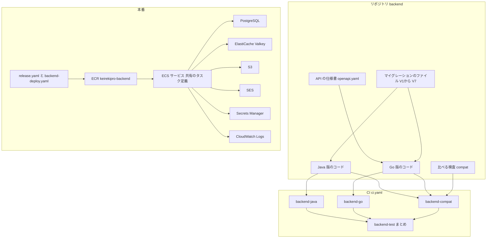
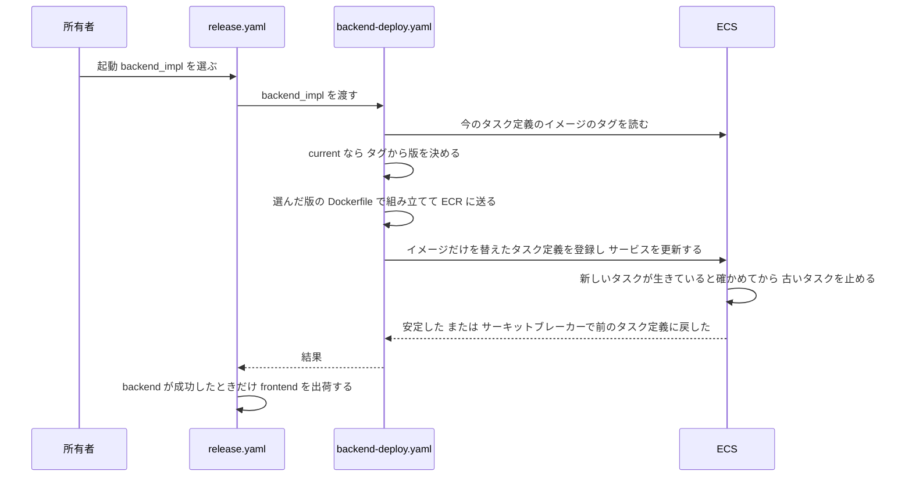
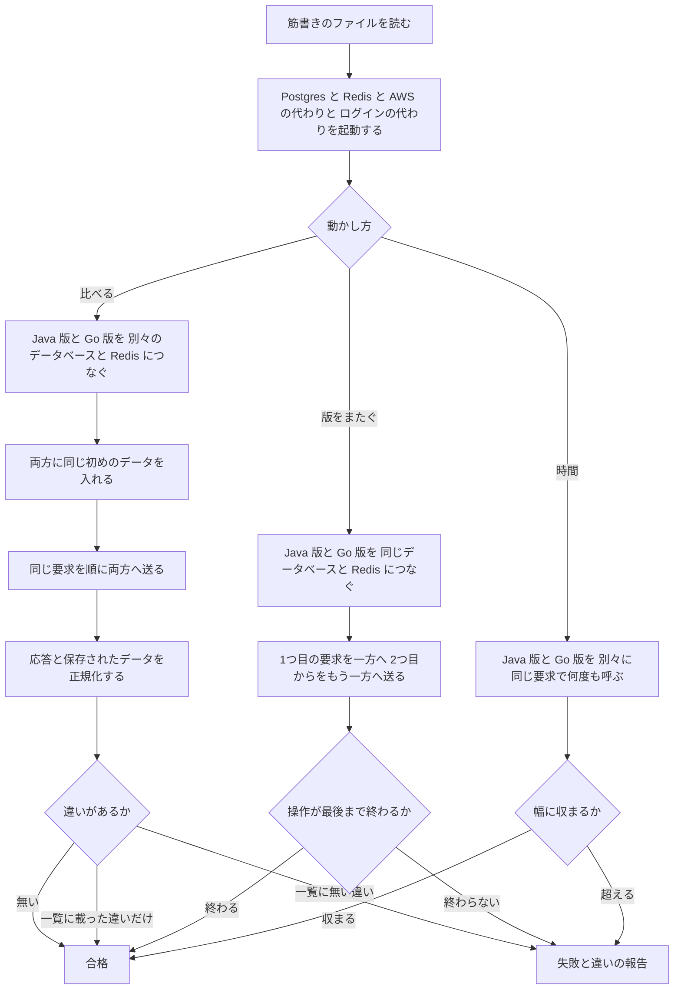
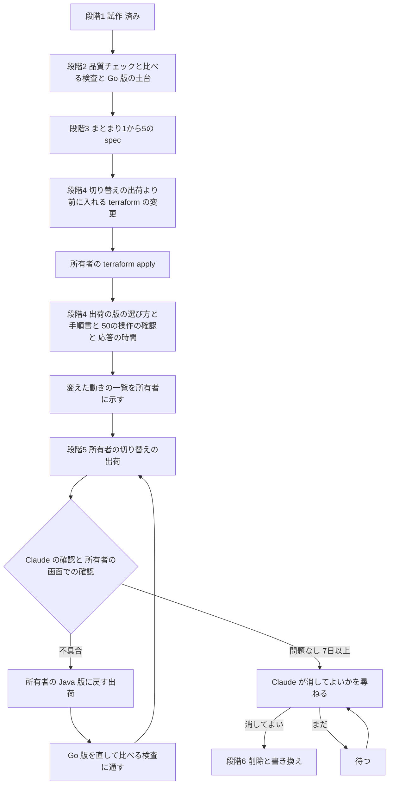

# 設計

## 概要

この設計は、backend を Java 版から Go 版へ、本番を止めずに置き換える仕組みを決める。仕組みは4つある。1つ目は、Go 版のコードを入れる土台と、Go 版の品質チェックである。2つ目は、Java 版と Go 版に同じ要求を送って応答と保存されたデータを比べる検査である。この設計は、この検査を「比べる検査」と呼ぶ。3つ目は、所有者が1回の出荷で本番を Go 版に切り替え、1回の出荷で Java 版に戻せる出荷の仕組みである。4つ目は、Java 版の削除と、Java と Spring を前提にした記述の書き換えと、使っていないものの削除の手順である。

Claude は、Go 版のコードを、Java 版と同じ `backend/` に置く。この spec は、機能のまとまりごとの spec が共通に使う土台と検査と出荷の仕組みを作る。この設計は、機能のまとまりごとの spec を「まとまりの spec」と呼ぶ。

## 作るものと作らないもの

### 作るもの

- Go 版の土台: Claude は、Go のモジュール、起動の入口、設定と秘密の値を読み込む部品、表の形の履歴(`flyway_schema_history`)の部品、データベースと Redis と AWS へ接続する部品、ログの部品、PDF を作る部品を作る。Claude は、HTTP の受け口の共通部分として、CORS の処理と、偽の送信の検査と、エラーの応答の形と、要求のログを作る。CORS の処理とは、別の送り元の画面から API を呼んでよいかを、応答のヘッダでブラウザに伝える処理である。送り元とは、画面の URL のうち、方式(`http` か `https`)とホスト名とポートの組である。偽の送信の検査とは、ほかのサイトの画面から利用者になりすまして送られた要求を見分けて断る検査である。Claude は、API の仕様書 `backend/api/openapi.yaml` からコードを生成する
- Go 版の品質チェック: Claude は、開発環境のイメージとサービス、`run-check.sh` の領域、`make check`、静的な検査と書式の検査と層の依存の検査の設定、カバレッジの下限、変更した箇所の変異テスト、CI の仕事を作る。Claude は、Dependabot と公開の時刻の検査と脆弱性の直しと、CodeQL とイメージの検査を、Go 版にも当てはまるように直す
- 比べる検査: Claude は、比べる検査の本体と、版をまたぐ確認と、応答の時間の比べ方と、PDF の比べ方と、AWS と外部のログインの代わりと、変えた動きの一覧を作る。比べる検査の本体は、筋書きのファイルから Java 版と Go 版に要求を送り、応答とデータベースと Redis と保存したファイルと送ったメールを比べる。筋書きとは、比べる検査が順に送る要求と、要求ごとの期待を書いたファイルであり、筋書きの中の1つの要求を段と呼ぶ
- 出荷の仕組み: Claude は、Go 版の本番のイメージと、出荷のワークフローが出荷する版を選ぶ仕組みと、段階4の本番の設定の変更と、切り替えの手順書を作る
- 進め方の記録: Claude は、機能のまとまりの分け方と順番と、まとまりごとの子の Issue と、進み具合の表を作る
- 段階6の作業: Claude は、段階6で、Java 版を削除し、Java と Spring を前提にした記述を書き換え、消す一覧に載せたものを削除し、段階6の本番の設定を変える
- Claude は、開発環境で開ける API の説明画面と、説明画面の「Try it out」から開発環境の Go 版を呼ぶための設定を作る

### 作らないもの

- 機能のまとまりごとの Go 版の処理。Claude は、認証、利用者、マスタと経歴書、出力、バックアップの各操作の処理と SQL と、メールと PDF と Markdown のテンプレートを、まとまりの spec で作る。この spec は、その処理が使う土台だけを作る
- 画面の変更。この spec は frontend のコードを変えない
- 本番の作りの変更のうち、版の見分けに要る環境変数と、Redis の利用者の名前の秘密のキーと、段階6の生きているかの確認の経路と、Java 版だけが使う値の削除を超えるもの。この spec は、サーバの台数と、タスクの CPU とメモリと、時間割を変えない
- データベースの表の形の変更。この spec はマイグレーションのファイルを足さない
- 必須の検査の名前を増やす変更。この spec は、GitHub の ruleset に必須の検査を足さない
- この spec が main に入った時点ですでに書かれていた spec の書き換え

## 使う既存の仕組み

- 本番: この設計は、本番の次のものを作り直さずに使う。使うものは、ECS のサービス `keirekipro-backend` とそのタスク定義、ALB、デプロイのサーキットブレーカー、ECR のリポジトリ `keirekipro-backend`、CloudWatch Logs のロググループ `/ecs/keirekipro-backend`、Secrets Manager の秘密の値 `keirekipro/rds` `keirekipro/redis` `keirekipro/jwt` `keirekipro/oidc/google` `keirekipro/oidc/github`、EventBridge Scheduler の時間割である。デプロイのサーキットブレーカーとは、新しいタスクが起動に失敗し続けたときに、ECS がサービスを前のタスク定義に戻す仕組みである。
- 出荷: 所有者は、`release.yaml` を起動し、出荷を承認する。`release.yaml` は、`backend-deploy.yaml` と `frontend-deploy.yaml` を呼ぶ。この2つのワークフローは `workflow_call` だけで動き、所有者が直接起動するものではない
- 開発環境: この設計は、`compose.yaml` の `db` `redis` `localstack` `dind` のサービスを今のまま使う。この設計は、`run-check.sh` が品質チェックを1回きりのコンテナで動かすことと、`run-check.sh` が同時に動かす数を設定の数までに抑えることも、今のまま使う。
- 品質の仕組み: この設計は、今の品質の仕組みのうち、次の11個を使う。
  - 必須の検査の期待一覧 `.github/audit/required-checks.json`: 必須の検査の名前が載る。週次監査は、載った検査が飛ばされたままマージされた PR を見つける
  - CODEOWNERS: 所有者の承認が要るファイルを決める
  - escape-hatch: テストの飛ばしとカバレッジの除外の追加を見つけて PR を止める
  - dependency-gate: ライブラリの入手先の設定か backend のビルドの手順のファイルを変えた PR を、所有者が承認するまでマージさせない
  - dependency-review: 脆弱性のある部品を足す PR を止める
  - dependency-cooldown: 公開から72時間たっていない版を入れる PR を止める。この設計は、dependency-cooldown を「公開の時刻の検査」と呼ぶ
  - Dependabot: 部品の版を上げる PR を作る
  - `backend-vuln-fix.yaml`: Dependabot が直さない部品の脆弱性を直す PR を作る
  - CodeQL: ソースコードの脆弱性を診断する
  - `container-scan.yaml`: 本番のイメージの脆弱性を調べる
  - `mutation-report.yaml`: 変異テストの結果を週ごとに報告する
- 進め方: Claude は、この置き換えを、`/start`、spec の各段階のコマンド、`/spec-review`、`/kiro-impl`、`/ship`、`file-issue` のスキルの起票の決まりの、今の手順のまま進める。
- 依存の向きの制約: Go 版のコードは Java 版のコードを読まない。比べる検査は、Java 版と Go 版を、コンテナのイメージと HTTP とデータベースと Redis だけを通して扱う。Claude は、Java 版のコードを変えない。ただし、Java 版か Go 版の一方の動きを直す PR でもう一方も同じように直すときは、Claude は Java 版のコードも直す

## 設計を見直すきっかけ

- API の仕様書の操作が増えるか減るか、要求と応答の形が変わったとき: まとまりの spec と、比べる検査の筋書きを確かめ直す
- Redis のキーと値の形、ログインの状態のトークンの中身、Cookie の名前と性質が変わったとき: 版をまたぐ確認と、Java 版に戻す出荷を確かめ直す
- 本番のタスク定義、生きているかの確認の経路、環境変数、秘密の値のキーが変わったとき: 出荷の仕組みと切り替えの手順書を確かめ直す
- Java 版の削除のあとにマイグレーションのファイルを足すとき: 表の形の履歴の部品と、Java 版に戻せなくなることを確かめ直す
- GitHub の ruleset か必須の検査の期待一覧が変わったとき: CI の `backend-test` のまとめの仕事を確かめ直す
- Go 版の本番のイメージの土台の Chromium かフォントが替わったとき: PDF の比べ方と許す違いの大きさを確かめ直す
- 変えた動きの一覧に載せるものが増えたとき: 所有者に、切り替えの出荷の前に一覧を見せ直す
- Go のツールチェーンの版を上げるときと、gremlins が 1.0 になったとき: 品質チェックの指定を確かめ直す

## プロジェクトの決まりを守っているか

- backend のコードを置く層: Java 版のコードは変えないので、ArchUnit のルールはそのまま守る。Go 版の依存の向きは、「全体の構成」の節に書いた一方向だけである。golangci-lint の depguard は、この向きをテストの前に検査する。Java 版を削除する段階6で、Claude は ArchUnit のテストも消す。ArchUnit のテストはゲート設定なので、所有者の承認が要る
- データベースの表の形: この spec はマイグレーションを含まない。Go 版の表の形の履歴の部品は、今の V1〜V7 を確かめるだけで、表の形を変えない
- 新しいライブラリの追加: Go のモジュールを足す。足すモジュールと版は「使う技術」の欄に書き、ほかの選択肢と比べた結果は research.md の「Go の部品と道具」に書いた。版は `backend/go.mod` と `backend/go.sum` に書く。CLAUDE.md の承認の対象の一覧は、Go のファイルを名指していない。そこで、Claude は、`go.mod` と `go.sum` を、CLAUDE.md が所有者の承認の対象の外とした依存のバージョン宣言として扱い、所有者の承認の対象に入れない。Claude は、`backend/Makefile` と `.golangci.yml` と `.testcoverage.yml` と `.gremlins.yaml` とコード生成の設定を承認の対象にする提案を、下の「所有者に提案するゲート設定の変更」に入れる
- 品質チェックの設定: `.github/` と `.claude/` の変更が要る。変更は、すべて下の「所有者に提案するゲート設定の変更」に分けて書き、所有者の承認つきの PR にする
- 使う外部の機能がこのリポジトリで使えるか: リポジトリは個人のアカウントの公開のリポジトリである。Claude は、2026-11-08 に `gh api` で、`owner.type` が `User` で、`visibility` が `public` であることを確かめた。CodeQL の Go の解析、Dependabot の gomod、依存のグラフの go.mod の読み取り、Issue の sub-issues は、公開のリポジトリで有効にする操作なしに使える。index.golang.org と proxy.golang.org と sum.golang.org は、認証なしで読める。本番の土台のイメージ `chromedp/headless-shell` は、本番の ECS の CPU の `linux/arm64` と、CI の機械の CPU の `linux/amd64` の両方のイメージを持つ。Claude は、2026-11-08 に `docker buildx imagetools inspect` で確かめ、結果を research.md の「Go の部品と道具」に書いた
- frontend の機能ごとの境界: この spec は frontend のコードを変えないので、関係しない
- frontend の状態の持ち方: この spec は frontend のコードを変えないので、関係しない

### 所有者に提案するゲート設定の変更

Claude は、次の変更を、所有者の承認が要る PR として出す。PR の番号は、「移行」の節の「段階ごとの PR」の表の番号である。

| 変えるファイル | 変更 | 段階ごとの PR の番号 |
|---|---|---|
| `.claude/scripts/parallel/run-check.sh` | 領域 `backend-go` の追加 | 2-1 |
| `.claude/hooks/check-verify-before-stop.sh` とそのテスト | Go 版の品質チェックの記録の確認の追加 | 2-1 |
| `.claude/skills/verify-backend/SKILL.md` ほか verify のスキル | Go 版の手順の追加 | 2-1 |
| `.github/workflows/ci.yaml` | backend の仕事の分割と、`docker-smoke` の組み立ての文脈の分岐の追加 | 2-1 |
| `.github/codeql/languages.tsv` | Go の行の組み立て方 | 2-1 |
| `.github/dependabot.yml` | gomod と docker の項目の追加 | 2-5 |
| `.github/scripts/check-dependency-cooldown.sh` と、そこから呼ぶ `cooldown-check-*.sh` `cooldown-match-alerts.sh` | gomod への対応 | 2-1 |
| `.github/scripts/check-release-age.sh` | gomod への対応 | 2-1 |
| `.github/scripts/check-dependency-additions.sh` | 承認の対象の追加 | 2-1 |
| `.github/CODEOWNERS` と `.github/scripts/check-escape-hatches.sh` | Go の設定ファイルと書き方の追加 | 2-1 |
| `.github/workflows/container-scan.yaml` と `container-scan-scheduled.yaml` | Go 版のイメージの追加 | 2-5 |
| `.github/workflows/backend-vuln-fix.yaml` と `.github/scripts/backend-vuln-fix.sh` | Go の仕事の追加 | 2-5 |
| `.github/workflows/mutation-report.yaml` と `.github/scripts/record-mutation-metrics.sh` | Go 版の週次の報告の追加 | 2-5 |
| `.github/scripts/collect-coverage.sh` | Go 版のカバレッジの集計 | 2-5 |
| `.github/workflows/release.yaml` と `backend-deploy.yaml` | 入力 `backend_impl` の追加 | 4-2 |

`ci.yaml`、`languages.tsv`、`dependabot.yml`、公開の時刻の検査、`container-scan`、`backend-vuln-fix`、`release.yaml` と `backend-deploy.yaml` の変更の中身と理由は、「部品」の節の「CI の仕事」「Dependabot と公開の時刻の検査と脆弱性の直し」「CodeQL とイメージの検査と組み立てて動かす検査」「backend-deploy.yaml と release.yaml」に書いた。部品の節に無い変更の中身と理由は、次のとおりである。

- `run-check.sh`: Claude は、領域 `backend-go` を足し、その領域の最後の検査を `make check` にする。開発者がどの OS でも1つのコマンドで Go 版の品質チェックを動かせるようにするためである。`make check` が通ると、`run-check.sh` は Go 版の品質チェックを動かした記録を書く。Claude は、dind を起こす領域にも `backend-go` を足す。Claude は、領域 `backend-go` の1回きりのコンテナに、リポジトリの最上位を読み取り専用で `/repo` に差し込む。比べる検査が、`./backend` の外にある `docker/` の Dockerfile からイメージを組み立てるためである。段階6で、Claude は領域の名前を `backend` に戻し、リポジトリの最上位の差し込みを消す。比べる検査を消すと、`./backend` の外のファイルを読む処理が無くなるためである
- `check-verify-before-stop.sh` とそのテスト: このフックは、今は `backend/` の下のファイルが変わると、Java 版の品質チェック `./gradlew check` を動かした記録を求める。Claude は、このフックを次の5つのように変える。
  - 記録を分ける: Claude は、変わったファイルを Java 版のファイルと Go 版のファイルに分け、Java 版のファイルが変わったときは Java 版の記録を、Go 版のファイルが変わったときは Go 版の記録を求めるようにする。このフックが、変わったファイルを Java 版のファイルと Go 版のファイルに分けるのは、Go 版だけを直す会話で、Claude が Go 版の品質チェックを動かしたのに、作業を終えるときにこのフックに止められることが無いようにするためである
  - ファイルの見分け方: Java 版のファイルと Go 版のファイルの見分け方は、「CI の仕事」の見分け `backend_java` と `backend_go` と同じにする
  - `backend/go.mod` が無いとき: このフックも、見分け `backend_go` と同じく、作業フォルダに `backend/go.mod` があるときだけ Go 版の記録を求める。`backend/go.mod` が無いときは、Go 版の品質チェックを動かせず、記録を書けないためである
  - マイグレーションのファイル: マイグレーションのファイルが変わったときは、このフックは Java 版の記録と Go 版の記録の両方を求める
  - 段階6: 段階6で、Claude はこの分け方を消し、`backend/` の下の変更に Go 版の記録だけを求める形に戻す
- verify のスキル: Claude は、Go 版の品質チェックの手順を足す。段階6で、Claude はスキルを言語に依存しない書き方にする。Claude が品質チェックを動かす手順を、Go 版に合わせるためである
- `check-release-age.sh`: Claude は、gomod の部品の公開の時刻を、公開の時刻の検査と同じ方法で調べるようにする。Dependabot の PR の自動マージで、公開から72時間たっていない版を止めるためである
- `check-dependency-additions.sh`: Claude は、`backend/Makefile`、`.golangci.yml`、`.testcoverage.yml`、`.gremlins.yaml`、`api/oapi-codegen.yaml`、`sqlc.yaml` を承認の対象に足す。品質チェックとコード生成の指定を、所有者の承認なしに緩められないようにするためである
- `CODEOWNERS` と `check-escape-hatches.sh`: Claude は、Go 版の品質チェックの設定ファイルを、CODEOWNERS の守る対象に足す。Claude は、escape-hatch の検知に、Go のカバレッジの除外とテストの飛ばしの書き方を足す。Go 版でも「見かけの合格」を機械で止めるためである
- `mutation-report.yaml` と `record-mutation-metrics.sh`: Claude は、`make mutation-full` の報告を週次で集める仕事を足す。Java 版の PIT の週次の報告と同じ報告を、Go 版でも残すためである
- `collect-coverage.sh`: Claude は、Go 版のカバレッジを集める処理を足す。週次監査のカバレッジの記録を、Go 版でも残すためである

Claude は、必須の検査の期待一覧 `.github/audit/required-checks.json` を、段階5まで変えない。必須の検査の名前は、`backend-test` のまま変わらない。`backend-test` が、Go 版の検査と比べる検査の結果をまとめるためである。段階6で期待一覧から `gradle-wrapper` の行を消すことは、「段階6の削除と書き換え」に書いた。

## 全体の構成



選んだ構成は、Java 版と Go 版が、同じデータベースの表、同じ Redis のキーと値の形、同じ S3 の置き場所、同じ Secrets Manager の秘密の値、同じ ALB とタスク定義を共有し、イメージだけを替える形である。この形にしたのは、切り替えと戻しを、どちらも「イメージを替えるだけの1回の出荷」にできるためである。また、この形では、ECS の入れ替えの途中で両方の版が操作を受けても、両方の版が同じデータベースと Redis を読み書きする。そのために、Go 版は、Java 版と同じ秘密の値を同じ方法で起動時に読み、Java 版と同じ経路 `/actuator/health` で生きていることを返し、同じポート 8080 で受ける。

この設計は、部品の責任を次のように分ける。API の仕様書は、受け付ける操作と要求と応答の形を決める。Claude は、Go 版の受け口のコードを仕様書から生成し、手で書かない。Java 版と Go 版は、表の形を変える同じマイグレーションのファイルを読む。比べる検査は、Java 版と Go 版のどちらの機能の処理のコードも読まず、イメージを動かして外から比べる。CI のまとめの仕事 `backend-test` は、検査をせず、3つの仕事の結果だけを判定する。

新しい部品が要るのは、表の形の履歴の部品と、比べる検査の AWS の代わりである。表の形の履歴の部品が要るのは、Flyway の表を読み書きできる Go の道具が無いためである。比べる検査の AWS の代わりが要るのは、CI で動く AWS の代わりのうち、送ったメールを読めるものが無いためである。比べた案は research.md の「設計で決めたこと」に書いた。

Claude は、Go 版のコードを、Go で標準的な、機能ごとのパッケージに分ける。Claude は、Java 版のオニオンの層の分け方を写さない。オニオンの層の分け方とは、業務の規則を中心の層に置き、外側の層だけが内側の層を読むようにコードを分ける作り方である。依存の向きは、`cmd/keirekipro` から `internal/httpapi`、`internal/httpapi` から機能のパッケージ、機能のパッケージから `internal/platform` の順の一方向とする。機能のパッケージには、`internal/auth` などがある。`internal/platform` は機能のパッケージを読まない。depguard は、機能のパッケージどうしの依存のうち、Claude がまとまりの spec で `.golangci.yml` の depguard の規則に足したものだけを許す。

**使う技術**:
- 言語と実行環境: Go 1.27(go1.27.3)。`go.mod` の `toolchain` で版を固定する。本番の実行ファイルは `CGO_ENABLED=0` で組み立てる
- HTTP の受け口: 標準の `net/http` の `ServeMux`。oapi-codegen v2.8.2 の `std-http-server` と `strict-server` で、仕様書から経路の登録と型を生成する
- データベース: pgx v5.11.0(`pgxpool`)と sqlc v1.31.1。SQL から型の付いた問い合わせのコードを生成する
- Redis: go-redis v9.23.0 の `UniversalClient`。本番(`prod`)はクラスタの形と TLS で、`dev` と `test` は1台の形でつなぐ。TLS とは、通信の中身を暗号化して、途中で読まれたり書き換えられたりしないようにつなぐ方式である
- AWS: AWS SDK for Go v2(S3、SES v1、Secrets Manager)。開発環境と比べる検査では接続先を `BaseEndpoint` で替え、S3 はパスの形にする。パスの形とは、バケットの名前を、接続先のホスト名ではなく URL のパスに入れて S3 を呼ぶ形である
- 認証の部品: golang-jwt v5.3.1、golang.org/x/crypto v0.58.0(bcrypt)、golang.org/x/oauth2 v0.37.0、go-oidc v3.21.0。これらを使う処理は、認証のまとまりの spec で作る
- PDF: chromedp と、同じイメージに入れる headless-shell の Chromium と、Noto のフォント(NotoSansJP と NotoSerifJP の Regular と Bold)
- ログ: 標準の `log/slog` の JSON の形
- 品質チェック: golangci-lint v2.15.0(gofumpt、goimports、depguard を含む)、go-test-coverage、gremlins v0.6.0、govulncheck v1.9.0、testcontainers-go
- 比べる検査: testcontainers-go、poppler-utils(`pdftotext` `pdffonts` `pdftoppm`)
- API の説明画面: Swagger UI の公式のイメージ `swaggerapi/swagger-ui`
- 本番の土台のイメージ: `chromedp/headless-shell`(Debian trixie-slim)を digest で固定する。digest は、イメージの中身から計算した値である。digest で固定すると、同じタグの中身があとから替わっても、組み立てに使う土台のイメージは替わらない

公開から72時間たっていない版について、Claude は、実装のときに72時間たっていればその版を使い、たっていなければ1つ前の版を使う。対象の版は research.md の「Go の部品と道具」に書いた。

## ファイルの構成

Claude が段階2で新しく作る、Go 版の土台のファイル:

- `backend/go.mod` `backend/go.sum`: モジュール `github.com/DogisRiki/KeirekiPro/backend` と、部品と道具(`tool` の指定)の版
- `backend/migrations.go`: `//go:embed src/main/resources/db/migration/*.sql` でマイグレーションのファイルを埋め込み、`fs.FS` として公開する。段階6で、Claude はマイグレーションのファイルを `backend/db/migrations/` に移し、この埋め込みの指定も直す
- `backend/api/openapi.yaml`: API の仕様書。設計の前に書いた版を、比べる検査で Java 版の応答と食い違った箇所だけ直す
- `backend/api/oapi-codegen.yaml`: 仕様書からのコード生成の設定(`std-http-server` と `strict-server` と `models`)
- `backend/sqlc.yaml`: SQL からのコード生成の設定。マイグレーションのファイルを V1 から順に1つずつ並べて指定する
- `backend/cmd/keirekipro/main.go`: 起動の入口
- `backend/internal/platform/config/`: 設定と秘密の値の読み込み
- `backend/internal/platform/migrate/`: 表の形の履歴の部品
- `backend/internal/platform/database/`: pgx の接続の束
- `backend/internal/platform/redisstore/`: Redis の接続と、Lua のスクリプトの読み込み
- `backend/internal/platform/awsclient/`: S3 と SES と Secrets Manager のクライアント
- `backend/internal/platform/logging/`: ログの形
- `backend/internal/platform/pdf/`: PDF を作る部品
- `backend/internal/httpapi/gen/api.gen.go`: 仕様書から生成するコード(手で直さない)
- `backend/internal/httpapi/server.go`: 経路の登録と、まとまりの処理の束ね
- `backend/internal/httpapi/middleware/`: CORS の処理、偽の送信の検査、要求のログ、パニックの受け止め、エラーの応答の形
- `backend/internal/httpapi/health.go`: `/actuator/health` と `/healthz`

Claude が段階2で新しく作る、品質チェックのファイル:

- `backend/Makefile`: 品質チェックとコード生成と比べる検査の入口
- `backend/.golangci.yml`: 静的な検査と書式の検査と depguard の規則
- `backend/.testcoverage.yml`: カバレッジの下限と、数えない生成コードの指定
- `backend/.gremlins.yaml`: 変異テストの指定
- `docker/backend-go/Dockerfile`: 開発環境と品質チェックのイメージ。このイメージは、`golang:1.27.3-trixie` に golangci-lint、poppler-utils、Docker の CLI、Debian の `chromium`、日本語のフォント `fonts-noto-cjk` を入れたものである。PDF を作る部品の単体テストと、開発サーバの PDF の出力が、このイメージの Chromium を使う
- `docker/backend-go/Dockerfile.prod`: 本番のイメージ
- `backend/assets/fonts.conf`: 本番のイメージの fontconfig の設定。fontconfig とは、Linux で、プログラムが文字を表示するときに使うフォントのファイルを探して決める仕組みである。組み立ての文脈とは、Docker がイメージを組み立てるときに読めるファイルを置いたフォルダである。本番のイメージは `./backend` を組み立ての文脈にして組み立てるので、Claude は、このファイルを `./backend` の中に置く

Claude が段階2で新しく作る、比べる検査のファイル:

- `backend/compat/harness/`: コンテナの起動、筋書きの実行、正規化、比べる処理、報告。このフォルダのファイルには、ビルドタグ `compat` を付ける。ビルドタグとは、組み立てるときに `-tags` でその名前を指定した場合だけ、そのファイルを組み立てに含める Go の指定である
- `backend/compat/fakeaws/`: AWS の代わりと、そのイメージを作る `Dockerfile`。このフォルダの Go のファイルにも、ビルドタグ `compat` を付ける
- `backend/compat/fakeoidc/`: Google と GitHub のログインの代わりと、そのイメージを作る `Dockerfile`。このフォルダの Go のファイルにも、ビルドタグ `compat` を付ける
- `backend/compat/pdfcmp/`: PDF の比べ方。このフォルダのファイルとテストにも、ビルドタグ `compat` を付ける。ビルドタグを付けるのは、pdfcmp が poppler-utils を使うためである。ビルドタグ `compat` があるので、`make check` は pdfcmp を動かさず、比べる検査だけが pdfcmp を動かす
- `backend/compat/scenarios/<まとまり>/*.yaml`: 筋書き。Claude がまとまりの spec で足す
- `backend/compat/fixtures/`: 筋書きが使う初めのデータと、経歴書とバックアップと画像のファイル
- `backend/compat/compat_test.go` `cross_test.go` `perf_test.go`: 比べる検査、版をまたぐ確認、応答の時間の比べ方のそれぞれの入口
- `backend/compat/changed-behaviors.yaml`: 変えた動きの一覧

Claude が新しく作るファイル(そのほか):

- `docker/api-docs/Dockerfile`: API の説明画面のイメージ(段階2)
- `.kiro/specs/backend-go-replacement/progress.md`: 進み具合の表(段階2)
- `.kiro/specs/backend-go-replacement/runbook.md`: 切り替えの手順書(段階4)

Claude が変えるファイル:

- `compose.yaml`: 段階2で、サービス `backend-go` と `api-docs` と、ボリューム `backend-go-cache` を足す。`backend-go` はホストの 8081 をコンテナの 8080 につなぎ、`api-docs` はホストの 8082 をコンテナの 8080 につなぐ。CORS の処理と、API の説明画面から Go 版を呼ぶ設定を入れる PR 2-6 で、`api-docs` に環境変数 `WITH_CREDENTIALS=true` を足す。段階6で `backend` のサービスを Go 版に替え、`backend-go` を消す
- `start-dev.sh`: `backend-go` と `api-docs` を起動の対象に足す(段階2)
- `doc/開発フロー/参加者セットアップ手順.md`: API の説明画面の URL と、Go 版の開発サーバの URL を書く(段階2)。CORS の処理と、API の説明画面から Go 版を呼ぶ設定を入れる PR 2-6 で、説明画面の「Try it out」でログインし、書き込みの要求にヘッダ `X-XSRF-TOKEN` を付けて送る手順を足す
- `backend/CLAUDE.md`: Go 版の作り方の説明を足す(段階2)。段階6で Java 版の説明を消す
- `terraform/main.tf`: 段階4と段階6で、`keirekipro/redis` の秘密の値のキーを変える。変える値は、「データの形」の節の「本番の設定の値の変わり方」の表に書く
- `terraform/modules/ecs/main.tf`: 段階4と段階6で、タスク定義の環境変数と生きているかの確認の経路を変える。変える値は、同じ表に書く
- `terraform/modules/alb/` のターゲットグループの定義: 段階6で、生きているかの確認の経路を変える。変える値は、同じ表に書く
- `.kiro/specs/backend-go-replacement/research.md`: 段階1の記録と、設計の段階の記録を持つ。段階1の記録は書き換えない
- 「所有者に提案するゲート設定の変更」の表に書いたファイル
- 段階6で書き換えるファイルと消すファイル: 「移行」の節の「段階6の書き換え」と「消す一覧」に書く

## 処理の流れ

### 出荷で版を選ぶ流れ



入力の選び方とイメージのタグの付け方と、失敗したときの扱いは、「部品」の節の「backend-deploy.yaml と release.yaml」に書いた。

### 比べる検査の流れ



比べる検査は、筋書きの段ごとに、両方の版の応答を比べてから次の段へ進む。ある段で違いが見つかっても、残りの段は続けて、筋書きの終わりにまとめて報告する。前の段の違いが後の段の違いを生むことがあるので、比べる検査は、違いの見つかった最初の段を報告の先頭に書く。

## 部品

### Go 版の土台

#### cmd/keirekipro(起動の入口)

対応する要件: 5.6, 5.7, 5.8, 9.4

**役割**: この入口は、設定を読み、表の形の履歴を確かめ、データベースと Redis と AWS と PDF の部品をつなぎ、HTTP の受け口を 8080 で開く。業務の処理は持たない。

**いつ動くか**: この入口は、コンテナが起動したときに動く。`SIGTERM` を受けたら、新しい接続を断り、受けている要求が終わるのを `http.Server.Shutdown` で最大90秒待ってから、PDF の部品とデータベースと Redis の接続を閉じて終わる。Claude は、待つ時間を90秒にした。Java 版も、本番で止まるときに、止める手順の区切りごとに最大90秒待つためである。90秒は、タスク定義の `stopTimeout` の120秒より短い。ECS は、`SIGTERM` を送ってから `stopTimeout` の時間がたってもコンテナが終わらなければ、コンテナを強制的に止める。待つ時間が120秒より短くないと、入口が接続を閉じる前に止められてしまう。

**失敗したとき**: 設定の読み込み、秘密の値の読み込み、表の形の履歴の確認、データベースか Redis への最初の接続のどれかが失敗したら、入口は理由をログに書き、終了コード1で終わる。

#### config(設定と秘密の値の読み込み)

対応する要件: 5.1, 12.2

**役割**: この部品は、起動時に1回だけ、環境変数と Secrets Manager から設定を読み、型の付いた `Config` を返す。起動のあとで設定を読み直さない。

**使う部品**: awsclient(Secrets Manager の `GetSecretValue`)。

**呼び出し方**: `func Load(ctx context.Context, env Lookup) (Config, error)`。

**環境ごとの値**: config は、環境の名前を環境変数 `KEIREKIPRO_ENV`(`prod` `dev` `test`)で決め、環境変数が無ければ `dev` とする。環境ごとの既定の値は、サイトの URL、Cookie の `Secure`、CORS の許す送り元、SES の送り元、S3 のバケット、トークンの有効な時間である。CORS の許す送り元とは、ほかのサイトの画面から API を呼んでよいとブラウザに伝える、画面の送り元の一覧である。config は、これらの既定の値として、Java 版の `application.yaml` と `application-prod.yaml` と `application-dev.yaml` と同じ値をコードに持つ。ただし、`dev` と `test` の CORS の許す送り元は、Java 版の `http://localhost:5173` に、API の説明画面の `http://localhost:8082` を足した2つにする。開発者が説明画面の「Try it out」で Go 版を呼べるようにするためである。この違いは、変えた動きの一覧の CB-010 に載せた。`prod` の CORS の許す送り元は、Java 版と同じ `https://app.keirekipro.click` だけである。config は、`prod` では、次の秘密の値を読む。

| 秘密の値 | 読むキー |
|---|---|
| `keirekipro/rds` | `host` `port` `database` `username` `password` |
| `keirekipro/redis` | `redis-host` `redis-port` `redis-password` `redis-username` |
| `keirekipro/jwt` | `jwt-secret` |
| `keirekipro/oidc/google` と `keirekipro/oidc/github` | `client_id` `client_secret` |

config は、`dev` と `test` で次の5つのように動く。

- 既定の値: config は、`test` の既定の値を、`dev` の既定の値と同じにする
- 環境変数: Go 版は、`dev` と `test` では、秘密の値の代わりに、Java 版の `application.yaml` の既定と同じ名前の環境変数(`DB_HOST` `DB_PORT` `DB_NAME` `DB_USERNAME` `DB_PASSWORD` `REDIS_HOST` `REDIS_PORT` `REDIS_PASSWORD` `JWT_SECRET`)を読む
- 外部のログインの秘密の値: config は、`keirekipro/oidc/google` と `keirekipro/oidc/github` を、`dev` と `test` でも Secrets Manager から読む。Java 版も `dev` でこの2つを localstack から読み、比べる検査もこの2つを fakeaws に置くためである
- AWS の接続先: `dev` と `test` で `KEIREKIPRO_AWS_ENDPOINT` が無いときは、config は AWS の接続先を、Java 版の `application-dev.yaml` と同じ `http://localstack:4566` にする
- 外部のログインの接続先: 外部のログインの接続先の URL は、環境変数 `KEIREKIPRO_OIDC_<GOOGLE|GITHUB>_<AUTH|TOKEN|USERINFO>_URL` で替えられる。比べる検査は、この環境変数で、Go 版をログインの代わりにつなぐ

**失敗したとき**: config は、足りない値と読めない秘密の値を、値を書かずにキーの名前だけでエラーにする。

#### migrate(表の形の履歴の部品)

対応する要件: 1.5, 12.4

**役割**: この部品は、`flyway_schema_history` を読み、埋め込んだマイグレーションのファイルと照らす。適用済みの版の検査の値が合わなければ、起動を止める。検査の値とは、Flyway がマイグレーションのファイルの中身から計算し、`flyway_schema_history` の `checksum` の列に書く数である。未適用のファイルがあれば、この部品は、版の順に1つずつ適用し、Flyway と同じ形の行を書く。この部品は、繰り返しのマイグレーションと元に戻すマイグレーションを扱わない。

**呼び出し方**: `func Run(ctx context.Context, pool *pgxpool.Pool, files fs.FS, mode Mode) (Result, error)`。`mode` は `ValidateOnly` と `Apply` の2つである。Java 版を削除するまでは、Go 版は `ValidateOnly` で起動する。表の形は、今のとおり Java 版の Flyway が変える。Go 版は、表の形の履歴を確かめるだけにする。段階6で、Go 版は `Apply` で起動する。

**状態の持ち方**: この部品の状態の持ち方は、次の3つである。

- 検査の値の計算: この部品は、検査の値を次のように計算する。この部品は、ファイルの中身から UTF-8 の BOM を除き、行ごとに改行を除いた文字列を CRC32(IEEE)に入れ、結果を符号付きの32ビットの整数にする。BOM とは、UTF-8 で書かれたことを示すために、ファイルの先頭に置かれることがある3バイトである。CRC32 とは、データから32ビットの値を計算する方式であり、IEEE はその計算に使う決まりの1つである。Claude は、この計算を V1〜V7 で確かめた結果を、research.md の「Flyway の検査の値」に書いた。
- 書く行の列と値: この部品が書く行の列は、`installed_rank`、`version`、`description`、`type`、`script`、`checksum`、`installed_by`、`installed_on`、`execution_time`、`success` である。この部品は、`installed_rank` に今の最大に1を足した数を書き、`description` にファイル名の `__` の後ろの `_` を空白にしたものを書く。この部品は、`type` に `SQL` を、`script` にファイル名を、`installed_by` に接続の利用者を、`execution_time` にミリ秒の数を書く。
- 同時に起動したタスクの扱い: 同時に起動した複数のタスクが同じファイルを適用しないように、この部品は、`pg_advisory_lock` で1つずつ動き、ファイルごとに1つのトランザクションでファイルの適用と行の記録をする。`pg_advisory_lock` は、同じ鍵の番号を取ろうとするほかの接続を、鍵が放されるまで待たせる PostgreSQL の関数である。トランザクションとは、データベースへの複数の書き込みを、すべて反映するか、すべて取り消すかのどちらかにするまとまりである。

**失敗したとき**: 検査の値が合わないとき、記録に `success = false` の行があるとき、記録の版がファイルに無いときは、この部品はエラーを返す。エラーを受けた入口は、起動を止める。ただし、この部品は、種類が `BASELINE` の行を受け付け、その行の版以下のファイルを適用済みとして扱う。Java 版は `baseline-on-migrate: true` と `baseline-version: 0` で動く。そのため、本番の履歴には、種類 `BASELINE` で版 `0` の行があるかもしれない。この部品がこの行でエラーを返すと、Go 版が起動しない。この部品が種類 `BASELINE` の行を受け付けるのは、このためである。

#### database と redisstore と awsclient(外とつなぐ部品)

対応する要件: 12.1, 12.3, 13.5

**役割**: database は pgx の接続の束を作り、日時を日本の時刻で読み書きするために、接続ごとに `TimeZone` を `Asia/Tokyo` にする。redisstore は、本番では `redis-host` と `redis-port` をクラスタの入口にして TLS と利用者の名前とパスワードでつなぎ、`dev` と `test` では1台の形でつなぐ。redisstore は、Java 版と同じ Lua のスクリプトの文字列を `redis.NewScript` で持つ。awsclient は、S3 と SES v1 と Secrets Manager のクライアントを作り、`dev` と `test` では接続先を `KEIREKIPRO_AWS_ENDPOINT` に替え、S3 をパスの形にする。

**状態の持ち方**: Redis のキーの名前と値の形、S3 のオブジェクトのキーの形は、Java 版と Go 版の取り決めである。まとまりの spec で作る Go 版は、Java 版と同じ形を使う。比べる検査は、Go 版がその形を使っていることを確かめる。Java 版を削除したあとに形を変えるときは、Claude は、形の変更を2回の出荷に分ける。1回目の出荷で、Go 版は古い形と新しい形の両方を読み、古い形で書く。古い形で書いた値は、ログインを続けるためのトークンの有効な時間の7日がたつと、すべて期限切れになる。Claude は、古い形で書いた値がすべて期限切れになるまで待ってから、2回目の出荷で、Go 版が新しい形で書くようにする。

#### logging(ログの形)

対応する要件: 5.8

**役割**: この部品は、`slog` の JSON の書き手を標準出力に置き、ログの項目の名前を、Java 版のログと同じ Elastic Common Schema の形に合わせる。Elastic Common Schema は、ログの項目の名前の決まりである。合わせる項目は、`@timestamp` `log.level` `message` `service.name` `service.environment` `service.version` `log.logger` `error.type` `error.message` `error.stack_trace` である。ECS のログの送り手である awslogs は、コンテナの標準出力を CloudWatch Logs の `/ecs/keirekipro-backend` に送る。そのため、Go 版のログの置き場所は、Java 版と変わらない。Go 版は、要求ごとのログに、メソッド、経路の型、ステータス、かかった時間を書き、Cookie と Authorization と要求の本文を書かない。

#### httpapi(HTTP の受け口の共通部分)

対応する要件: 9.1, 9.2, 9.4, 9.5, 14.2, 14.5, 14.6, 14.7

**役割**: この部品は、生成したコードの `StrictServerInterface` を、まとまりのパッケージの処理を束ねた型で満たし、`ServeMux` に登録する。まだ作っていない操作は、501 と `{"message":"未実装です。"}` を返す仮の実装で満たす。この部品は、共通の中間処理を次の順に置く。中間処理とは、まとまりの処理より前に、すべての要求に対して動く共通の処理である。

1. パニックの受け止め: パニックとは、Go の処理が想定外の誤りで途中で止まることである。この中間処理は、パニックが起きたら、500 と Java 版と同じエラーの本文を返し、パニックが起きたときの関数の呼び出しの順(スタック)をログに書く
2. 要求のログ
3. CORS の処理: この中間処理は、Java 版の `SecurityConfig` の CORS の設定と同じ応答を、Go の標準ライブラリだけで返す。この部品がこの中間処理を Java 版と同じく偽の送信の検査より前に置くのは、ブラウザが本当の要求の前に送るプリフライトを、偽の送信の検査とログインの状態の検査で断らないためである。プリフライトとは、ブラウザが、別の送り元への書き込みの要求の前に、`OPTIONS` で、その要求を送ってよいかを確かめる要求である。この中間処理は、次の5つのことをする。
   - すべての応答に、ヘッダ `Vary: Origin, Access-Control-Request-Method, Access-Control-Request-Headers` を付ける。`Vary` は、同じ URL への要求でも、並べた要求のヘッダの値が違えば別の応答として扱うよう、ブラウザとキャッシュに伝えるヘッダである。Java 版の CORS の処理も、すべての応答にこのヘッダを付けるためである
   - ヘッダ `Origin` が無い要求と、`Origin` が要求の宛先と同じ送り元の要求は、CORS の要求でない。この中間処理は、これらの要求には何もしないで、次の処理に渡す
   - `Origin` が config の CORS の許す送り元に無い CORS の要求には、403 と本文 `Invalid CORS request` を返し、次の処理に渡さない。この応答は、Java 版の CORS の処理が返す応答と同じである
   - 許す送り元からのプリフライトでは、ヘッダ `Access-Control-Request-Method` が `GET` `POST` `PUT` `DELETE` `PATCH` `OPTIONS` のどれかなら、200 を返し、次の処理に渡さない。この中間処理は、この応答に、`Access-Control-Allow-Origin` に要求の `Origin` を、`Access-Control-Allow-Methods` に6つのメソッドを、`Access-Control-Allow-Headers` に要求の `Access-Control-Request-Headers` の値を、`Access-Control-Allow-Credentials: true` を付ける。Java 版の CORS の設定は、ブラウザがプリフライトの結果を覚えておく時間を決めていないので、この中間処理も、その時間をブラウザに伝えるヘッダ `Access-Control-Max-Age` を付けない。この中間処理は、`Access-Control-Request-Method` が6つのメソッドのどれでもないプリフライトには、403 と本文 `Invalid CORS request` を返す
   - 許す送り元からのプリフライトでない要求のうち、メソッドが6つのメソッドのどれでもない要求には、403 と本文 `Invalid CORS request` を返し、次の処理に渡さない。Java 版の CORS の処理も、プリフライトでない要求のメソッドを、許すメソッドと照らすためである。この中間処理は、許す送り元からのプリフライトでない要求のうち、メソッドが6つのメソッドのどれかの要求には、`Access-Control-Allow-Origin` に要求の `Origin` を、`Access-Control-Allow-Credentials: true` を、`Access-Control-Expose-Headers: Content-Disposition, X-Request-Id` を付けて、次の処理に渡す。`Access-Control-Expose-Headers` は、画面の JavaScript が読んでよい応答のヘッダをブラウザに伝えるヘッダである。ブラウザは、応答に `Access-Control-Allow-Credentials: true` があるので、画面と API の説明画面が受け取ったログインの状態の Cookie を保存し、次の要求に付けて送る
4. 偽の送信の検査: この中間処理は、次の6つのことをする。
   - `GET` `HEAD` `OPTIONS` のほかの要求で、Cookie `XSRF-TOKEN` とヘッダ `X-XSRF-TOKEN` が一致しなければ、403 と `{"message":"アクセス権限がありません。"}` を返し、新しい `XSRF-TOKEN` の Cookie を付ける
   - `OPTIONS` のほかの要求で、要求に Cookie `XSRF-TOKEN` が無いか値が空なら、検査を通った要求と検査しない要求にも、新しい `XSRF-TOKEN` の Cookie を付ける。この中間処理がこの Cookie を付けるのは、Cookie を持たない利用者の最初の書き込みの要求が 403 にならないようにするためである。画面は、この Cookie の値を、次の書き込みの要求のヘッダに写す
   - `OPTIONS` の要求を、検査しないで次の処理に渡す。この中間処理は、`OPTIONS` の要求への応答には Cookie を付けない
   - 経路が `/api/auth` の下の要求を検査しない。画面がログインに使う通信の部品は、Cookie `XSRF-TOKEN` の値をヘッダ `X-XSRF-TOKEN` に写さない。この中間処理が `/api/auth` の下の要求を検査すると、利用者が今の画面からログインできなくなるためである
   - Cookie `XSRF-TOKEN` の値を、Go の標準ライブラリの関数 `crypto/rand.Text` で作る
   - この部品は、偽の送信の検査を、Java 版と同じく、ログインの状態の検査より前に置く
5. ログインの状態の検査: Claude が認証のまとまりの spec で作り、ここに差し込む

この部品は、要求の形の誤りを、生成したコードの誤りの受け口で、Java 版と同じ `{message, errors}` の形の 400 にする。要求の形の誤りとは、JSON の構文の誤りと、値の型の誤りと、必須の値が無いことである。Java 版が 500 で答えている形の誤りを 4xx に変えるかは、まとまりの spec が決める。Claude は、4xx に変えた形の誤りを、変えた動きの一覧に載せる。

**呼び出し方**: この部品は、仕様書の経路だけを登録する。この部品は、仕様書に無い経路への要求に 404 を返す。この部品は、`/actuator/health` と `/healthz` への要求を受けると、データベースに `SELECT 1` を送り、通れば 200 と `{"status":"UP"}` を、通らなければ 503 と `{"status":"DOWN"}` を返す。

#### pdf(PDF を作る部品)

対応する要件: 10.1, 13.1

**役割**: この部品は、HTML の文字列を受け取って A4 の PDF を返す。HTML を作るテンプレートは、Claude が出力のまとまりの spec で作る。部品は、起動時に Chromium を1つ起動したまま持ち、PDF ごとに新しいタブを開いて閉じる。

**呼び出し方**: `func (e *Engine) Render(ctx context.Context, html string) ([]byte, error)`。この部品は、タブで JavaScript を止め、`data:` のほかの通信をすべて断り、`Page.printToPDF` を `preferCSSPageSize: true` と `printBackground: true` で呼ぶ。同時に作る数は2までにし、3つ目からは空くまで待つ。1つの PDF は30秒で打ち切る。

**状態の持ち方**: Chromium は、`--headless` `--disable-gpu` `--no-sandbox` `--disable-dev-shm-usage` `--font-render-hinting=none` で起動する。`--no-sandbox` にするのは、Fargate では、Chromium のサンドボックスが使う機能が使えないためである。サンドボックスとは、Chromium が、ページを表示する処理を、ほかのファイルや処理に触れられないように閉じ込める仕組みである。代わりに、この部品は、タブで JavaScript を止め、外への通信を断る。Go 版のコードが利用者の入力をどう置き換えるかは、「安全」の節に書いた。

**失敗したとき**: Chromium が落ちたら、部品は次の要求の前に Chromium を起動し直し、落ちたときの要求には 500 を返す。30秒を超えた要求では、部品は、タブを閉じて 500 を返す。

### API の仕様書と説明画面

#### openapi.yaml(API の仕様書)

対応する要件: 4.3, 14.2

**役割**: Claude は、`backend/api/openapi.yaml` に、Java 版が受け付ける50の操作の経路、要求と応答の形、エラーの形、Cookie とヘッダを、OpenAPI 3.1 で書く。Go 版の受け口のコードと API の説明画面は、この仕様書だけから作る。Java 版の応答と仕様書が食い違ったら、比べる検査がその食い違いを見つける。Claude は、見つかった食い違いについて、仕様書を Java 版の応答に合わせて直す。

#### api-docs(開発環境の API の説明画面)

対応する要件: 14.1, 14.3, 14.4, 14.5, 14.6, 14.7

**役割**: compose のサービス `api-docs` は、`docker/api-docs/Dockerfile` のイメージで、`backend/api/openapi.yaml` を読み取りだけで差し込み、環境変数 `SWAGGER_JSON=/spec/openapi.yaml` で表示する。このイメージの土台は、digest で固定した `swaggerapi/swagger-ui` である。開発者は、API の説明画面を `http://localhost:8082` で開く。Swagger UI の「Try it out」で送る要求の宛先は、仕様書の `servers` の `http://localhost:8081` とする。Claude は、Go 版の本番のイメージと Go 版のコードに、説明画面も仕様書の配信も入れない。

**Go 版を呼ぶ設定**: 説明画面と Go 版は送り元が違うので、Swagger UI は、既定では、「Try it out」の要求にブラウザの Cookie を付けない。Claude は、`api-docs` に環境変数 `WITH_CREDENTIALS=true` を足し、Swagger UI に Cookie を付けて送らせる。説明画面と Go 版は、どちらも `localhost` で動く。ブラウザは、Cookie をポートで分けずに扱う。そのため、ブラウザは、Go 版がログインの API の応答で付けたログインの状態の Cookie と `XSRF-TOKEN` の Cookie を、説明画面から Go 版への次の要求にも付ける。開発者は、次の順に「Try it out」を使う。

1. 開発者は、ログインの API `POST /api/auth/login` を「Try it out」で呼び、ログインする
2. 開発者は、ブラウザの開発者ツールで `localhost` の Cookie `XSRF-TOKEN` の値を読む
3. 開発者は、書き込みの要求の「Try it out」で、ヘッダ `X-XSRF-TOKEN` の欄に、読んだ値を入れて送る。仕様書は、偽の送信の検査を受ける書き込みの操作に、ヘッダの引数 `XsrfTokenHeader` を書いているので、Swagger UI はこのヘッダの入力の欄を出す

Claude は、Swagger UI に自分で書いた初期化のファイルを足して、Cookie の値をヘッダに自動で写させることはしない。初期化のファイルを足すと、土台のイメージの更新のたびに、そのファイルが新しい版の Swagger UI で動くかを確かめることになるためである。Claude は、開発者が「Try it out」でログインし、書き込みの要求を送る上の3つの手順を、`doc/開発フロー/参加者セットアップ手順.md` に書く。

### Go 版の品質チェック

#### Makefile(品質チェックの入口)

対応する要件: 3.1, 3.2, 3.3, 14.2

**役割**: `backend/Makefile` は、Go 版の品質チェックとコード生成と比べる検査の入口を、次のタスクで持つ。Java 版の品質チェックは、Gradle のまま変えない。

| タスク | 中身 |
|---|---|
| `make generate` | oapi-codegen と sqlc のコード生成 |
| `make generate-check` | 生成したコードの食い違いの検査 |
| `make fmt` と `make fmt-check` | 書式の直しと検査 |
| `make lint` | 静的な検査と依存の向きの検査 |
| `make test` | 単体テストと結合テスト |
| `make coverage` | カバレッジの下限の検査 |
| `make check` | 品質チェックの全部 |
| `make mutation-diff BASE=<git の参照>` | 変えた箇所の変異テスト |
| `make mutation-full` | 全体の変異テスト |
| `make vuln` | 脆弱性の検査 |
| `make compat` と `make compat-cross` と `make compat-perf` | 比べる検査 |

- `make generate-check` は、一時のフォルダにコードを生成し、リポジトリのファイルと `diff -r` で比べる。git を使わないのは、作業のフォルダが git の worktree のとき、コンテナの中で git の履歴を読めないためである。worktree とは、1つのリポジトリから別のブランチを取り出して作る2つ目の作業のフォルダであり、履歴はもとのフォルダの側に置かれる
- `make fmt` は `golangci-lint fmt` で書式を直す。`make fmt-check` は `golangci-lint fmt --diff` で書式の違いを見つけたら止める
- `make lint` は `golangci-lint run` を動かす。depguard の依存の向きの検査も、ここで動く
- `make test` は `go test -race -coverprofile=coverage.out ./...` を動かす。結合テストは、testcontainers-go で Postgres と Redis を動かす
- `make coverage` は、go-test-coverage で `.testcoverage.yml` の下限を確かめる
- `make check` は、`fmt-check` `generate-check` `lint` `test` `coverage` `build` を順に動かす
- `make mutation-diff` は、gremlins を `--diff <BASE> --threshold-efficacy 80 --threshold-mcover 93` で動かす。git の履歴が要るので、CI でだけ動かす
- `make mutation-full` は、gremlins を全体に動かし、JSON の報告を書く。週次の報告がこの報告を使う
- `make vuln` は `go tool govulncheck ./...` を動かす
- 比べる検査の3つのタスクは、`go test -tags compat` で動く

**呼び出し方**: 開発者は、`bash .claude/scripts/parallel/run-check.sh backend-go` で、`make check` を1回きりのコンテナで動かす。CI は `backend/` で `make check` を直接動かす。

#### .golangci.yml と .testcoverage.yml と .gremlins.yaml(検査の設定)

対応する要件: 3.1, 3.3

**役割**: `.golangci.yml` は `version: "2"` で、`formatters` に gofumpt と goimports、`linters` に標準の組と depguard と errcheck と gosec と bodyclose と sqlclosecheck を有効にする。depguard の規則は、`internal/platform/**` が `internal/httpapi` と機能のパッケージを読むことと、機能のパッケージが `internal/httpapi` と `cmd` を読むことを断る。

`.testcoverage.yml` は、`./internal/...` の文の割合の下限を全体で 93% にする。文の割合とは、Go のコードの文のうち、テストで動いた文の割合であり、Go のカバレッジの道具が測る割合である。数えないのは生成したコード(`internal/httpapi/gen/` と sqlc の出力のフォルダ)だけにする。

分岐の割合の代わりは、変更した箇所の変異テストである。gremlins は、PR で変えた Go のコードだけに、条件の反転、条件の境目、算術の演算子、増減、符号の反転の変異を作る。テストが見逃した変異の割合が20%を超えるか(`--threshold-efficacy 80`)、テストで動かない箇所の変異が7%を超えたら(`--threshold-mcover 93`)、CI を止める。Java 版の分岐の割合の基準の73%は、条件が成り立つ側と成り立たない側のどちらの結果もテストが確かめていることを守る。条件を反転した変異をテストが見逃さなければ、条件のどちらの側の結果もテストが確かめていることが直接分かる。理由の詳細は research.md の「分岐の割合の代わりに、変えた箇所の変異テストで止める」に書いた。

#### backend-go(開発環境と品質チェックのサービス)

対応する要件: 3.2

**役割**: compose のサービス `backend-go` は、`docker/backend-go/Dockerfile` のイメージで、`./backend` を `/app` に差し込み、Go のモジュールとビルドのキャッシュをボリューム `backend-go-cache` に置く。開発サーバは `go run ./cmd/keirekipro` で 8080 を開き、ホストの 8081 に出す。環境変数は `KEIREKIPRO_ENV=dev` と、`db` と `redis` と `localstack` への接続と、testcontainers-go のための `DOCKER_HOST=tcp://dind:2375` と `TESTCONTAINERS_HOST_OVERRIDE=dind` である。`run-check.sh` の領域 `backend-go` は、このサービスで1回きりのコンテナを作り、dind を起こしてから `make check` を動かす。`run-check.sh` がこのコンテナにリポジトリの最上位を差し込む理由は、「所有者に提案するゲート設定の変更」の `run-check.sh` に書いた。

#### CI の仕事(ci.yaml の backend の仕事)

対応する要件: 3.1, 3.2, 3.4, 3.5, 4.7, 13.6

**役割**: `detect-changes` は、`backend/**` のほかに、次の3つの見分けを出す。見分けとは、PR で変わったファイルが決めた形のどれかに当たるかどうかを、`detect-changes` が仕事の結果として出す値である。

- `backend_java`: `backend/src/**` `backend/*.gradle` `backend/gradle/**` `backend/config/**` `backend/gradlew*` `docker/backend/**`
- `backend_go`: 検査するコミットに `backend/go.mod` があり、変わったファイルが次の形のどれかに当たるとき。`backend/**/*.go` `backend/go.mod` `backend/go.sum` `backend/Makefile` `backend/.golangci.yml` `backend/.testcoverage.yml` `backend/.gremlins.yaml` `backend/api/**` `backend/sqlc.yaml` `backend/assets/**` `backend/src/main/resources/db/migration/**` `docker/backend-go/**`
- `backend_compat`: 検査するコミットに `backend/compat/` のフォルダがあり、変わったファイルが `backend_java` か `backend_go` か `backend/compat/**` に当たるとき

`backend_compat` に `backend/compat/` のフォルダがあることを条件に入れるのは、比べる検査のコードが、比べる検査を入れる PR 2-3 で初めて main に入るためである。この条件が無いと、`backend-compat` は、比べる検査のコードが無いまま動いて失敗する。失敗するのは、ゲート設定を Go に対応させる PR 2-1 が main に入ってから、比べる検査を入れる PR 2-3 が入るまでのあいだの PR である。たとえば、Dependabot の Gradle の更新のような Java 版だけを変える PR と、Go 版の土台を入れる PR 2-2 である。`backend-compat` が失敗すると、必須の検査 `backend-test` が失敗し、その PR は main に入らない。2-3 の PR には `backend/compat/` が入っているので、比べる検査は 2-3 の PR から動き始める。Java 版と比べる検査を消す段階6の PR 6-1 で、Claude は、`backend-compat` の仕事と一緒に `backend_compat` の見分けを消す。

`backend_go` に `backend/go.mod` があることを条件に入れるのは、Go 版のコードが、Go 版の土台を入れる PR 2-2 で初めて main に入るためである。この条件が無いと、PR 2-1 が main に入ってから PR 2-2 が入るまでのあいだに、マイグレーションのファイルか `backend/api/**` を変えた PR で、`backend-go` の仕事が Go 版のコードが無いまま動いて失敗する。`backend-go` が失敗すると、必須の検査 `backend-test` が失敗し、その PR は main に入らない。

マイグレーションのファイルの変更は、`backend_java` と `backend_go` と `backend_compat` の3つの見分けのすべてに当たる。Java 版と Go 版が、同じマイグレーションのファイルを読むためである。段階6でマイグレーションのファイルを `backend/db/migrations/` に移すとき、Claude は、見分け `backend_go` に書いたマイグレーションのファイルの形 `backend/src/main/resources/db/migration/**` を、`backend/db/migrations/**` に替える。

`ci.yaml` の backend の仕事は次の4つである。

| 仕事 | 動く条件 | 中身 |
|---|---|---|
| `backend-java` | 見分け `backend_java` | Java 版の品質チェック |
| `backend-go` | 見分け `backend_go` | Go 版の品質チェックと変異テスト |
| `backend-compat` | 見分け `backend_compat` | 比べる検査と版をまたぐ確認 |
| `backend-test` | backend が変わったとき | 3つの仕事の結果の判定 |

- `backend-java` は、今の `backend-test` の手順(`./gradlew check` ほか)をそのまま動かす
- `backend-go` は、`actions/setup-go` で `go.mod` の版を入れ、版を固定した golangci-lint を入れて `make check` を動かす。PR では、`fetch-depth: 0` で履歴を取り、`make mutation-diff BASE=origin/${{ github.base_ref }}` を動かす
- `backend-go` の `make test` のうち、PDF を作る部品の単体テストは、GitHub の Ubuntu の機械に入っている Google Chrome を使う。Claude は、2026-11-08 に、GitHub が公開する機械の中身の一覧 `actions/runner-images` の `images/ubuntu/Ubuntu2404-Readme.md` を `gh api` で読み、Google Chrome と Chromium が入っていることを確かめた。Claude は、この Chrome の版を固定しない。版を固定しないのは、単体テストが確かめるのが、PDF を作れることと、同時の数と時間切れの扱いであるためである。本番と同じ Chromium で作った PDF は、比べる検査が本番のイメージで確かめる
- `backend-compat` は、poppler-utils を apt で入れ、Java 版と Go 版の本番のイメージを組み立て、`make compat` と `make compat-cross` を動かす。違いの報告を成果物に残す
- `backend-test` は、`backend/**` か `docker/backend*/**` が変わったときに `if: always()` で動く。見分けが当たった仕事の結果が `success` でなければ、`backend-test` は失敗する。見分けが当たったのに飛ばされた仕事があっても、`backend-test` は失敗する

**権限**: 4つの仕事の権限は `contents: read` に限る。

**いつ動くか**: 4つの仕事は、`pull_request` と main への `push` で動く。main への `push` で動くのは、今の `ci.yaml` の仕事と同じである。main の必須の検査は、PR が最新の main を取り込んでいることを求めるので、Java 版か Go 版の一方だけを直した PR は、PR の検査で `backend-compat` に止められ、main に入らない。

**失敗したとき**: `backend-test` は必須の検査なので、失敗した PR は main に入らない。週次監査は、今のとおり `backend-test` が飛ばされたまま入った PR を見つける。

#### Dependabot と公開の時刻の検査と脆弱性の直し(Go の部品の版と脆弱性を調べて直す仕組み)

対応する要件: 1.7, 3.1, 3.6

**役割**: Dependabot は、次の項目で版を上げる PR を作る。

- gomod の項目: Dependabot は、`gomod` の項目で `backend/go.mod` の部品と道具の版を上げる PR を作る
- docker の項目に足すフォルダ: Dependabot は、docker の項目で `docker/backend-go/` と `docker/api-docs/` と `backend/compat/fakeaws/` と `backend/compat/fakeoidc/` の土台のイメージの版を上げる PR を作る。今の docker の項目は `docker/` の下のフォルダだけを見るので、Claude は、比べる検査の2つの Dockerfile のフォルダを docker の項目に足す。足さないと、2つの Dockerfile の `golang` と distroless のイメージの版が上がらない。distroless のイメージとは、実行ファイルを動かすのに要るものだけを入れ、シェルやパッケージを入れる道具を入れない土台のイメージである。公式の `golang` のイメージは、`go.mod` が求める Go の版がイメージの Go より新しいときに、新しい Go を取りに行かず組み立てに失敗する。そのため、版が上がらないと、`go.mod` の Go の版を上げた最初の PR で、比べる検査のイメージを組み立てられず、`backend-compat` と `backend-test` が失敗する
- Java 版の項目を残す期間: Claude は、Dependabot の Java 版の項目(`gradle` と `docker/backend/`)を、Java 版を削除するまで残す
- Java 版と比べる検査を消す PR 6-1 で消すもの: Claude は、docker の項目に足した `backend/compat/` の2つのフォルダを、PR 6-1 で `backend/compat/` を消すときに、docker の項目から消す。PR 6-1 のあとに消すと、`dependabot.yml` を直すために、所有者の承認が要る PR がもう1つ要るためである

PR で脆弱性のある Go の部品を足すのを止めるのは、今の dependency-review である。dependency-review は `go.mod` を読むので、設定を変えずに Go の部品も調べる。

公開の時刻の検査は、gomod の部品ごとに、index.golang.org の索引を、PR を検査する時刻の72時間と1時間前から読み、モジュールと版の組が初めて取り込まれた時刻を探す。公開の時刻の検査は、この73時間を4時間ずつの区間に分けて区間を同時に読み、区間の中は `since` で順に読む。index.golang.org は1回の問い合わせに約4秒かかり、73時間を順に読むと約10分かかって、判定の手順の5分の上限に収まらないためである。モジュールと版の組が初めて取り込まれた時刻が、PR を検査する時刻から72時間より新しければ、公開の時刻の検査はその PR を止める。索引は1回の検査で1度だけ読み、PR のすべての Go の部品をまとめて照らす。proxy.golang.org の `.info` の時刻は、後から古い時刻にできるので使わない。

Claude は、`backend-vuln-fix.yaml` に Go の仕事を足す。この仕事は、毎日 `make vuln` を動かす。`backend-vuln-fix.yaml` の Go の仕事は、呼ばれる箇所のある脆弱性が見つかったら、直す PR を作る。脆弱性が部品にあるときは、この仕事は、`go get <モジュール>@<直した版>` と `go mod tidy` で直す。脆弱性が Go の標準ライブラリにあるときは、この仕事は、`go.mod` の `toolchain` と、`docker/backend-go/` と `backend/compat/fakeaws/` と `backend/compat/fakeoidc/` の `golang` のイメージの版を、1つの PR で上げて直す。直した版が公開から72時間たっていなければ、その PR は公開の時刻の検査で止まる。そのときは、今の Java 版の扱いと同じく、所有者が、`ci-tool-fast-update` の決まりで、止まった PR をどう扱うかを判断する。

Java 版と比べる検査を消す PR 6-1 で、`backend/compat/` は消え、`docker/backend-go/` は `docker/backend/` に名前が戻る。そのため、Claude は、PR 6-1 で、この仕事が `golang` のイメージの版を上げる場所を、`docker/backend/` の Dockerfile だけにする。PR 6-1 のあとに直すと、それまでの間、この仕事は無い Dockerfile を指すので、Go の標準ライブラリの脆弱性を直す PR を作れない。そのうえ、`backend-vuln-fix.yaml` はゲート設定なので、直すために所有者の承認が要る PR がもう1つ要る。

#### CodeQL とイメージの検査と組み立てて動かす検査(Go 版のソースコードと本番のイメージを調べる仕組み)

対応する要件: 3.1

**役割**: この節は、次の3つの検査を Go 版に当てはめる。

- CodeQL: Claude は、`languages.tsv` の Go の行の組み立て方を `manual` にし、組み立てのコマンドを `cd backend && go build ./...` にする。`manual` は、CodeQL が組み立て方を自分で推し量る代わりに、行に書いたコマンドでコードを組み立てる指定である。CodeQL は、Go のファイルを含む PR で、Go のコードを解析する。
- `container-scan`: `container-scan` は、`docker/backend-go/Dockerfile.prod` から組み立てたイメージを、Java 版のイメージと同じく Trivy で調べる。
- `docker-smoke`: `docker-smoke` は、今の Java 版のイメージと同じく、Go 版の本番のイメージを組み立てられることを確かめる。今の `ci.yaml` の `docker-smoke` は、`docker/backend/Dockerfile.prod` だけを組み立ての文脈 `./backend` で組み立て、ほかの Dockerfile をリポジトリの最上位を組み立ての文脈にして組み立てる。Claude は、ゲート設定を Go に対応させる PR 2-1 で、`docker/backend-go/Dockerfile.prod` も組み立ての文脈 `./backend` で組み立てる分岐を足す。Claude がこの分岐を足すのは、`ci.yaml` のこの箇所の説明が、組み立ての文脈を `backend-deploy.yaml` の指定とそろえるよう求めているためである。また、Go 版の Dockerfile.prod が `backend/` の中のファイルを写すためでもある。起動して生きているかの確認が通ることは、比べる検査がイメージを起動するときに確かめる。

### 比べる検査

#### compat harness(比べる検査の本体)

対応する要件: 1.6, 4.4, 4.5, 4.6, 4.7, 8.2, 9.1, 9.2, 9.3, 9.4, 10.2, 11.1, 11.2, 11.3, 12.1, 12.2, 12.3

**役割**: この部品は、`go test -tags compat ./compat/...` で動き、筋書きのファイルの要求を Java 版と Go 版に送って比べる。Java 版のコードと、Go 版の機能の処理のコードは読まず、両方の本番のイメージを動かす。Go 版のコードのうち使うのは、データベースの表を作る migrate の部品だけである。

**使う部品**: この部品は、testcontainers-go で、`docker/db` の Postgres を2つ、`docker/redis` の Redis を2つ、fakeaws、fakeoidc、Java 版のイメージ、Go 版のイメージを動かす。Java 版と Go 版のイメージは、比べる検査を動かす機械の CPU 向けに組み立てたものを使う。PDF の比べには pdfcmp を使う。

**イメージの組み立て方**: 比べる検査は、検査の始めに、testcontainers-go の Dockerfile からの組み立ての機能で、次の6つのイメージを組み立てる。組み立てる先は、testcontainers-go がつなぐ Docker である。開発環境の `run-check.sh` の中では dind で、CI では GitHub の機械の Docker である。開発環境でホストの Docker が組み立てたイメージは dind から見えないので、比べる検査は、組み立て済みのイメージを使わず、毎回 Docker に組み立てさせる。

| イメージ | Dockerfile | 組み立ての文脈 |
|---|---|---|
| Java 版 | `docker/backend/Dockerfile.prod` | `backend/` |
| Go 版 | `docker/backend-go/Dockerfile.prod` | `backend/` |
| Postgres | `docker/db/Dockerfile` | `docker/db/` |
| Redis | `docker/redis/Dockerfile` | `docker/redis/` |
| fakeaws | `backend/compat/fakeaws/Dockerfile` | `backend/` |
| fakeoidc | `backend/compat/fakeoidc/Dockerfile` | `backend/` |

- 比べる検査は、リポジトリの最上位のパスを、環境変数 `KEIREKIPRO_REPO_ROOT` で受け取る。CI はチェックアウトしたフォルダを渡し、`run-check.sh` の領域 `backend-go` は差し込んだ `/repo` を渡す
- fakeaws と fakeoidc の Dockerfile は、`golang:1.27.3-trixie` で `go build -tags compat` を動かし、できた実行ファイルを `gcr.io/distroless/static-debian13:nonroot` の土台に置く。2つの土台は digest で固定する。Claude は、2026-11-08 に `docker buildx imagetools inspect` で、この土台が `linux/amd64` と `linux/arm64` の両方のイメージを持つことを確かめた
- 比べる検査は、検査ごとに Docker のネットワークを1つ作り、すべてのコンテナを、`java` `go` `fakeaws` `fakeoidc` のような名前を付けてそのネットワークに入れる。Java 版と Go 版は、Postgres と Redis と fakeaws と fakeoidc を、この名前で呼ぶ。テストの処理は、コンテナの外にあるので、testcontainers-go が返す、外に出したポートで各コンテナに要求を送る
- ログインの代わりの流れで、Java 版か Go 版が返す転送先の URL には、`fakeoidc` の名前が入る。比べる検査は、両方の版が返した転送先の URL を、元のまま比べる。比べたあとで、比べる検査は、転送先の URL の宛先を、テストの処理から届く fakeoidc の外に出したポートに置き換えて送る

**比べ方**: 比べるもの、正規化のしかた、合格の条件は次のとおりである。正規化とは、UUID や日時のように版ごとに違って当然の値を記号に置き換えることや、行の並びをそろえることのように、比べる前に値の形をそろえることである。

| 比べるもの | 正規化 | 合格の条件 |
|---|---|---|
| 応答のステータス | なし | 同じ |
| 応答のヘッダ | 決めたヘッダだけを比べる | 同じ |
| JSON の本文 | 解析と、UUID と日時とトークンの置き換え | 同じ |
| Markdown の本文 | UUID と日時の置き換え | 1文字も違わない |
| PDF の本文 | pdfcmp | pdfcmp の許す幅に収まる |
| データベース | UUID と日時の置き換えと、置き換えたあとの値での並べ替え | 同じ |
| Redis | キーの名前と値と残りの有効な時間の読み出し | 有効な時間の ±5秒のずれのほかは同じ |
| S3 のオブジェクト | なし | キーの形と中身のバイトが同じ |
| 送ったメール | 本文の URL の中のトークンの置き換え | 送り元と宛先と件名と本文が同じ |

- 比べる検査は、応答のヘッダのうち、`Content-Type` `Content-Disposition` `Cache-Control` `Location` と、`Set-Cookie` の Cookie の名前と性質(`Path` `Max-Age` `HttpOnly` `Secure` `SameSite`)だけを比べる
- 比べる検査は、JSON の本文を、解析した値で比べる。UUID は、現れた順の番号に置き換える。日時は、形を確かめてから記号に置き換える。両方の版で同じ時刻にするのはむずかしいため、比べる検査は時刻を比べない。トークンは、中身を読み、トークンに書かれた項目のうち `iat` `exp` `jti` を除いた項目と、`exp` から `iat` を引いた長さを比べる
- 比べる検査は、データベースのすべての表のすべての行を読み、UUID と日時を置き換えてから、置き換えたあとの値で行を並べ替えて比べる。主キーの順に並べないのは、主キーの UUID が版ごとに別の乱数なので、同じ内容の行でも並びが版ごとに違うためである。比べる検査は、応答に現れた UUID を、応答と同じ番号に置き換える。応答に現れない UUID は、その行のほかの列の値の順に番号を付けて置き換える。比べる検査は、`flyway_schema_history` を比べない
- 比べる検査は、送ったメールの本文の URL の中のトークンを、記号に置き換える

比べる検査は、見つけた違いが、変えた動きの一覧のどれかの項目の `match` に当たれば、その違いでは失敗しない。どれにも当たらない違いがあれば失敗し、筋書きの名前、段、比べたもの、Java 版の値、Go 版の値を報告する。

筋書きの全体について、次も確かめる。

- まとまりが完了と記した操作(`progress.md` の表)が、そのまとまりの筋書きに1回以上出てくること。出てこない操作があれば失敗する
- 段階4の切り替えの準備では、仕様書の50の操作のすべてが筋書きに出てくること

**状態の持ち方**: 比べる検査は、検査の始めに1回、各データベースに、migrate の部品の `Apply` で V1〜V7 を適用する。Java 版の Flyway は起動のときに適用済みの履歴を確かめるだけになり、Go 版は `ValidateOnly` で同じ履歴を確かめる。比べる検査は、筋書きごとに、`flyway_schema_history` のほかの表と Redis と AWS の代わりの記録を空にしてから、初めのデータを入れる。

**失敗したとき**: 比べる検査は、コンテナの起動が5分で終わらなければ失敗にする。比べる検査は、1つの要求を60秒で打ち切る。比べる検査は、失敗したら、両方の版のコンテナのログを成果物に残す。

#### fakeaws と fakeoidc(外部のサービスの代わり)

対応する要件: 9.3, 12.2, 12.3

**役割**: fakeaws は、1つの HTTP のサーバで、S3 のパスの形の `PutObject` `GetObject` `DeleteObject` と、署名付きの URL の `GetObject`、SES v1 の `SendEmail`(Query の形)、Secrets Manager の `GetSecretValue`(JSON の形)だけを受ける。受けたオブジェクトとメールを、版ごとに分けて覚え、比べる検査に返す。fakeaws は、署名と権限を調べない。

fakeoidc は、Google の認可と token と userinfo への要求と、GitHub の認可と `access_token` と `/user` と `/user/emails` への要求に、筋書きが決めた利用者の値で応答を返す。

**使う部品**: 比べる検査は、Java 版を `dev` のプロファイル(`SPRING_PROFILES_ACTIVE=dev`)で動かし、Go 版を `KEIREKIPRO_ENV=dev` で動かす。どちらの版も、Cookie の `Secure` を付けず、Redis に TLS なしでつなぐ。両方の版の設定を Java 版の `application-dev.yaml` の値にそろえるのは、`Set-Cookie` の比べで、設定の違いによる偽の違いが出ないようにするためである。CORS の許す送り元は、Java 版と Go 版でそろっていない(CB-010)。ただし、比べる検査は、要求にヘッダ `Origin` を付けない。そのため、どちらの版の CORS の処理も、応答に `Vary` のヘッダを付けるだけである。比べる検査が比べる応答のヘッダは、CORS の処理では変わらない。そのため、この違いは比べる結果に出ない。比べる検査は、Java 版を、Spring の環境変数の `SPRING_CLOUD_AWS_ENDPOINT` と `OIDC_PROVIDERS_<GOOGLE|GITHUB>_*` で、fakeaws と fakeoidc につなぐ。

Java 版の `dev` は、データベースと Redis と JWT の値を、環境変数でなく Secrets Manager の `keirekipro/rds` `keirekipro/redis` `keirekipro/jwt` から読み、読めなければ起動しない。JWT とは、backend がログインの状態を表すために署名して渡すトークンの形式であり、JWT の値とは、その署名に使う秘密の値である。そのため、比べる検査は、Java 版を起動する前に、fakeaws に次の秘密の値を登録する。

- `keirekipro/rds` と `keirekipro/redis`: 比べる検査が起動した、その Java 版がつなぐ Postgres と Redis の接続先
- `keirekipro/jwt`: Go 版に渡す `JWT_SECRET` と同じ値
- `keirekipro/oidc/google` と `keirekipro/oidc/github`: fakeoidc の `client_id` と `client_secret`

JWT の秘密の値を両方の版でそろえるのは、版をまたぐ確認で、一方の版が出したトークンをもう一方の版が受け付けるようにするためである。比べる検査は、Go 版を、`KEIREKIPRO_AWS_ENDPOINT` と `KEIREKIPRO_OIDC_*` で、fakeaws と fakeoidc につなぐ。

#### cross(版をまたぐ確認)

対応する要件: 5.6, 13.1, 13.2, 13.3, 13.4, 13.6

**役割**: この部品は、Java 版と Go 版を1つの Postgres と1つの Redis と1つの fakeaws につなぎ、筋書きの段ごとに送り先を決めて要求を送る。この部品は、筋書きごとに、Java 版から Go 版へ送る組と、Go 版から Java 版へ送る組と、2つの版へ交互に送る組の、3つの送り先の組を試す。この部品は、応答を比べない。この部品は、各段の応答のステータスと本文の必須の項目が筋書きの期待に合い、操作が最後まで終わることを確かめる。

対象の筋書きは、少なくとも次の10の操作の筋書きを含む。

- ログインしたままの利用者の保存
- PDF の出力
- ログアウト
- トークンの更新
- 2段階の認証
- パスワードの再設定
- 新規の登録のメールアドレスの確認
- Google と GitHub でのログイン
- Go 版で書き出したバックアップを Java 版で戻すこと
- Java 版で書き出したバックアップを Go 版で戻すこと

この部品は、最後の段で、もう一方の版から保存した内容を読み、消えていないことを確かめる。

#### perf(応答の時間の比べ方)

対応する要件: 9.7

**役割**: この部品は、Java 版と Go 版を別々のデータベースと Redis につなぐ。この部品は、時間を測らない要求を20回送ったあと、同じ要求を200回ずつ、1つずつ順に送り、操作ごとに95パーセンタイルを比べる。95パーセンタイルとは、測った時間を短い順に並べたときに、短いほうから95%の位置にある時間である。比べる操作は、ログイン、トークンの更新、利用者の情報の取得、経歴書の一覧と取得と基本情報の保存と職歴の追加、PDF の出力、Markdown の出力、バックアップの書き出しと戻しとする。

**許す幅**: 許す幅は、操作ごとに「Go 版の95パーセンタイル ≤ Java 版の95パーセンタイル × 1.2 + 20ミリ秒」とする。20ミリ秒を足すのは、Java 版の応答が数ミリ秒の操作で、測るたびの揺れだけで割合の幅を超えないようにするためである。PDF の出力では、この部品は、同時に2件を送ったときのコンテナのメモリの最大も測り、タスク定義の `memoryReservation` 1792MB を超えないことを確かめる。

**いつ動くか**: この部品は、PR の検査では動かない。CI の機械では、測るたびの時間の揺れが大きいためである。Claude が段階4で、開発環境の `run-check.sh backend-go` の中で `make compat-perf` を動かし、結果を `progress.md` に書く。Claude は、幅を超えた操作の Go 版を直したら、`make compat-perf` で測り直す。所有者に報告するときは、Claude は、操作と測った値を示す。

#### pdfcmp(PDF の比べ方)

対応する要件: 10.1, 10.3, 10.4

**役割**: この部品は、Java 版と Go 版の PDF を、poppler-utils で読んで比べる。この部品は、PDF を画素の割合では比べない。research.md の「PDF の見た目(H1)」のとおり、画素で比べると、文字の位置が 1〜2pt ずれただけで画素の7〜15%が違うと数えてしまい、見た目の違いと区別できないためである。

| 比べるもの | 読み方 | 許す違い |
|---|---|---|
| ページの数と大きさ | `pdfinfo` | 許さない |
| フォント | `pdffonts` | 許さない |
| ページごとの文字 | `pdftotext -layout` | 許さない |
| 語の位置 | `pdftotext -bbox-layout` | 上下左右の端のずれがそれぞれ 2pt 以内 |
| 文字の大きさ | 語の箱の高さ | 0.5pt 以内 |
| 表の色 | `pdftoppm -r 72` の画像 | RGB のそれぞれが 2 以内 |

- この部品は、フォントを、`pdffonts` の名前から先頭の6文字の付け足しを除いて比べる
- この部品は、ページごとの文字を、「～」(U+FF5E)を「〜」(U+301C)に直してから比べる。各ページの最後の行が同じになるので、改頁の位置も同じになる
- この部品は、`pdftotext -bbox-layout` の語ごとの箱を、ページと出てくる順で組にして、語の位置を比べる。文字の大きさは、同じ箱の高さで比べる
- この部品は、表の色を、表の見出しと罫線の箱の内側から文字の箱を除いた画素の、色の最頻値で比べる

Claude は、比べる経歴書のデータとして、項目が空の経歴書と、職歴と案件が多く3ページ以上になる経歴書と、長い文と改行を含む経歴書と、2つのフォントのそれぞれを選んだ経歴書を、`backend/compat/fixtures/resumes/` に置く。Claude は、どのデータを使うかを、出力のまとまりの spec で筋書きに書く。

#### changed-behaviors.yaml(変えた動きの一覧)

対応する要件: 4.6, 9.5, 9.6

**役割**: このファイルは、利用者が目にしない動きを意図して変えたものと、所有者が受け入れた違いを、1つの項目ずつ持つ。所有者は、この spec の設計の承認のときに、「データの形」の節に書いた初めの項目を見る。所有者は、まとまりの spec の設計の承認のときに、Claude がそのまとまりの spec で足す項目を見る。所有者は、切り替えの前に、Claude が示す一覧の全体を見る。

**状態の持ち方**: Claude は、このファイルに項目を足すのを、まとまりの spec の PR だけにする。Claude は、項目を足す PR の本文に、足した項目の `id` を書く。

### 出荷の仕組み

#### Dockerfile.prod(Go 版の本番のイメージ)

対応する要件: 3.1, 5.2, 10.1

**役割**: `docker/backend-go/Dockerfile.prod` は、このイメージを2つの工程で組み立てる。このイメージの組み立て方と動かし方は、次の5つである。

- 1つ目の工程: 1つ目の工程は `golang:1.27.3-trixie` で `CGO_ENABLED=0 GOOS=linux GOARCH=$TARGETARCH go build -trimpath -ldflags="-s -w -X main.version=<SHA>" ./cmd/keirekipro` を動かす。`TARGETARCH` は、Docker が組み立て先の CPU の種類を入れる引数である。本番の出荷は arm の機械で `linux/arm64` 向けにイメージを組み立てるので、`TARGETARCH` は arm64 になる。CI の機械と開発者の PC では、`TARGETARCH` はその機械の CPU の種類になる。
- 2つ目の工程: 2つ目の工程は `chromedp/headless-shell` を digest で固定した土台に、`fonts-noto-cjk` を入れず、Java 版と同じ Noto の4つのフォントのファイルを `/usr/share/fonts/keirekipro/` に置き、`backend/assets/fonts.conf` を置き、`curl` を入れる。フォントのファイルは、段階6より前は、Java 版が使う `backend/src/main/resources/fonts/` から写す。
- 段階6のフォントのファイルの移動: 段階6の 6-1 の PR で Java 版のコードを消すとこのフォルダも消えるので、Claude は、6-1 の PR でフォントのファイルを `backend/assets/fonts/` へ移し、このイメージが写す元も直す。
- 実行の利用者とポートと入口: 実行の利用者は uid 10001 の利用者にし、`EXPOSE 8080` と `ENTRYPOINT ["/app/keirekipro"]` にする。
- 生きているかの確認: 生きているかの確認の `curl -f http://localhost:8080/actuator/health` は、タスク定義の指定のまま通る。

#### backend-deploy.yaml と release.yaml(出荷のワークフロー)

対応する要件: 1.3, 1.4, 5.2, 5.6, 5.7

**役割**: Claude は、`release.yaml` に入力 `backend_impl` を足す。`release.yaml` は、この入力を `backend-deploy.yaml` に渡す。所有者は、入力を `current` `java` `go` の3つから選ぶ。入力の既定は `current` である。`backend-deploy.yaml` は、最初のステップで `aws ecs describe-task-definition` を動かし、今のタスク定義を読む。`current` のときは、今のイメージのタグが `go-` で始まれば Go 版、そうでなければ Java 版に決める。`backend-deploy.yaml` は、決めた版に合わせて、Dockerfile と、組み立ての文脈と、イメージのタグを選ぶ。Dockerfile は、Java 版では `docker/backend/Dockerfile.prod`、Go 版では `docker/backend-go/Dockerfile.prod` である。組み立ての文脈は、どちらの版も `./backend` である。`backend-deploy.yaml` は、Java 版のタグをコミットの SHA のままにし、Go 版のタグを `go-<SHA>` にする。そのあとの4つのステップは、今のまま変えない。4つのステップは、イメージを ECR に送ること、イメージだけを替えたタスク定義を登録すること、サービスを更新すること、サービスが安定するまで待つことである。`backend-deploy.yaml` は、決めた版をワークフローの要約に書く。

**権限**: Claude は、`backend-deploy.yaml` の今の権限と AWS の役割を変えない。タスク定義を読む `aws ecs describe-task-definition` は、今の手順でもタスク定義を写すために使っている。

**失敗したとき**: Go 版のタスクが起動に失敗すると、ECS のサーキットブレーカーが前のタスク定義に戻す。そのとき、`aws ecs wait services-stable` が失敗するので、`backend-deploy.yaml` は失敗する。backend の出荷が失敗したので、`release.yaml` は frontend の出荷を動かさない。前のタスク定義の版が本番に残る。

#### 段階4の本番の設定の変更(切り替えの出荷より前に入れる terraform の変更)

対応する要件: 5.1

**役割**: Claude は、段階4の初めに、Java 版のままでも本番が今のまま動く変更だけを、1つの PR で main に入れる。変更は、「本番の設定の値の変わり方」の表の段階4の列で、値を足すとした2つの行である。Java 版はどちらも読まない。所有者がこの PR を `terraform apply` で本番に反映すると、タスク定義が変わる。そのあとの最初の出荷で、`backend-deploy.yaml` は、今の出荷の手順のまま、新しいタスク定義を元にして、イメージだけを替えたタスク定義を登録する。

#### runbook.md(切り替えの手順書)

対応する要件: 5.3, 5.4, 5.5, 7.1

**役割**: `.kiro/specs/backend-go-replacement/runbook.md` は、所有者がする操作を、切り替え、Java 版に戻す、もう一度切り替える、の3つの場面ごとに、順番に書く。手順書には、所有者が切り替えの出荷を平日の 08:00 から 20:00 の間に起動し、20:00 に本番が止まる30分前までに出荷を終えることも書く。手順書には次の操作を含める。

1. 段階4の本番の設定の変更の反映: 所有者は、「移行」の節の「段階ごとの PR」に書いた、terraform のファイルだけを変える PR を本番に反映する2回の手順のとおりに、`terraform-apply.yaml` を動かす。手順書には、この2回の手順を順番に書く。見分け方は、`aws secretsmanager get-secret-value` で読んだ `keirekipro/redis` にキー `redis-username` があること
2. 切り替えの出荷: Actions の `release` を、`backend_impl` に `go` を選んで起動し、承認する。見分け方は、ワークフローの要約の版が `go` で、`backend` と `frontend` の仕事が成功したこと
3. Claude への報告の依頼: 所有者は、出荷が終わったら会話で「切り替えた」と書く。見分け方は、Claude が出荷の結果とログを確かめた返事を書くこと
4. 画面での確認: ログインしたままの画面で経歴書を開き、1つの項目を保存し、PDF を出力する。見分け方は、ログインの画面に戻らず、保存した値が画面を開き直しても残り、PDF が開けること
5. Java 版に戻す出荷: Actions の `release` を、`backend_impl` に `java` を選んで起動し、承認する。見分け方は、ワークフローの要約の版が `java` で、`backend` の仕事が成功したこと

**使う部品**: Claude は、所有者の「切り替えた」を受けて、`gh run view` で出荷の結果を読み、`aws ecs describe-services` と `describe-task-definition` で動いているタスクのイメージのタグが `go-` で始まることを確かめ、CloudWatch Logs の `/ecs/keirekipro-backend` で、出荷のあとの Go 版のログに 5xx の行が無いかを読む。Claude は、確かめた結果と、所有者が画面で確かめる操作を、1つの返事で示す。AWS を読む権限が Claude の環境に無いときは、所有者に、打つコマンドを1つずつ示し、結果を貼ってもらう。

### 進め方の記録

#### progress.md(進み具合の表と進め方の決まり)

対応する要件: 1.1, 1.2, 1.8, 2.5, 3.5, 4.1, 4.2, 6.4, 7.1, 7.2, 7.3, 7.4, 7.5, 8.1, 8.3

**役割**: `.kiro/specs/backend-go-replacement/progress.md` は、段階ごとの状態を書く段階の表と、機能のまとまりごとの状態を書くまとまりの表を持つ。Claude は、会話の始めに Issue #445 の作業を続けるとき、このファイルと Issue #445 の子の Issue と、`backend-go-replacement` を指す PR を読み直してから続ける。

**状態の持ち方**: まとまりの表は、まとまり、子の Issue、spec、状態の4つの列を持つ。状態は、`未着手` `spec の作成中` `作り終えた` `比べる検査に通った` `本番で動いている` のどれかである。Claude は、まとまりの状態を、その状態にした PR の中で書き換える。「本番で動いている」だけは、Claude が切り替えを確かめたあとの PR で書く。Claude は、段階の表に、段階1〜6のそれぞれについて、終えた日と、その段階の最後の PR を書く。

**まとまりの分け方と順番**: 機能のまとまりと順番は次のとおりである。順番は、ほかのまとまりが前提にする処理を先に作る順にした。

| 順 | まとまり | 操作 |
|---|---|---|
| 1 | 認証 | `/api/auth/**` の13 |
| 2 | 利用者 | `/api/users/**` の7 |
| 3 | マスタと経歴書 | マスタの3と経歴書の23 |
| 4 | 出力 | `exportResume` と `exportResumeWithSettings` |
| 5 | バックアップ | `backupResume` と `restoreResume` |

- 認証を先に作るのは、ログインの状態の検査と、偽の送信の検査と、メールの送り方を、ほかのまとまりが使うためである
- 利用者を2番目に作るのは、利用者の情報とプロフィール画像を、経歴書の画面が使うためである
- マスタと経歴書のマスタの3つは、`/api/certifications` `/api/sns-platforms` `/api/tech-stacks` である。経歴書の23は、経歴書の作成、取得、一覧、削除、基本情報、職歴、案件、資格、ポートフォリオ、SNS、自己PR の操作である。出力とバックアップが経歴書のデータを使うので、Claude は、マスタと経歴書のまとまりを3番目に作る。日本語の名前の並び順も、このまとまりで作る
- 出力は、PDF の部品とテンプレートを使う
- Claude は、バックアップのまとまりを、すべての項目の形が決まってから作るので、最後にする

Claude は、まとまりごとに、Issue #445 の子の Issue を、`file-issue` のスキルの決まりで起票し、`gh api` の sub-issues で Issue #445 につなぐ。子の Issue の本文には、そのまとまりの操作の一覧と、この spec の要件のうち当てはまる番号だけを書き、要件の文を写さない。Claude は、まとまりの spec で試しに作って確かめた結果を、そのまとまりの research.md に書く。

Claude は、PR の本文を次の決まりで書く。この spec の PR の本文には `Spec: .kiro/specs/backend-go-replacement` と `Refs: #445` を書く。Claude は、所有者の承認が要る PR の本文に、「承認が要る理由」と「main に入れたときに本番で起きること」の2つの欄を書き、PR を作ったときの所有者への返事に、この2つの欄をそのまま写す。本番で何も起きない PR では、Claude は、2つ目の欄に「本番で起きることは無い」と書く。

**失敗したとき**: Claude は、決めた方式のとおりに作れない機能を見つけたら、その機能の PR を作らない。決めた方式は、Issue #445 の本文の「決めた方式」に書いてある。

#### research.md の段階1の記録(試作の結果)

対応する要件: 2.1, 2.2, 2.3, 2.4

**役割**: research.md の「段階1 試作の記録」は、洗い出した動きと、動きごとに確かめた方法と結果を持つ。同じにできなかった4つの動きは、所有者が 2026-11-07 に扱いを決め、Issue #445 の本文に書いた。Claude は、試作のコードをリポジトリに入れていない。この記録は設計の段階では書き換えない。

### 段階6の作業

#### 段階6の削除と書き換え(Java 版の削除の PR)

対応する要件: 6.1, 6.2, 6.3, 6.4, 15.1, 15.2, 15.3, 15.4, 16.1, 16.2, 16.3

**役割**: Claude は、切り替えの出荷から7日以上たってから、所有者に Java 版を消してよいかを尋ねる。7日は、Java 版が出したログインを続けるためのトークンの有効な時間であり、7日たてば、Java 版が書いたログインの状態は Redis に残らない。Claude は、尋ねるときに示す不具合を、その不具合の Issue の一覧で示す。所有者が消してよいと答えたら、Claude は、次の PR に分けて進める。

| PR | 中身 | 所有者の操作 |
|---|---|---|
| 6-1 | Java 版と比べる検査の削除と、名前の戻し | ゲート設定の PR の承認と、ruleset から `gradle-wrapper` を外す操作 |
| 6-2 | 段階6の terraform の変更 | `terraform-apply.yaml` の2回の起動 |
| 6-3 | Go 版の `/actuator/health` の削除 | なし |
| 6-4 | Java と Spring を前提にした記述の書き換え | ゲート設定の PR の承認 |
| 6-5 | 消す一覧のものの削除 | ゲート設定の PR の承認 |

- 6-1 で、Claude は、次の6つをする
  1. Claude は、次のものを消す
     - Java 版のコード
     - Gradle の設定
     - `docker/backend/`
     - ArchUnit のテスト
     - CI の `backend-java` と `backend-compat` の仕事
     - `backend/compat/` の部品
     - 出荷の入力 `backend_impl`
     - `backend-deploy.yaml` が今のイメージのタグから版を決める処理
     - Dependabot の `gradle` の項目
     - Dependabot の docker の項目の `backend/compat/fakeaws/` と `backend/compat/fakeoidc/` のフォルダ
     - Java 版だけの検査のスクリプト
  2. Claude は、`changed-behaviors.yaml` を spec のフォルダに移して記録に残す
  3. Claude は、Go 版の表の形の履歴の部品を `Apply` にする
  4. Claude は、マイグレーションのファイルを `backend/db/migrations/` に移す
  5. Claude は、`docker/backend-go/` を `docker/backend/` に戻し、compose と `run-check.sh` の `backend-go` を `backend` に戻す
  6. Claude は、`ci.yaml` の `docker-smoke` の組み立ての文脈の分岐から、`docker/backend-go/Dockerfile.prod` の行を消す
- 6-1 で、Claude は、段階2で足した移行のための条件を、次の6つのとおりに消すか元の1つの形に戻す。
  1. Claude は、`ci.yaml` の見分け `backend_java` と `backend_compat` を消し、`backend-test` が見る仕事を Go 版の仕事だけにする
  2. Claude は、`run-check.sh` のリポジトリの最上位の差し込みを消す
  3. Claude は、`check-verify-before-stop.sh` の Java 版と Go 版の記録の分け方を消す
  4. Claude は、Go 版の本番のイメージに写すフォントのファイルを `backend/assets/fonts/` へ移す
  5. Claude は、`backend-vuln-fix` の Go の仕事が `golang` のイメージの版を上げる場所を、`docker/backend/` の Dockerfile だけにする
  6. Claude は、`ci.yaml` の見分け `backend_go` から、`backend/go.mod` があることの条件を消す

  それぞれの理由は、「所有者に提案するゲート設定の変更」と「CI の仕事」と「Dockerfile.prod」と「Dependabot と公開の時刻の検査と脆弱性の直し」に書いた。見分け `backend_go` の、`backend/go.mod` があることの条件は、Go 版のコードが main に入ったあとは、いつも当たるので要らなくなる
- 6-1 で、Claude は、Gradle を前提にする必須の検査を、検査ごとに次のように扱う。6-1 で Gradle の設定と wrapper を消すと、この4つの検査は今の中身のままでは失敗するか結果を出さず、6-1 の PR が main に入らないためである

  | 必須の検査 | 6-1 での扱い |
  |---|---|
  | `dependency-graph-generate` | 名前を残し、中身を `go.mod` と `go.sum` の検査に替える |
  | `dependency-graph-submit` | 名前を残し、中身を `actions/go-dependency-submission` での送信に替える |
  | `dependency-review` | 名前と中身と条件を変えない |
  | `gradle-wrapper` | 仕事を消し、期待一覧から行を消す |

  - `dependency-graph-generate` は、`backend/` で `go mod verify` を動かし、`go.sum` の検査の値と取ってきた部品が合うことを確かめる。Go のライブラリの一覧は `actions/go-dependency-submission` が自分で作るので、この仕事は一覧を作らない
  - `dependency-graph-submit` は、`actions/go-dependency-submission` に `go-mod-path: backend/go.mod` と `go-build-target: backend/cmd/keirekipro/main.go` を渡し、本番の実行ファイルが使う部品の一覧を GitHub に送る。Claude は、2026-11-08 に `gh api` で、この部品が GitHub の公式の組織 `actions` にあり、保管だけの状態になっていないことと、最新の版が v2.0.3 であることと、`go-build-target` が `main()` を持つファイルのパスを受け取ることを、README で確かめた。main への push で動く `dependency-graph.yaml` の Gradle の仕事も、同じ送信に替える
  - `dependency-review` と公開の時刻の検査は、`dependency-graph-generate` と `dependency-graph-submit` が成功したことを条件にしている。2つの仕事が名前を変えずに成功するので、Claude は、この2つの条件を変えない
  - `gradle-wrapper` は、Gradle の wrapper の配布元と公表されたチェックサムを確かめる検査であり、Gradle を消すと確かめる対象が無くなる。中身を別の検査に替えると、名前と中身が食い違う。そこで、Claude は、6-1 で `guardrails.yaml` の `gradle-wrapper` の仕事と `check-gradle-wrapper.sh` とそのテストを消し、期待一覧から `gradle-wrapper` の行を消す。所有者は、6-1 の PR を承認するときに、GitHub の ruleset から `gradle-wrapper` を外す。所有者が `gradle-wrapper` を外さないと、6-1 の PR は、結果の来ない必須の検査を待ったまま main に入らない。Claude は、6-1 の PR の本文の「承認が要る理由」の欄に、この操作と、GitHub の画面で押す場所と、外せたかの見分け方を書く
- 6-1 で、Claude は、開発環境で backend が生きているかを確かめる経路を `/actuator/health` から `/healthz` に替える。替えるのは、`start-dev.sh`、`.claude/scripts/parallel/ui.sh`、そのテストの `.claude/scripts/parallel/tests/test-ui.sh`、`verify-ui` のスキルである。6-1 で compose の `backend` が Go 版になり、Go 版は `/healthz` を返すので、6-1 で替えられる。6-1 で替えないと、開発環境の起動と画面の確認が、backend の起動を確かめられずに失敗する。失敗するのは、Go 版の `/actuator/health` を消す 6-3 が main に入ってから、Java と Spring を前提にした記述を書き換える 6-4 が main に入るまでの間である
- 6-2 で変える値は、「本番の設定の値の変わり方」の表の段階6の列である
- Claude は、Go 版の `/actuator/health` を消す PR 6-3 を、段階6の terraform の変更の PR 6-2 を所有者が本番に反映したあとに、main に入れる。Claude は、6-3 の PR を作る前に、`git grep -n 'actuator/health'` を `.kiro/specs/` を除いて動かし、その経路を呼ぶ設定とスクリプトが残っていないことを確かめる。残ってよいのは、6-4 で書き換える文書の行だけである
- 6-4 で書き換える記述は、「移行」の節の「段階6の書き換え」に書いた
- 6-5 は、Issue #445 を閉じる最後の PR であり、Claude は PR の本文に `Closes #445` を書く

Java と Spring を前提にした記述を書き換える PR 6-4 の検査として、Claude は、`git grep -n -i -o -E '(^|[^[:alnum:]])(<語の一覧>)[[:alnum:]_]*'` を、言語を書いてよいファイルと `.kiro/specs/` を除いて動かす。語の一覧は、`|` でつないだ次の語である。

| 種類 | 語 |
|---|---|
| 言語と実行の環境 | `java` `jdk` `jre` `temurin` |
| 組み立ての道具 | `gradle` `maven` |
| 枠組みと部品 | `spring` `mybatis` `flyway` `openhtmltopdf` `thymeleaf` `freemarker` `lombok` `jackson` `micrometer` `actuator` `awspring` `aspectj` |
| テストの道具 | `junit` `mockito` `mockmvc` `archunit` `jacoco` `pitest` |
| 静的解析と整形の道具 | `pmd` `spotbugs` `checkstyle` `spotless` |

6-4 の検査では、Claude は次の5つを守る。

- 語の一覧に足す名前の探し方: Claude は、6-4 の PR を作るときに、6-1 で消す前の `backend/gradle/libs.versions.toml` と `backend/build.gradle` と `docker/backend/` の Dockerfile を `git show` で読み、そこに出る部品と道具と土台のイメージの名前のうち、この一覧に無く、Go 版が使わない名前を一覧に足す。語の一覧は 2026-11-08 の Java 版から作ったものであり、そのあとに Java 版に足された部品は語の一覧に無いためである
- 一覧に入れない語: Claude は、Go 版も使う `testcontainers` と `postgresql` と `redis` を、一覧に入れない
- 除く語: Claude は、出た語のうち、`javascript` で始まる語だけを除く。`JavaScript` は Java 版の道具の名前でないためである
- 検索から外すファイル: 言語を書いてよいファイルは、「移行」の節の「段階6の書き換え」に書いた、言語を書いてよい文書である
- 残った行の扱い: Claude は、除いたあとに残った語の行のすべてを、残す理由を添えて PR の本文に並べる。残してよい行は、表の名前の `flyway_schema_history` のように、Java 版を消したあとも使う名前を書いた行だけである

この検索の形は、語の前が英数字でないところから始まる語を、後ろに続く英数字と `_` まで含めて1語ずつ出す。そのため、この検索の形は、`gradlew` `SPRING_APPLICATION_JSON` `jacocoTestReport` `flyway_schema_history` のように、後ろに文字の続く名前も拾う。Claude は、2026-11-08 にこの一覧で検査を動かし、`.kiro/steering/structure.md` の `MyBatis〜Repository` と `Mockito単体` と `MockMvc契約テスト` の行と、`.claude/scripts/parallel/ui.sh` の `actuator/health` の行を拾うことを確かめた。

## データの形

### 変えた動きの一覧の形

`backend/compat/changed-behaviors.yaml` の1つの項目は次の形である。

```yaml
- id: CB-001                # 足した順の番号
  group: 3                  # まとまりの順の番号
  変えた動き: 日本語の名前の並び順
  java: Java の日本語の並べ替えの規則で並べる
  go: golang.org/x/text/collate の日本語の規則で並べる
  画面に影響が無い理由: 画面の並び順が変わる。所有者が 2026-11-07 に受け入れた(Issue #445 の決めた方式)
  match:                    # 比べる検査が違いを許す範囲
    operation: getResume
    target: body            # body / status / header / db / redis / s3 / mail / pdf
    path: $.portfolios[*]   # JSON の場所。order_only: true なら順だけの違いを許す
    order_only: true
```

`match` は、操作の名前と、比べるものと、JSON の場所の組である。`operation` に `"*"` を書いた `match` は、すべての操作の応答に当たる。`match` には、ステータスの欄 `status` を書ける。`status` を書いた `match` は、Java 版と Go 版の応答のステータスがどちらもその値のときだけ当たる。`target` が `header` の `match` では、`path` にヘッダの名前を書く。Claude は、`match` で違いを許す範囲を、できるだけ狭く書く。

この spec の設計の承認のときに載せる項目は次のとおりである。日本語の名前の並び順、プロフィール画像の受け入れ、入力の足りない経歴書の書き出し、PDF の文字の位置と写したときの「〜」の4つの違い CB-001 から CB-004 は、所有者が 2026-11-07 に受け入れた違いである。偽の送信の検査で断るときの Cookie の作り直し、`TRACE` の要求の偽の送信の検査、`/actuator` の下の要求の偽の送信の検査の3つの違い CB-006 から CB-008 は、所有者が 2026-11-09 に受け入れた違いである。開発環境の CORS の許す送り元の違い CB-010 は、所有者が 2026-11-10 に了承した方針で生じる違いである。

| id | 変えた動き |
|---|---|
| CB-001 | 日本語の名前の並び順 |
| CB-002 | プロフィール画像の受け入れ |
| CB-003 | 入力の足りない経歴書の書き出し |
| CB-004 | PDF の文字の位置と、写したときの「〜」 |
| CB-005 | JSON で文字を `\uXXXX` の形で書くかどうか |
| CB-006 | 偽の送信の検査で断るときの Cookie の作り直し |
| CB-007 | `TRACE` の要求の偽の送信の検査 |
| CB-008 | `/actuator` の下の要求の偽の送信の検査 |
| CB-009 | API の説明画面の経路への要求の偽の送信の検査 |
| CB-010 | 開発環境の CORS の許す送り元 |

- CB-001: 並び順が変わるのは、ポートフォリオ、SNS、自己PR などの日本語の名前である。Java 版は、Java の日本語の並べ替えの規則で並べる。Go 版は、golang.org/x/text/collate の日本語の規則で並べる。画面と PDF の並び順が変わる。所有者は、この違いを受け入れた
- CB-002: Java 版は、中身が BMP と WBMP のファイルと、途中で切れた JPEG を受け入れる。Go 版は、中身が PNG、JPEG、GIF のファイルだけを受け入れ、途中で切れた JPEG を断る。画面は PNG、JPEG、GIF の選び方を案内しており、ほかのファイルを選んだときは画面にエラーが出る。所有者は、この違いを受け入れた
- CB-003: Java 版は、`Accept` に `application/json` が無いと 401 と空の本文を返す。Go 版は、`Accept` によらず 400 と足りない項目の一覧を返す。画面は `Accept` に `application/json` を付けて送るので、画面の動きは変わらない
- CB-004: Java 版は openhtmltopdf で文字を配置し、PDF から文字を写すと「～」(U+FF5E)になる。Go 版は Chromium で文字を配置するので位置が 1〜2pt ずれ、写すと「〜」(U+301C)のままになる。配置、フォント、文字の大きさ、表の色、改頁の位置は同じである。所有者は、この違いを受け入れた
- CB-005: Java 版は、絵文字を `\uXXXX` の形で書き、`<>&` と U+2028 と U+2029 をそのままの文字で書く。Go 版は、絵文字をそのままの文字で書き、U+2028 と U+2029 を `\uXXXX` の形で書く。画面は JSON を解析してから使うので、表示される文字は同じである。比べる検査が解析した値で比べるので、Claude は、CB-005 を、`match` を持たない記録だけの項目にする
- CB-006: Java 版は、偽の送信の検査で要求を断るとき、要求に Cookie `XSRF-TOKEN` が無い場合だけ、新しい Cookie を付ける。Go 版は、要求を断るたびに新しい Cookie を付ける。画面は次の要求で新しい Cookie の値をヘッダに写すので、画面の動きは変わらない。Claude は、CB-006 の `match` を、`operation: "*"`、`status: 403`、`target: header`、`path: Set-Cookie` にする。この `match` は、403 の応答の `Set-Cookie` のヘッダの違いだけを許す。そのため、検査を通った要求と検査しない要求で、Go 版が Cookie を付ける動きが Java 版と違えば、比べる検査はその違いを見つける
- CB-007: Java 版は、`TRACE` の要求を偽の送信の検査にかけない。Go 版は、`GET` `HEAD` `OPTIONS` のほかのすべての要求を検査するので、`TRACE` の要求も検査する。画面は `TRACE` の要求を送らないので、画面の動きは変わらない。比べる検査は `TRACE` の要求を送らないので、Claude は、CB-007 を、`match` を持たない記録だけの項目にする
- CB-008: Java 版は、`/actuator` の下の経路への要求を偽の送信の検査にかけない。Go 版は、`/actuator` の下への要求も検査する。Go 版が `/actuator` の下で受け付ける要求は `GET /actuator/health` だけなので、ALB とコンテナが backend の生きているかを確かめる動きは変わらない。比べる検査は `/actuator` の下に `GET` のほかの要求を送らないので、Claude は、CB-008 を、`match` を持たない記録だけの項目にする
- CB-009: Java 版は、API の説明画面の経路 `/swagger-ui/**`、`/swagger-ui.html`、`/v3/api-docs`、`/v3/api-docs/**` への要求を、偽の送信の検査にかけない。Go 版は、本番では利用者が API の説明画面を開けないとした要件14の受入基準3のとおり、これらの経路を受け付けず、ほかの経路と同じく検査するので、`GET` `HEAD` `OPTIONS` のほかの要求に、404 の前に 403 を返す。画面はこれらの経路に要求を送らないので、画面の動きは変わらない。開発者は、API の説明画面を compose の `api-docs` で開く。比べる検査はこれらの経路に要求を送らないので、Claude は、CB-009 を、`match` を持たない記録だけの項目にする
- CB-010: Java 版の開発環境は、CORS の許す送り元を `http://localhost:5173` だけにする。Go 版の開発環境は、API の説明画面の `http://localhost:8082` も許す。開発者が説明画面の「Try it out」で Go 版を呼べるようにするためである。本番の許す送り元は、どちらの版も `https://app.keirekipro.click` だけなので、利用者の画面の動きは変わらない。比べる検査は要求に `Origin` を付けないので、Claude は、CB-010 を、`match` を持たない記録だけの項目にする

次の Java 版の動きは、変えた動きの一覧に項目を足す候補である。どれも Java 版は 500 を返している。

| 候補 | まとまり | Go の標準の形 |
|---|---|---|
| 許していないメソッドで送られた要求 | すべて | 405 |
| 受け付けない `Content-Type` の要求 | すべて | 415 |
| 2MB を超えるファイル | 利用者 | 413 |
| 必須の問い合わせの値が無い要求 | 認証、マスタと経歴書 | 400 |
| UUID でない子の項目の ID | マスタと経歴書 | 400 |
| 知らない外部のログインのサービスの名前 | 認証 | 400 |
| `resume` を含まないバックアップの戻し | バックアップ | 400 |

### 筋書きのファイルの形

`backend/compat/scenarios/<まとまり>/<名前>.yaml` は次の形である。

```yaml
name: login-and-save-basic
group: 1
fixtures: [users/basic.sql]       # 初めのデータ
modes: [compare, cross]           # compare / cross / perf
steps:
  - name: login
    request:
      method: POST
      path: /api/auth/login
      json: {email: user1@example.com, password: Passw0rd!}
    capture: {}                   # Cookie は harness が版ごとに覚える
    expect: {status: 200}         # cross のときに確かめる
  - name: save-basic
    to: other                     # cross のときの送り先。same / other
    request:
      method: PUT
      path: /api/resumes/{resume1}/basic
      csrf: true
      json: {name: 新しい名前}
    expect: {status: 200}
```

### 進み具合の表の形

```markdown
| まとまり | 子の Issue | spec | 状態 |
|---|---|---|---|
| 認証 | #N | .kiro/specs/<名前> | 比べる検査に通った |
```

### 本番の設定の値の変わり方

| 値 | 段階4より前 | 段階4 | 段階6 |
|---|---|---|---|
| 環境変数 `KEIREKIPRO_ENV` | 無い | `prod` を足す | 残す |
| 環境変数 `SPRING_PROFILES_ACTIVE` `JAVA_TOOL_OPTIONS` | ある | 残す | 消す |
| `keirekipro/redis` の `redis-username` | 無い | 足す | 残す |
| `keirekipro/redis` の `spring.data.redis.*` | ある | 残す | 消す |
| 生きているかの確認の経路(ALB とコンテナ) | `/actuator/health` | 残す | `/healthz` |

## 失敗したときの扱い

- 比べる検査で一覧に無い違いが見つかったとき: `backend-test` が失敗し、PR は main に入らない。Claude は、違いが Go 版の誤りなら Go 版を直す。所有者が、Java 版と同じ動きにできない違いを受け入れたら、Claude は、変えた動きの一覧に項目を足す
- Java 版の不具合の直しで違いが見つかったとき: 片方だけを直した PR は main に入らない。理由は「CI の仕事」の「いつ動くか」に書いた
- 切り替えの出荷で Go 版が起動しないとき: Claude は、Go 版のタスクの止まった理由とログを読み、所有者に報告する。止まった理由は、`aws ecs describe-tasks` の `stoppedReason` で読む
- 切り替えのあとに Go 版で不具合が見つかったとき: 所有者が `backend_impl` に `java` を選んで出荷する。Java 版と Go 版は同じ表の形と同じ Redis の形を使うので、Go 版に届いた保存とログインの状態は残る。Claude は、Go 版を直して比べる検査に通したあと、もう一度切り替える手順を示す
- Go 版の監視: 生きているかの確認は、コンテナと ALB の今の仕組みのままにする。ログはロググループ `/ecs/keirekipro-backend` に書くので、今の CloudWatch の監視とダッシュボードの対象のままになる

## テストの方針

- 単体テスト:
  - migrate: V1〜V7 のファイルから、research.md の検査の値の7つを計算すること。検査の値が合わない行、`success = false` の行、ファイルに無い版の行でエラーを返すこと。種類が `BASELINE` の行を受け付け、その版以下のファイルを適用済みとして扱うこと。`ValidateOnly` で行を書かないこと
  - config: `prod` で5つの秘密の値の決まったキーを読むこと。足りないキーのエラーに値を書かないこと。`dev` で Java 版と同じ名前の環境変数を読むこと
  - httpapi の偽の送信の検査: Cookie とヘッダが一致しない `POST` に 403 と決まった本文と新しい Cookie を返すこと。`GET` は通すこと。Cookie の無い `GET` と、経路が `/api/auth` の下の `POST` に、新しい Cookie を付けて通すこと。Cookie のある要求と `OPTIONS` の要求に Cookie を付けないこと。ログインの状態の検査より前に動くこと
  - pdf: 同時に3件を頼んだとき、3件目が1件目の終わりまで待つこと。30秒を超えた要求が 500 になること。Chromium を止めたあとの要求で Chromium を起動し直すこと
  - pdfcmp: 2pt のずれを許し、2.5pt のずれと1文字の違いと改頁の位置の違いを失敗にすること
- 結合テスト:
  - migrate: testcontainers-go の Postgres で、Java 版の Flyway が書いた形の表を作り、`ValidateOnly` で通ること。空のデータベースに `Apply` で V1〜V7 を適用した表を、Java 版の Flyway の `validate` が通すこと。この確認では、Java 版の Flyway を比べる検査の中で動かす
  - redisstore: 1台の Redis で、Java 版と同じ Lua のスクリプトが同じ結果を返すこと
  - 比べる検査の土台: 同じイメージを Java 版と Go 版の両方の位置に置いた筋書きが、違い0件で通ること。片方の応答を1文字変える偽物を置いた筋書きが失敗し、報告に段と値が出ること。一覧の `match` に当たる違いだけのときに通ること。`status` を書いた `match` が、ほかのステータスの応答の違いを許さないこと
  - 版をまたぐ確認の土台: 同じイメージを両方の位置に置き、1つ目の要求と2つ目からの要求を別の位置に送る筋書きが通ること。期待と違うステータスを返す段がある筋書きが失敗し、報告に段と向きが出ること
- 比べる検査と版をまたぐ確認: Claude は、まとまりの spec で、次の筋書きを足す。
  - Claude は、まとまりの spec で、まとまりごとに、画面が送る正しい要求と、入力に誤りのある要求と、権限の無い操作の要求と、ログインが切れたあとの要求と、偽の送信の検査に通らない要求を送る筋書きを足す
  - 出力: Claude は、`fixtures/resumes/` の4種類の経歴書で、Java 版と Go 版の PDF と Markdown を比べる筋書きを足す
  - バックアップ: Claude は、Java 版で書き出したバックアップを Go 版で戻す筋書きと、Go 版で書き出したバックアップを Java 版で戻す筋書きと、形の誤ったバックアップと版の違うバックアップを戻そうとする筋書きを足す
  - 段階4: 仕様書の50の操作がすべて筋書きに出てくること
- 性能と負荷のテスト:
  - perf が比べる11の操作で、許す幅に収まること
  - PDF の出力を同時に2件送ったときのメモリの最大が 1792MB 以内であること
  - Go 版の本番のイメージが、起動から `/healthz` が 200 を返すまで10秒以内であること。比べる検査は、この時間を、イメージを起動するときに測る
- シェルのテスト: Claude が `.github/scripts/` に足す処理には、index.golang.org の読み取りと、`backend-test` の判定と、出荷の版の決め方がある。Claude は、これらの処理のテストを、今のテストのファイルの形に合わせ、環境変数 `KP_TEST_CASE` に場合の名前を入れれば、その場合だけを流せる形にする

## 安全

- 偽の送信の検査、Cookie の名前と性質、ログインの状態の有効な時間、2段階の認証、確認のメールを送り直せる間隔の制限は、比べる検査が Java 版と同じであることを確かめる。偽の送信の検査のうち、断るときの Cookie の作り直しと、`TRACE` の要求の検査と、`/actuator` の下の要求の検査と、API の説明画面の経路への要求の検査の4つは、Go 版の動きが Java 版と違う。この4つは、変えた動きの一覧の CB-006 から CB-009 に載せた
- CORS の処理は、本番では、許す送り元とメソッドとヘッダと、Cookie を付けた要求を許すことと、ブラウザに見せるヘッダを、Java 版と同じにする。比べる検査は要求に `Origin` を付けないので、Claude は、CORS の処理が Java 版と同じ応答を返すことを、Go 版の単体テストで確かめる。Go 版の CORS の処理は、開発環境でだけ、API の説明画面の送り元も許す(CB-010)。開発環境の Go 版は開発者の PC の中だけで動くので、許す送り元を1つ足しても、利用者のデータは外に出ない
- 出力のまとまりの spec で作る Go 版のコードは、テンプレートに入れる利用者の入力のうち、Java 版のテンプレートが置き換えているのと同じ5つの文字 `<` `>` `&` `"` `'` を、HTML の中でただの文字として表示される書き方に置き換える
- 本番の組み立ては `-tags` を付けないので、`compat` のビルドタグの中にある AWS とログインの代わりは、本番の実行ファイルに入らない
- 公開のリポジトリなので、Claude は、まだ直していないセキュリティの穴を、Issue、PR、コミット、spec の本文に書かない

## 性能

- 応答の時間の目標は、perf の部品に書いた許す幅である。測り方も、perf の部品に書いた
- メモリ: タスクのメモリ 2048MB と `memoryReservation` 1792MB は変えない。Claude は、Go 版の実行ファイルと Chromium が使うメモリの合計を、PDF の同時の数が2のときに 1792MB の内側に収める。収まらないときは、PDF の同時の数を1に下げ、それでも収まらなければ所有者に報告する
- 起動: Go 版は数秒で起動するので、タスク定義の `startPeriod` 180秒と ALB の確認の間隔は変えない
- データベースの接続の束: pgx の接続の最大は、Java 版の HikariCP の既定の10と同じにする

## 移行



### 段階ごとの PR

| 段階 | PR | 中身 | 所有者の承認 |
|---|---|---|---|
| 2 | 2-1 | ゲート設定の Go への対応 | 要る |
| 2 | 2-2 | Go 版の土台と品質チェックの設定と開発環境 | 要る |
| 2 | 2-3 | 比べる検査と、AWS とログインの代わりと、PDF の比べ方と、変えた動きの一覧 | 要らない |
| 2 | 2-4 | API の説明画面と開発の手順の文書 | 要らない |
| 2 | 2-6 | CORS の処理と、API の説明画面から Go 版を呼ぶ設定 | 要らない |
| 2 | 2-5 | Go のファイルがあることを前提にするゲート設定の Go への対応 | 要る |
| 3 | まとまりごと | まとまりの spec で作るもの | まとまりの spec で決まる |
| 4 | 4-1 | 切り替えの出荷より前に入れる terraform の変更 | 要らない |
| 4 | 4-2 | 出荷の版の選び方と手順書 | 要る |
| 4 | 4-3 | 50の操作の確認を比べる検査の必須にすることと、応答の時間の結果 | 要らない |
| 6 | 6-1〜6-5 | 部品の「段階6の削除と書き換え」の表のもの | 部品の表のとおり |

- 2-1 で変えるファイルは、「所有者に提案するゲート設定の変更」の表の番号が 2-1 のファイルである。2-1 は Go のファイルを含まない
- 2-2 は、`backend/go.mod` ほかの Go 版の土台、`docker/backend-go/`、compose、`start-dev.sh`、`backend/CLAUDE.md`、`progress.md` を入れる。2-2 で所有者の承認が要るのは、`Makefile` ほかの品質チェックの設定が承認の対象になるためである
- 2-6 は、API の説明画面と開発の手順の文書を入れる PR 2-4 が main に入ったあとに足した PR である。そのため、2-6 の番号は、Go のファイルがあることを前提にするゲート設定を Go に対応させる PR 2-5 より大きい。Claude は、2-6 を 2-5 より先に main に入れる。2-6 は、CORS の処理、config の開発環境の許す送り元、`api-docs` の `WITH_CREDENTIALS`、変えた動きの一覧の、開発環境の CORS の許す送り元の項目 CB-010、開発の手順の文書の「Try it out」の手順を入れる。2-6 は、ゲート設定のファイルを変えないので、所有者の承認は要らない
- 2-5 で変えるファイルは、「所有者に提案するゲート設定の変更」の表の番号が 2-5 のファイルである。Claude は、イメージの検査と Dependabot の gomod の項目を、2-1 でなく 2-5 で足す。イメージの検査は自分のワークフローのファイルが変わると動くので、2-1 で足すと、2-1 の PR でまだ無い `docker/backend-go/Dockerfile.prod` を組み立てようとして失敗し、2-1 が main に入らないためである。Dependabot の gomod の項目も、`backend/go.mod` が main に無い間は、読むファイルが無いと失敗する
- 4-1 と 6-2 は、terraform のファイルだけを変える。`.github/CODEOWNERS` は、terraform のファイルのうち `terraform/.checkov.baseline` だけを守る。そのため、4-1 と 6-2 は、所有者の承認を待たずに、品質チェックに通ると main に入る。本番の設定は、main に入っただけでは変わらない。本番の設定は、所有者が `terraform-apply.yaml` を動かしたときに変わる。`terraform-apply.yaml` は、`environment: production` の承認が通ったあとに、本番との差分をログに出し、そのまま適用する。そのため、所有者は、4-1 と 6-2 を本番に反映するとき、次の2回に分けて `terraform-apply.yaml` を動かす。2回に分けるのは、所有者が差分を見てから本番に反映するかを決めるためである
  1. 所有者は、入力 `plan_only` にチェックを付けて動かす。うまくいったときは、実行の概要に「本番には適用していません」が出る。Claude は、`gh run view --log` でその実行のログの差分を読み、PR の本文に書いた変わるはずの資源と値と照らし、照らした結果を所有者に返事で示す
  2. 所有者は、差分が PR の本文のとおりなら、チェックを外してもう一度動かす

### Java 版に戻す条件

- 段階5で、Claude が Go 版のログに 5xx の行を見つけるか、所有者が画面で確かめた操作が失敗したら、所有者は Java 版に戻す出荷をする
- 段階6で、Java 版と比べる検査を消す PR 6-1 を main に入れたあとは、Java 版に戻す出荷は使えない。6-1 より前に Go 版の不具合が見つかったら、Claude は段階6を止め、所有者に Java 版を消してよいかをもう一度尋ねる

### 段階6の書き換え

Java と Spring を前提にした記述は、ファイルの種類で書き換え方を分ける。

| 種類 | 書き換え方 |
|---|---|
| 言語を書いてよい文書 | Go 版の作りに合わせて書き直す |
| 言語に依存しない書き方にする文書 | 言語と道具の名前を消す |
| 設定とスクリプト | Go 版の道具に替えるか、Java 版の分を消す |

- 言語を書いてよい文書は、`README.md`、`backend/CLAUDE.md`、`backend/` の中のほかの説明、`.kiro/steering/tech.md`、`doc/` の設計図である。設計図のフォルダは、`DB設計/` `インフラ設計/` `クラス図/` `シーケンス図/` `モデル図/` `ログ設計/` である。Claude は、Java 版のクラス図を、Go 版のパッケージの図に替える
- 言語に依存しない書き方にする文書は、次の文書である。
  - ルートの `CLAUDE.md` と `REVIEW.md`
  - `.claude/skills/` のスキルのうち言語を名指すもの。`verify-backend` `verify-all` `verify-ui` `kiro-impl` `retrospective` `goal-fix-tests` `vuln-watch` がある
  - `.kiro/settings/rules/` の決まりの `spec-writing.md` と `owner-writing.md`
  - `.kiro/settings/templates/specs/design.md` と、`.kiro/steering/structure.md` と `product.md`
  - `doc/開発フロー/` の手順書の `基盤構築手順.md` `監査手順.md` `参加者セットアップ手順.md` `並行作業の手順.md`
- Claude は、言語に依存しない書き方にする文書を、「backend の品質チェック」「backend の変異テスト」のように書き、道具の名前は `backend/CLAUDE.md` に寄せる。Claude は、spec-writing.md の「`./gradlew check`」の例を、言語に依存しない例に替える
- 設定とスクリプトは、`.claude/settings.json`、`.claude/scripts/` の `run-check.sh` `ui.sh` `session.sh` と vuln-watch のスクリプト、`.claude/hooks/check-encoding.sh`、`.github/` のワークフローとスクリプトと設定、`docker/`、`compose.yaml`、`start-dev.sh`、`terraform/`、`.gitignore` である。`check-encoding.sh` では、Claude は `.go` を対象に足し、`.java` を消す

### 消す一覧

Claude は、所有者が消してよいとしたものを、消す一覧のものを削除する PR 6-5 で消す。Java 版と一緒に消えるものは、Gradle の設定、`backend/.vscode/`、`backend/.gitignore` の Spring Initializr の行、`docker/backend/Dockerfile` の使われない `COPY`、Gradle の Flyway のプラグイン、PMD と OpenTelemetry の設定である。Claude は、これらを、Java 版と比べる検査を消す PR 6-1 で消し、この一覧には入れない。

消すものと、使っていないと判断した理由:

- `compose.yaml` のボリューム `vendor`(`named-vendor`): どのサービスもこのボリュームを差し込んでいない。Claude は `compose.yaml` を読んで確かめた
- `compose.yaml` の frontend のポート `6006:6006`: 6006 は Storybook のポートだが、`frontend/package.json` に Storybook の部品もスクリプトも無い。Claude は `frontend/package.json` を読んで確かめた
- `.gitignore` の `output.sh` と `output_result.txt`: リポジトリのどのスクリプトも、この名前のファイルを作らない。Claude は `git grep` で確かめた
- frontend の部品 `@react-router/node` と `@react-router/dev`: Claude は、frontend のコードと設定のどこもこの部品を import していないことを確かめた。Claude は、この2つの部品を、frontend の `package.json` と `pnpm-lock.yaml` から消す
- `.claude/scripts/parallel/ui.sh` の `KP_UI_SERVICES` の `dind`: dind は testcontainers のためのサービスである。画面を確かめるときに起動する開発サーバは、dind を使わない
- スキル `kiro-discovery`: ルートの `CLAUDE.md` が「使わない」と決めている
- スキル `kiro-validate-design`: ルートの `CLAUDE.md` が「使わない」と決め、`/spec-review` が置き換えた
- スキル `kiro-spec-batch`: `.kiro/` に、このスキルが読む `roadmap.md` が無い。ルートの `CLAUDE.md` は、このスキルによる自動の承認を禁じている

Claude が調べて、使っているので残すと決めたものと、残す理由:

- `REVIEW.md`: `/code-review` が `REVIEW.md` を読む。`REVIEW.md` は、`doc/開発フロー/監査手順.md` の半期の点検の対象でもある。Claude は、言語に依存しない書き方に書き換える
- スキル `kiro-steering-custom`: 所有者が steering を足すときに使える。使わないと決めた記録が無い
- `.claude/hooks/tests/` と、`.claude/scripts/` の下の各フォルダの `tests/` と、`.claude/scripts/ci-tool-signature/test-verify-ci-tool.sh` のシェルのテスト: CI では動かないが、開発者が手で動かすコマンドが、テストのファイルの先頭か、テストするスクリプトのコメントに書いてある
- `terraform/README.md` と構成図の drawio のファイル: 古い記述はあるが、使われている文書である。Claude は、言語を名指す箇所を段階6で書き直す
- `docker/localstack/`: 開発環境で、S3 と SES と Secrets Manager の代わりとして使う
