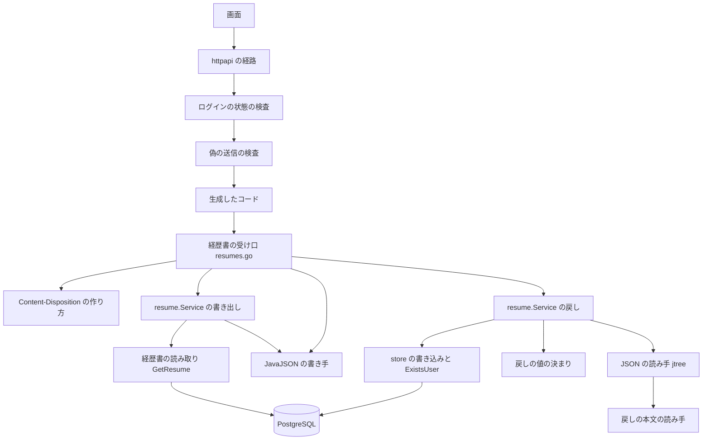
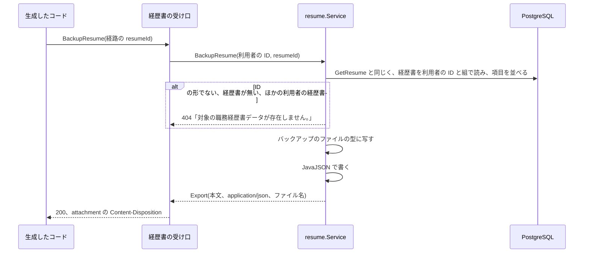
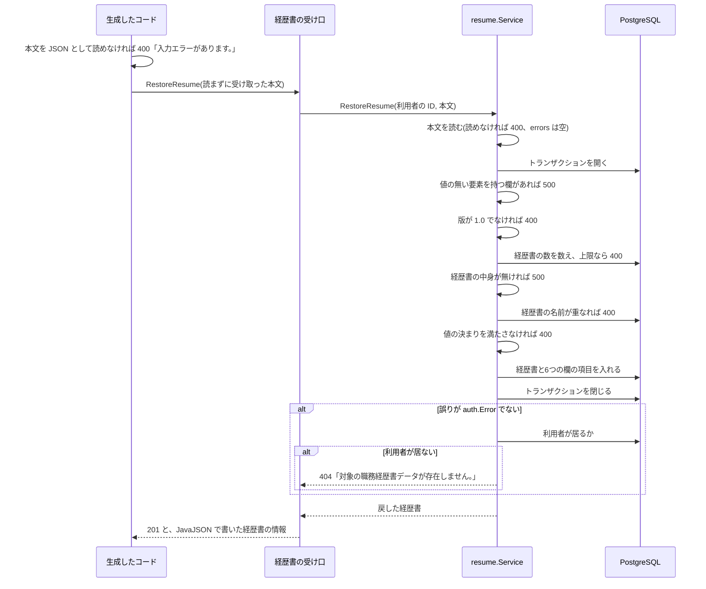

# 設計

## 概要

この設計は、Go 版に、経歴書のバックアップを書き出す操作と戻す操作を足す。

この設計は、Go 版の部品ごとに、写す元の Java のクラスを書く。Claude は、Java 版の次の4つを、Go 版を写す元とする。

- 受け口: `presentation/resume/controller/BackupResumeController.java` と `RestoreResumeController.java`
- `usecase/resume/` の `BackupResumeUseCase` と `RestoreResumeUseCase`
- バックアップのファイルの形: `presentation/resume/dto/BackupResumeResponse.java` と `RestoreResumeRequest.java`
- 戻しで確かめる値の決まり: `domain/model/resume/` の経歴書と項目のクラス

Claude は、2つの操作の処理を、マスタと経歴書のまとまりの spec で作った機能のパッケージ `internal/resume` に足す。Claude は、受け口を、同じまとまりの経歴書の受け口 `internal/httpapi/resumes.go` に足す。2つの操作も、ログインを求め、自分の経歴書だけを読み書きする操作なので、Claude は、2つの操作を同じ受け口と同じ `Service` に置く。

## 作るものと作らないもの

### 作るもの

- 書き出しと戻しの2つの操作の Go 版
- Java 版の Jackson と同じ書き方で JSON を書く書き手と、対になっていないサロゲートを保って JSON を読む読み手。Jackson は、Java 版が JSON を読み書きするのに使うライブラリである。サロゲートとは、UTF-16 で絵文字のような字を2つの単位の組で表すときの、それぞれの単位を指す。対になっていないサロゲートとは、組の片方だけが書かれたものを指す
- 退会してすでに居ない利用者かどうかを調べる sqlc の問い合わせ `ExistsUser` と、その呼び出し
- API の仕様書の、戻しの要求の本文の型の書き換えと、生成したコードの作り直し
- Java 版と Go 版を比べる検査の広げ方。広げる中身は、部品の節の「Java 版と Go 版を比べる検査の広げ方(harness)」に書く
- バックアップの操作の筋書き(`backend/compat/scenarios/backup/*.yaml`)と、初期のデータとバックアップのファイル(`backend/compat/fixtures/backup/backup.sql` と `backend/compat/fixtures/backups/` に足すファイル)
- 変えた動きの一覧に CB-062 から番号を振って載せる、バックアップの操作の違い
- Java 版と Go 版を比べる検査そのもののテストの、戻しの要求への期待の書き換え
- 置き換えの spec の進み具合の表(`progress.md`)の、バックアップのまとまりの行と、応答の時間の行

### 作らないもの

- ほかのまとまりの操作の Go 版
- ログインの状態の検査と、偽の送信の検査。どちらも認証の spec と置き換えの spec で作ってあり、この spec はそのまま使う
- 経歴書の読み取りと項目の並べ方の変更。この設計は、マスタと経歴書のまとまりの読み取りと `sortEntries` をそのまま使う
- ファイル名と Content-Disposition の作り方の変更。この設計は、出力の spec の `sanitizeFileName` と `formatContentDisposition` をそのまま使う
- データベースの表の形の変更(マイグレーション)
- 品質チェックの設定の変更。`backend/.golangci.yml` と、生成の設定 `backend/api/oapi-codegen.yaml` と `backend/sqlc.yaml` は変えない
- 新しいライブラリの追加
- Java 版のコードの変更
- 画面の変更

## 使う既存の仕組み

- 置き換えの spec の段階2で作った Go 版の土台: この設計は、次の3つを使う。
  - `internal/httpapi`: 経路の登録と、中間処理と、未実装の答え。本文を JSON として読めない要求に 400 と「入力エラーがあります。」で答える `RequestErrorHandlerFunc`
  - `internal/platform/authctx`: ログインした利用者の ID を受け渡す
  - 誤りの受け口: `*auth.Error` でない誤りを、500 と決まった本文で答え、ログに書く
- マスタと経歴書のまとまりで作った `internal/resume` の部品: この設計は、次の7つを使う。
  - 経歴書を利用者の ID と組で読み、6つの欄の項目を並べて返す `GetResume`。`GetResume` は、中で `findResume` と `sortEntries` を使う
  - トランザクションを開く `inTx` と、利用者の経歴書の数を数える `countResumes` と、経歴書の名前が利用者のほかの経歴書と重なるかを調べる `resumeNameExists` と、経歴書と項目をデータベースに入れる `insertResume`
  - 経歴書の数の上限を確かめる `resumeLimit`
  - 誤りを作る `errResumeNotFound`(404)と `errUnreadableInput`(読めない本文の 400)と `errResumeNameDuplicated`(400)
  - 値の決まりの関数 `isPersonName` と、日本の時刻の `japanZone`
  - テストの中の表の番号を変えた動きの一覧と照らす `checkDiffTableInChangedBehaviors`(`difftable_test.go`)
- 出力の spec で作った `internal/resume` と `internal/httpapi` の部品: この設計は、次の6つを使う。
  - 出力の結果の型 `Export` と、受け口の `exported`
  - 経歴書の名前からファイル名を作る `sanitizeFileName`
  - Content-Disposition を作る `formatContentDisposition`
  - Java の `String.trim` と同じ範囲で空白を除く `javaTrim`
  - Jackson の数の長さの上限を確かめる `numbersWithinLimit`
  - リンクの読み方 `parseJavaURI` と、ASCII の大文字と小文字を区別せずに比べる `equalsIgnoreCaseASCII`
- 認証の spec で作った `internal/auth` の公開した部品: 誤りの型 `auth.Error`、業務の決まりで断る誤りを作る `ErrBusiness`、Java の `@NotBlank` と同じ判定の `NotBlank`
- API の仕様書 `backend/api/openapi.yaml` と、そこから生成した `internal/httpapi/gen`
- Java 版と Go 版を比べる検査 `backend/compat/harness` と、変えた動きの一覧 `changed-behaviors.yaml`
- 比べる経歴書と利用者のデータ: `fixtures/users/basic.sql`、`fixtures/resumes/fonts.sql` の経歴書 401、`fixtures/resumes/resume-ops.sql` の退会用の利用者 340 と経歴書 350、`fixtures/resumes/resume-limits.sql` の経歴書の数が上限の利用者 500、`fixtures/backups/` の4つのファイル
- 利用者の spec で作った退会の操作 `DELETE /api/users/me`
- 依存の向き: `internal/httpapi` から `internal/resume`、`internal/resume` から `internal/auth` と `internal/platform` の一方向とする。`internal/resume` は `internal/httpapi` と生成した型 `internal/httpapi/gen` を読まない

## 設計を見直すきっかけ

- Java 版の `BackupResumeResponse`、`RestoreResumeRequest`、`BackupResumeUseCase`、`RestoreResumeUseCase` の項目か確かめる順を変えたとき。Claude が、Go 版の書き手と読み手と確かめる順を、今の Java 版に合わせて作るためである。Claude は、Go 版を同じ PR で直す(置き換えの spec の要件1の受入基準6)
- Java 版の経歴書と項目のクラスの値の決まりを変えたとき。戻しで確かめる値の決まりが変わるためである
- Java 版の Jackson の版か設定を変えたとき。Java 版の JSON の書き方と読み方が変わることがあるためである
- マスタと経歴書のまとまりの読み取りか項目の並べ方を変えたとき。書き出すファイルの項目の順が変わるためである
- バックアップのファイルの版を上げるとき
- 筋書きの要求の `json_capture` の形を変えたとき。ほかのまとまりの筋書きも、この欄を使えるためである

## プロジェクトの決まりを守っているか

- backend のコードを置く層: Go 版の層の決まりは depguard が検査する。この設計は、2つの操作の処理を `internal/resume` に、受け口を `internal/httpapi` に置く。`internal/resume` が読む `internal/auth` と `internal/platform` と `golang.org/x/text` と、sqlc の生成したコードは、今の depguard の規則で読めるので、規則を変えずに済む。ArchUnit は Java 版だけを検査する。この spec は Java 版のコードを変えない
- データベースの表の形: 変えない。マイグレーションを足さない。足す sqlc の問い合わせは、今の `users` の表を読むだけである
- 新しいライブラリの追加: 無い。Go の標準の `encoding/json` と `reflect` と `unicode/utf16` と、`go.mod` に入っている `golang.org/x/text` と `github.com/google/uuid` を使う
- 品質チェックの設定: 変えない。仕様書 `backend/api/openapi.yaml` と、sqlc の問い合わせのファイル `backend/db/queries/resumes.sql` は品質チェックの設定ではないので、Claude が変える
- 使う外部の機能がこのリポジトリで使えるか: 新しいものは無い。2つの操作は、データベースを読み書きするだけで、メールと Redis と画像の置き場所と PDF の部品を使わない
- frontend の機能ごとの境界: この spec は画面を変えない
- frontend の状態の持ち方: この spec は画面を変えない

## 全体の構成



**使う技術**: net/http と oapi-codegen v2.8.2 の strict-server、pgx v5.11.0、sqlc v1.31.1、google/uuid v1.6.0、golang.org/x/text v0.43.0、Go 1.27.0、testcontainers-go v0.45.0。どれも `go.mod` と `Makefile` にすでにある版である。

この設計は、`internal/resume` の中の新しい部品を6つに分ける。部品ごとの役割は、部品の節に書く。

生成した型で本文を読むと、`encoding/json` は、対になっていないサロゲートを U+FFFD に置き換え、欄の名前の大文字と小文字を区別せずに読み、型の違う値を持つ本文を読めない本文として断る。この読み方は Java 版の Jackson の読み方と違う。そこで、戻しの本文の読み手は、生成した型を使わずに本文を読む。同じく、`encoding/json` の書き方は `<` `>` `&` と行や段落の区切りを番号で書くので、Java 版と同じ字の並びにならない。そこで、書き出しは、Go の標準の書き方を使わずに、JSON の書き手で書く。

## ファイルの構成

Claude が新しく作るファイル:

- `backend/internal/resume/backup.go`: `Service` の書き出しのメソッド `BackupResume` と、バックアップのファイルの型(`bkFile` `bkResume` と6つの欄の項目の型)と、日時と日付の書き方
- `backend/internal/resume/restore.go`: `Service` の戻しのメソッド `RestoreResume` と、戻しの値の決まりで経歴書を作る `buildRestored`
- `backend/internal/resume/restoreread.go`: 戻しの本文の読み手 `readRestoreFile` と、戻しの本文の型(`rsFile` `rsResume` と6つの欄の項目の型)
- `backend/internal/resume/jtree.go`: 対になっていないサロゲートを保って JSON を値の木にする読み手 `parseJTree`
- `backend/internal/resume/javajson.go`: Java 版の Jackson と同じ字の並びで JSON を書く書き手 `JavaJSON`
- `backend/internal/resume/wtf8.go`: UTF-16 の単位で字を数える `javaLen` と、データベースに入れる字に直す `toDBText` と `dbResume`
- `backend/internal/resume/*_test.go`: 上の各ファイルの単体テスト(`backup_test.go` `restore_test.go` `restoreread_test.go` `jtree_test.go` `javajson_test.go` `wtf8_test.go`)
- `backend/internal/resume/backup_integration_test.go`: 書き出しのメソッドの結合テスト
- `backend/internal/resume/restore_integration_test.go`: 戻しのメソッドの結合テスト
- `backend/internal/resume/testdata/backup/restore.json`: 実装のはじめに Java 版から控える、戻しの本文ごとの Java 版の答えの正解のファイル。中身は、部品の節の「Java 版の答えの正解のファイル(testdata と fixtures/backups)」に書く
- `backend/internal/httpapi/testdata/backup-unsent.json`: 実装のはじめに Java 版から控える、画面が送らない要求への Java 版の答えの正解のファイル
- `backend/compat/scenarios/backup/*.yaml`: バックアップの操作の筋書き(部品の節の「バックアップの操作の筋書き」の表のファイル)
- `backend/compat/fixtures/backup/backup.sql`: 筋書きと結合テストの経歴書の初期のデータ
- `backend/compat/fixtures/backups/java-*.json`: 実装のはじめに Java 版から控える、Java 版が書き出したバックアップのファイル
- `backend/compat/fixtures/backups/reject-*.json`、`lax-*.json`、`malformed-*.json`: 筋書きの戻しの要求の本文(部品の節の「初期のデータとバックアップのファイル」の表のファイル)

Claude が変えるファイル:

- `backend/api/openapi.yaml`: 戻しの要求の本文の型を、新しい型 `RestoreResumeRequest`(`x-go-type: json.RawMessage`)にする。書き出しの答えの型 `ResumeBackup` は変えない
- `backend/internal/httpapi/gen/` の生成したコード: `make generate` で作り直す
- `backend/db/queries/resumes.sql`: 利用者が居るかを調べる問い合わせ `ExistsUser` を足す
- `backend/internal/platform/database/sqlcgen/` の生成したコード: `make generate` で作り直す
- `backend/internal/resume/store.go`: `ExistsUser` を呼ぶ `userExists` を足す
- `backend/internal/resume/errors.go`: 戻しの2つの文言の定数を、今の文言の定数と並べて足す
- `backend/internal/resume/service.go`: 28の操作と書いたコメント(1行と31行)を30にする
- `backend/internal/httpapi/resumes.go`: `ResumeService` に2つのメソッドを足し、2つの受け口を足す。28の操作と書いたコメント(57行)を30にする
- `backend/internal/httpapi/resumeresponses.go`: 2つの答えの型を `authResponse` にし、`Visit` の関数を2つ足す。28の操作と書いたコメント(12行)を30にする
- `backend/internal/httpapi/server.go`: `Options` の `ResumeHandlers` のコメント(49行)と `resumeOperations`(93行からの並び)を、28の操作から30の操作にする
- `backend/internal/httpapi/resumes_test.go`: 2つの受け口のテストと、画面が送らない要求のテストを足し、28の操作を期待するテスト(469行、618行、626-627行、844行、879-880行、933行、946行、998行、1006-1007行、1028行)の期待とコメントを30にする。増やさないと、これらのテストが失敗する
- `backend/compat/harness/scenario.go`: 要求の `json_capture` を足す
- `backend/compat/harness/capture.go`: `json_capture` の値を本文にして送る
- `backend/compat/harness/scenario_test.go`、`capture_test.go`: 足した欄の単体テスト
- `backend/compat/harness/cross_test.go`: 版をまたいで確かめる筋書きの送り先を確かめるテスト `TestCrossRoute_BackupSteps` を足す
- `backend/compat/harness/perfmeasure_test.go`: 2つの時間を測る筋書きを読むテスト `TestLoadScenarios_BackupPerf` を足す
- `backend/compat/harness/fixtures.go`: `FixturesDir` のコメントの `backups/` の説明(23行)に足すファイルを書き、`backup/` のフォルダの説明を足す
- `backend/compat/harness/fixtures_test.go`: `checkBackup` に、足すファイルの名前の頭ごとの確かめ方を足し、`TestFixtures_AllLoadable` に `backup` のフォルダの SQL を足す。足さないと、知らない名前のファイルとして、これらのテストが失敗する
- `backend/compat/compat_test.go`、`backend/compat/cross_test.go`、`backend/compat/perf_test.go`: 戻しの要求に 501 を期待する筋書きとコメントを、400 を期待する形に変える。変えないと、これらのテストが失敗する
- `backend/compat/changed-behaviors.yaml`: CB-062 からの違いを足す
- `backend/compat/harness/match_test.go`: 変えた動きの一覧の項目の数を確かめるテスト(328-329行)の期待する数を、足した違いの数だけ増やす。増やさないと、このテストが失敗する
- `.kiro/specs/backend-go-replacement/progress.md`: バックアップのまとまりの行の spec の列と状態の列を書き、応答の時間を比べた結果の表に、2つの操作の行を足す

この設計の段階で Claude が書いたファイル:

- `.kiro/specs/backend-go-resume-backup/research.md`: 試作の記録と、設計の段階で調べたこと

## 処理の流れ

### 書き出し



### 戻し



確かめる順は、Java 版のとおりである。値の無い要素を持つ欄と、経歴書の中身が無いファイルの戻しには、Java 版はサーバの誤りとして 500 で答える。Go 版も、画面が送る要求なので、同じ順で同じ 500 で答える(requirements の要件1の受入基準1)。ただし、退会してすでに居ない利用者の要求で、Java 版が 500 で答えるものには、Go 版は 404 で答える。

## 部品

### Service の書き出し(backup.go)

対応する要件: 1.1, 1.3, 3.1, 3.2, 3.4, 5.1, 5.2

**役割**: `BackupResume` は、経歴書を読み、バックアップのファイルを作る。写す元は `BackupResumeUseCase` と `BackupResumeResponse` である。`BackupResume` は、答えの HTTP のヘッダを作らず、本文と Content-Type とファイル名を返す。`BackupResume` はデータベースに書かない。

- `BackupResume` は、経歴書を `GetResume` で読む。そのため、ID の形でない値と、無い経歴書と、ほかの利用者の経歴書は、どれも `errResumeNotFound` になる。項目は `GetResume` の中の `sortEntries` の順に並ぶ
- バックアップのファイルの型は、`BackupResumeResponse` の欄の名前と並びを写す。`BackupResume` は、ファイルの版に定数 `backupVersion`(`1.0`)を書く
- 書かない欄: 姓と名が無ければ `lastName` と `firstName` を書かない。終わりの年月が無ければ `endDate` を書かない。項目の無い欄と、技術の分類の値が無い並びと、ポートフォリオの技術が無い値を書かない。Go 版は、この3つを、書き手の `omitempty` で書かない
- `BackupResume` は、書き出した日時 `exportedAt` に、`Deps` の `Now` の時刻を世界標準時にした値を書く。`BackupResume` は、Java の `Instant.toString` と同じく、秒の小数を、0 でなければ 3、6、9 桁のうち値を表せる最も短い桁数で書き、最後に `Z` を付ける
- `BackupResume` は、日付を `YYYY-MM-DD` で、年月を `YYYY-MM` で書く。日付か年月の年が 1 から 9999 の外にあれば、`BackupResume` は誤り `errBackupDate` を返す。Java 版の `LocalDate` は、この範囲の外の年を書けないためである。画面の保存の決まりで、この年は入らない

**呼び出し方**: `BackupResume(ctx, userID uuid.UUID, resumeID string) (Export, error)`。`Export` は出力の spec の型で、次の値を入れる。

- `Body`: `JavaJSON(bkFile{Version, ExportedAt, Resume})`
- `ContentType`: `application/json`
- `FileName`: `sanitizeFileName(経歴書の名前) + "_backup.json"`
- `Inline`: false

**失敗したとき**: 経歴書が無いときは `errResumeNotFound`(404)を返す。退会すると経歴書も消えるので、退会してすでに居ない利用者の要求も 404 になる。Java 版も 404 で答える(research.md の試作の記録)。`errBackupDate` とデータベースの誤りは、500 になる。

### Service の戻し(restore.go)

対応する要件: 1.1, 1.3, 2.1, 2.2, 2.3, 4.1, 4.2, 4.3, 4.4, 4.5, 5.3

**役割**: `RestoreResume` は、本文を読み、Java 版と同じ順で断る条件を確かめ、要求を送った利用者の新しい経歴書を入れる。写す元は `RestoreResumeUseCase` である。確かめる順は、処理の流れの節の戻しの図のとおりである。`RestoreResume` は、経歴書の数と名前の重なりを確かめてから経歴書を入れるまでを、`CreateResume` と同じく1つのトランザクションで行う。

- 版の確認: ファイルの版が無いか `1.0` でなければ、`auth.ErrBusiness(MessageUnsupportedBackupVersion)` を返す
- 経歴書の数: `countResumes` で数え、`resumeLimit.check` で確かめる
- 名前の重なり: ファイルの経歴書の名前が無いときと、名前が対になっていないサロゲートを含むときは、名前の重なりを確かめない。データベースの経歴書の名前は対になっていないサロゲートを含まないので、Java 版でも、このような名前は重ならないためである。ほかの名前は、そのまま `resumeNameExists` に渡し、重なれば `errResumeNameDuplicated()` を返す。Java 版の名前の値の決まり(`ResumeName`)は対になっていないサロゲートを断らないので、Go 版の値の決まりも断らない
- 値の決まり: `buildRestored` が経歴書を作れなければ、`auth.ErrBusiness(MessageInvalidBackupFile)` を返す
- 入れる経歴書: 経歴書と項目の ID を新しく作り、作った日時と直した日時を `Now` の時刻を `japanZone` にした値にする。利用者の ID は、要求を送った利用者の ID にする。`insertResume(dbResume(r))` で入れる

`buildRestored(rr *rsResume, userID uuid.UUID) (Resume, bool)` は、Java 版の経歴書と項目のクラスを作るときの値の決まりを写す。写す元は `RestoreResumeUseCase` の 97-138行と、`ResumeName` `FullName` `Period` `Link` などのクラスである。

- 経歴書の名前: 空白だけでないこと、UTF-16 の単位で数えた長さが上限以下であること、今の経歴書の名前と同じ使えない字の決まりを満たすこと、`.` で始まらず `.` で終わらないこと。行の区切りの字の扱いは、`ResumeName` のとおりにする
- 氏名: 姓と名の両方が無いか空白だけなら、氏名の無い経歴書にする。片方でも入っていれば、両方が空白だけでなく、長さが上限以下で、`isPersonName` を満たすこと
- 日付: あること
- 職歴: 会社の名前の長さと期間を確かめる。期間では、始まりの年月があることと、終わりの年月が始まりの年月より前でないことと、今も続いているかと終わりの年月の組を確かめる
- プロジェクト: 会社の名前、期間、名前、概要、体制、役割、成果のそれぞれの長さ。工程と技術は読んだ値のまま使い、無ければ選んでいないものとする
- 資格: 名前と年月があること
- ポートフォリオ: 名前、概要、技術の長さと、リンク
- SNS: 名前とリンク
- 自己PR: 題と中身
- リンク: 空白だけでなく、`parseJavaURI` で読め、スキームが ASCII の大文字と小文字を区別せずに `https` であること

`buildRestored` は、長さを `javaLen` で UTF-16 の単位で数える。Java 版の文字列の長さと同じ数え方にするためである。`buildRestored` は、年月の範囲、職歴の期間の重なり、リンクの長さ、欄ごとの項目の数を確かめない。`buildRestored` は、最後に `sortEntries` で項目を並べる。Java 版も、戻すときに、経歴書を読み出すときと同じ順に項目を並べてから入れるためである。

**呼び出し方**: `RestoreResume(ctx, userID uuid.UUID, body []byte) (Resume, error)`。`body` は読まずに受け取った本文のバイトの並びである。返す `Resume` は、`dbResume` で直す前の値である。

**失敗したとき**: 返す誤りは次のとおりである。

- 本文を読めない: `errUnreadableInput`(400、`errors` は空)
- 値の無い要素を持つ欄があるか、経歴書の中身が無い: `*auth.Error` でない誤り `errRestoreServer`(500)
- ファイルの版、経歴書の数、名前の重なり、値の決まり: 上の箇条の `*auth.Error`(400)
- 256文字以上のリンクのように、データベースの列の長さを超える値: `insertResume` が返すデータベースの誤り(500)。Java 版も 500 で答える(research.md の試作の記録)
- トランザクションのあとに、誤りが `*auth.Error` でないとき: `userExists` で利用者が居るかを調べる。利用者が居なければ `errResumeNotFound`(404)を返す。居れば、元の誤りを返す(500)

退会してすでに居ない利用者の要求のうち、ファイルの版の誤り、値を読めない本文、値の決まりを満たさない本文は、利用者が居るときと同じ 400 になる。Java 版も 400 で答える。

### 戻しの本文の読み手(restoreread.go)

対応する要件: 1.1, 2.1, 2.2, 4.6

**役割**: `readRestoreFile(body []byte) (rsFile, bool)` は、本文を `parseJTree` で値の木にし、Java 版の Jackson が `RestoreResumeRequest` を読むのと同じ規則で、戻しの本文の型にする。Java 版と同じに読む規則は、試作で Java 版に送った書き方(research.md の試作の記録)である。読めない値が1つでもあれば、`readRestoreFile` は false を返す。

- `readRestoreFile` は、出力の spec の `numbersWithinLimit` で、本文の中の数の長さが上限を超えないことを確かめる
- 木の根はオブジェクトでなければならない。`readRestoreFile` は、知らない名前の欄を読み飛ばす。同じ名前の欄が2つあれば、あとの値を使う
- 文字列の欄: 文字列と、数と真偽を JSON に書かれた字のまま読む。`null` と無い欄は、値が無いとする
- 真偽の欄: 数は 0 でなければ真とする。文字列は `javaTrim` で前後の空白を除き、`true` `True` `TRUE` を真、`false` `False` `FALSE` と空の文字列と `null` を偽とする。ほかの値は読めない値とする
- 年月の欄: `[年, 月]` の並びと空の並び、`YYYY-MM` の文字列を読む。文字列は前後の空白を除き、空なら値が無いとする
- 日付の欄: 1970年1月1日からの日数の数、`[年, 月, 日]` の並び、`YYYY-MM-DD` の文字列、日時の文字列、`Z` で終わる世界標準時の日時の文字列を読む
- `exportedAt`: 世界標準時の日時として読めなければ読めない値とする。読んだ値は使わない
- 文字列の並び(技術の分類): `null` は空の並びとする
- オブジェクトの欄(工程、技術、技術の分類): `null` は値が無いとする。オブジェクトでない値は読めない値とする
- 6つの欄: 無い欄と `null` は値が無いとする。並びの中の `null` の要素は、読めない値とせず、`rsFile` の `nullElement` を真にする。並びの中のオブジェクトでない要素は、読めない値とする

### JSON の読み手(jtree.go)

対応する要件: 2.1, 4.6

**役割**: `parseJTree(in []byte) (*jv, bool)` は、本文の最初の JSON の値を読み、値の木を作る。文字列の `\uD800` から `\uDFFF` の番号で書かれた対になっていないサロゲートを、WTF-8 のバイトとして保つ。WTF-8 は、対になっていないサロゲートを UTF-8 と同じ規則でバイトにした書き方である。最初の値のあとに続く字は読まない。Java 版の Jackson も、最初の値だけを読むためである。木の値の種類は、オブジェクト、並び、文字列、数、真偽、`null` の6つである。値の木は、数を、JSON に書かれた字のまま持つ。

### JSON の書き手(javajson.go)

対応する要件: 3.1, 3.3

**役割**: `JavaJSON(v any) []byte` は、Go の値を、Java 版の Jackson の既定の書き方と同じ字の並びで書く。構造体の欄は宣言の順に書き、`json` のタグの名前と `omitempty` に従う。`json.Marshaler` を持つ値は、その書き方に従う。`JavaJSON` は、空白と改行を入れない。

- 文字列の中の `"` と `\` の前に `\` を置く
- 0x20 より小さい字のうち、`\b` `\t` `\n` `\f` `\r` は短い形で書き、ほかは `\u00XX` の形で書く。`XX` の16進数の字は大文字にする
- BMP の外の字は、サロゲートの組を `\uXXXX\uXXXX` で書く。BMP は、Unicode の U+0000 から U+FFFF までの字の範囲を指し、絵文字の多くはこの範囲の外にある。対になっていないサロゲートは `\uXXXX` で書く
- `<` `>` `&` `'` `/` と U+007F と U+2028 と U+2029 は、番号にせず、そのまま書く

**呼び出し方**: 書き出しは、バックアップのファイルを書くときに使う。戻しの受け口は、201 の答えの本文を `JavaJSON(newResumeBody(r))` で書く。戻した値に対になっていないサロゲートがあるとき、Java 版の 201 の答えはそのサロゲートを番号で書く。`encoding/json` は U+FFFD に置き換えるので、JSON として読んだ値が Java 版と違ってしまうためである。

### WTF-8 の扱い(wtf8.go)

対応する要件: 2.1, 4.5

**役割**: `wtf8Units(s string) []uint16` は、WTF-8 の字を UTF-16 の単位の並びにする。`javaLen(s string) int` は、その並びの長さを返す。`toDBText(s string) string` は、対になっていないサロゲートを `?` にして、データベースに入れる字にする。PostgreSQL の UTF-8 の列は、対になっていないサロゲートを入れられないためである。試作で、対になっていないサロゲートを項目に含むファイルを戻すと、データベースの字が Java 版と同じになった(research.md の試作の記録)。`dbResume(r Resume) Resume` は、経歴書と項目のすべての字の欄に `toDBText` を当てた経歴書を返す。

### 戻しと書き出しの受け口(internal/httpapi の resumes.go、resumeresponses.go)

対応する要件: 1.1, 1.2, 1.3, 3.4

**役割**: Claude は、`BackupResumeController` と `RestoreResumeController` を、2つの受け口に写す。

- `BackupResume`: 経路の `resumeId` を `Service` に渡し、`exported` で答える。そのため、答えは 200 と、`application/json` と、attachment の Content-Disposition と、本文になる。Accept のヘッダを見ない
- `RestoreResume`: 読まずに受け取った本文を、`CreateResume` と同じく `rawBody` で `Service` に渡す。成功すれば、状態の番号 201 と、`application/json` と、`JavaJSON(newResumeBody(r))` の本文の `authResponse` で答える
- 誤りは、マスタと経歴書の受け口と同じく `authErrorResponse` で答える

Claude は、`resumeresponses.go` に `_ gen.BackupResumeResponseObject = authResponse{}` と `_ gen.RestoreResumeResponseObject = authResponse{}` と、2つの `Visit` の関数を足す。

画面が送らない要求には、Go 版は、生成したコードと受け口のふだんの答えで答える。書き出しの受け口は Accept のヘッダを見ないので、Accept のヘッダに `application/json` が無い要求にも 200 で答える。戻しの本文を JSON として読めない要求には、生成したコードが 400 と「入力エラーがあります。」で答える。Claude は、Java 版の答えを、実装のはじめに正解のファイル `internal/httpapi/testdata/backup-unsent.json` に控える。Java 版と答えが違う要求は、要求ごとに変えた動きの一覧に載せる(変えた動きの一覧の節)。

### 仕様書の変更(backend/api/openapi.yaml と生成したコード)

対応する要件: 1.1

**役割**: Claude は、仕様書の components に戻しの要求の本文の型 `RestoreResumeRequest` を足し、`x-go-type: json.RawMessage` を付ける。書き方は、今の `CreateResumeRequest` と同じで、`x-go-type-import` は足さない。Claude は、戻しの操作の要求の本文を、`ResumeBackup` から `RestoreResumeRequest` に向け直す。書き出しの 200 の答えは、今のとおり `ResumeBackup` を指す。Claude は、`make generate` で生成したコードを作り直す。生成したコードは本文を読まずに受け口へ渡す。Claude は、`unimplemented.go` を残す。`ResumeHandlers` が無いときは、Go 版は、今と同じ未実装の答えを返す。

### 利用者が居るかの問い合わせ(db/queries/resumes.sql、store.go)

対応する要件: 5.3

**役割**: Claude は、`backend/db/queries/resumes.sql` に次の問い合わせを足し、`make generate` で sqlc の生成したコードを作り直す。

```sql
-- name: ExistsUser :one
SELECT EXISTS (SELECT 1 FROM users WHERE id = $1);
```

Claude は、`store.go` に `userExists(ctx, userID uuid.UUID) (bool, error)` を足す。戻しのメソッドだけが、トランザクションのあとに、この関数を呼ぶ。

### 文言の定数(errors.go)

対応する要件: 4.2, 4.5

**役割**: Claude は、`errors.go` に次の2つの定数を、`MessageResumeNotFound` と `MessageResumeNameDuplicated` の並びに足す。文言は、Java 版の `RestoreResumeUseCase.java` の文字列をそのまま写す。

- `MessageUnsupportedBackupVersion`: 「サポートされていないバックアップバージョンです。」
- `MessageInvalidBackupFile`: 「バックアップファイルが不正なためリストアできません。」と「別のバックアップファイルでお試しください。」を改行 `\n` でつないだ文言

### 試作の記録(research.md)

対応する要件: 8.1, 8.2

**役割**: Claude は、設計を書く前に、要件8の受入基準1の7つの動きを試しに作り、方法と結果を research.md の「試作の記録」に書いた。Java 版と同じにできない動きは見つからなかったので、Claude は止まらなかった。

### Java 版の答えの正解のファイル(testdata と fixtures/backups)

対応する要件: 1.2, 2.1, 3.3, 4.6, 6.2

**役割**: Claude は、Java 版の答えを正解のファイルに置く。試作で Java 版に送った入力と答えはリポジトリに入っていない。そこで、Claude は、実装のはじめに、入力を作り直し、Java 版に送って答えを控える。

Claude は、試作と同じ設定で、main の Java 版を試作用のコンテナで動かす。Claude は、Java 版のイメージを `docker/backend/Dockerfile.prod` で作り、コンテナを開発環境の compose のネットワーク `my-network`(compose が付ける名前は `keirekipro_my-network`)につなぐ。Claude は、Java 版を、Java 版と Go 版を比べる検査と同じく、環境変数 `SPRING_PROFILES_ACTIVE` を `dev` にして動かす。dev のプロファイルは、データベースと Redis のつなぎ先と JWT の値を localstack の秘密の値から読むので、Claude は、開発環境の localstack が動いていることを確かめてから Java 版を起動する。Claude は、つなぎ先を、環境変数 `SPRING_DATASOURCE_URL` を `jdbc:postgresql://postgresql:5432/kp_backup_proto` にし、`SPRING_DATA_REDIS_DATABASE` を `7` にして選ぶ。Claude は、Java 版を起動する前に、開発環境の `postgresql` のコンテナにデータベース `kp_backup_proto` を作る。表は、Java 版が起動のときに Flyway で作る。そのため、この Java 版は、データベース `kp_backup_proto` と Redis の DB 7 を使い、所有者の開発のデータベース `keireki_pro` と Redis の DB 0 に触れない。Claude は、答えを控え終えたら、このコンテナを止め、データベース `kp_backup_proto` を消し、Redis の DB 7 を空にする。

| 正解のファイル | 中身 | 使うテスト |
|---|---|---|
| `backend/compat/fixtures/backups/java-*.json` | Java 版が書き出したバックアップのファイル | 筋書きと `backup_integration_test.go` |
| `internal/resume/testdata/backup/restore.json` | 戻しの本文ごとの、Java 版の状態の番号と答えの本文 | `restore_integration_test.go` |
| `internal/httpapi/testdata/backup-unsent.json` | 画面が送らない要求ごとの、Java 版の状態の番号と答えの本文 | `resumes_test.go` |

正解のファイルに含めるものは、次のとおりである。

- `java-*.json`: 初期のデータとバックアップのファイルの節の表の `java-` で始まるファイル。Claude は、`users/basic.sql`、`resumes/fonts.sql`、`backup/backup.sql` の順に `kp_backup_proto` に入れて、Java 版で書き出す。`users/basic.sql` を先に入れるのは、`fonts.sql` と `backup.sql` の経歴書が user1 のものだからである。API で作る経歴書は、筋書きと同じ要求を Java 版に送って作ってから書き出す
- `restore.json`: research.md の試作の記録の、形の誤ったファイルと断る条件に当たるファイルの書き方のすべてと、戻しの本文の読み手の節のすべての読み方の本文。それぞれの本文を、経歴書を持たない user2 が戻したときの答え。Claude は、答えが 201 のときは、次の本文を送る前に、作られた経歴書を user2 で消す要求(`DELETE /api/resumes/{resumeId}`)を Java 版に送り、user2 が経歴書を持たない状態に戻す
- `restore.json` の名前の重なりの場合: 名前に対になっていないサロゲートを含むファイルを、そのサロゲートを `?` にした名前の経歴書を持つ利用者が戻したときの答え。Claude は、ほかの本文の答えを控え終えてから、user2 で、このファイルを2回続けて Java 版に戻し、2回目の答えを控える。1回目の戻しで、データベースに、名前のサロゲートを `?` にした経歴書ができるためである
- `backup-unsent.json`: 書き出しで Accept に `application/json` の無い要求、戻しで本文が JSON として読めない要求、戻しで Content-Type のヘッダが JSON でない要求。Claude は、書き出しの要求を user1 で経歴書 401 に送り、戻しの要求を user2 で送る

`restore_integration_test.go` は、`restore.json` の本文ごとに、Go 版の戻しのメソッドの答えの状態の番号と文言を、Java 版の答えと比べる。201 の答えは、経歴書と項目の ID と作った日時と直した日時を除いて、JSON として読んだ値で比べる。`resumes_test.go` は、`backup-unsent.json` の要求ごとに Go 版の受け口の答えを Java 版の答えと比べ、違う要求を、テストの中の表と照らす。表は、違う要求ごとに、その違いを載せた変えた動きの一覧の番号を持つ。Java 版と違うのに表に無い要求と、表にあるのに Java 版と同じ要求があれば、テストは失敗する。

控えた Java 版の答えが、research.md の試作の記録と違うときは、Claude は、要件8の受入基準2のとおり止まって所有者に報告する。

### Java 版と Go 版を比べる検査の広げ方(harness)

対応する要件: 7.2

**役割**: Claude は、harness の筋書きの形を、要求の `json_capture` で広げる。

- 要求の `json_capture`: 前の段の `capture` で取り出した値の名前である。harness は、その値の字をそのまま本文にし、Content-Type を `application/json` にして送る。版に送る段にだけ書ける。`json` と `json_file` と `multipart` と `body_file` と同時に書けない
- 前の段の答えの本文の全体は、今の `capture` の `text` で取り出せる。版をまたいで確かめる筋書きは、一方の版が書き出したバックアップのファイルを `capture: {backup: text}` で取り出し、もう一方の版への戻しの段に `json_capture: backup` で送る
- Java 版と Go 版を比べる検査では、版ごとに取り出した値が分かれるので、`json_capture` で一方の版のファイルを両方の版に送れない。そこで、Java 版と Go 版を比べる検査の戻しの要求は、`json_file` で `fixtures/backups/` のファイルを送る

Claude は、`scenario.go` の `Request` に `JSONCapture string` の欄(`yaml:"json_capture"`)を足し、`validateKind` の `hasRequest` と、`validateVersionBody` に、この欄を足す。Claude は、`validateJSONFile` を手本に `validateJSONCapture` を足し、同時に書けない欄と一緒に書かれていないことを確かめる。絶対の URL の段の `json_capture` は、`json_file` と同じく誤りにする。Claude は、`capture.go` の `requestBody` に、この欄の場合を足す。

**失敗したとき**: 同時に書けない欄と一緒に書かれた `json_capture` と、絶対の URL の段の `json_capture` は、harness が筋書きを読む時点で誤りにする。送る時点で値の名前が取り出されていなければ、harness は、段の名前と値の名前を誤りに書いて、その段を失敗にする。

### バックアップの操作の筋書き(scenarios/backup)

対応する要件: 1.1, 1.3, 2.1, 2.2, 2.3, 3.1, 3.2, 3.4, 4.1, 4.2, 4.3, 4.4, 4.5, 4.6, 5.1, 5.2, 5.3, 6.1, 6.2, 6.4, 7.1, 7.2

**役割**: Claude は、バックアップの操作の筋書きを `backend/compat/scenarios/backup/` に `group: 5` で書く。Claude は、戻しの段に `csrf: true` を付ける。書き出しの段の Accept は、画面と同じく `application/json` にする。

| ファイル | 形 | 送る利用者と経歴書 |
|---|---|---|
| `export.yaml` | compare | user1 が、API で作った経歴書と、経歴書 401、801、802、803、804 と、無い経歴書と、ID の形でない値に送る |
| `export-added.yaml` | compare | user1 が、API で作って項目を足し、直した経歴書に送る |
| `restore.yaml` | compare | user2 が、`java-` で始まるファイルと `basic.json` を戻す |
| `rejects.yaml` | compare | user1 と利用者 500 が、断る条件に当たるファイルを戻す |
| `lax.yaml` | compare | user2 が、Java 版の戻しが確かめない決まりに当たるファイルを戻す |
| `malformed.yaml` | compare | user2 が、形の誤ったファイルを戻す |
| `not-found-other-user.yaml` | compare | user1 が無い経歴書に、user2 が user1 の経歴書 401 に送る |
| `deleted-user.yaml` | compare | 退会用の利用者 340 が、退会のあとに送る |
| `require-login.yaml` | compare | ログインしていない要求、ログインが切れた要求、偽の送信の検査に通らない要求 |
| `cross-backup.yaml` | cross | user1 が、経歴書 401 を書き出して戻す |
| `perf-backup.yaml` | perf | user1 が、経歴書 401 を書き出す |
| `perf-restore.yaml` | perf | user1 が、`java-401.json` を戻す |

ファイルごとに送る要求と確かめることは、次のとおりである。

- `export.yaml`: user1 が、名前と日付だけを入れて API で作った経歴書と、初期のデータの経歴書 401、801、802、803、804 を書き出す。続けて、無い経歴書の ID と、ID の形でない値に書き出しを送る
- `export-added.yaml`: user1 が、API で経歴書を作り、6つの欄のそれぞれに2件以上の項目を、名前の順とも期間の順とも違う順に足してから書き出す。続けて、user1 が、各欄の項目の値と経歴書の名前を `PUT` で直してから、もう一度書き出す
- `restore.yaml`: user2 が、`java-` で始まる8つのファイルと `basic.json` を、1つずつ戻す。どの要求も 201 で答えられる
- `rejects.yaml`: 断る条件ごとに、その条件に当たるファイルを送る。送るファイルは、次の6つの組である。
  - ファイルの版の誤り: `wrong-version.json` と、ファイルの版が書かれていないファイル
  - 経歴書の数の上限: 利用者 500 が戻す `basic.json`
  - 名前の重なり: user1 が戻す `java-401.json`
  - 値の決まり: 名前の無いファイル、51文字の名前のファイル、姓だけのファイル、終わりの年月が始まりの年月より前のファイル、https でないリンクのファイル
  - 値を読めない本文: 日付の欄に日付の形でない文字を入れたファイル
  - 確かめる順: 値を読めなくてファイルの版も誤ったファイル、ファイルの版が誤っていて利用者 500 が戻すファイル、利用者 500 が戻す、利用者 500 の経歴書と同じ名前のファイル、user1 が戻す、経歴書 401 と同じ名前で値の決まりも満たさないファイル
- `lax.yaml`: 期間の重なる2件の職歴を持つファイル、1900 年より前の年月を持つファイル、工程の無いファイル、姓と名の両方が無いファイル、自己PR を6件持つファイル、256文字以上のリンクを持つファイルを戻す。256文字以上のリンクのファイルには、Java 版も Go 版も 500 で答える
- `malformed.yaml`: `no-resume.json`、職歴の欄の無いファイル、項目の並びに `null` の要素を持つファイル、値の型の違うファイル、知らない名前の欄を持つファイル、中身が並びのファイル、中身が数のファイルを戻す。`no-resume.json` と `null` の要素を持つファイルには、Java 版も Go 版も 500 で答える
- `not-found-other-user.yaml`: user1 が、無い経歴書の ID に書き出しを送る。user2 が、user1 の経歴書 401 に書き出しを送る。どちらも 404 で答えられる
- `deleted-user.yaml`: 退会用の利用者 340 がログインし、Cookie の `accessToken` の値を取り出してから退会する。取り出した値を `headers` の `Cookie` に入れて、退会の前の経歴書 350 の書き出しと、`wrong-version.json` と、日付の欄に日付の形でない文字を入れたファイルと、終わりの年月が始まりの年月より前のファイルの戻しを送る。手本は `scenarios/export/deleted-user.yaml` である。Java 版が 500 で答える4つの戻し(変えた動きの一覧の CB-063 から CB-066)は、この筋書きで送らない
- `require-login.yaml`: Cookie の無い書き出しと戻しの要求、ログインのあとに `expire` でアクセストークンを切らした書き出しと戻しの要求に、401 で答えられることを確かめる。ログインしていない戻しの要求には、最初の段の答えの `XSRF-TOKEN` を `csrf` で付ける。ログインした利用者の、`X-XSRF-TOKEN` を付けない戻しの要求に、403 で答えられることを確かめる。手本は `scenarios/users/require-login.yaml` である
- `cross-backup.yaml`: 下の段落に書く
- `perf-backup.yaml`: 筋書きの名前は `backup-perf-backup` である。user1 がログインし、経歴書 401 を書き出す。`make compat-perf` は、書き出しの段を繰り返して測る
- `perf-restore.yaml`: 筋書きの名前は `backup-perf-restore` で、`prepare_each: true` を付ける。user1 がログインし、経歴書の一覧の最初の経歴書の ID を取り出して消し、`java-401.json` を戻す。`make compat-perf` は、測る回ごとに、前の段を送り直してから戻しの段を測る。同じファイルを続けて戻すと、名前の重なりで断られるためである。`fixtures` は `users/basic.sql` と `resumes/fonts.sql` なので、user1 の経歴書は1件である。手本は `scenarios/auth/two-factor-perf.yaml` である

筋書きの `fixtures` は、`users/basic.sql` と、使う経歴書のファイル(`resumes/fonts.sql`、`resumes/resume-ops.sql`、`resumes/resume-limits.sql`)と、`backup/backup.sql` を並べる。

Java 版と Go 版を比べる検査は、今の比べ方で、状態の番号と、Content-Type と Content-Disposition のヘッダと、本文と、要求のあとのデータベースを比べる。Java 版と Go 版を比べる検査は、変えた動きの一覧の CB-001 と CB-062 の `order_only` に従い、書き出しの本文の6つの欄の項目の順を比べない。

`cross-backup.yaml` は、`fixtures` を `users/basic.sql` と `resumes/fonts.sql` にし、`modes: [cross]` にする。段は次の5つである。

1. user1 がログインする
2. 最初の版で、経歴書 401 を書き出し、`capture: {backup: text}` で本文を取り出す
3. 最初の版で、経歴書 401 を消す。戻す経歴書の名前が重ならないようにするためである
4. もう一方の版(`to: other`)で、`json_capture: backup` で戻し、201 で答えることを確かめ、作った経歴書の ID を `$.id` で取り出す
5. 最初の版で、作った経歴書を読み、期待の `values` で、経歴書の名前、日付、姓、名と、6つの欄の項目の値が、経歴書 401 の値と同じことを確かめる

`CrossRoute` は、筋書きの最後の段を、その前の版に送る段と違う版に送る。そのため、5つ目の段は最初の版に届く。

Claude は、`harness/cross_test.go` に `TestCrossRoute_BackupSteps` を足す。このテストは、`cross-backup.yaml` を読み、Java 版から Go 版への向きと Go 版から Java 版への向きのそれぞれで、戻しの段の送り先が書き出しの段の送り先と違い、最後の読む段の送り先が書き出しの段の送り先と同じことを確かめる。筋書きが無ければ、テストは失敗する。手本は `TestCrossRoute_ExportSteps` である。

Claude は、時間を測る2つの筋書きを、`perfmeasure_test.go` に足す `TestLoadScenarios_BackupPerf` で確かめる。このテストは、2つの筋書きが group 5 で、段の数と最後の段の操作が上のとおりで、戻しの筋書きだけが `prepare_each` を持つことを確かめる。手本は `TestLoadScenarios_ExportPerf` である。

### 初期のデータとバックアップのファイル(fixtures/backup と fixtures/backups)

対応する要件: 6.1, 6.2

**役割**: Claude は、筋書きと結合テストの経歴書を `backend/compat/fixtures/backup/backup.sql` に置き、戻しの要求の本文を `backend/compat/fixtures/backups/` に置く。Claude は、今の `fixtures/backups/` の4つのファイルを変えない。`scenario_test.go` と `fixtures_test.go` が使うためである。

`backup.sql` に置く user1 の経歴書(ID は `00000000-0000-4000-8000-000000000801` の形):

- 経歴書 801: 6つの欄のすべてに1件ずつ項目を持つ。プロジェクトは、7つの工程をすべて選び、`project_tech_stacks` の表のすべての列に値を入れる
- 経歴書 802: 終わりの年月の無い、今も続いている職歴とプロジェクトを1件ずつ持つ
- 経歴書 803: 名前が日本語で、`\ / : * ? " < > |` を含む
- 経歴書 804: 名前と項目の字に、`<` `>` `&` `"` `'`、改行、タブ、絵文字、U+2028 と U+2029 を入れる
- 経歴書 805: 6つの欄のそれぞれに3件の項目を、経歴書を読み出すときの順と違う順に入れる。`backup_integration_test.go` が、書き出した項目の順を確かめるために使う

Claude は、経歴書 801 から 804 の各欄の項目を1件以下にする。Java 版の書き出しの項目の並びは、データベースの行の置かれ方で変わるので、項目が2件以上あると、`java-*.json` のバイトの並びと Go 版のバイトの並びが、項目の順だけで違うことがあるためである。Claude は、ポートフォリオと SNS と自己PR の項目の名前を、`fonts.sql` と同じく、名前の頭の英大文字(`A ` と `B `)で順が決まる名前にする(変えた動きの一覧の CB-001)。Claude は、職歴の期間を、経歴書 805 のほかで重ならないようにする。

バックアップのファイル:

| ファイル | 中身 |
|---|---|
| `java-created.json` | Java 版が、`export.yaml` と同じく API で作った経歴書を書き出したファイル |
| `java-401.json`、`java-801.json` から `java-804.json` | Java 版が、経歴書 401 と 801 から 804 を書き出したファイル |
| `java-added.json`、`java-edited.json` | Java 版が、`export-added.yaml` と同じ要求で項目を足した経歴書と、直した経歴書を書き出したファイル |
| `reject-no-version.json` | 版の無いファイル |
| `reject-no-name.json`、`reject-long-name.json`、`reject-last-name-only.json`、`reject-end-before-start.json`、`reject-http-link.json` | 値の決まりを満たさないファイル |
| `reject-bad-date.json` | 日付の欄に日付の形でない文字を入れたファイル |
| `reject-bad-date-wrong-version.json`、`reject-limit-duplicate.json`、`reject-duplicate-invalid.json` | 2つの条件に当たるファイル |
| `lax-overlap.json`、`lax-before-1900.json`、`lax-no-process.json`、`lax-no-names.json`、`lax-many-self-promotions.json`、`lax-long-link.json` | Java 版の戻しが確かめない決まりに当たるファイル |
| `malformed-no-careers.json`、`malformed-null-element.json`、`malformed-types.json`、`malformed-unknown-fields.json`、`malformed-array.json`、`malformed-number.json` | 形の誤ったファイル |

`reject-limit-duplicate.json` の経歴書の名前は、`resume-limits.sql` の利用者 500 の経歴書の1つと同じにする。`reject-duplicate-invalid.json` の経歴書の名前は、経歴書 401 と同じ「フォントを比べる経歴書」にする。

`java-edited.json` の経歴書の名前は、`java-added.json` と違う。`export-added.yaml` が、項目を直すときに経歴書の名前も直すためである。`restore.yaml` で、user2 が2つのファイルを続けて戻しても、名前が重ならない。

Claude は、`fixtures_test.go` の `checkBackup` に、ファイルの名前の頭ごとの確かめ方を足す。`java-` で始まるファイルは、今の `basic.json` と同じく、版が `1.0` で経歴書の中身を持つことを確かめる。`reject-` と `lax-` と `malformed-` で始まるファイルは、JSON として読めることだけを確かめる。Claude は、`TestFixtures_AllLoadable` に `backup` のフォルダの SQL を足す。

### 変えた動きの一覧に載せる違い(changed-behaviors.yaml)

対応する要件: 1.2, 3.2, 5.3, 6.2, 6.3

**役割**: Claude は、`changed-behaviors.yaml` に次の違いを `group: 5` で足す。番号ごとに、match を書くかどうかと、Go 版の答えを確かめるテストを書く。

- CB-062: バックアップのファイルの職歴、プロジェクト、資格の項目の並び。Java 版はデータベースの行の置かれ方で並べ、Go 版は経歴書を読み出すときと同じ順に並べる。「画面に影響が無い理由」に、バックアップのファイルの中の6つの欄の項目の並びが変わることと、「所有者が 2026-11-24 に受け入れた(requirements の承認)」と書く。match は、`backupResume` の `$.resume.careers[*]` と `$.resume.projects[*]` と `$.resume.certifications[*]` の `order_only` にする。ポートフォリオ、SNS、自己PR の項目の並びは、今の CB-001 の `order_only` が受け持つ。確かめるテストは `backup_integration_test.go` である
- CB-063: 退会してすでに居ない利用者の、版の正しいファイルの戻し
- CB-064: 退会してすでに居ない利用者の、項目の並びに `null` の要素を持つファイルの戻し
- CB-065: 退会してすでに居ない利用者の、経歴書の中身が無いファイルの戻し
- CB-066: 退会してすでに居ない利用者の、256文字以上のリンクを持つファイルの戻し

CB-063 から CB-066 は、Java 版が 500 と「予期せぬエラーが発生しました。」で、Go 版が 404 と「対象の職務経歴書データが存在しません。」で答える違いである。Claude は、CB-063 から CB-066 の「画面に影響が無い理由」に、退会してすでに居ない利用者は、どちらの答えでも戻しを終えられないことを書く。Claude は、CB-063 から CB-066 に match を書かず、コメントに、Java 版と Go 版を比べる検査はこの要求を送らないことと、Go 版の答えは `restore_integration_test.go` が確かめることを書く。

Claude は、実装のはじめに控えた `backup-unsent.json` の、画面が送らない要求のうち、Java 版と Go 版の答えが違う要求を、要求ごとに CB-067 から番号を振って変えた動きの一覧に足す。match を書かず、コメントに、Java 版と Go 版を比べる検査はこの要求を送らないことと、Go 版の答えは `resumes_test.go` が確かめることを書く。

Claude は、`harness/match_test.go` の項目の数の期待を、足した違いの数だけ増やす。

### Java 版と Go 版を比べる検査そのもののテスト(compat_test.go、cross_test.go、perf_test.go)

対応する要件: 1.1

**役割**: 3つのテストの筋書きは、ログインの状態の検査と偽の送信の検査を通ったことを、まだ作っていない戻しの操作の 501 の答えで確かめている。この spec で戻しの操作を作ると、空のオブジェクト `{}` の本文の戻しには、ファイルの版が無いので、400 と「サポートされていないバックアップバージョンです。」で答えるようになる。Claude は、3つのテストの段 `restore-with-token` の期待を 400 にし、501 と書いたコメントを、ファイルの版の無い本文に 400 で答えることで確かめると書き直す。

`compat_test.go` の、違いを見つけることを確かめるテストは、偽の Go 版が文言の「です。」を「です！」に替えた答えを、違いとして見つけることを確かめる。Claude は、このテストが期待する字を、「未実装です。」と「未実装です！」から、「サポートされていないバックアップバージョンです。」と「サポートされていないバックアップバージョンです！」にする。Claude は、違いを許す設定の状態の番号を `http.StatusNotImplemented` から `http.StatusBadRequest` にする。

### API の説明画面での確認(実装の終わりに Claude が Playwright で行う確認)

対応する要件: 1.3

**役割**: Claude は、実装の終わりに、開発環境の compose の `api-docs`(ポート 8082)を Playwright で開き、実装している作業フォルダのコードを動かす `backend-go` のコンテナで、2つの操作を確かめる。Claude は、利用者を作ってログインし、ブラウザの Cookie `XSRF-TOKEN` の値を Playwright で読み、戻しの「Try it out」の `X-XSRF-TOKEN` の欄に入れる。Claude は、経歴書を作って書き出し、200 と `application/json` と attachment の Content-Disposition で答えることを確かめる。Claude は、経歴書を消してから、書き出した本文を戻しの本文に入れて戻し、201 で答えることを確かめる。Claude は、結果を PR の本文に書く。

Claude は、要件1の受入基準3の、今の画面で2つの操作を終えられることを、画面と同じ要求を送る Java 版と Go 版を比べる検査の筋書き(`export.yaml` と `restore.yaml`)と、この確認で確かめる。

### 進み具合の表(progress.md のバックアップのまとまりの行)

対応する要件: 8.3

**役割**: Claude は、`progress.md` のまとまりの表のバックアップの行の spec の列に `.kiro/specs/backend-go-resume-backup` を書き、状態の列を「未着手」から「作り終えた」にする。この spec の PR は1つで、2つの操作を作り終える PR だからである。

状態を「作り終えた」にすると、筋書きに出てくる操作が足りているかを確かめる `TestCoverage_Operations` が、group 5 の2つの操作が筋書きに1回以上出てくることを求め始める。Claude は、この書き換えを、筋書きを書き終える時点で行う。

Claude は、`make compat-perf` で測った2つの操作の時間を、`progress.md` の応答の時間を比べた結果の表に、出力の行のあとに、今の行と同じ形で足す。

Java 版と Go 版を比べる検査は、この spec の PR の必須のチェックであり、通らなければ PR はマージされない。そこで、Claude は、この spec の PR のマージを見届けたあと、main から新しい featureブランチを作り、状態の列を「比べる検査に通った」にする PR を別に出す。

## データの形

### バックアップのファイル

```json
{"version":"1.0","exportedAt":"2026-11-24T01:02:03.456Z","resume":{"resumeName":"経歴書","date":"2026-02-04","lastName":"鈴木","firstName":"一郎","careers":[{"companyName":"株式会社ひかく","startDate":"2012-04","endDate":"2018-03","active":false}],"projects":[{"companyName":"株式会社ひかく","startDate":"2016-04","active":true,"name":"案件","overview":"概要","teamComp":"5名","role":"開発","achievement":"成果","process":{"requirements":true,"basicDesign":true,"detailedDesign":false,"implementation":true,"integrationTest":false,"systemTest":false,"maintenance":false},"techStack":{"frontend":{"languages":["TypeScript"]},"backend":{},"infrastructure":{},"tools":{}}}],"selfPromotions":[{"title":"A 題","content":"中身"}]}}
```

- 欄の並びは、`BackupResumeResponse` の並びと同じである。
- `lastName` `firstName` `endDate` と、項目の無い欄と、値の無い技術の分類と、ポートフォリオの `techStack` は、値が無ければ書かない
- 戻しの本文は、同じ形のファイルである。戻しの本文の読み手は、この形のほかに、戻しの本文の読み手の節の書き方も読む

### 戻しの答え

- 201: `Content-Type: application/json`。本文は、経歴書1件の取得と同じ形の経歴書の情報である
- 400: `{"message":"…","errors":{}}`。文言は、Service の戻しの節の「失敗したとき」のとおりである

### 書き出しの答えのヘッダ

- `Content-Type: application/json`
- `Content-Disposition: attachment; filename="____backup.json"; filename*=UTF-8''%E7%B5%8C...`。この例は、経歴書の名前が日本語のときである

## 失敗したときの扱い

- 誤りを返す順: 処理の流れの節と、Service の戻しの節の「失敗したとき」のとおりである
- システムの失敗: データベースの誤りと `errRestoreServer` と `errBackupDate` は、置き換えの spec の土台の誤りの受け口で 500 と決まった本文にし、誤りの型をログに書く
- 戻しは、経歴書と項目を1つのトランザクションで入れるので、途中で失敗すると、経歴書も項目も残らない。断った要求のあとにも経歴書は残らない
- 書き出しはデータベースに書かないので、途中で止まっても経歴書は変わらない

## テストの方針

- 単体テスト:
  - `javajson.go`: `"` `\`、0x20 より小さい字、BMP の外の字、対になっていないサロゲート、`<` `>` `&` `'` `/`、U+007F、U+2028、U+2029 が、JSON の書き手の節の書き方になること。`omitempty` の欄と `json.Marshaler` を持つ値が、Java 版の書き方になること(要件3の受入基準1と3)
  - `jtree.go`: 対になっていないサロゲートの番号が WTF-8 のバイトで残ること。最初の値のあとの字を読まないこと。同じ名前の欄はあとの値になること。誤った JSON を読めないこと
  - `restoreread.go`: 戻しの本文の読み手の節の欄の種類ごとに、読める書き方と読めない書き方。`null` の要素が `nullElement` になること。オブジェクトでない根を読めないこと(要件4の受入基準6)
  - `wtf8.go`: `javaLen` が BMP の外の字を2、対になっていないサロゲートを1と数えること。`toDBText` が対になっていないサロゲートを `?` にすること
  - `restore.go`: `buildRestored` が、Service の戻しの節の値の決まりのそれぞれで、決まりを満たす値と満たさない値を分けること。Java 版の戻しが確かめない決まりに当たる値を断らないこと。姓と名の両方が無いときに氏名の無い経歴書にし、片方だけのときに断ること。項目を `sortEntries` の順に並べること(要件4の受入基準5、要件2の受入基準2)
  - `backup.go`: 書かない欄の決まりと、`exportedAt` の秒の小数の桁数。年が 1 から 9999 の外の日付が `errBackupDate` になること
  - `resumes.go` の単体テストは、次の5つの場合を確かめる
    - 書き出しの答えが、200 と `application/json` と attachment の Content-Disposition と本文を書くこと
    - 戻しの答えが、201 と `application/json` と `JavaJSON` で書いた本文を書くこと
    - 画面が送らない要求の答えが、`backup-unsent.json` の Java 版の答えと同じか、違う要求がテストの中の表と合うこと
    - `ResumeHandlers` が無いときは、2つの操作の要求に今と同じ未実装の答えを返すこと
    - `httpapi.New` に `ResumeHandlers` を渡すと、30の操作の要求が受け口に届くこと。答えの型の数を確かめるテストが30を確かめること
  - harness: `json_capture` を同時に書けない欄と書いた筋書きと、絶対の URL の段の `json_capture` を断ること。`json_capture` の値をそのまま `application/json` で送ること。値の名前が取り出されていない段を失敗にすること
- 結合テスト: 結合テストは、名前が `_integration_test.go` で終わるファイルに書き、testcontainers-go で動かす PostgreSQL に Java 版のマイグレーションを当ててから動く。
  - `backup_integration_test.go` は、`backend/compat/fixtures` の `users/basic.sql` と `resumes/fonts.sql` と `backup/backup.sql` をデータベースに入れ、次の3つの場合を確かめる
    - 経歴書 801 から 804 の書き出しの本文が、`exportedAt` の値を除いて、`java-801.json` から `java-804.json` と1バイトも違わないこと。Content-Type とファイル名が Java 版と同じこと(要件3の受入基準1、3、4。要件6の受入基準2の、文字の並びを機械で確かめること)
    - 経歴書 805 の書き出しの項目が、6つの欄のそれぞれで、`GetResume` が返す順に並ぶこと(要件3の受入基準2。要件6の受入基準2の、項目の順を Go 版のテストで確かめること)
    - 無い経歴書とほかの利用者の経歴書の書き出しが `errResumeNotFound` になること(要件5の受入基準1と2)
  - `restore_integration_test.go` は、同じ初期のデータを入れ、次の5つの場合を確かめる
    - `restore.json` の本文ごとに、Go 版の答えが Java 版の答えと同じこと(要件2の受入基準1と2、要件4の受入基準2、5、6)
    - 経歴書の数の上限、名前の重なりと、2つ以上の条件に当たる要求が、確かめる順のとおりの誤りになること(要件4の受入基準1、3、4)
    - 名前に対になっていないサロゲートを含むファイルを、そのサロゲートを `?` にした名前の経歴書を持つ利用者が戻すと、名前の重なりの誤りでなく、`restore.json` に控えた Java 版の答えと同じ答えになること(要件1の受入基準1、要件4の受入基準4)
    - 戻した経歴書が要求を送った利用者のものになり、断った要求のあとに経歴書が残らないこと(要件2の受入基準3)
    - 退会してすでに居ない利用者の、CB-063 から CB-066 の4つの戻しが 404 になり、版の誤りと読めない本文と値の決まりを満たさない本文が 400 になること(要件5の受入基準3)
- Java 版と Go 版を比べる検査(`make compat`): バックアップの操作の筋書きを compare で動かし、答えとデータベースを比べる。この検査で確かめる受入基準は次のとおりである
  - 要件1の受入基準1と3: 画面が送る要求で、Java 版と同じ状態の番号と、Content-Type と Content-Disposition のヘッダと本文
  - 要件2の受入基準1から3: Java 版が書き出したファイルの戻しの答えと、戻したあとのデータベース
  - 要件3の受入基準1と4: 書き出しの欄と値と、ファイル名
  - 要件4の受入基準1から6: 断る条件と文言と確かめる順
  - 要件5の受入基準1から3: 無い経歴書、ほかの利用者の経歴書、退会した利用者の要求への答え
  - 要件6の受入基準1と2: 筋書きに含める要求と、データベースの比べ方
- 版をまたいで確かめる検査(`make compat-cross`): `cross-backup.yaml` を2つの向きで動かす。この検査で、要件7の受入基準1と2を確かめる
- 応答の時間の比べ方(`make compat-perf`): 2つの時間を測る筋書きで、要件6の受入基準4の時間を測る。結果は、置き換えの spec の進み具合の表の決まりのとおりに書く
- 画面を通しで操作するテスト: この spec は画面を変えないので足さない。Claude は、要件1の受入基準3を、「API の説明画面での確認(実装の終わりに Claude が Playwright で行う確認)」の節のとおりに確かめる

## 安全

- ほかの利用者の経歴書: 書き出しは、経歴書を利用者の ID と組で読むので、ほかの利用者の経歴書の要求にも、無い経歴書と同じ 404 で答える。要求を送った人は、答えから、その経歴書があるかどうかを見分けられない
- 戻した経歴書の持ち主: 戻しは、ログインの状態から取り出した利用者の ID で経歴書を作る。ファイルの中に利用者の ID の欄は無く、Go 版はファイルから利用者を決めない
- ファイル名: Content-Disposition のファイル名は、出力の spec の `formatContentDisposition` で、制御の字と `"` と `\` をそのまま出さずに書くので、経歴書の名前でヘッダが途中で分かれることはない
- 本文の大きさ: 戻しの本文の読み手は、`numbersWithinLimit` で数の長さを限る。本文の全体の大きさは、置き換えの spec の土台の決まりのとおりである
- 偽の送信: 戻しは POST なので、今の偽の送信の検査が働く

## 性能

- 目標: 置き換えの spec の性能の目標のとおり、Java 版と比べる。書き出しは経歴書1件の取得と同じ読み取りで、戻しは経歴書1件と項目を1つのトランザクションで入れるので、この設計は、新しい限りを足さない
