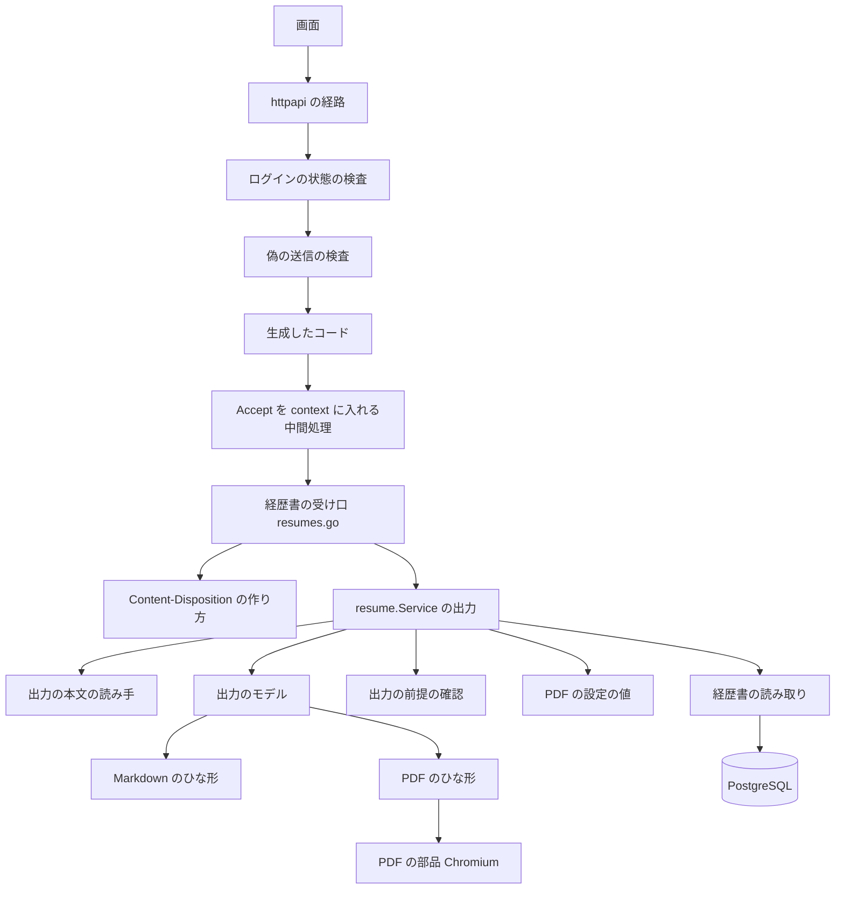
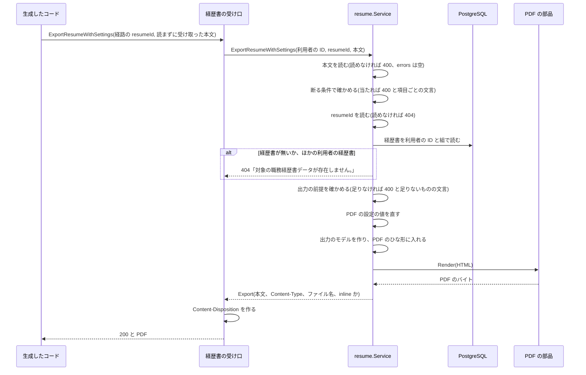
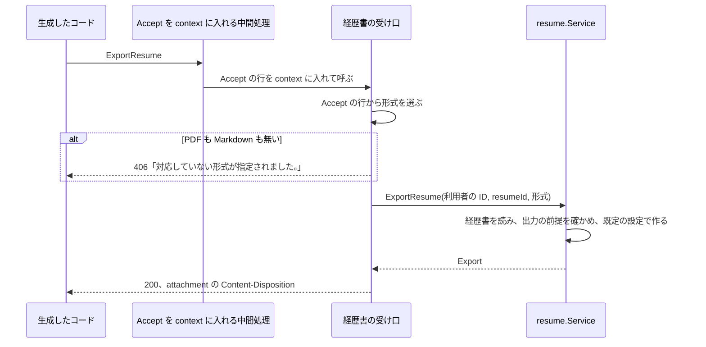

# 設計

## 概要

この設計は、Go 版に、経歴書を PDF と Markdown で出力する2つの操作を足す。

Go 版は、マスタと経歴書のまとまりの読み取りで経歴書を読み、Java 版と同じ形のひな形に入れる。Go 版は、Markdown をそのまま返し、PDF を、置き換えの spec の段階2で作った、Chromium を使う PDF の部品で作る。この設計は、Go 版の部品ごとに、写す元の Java のクラスを書く。Claude は、Java 版の次の4つを、Go 版を写す元とする。

- 受け口: `presentation/resume/controller/ExportResumeController.java` と `ExportResumeWithSettingsController.java`
- `usecase/resume/` の `ExportResumeUseCase` と、`usecase/resume/export/` の `ResumePdfExportSettings`
- 出力の前提の確認: `ResumeExportRuleCheckService`
- `infrastructure/export/resume/` の `ResumeExportModelBuilder` と2つのひな形

Claude は、出力の処理を、マスタと経歴書のまとまりが作った機能のパッケージ `internal/resume` に足す。Claude は、受け口を、同じまとまりの経歴書の受け口 `internal/httpapi/resumes.go` に足す。出力の操作も、ログインを求め、自分の経歴書だけを読む操作なので、Claude は、出力の操作を同じ受け口と同じ `Service` に置く。

試作で、Go 版の PDF に、Java 版と同じにできない3つの違いが見つかった。3つの違いは、頁の大きさと、PDF から写した字と、長い文の折り返しである。所有者は、この3つの違いを受け入れた。今の PDF を比べる部品は、この3つの違いと、2つの版の語と行の区切りと罫線の描き方の違いで、どの PDF も違うと判定する。そこで、この設計は、PDF を比べる部品の比べ方を、行と字の並びで比べる形に決め直す。比べ方は、部品の節の「PDF を比べる部品(pdfcmp)」に書く。

## 作るものと作らないもの

### 作るもの

- 出力の2つの操作の Go 版。Claude は、受け口を `internal/httpapi/resumes.go` に足し、処理を `internal/resume` の新しいファイルに置く
- Markdown と PDF のひな形(`internal/resume/templates/`)。Claude は、Java 版の2つのひな形を写し、PDF のひな形には、Chromium で Java 版と同じ見た目にするための CSS を足す
- 答えの Content-Disposition のヘッダを Spring と同じ規則で作る関数(`internal/httpapi/exportdisposition.go`)
- 単体テストと結合テストが Go 版の答えと比べる、Java 版の答えの正解のファイル。中身は、部品の節の「Java 版の答えの正解のファイル(testdata)」に書く
- API の仕様書の、設定を付けた出力の本文の型の書き換えと、生成したコードの作り直し
- PDF を比べる部品の比べ方の決め直し
- Java 版と Go 版を比べる検査の広げ方。広げる中身は、部品の節の「Java 版と Go 版を比べる検査の広げ方(harness)」に書く
- 出力の操作の筋書き(`backend/compat/scenarios/export/*.yaml`)と、初期のデータと要求の本文(`backend/compat/fixtures/export/`)
- 変えた動きの一覧に CB-056 から番号を振って載せる、出力の操作の違い
- 置き換えの spec の進み具合の表(`progress.md`)の、出力のまとまりの行

### 作らないもの

- ほかのまとまりの操作の Go 版。Claude は、経歴書のバックアップと戻しの Go 版を、バックアップのまとまりの spec で作る
- ログインの状態の検査と、偽の送信の検査。どちらも認証の spec と置き換えの spec で作ってあり、この spec はそのまま使う
- PDF の部品(`internal/platform/pdf`)の変更。この設計は、今の `Render` をそのまま使う
- 経歴書の読み取りと項目の並べ方の変更。この設計は、マスタと経歴書のまとまりの読み取りをそのまま使う
- データベースの表の形の変更(マイグレーション)
- 品質チェックの設定の変更。`backend/.golangci.yml` と、生成の設定 `backend/api/oapi-codegen.yaml` と `backend/sqlc.yaml` は変えない
- 開発環境と本番のコンテナイメージの変更。PDF を比べる部品が新しく使う `pdftohtml` は、今のイメージの poppler-utils に入っている
- Java 版のコードの変更
- 画面の変更

## 使う既存の仕組み

- 置き換えの spec の段階2で作った Go 版の土台: この設計は、次の3つを使う。
  - `internal/httpapi`: 経路の登録と、中間処理と、未実装の答え
  - `internal/platform/pdf`: HTML の文字列から A4 の PDF を作る `Engine.Render(ctx, html)`。同時に作る数は2で、打ち切りは30秒である
  - `internal/platform/authctx`: ログインした利用者の ID を受け渡す
- マスタと経歴書のまとまりで作った `internal/resume` の部品: この設計は、次の4つを使う。
  - 経歴書を利用者の ID と組で読み、6つの欄の項目を並べて返す読み取り(`GetResume` が使う `findResume` と `order.go`)
  - 経歴書の ID を読む `parseID`
  - 誤りを作る `errResumeNotFound`(404「対象の職務経歴書データが存在しません。」)と `errUnreadableInput`(読めない本文の 400)
  - テストの中の表の番号を変えた動きの一覧と照らす `checkDiffTableInChangedBehaviors`(`difftable_test.go`)
- 認証の spec で作った `internal/auth` の公開した部品: この設計は、次の5つを使う。
  - 誤りの型 `auth.Error`
  - 入力の誤りを項目ごとに集める `FieldErrors`
  - 業務の決まりで断る誤りを作る `ErrBusiness`
  - 入力の誤りを作る `ErrInvalidInput`
  - Java の `@NotBlank` と同じ判定の `NotBlank`
- 認証の spec で作った `internal/httpapi` の部品: この設計は、次の4つを使う。
  - 応答の型 `authResponse`
  - 誤りの答えを作る `authErrorResponse`
  - Accept の行を Spring と同じく読む `parseAccept`
  - Accept の行を context に入れる中間処理 `authRequestMiddleware`
- API の仕様書 `backend/api/openapi.yaml` と、そこから生成した `internal/httpapi/gen`
- Java 版と Go 版を比べる検査 `backend/compat/harness`、PDF を比べる部品 `backend/compat/pdfcmp`、変えた動きの一覧 `changed-behaviors.yaml`
- 置き換えの spec の段階2で置いた比べる経歴書のデータ: `fixtures/users/basic.sql` と、`fixtures/resumes/` の `empty.sql` `many-pages.sql` `long-text.sql` `fonts.sql` と、4つの要求の本文 `fonts-NotoSansJP.json` `fonts-NotoSerifJP.json` `sizes-NotoSansJP.json` `sizes-NotoSerifJP.json`
- マスタと経歴書のまとまりで置いた比べる経歴書のデータ: `fixtures/resumes/resume-ops.sql` の退会用の利用者と経歴書
- 利用者の spec で作った退会の操作 `DELETE /api/users/me`
- poppler-utils の `pdfinfo` `pdffonts` `pdftotext` `pdftoppm` `pdftohtml`。開発環境のイメージと、CI の backend-compat のジョブに入っている
- `golang.org/x/text`: この設計は、パッケージ `unicode/norm` を、互換漢字を普通の字に直すことと、ファイル名の字を ASCII に写すときの字の分解に使う。`go.mod` に直接の依存として v0.43.0 が入っている
- 依存の向き: `cmd/keirekipro` から `internal/httpapi` と `internal/platform/pdf`、`internal/httpapi` から `internal/resume`、`internal/resume` から `internal/auth` と `internal/platform` の一方向とする。`internal/resume` は `internal/platform/pdf` を読まず、`Render` を持つインタフェースで PDF の部品を受け取る。`internal/resume` は `internal/httpapi` と生成した型 `internal/httpapi/gen` を読まない

## 設計を見直すきっかけ

- Java 版の出力の受け口、`ExportResumeUseCase`、`ResumePdfExportSettings`、`ResumeExportRuleCheckService`、`ExportResumeRequest` の項目か注釈を変えたとき。Claude が、Go 版の本文の読み手と、設定の値の直し方と、出力の前提の確認を、今の Java 版に合わせて作るためである
- Java 版の2つのひな形(`templates/resume/markdown/default.md` と `templates/resume/pdf/simple.html`)か、`ResumeExportModelBuilder` を変えたとき。Claude は、Go 版のひな形を同じ PR で直す(置き換えの spec の要件1の受入基準6)
- マスタと経歴書のまとまりの読み取りか項目の並べ方を変えたとき。出力の本文の項目の順が変わるためである
- `internal/platform/pdf` の `Render` の形か、Chromium の版を変えたとき。PDF の頁の大きさと字の幅が変わると、Claude は、試作で決めた CSS の値と、PDF を比べる部品の許す幅を確かめ直す
- 本番のイメージに置く4つのフォントのファイルを変えたとき。Claude は、ひな形の `@font-face` の名前と、`ascent-override` と `descent-override` の値を確かめ直す
- PDF を比べる部品の比べ方か許す幅を変えたとき。ほかのまとまりの PDF の比べ方も、この部品を使うためである
- 筋書きの要求の `json_file` と、期待の `body_contains` と `content_type` の形を変えたとき。ほかのまとまりの筋書きも、この欄を使えるためである

## プロジェクトの決まりを守っているか

- backend のコードを置く層: Go 版の層の決まりは depguard が検査する。depguard は、Go のパッケージが読んでよいパッケージを、決めた規則で検査する道具である。この設計は、出力の処理を `internal/resume` に、受け口と Content-Disposition の作り方を `internal/httpapi` に置く。`internal/resume` は PDF の部品をインタフェースで受け、`internal/platform/pdf` を読まない。`internal/resume` が読む `internal/auth` と `internal/platform` と `golang.org/x/text` は、今の depguard の規則で読めるので、規則を変えずに済む。ArchUnit は Java 版だけを検査する。この spec は Java 版のコードを変えない
- データベースの表の形: 変えない。マイグレーションを足さない。出力の操作はデータベースを読むだけである
- 新しいライブラリの追加: 無い。Go の標準の `text/template` と `html/template` と `embed` と `encoding/json` と `math/big` と、`go.mod` に入っている `golang.org/x/text` を使う。PDF を比べる部品は、開発環境と CI にすでにある poppler-utils の `pdftohtml` を足して使う
- 品質チェックの設定: 変えない。仕様書 `backend/api/openapi.yaml` は品質チェックの設定ではないので、Claude が変える
- 使う外部の機能がこのリポジトリで使えるか: 新しいものは無い。出力の操作は、データベースを読み、PDF の部品の Chromium を使うだけで、メールと Redis と画像の置き場所を使わない
- frontend の機能ごとの境界: この spec は画面を変えない
- frontend の状態の持ち方: この spec は画面を変えない

## 全体の構成



**使う技術**: net/http と oapi-codegen v2.8.2 の strict-server、pgx v5.11.0、sqlc v1.31.1、google/uuid v1.6.0、golang.org/x/text v0.43.0、Go 1.27.0、testcontainers-go v0.45.0。どれも `go.mod` と `Makefile` にすでにある版である。PDF を比べる部品は poppler-utils を使う。

この設計は、`internal/resume` の中の出力の部品を、`Service` の出力の2つのメソッドと、本文の読み手と、PDF の設定の値と、出力のモデルの4つに分ける。

- `Service` の出力の2つのメソッドは、確かめる順を決め、経歴書を読み、出力のモデルを作り、ひな形に入れる
- 生成した型で本文を読むと、`encoding/json` は、鍵の大文字と小文字を区別せずに読み、型の違う値を持つ本文を読めない本文として断る。この読み方は Java 版の断る条件と違うので、本文の読み手は、生成した型を使わずに本文を読む

受け口は、Accept の行から形式を選ぶ処理と、答えのヘッダを作る処理を受け持つ。この設計は、Accept の行の読み方と Content-Disposition の書き方を、ヘッダを扱う `internal/httpapi` に置く。どちらも HTTP のヘッダの取り決めだからである。

## ファイルの構成

Claude が新しく作るファイル:

- `backend/internal/resume/export.go`: `Service` の出力の2つのメソッドと、出力の結果の型 `Export` と形式の型 `ExportFormat`
- `backend/internal/resume/exportbody.go`: 設定を付けた出力の本文の読み手と、断る条件の確認
- `backend/internal/resume/exportsettings.go`: PDF の設定の既定の値と、値の直し方
- `backend/internal/resume/exportrule.go`: 出力の前提の確認と、8つの文言
- `backend/internal/resume/exportmodel.go`: 経歴書から、ひな形が読む出力のモデルを作る
- `backend/internal/resume/exporttemplate.go`: ひな形を `embed` で読み込み、Markdown と PDF の HTML を作る
- `backend/internal/resume/templates/resume.md.tmpl`: Markdown のひな形(`text/template`)
- `backend/internal/resume/templates/resume.html.tmpl`: PDF の HTML のひな形(`html/template`)
- `backend/internal/resume/filename.go`: 経歴書の名前からファイル名を作る
- `backend/internal/resume/*_test.go`: 上の各ファイルの単体テスト(`export_test.go` `exportbody_test.go` `exportsettings_test.go` `exportrule_test.go` `exportmodel_test.go` `exporttemplate_test.go` `filename_test.go`)
- `backend/internal/resume/export_integration_test.go`: 出力の2つのメソッドの結合テスト
- `backend/internal/resume/testdata/export/`: 実装のはじめに Java 版から控える正解のファイル。中身は、部品の節の「Java 版の答えの正解のファイル(testdata)」に書く
- `backend/internal/httpapi/exportdisposition.go`: Content-Disposition のヘッダを Spring と同じ規則で作る関数 `formatContentDisposition`
- `backend/internal/httpapi/exportdisposition_test.go`: 上の関数の単体テスト
- `backend/internal/httpapi/testdata/exportdisposition.json`: 経歴書の名前ごとの、Java 版の Content-Disposition のヘッダの正解のファイル
- `backend/compat/scenarios/export/*.yaml`: 出力の操作の筋書き(部品の節の「出力の操作の筋書き」の表のファイル)
- `backend/compat/fixtures/export/export.sql`: 筋書きの経歴書の初期のデータ
- `backend/compat/fixtures/export/*.json`: 筋書きの要求の本文(部品の節の「初期のデータと要求の本文」の表のファイル)

Claude が変えるファイル:

- `backend/api/openapi.yaml`: 設定を付けた出力の本文の型 `ExportResumeRequest` に `x-go-type: json.RawMessage` を足す
- `backend/internal/httpapi/gen/` の生成したコード: `make generate` で作り直す
- `backend/internal/httpapi/resumes.go`: `ResumeService` に出力の2つのメソッドを足し、出力の2つの受け口を足す
- `backend/internal/httpapi/resumeresponses.go`: 出力の2つの答えの型を `authResponse` にし、`Visit` の関数を2つ足す。26の操作と書いたコメントを28にする
- `backend/internal/httpapi/authresponses.go`: `authResponse` に Content-Disposition の欄を足し、`write` で書く
- `backend/internal/httpapi/auth.go`: `authRequestMiddleware` が Accept の行を context に入れる操作に、設定を付けない出力 `ExportResume` を足す
- `backend/internal/httpapi/server.go`: `Options` の `ResumeHandlers` のコメントと `resumeOperations` を、26の操作から28の操作にする
- `backend/internal/httpapi/resumes_test.go`: 出力の受け口のテストを足し、応答の型の数を確かめるテスト(803-836行)の期待を26から28にする。増やさないと、このテストが失敗する
- `backend/internal/httpapi/auth_test.go`: `authRequestMiddleware` が `ExportResume` で Accept の行を context に入れることを確かめる
- `backend/cmd/keirekipro/main.go`: `resume.New` を PDF の部品を作ったあとに移し、`resume.Deps` に PDF の部品を渡す
- `backend/cmd/keirekipro/main_test.go`: 入口が PDF の部品を経歴書の処理に渡すことを確かめるテスト `TestRun_PassesPDFEngineToResume` を足す
- `backend/compat/pdfcmp/pdfcmp.go`: 比べ方を決め直す。許す幅のコメント(30行)が指す先を、この spec の design.md の PDF を比べる部品の節に直す
- `backend/compat/pdfcmp/pdfcmp_test.go` と `pdf_helper_test.go`: 決め直した比べ方のテストを足す
- `backend/compat/harness/scenario.go`: 要求の `json_file` と期待の `body_contains` を足し、版に送る段でも期待の `content_type` を書けるようにする
- `backend/compat/harness/capture.go`: `json_file` のファイルを本文にして送る
- `backend/compat/harness/steps.go`: 版に送る段の期待の `content_type` と `body_contains` を確かめる
- `backend/compat/harness/scenario_test.go`、`capture_test.go`、`steps_test.go`: 足した欄の単体テスト
- `backend/compat/harness/cross_test.go`: 版をまたいで確かめる筋書きの送り先を確かめるテスト `TestCrossRoute_ExportSteps` を足す
- `backend/compat/harness/perfmeasure_test.go`: 出力の時間を測る筋書きを読むテスト `TestLoadScenarios_ExportPerf` を足す
- `backend/compat/changed-behaviors.yaml`: CB-056 からの違いを足し、CB-004 の文に、CB-056 から CB-058 に違いを分けて載せたことを書き足す
- `backend/compat/harness/match_test.go`: 変えた動きの一覧の項目の数を確かめるテスト(328行)の期待する数を、足した違いの数だけ増やす。増やさないと、このテストが失敗する
- `.kiro/specs/backend-go-replacement/progress.md`: 出力のまとまりの行の spec の列と状態の列を書き、応答の時間を比べた結果の表に、出力の2つの操作の行を足す

この設計の段階で Claude が書いたファイル:

- `.kiro/specs/backend-go-resume-export/research.md`: 試作の記録と、設計の段階で調べたこと

## 処理の流れ

### 設定を付けた出力(PDF の例)



### 設定を付けない出力



確かめる順は、Java 版のとおりである。設定を付けない出力は、Accept の行を、経歴書を読む前に確かめる。Java 版のコントローラが、ユースケースを呼ぶ前に Accept の行を見るためである。設定を付けた出力は、本文を、経歴書を読む前に確かめる。Java 版は、Spring が本文を読んで注釈で確かめてから、コントローラを呼ぶためである。どちらの操作も、出力の前提を、経歴書の持ち主を確かめたあとに確かめる。ほかの利用者の経歴書の足りないものを答えないためである(要件4の受入基準1)。

## 部品

### Service の出力(export.go)

対応する要件: 1.1, 1.2, 3.2, 3.3, 3.4, 4.1, 4.2, 5.3, 6.1

**役割**: `Service` の出力の2つのメソッドは、経歴書を読み、出力の前提を確かめ、Markdown か PDF を作る。写す元は `ExportResumeUseCase` である。メソッドは、答えの HTTP のヘッダを作らず、本文と Content-Type とファイル名と出し方を返す。メソッドはデータベースに書かない。経歴書の読み取りは、マスタと経歴書のまとまりの経歴書1件の取得と同じ読み取りで、トランザクションも行の固定も使わない。

**呼び出し方**:

- `ExportResume(ctx, userID uuid.UUID, resumeID string, format ExportFormat) (Export, error)`: 設定を付けない出力。PDF は既定の設定で作り、出し方は attachment にする
- `ExportResumeWithSettings(ctx, userID uuid.UUID, resumeID string, body []byte) (Export, error)`: 設定を付けた出力。`body` は読まずに受け取った本文のバイトの並びである
- `ExportFormat` は `ExportPDF` と `ExportMarkdown` の2つである
- `Export` は次の4つを持つ
  - `Body []byte`: PDF か Markdown のバイト
  - `ContentType string`: PDF は `application/pdf`、Markdown は `text/markdown;charset=utf-8`。Java 版の答えの Content-Type と同じである
  - `FileName string`: ファイル名の節の関数で作った名前に、`.pdf` か `.md` を付けたもの
  - `Inline bool`: 設定を付けた出力で出し方が `inline` のとき true

この設計は、`Deps` に `PDF PDFRenderer` を足す。`PDFRenderer` は `Render(ctx context.Context, html string) ([]byte, error)` を持つインタフェースで、`internal/platform/pdf` の `*Engine` が満たす。

設定を付けた出力の形式が `markdown` のときは、Java 版と同じく、`Service` は Markdown を返す。本文に PDF の設定があれば、形式が `markdown` でも、本文の読み手は、PDF の設定を断る条件で確かめる。Java 版は、注釈で PDF の設定の中まで確かめるためである。

**失敗したとき**: 返す誤りは次のとおりである。誤りはどれも、マスタと経歴書のまとまりと同じく `*auth.Error` で返す。

- 本文が読めない: `errUnreadableInput`(400、`errors` は空)
- 本文が断る条件に当たる: `auth.ErrInvalidInput`(400、項目ごとの文言)
- 経歴書の ID が読めない、経歴書が無い、ほかの利用者の経歴書: `errResumeNotFound`(404)。退会すると経歴書も消えるので、退会してすでに居ない利用者の要求も、無い経歴書として 404 で答える。Java 版の答えが 404 でなければ、Claude は、違いを変えた動きの一覧に載せる(変えた動きの一覧の節)
- 出力の前提を満たさない: `auth.ErrBusiness`(400)。文言は出力の前提の節のとおりである
- 設定の値を直せない: `auth.ErrBusiness`(400)。Java 版の `ExportResumeUseCase` が、設定の値を直せないときに業務の誤りにするためである。断る条件で範囲を確かめたあとなので、本文から届く値では起きない
- `PDF` が nil で PDF を求められた: 組み立ての誤りとして、誤りを返す(500)
- `Render` の失敗と時間切れ: 誤りをそのまま返す(500)

### 出力の本文の読み手(exportbody.go)

対応する要件: 1.1, 1.2, 3.1, 3.4

**役割**: 本文の読み手は、設定を付けた出力の本文を読み、Java 版の `ExportResumeRequest` の注釈と同じ断る条件で確かめる。読み方は Java 版の Jackson の読み方に合わせる。Java 版と同じに読む書き方は、試作で Java 版に送った書き方(research.md の「本文の数の欄と型の読み方」)である。

- 本文は `encoding/json` の `Decoder` で最初の値だけを読み、あとに続く字を読まない。本文が空か、オブジェクトでなければ、読めない本文とする
- オブジェクトは鍵ごとの `json.RawMessage` に読む。鍵の大文字と小文字を区別し、同じ鍵が2つあればあとの値を使い、知らない鍵を読み飛ばす
- 文字の大きさの4つの欄は、数か、前後の空白を除いて10進数として読める文字列を、`math/big` の `Rat` で読む。指数の付いた書き方を読み、`0x` で始まる値と `NaN` と全角の数字を読めない値とする。大きすぎる値は72より大きい値として、範囲の文言で断る
- 赤と緑と青の3つの欄は、数か、前後の空白を除いて10進数として読める文字列を、0 の向きに切り捨てて整数にする。Java の `int` の範囲の外の値と、指数の付いた書き方は、読めない値とする
- 文字列の欄(形式、出し方、フォント、16進数の色)は、文字列のほかに、数と真偽を、JSON に書かれた字のまま文字列として読む
- 欄にオブジェクトを求める場所(`pdfSettings` `fontSizes` `tableHeaderColor` `rgb`)の、オブジェクトでも `null` でもない値と、文字列の欄の並びとオブジェクトは、読めない値とする。読めない値が1つでもあれば、本文の全体を読めない本文とする

Claude は、断る条件と文言を、`ExportResumeRequest` の注釈から写す。答えの `errors` の鍵は、Java 版の欄の名前をつないだ道筋(`pdfSettings.fontSizes.title`、`pdfSettings.tableHeaderColor.rgb.red` など)と、Java の確かめるメソッドの名前から作る道筋(`pdfSettings.tableHeaderColor.specifiedOnce` など)である。文言は `ExportResumeRequest.java` の文字列をそのまま写す。

1つの欄に2つの文言が付く本文では、Go 版は、文言を注釈の順に並べる。たとえば、形式が空の文字列の本文では、入力が要る文言と選べない値の文言の2つが付く。Java 版の並びは Hibernate Validator の内部の順で決まり、要求ごとに変わることがある。Java 版と Go 版を比べる検査は、この本文を送らない。Claude は、並びの違いを、変えた動きの一覧に載せる。

画面が送らない書き方の本文のうち、Go 版の答えが Java 版と違う書き方は、正解のファイルを使う単体テストが、テストの中の表と照らして確かめる(正解のファイルの節)。

### PDF の設定の値(exportsettings.go)

対応する要件: 1.1, 2.1

**役割**: Claude は、Java 版の `ResumePdfExportSettings` の既定の値と直し方を、`exportsettings.go` に写す。

- 既定の値: フォントは Noto Sans JP、文字の大きさはタイトル 16、日付 10、氏名 10、見出し 11.5、表の見出しの色は `#d9d9d9`
- フォント: 本文の `NotoSansJP` と `NotoSerifJP` を、CSS のフォントの名前 `Noto Sans JP` と `Noto Serif JP` にする。PDF のひな形は、続けて代わりのフォント `sans-serif` か `serif` を書く
- 文字の大きさ: 6より小さいか72より大きい値は、直せない値として誤りを返す。範囲の中の値は、整数の部分と、10分の1の位で丸める。10分の1の位が2以下なら整数の部分、7以下なら整数の部分に 0.5 を足した値、それより大きければ整数の部分に1を足した値にする
- 色: 16進数の色は小文字の `#rrggbb` にする。赤と緑と青の値は、小文字の `#rrggbb` の形に書き直す

**呼び出し方**: `defaultPDFSettings() pdfSettings`、`normalizePDFSettings(in exportPDFSettingsInput) (pdfSettings, error)`。`pdfSettings` は、フォントの名前と、4つの文字の大きさの `float64` と、`#rrggbb` の色を持つ。

### 出力の前提の確認(exportrule.go)

対応する要件: 3.2, 4.1

**役割**: Claude は、`ResumeExportRuleCheckService` を `exportrule.go` に写す。確かめる順は、経歴書の名前、日付、氏名、姓、名、職歴、プロジェクト、自己PR である。足りないものごとの8つの文言は、`ResumeExportRuleCheckService.java` の文字列をそのまま写す。

誤りの文言は、出し方が `inline` なら「入力エラーがあるため、PDFプレビューを表示できません。」、それ以外なら「職務経歴書をエクスポートできません。」で始め、足りないものごとに、改行と `- ` と文言を続ける。設定を付けない出力は、出し方が無いので「職務経歴書をエクスポートできません。」で始める。

### 出力のモデルとひな形(exportmodel.go、exporttemplate.go、templates/)

対応する要件: 2.1, 2.2, 2.4

**役割**: 出力のモデルは、経歴書から、2つのひな形が読む値を作る。Claude は、出力のモデルを、`ResumeExportModelBuilder` を写して作る。値の名前と書き方は、`ResumeExportModelBuilder` と同じにする。同じにする書き方には、日付と期間の書き方と、作業の工程の並びと、技術スタックの並びと、値の無い欄の扱いがある。Markdown と PDF のひな形は、同じモデルを読む。

Markdown のひな形は、Java 版の `templates/resume/markdown/default.md` を `text/template` に写す。

- 利用者が書いた字は、Java 版と同じく `&` `<` `>` `"` `'` を `&amp;` `&lt;` `&gt;` `&quot;` `&#39;` に書き換える関数を通して出す
- Thymeleaf は、TEXT の形の繰り返しの本文が空白と改行で始まり、改行と空白で終わるときだけ、繰り返しの間の空白と改行を落とす。Go のひな形は、その形の繰り返しでは、2回目以降の繰り返しの先頭の改行を出さない書き方にする。1行の形の繰り返し(職歴、資格、SNS)は、改行を落とさない

PDF のひな形は、Java 版の `templates/resume/pdf/simple.html` を `html/template` に写す。

- 利用者が書いた字は、`html/template` の書き換えで出す。改行は、Java 版と同じく CSS の `white-space: pre-line` で出す
- PDF のひな形は、設定の値のうち、フォントの名前を決まった2つの値から選んで、文字の大きさを数として、色を `#rrggbb` として、CSS に入れる
- Claude は、Chromium で Java 版と同じ見た目にするために、PDF のひな形に次の CSS を足す。Claude は、CSS の値を試作で決めた
  - `@page { size: A4; margin: calc(9mm + 5.9pt) 11mm 9mm 11mm }` と `@page :first { margin-top: 9mm }`。2頁目から先の中身の位置を Java 版に合わせる
  - 職務内容の表の見出しを `display: table-row-group` にする。改頁した先で見出しを繰り返さない
  - 職務内容の表の列の幅を、期間 87px、業務内容 400.33px、技術を自動にする
  - `.sns-item` に `padding-top: 5.9pt` を足す
  - `body` に `font-variant-ligatures: none` を足す。英字の合字を作らない。合字とは、fi のような続いた英字を、1つにつないだ字の形で描くことである
  - 4つのフォントを `@font-face` の `local()` で指す。Noto Sans JP に `ascent-override: 112.1%; descent-override: 32.7%`、Noto Serif JP に `ascent-override: 111.2%; descent-override: 32.5%` を付ける。行の中で字を置く高さを Java 版に合わせる

**呼び出し方**: `renderMarkdown(m exportModel) ([]byte, error)`、`renderPDFHTML(m exportModel, s pdfSettings) (string, error)`。Claude は、ひな形を `embed` でパッケージに入れる。`exporttemplate.go` は、起動のときに、ひな形を1度だけ読み込む。読み込みに失敗すれば、`exporttemplate.go` は `template.Must` で止まる。そのため、ひな形の誤りは、テストと起動で見つかる。

### ファイル名(filename.go)

対応する要件: 2.3

**役割**: `sanitizeFileName` は、経歴書の名前からファイル名を作る。Claude は、この関数を、Java 版の `FileUtil.sanitizeFileName` を写して作る。`sanitizeFileName` は、名前が空白だけなら `resume` にする。前後の空白を除き、`\ / : * ? " < > |` を `_` に、制御の字を消し、`_` だけの名前を空にする。空白だけになれば `resume` にする。UTF-16 の単位で255を超える名前は、255で切る。空白と制御の字の判定は、Java の `String.isBlank` と `trim` と正規表現の `\p{Cntrl}` と同じ範囲にする。

**呼び出し方**: `sanitizeFileName(name string) string`。`Service` が拡張子を付ける。

### 出力の受け口(internal/httpapi の resumes.go、resumeresponses.go、exportdisposition.go)

対応する要件: 1.1, 1.2

**役割**: Claude は、`ExportResumeController` と `ExportResumeWithSettingsController` を、出力の受け口に写す。

- `ExportResume`: `requestInfo(ctx).accept` の Accept の行を `parseAccept` で読み、型が `application/pdf` の値があれば PDF、無くて `text/markdown` の値があれば Markdown にする。どちらも無いときと、Accept の行を読めないときは、406 と `{"message":"対応していない形式が指定されました。","errors":{}}` で答える。Java 版は、Accept の行の字の並びに `application/pdf` か `text/markdown` が含まれるかで選ぶ。Go 版は、型として読んで選ぶ。Claude は、この違いを、変えた動きの一覧に載せる
- `ExportResumeWithSettings`: 読まずに受け取った本文を `Service` に渡す。Accept の行を見ない
- どちらも、`Export` から、状態の番号 200、Content-Type、Content-Disposition、本文の `authResponse` を作る。誤りは、マスタと経歴書の受け口と同じく `authErrorResponse` で答える

`authRequestMiddleware` は、今は Google と GitHub のログインの開始と戻り先の操作のときだけ、Accept の行を context に入れる。この設計は、対象に `ExportResume` を足す。生成した GET の要求の型は Accept を持たないためである。

この設計は、`authResponse` に `contentDisposition` の欄を足す。`write` は、この欄が空でなければ、欄の値を `Content-Disposition` のヘッダに書く。生成した Markdown の答えの型は Content-Type に charset を付けないので、この設計は、出力の2つの操作の答えの型を `authResponse` にする。Claude は、`resumeresponses.go` に `_ gen.ExportResumeResponseObject = authResponse{}` と `_ gen.ExportResumeWithSettingsResponseObject = authResponse{}` と、2つの `Visit` の関数を足す。

`formatContentDisposition(inline bool, fileName string) string` は、Spring 7.0.10 の `ContentDisposition` が UTF-8 のファイル名で作るヘッダと同じ字を作る。

- 型は `inline` か `attachment` である
- `filename="…"` には、ファイル名の字のうち、0x7f と0x1f以下の字を落とし、`"` と `\` の前に `\` を置いた ASCII の字を書く。ASCII でない字は、Spring の ASCII への写し方のとおりに写す。ä を ae にするような決まった字の表にある字は、表のとおりに写す。表に無い字は、Unicode の正準分解(`golang.org/x/text/unicode/norm` の NFD)で分ける。正準分解とは、é を e と上に付く記号に分けるように、1つの字を、元の字と結合の記号に分けることである。分けたあとに ASCII の字が残るものは、その ASCII の字を残し、結合の記号を落とす。ほかの字は `_` にする
- `filename*=UTF-8''…` には、英数字と `!#$&+-.^_`|~` のほかの字のバイトを `%XX` に書く

`internal/httpapi` には、multipart の Content-Disposition を読む `contentdisposition.go` がすでにある。Claude は、作る関数を別のファイル `exportdisposition.go` に置き、関数の名前を `format` で始める。作る関数は、読む関数と役割が違うためである。

### 仕様書の変更(backend/api/openapi.yaml と生成したコード)

対応する要件: 1.1

**役割**: Claude は、`ExportResumeRequest` に `x-go-type: json.RawMessage` を足し、`make generate` で生成したコードを作り直す。マスタと経歴書のまとまりが本文の8つの型に付けたのと同じ書き方で、`x-go-type-import` は足さない。生成したコードは本文を読まずに受け口へ渡す。Claude は、`unimplemented.go` を残す。`ResumeHandlers` が無いときは、Go 版は、今と同じ未実装の答えを返す。

### main.go(Go 版を起動する入口で、PDF の部品を経歴書の処理に渡す変更)

対応する要件: 1.1, 1.3

**役割**: `main.go` は、今は `resume.New` を PDF の部品を作る前に呼ぶ。この設計は、`resume.New` を `d.newPDF` のあとに移し、`resume.Deps{Pool: pool, Now: time.Now, PDF: engine}` を渡す。

Claude は、`main_test.go` に `TestRun_PassesPDFEngineToResume` を足す。手本は、同じファイルの `TestRun_PassesResumeHandlers` である。このテストは、入口を起動し、出力の前提を満たす経歴書をデータベースに入れる。次に、このテストは、ログインした利用者として、Cookie の `XSRF-TOKEN` と同じ値を `X-XSRF-TOKEN` に入れ、設定を付けた出力で PDF を求める。このテストは、入口が、200 と `application/pdf` と `%PDF-` で始まる本文で答えることを確かめる。`internal/resume` のテストは `Deps` に自分で PDF の部品を渡すので、`main.go` が渡し忘れても通ってしまうためである。

### 試作の記録(research.md)

対応する要件: 7.1, 7.2

**役割**: Claude は、設計を書く前に、要件7の受入基準1の6つの動きを試しに作り、方法と結果を research.md の「試作の記録」に書いた。PDF で Java 版と同じにできない3つの違いが見つかったので、Claude は、要件7の受入基準2のとおり止まって所有者に報告した。所有者は、2026-11-23 に、この3つの違いを受け入れた。この3つの違いは、requirements の要件2の受入基準4に書いてある。ほかの動きは、Java 版と同じになった。

### Java 版の答えの正解のファイル(testdata)

対応する要件: 1.1, 2.2, 2.3

**役割**: Claude は、Java 版の答えを正解のファイルに置く。単体テストと結合テストは、Go 版の答えを、正解のファイルの Java 版の答えと比べる。試作で Java 版に送った入力と答えはリポジトリに入っていない。そこで、Claude は、実装のはじめに、research.md の試作の記録に書いた書き方と値の種類を、すべて含む入力を作り直し、Java 版に送って答えを控える。

Claude は、research.md の試作の記録と同じ設定で、main の Java 版を試作用のコンテナで動かす。この Java 版は、データベース `keireki_proto` と Redis の DB 7 を使い、所有者の開発のデータベース `keireki_pro` と Redis の DB 0 に触れない。Claude は、答えを控え終えたら、このコンテナを止め、データベース `keireki_proto` を消し、Redis の DB 7 を空にする。

| 正解のファイル | 中身 | 使うテスト |
|---|---|---|
| `internal/resume/testdata/export/markdown/*.md` | 経歴書5件の、設定を付けない出力の Markdown | `export_integration_test.go` |
| `internal/resume/testdata/export/body.json` | 本文ごとの、Java 版の状態の番号と答えの本文 | `exportbody_test.go` |
| `internal/resume/testdata/export/filenames.json` | 経歴書の名前ごとの、Java 版のファイル名 | `filename_test.go` |
| `internal/httpapi/testdata/exportdisposition.json` | 経歴書の名前と出し方ごとの、Java 版の Content-Disposition のヘッダ | `exportdisposition_test.go` |

正解のファイルに含めるものは、次のとおりである。

- `markdown/*.md`: 経歴書 601、201(自己PR を足したもの)、301、401、701 の5件の Markdown
- `body.json`: research.md の「本文の数の欄と型の読み方」の表のすべての書き方と、数の欄に真偽を入れた本文と、文字列の欄に指数の付いた数を入れた本文
- `filenames.json`: 空白だけ、前後の空白、使えない記号、制御の字、`_` だけ、UTF-16 で255を超える名前、日本語、絵文字の名前
- `exportdisposition.json`: inline と attachment のそれぞれで、ä と é のような表と分解で写す字、日本語、`"` と `\` を含む名前

経歴書の名前に経歴書の決まりで使えない字を入れるときは、Claude は、経歴書の行を `keireki_proto` に SQL で入れてから Java 版に要求を送る。

正解のファイルを使う単体テストは、書き方ごとに Go 版の答えと Java 版の答えを比べる。画面が送る書き方は、Java 版と同じ答えになることを確かめる。画面が送らない書き方では、テストは、Java 版と違う答えになる書き方を、テストの中の表と照らす。表は、違う書き方ごとに、その違いを載せた変えた動きの一覧の番号を持つ。Java 版と違うのに表に無い書き方と、表にあるのに Java 版と同じ書き方があれば、テストは失敗する。表の番号は `checkDiffTableInChangedBehaviors` で変えた動きの一覧と照らす。

### PDF を比べる部品(pdfcmp)

対応する要件: 2.4, 5.5

**役割**: PDF を比べる部品は、Java 版の PDF と Go 版の PDF を比べ、許す幅を超える違いを返す。この設計は、比べ方を次の6つに決め直す。この設計は、`Describe` と `Compare` の形と、Java 版と Go 版を比べる検査への違いの渡し方を変えない。

| 比べること | 取り方 | 許す違い | 違いの種類 |
|---|---|---|---|
| 頁の大きさ | `pdfinfo` | 幅と高さのそれぞれで 0.5pt | ページの大きさ |
| フォント | `pdffonts` | 無い | フォント |
| 文書の全体の字の並び | `pdftotext -bbox-layout` | 無い | 文書の字の並び |
| フォントと色ごとの字の数 | `pdftohtml -xml -fontfullname` | 無い | フォントと色 |
| 色 | `pdftoppm` | R、G、B のそれぞれで 2 | 表の色 |
| 行の位置と高さ | `pdftotext -bbox-layout` | 位置は 2pt、高さは 0.35pt | 行の位置、文字の大きさ、折り返し、ページの数 |

部品がコマンドの出力から取るものは、次のとおりである。

- フォント: `pdffonts` のフォントの名前の集まり。部品は、名前の前の付け足しの接頭(`ABCDEF+`)を除く
- 文書の全体の字の並び: `pdftotext -bbox-layout` の行。部品は、行の字を直して、列、頁、上からの位置の順につなぐ
- フォントと色ごとの字の数: `pdftohtml -xml -fontfullname` の字の、フォントの名前と色の組ごとの数
- 色: `pdftoppm` の頁の画像の、白でなく、字の箱の外にある、9画素以上の色の集まり
- 行の位置と高さ: `pdftotext -bbox-layout` の行。部品は、字が同じ行を組にする。折り返しのまとまりの許す違いは、下の「行の組」のとおりである

字の直し方: 部品は、行の字を、Unicode の NFC で直し、U+2011 を `-` に、U+FF5E を U+301C に直し、空白を除く。NFC は、é のように元の字と結合の記号の組でも書ける字と、互換漢字を、Unicode が決めた1つの書き方にそろえる直し方である。Java 版の PDF から写した互換漢字と U+2011 を、Go 版の字と同じにするためである(変えた動きの一覧の、PDF から写した字の違い)。U+FF5E の直しは、置き換えの spec の PDF の「〜」の扱い(CB-004)のとおりである。部品は、名前で並べる欄の項目の順の違い(CB-001)を直さない。Claude は、項目の順の違いを、初期のデータと要求の本文の節のとおり、筋書きの経歴書の項目の名前で避ける。

列: 部品は、Java 版の行の左の端を、2pt 以内のものどうしで列にまとめる。Go 版の行は、左の端が 2pt 以内の Java 版の列に入れる。どの列にも入らない Go 版の行があれば、部品は「文書の字の並び」の違いとする。列でまとめるのは、表の列の字が1行にまとまる順が2つの版で違うためである。

行の組: 部品は、列、頁、上からの位置の順に並べた2つの版の行を、前から順に、字が同じ行どうしで組にする。組にならない行は、折り返しのまとまりとして、次の4つの条件をすべて満たすときだけ受け入れる。

- 同じ列で続く Java 版の行と Go 版の行をそれぞれつないだ字が同じ
- Go 版の行の数が Java 版の行の数以下
- まとまりの最初の行の位置が 2pt 以内
- まとまりの中の行の高さが、Java 版の行の高さと 0.35pt 以内

組になった行は、位置が横と縦で 2pt 以内、高さが 0.35pt 以内でなければならない。ただし、折り返しのまとまりで Go 版の行が減ったときは、同じ頁で、まとまりより下にある行は、上に向かってだけ、減った行の高さの合計まで余分にずれてよい。折り返しのまとまりが1つも無い PDF では、部品は、頁の数と、組になった行の頁が違うことを違いとする。折り返しのまとまりがある PDF では、部品は、頁の数と行の頁の違いを許し、頁の違う組の行の縦の位置を比べない。色の集まりは、折り返しのまとまりが無ければ頁ごとに、あれば文書の全体で比べる。

全体の字の並びと、フォントと色ごとの字の数は、折り返しのまとまりがあっても比べる。利用者が書いた字が抜けたか増えたときは、折り返しの違いではないためである(要件5の受入基準5)。

`pdftohtml` は文字の大きさを整数に丸めるので、部品は文字の大きさを行の高さで比べる。`pdftohtml` は、Go 版の PDF の一部の字を、部首の字として写す。そのため、部品は、`pdftohtml` が写した字そのものを、比べる材料に使わない。

**失敗したとき**: poppler-utils のコマンドが失敗したとき、部品は誤りを返す。Java 版と Go 版を比べる検査は、その段を失敗にする。

### Java 版と Go 版を比べる検査の広げ方(harness)

対応する要件: 5.2, 6.2

**役割**: Claude は、harness の筋書きの形を、次の3つで広げる。

- 要求の `json_file`: `fixtures` の下の JSON のファイルの名前である。harness は、ファイルのバイトをそのまま本文にし、Content-Type を `application/json` にして送る。`json` と `multipart` と `body_file` と同時に書けない。置き換えの spec が置いた4つの要求の本文のファイルを、筋書きに書き写さずに送るために使う
- 期待の `body_contains`: 答えの本文に含まれるはずの字の並びの一覧である。版に送る段で確かめる。版をまたいで確かめる検査が、Markdown の本文に、保存した版で入れた値が出ていることを確かめるために使う。値には `{名前}` を差し込める
- 期待の `content_type`: 今は絶対の URL の段にだけ書ける。版に送る段でも書けるようにし、答えの Content-Type が同じ値かを確かめる。`validateVersionBody` の断る条件から外し、`checkStepExpect` で確かめる

**失敗したとき**: `json_file` のファイルが無いか、JSON として読めないとき、harness は筋書きを読む時点で誤りにする。`body_contains` の字の並びが無いとき、harness は、段の名前と見つからない字の並びを報告に書く。

### 出力の操作の筋書き(scenarios/export)

対応する要件: 3.1, 3.2, 3.3, 3.4, 4.1, 4.2, 5.1, 5.2, 5.4, 6.1, 6.2

**役割**: Claude は、出力の操作の筋書きを `backend/compat/scenarios/export/` に `group: 4` で書く。Claude は、設定を付けた出力の段に `csrf: true` を付ける。Claude は、Accept の行を `headers` の欄に書く。断る条件と誤りの答えを確かめる要求の Accept は、画面と同じく `application/json` を含める。

| ファイル | 形 | 送る利用者と経歴書 |
|---|---|---|
| `formats.yaml` | compare | user1 が、経歴書 601、201、301、701、401 に送る |
| `settings.yaml` | compare | user1 が、経歴書 401 に送る |
| `rejects.yaml` | compare | user1 が、経歴書 401 と無い経歴書に送る |
| `prerequisite.yaml` | compare | user1 が、経歴書 101 に送る |
| `not-found.yaml` | compare | user1 が、無い経歴書と、経歴書の ID の形でない値に送る |
| `other-user.yaml` | compare | user2 が、user1 の経歴書 401 と 101 に送る |
| `deleted-user.yaml` | compare | 退会用の利用者が、退会の前の経歴書 350 に送る |
| `cross-export.yaml` | cross | user1 が、最初の版で作った経歴書に送る |
| `perf-export-pdf.yaml` | perf | user1 が、経歴書 401 に送る |
| `perf-export-markdown.yaml` | perf | user1 が、経歴書 401 に送る |

ファイルごとに送る要求と確かめることは、次のとおりである。

- `formats.yaml`: user1 が、経歴書 601、201、301、701、401 のそれぞれに、要件1の受入基準1の4種類の要求を送る。設定を付けた出力の本文は、既定の設定の `inline-default.json` と `resumes/fonts-NotoSansJP.json` である
- `settings.yaml`: user1 が、経歴書 401 に、2つのフォントの本文、文字の大きさと色を変えた2つの本文、既定から 0.5 違う文字の大きさの本文、0.5 刻みでない文字の大きさと大文字の16進数の本文、赤と緑と青の色の本文、数の欄に真偽を入れた本文、文字列の欄に指数の付いた数を入れた本文を、`json_file` で送る
- `rejects.yaml`: user1 が、要件3の受入基準1の5種類の断る条件のそれぞれに当たる本文を、経歴書 401 に送る。形式の条件に当たる本文は、無い経歴書にも送る
- `prerequisite.yaml`: user1 が、出力の前提を満たさない経歴書 101 に、設定を付けない出力の PDF と Markdown と、設定を付けた出力の inline と attachment を送る
- `not-found.yaml`: user1 が、無い経歴書と、経歴書の ID の形でない値に、設定を付けない出力と設定を付けた出力を送る
- `other-user.yaml`: user2 が、user1 の経歴書 401(出力の前提を満たす)と 101(満たさない)に、設定を付けない出力の Markdown と、設定を付けた出力の attachment を送る
- `deleted-user.yaml`: `resumes/resume-ops.sql` の退会用の利用者がログインし、ログインの状態の値を取り出してから退会し、取り出した値で、退会の前の経歴書 350 に設定を付けない出力の Markdown と、設定を付けた出力の attachment を送る。手本は `scenarios/resumes/deleted-user.yaml` である
- `cross-export.yaml`: user1 が、最初の版で経歴書を作り、基本の情報と、職歴、プロジェクト、自己PR の項目を足す。user1 が、もう一方の版(`to: other`)で、設定を付けない出力の Markdown を求める。版をまたいで確かめる検査は、`content_type` と `body_contains` で、足した項目の値が出ていることを確かめる。user1 が、もう一方の版で、設定を付けた出力の PDF を求める。版をまたいで確かめる検査は、`content_type` が `application/pdf` であることを確かめる。最後に、user1 が最初の版(`to: other`)で経歴書を読み、版をまたいで確かめる検査は、項目が変わっていないことを確かめる
- `perf-export-pdf.yaml`: user1 がログインし、経歴書 401 に設定を付けた出力の PDF を求める。`make compat-perf` は、PDF を求める段を繰り返して測る。Claude は、この筋書きに `measure_memory: true` を付ける
- `perf-export-markdown.yaml`: user1 がログインし、経歴書 401 に設定を付けない出力の Markdown を求める。`make compat-perf` は、Markdown を求める段を繰り返して測る

Java 版と Go 版を比べる検査は、今の比べ方で、状態の番号と、Content-Type と Content-Disposition のヘッダと、本文と、出力のあとのデータベースを比べる。PDF の本文は、決め直した PDF を比べる部品で比べ、Markdown とエラーの本文は字と JSON で比べる。

測る経歴書 401 は、6つの欄のすべてに項目を持ち、PDF が2頁になる。

Claude は、`harness/cross_test.go` に `TestCrossRoute_ExportSteps` を足し、版をまたいで確かめる筋書きの出力の段が、経歴書を作り変えた版と違う版に送られることを、このテストで確かめる。このテストは、`cross-export.yaml` を読み、Java 版から Go 版への向きと Go 版から Java 版への向きのそれぞれで、出力の2つの段の送り先が、その前の、経歴書か項目を変える段の送り先と違うことを確かめる。`CrossRoute` は、筋書きの最後の段を、その前の版に送る段と違う版に送る。そのため、出力の段のあとの読み取りの段は、最初の版に届く。筋書きが無ければ、テストは失敗する。手本は `TestCrossRoute_ResumeSteps` である。

Claude は、時間を測る2つの筋書きを、`perfmeasure_test.go` に足す `TestLoadScenarios_ExportPerf` で確かめる。このテストは、2つの筋書きが group 4 で、段の数と最後の段の操作が上の表のとおりで、PDF の筋書きだけが `measure_memory` を持つことを確かめる。

### 初期のデータと要求の本文(fixtures/export)

対応する要件: 5.1

**役割**: Claude は、筋書きの経歴書と要求の本文を `backend/compat/fixtures/export/` に置く。Claude は、`many-pages.sql` を変えない。Java 版と Go 版を比べる検査そのもののテスト(`compat_test.go` と `cross_test.go`)の筋書きが、このファイルを使うためである。

`export.sql` に置くもの:

- 経歴書 601: user1 の、出力の前提を満たす中で項目が最も少ない経歴書。資格、ポートフォリオ、SNS の欄と、プロジェクトの任意の欄を空にする
- 経歴書 701: user1 の、名前と本文に `<` `>` `&` `"` `'` と `\` と `:` と日本語を入れた経歴書
- 経歴書 201 に自己PR を1件足す行。201 は `many-pages.sql` の経歴書で、自己PR を持たず、出力の前提を満たさないためである

Claude は、`export.sql` の経歴書のポートフォリオと SNS と自己PR の項目の名前を、`fonts.sql` と同じく、名前の頭の英大文字(`A ` と `B `)で順が決まる名前にする。この3つの欄の項目は、Java 版と Go 版で並べ替えの規則が違うので、日本語で始まる名前では、2つの版で項目の順が違うことがある(変えた動きの一覧の CB-001)。PDF を比べる部品と Markdown の比べ方は項目の順の違いを許さないので、順が違うと、Java 版と Go 版を比べる検査が止まる。

筋書きは、経歴書 201 と 301 と 401 と 101 に、`resumes/many-pages.sql` と `long-text.sql` と `fonts.sql` と `empty.sql` のものを使う。筋書きは、`fixtures` に、`users/basic.sql` と使う経歴書のファイルと `export/export.sql` を並べる。

要求の本文のファイル:

| ファイル | 中身 |
|---|---|
| `inline-default.json` | 形式 pdf、出し方 inline、既定の設定 |
| `half-step-sizes.json` | 4つの文字の大きさを既定から 0.5 違う値(16.5、10.5、9.5、12)にした本文 |
| `odd-values.json` | 0.5 刻みでない文字の大きさと、大文字の16進数の色の本文 |
| `rgb-color.json` | 赤と緑と青の値で書いた色の本文 |
| `bool-number.json` | 文字の大きさの欄に真偽を入れた本文 |
| `exp-string.json` | 16進数の色の欄に指数の付いた数を入れた本文 |
| `reject-format.json` | 形式に選べない値を入れた本文 |
| `reject-no-settings.json` | 形式 pdf で PDF の設定の無い本文 |
| `reject-font.json` | フォントに選べない値を入れた本文 |
| `reject-size.json` | 文字の大きさに72より大きい値を入れた本文 |
| `reject-color.json` | 16進数と赤と緑と青の両方を書いた色の本文 |

`bool-number.json` と `exp-string.json` の答えが Java 版と違えば、Claude は、違いを変えた動きの一覧に載せ、その本文を筋書きから外し、`exportbody_test.go` の表で確かめる。

### 変えた動きの一覧に載せる違い(changed-behaviors.yaml)

対応する要件: 1.2, 2.4, 5.3

**役割**: Claude は、`changed-behaviors.yaml` に次の違いを `group: 4` で足す。どの違いにも、「画面に影響が無い理由」に「所有者が 2026-11-23 に受け入れた(requirements の承認)」と書く。番号ごとに、match を書くかどうかと、Go 版の答えを確かめるテストを書く。

- CB-056: PDF の頁の大きさ。match を書かない。PDF を比べる部品が 0.5pt まで許す。確かめるテストは `pdfcmp_test.go` である
- CB-057: PDF から写した字。match を書かない。PDF を比べる部品が字を直して比べる。確かめるテストは `pdfcmp_test.go` である
- CB-058: 長い文の折り返しと、折り返しから起きる4つの動き。match を書かない。PDF を比べる部品が折り返しのまとまりとして許す。確かめるテストは `pdfcmp_test.go` である
- CB-059: 設定を付けない出力の Accept の行の読み方。Java 版は字の並びで、Go 版は型として読む。Java 版と Go 版を比べる検査は、この要求を送らない。確かめるテストは `resumes_test.go` である
- CB-060: Accept の行に `application/json` が無い、断る条件に当たる本文の要求。Java 版は 401 と空の本文で、Go 版は 400 と JSON の本文で答える。Java 版と Go 版を比べる検査は、この要求を送らない。確かめるテストは `resumes_test.go` である
- CB-061: 1つの欄に2つの文言が付く本文の文言の並び。match を書かない。Java 版と Go 版を比べる検査は、この本文を送らない。確かめるテストは `exportbody_test.go` である
- CB-062: 画面が送らない書き方の本文の読み方。正解のファイルを使う単体テストが、テストの中の表で確かめる。違いがあるかどうかと違いの中身は、正解のファイルを控えたときに決まるので、Claude は、違いが無ければこの番号を足さない
- 実装で、Java 版が 500 で答える出力の要求が見つかったら、Claude は、要求ごとに1つの違いを足す。Go 版は、経歴書か利用者が無いことから 500 になる要求には 404 で、本文の値から 500 になる要求には 400 で答える

Claude は、CB-004 の文に、PDF の文字の位置と「〜」のほかの、Go 版の PDF の違いを CB-056 から CB-058 に載せたことを書き足す。

Claude は、`harness/match_test.go` の項目の数の期待を、足した違いの数だけ増やす。

### API の説明画面での確認(実装の終わりに Claude が Playwright で行う確認)

対応する要件: 1.3

**役割**: Claude は、実装の終わりに、開発環境の compose の `api-docs`(ポート 8082)を Playwright で開き、実装している作業フォルダのコードを動かす `backend-go` のコンテナで、出力の2つの操作を確かめる。Claude は、利用者を作ってログインし、ブラウザの Cookie `XSRF-TOKEN` の値を Playwright で読み、設定を付けた出力の「Try it out」の `X-XSRF-TOKEN` の欄に入れる。Claude は、出力の前提を満たす経歴書を作り、設定を付けた出力の inline と attachment の PDF と、設定を付けない出力の Markdown が、200 と、`application/pdf` か `text/markdown;charset=utf-8` で答えることを確かめる。開発環境のイメージは Java 版の4つのフォントのファイルを置かないので、PDF の見た目は確かめない。PDF の見た目は、本番のイメージで動かす Java 版と Go 版を比べる検査が確かめる。Claude は、結果を PR の本文に書く。

Claude は、要件1の受入基準3の、今の画面で3つの操作を終えられることを、画面と同じ要求を送る Java 版と Go 版を比べる検査の筋書き(`formats.yaml`)と、この確認で確かめる。

### 進み具合の表(progress.md の出力のまとまりの行)

対応する要件: 7.3

**役割**: Claude は、`progress.md` のまとまりの表の出力の行の spec の列に `.kiro/specs/backend-go-resume-export` を書き、状態の列を「未着手」から「作り終えた」にする。この spec の PR は1つで、2つの操作を作り終える PR だからである。

状態を「作り終えた」にすると、筋書きに出てくる操作が足りているかを確かめる `TestCoverage_Operations` が、group 4 の2つの操作が筋書きに1回以上出てくることを求め始める。Claude は、この書き換えを、筋書きを書き終える時点で行う。

Claude は、`make compat-perf` で測った出力の2つの操作の時間を、`progress.md` の応答の時間を比べた結果の表に、今の行と同じ形で足す。PDF の出力のメモリの最大は、表の下の箇条に書く。

Java 版と Go 版を比べる検査は、この spec の PR の必須のチェックであり、通らなければ PR はマージされない。そこで、Claude は、この spec の PR のマージを確かめたあと、main から新しい featureブランチを作り、状態の列を「比べる検査に通った」にする PR を別に出す。

## データの形

### 設定を付けた出力の本文

```json
{
  "format": "pdf",
  "disposition": "attachment",
  "pdfSettings": {
    "fontFamily": "NotoSansJP",
    "fontSizes": {"title": 16, "date": 10, "fullName": 10, "sectionHeading": 11.5},
    "tableHeaderColor": {"hex": "d9d9d9"}
  }
}
```

- `format` は `pdf` か `markdown`、`disposition` は `inline` か `attachment` である
- `fontFamily` は `NotoSansJP` か `NotoSerifJP` である
- `tableHeaderColor` は、`hex` か `rgb`(`{"r": 217, "g": 217, "b": 217}`)のどちらか一方だけを持つ

### 答えのヘッダ

- PDF: `Content-Type: application/pdf`
- Markdown: `Content-Type: text/markdown;charset=utf-8`
- `Content-Disposition: attachment; filename="____.pdf"; filename*=UTF-8''%E8%81%B7...`。この例は、経歴書の名前が日本語のときである。出し方が inline のときも、同じ形である

## 失敗したときの扱い

- 誤りを返す順: 処理の流れの節と、Service の出力(export.go)の節の「失敗したとき」のとおりである
- システムの失敗: データベースの誤りと、PDF の部品の失敗と時間切れは、置き換えの spec の土台の誤りの受け口で 500 と決まった本文にし、誤りの型をログに書く
- 出力の操作はデータベースに書かないので、途中で止まっても経歴書は変わらない

## テストの方針

- 単体テスト:
  - `exportbody.go`: 本文の正解のファイルのすべての本文で、画面が送る書き方の本文は Java 版と同じ状態の番号と答えになること。画面が送らない書き方は、Java 版と違う答えになる本文が、テストの中の表(CB-061 と CB-062)と合うこと。`errors` の鍵が Java 版の道筋になること(要件3の受入基準1)
  - `exportsettings.go`: 既定の値が、要件2の受入基準1が決めた、フォントと4つの文字の大きさと表の見出しの色の既定の値であること。文字の大きさが、丸めの境界の x.2 と x.3、x.7 と x.8 で、PDF の設定の値の節の直し方のとおりに丸まること。6 と 72 は直せる値になり、その外の値は誤りになること。大文字の16進数と赤と緑と青の値が小文字の `#rrggbb` になること
  - `exportrule.go`: 8つの足りないもののそれぞれと、すべてが足りないときに、文言が Java 版の順に並ぶこと。inline と attachment と設定を付けない出力で、始まりの文が、要件3の受入基準2が出し方ごとに決めた文になること
  - `exporttemplate.go`: Markdown が `& < > " '` を Java 版と同じ形に書き換えること。PDF の HTML が利用者の字を HTML として読まれない形で書き、改行を残すこと。PDF の HTML に、設定の値と、試作で決めた CSS が入ること
  - `filename.go`: ファイル名の正解のファイルのすべての名前で、Java 版と同じファイル名になること
  - `exportdisposition.go`: Content-Disposition の正解のファイルのすべての名前と出し方で、Java 版と同じヘッダになること(要件2の受入基準3)
  - `export.go`: 確かめる順が処理の流れの節のとおりであること。断る本文は、無い経歴書とほかの利用者の経歴書と前提を満たさない経歴書でも、本文の誤りになること(要件3の受入基準4)。`PDF` が nil のときに PDF を求めると誤りになること
  - `resumes.go` の単体テストは、次の6つの場合を確かめる
    - Accept の行ごとに、選ぶ形式と 406 が受け口の節のとおりになること。Java 版と違う読み方になる Accept の行は、テストの中の表(CB-059)と合うこと
    - 出力の2つの操作の答えが、状態の番号 200 と、Content-Type と Content-Disposition と本文を書くこと
    - Accept の行に `application/json` の無い、断る本文の要求に、400 と JSON の本文で答えること(CB-060)
    - `ResumeHandlers` が無いときは、出力の操作の要求に今と同じ未実装の答えを返すこと
    - `httpapi.New` に `ResumeHandlers` を渡すと、28の操作の要求が受け口に届くこと
    - 応答の型の数を確かめるテストが28を確かめること
  - `auth.go`: `authRequestMiddleware` が、`ExportResume` のときに Accept の行を context に入れ、ほかの経歴書の操作では入れないこと
  - `pdfcmp.go`: 今の6つのテストは、確かめる場合を保ち、期待する違いの種類と説明を、PDF を比べる部品の節の違いの種類に替える。次の10の場合を足す。テストの PDF は、`pdf_helper_test.go` の作り方でテストの中で作る
    - 頁の大きさの違いを 0.3pt なら許し、0.6pt なら違いとすること
    - 字の直し方が、互換漢字と U+2011 と U+FF5E を直し、空白を除くこと。CJK の字は Type1 の標準フォントで作れないので、この場合のテストは、PDF を作らずに `normalizeText` を直接呼ぶ
    - 同じ字の段落を、Go 版で1行少なく折り返した PDF を許すこと
    - Go 版の行の数が Java 版より多い折り返しを違いとすること
    - 字が1字抜けた PDF を違いとすること
    - 折り返しのあとの行が、減った行の高さより大きく上がった PDF を違いとすること
    - 折り返しのまとまりが無いのに改頁の位置が違う PDF を違いとすること
    - フォントと色ごとの字の数が違う PDF を違いとすること
    - 2列の行を、列、頁、上からの位置の順につないで比べること
    - 色の集まりが違う PDF を違いとすること
  - harness: `json_file` を `json` と `multipart` と `body_file` と同時に書いた筋書きを断ること。`json_file` のバイトをそのまま `application/json` で送ること。版に送る段の `content_type` と `body_contains` を確かめ、合わないときに報告すること
  - `main.go`: `main_test.go` の `TestRun_PassesPDFEngineToResume` で、入口が PDF の部品を経歴書の処理に渡すこと
- 結合テスト: 結合テストは、名前が `_integration_test.go` で終わるファイルに書き、testcontainers-go で動かす PostgreSQL に Java 版のマイグレーションを当ててから動く。`export_integration_test.go` は、`backend/compat/fixtures` の `users/basic.sql` と経歴書のファイルと `export/export.sql` をデータベースに入れ、`PDF` に偽の部品を渡して、次の5つの場合を確かめる
  - 経歴書 601、201、301、401、701 の Markdown が、正解のファイルの Java 版の Markdown と1バイトも違わないこと(要件2の受入基準2)
  - ほかの利用者の経歴書が、出力の前提を満たすときも満たさないときも、無い経歴書と同じ誤りになること(要件4の受入基準1)
  - 退会した利用者の要求の答え(要件4の受入基準2)
  - 出力のあとに、経歴書の行と6つの欄の項目が変わっていないこと(要件6の受入基準1)
  - PDF を求めると、偽の部品に、設定の値を入れた HTML が渡ること
- Java 版と Go 版を比べる検査(`make compat`): 出力の操作の筋書きを compare で動かし、答えとデータベースを比べる。この検査で確かめる受入基準は次のとおりである
  - 要件1の受入基準1: 4種類の要求で、Java 版と同じ状態の番号と、Content-Type と Content-Disposition のヘッダ
  - 要件2の受入基準1から3: PDF の見た目、Markdown の字、ファイル名
  - 要件3の受入基準1から4: 断る条件と文言、出力の前提の文言、無い経歴書、確かめる順
  - 要件4の受入基準1と2: ほかの利用者と退会した利用者の要求への答え
  - 要件5の受入基準1と2: 筋書きに含める要求と、データベースの比べ方
- 版をまたいで確かめる検査(`make compat-cross`): `cross-export.yaml` を2つの向きで動かす。この検査で、要件6の受入基準1と2の、一方の版で保存した経歴書を、もう一方の版で PDF と Markdown で出力できることを確かめる
- 応答の時間の比べ方(`make compat-perf`): 2つの時間を測る筋書きで、要件5の受入基準4の時間とメモリの最大を測る。結果は、置き換えの spec の進み具合の表の決まりのとおりに書く
- 画面を通しで操作するテスト: この spec は画面を変えないので足さない。Claude は、要件1の受入基準3を、API の説明画面での確認と、画面と同じ要求を送る Java 版と Go 版を比べる検査で確かめる

## 安全

- ほかの利用者の経歴書: `Service` は、処理の流れの節の確かめる順と、Service の出力の節の「失敗したとき」のとおりに答えるので、ほかの利用者の経歴書の足りないものは答えに出ない
- 利用者が書いた字: PDF の HTML は `html/template` の書き換えで出すので、利用者が書いた字は HTML として読まれない。Chromium は、置き換えの spec の PDF の部品の決まりのとおり、外への通信をしない
- ファイル名: Content-Disposition のファイル名は、受け口の節のとおり、制御の字と `"` と `\` をそのまま出さずに書くので、経歴書の名前でヘッダが途中で分かれることはない
- 偽の送信: 設定を付けた出力は POST なので、今の偽の送信の検査が働く

## 性能

- 目標: 置き換えの spec の性能の目標のとおり、Java 版と比べる。PDF の出力は、同時に2件を送ったときの Go 版のコンテナのメモリの最大が、置き換えの spec の上限 1792MB に収まること。試作では 201 と 301 の組で約388MiB だった
- PDF の部品は、同時に作る数を2に限り、3件目からは空くまで待つ。この設計は、この限りを変えない
