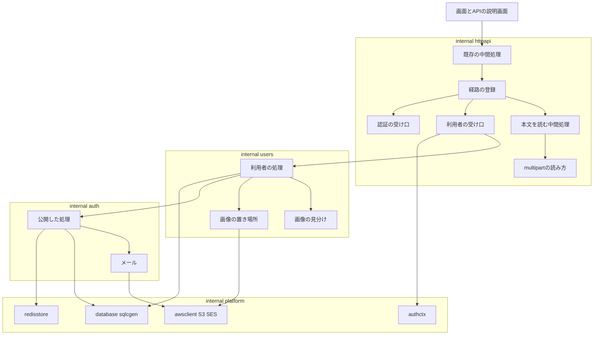
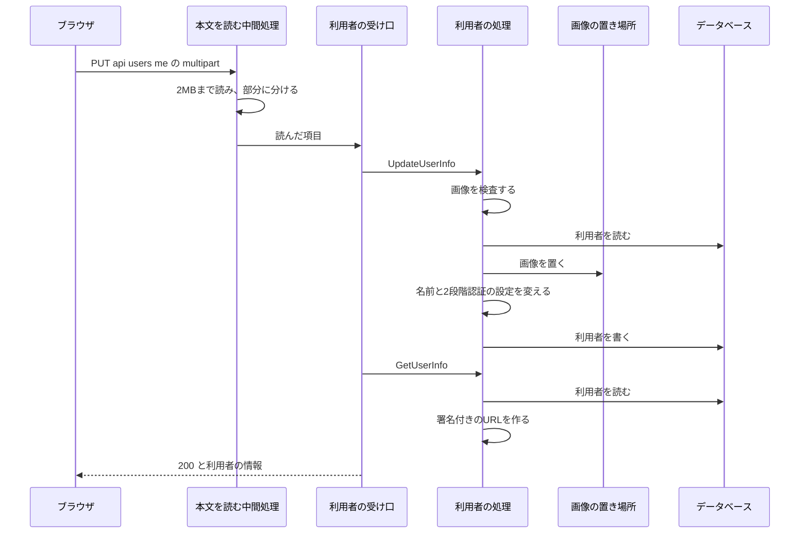
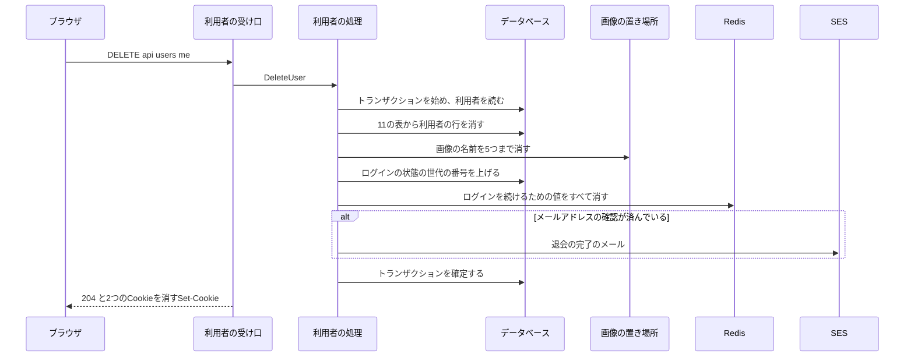

# 設計

## 概要

この設計は、Go 版に、利用者の7つの操作を足す。

Go 版は、Java 版と同じデータベースの表と、同じ Redis のキーと、同じ画像の置き場所を、Java 版と同じ値の形で読み書きする。Claude は、Java 版の `presentation/user/` の受け口と、`usecase/user/` の処理と、`domain/model/user/User.java` の変更の決まりを写す元とし、Go 版の部品ごとに、写す元の Java のクラスを書く。

利用者の操作は、認証の spec で作った処理のうち、利用者の行の読み書き、パスワードの照合、確認のメールの送り出し、ログインの状態を使えなくする処理を使う。そこで、この設計は、認証の機能のパッケージ `internal/auth` のそれらの処理を、ほかのパッケージから呼べる形で公開する。利用者の処理は、新しい機能のパッケージ `internal/users` に置く。`internal/users` が `internal/auth` を読むには、品質チェックの設定 `backend/.golangci.yml` の depguard の規則を変える必要がある。depguard は、Go のパッケージが読んでよいパッケージを決まりのとおりに限る、静的な検査の道具である。変更の中身と承認の求め方は、部品の節の「品質チェックの設定の変更の提案(backend/.golangci.yml)」に書く。

この設計は、Java 版と Go 版を比べる検査を、画像を送る要求と、画像を見せるための署名付きの URL を比べられる形に広げる。署名付きの URL とは、画像の置き場所の鍵を持たない画面が、決まった時間だけ画像を読めるように、URL の問い合わせに署名を付けたものである。

## 作るものと作らないもの

### 作るもの

- 利用者の7つの操作の Go 版。Claude は、受け口を `internal/httpapi/users.go` に置き、処理を新しい機能のパッケージ `internal/users` に置く
- 名前と画像の変更の要求の本文を、Java 版の Spring と同じ規則で読む部品(`internal/httpapi/multipart.go` と、その下の2つのファイル)
- 画像の置き場所への書き込みと削除と、署名付きの URL を作る部品(`internal/users/objectstore.go`)
- 認証の機能のパッケージの処理を、利用者の処理から呼べる形で公開するファイル(`internal/auth/exported.go`)と、退会の完了のメール(`internal/auth/mail.go` に足す)
- 退会で消す表の SQL の問い合わせ(`backend/db/queries/users.sql`)と、sqlc が生成するコード
- depguard の規則の変更の提案。この変更で、`internal/users` は `internal/auth` を読めるようになる
- Java 版と Go 版を比べる検査の広げ方。広げる中身は、部品の節の「Java 版と Go 版を比べる検査の広げ方(harness と fakeaws)」に書く
- 利用者の操作の筋書き(`backend/compat/scenarios/users/*.yaml`)と、初期のデータ(`backend/compat/fixtures/users/users-ops.sql`)と、画像の初期のデータ2つ
- 変えた動きの一覧の、利用者の操作の項目(CB-028 から)
- 置き換えの spec の進み具合の表(`progress.md`)の、利用者のまとまりの行の状態と、表の下の決まりの書き直し

### 作らないもの

- ほかのまとまりの操作の Go 版
- 確認のリンクを開いたときに確認を受け付ける操作と、ログインの状態の検査と、偽の送信の検査。どれも認証の spec と置き換えの spec で作ってあり、この spec はそのまま使う
- 本番の設定の変更。画像の置き場所の名前と AWS の接続先は、置き換えの spec の段階2である、Go 版の品質チェックと Java 版と Go 版を比べる検査をそろえる段階で、設定に入っている
- データベースの表の形の変更(マイグレーション)
- 仕様書 `backend/api/openapi.yaml` の変更
- Java 版のコードの変更。Java 版と Go 版を比べる検査で Java 版の誤りが見つかったときは、Claude は、置き換えの spec の決まりのとおり、同じ PR で両方の版を直すかを所有者に報告する
- 本番の署名付きの URL の形を本番で確かめること。開発環境では確かめられないので、Claude は、この確認を、本番の切り替えのときに確かめる項目として、research.md の「危うい点と備え」に書く

## 使う既存の仕組み

- 置き換えの spec の段階2である、Go 版の品質チェックと Java 版と Go 版を比べる検査をそろえる段階で作った Go 版の土台: この設計は、土台のうち次の5つのパッケージを使う。
  - `internal/httpapi`: 経路の登録と、中間処理と、未実装の答えを持つ。中間処理とは、要求が受け口に届く前に動き、要求を調べるか読む処理である
  - `database`: pgx の接続の束と、sqlc の出力 `sqlcgen` を持つ
  - `redisstore`: Redis の接続を持つ
  - `awsclient`: S3 と SES のクライアントを作る。AWS の接続先が設定にあれば、S3 を、置き場所の名前を URL のパスに書く形にする。この設計では、この形をパスの形と呼ぶ
  - `internal/platform/config`
- 認証の spec で作った `internal/auth` の処理と `internal/platform/authctx`: `internal/auth` は、利用者の行の読み書き、トランザクション、パスワードの照合とハッシュ、確認のメールの送り出し、ログインの状態を使えなくする処理、誤りの型、入力の検査の部品を持つ。トランザクションとは、データベースへの複数の書き換えを、すべて確定するか、すべて取り消すかのどちらかにする仕組みである。`internal/platform/authctx` は、ログインした利用者の ID を受け渡す
- 認証の spec で作った `internal/httpapi/authresponses.go` の応答の型 `authResponse`。この型は、Cookie を2つ以上書ける
- API の仕様書 `backend/api/openapi.yaml` と、そこから生成した `internal/httpapi/gen`
- Java 版と Go 版を比べる検査 `backend/compat/harness`、偽の AWS(`fakeaws`)、偽のログインのサービス(`fakeoidc`)、変えた動きの一覧 `changed-behaviors.yaml`
- Java 版のメールのひな形 `backend/src/main/resources/mail/user-deleted.ftl`
- 依存の向き: `cmd/keirekipro` から `internal/httpapi`、`internal/httpapi` から `internal/users` と `internal/auth`、`internal/users` から `internal/auth` と `internal/platform`、`internal/auth` から `internal/platform` の一方向とする。`internal/users` は `internal/httpapi` と生成した型 `internal/httpapi/gen` を読まない。`internal/auth` は `internal/users` を読まない

## 設計を見直すきっかけ

- `internal/auth` の `exported.go` で公開した関数か型の形を変えたとき。`internal/users` が、利用者の行の読み書きと、確認のメールと、ログインの状態を使えなくする処理を、この関数で呼ぶためである
- 認証の spec の設計は、ほかのまとまりのパッケージが `internal/auth` を読まず、`internal/platform/authctx` だけを読むと決めている。この spec は、この決めごとを利用者のまとまりについて変える。ほかのまとまりの spec が `internal/auth` を読むときも、Claude は、同じく depguard の規則と認証の spec の設計の両方を見直す
- Java 版の画像の名前の決め方(`ProfileImageKeys`)か、署名付きの URL の作り方か、URL を使える時間を変えたとき。見直さないと、一方の版が置いた画像を、もう一方の版が見せられなくなるためである
- 名前と画像と2段階認証の設定の変更の要求の形を、仕様書か Java 版の設定で変えたとき。要求の形とは、項目の名前と、本文の大きさの上限である。`internal/httpapi/multipart.go` は、今の形に合わせて本文を読むためである
- Java 版の退会で消す表の並び(`UserMapper.xml` の削除の問い合わせ)に表が足されたとき。Claude は、Go 版の `users.sql` の削除の並びも同じに直す
- 筋書きの形のうち、この spec で足す `request.multipart` `request.body_file` `expect.values` `expect.body_file` `expect.content_type` の書き方を変えたとき。ほかのまとまりの筋書きも同じ形で書くためである

## プロジェクトの決まりを守っているか

- backend のコードを置く層: Go 版の層の決まりは depguard が検査する。今の depguard の規則は、機能のパッケージが `internal/platform` のほかの `internal` の下のパッケージを読むことを断る。規則の注釈は、機能のパッケージの間の依存を、まとまりの spec が許す一覧に足したときだけ認めると書いている。この設計は、depguard の規則を、部品の節の「品質チェックの設定の変更の提案」のとおりに変える。ArchUnit は Java 版だけを検査する。この spec は Java 版のコードを変えない
- データベースの表の形: マイグレーションを含まない。Go 版は今の表に、Java 版と同じ行を書き、Java 版と同じ行を消す
- 新しいライブラリの追加: 足さない。画像の見分けは Go の標準の `image/png` `image/jpeg` `image/gif` で行う。署名付きの URL は、すでに `go.mod` にある AWS SDK for Go v2 の署名の部品(`aws/signer/v4`)で作る
- 品質チェックの設定: `.golangci.yml` の depguard の規則に許す項目を1つ足す提案をする。`.testcoverage.yml` `Makefile` `sqlc.yaml` `.github/` は変えない。sqlc は `db/queries` のフォルダのファイルをすべて読むので、`users.sql` を足しても `sqlc.yaml` を変えずに済む。カバレッジの下限は、置き換えの spec の決めた全体の 93% のまま守る。カバレッジとは、テストで動いたコードの割合である
- 使う外部の機能がこのリポジトリで使えるか: 新しく使う外部のサービスは無い。S3 と SES は、Java 版が今使っているものを、同じ設定で使う
- frontend の機能ごとの境界: この spec は画面を変えないので、この項目はこの spec に関係しない
- frontend の状態の持ち方: この spec は画面を変えないので、この項目はこの spec に関係しない

## 全体の構成



Claude は、利用者のコードを、1つの機能のパッケージ `internal/users` のファイルに分ける。`internal/users` の関数は、Go の普通の型で値を受けて返す。生成した型と `internal/users` の間の変換と、応答の書き方は、`internal/httpapi/users.go` が受け持つ。名前と画像と2段階認証の設定の変更の要求の本文を読む処理は、HTTP の決まりを扱う。そのため、Claude は、この処理を `internal/httpapi` に置く。こうすると、`internal/users` は HTTP の要求の形を知らずに済む。

`internal/users` が `internal/auth` を読むのは、利用者の行の読み書きと、確認のメールの送り出しと、ログインの状態を使えなくする処理を、認証の spec で作ってあるためである。同じ処理を `internal/users` に写すと、切り替えの途中で2つの写しのどちらかだけを直す誤りが起きる。`internal/users` が `internal/auth` を読む案と、同じ処理を `internal/users` に写す案を比べた結果は、research.md の「設計で比べた案」に書いた。

**使う技術**:
- HTTP の受け口: 標準の `net/http` と、oapi-codegen v2.8.2 の `strict-server` で生成した型。利用者の受け口は、利用者の操作の応答を、認証の操作と同じ自分で書いた型 `authResponse` で返す
- multipart の本文: 標準の `mime/multipart` を使わず、Spring と Tomcat の読み方を写した自分で書いた部品で読む。multipart とは、1つの要求の本文を区切りの文字列で部分に分け、文字の値とファイルを部分ごとに入れて送る形である。使わない理由は、部品の節の「本文を読む中間処理と multipart の読み方」に書く
- 画像の見分け: Go の標準の `image` と `image/png` `image/jpeg` `image/gif`
- 画像の置き場所: AWS SDK for Go v2 v1.47.7 の S3 v1.114.8(`PutObject` `DeleteObject`)と、署名の部品 `aws/signer/v4`
- メール: 認証の spec の `mail.go`(SES v1.42.8 の `SendEmail` と、標準の `text/template`)
- パスワードのハッシュ: golang.org/x/crypto v0.58.0 の bcrypt。強さは Java 版と同じ 10
- データベース: pgx v5.11.0 と sqlc v1.31.1
- Redis: go-redis v9.23.0
- 識別子: google/uuid v1.6.0
- Go: 1.27.0
- Java 版と Go 版を比べる検査: 置き換えの spec の段階2である、Go 版の品質チェックと Java 版と Go 版を比べる検査をそろえる段階で作った harness と、testcontainers-go v0.45.0

## ファイルの構成

Claude が新しく作るファイル:

- `backend/internal/users/service.go`: 利用者の処理の入口の型 `Service` と、使う部品の束(`Deps`)と、組み立ての関数 `New`
- `backend/internal/users/errors.go`: Java 版の利用者の操作の文言の定数
- `backend/internal/users/userinfo.go`: 利用者の情報を読み、答えの形にする処理
- `backend/internal/users/update.go`: 名前と画像と2段階認証の設定の変更
- `backend/internal/users/image.go`: 画像の検査(形式、大きさ、縦と横の長さ、中身)と、拡張子の取り出し
- `backend/internal/users/objectstore.go`: 画像の置き場所への書き込みと削除と、署名付きの URL を作る処理
- `backend/internal/users/delete.go`: 退会
- `backend/internal/users/password.go`: パスワードの変更と、メールアドレスとパスワードの設定
- `backend/internal/users/provider.go`: Google か GitHub のアカウントとの連携の解除
- `backend/internal/users/emailverification.go`: 確認のメールを送る操作
- `backend/internal/users/validate.go`: パスワードの変更と、メールアドレスとパスワードの設定の、要求の入力の検査
- `backend/internal/users/*_test.go`: 上のファイルごとの単体テスト。データベースと Redis と S3 を使うテストは、認証の spec と同じく、ファイル名を `_integration_test.go` で終わる形にし、testcontainers-go で Postgres と Valkey と偽の AWS のコンテナをテストの中で起動する。そのため、このテストは `make test` と CI の Go 版の検査で毎回動き、カバレッジの計算にも入る
- `backend/internal/auth/exported.go`: 利用者の処理から呼ぶ処理を公開する関数と型
- `backend/internal/auth/exported_integration_test.go`: 公開した関数の結合テスト
- `backend/internal/auth/testdata/mail/user-deleted.txt`: 退会の完了のメールの件名と本文の正解のファイル。Claude は、試作で Java 版と文字の単位で一致したメールから作る
- `backend/internal/users/testdata/presign/`: 署名付きの URL の正解のファイルと、その正解を作る小さな Java のプログラム。作り方は、テストの方針の節の `objectstore.go` の項目に書く
- `backend/internal/httpapi/users.go`: 利用者の7つの操作の受け口と、名前と画像と2段階認証の設定の変更の要求の本文を読む、生成したコードの中間処理
- `backend/internal/httpapi/userresponses.go`: `authResponse` に足す、利用者の7つの操作の `Visit<操作の名前>Response`
- `backend/internal/httpapi/multipart.go`: multipart の本文を部分に分け、部分の見出しを読む処理
- `backend/internal/httpapi/contentdisposition.go`: Spring 7.0.10 の `ContentDisposition.parse` を写した、部分の名前とファイルの名前の読み方
- `backend/internal/httpapi/jdkutf8.go`: JDK の UTF-8 の読み方を写した、バイトの並びを文字列にする処理
- `backend/internal/httpapi/users_test.go` `multipart_test.go` `contentdisposition_test.go` `jdkutf8_test.go`: 単体テスト
- `backend/db/queries/users.sql`: 退会で消す11の表の SQL の問い合わせ。sqlc が `internal/platform/database/sqlcgen/` にコードを生成する
- `backend/compat/scenarios/users/*.yaml`: 利用者の操作の筋書き。ファイルの一覧は、部品の節の「利用者の操作の筋書き」に書く
- `backend/compat/fixtures/users/users-ops.sql`: 利用者の操作の筋書きが使う初期のデータ
- `backend/compat/fixtures/images/wide.png`: 横 4097 画素、縦 1 画素の PNG
- `backend/compat/fixtures/images/not-image.png`: 中身が画像でない、名前だけ `.png` の文字のファイル
- `backend/compat/harness/multipart.go` `multipart_test.go`: 筋書きの `request.multipart` から本文を組み立てる処理

Claude が変えるファイル:

- `backend/internal/auth/` の、利用者の行の型 `storedUser` を使うファイル(`emailverification.go` `oidccallback.go` `passwordreset.go`): `storedUser` を公開する型 `StoredUser` に改め、欄の名前を `Row` `Providers` `Roles` にする。`backend/internal/auth/` のテストのファイルは `storedUser` を使わないので、Claude はテストのファイルを変えない。テストのファイルにある補助の関数 `insertStoredUser` は、型の名前を改めても変える必要が無い
- `backend/internal/auth/mail.go` と `mail_test.go`: 退会の完了のメールを足す
- `backend/internal/httpapi/server.go` と `server_test.go`: 部品の節の「httpapi.New の変更(受け口と中間処理を組み立てる関数 `New` の変更)」のとおりに変える
- `backend/cmd/keirekipro/main.go` と、そのテスト: `users.New` で `Service` を作り、`httpapi.Options` に渡す
- `backend/.golangci.yml`: depguard の機能のパッケージの規則の許す一覧に `internal/auth` を足す。所有者の承認が要る
- `backend/compat/harness/scenario.go` `send.go` `steps.go` `normalize.go` `compare.go` `compareenv.go` `cross.go` `crossenv.go` `perfenv.go` と、それぞれのテスト: Java 版と Go 版を比べる検査の広げ方の節のとおりに広げる
- `backend/compat/fakeaws/fakeaws.go` `s3.go` と、それぞれのテスト: URL のパスに `//` を含む要求を受けられるようにする。`s3.go` の S3 の処理は、今は `r.PathValue` で置き場所の名前と画像の名前を読む。Claude は、この処理を、要求の URL のパスをそのまま読み、そこから取り出した名前を読む形に変える
- `backend/compat/changed-behaviors.yaml`: CB-028 からの、利用者の操作の項目を足す
- `.kiro/specs/backend-go-replacement/progress.md`: 利用者のまとまりの行の状態を書き、表の下の、API の説明画面での確認の決まりを書き直す
- `.kiro/specs/backend-go-users/research.md`: 実装で確かめた Java 版の動きを書き足す

## 処理の流れ

### 名前と画像と2段階認証の設定の変更



- 利用者の処理は、Java 版の `UpdateUserInfoUseCase` と同じく、画像を置いてから名前を確かめる。利用者の行は変わらない
- 利用者の処理は、名前の誤りか2段階認証の設定の誤りを1つ見つけたら、その時点で処理を止める。Java 版の `User` の変更の決まりが、誤りを見つけた時点で例外を投げるためである
- 利用者の受け口は、変更のあとで、利用者の情報を読み直して答える。変更と読み直しは別の処理で、トランザクションでまとめない。Java 版のコントローラも、2つのユースケースを順に呼ぶ

### 退会



- 消す画像の名前は、`/profile/image/<利用者の ID>.<拡張子>` の4つの拡張子(`jpg` `jpeg` `png` `gif`)の名前と、利用者の行の今の画像の名前である。今の画像の名前が4つのどれかと同じなら、利用者の処理は同じ名前を2回消さない。Java 版の `LinkedHashSet` と同じである
- ログインの状態の世代の番号を上げる問い合わせは、利用者の行を消したトランザクションの中で送る。世代の番号の行は、利用者の行を消すと一緒に消えるので、この問い合わせは何も変えない。Java 版も同じ問い合わせを同じトランザクションの中で送る。トランザクションの外の接続で送ると、その問い合わせは、トランザクションが消した行のロックが外れるのを待ち続ける。ロックとは、トランザクションが書き換えた行を、そのトランザクションが終わるまでほかの接続に書き換えさせない仕組みである。そのため、利用者の処理は必ずトランザクションの中の問い合わせで送る
- 退会の完了のメールを作れないか送れないときは、利用者の処理はトランザクションを戻し、受け口は 500 で答える。このとき、画像とログインを続けるための値は消えたまま残る。Java 版も同じであることを、Claude は、research.md の試作の記録の P10 の、名前を持たない利用者の退会の試作で確かめた

## 部品

### Service(利用者の処理の入口)

対応する要件: 1.1, 1.2, 4.1

**役割**: `internal/users` の型 `Service` は、利用者の7つの操作の処理を、Java 版の `usecase/user/` のユースケースと同じ順で行う。`Service` は、HTTP の要求と応答を扱わない。`Service` は、操作ごとのメソッドで Go の普通の型を受け、結果の型か `*auth.Error` を返す。

**使う部品**: `Service` は、`Deps` に次の7つの部品を受ける。

- `*pgxpool.Pool`
- `redis.UniversalClient`
- `*auth.Service`。`Service` は、これで、利用者の行の読み書きと、確認のメールと、ログインの状態を使えなくする処理と、退会の完了のメールを呼ぶ
- S3 のクライアントの小さなインタフェース。このインタフェースは `PutObject` と `DeleteObject` と `Options` だけを持つ。`*s3.Client` がこのインタフェースを満たす
- 画像の置き場所の名前。設定 `App.S3Bucket` の値である
- 開発環境で URL のホストを置き換えるかどうかの真偽と、AWS の接続先。この2つの使い方は、部品の節の「ObjectStore」に書く
- 現在の時刻を返す関数。単体テストで値を決めるために受ける

**呼び出し方**: 操作ごとのメソッドと、写す元の Java のクラスは次のとおりである。

| メソッド | 写す元 | 返すもの |
|---|---|---|
| `GetUserInfo(ctx, userID)` | `GetUserInfoUseCase` | 利用者の情報 |
| `UpdateUserInfo(ctx, UpdateInput)` | `UpdateUserInfoUseCase` | なし |
| `DeleteUser(ctx, userID)` | `DeleteUserUseCase` `UserDeletedEventListener` | なし |
| `SendAccountEmailVerification(ctx, userID)` | `SendAccountEmailVerificationUseCase` | なし |
| `SetEmailAndPassword(ctx, SetEmailAndPasswordInput)` | `SetEmailAndPasswordUseCase` | なし |
| `ChangePassword(ctx, userID, nowPassword, newPassword)` | `ChangePasswordUseCase` | なし |
| `RemoveAuthProvider(ctx, userID, provider)` | `RemoveAuthProviderUseCase` | なし |

どのメソッドも、利用者の行を読み、利用者が居なければ、401 と「不正なアクセスです。」と、ログインの状態の Cookie を消す印を持つ誤りを返す。この誤りは、認証の spec の `errCredentialsNotFound` で作る。Java 版の `AuthenticationCredentialsNotFoundException` にあたる。

**状態の持ち方**: `Service` は、要求をまたぐ状態をメモリに持たない。要求をまたぐ記録は、すべて Redis とデータベースと画像の置き場所に置く。

**失敗したとき**: `Service` は、業務の決まりで断るときは、`*auth.Error` に状態の番号と文言を入れて返す。`Service` は、データベースと Redis と S3 と SES の誤りを、そのまま包んで返す。包むとは、元の誤りをあとから取り出せる形のまま、別の誤りの中に入れることである。受け口は、その誤りを 500 にする。

### 公開した認証の処理(internal/auth/exported.go)

対応する要件: 3.1, 3.2, 3.3, 4.2

**役割**: `exported.go` は、認証の spec で作った処理のうち、利用者の処理が使うものを、ほかのパッケージから呼べる形にする。`exported.go` は、処理の中身を持たず、今ある関数を呼ぶ薄い関数と型だけを置く。

**呼び出し方**: 公開するものは次のとおりである。

| 公開するもの | 中身 |
|---|---|
| `StoredUser` と `LoadUser` `SaveUser` | 利用者1人の行と連携と役割の読み書き |
| `InTransaction` | 1つのトランザクションで処理を動かす |
| `PasswordMatches` `HashPassword` | bcrypt の照合と、強さ 10 のハッシュ |
| `SendEmailVerification` | 確認のメールの送り出し |
| `ClearCurrentEmailVerification` | 今の確認のリンクの記録を消す |
| `InvalidateSessions` | 世代の番号を上げ、ログインを続けるための値をすべて消す |
| `RemoveAllRefreshTokens` | ログインを続けるための値をすべて消す段だけを呼ぶ |
| `SendUserDeletedMail` | 退会の完了のメールを送る |
| `ErrBusiness` `ErrInvalidInput` `ErrCredentialsNotFound` と `FieldErrors` | 誤りの型を作る関数と、項目ごとの文言を集める型 |
| `NotBlank` `UTF16Len` `IsJavaWhitespace` `PasswordPatternOK` `IsEmailLikeHibernate` | 入力の検査の部品 |
| `EmailCreateErrors` | メールアドレスの空と形の検査 |
| `EmailInUse` | そのメールアドレスを `users` の `email` の列に持つ利用者が居るかの判定 |

`StoredUser` と `LoadUser` `SaveUser` は、Java 版の `UserRepository.findById` と `save` にあたる。

`exported.go` は、`SendEmailVerification` に渡す確認のメールの目的として、`AccountEmail` と `PendingEmail` の2つを公開する。`SendEmailVerification` は、送り直せる間隔の中で送れないときは偽を返す。

利用者の処理は、`InvalidateSessions` をトランザクションの外で呼ぶ。

退会の処理は、トランザクションの中で `BumpTokenVersion` を呼んだあとに、`RemoveAllRefreshTokens` を呼ぶ。

`EmailCreateErrors` は、Java 版の `Email.create` にあたり、認証の spec の `emailCreateErrors` を呼ぶ。

`EmailInUse` は、Java 版の `UserEmailDuplicationCheckService` にあたり、認証の spec の `findAccountByEmail` を呼ぶ。

`BumpTokenVersion` は、認証の spec で `auth.Service` のメソッドとして公開してある。そのため、利用者の処理は、`BumpTokenVersion` をそのまま使う。

`LoadUser` は、利用者が居なければ、渡された誤りを返す。

利用者の処理は、`SendEmailVerification` に、トランザクションの問い合わせを渡さない。確認のメールの送り出しは Redis と SES だけを使うためである。

**失敗したとき**: 公開した関数は、元の関数の誤りをそのまま返す。

### Error(利用者の操作の文言)

対応する要件: 1.3

**役割**: `internal/users/errors.go` は、Java 版の利用者の操作の文言を定数で持つ。誤りの型は、認証の spec の `auth.Error` をそのまま使う。

**呼び出し方**: 利用者の操作の誤りは、次の4つの形のどれかになる。

- 業務の決まりで断るとき: 400 と `{"message": 文言, "errors": {}}`。Java 版の `UseCaseException(文言)` にあたる
- 項目ごとの誤りのとき: 400 と `{"message": "入力エラーがあります。", "errors": {項目: [文言]}}`。Java 版の `UseCaseException(項目ごとの文言)` と `DomainException` と、要求の型の注釈の誤りにあたる
- 利用者が居ないとき: 401 と `{"message": "不正なアクセスです。", "errors": {}}` と、2つの Cookie を消す `Set-Cookie`
- システムの失敗: 500 と `{"message": "予期せぬエラーが発生しました。", "errors": {}}`

### Validate(要求の入力の検査)

対応する要件: 1.3

**役割**: `internal/users/validate.go` は、パスワードの変更とメールアドレスとパスワードの設定の要求を、Java 版の要求の型(`ChangePasswordRequest` `SetEmailAndPasswordRequest`)の注釈と同じ規則で検査する。検査の部品は、認証の spec の `validate.go` が公開した部品を使う。

**呼び出し方**: `ValidateChangePassword(nowPassword, newPassword)` と `ValidateSetEmailAndPassword(email *string, password string, confirmPassword *string)` は、誤りが無ければ `nil` を、あれば項目ごとの文言を持つ `*auth.Error` を返す。

- パスワードの変更: `nowPassword` が空白だけか空なら「現在のパスワードは入力必須です。」にする。`newPassword` は、空白だけか空、8文字より短い、UTF-8 で72バイトを超える、英小文字と英大文字と数字のどれかを含まない、の4つの条件ごとに Java 版の文言を足す
- メールアドレスとパスワードの設定: `email` は、`null` なら検査しない。`null` でなければ、255文字を超えるか、Hibernate の `@Email` の形でないときに文言を足す。`password` は、パスワードの変更の `newPassword` と同じ4つの条件で検査し、文言は「パスワードは」で始まる Java 版の文言にする。`confirmPassword` が `nil` でなく、`password` と違えば、項目 `confirmPassword` に「パスワードとパスワード(確認)が一致していません。」を足す。Java 版の `@PasswordMatches` の既定の文言である
- 生成した要求の型は、`nowPassword` `newPassword` `password` を `*string` でなく文字列で持つ。そのため、Go 版は、これらの項目が無い要求を空の文字列の要求と同じに検査し、Java 版より多くの文言を返す。Claude は、この違いの項目を、節「変えた動きの一覧の項目」に足す
- 1つの項目に2つ以上の文言があるとき、Java 版は文言の並ぶ順を決めていない。Claude は、Go 版の並びを認証の spec と同じ注釈の順にする。Java 版と Go 版を比べる検査がこの並びを比べないことは、節「変えた動きの一覧の項目」に書く

### UserInfo(利用者の情報の答え)

対応する要件: 1.1, 2.1, 2.2, 2.3, 3.6, 4.1

**役割**: `userinfo.go` の `GetUserInfo` は、Java 版の `GetUserInfoUseCase` と `UserInfoResponse` と同じ10の項目を、同じ順で返す。

| 項目 | 値 |
|---|---|
| `id` | 利用者の ID |
| `email` | メールアドレスか `null` |
| `username` | 名前か `null` |
| `hasPassword` | パスワードのハッシュがあるか |
| `profileImage` | 画像の名前があれば、その名前の署名付きの URL。無ければ `null` |
| `twoFactorAuthEnabled` | 2段階認証を使うか |
| `authProviders` | 連携している提供元の名前の並び |
| `roles` | 役割の名前の並び |
| `emailVerified` | メールアドレスの確認が済んでいるか |
| `pendingEmail` | 設定待ちのメールアドレスか `null` |

- 署名付きの URL を使える時間は、Java 版と同じ600秒で、10分にあたる
- `authProviders` と `roles` の並びの順は、Java 版では `HashMap` と `Set` の順で決まり、決まった順を持たない。Go 版は名前の順に並べる。Java 版と Go 版を比べる検査がこの2つの並びの順を比べないことは、節「変えた動きの一覧の項目」に書く

### Update(名前と画像と2段階認証の設定の変更)

対応する要件: 1.2, 1.3, 2.2, 2.3, 3.4, 4.1

**役割**: `update.go` の `UpdateUserInfo` は、Java 版の `UpdateUserInfoUseCase` と、`User` の `changeUsername` `changeProfileImage` `changeTwoFactorAuthEnabled` の決まりを写す。

**呼び出し方**: `UpdateInput` は、利用者の ID と、名前(`*string`)と、画像(`*ImageInput`)と、2段階認証の設定(`*bool`)を持つ。`ImageInput` は、ファイルの名前と、部分の `Content-Type` と、バイトの並びを持つ。`UpdateUserInfo` は、次の順に処理する。

1. 画像があり、空でなければ、`image.go` で画像を検査する。誤りがあれば、項目 `profileImage` の文言をすべて集めて 400 を返す
2. 利用者の行を読む
3. 画像があり、空でなければ、`objectstore.go` で `/profile/image/<利用者の ID>.<拡張子>` の名前で置く。拡張子が無ければ `.` も付けない
4. 名前があれば、Java の `String.strip()` と同じく、`isJavaWhitespace` に当たる字を前後から取り除く。取り除いた名前が空なら「ユーザー名は必ず指定してください。」を、UTF-16 の単位で50を超えれば「ユーザー名は50文字以内で入力してください。」を、項目 `username` に付けて 400 を返す。取り除いた名前が今の名前と同じなら、名前を変えない
5. 画像を置いたら、利用者の行の画像の名前を、置いた名前にする
6. 2段階認証の設定があれば、`UpdateUserInfo` は次の2つの条件を確かめる。管理者が `false` にするときは、`UpdateUserInfo` は、項目 `twoFactorAuthEnabled` に「管理者の場合は二段階認証を無効にできません。」を付けて 400 を返す。`true` にするときに確認の済んだメールアドレスかパスワードが無ければ、`UpdateUserInfo` は、項目 `twoFactorAuthEnabled` に「メールアドレスとパスワードが未設定の場合は二段階認証を有効にできません。」を付けて 400 を返す。2つの条件は、一方が `false` のとき、もう一方が `true` のときに当たるので、同時には当たらない
7. 利用者の行を書く。Java 版と同じく、トランザクションを使わない

**失敗したとき**: `UpdateUserInfo` は、画像を置いたあとで名前か2段階認証の設定の誤りで断るときも、置いた画像を消さない。Java 版も置いた画像を消さないことを、Claude は、research.md の試作の記録の P5 の、名前の誤りで断る要求の試作で確かめた。

### ImageCheck(画像の検査)

対応する要件: 1.3

**役割**: `image.go` は、Java 版の `UpdateUserInfoUseCase` の `validateProfileImage` と同じ順で、画像を検査する。

**呼び出し方**: `checkImage(ImageInput) []string` は、項目 `profileImage` の文言を、次の順に集めて返す。

1. 部分の `Content-Type` が `image/jpeg` `image/png` `image/gif` のどれでもなければ「許可されていない画像形式です。」
2. 拡張子が `jpg` `jpeg` `png` `gif` のどれでもなければ「許可されていないファイル形式です。jpg, jpeg, png, gifのみ許可されています。」
3. 大きさが 1048576 バイトを超えれば「プロフィール画像のサイズは1MB以下である必要があります。」
4. 中身を `image.DecodeConfig` で読めなければ「有効な画像ファイルではありません。」を足して終える
5. 縦か横が 4096 画素を超えれば「プロフィール画像の幅と高さは4096ピクセル以下である必要があります。」を足して終える
6. 中身を `image.Decode` で最後まで読めなければ「有効な画像ファイルではありません。」

拡張子は、ファイルの名前の最後の `.` のあとの文字列を、ASCII の字だけ小文字にしたものである。`checkImage` は、ASCII でない字を含む拡張子を許可しない。Go 版が読む画像の形式は、PNG と JPEG と GIF だけである。Go 版は、Java 版が読めるほかの形式の画像を、置き換えの spec の変えた動きの一覧のとおり、「有効な画像ファイルではありません。」で断る。

### ObjectStore(画像の置き場所)

対応する要件: 1.5, 2.1, 2.2, 2.3, 3.6

**役割**: `objectstore.go` は、Java 版の `S3ObjectStore` と同じ名前と値で、画像を置いて消し、署名付きの URL を作る。

**呼び出し方**:

- `put(ctx, key, content, contentType)`: `PutObject` で置く。`Content-Type` と、S3 のユーザー定義のメタデータの `Content-Type` の両方に、部分の `Content-Type` をそのまま入れる
- `delete(ctx, key)`: `DeleteObject` で消す。名前の画像が無くても誤りにしない。S3 は無い名前の削除にも成功を返す
- `presign(key, expires)`: GET の要求を、AWS SDK の署名の部品 `aws/signer/v4` の `PresignHTTP` で署名する。URL のパスの `/` を `%2F` に置き換えない設定 `DisableURIPathEscaping` を付ける。署名の資格情報と地域は、S3 のクライアントの `Options()` から読む。AWS の接続先が設定にあれば、URL を `<接続先>/<置き場所の名前>/<画像の名前>` のパスの形にし、無ければ `https://<置き場所の名前>.s3.<地域>.amazonaws.com/<画像の名前>` の形にする。画像の名前は `/` で始まるので、パスの形では `/` が2つ続く
- `objectstore.go` は、URL の問い合わせの項目を、Java 版と同じく、`X-Amz-Algorithm` `X-Amz-Date` `X-Amz-SignedHeaders` `X-Amz-Credential` `X-Amz-Expires` `X-Amz-Signature` の順に並べ直す。この6つのほかの項目があれば、`X-Amz-Signature` の前に置く。たとえば、本番の ECS のタスクの権限で署名したときに付く `X-Amz-Security-Token` は、この6つのほかの項目にあたる。本番の Java 版がこの項目をどこに置くかは、開発環境では確かめられない。この項目の置き場所は、本番の切り替えのときに確かめる項目として、research.md の「危うい点と備え」に書いてある
- `objectstore.go` は、開発環境では、Java 版の `LocalstackPresignedUrlTransformer` と同じく、URL の中の AWS の接続先のホストの名前を、すべて `localhost` に置き換える。開発環境とは、設定 `Env` が `dev` のときである。接続先が空のときは置き換えない

**失敗したとき**: `objectstore.go` は、`PutObject` と `DeleteObject` の誤りを、包んで返す。受け口はこの誤りを 500 にする。

### Delete(退会)

対応する要件: 1.5, 3.2, 4.3

**役割**: `delete.go` の `DeleteUser` は、Java 版の `DeleteUserUseCase` と `User.delete` と `UserDeletedEventListener` を写す。

**呼び出し方**: `DeleteUser` は、処理の流れの節の「退会」の順で、1つのトランザクションの中で処理する。利用者の行を消す問い合わせは、Java 版の `UserMapper.xml` の削除と同じ順で、次の11の表から利用者の行を消す。

1. `project_tech_stacks`
2. `projects`
3. `careers`
4. `certifications`
5. `portfolios`
6. `sns_platforms`
7. `self_promotions`
8. `resumes`
9. `user_auth_providers`
10. `user_roles`
11. `users`

`DeleteUser` は、退会の完了のメールを、メールアドレスの確認が済んでいる利用者にだけ送る。宛先はメールアドレスである。件名と本文は、部品の節の「Mail(退会の完了のメール)」に書く。名前が `null` のときは、Java 版のひな形と同じく本文を作れないので、`SendUserDeletedMail` は誤りを返す。

受け口は、成功したら、204 と、`accessToken` と `refreshToken` を消す2つの `Set-Cookie` を返す。Java 版の `DeleteUserController` と同じである。

**失敗したとき**: `DeleteUser` は、どの段で失敗しても、トランザクションを戻して誤りを返す。画像の削除と Redis の削除は戻せないので、消えたまま残る。Java 版と同じである。

### Password(パスワードの変更と、メールアドレスとパスワードの設定)

対応する要件: 1.2, 1.3, 1.4, 3.1, 3.2, 3.3, 4.2, 4.3

**役割**: `password.go` は、Java 版の `ChangePasswordUseCase` と `SetEmailAndPasswordUseCase` を写す。

**呼び出し方**:

- `ChangePassword`: トランザクションを使わない。利用者の行を読み、今のパスワードが合わなければ項目 `nowPassword` に「現在のパスワードが正しくありません。」を、新しいパスワードが今のパスワードと合えば項目 `newPassword` に「新しいパスワードは現在のパスワードと異なる必要があります。」を集め、1つでもあれば 400 を返す。パスワードのハッシュが無い利用者では、どちらの照合も合わないとみなす。誤りが無ければ、新しいパスワードを強さ 10 でハッシュにして利用者の行を書き、`InvalidateSessions` で、すべての端末のログインの状態を使えなくする
- `SetEmailAndPassword`: 1つのトランザクションの中で次の順に処理する
  1. 利用者の行を読む
  2. メールアドレスが `null` でなければ、`EmailCreateErrors` で、空と形の誤りの文言(「メールアドレスが空です。」か「メールアドレスの形式が不正です。」)を項目 `email` に集める。この手順では、集めた文言を返さない。Java 版の `Email.create` も、文言を集めるだけで断らないためである。続けて、`EmailInUse` で、そのメールアドレスを持つ利用者が居るかを確かめ、居れば「このメールアドレスは登録できません。」の 400 を返す。自分のメールアドレスと同じでも断る。Java 版と同じである
  3. 利用者がパスワードを持ち、今のパスワードが無いか合わなければ、「今のパスワードが正しくありません。」の 400 を返す
  4. メールアドレスが `null` でなければ、利用者がすでにメールアドレスを持つときに、項目 `email` に「メールアドレスが既に設定されているため設定できません。」を足す。メールアドレスの空と形の誤りの文言と、すでにメールアドレスを持つ誤りの文言のうち、集めた文言が1つでもあれば、集めた文言を付けた 400 を返す。文言が無ければ、設定待ちのメールアドレスにする。Java 版の `User.setPendingEmail` と同じ順である
  5. パスワードを強さ 10 でハッシュにして、利用者の行に入れる
  6. 利用者の行を書く
  7. メールアドレスが `null` でなければ、今の確認のリンクの記録を消し、設定待ちのメールアドレスへ、目的 `PENDING_EMAIL` の確認のメールを送る。送り直せる間隔の中で送れなかったときも、Java 版と同じく、誤りにしない

  受け口は、成功したら、利用者の情報を読み直して 200 で答える

**失敗したとき**: 確認のメールを送れないときは、`SetEmailAndPassword` はトランザクションを戻して誤りを返す。Java 版も、メールの送り出しを同じトランザクションの中で行う。

### Provider(連携の解除)

対応する要件: 1.2, 3.5, 4.1

**役割**: `provider.go` の `RemoveAuthProvider` は、Java 版の `RemoveAuthProviderUseCase` と `User.removeAuthProvider` を写す。

**呼び出し方**: `RemoveAuthProvider` は、1つのトランザクションの中で、利用者の行を読み、経路の `provider` を ASCII の字だけ小文字にした名前で、連携を探す。連携が無ければ、項目 `authProviders` に「連携の解除に失敗しました。」を付けた 400 を返す。確認の済んだメールアドレスかパスワードが無く、連携が1つだけなら、項目 `authProviders` に「メールアドレスとパスワードが設定済みでないと、連携を解除できません。」を付けた 400 を返す。どちらでもなければ、連携を除いた利用者の行を書く。

Java 版は `toLowerCase()` を JVM の言語の設定で行う。提供元の名前は `google` と `github` だけで、どちらも ASCII の字なので、ASCII の字だけを小文字にしても結果は同じになる。ASCII でない字を含む `provider` は、どちらの版でも連携が見つからない。

### EmailVerification(確認のメールを送る操作)

対応する要件: 1.2, 1.4, 3.3

**役割**: `emailverification.go` の `SendAccountEmailVerification` は、Java 版の `SendAccountEmailVerificationUseCase` を写す。

**呼び出し方**: `SendAccountEmailVerification` は、利用者の行を読み、設定待ちのメールアドレスがあれば、そのメールアドレスへ目的 `PENDING_EMAIL` の確認のメールを送る。設定待ちのメールアドレスが無く、メールアドレスの確認が済んでいなければ、メールアドレスへ目的 `ACCOUNT_EMAIL` の確認のメールを送る。どちらでもなければ、「確認が必要なメールアドレスはありません。」の 400 を返す。送り直せる間隔の中で送れなければ、「確認のメールは1分に1回まで送れます。少し待ってからもう一度お試しください。」の 400 を返す。

送り直せる間隔と、確認のリンクの有効な時間と、新しいリンクを送ると前のリンクを使えなくすることは、認証の spec の `sendEmailVerification` が Java 版と同じに守る。送り直せる間隔は60秒である。この部品は、認証の spec の `sendEmailVerification` をそのまま使う。

### Mail(退会の完了のメール)

対応する要件: 1.4

**役割**: Claude は、認証の spec の `mail.go` に、`userDeletedMail(app, username)` を足す。件名は「【」とサイトの名前と「】退会手続き完了のお知らせ」をつないだ文字列である。本文は、ひな形 `user-deleted.ftl` に `username` `siteName` `siteUrl` を差し込んだテキストで、HTML の本文は無い。サイトの名前とサイトの URL は、認証の spec のメールと同じ設定の値を使う。

### 利用者の受け口(internal/httpapi/users.go と userresponses.go)

対応する要件: 1.1, 1.2, 1.6

**役割**: `users.go` の型 `userHandlers` は、生成した `StrictServerInterface` のうち利用者の7つの操作のメソッドを持つ。メソッドは、ログインした利用者の ID を `authctx.UserID` で受け、生成した要求の型から値を取り、`Validate` で検査し、`Service` を呼び、結果を `authResponse` に入れて返す。`userresponses.go` は、`authResponse` に、利用者の7つの操作の `Visit<操作の名前>Response(w http.ResponseWriter) error` を足す。

**呼び出し方**: 操作ごとの成功の応答は次のとおりにする。

| 操作 | 成功の応答 |
|---|---|
| `getUserInfo` | 200 と利用者の情報 |
| `updateUserInfo` | 200 と利用者の情報 |
| `deleteUser` | 204 と、`accessToken` と `refreshToken` を消す Cookie |
| `sendAccountEmailVerification` | 204 |
| `setEmailAndPassword` | 200 と利用者の情報 |
| `changePassword` | 204 |
| `removeAuthProvider` | 204 |

受け口は、`*auth.Error` を、認証の受け口と同じ `authErrorResponse` で本文にする。`authErrorResponse` は、利用者が居ない誤りに、2つの Cookie を消す `Set-Cookie` を付ける。受け口は、ほかの誤りを、生成したコードの誤りの受け口に返し、500 と決まった本文にする。

`updateUserInfo` の受け口は、生成した要求の型の `Body`(`*multipart.Reader`)を使わない。受け口は、下の「本文を読む中間処理」が `context` に入れた項目を読む。

### 本文を読む中間処理と multipart の読み方(internal/httpapi/users.go と multipart.go)

対応する要件: 1.1, 1.3, 5.4

**役割**: 本文を読む中間処理と `multipart.go` は、名前と画像と2段階認証の設定の変更の要求の本文を、Java 版の Spring と Tomcat と同じ規則で読む。Go の標準の `mime/multipart` は、research.md の試作の記録の P4 と P8 のとおり、ファイルの名前の読み方と、UTF-8 として誤ったバイトの読み方と、部分の見出しの制御文字の扱いが Java 版と違う。そのため、この部品は `mime/multipart` を使わない。

**呼び出し方**: `users.go` は、生成したコードの中間処理(`gen.StrictMiddlewareFunc`)を1つ持つ。この中間処理は、操作の名前が `UpdateUserInfo` のときだけ動き、次の順に処理する。

1. 要求の本文を、2097152 バイトより1バイト多くまで読む。2097152 バイトを超えれば、400 と `{"message": "入力エラーがあります。", "errors": {}}` で答える。Java 版の `spring.servlet.multipart` の上限の 2MB にあたる
2. `multipart.go` で、`Content-Type` の `boundary` で本文を部分に分け、部分ごとに見出しと中身を取り出す。部分の見出しに制御文字があっても読む
3. 部分の `Content-Disposition` を `contentdisposition.go` で読み、部分の名前とファイルの名前を取り出す。RFC 2047 の書き方(`=?UTF-8?B?…?=`)と、`filename*` の書き方を Spring と同じに解く
4. 項目を、次の決まりで値にする
   - `username`: URL の問い合わせと本文の両方にある値を、問い合わせ、本文の順に並べ、2つ以上あれば `,` でつなぐ。本文の値は `jdkutf8.go` で文字列にする。ファイルとして送られた `username` の部分は、400 と `{"message": "入力エラーがあります。", "errors": {}}` で答える
   - `twoFactorAuthEnabled`: 値を前後の空白を取り除いてから見て、`true` `on` `yes` `1` なら真、`false` `off` `no` `0` なら偽、空なら `null` にする。大文字と小文字を区別しない。ほかの値は、400 と `{"message": "入力エラーがあります。", "errors": {}}` で答える。Spring の文字列から真偽への変換と同じ規則である
   - `profileImage`: ファイルの名前を持つ部分の、ファイルの名前と、部分の `Content-Type` と、中身を取り出す。中身が0バイトの部分は、画像が無いものとして扱う
5. 読んだ項目を `context` に入れて、次の処理に渡す

生成したコードは、中間処理の前に `r.MultipartReader()` を呼び、`Content-Type` が multipart でない要求を `RequestErrorHandlerFunc` の 400 で断る。そのため、この中間処理には multipart の要求だけが届く。

**失敗したとき**: 部分に分けられない本文は、400 と `{"message": "入力エラーがあります。", "errors": {}}` で答える。Java 版が 500 で答える要求を Go 版が 400 で答える4つの場合は、節「変えた動きの一覧の項目」に書く。

Claude は、実装のときに、次の3つを Java 版の答えで確かめ、食い違えば Java 版に合わせる。

- `username` が URL の問い合わせと本文の両方にあるときの並びの順
- `profileImage` をファイルの名前の無い文字の部分で送ったときの答え
- `Content-Type` の無い画像の部分を送ったときの答え

### httpapi.New の変更(受け口と中間処理を組み立てる関数 `New` の変更)

対応する要件: 1.1, 6.1

**役割**: Claude は、`server.go` の `Options` に、利用者の受け口 `UserHandlers` を足す。`New` は、`UserHandlers` を、認証の受け口と同じ深さ1に埋め込む。深さとは、Go の構造体の埋め込みが何段目にあるかを指す。Go は、同じ名前のメソッドが複数の深さにあるとき、浅い深さのメソッドを使う。そのため、利用者の受け口のメソッドが、未実装の答えの同じ名前のメソッドより先に使われる。認証の受け口と利用者の受け口は、同じ名前のメソッドを持たないので、深さ1で並べても曖昧にならない。`New` は、`NewStrictHandlerWithOptions` の中間処理の並びに、本文を読む中間処理を足す。

Claude は、`ErrorHandlerFunc` の、問い合わせの誤りを 400 にする経路の条件を変えない。利用者の操作には、問い合わせの誤りが起きる値は無い。

**使う部品**: `main.go` は、`users.New(users.Deps{...})` で `Service` を作り、`httpapi.Options{UserHandlers: usersService, ...}` を渡す。`main.go` は、`Deps` に、接続の束と、Redis と、`authService` と、`newAWS` の結果の S3 のクライアントと、設定の `App.S3Bucket` と、設定の `Env` と AWS の接続先を渡す。

### 品質チェックの設定の変更の提案(backend/.golangci.yml)

対応する要件: 1.1

**役割**: Claude は、depguard の機能のパッケージの規則(`feature`)の許す一覧に、`github.com/DogisRiki/KeirekiPro/backend/internal/auth` を足す。この変更は、規則の注釈にある「まとまりの spec が許す一覧に足したとき」にあたる。

- 承認が要る理由: `backend/.golangci.yml` は品質チェックの設定で、CODEOWNERS が所有者の承認を求めるファイルである。CLAUDE.md は、品質チェックの設定の変更に人間の承認を求めている
- 変える中身: `feature` の規則の `allow` に1行を足す。`deny` の `internal` と `cmd` は変えない。そのため、`internal/users` は `internal/auth` と `internal/platform` だけを読め、`internal/httpapi` と `cmd` を読めないままである。`internal/auth` が `internal/users` を読むことも、今の規則のまま断られる
- main に入れたときに本番で起きること: 本番の動きは変わらない。depguard は静的な検査で、ビルドしたプログラムには入らない
- ほかの機能のパッケージに起きること: `internal/resume` のように、これから作るほかの機能のパッケージも、`internal/auth` を読めるようになる。認証の spec の設計は、ほかのまとまりが `authctx` だけを読むと決めている。Claude は、この決めごとを守るかを、まとまりごとの spec の設計で確かめる
- Claude は、この変更を、利用者の操作の Go 版を入れる PR に含める。CODEOWNERS が所有者の承認を求めるので、所有者が承認するまで PR は main に入らない

### Java 版と Go 版を比べる検査の広げ方(harness と fakeaws)

対応する要件: 2.1, 2.2, 2.3, 4.4, 5.1, 5.2, 5.3

**役割**: Claude は、置き換えの spec の段階2である、Go 版の品質チェックと Java 版と Go 版を比べる検査をそろえる段階で作り、認証の spec で広げた harness を、画像を送る要求と、画像を見せるための署名付きの URL を比べられる形に広げる。

**呼び出し方**: Claude は、筋書きの形に次の欄を足す。

- `request.multipart`: 版に送る段で、本文を multipart で送る。部分ごとに、`name` と、`value`(文字の値)か `file`(`fixtures/images` の下のファイルの名前)のどちらかを書く。`file` の部分には、`filename` と `content_type` と `pad_to` を書ける。`filename` は、送るファイルの名前である。`pad_to` を書くと、harness は、ファイルの後ろに 0 のバイトを足して、ファイルを `pad_to` の大きさにする。harness は、決まった `boundary` で本文を組み立てる。`pad_to` を使うと、1MB を超える画像を、リポジトリに大きなファイルを置かずに送れる。PNG と JPEG と GIF は、画像の終わりのあとのバイトを無視して読めるので、`pad_to` を付けた画像も、両方の版で読める画像のまま大きさだけが変わる
- `request.body_file`: 絶対の URL の段で、`fixtures/images` の下のファイルを、そのまま本文に入れて送る。`request.headers` の `Content-Type` と一緒に使う
- `expect.values`: 応答の本文の JSON の場所と、期待する値の組。値には `{名前}` を差し込める。版をまたいで確かめる検査で、もう一方の版の答えに、変えたあとの値が見えることを確かめる
- `expect.body_file`: 絶対の URL の段で、応答の本文が `fixtures/images` の下のファイルとバイトの単位で同じことを確かめる
- `expect.content_type`: 絶対の URL の段で、応答の `Content-Type` を確かめる

Claude は、送り方と比べ方を、次のとおりに広げる。

- 絶対の URL の書き換え: Java 版と Go 版を比べる検査の環境は、2つの版を開発環境の設定で動かし、AWS の接続先を偽の AWS(ポート 4566)にする。そのため、版が返す署名付きの URL のホストは `localhost:4566` になる。絶対の URL の段の URL のホストが `localhost:4566` なら、harness は、宛先をテストの処理から届く偽の AWS のアドレスに書き換え、要求の `Host` を、その版の設定の AWS の接続先(`AWSEndpoint`)のホストとポートにする。偽の AWS は署名を調べないが、要求の `Host` のホスト名で、Java 版と Go 版のどちらの版の画像を読むかを選ぶ。そのため、`Host` を版の AWS の接続先にしないと、偽の AWS は、その版が置いた画像を見つけられない
- 絶対の URL の段で、Java 版と Go 版を比べる検査が版ごとに1回ずつ送ることと、応答を比べないことは、認証の spec のとおりである。この段で画像を読むときは、Java 版と Go 版を比べる検査は、`expect.body_file` と `expect.content_type` で、版ごとに画像が同じことを確かめる
- URL の署名の値の正規化: 文字と JSON の本文の中の URL のうち、問い合わせに `X-Amz-Signature` を持つものは、`X-Amz-Date` の値と、`X-Amz-Credential` の中の日付と、`X-Amz-Signature` の値を、決まった文字列に置き換えてから比べる。`X-Amz-Expires` と、項目の並ぶ順と、URL のパスは置き換えない。そのため、Java 版と Go 版を比べる検査は、URL の形と、使える時間と、項目の順と、画像の名前が Java 版と同じことを確かめる。URL のパスの中の利用者の ID は、今の UUID の置き換えで比べる
- 画像の置き場所の比べ方: 今の harness は、画像の置き場所を、置き場所の名前とバイトの並びで比べる。Claude は、harness が比べるものに、`Content-Type` と、S3 のユーザー定義のメタデータを足す
- 偽の AWS が URL のパスを読む方法: 今の偽の AWS は、Go の `http.ServeMux` で要求を振り分けるので、URL のパスに `//` を含む要求を、`/` を1つにしたパスへ移すように答える。Claude は、偽の AWS の S3 の受け口を、`ServeMux` の前で、要求の URL のパスをそのまま読み、置き場所の名前と画像の名前を取り出す形にする。こうすると、名前が `/` で始まる画像を、版が置いた名前のまま読み書きできる

**失敗したとき**: `request.multipart` の `file` が無いときと、`expect` の欄が絶対の URL の段に合わないときは、harness は、筋書きを読むときに誤りとして報告する。`expect.values` と `expect.body_file` が外れたときは、段の名前と、期待した値と、受けた値を報告に書く。画像の中身は報告に書かず、大きさと SHA-256 だけを書く。

Claude は、広げたあとに、認証の操作の筋書きを動かし直し、結果が変わらないことを確かめる。

### 利用者の操作の筋書き(scenarios/users)

対応する要件: 1.1, 1.2, 1.3, 1.4, 1.5, 1.6, 2.1, 2.2, 2.3, 3.1, 3.2, 3.3, 3.4, 3.5, 3.6, 4.1, 4.2, 4.3, 4.4, 5.1, 5.2, 5.3, 5.5

**役割**: `backend/compat/scenarios/users/*.yaml` は、`group: 2` の筋書きである。どの筋書きも、置き換えの spec の段階2である、Go 版の品質チェックと Java 版と Go 版を比べる検査をそろえる段階で作った初期のデータ(`fixtures/users/basic.sql`)と、認証の spec の初期のデータ(`fixtures/users/auth-users.sql`)と、この spec で足す初期のデータ `fixtures/users/users-ops.sql` を使う。

`users-ops.sql` は、次の5人の利用者を置く。パスワードを持つ利用者は、`basic.sql` の利用者と同じパスワードを持つ。

| 利用者 | 中身 | 使う場面 |
|---|---|---|
| Google だけの利用者 | パスワードもメールアドレスも持たず、Google の連携を1つだけ持つ | パスワードの無い利用者のメールアドレスとパスワードの設定と、パスワードの変更と、最後の連携の解除 |
| 管理者 | 役割 `USER` と `ADMIN` を持ち、2段階認証を使う | 管理者が2段階認証を使わない設定にする要求 |
| 名前の無い利用者 | 確認の済んだメールアドレスとパスワードを持ち、名前を持たない | 退会の完了のメールを作れない退会 |
| 確認の済んでいない連携の利用者 | 確認の済んでいないメールアドレスとパスワードと、Google の連携を1つ持つ | 確認の済んでいないメールアドレスへの、確認のメールの送り直し |
| 2つの連携を持つ利用者 | 確認の済んだメールアドレスとパスワード、Google と GitHub の連携、4つの拡張子に当たらない画像の名前を持つ | 連携の解除の成功と、4つの拡張子の名前のほかの画像を消す退会 |

筋書きは、利用者を次の6つの方法で用意する。

- Google だけの利用者は、筋書きの `oidc_users` の欄で偽のログインのサービスに利用者を設定し、Google のアカウントでのログインの段でログインする
- 確認の済んでいない連携の利用者も、同じく Google のアカウントでログインする。メールアドレスの確認が済んでいない利用者は、パスワードではログインできないためである
- 確認の済んでいない連携の利用者をログインさせるとき、筋書きは、`oidc_users` の Google の利用者の `email_verified` を偽にする。Google が確認の済んだメールアドレスを返さないので、Java 版と Go 版は、ログインのときに利用者のメールアドレスを確認済みにしない
- 管理者は、認証の spec の2段階認証の筋書きと同じく、確認のコードを `mail:` で取り出してログインする
- 2つの連携を持つ利用者の画像は、harness が、筋書きの始めの絶対の URL の段で、`request.body_file` で偽の AWS に置く
- 設定待ちのメールアドレスを持つ利用者は、初期のデータで置かず、筋書きの段でメールアドレスとパスワードを設定して作る

**呼び出し方**: 筋書きと動かし方は次のとおりにする。

| ファイル | 中身 | 動かし方 |
|---|---|---|
| `get-user-info.yaml` | 利用者の情報を見る | compare |
| `update-user-info.yaml` | 名前と画像と2段階認証の設定の変更 | compare |
| `update-validation.yaml` | 名前と画像と2段階認証の設定の変更の入力の誤り | compare |
| `delete-user.yaml` | 退会 | compare |
| `email-password.yaml` | メールアドレスとパスワードの設定 | compare |
| `change-password.yaml` | パスワードの変更 | compare |
| `remove-auth-provider.yaml` | 連携の解除 | compare |
| `email-verification.yaml` | 確認のメールを送る | compare |
| `require-login.yaml` | ログインの状態と偽の送信の検査 | compare |
| `cross-update.yaml` | 変えたものがもう一方の版で見える | cross |
| `cross-email-password.yaml` | もう一方の版で確認しログインする | cross |
| `cross-invalidate.yaml` | 前のログインの状態がもう一方の版で使えない | cross |
| `get-user-info-perf.yaml` | ログインと、利用者の情報を見る段だけを持つ | perf |
| `update-username-perf.yaml` | ログインと、名前を変える段だけを持つ | perf |

筋書きごとの場面と、場面の前の状態の作り方は次のとおりにする。Claude は、時間が過ぎるのを待つ場面を作らない。

- `get-user-info.yaml`: 画像の無い利用者、画像のある利用者、パスワードの無い利用者、管理者、設定待ちのメールアドレスを持つ利用者の情報。画像のある利用者は、先に名前と画像と2段階認証の設定の変更の段で画像を置いて作る。署名付きの URL は `$.profileImage` で取り出し、絶対の URL の段で読み、`expect.body_file` で置いた画像と同じことを確かめる
- `update-user-info.yaml`: 名前だけ、画像だけ(PNG、JPEG、GIF)、2段階認証を使う設定と使わない設定、名前と画像と2段階認証の設定の3つを一度に変える要求、前後に空白のある名前、今と同じ名前、拡張子の違う画像への替え、名前の誤りで断られても画像が残ること。画像を替えたあとは、署名付きの URL を絶対の URL の段で読み、替えたあとの画像が返ることを確かめる
- `update-validation.yaml`: 名前が空と空白だけと51文字、画像の `Content-Type` の誤り、拡張子の誤り、`pad_to` で 1048577 バイトにした画像、`wide.png`、`not-image.png`、管理者が2段階認証を使わない設定にする要求、パスワードの無い利用者が2段階認証を使う設定にする要求
- `delete-user.yaml`: 画像のある利用者の退会、2つの連携を持つ利用者の退会、名前の無い利用者の退会、退会した利用者の要求の2つの場合。退会した利用者の要求は、要件5の受入基準1の2つの場合に分ける。1つ目の場合は、ログインしてから一度もパスワードを変えずに退会し、ログインの状態の値を `cookie:accessToken` で取り出して、退会のあとに `Cookie` ヘッダに差し込んで `GET /api/users/me` を送る。このとき、どちらの版も 401 と「不正なアクセスです。」と2つの Cookie を消す `Set-Cookie` を返すことを比べる。2つ目の場合は、パスワードを変えてからログインし直して退会し、同じく取り出した値を退会のあとに送る。このとき、ログインの状態の検査で断られることを比べる。退会の完了のメールは、両方の版が送ったメールを比べる
- `email-password.yaml`: パスワードの無い利用者がメールアドレスとパスワードを設定する要求、パスワードを持つ利用者が今のパスワードを付けて設定する要求、今のパスワードが無い要求、今のパスワードが合わない要求、使われているメールアドレス、空のメールアドレスと `a@b` のような形の誤ったメールアドレス、すでにメールアドレスを持つ利用者、パスワードの入力の誤り、2つのパスワードが合わない要求。設定のあとに届いた確認のメールのリンクを `mail:` で取り出し、`verifyEmail` に送って確認を終えるところまで比べる
- `change-password.yaml`: パスワードの変更、今のパスワードが合わない要求、新しいパスワードが今と同じ要求、パスワードの無い利用者の要求、入力の誤り、変更の前のログインの状態での要求、変更のあとの新しいパスワードでのログイン。変更の前のログインの状態は、変更の前に `cookie:accessToken` で取り出し、変更のあとに `Cookie` ヘッダに差し込んで送る
- `remove-auth-provider.yaml`: 2つの連携を持つ利用者の解除、連携していない提供元の解除、大文字の提供元の名前、Google だけの利用者の最後の連携の解除
- `email-verification.yaml`: 確認の済んでいない利用者への送り直し、設定待ちのメールアドレスへの送り直し、送り直せる間隔の中の送り直し、確認の要るメールアドレスが無い利用者、新しいリンクを送ったあとの前のリンク。確認の済んでいない利用者への送り直しは、`users-ops.sql` の確認の済んでいない連携の利用者で作る。送り直せる間隔の中の送り直しは、メールアドレスとパスワードの設定の直後に送って作る。前のリンクの場面は、Redis を書き換える段で `email-verification:rate:<メールアドレス>` を消してから送り直し、前のリンクを `verifyEmail` に送る
- `require-login.yaml`: 7つの操作への、Cookie の無い要求と、値を期限切れにする段で期限を切らした値の要求と、偽の送信の検査のヘッダを付けない書き込みの要求
- `cross-update.yaml`: 一方の版で、名前、画像、2段階認証の設定、連携の解除を変え、もう一方の版の `GET /api/users/me` の答えを `expect.values` で確かめる。画像は、もう一方の版が返す署名付きの URL を絶対の URL の段で読み、`expect.body_file` で確かめる。画像を別の拡張子の画像に替える段も含める
- `cross-email-password.yaml`: 一方の版でメールアドレスとパスワードを設定し、届いたリンクをもう一方の版の `verifyEmail` に送り、そのメールアドレスと新しいパスワードでもう一方の版にログインする。パスワードを変えたあとの新しいパスワードでのログインも含める
- `cross-invalidate.yaml`: 一方の版でパスワードを変えたあとと、退会したあとに、その前のログインの状態の値を、もう一方の版の `GET /api/users/me` に送り、断られることを確かめる
- `get-user-info-perf.yaml` と `update-username-perf.yaml`: 置き換えの spec の測り方で、最後の段の時間を測る。名前を変える段は、毎回同じ名前を送る。1回目のあとは名前が変わらないが、名前を検査し、利用者を読み、利用者を書き、情報を読み直す処理は毎回行う

版をまたいで確かめる3つの筋書きは、Java 版から Go 版、Go 版から Java 版、交互の3つの向きのすべてで動く。

この筋書きで、Claude は、置き換えの spec の「利用者」のまとまりの7つの操作のすべてに、`group: 2` の筋書きを書く。harness の `MissingOperations` は、この筋書きがそろうと、利用者のまとまりの欠けた操作を返さなくなる。

### 変えた動きの一覧の項目(changed-behaviors.yaml)

対応する要件: 5.3, 5.4

**役割**: Claude は、`changed-behaviors.yaml` に次の項目を `group: 2` で足す。Claude は、どの項目にも、所有者が受け入れたあとに、受け入れた日を「画面に影響が無い理由」に書く。

- CB-028 から: 並びの順。`getUserInfo` `updateUserInfo` `setEmailAndPassword` の答えの `$.roles[*]` と `$.authProviders[*]` に、`target: body`、`order_only: true` の match を書く
- 次の番号から: 入力の誤りの文言の並び。認証の spec で足した、入力の誤りの文言の並びの項目 CB-011 と同じ形で、`changePassword` の `$.errors.newPassword[*]` と、`setEmailAndPassword` の `$.errors.password[*]` と `$.errors.email[*]` に `order_only: true` の match を書く
- 次の番号から: 本文の項目が無い要求の入力の誤り。`changePassword` の `nowPassword` か `newPassword` が無い要求と、`setEmailAndPassword` の `password` が無い要求で、Go 版は、空の文字列の要求と同じ文言を返す。Java 版は、`@NotBlank` の文言だけを返す。認証の spec で足した、本文の項目が無い要求の入力の誤りの項目 CB-020 と同じく match を書かず、Java 版と Go 版を比べる検査の筋書きで、項目を省いた要求を送らない。Go 版の答えは、`validate_test.go` の単体テストで確かめる
- 次の番号から: Java 版の 500 を Go 版の 400 にする4つの要求。2MB を超える本文、multipart でない本文、真偽として読めない `twoFactorAuthEnabled`、ファイルとして送った `username` である。match の欄は状態の番号を両方の版で同じにすることを求めるので、この4つの項目には match を書かない。Claude は、Java 版と Go 版を比べる検査の筋書きで、この4つの要求を送らない。Go 版の答えは、`users_test.go` の単体テストで確かめる。この扱いは、認証の spec で足した、本文の項目が無い要求の入力の誤りの項目 CB-020 と同じである
- 実装で、Java 版が 500 で答えるほかの形の誤った要求が見つかったら、Claude は、要求ごとに1つの項目を足す

### API の説明画面での確認(実装の終わりに Claude が Playwright で行う確認)

対応する要件: 6.1

**役割**: Claude は、実装の終わりに、開発環境の compose の `api-docs`(ポート 8082)を Playwright で開いて確かめる。Claude は、実装している作業フォルダのコードを動かす `backend-go` のコンテナで、API の説明画面の動きを確かめる。開発環境のデータベースには利用者の初期のデータが無いので、Claude は、確かめる前に、Go 版の `registerUser` と `verifyEmail` の操作で利用者を作る。確認のリンクの値は、開発環境の LocalStack の SES が受けたメールから読む。

Claude は、`POST /api/auth/login` の「Try it out」で作った利用者でログインし、そのあとの `GET /api/users/me` の「Try it out」が、200 と、作った利用者の ID とメールアドレスと名前を持つ利用者の情報を返すことを確かめる。Claude は、結果を PR の本文に書く。

### 進み具合の表(progress.md の利用者のまとまりの行)

対応する要件: 7.1, 7.2, 7.3

**役割**: Claude は、試作の方法と結果を、research.md の「試作の記録」に書いた。Java 版と同じにできない動きは見つからなかったので、Claude は止まらずに設計を書いた。`progress.md` のまとまりの表の利用者の行の spec の列には、すでに `.kiro/specs/backend-go-users` を書いてある。Claude は、状態の列を、この spec の最初の PR で `spec の作成中` のまま入れ、すべての操作を作り終えた PR で `作り終えた` にし、Java 版と Go 版を比べる検査が CI で通った PR で `比べる検査に通った` にする。

Claude は、表の下の、API の説明画面での確認の決まりを、「認証のまとまりの spec で、Claude は、ログインした開発者の要求がログインの状態の検査を通ることを、未実装の答えに変わることで確かめた。ログインした開発者への応答が返ることは、利用者のまとまりの spec で確かめた」の形に書き直す。

## データの形

### 画像の置き場所

| 項目 | 値 |
|---|---|
| 置き場所の名前 | 設定 `App.S3Bucket`(`keirekipro-storage`) |
| 画像の名前 | `/profile/image/<利用者の ID>.<拡張子>`。拡張子が無ければ `/profile/image/<利用者の ID>` |
| `Content-Type` | 部分の `Content-Type` |
| メタデータ | `Content-Type` に、部分の `Content-Type` |

利用者の行の `profile_image` の列は、置いた画像の名前を持つ。

### 署名付きの URL

開発環境の URL は次の形である。

```
http://localhost:4566/keirekipro-storage//profile/image/<利用者の ID>.png?X-Amz-Algorithm=AWS4-HMAC-SHA256&X-Amz-Date=<日時>&X-Amz-SignedHeaders=host&X-Amz-Credential=<鍵の ID>%2F<日付>%2F<地域>%2Fs3%2Faws4_request&X-Amz-Expires=600&X-Amz-Signature=<署名>
```

### Cookie

Cookie を消す `Set-Cookie` の文字列は、認証の spec の `DeleteCookie` が作る。

### Redis のキー

この spec は新しいキーを足さない。利用者の操作が読み書きするキーは、認証の spec の `refresh-token:<値>`、`user-refresh-tokens:<利用者の ID>`、`email-verification:current:<sub>`、`email-verification:rate:<メールアドレス>` である。

### データベースの表

この spec は表の形を変えない。利用者の操作が書く表は、`users`、`user_auth_providers`、`user_roles`、`user_token_versions` である。

### 利用者の情報の答え

```json
{
  "id": "<利用者の ID>",
  "email": "<メールアドレス>",
  "username": "<名前>",
  "hasPassword": true,
  "profileImage": "<署名付きの URL>",
  "twoFactorAuthEnabled": false,
  "authProviders": ["google"],
  "roles": ["USER"],
  "emailVerified": true,
  "pendingEmail": null
}
```

## 失敗したときの扱い

- システムの失敗: データベースと Redis と S3 と SES の誤りは、置き換えの spec の土台の誤りの受け口で 500 と決まった本文にし、誤りの型をログに書く
- 途中で止まったとき: データベースの書き換えと、画像の置き場所と Redis と SES をまたぐ処理の順は、Java 版と同じにする。Java 版と同じ順にすると、途中で止まったときに残るものも Java 版と同じになる

## テストの方針

- 単体テスト:
  - `contentdisposition.go`: 試作で Java 版に送った12通りのファイルの名前で、Java 版と同じファイルの名前を返すこと。12通りのファイルの名前には、`x.GİF`、`a.png/`、RFC 2047 の書き方、`C:\dir\a.JPG` が含まれる
  - `jdkutf8.go`: 試作の誤ったバイトの例(`61 E3 81 62`、`61 F4 90 80 80 62`)で、Java 版と同じ数の U+FFFD を返すこと。U+FFFD は、文字として読めないバイトの代わりに置く文字である。試作で Java 版と比べたバイトの並びのうち、境界の例を正解のファイルに置いて比べること
  - `multipart.go` と本文を読む中間処理: 2097152 バイトと 2097153 バイトの本文、部分の見出しの制御文字、`username` が2つある要求、URL の問い合わせと本文の両方の `username`、ファイルとして送った `username`、`twoFactorAuthEnabled` の真と偽と空とほかの値、multipart でない要求で、「本文を読む中間処理」の節の答えになること
  - `image.go`: 6つの検査の境界(1048576 バイトと 1048577 バイト、4096 画素と 4097 画素)と、誤りが重なったときの文言の並びが Java 版と同じになること
  - `update.go` の名前の決まり: 試作で Java 版に送った27通りの名前で、Java 版と同じ名前を書くか同じ文言で断ること。前後の空白の判定は、試作で Java 版と比べた字の一覧で確かめる
  - `objectstore.go`: 次の3つを確かめる
    - 正解のファイルの URL の `X-Amz-Date` の時刻と、正解と同じ資格情報で作った URL が、正解のファイルの URL と1文字も違わないこと
      - 正解の URL は、Claude が `backend/internal/users/testdata/presign/` に置く小さな Java のプログラムで作る。このプログラムは、Java 版の `S3ObjectStore` と同じ AWS SDK for Java の `S3Presigner` を、Java 版が使う版で動かす。版は、Spring Cloud AWS 4.2.1 の依存の一覧が決める版である。Claude は、版を `spring` のコンテナで `./gradlew dependencies --configuration runtimeClasspath` の出力から確かめる
      - このプログラムは、Java 版の開発環境の設定 `application-dev.yaml` と同じ接続先 `http://localstack:4566`、地域 `ap-northeast-1`、資格情報 `dummy`、パスの形の設定 `path-style-access-enabled: true` で、置き場所 `keirekipro-storage` の `/profile/image/` で始まる画像の名前に、600秒の URL を署名する。正解の URL のホストは、`LocalstackPresignedUrlTransformer` が置き換える前の `localstack:4566` のままにする。`localhost` への置き換えは、下の3つ目の項目が別に確かめる
      - `S3Presigner` は、署名の時刻を、動かした時刻にする。そのため、Go の単体テストは、正解のファイルの URL の `X-Amz-Date` の時刻を、署名の時刻として使う
      - Claude は、`build.gradle` を変えない。Claude は、このプログラムを、開発環境の `spring` のコンテナで、Gradle が取ってきた AWS SDK for Java の jar を `--class-path` に並べた `java` の1つのソースのファイルの起動で動かし、出た URL を同じフォルダに正解のファイルとして置く。`build.gradle` を変えないので、この作業は、CLAUDE.md が所有者の承認を求める backend のビルドスクリプトの変更にあたらない
      - Claude は、2026-11-13 に、この動かし方で、`spring` のコンテナの AWS SDK for Java 2.57.0 の jar と `S3Presigner` から、`X-Amz-Algorithm` `X-Amz-Date` `X-Amz-SignedHeaders` `X-Amz-Credential` `X-Amz-Expires` `X-Amz-Signature` の順の URL が出ることを確かめた
    - 資格情報に一時的な値があるとき、`X-Amz-Security-Token` が `X-Amz-Signature` の前に入ること
    - 開発環境の設定のときだけホストを `localhost` に置き換えること
  - `validate.go`: 2つの要求の型の注釈ごとに、境界の値で、Java 版と同じ文言を返すこと。境界の値は、空白だけ、7文字と8文字、UTF-8 の72バイトと73バイト、`null` のメールアドレス、255文字と256文字のメールアドレスである
  - `mail.go`: 退会の完了のメールの件名と本文が、正解のファイル `user-deleted.txt` と同じになること。名前が `null` のときに誤りを返すこと
  - `users.go`: 7つの操作の成功の応答の状態の番号と Cookie と、利用者が居ない誤りの2つの Cookie が、受け口の節の表のとおりになること。Java 版が 500 で答え、Go 版が 400 で答えると決めた4つの要求に、Go 版が状態の番号 400 で答えること
- 結合テスト:
  - `delete.go`: 11の表の行と、5つの画像の名前と、ログインを続けるための値が消えること。退会の完了のメールの送り出しが失敗したときに、データベースの行が戻ること。トランザクションの中の世代の番号の問い合わせが、待たずに終わること
  - `password.go`: パスワードの変更のあとに、変更の前のログインの状態の値とログインを続けるための値が使えないこと。メールアドレスとパスワードの設定で、確認のメールを送れないときに、データベースの行が戻ること。メールアドレスの空と形の誤りの文言が、すでにメールアドレスを持つ誤りの文言と一緒に返ること
  - `exported.go`: 公開した関数が、元の関数と同じ結果を返すこと
- Java 版と Go 版を比べる検査(`make compat`): 利用者の操作の筋書きの9つのファイルを compare で動かし、答え、Cookie、データベース、Redis、画像の置き場所、メールを比べる。この検査で確かめる受入基準を、要件ごとに次の4つにまとめる
  - 要件1の受入基準1と3から6: Java 版と同じ答え、入力の誤りの条件と文言、2種類のメール、退会で消すもの、退会した利用者の要求の断り方
  - 要件2の受入基準1から3: アップロードした画像を、どちらの版でも見せられ、替えた画像も見せられること
  - 要件3: 今のパスワードの確認、ログインの状態を使えなくすること、確認のメールの間隔とリンク、2段階認証の設定と連携の解除の条件、URL を使える時間
  - 要件5の受入基準1から3: 筋書きに含める場合、比べるもの、要求のたびに違う値の比べ方
- 版をまたいで確かめる検査(`make compat-cross`): cross の3つの筋書きを、Java 版から Go 版、Go 版から Java 版、交互の3つの向きで動かす。この検査で、要件4の受入基準1から4の、変えたものがもう一方の版で見えること、もう一方の版で確認してログインできること、前のログインの状態がもう一方の版で使えないこと、3つの向きで動かすことを確かめる。あわせて、要件2の受入基準1と2の、一方の版で置いた画像をもう一方の版で見せられることを確かめる
- 応答の時間を Java 版と Go 版で測って比べること(`make compat-perf`): 利用者の情報を見ることと、名前を変えることの2つを、置き換えの spec の測り方で測り、結果を `progress.md` の決まりのとおりに書く。この測り方で、要件5の受入基準5の、利用者の情報を見ることと名前を変えることの応答の時間を確かめる
- Java 版と Go 版を比べる検査そのもののテスト: Claude は、`request.multipart` の本文の組み立て、`pad_to`、`request.body_file`、`expect.values` と `expect.body_file` と `expect.content_type` による確認、`localhost:4566` の書き換えと `Host`、署名の値の正規化、画像の置き場所の `Content-Type` とメタデータの比べ方、偽の AWS が `//` を含む URL のパスを読む処理に、単体テストを書く
- 画面を通しで操作するテスト: 画面は変えない。要件1の受入基準2の画面の操作は、Java 版と Go 版を比べる検査の筋書きが、画面が送るのと同じ要求で確かめる。API の説明画面での確認は、部品の節の「API の説明画面での確認」のとおり Claude が Playwright で行う

## 安全

- Go 版は、ログに秘密を書かない。ログに、Cookie の値、パスワード、確認のリンクの値、署名付きの URL、画像の中身を書かない。利用者の処理のログには、利用者の ID だけを書く
- 本文を読む中間処理は、名前と画像と2段階認証の設定の変更の要求の本文を、2097152 バイトより1バイト多くまでしか読まない。大きな本文でメモリを使い切らないためである
- `checkImage` は、縦と横の長さを `image.DecodeConfig` で先に読み、4096 画素を超える画像を最後まで読まない。小さなファイルで大きな画像を作る要求で、メモリを使い切らないためである
- 署名付きの URL に署名する資格情報は、Go 版が今使う AWS の資格情報である。Go 版は、新しい資格情報を作らない

## 性能

- 応答の時間の目標には、置き換えの spec が決めた幅をそのまま使う。この幅は、Java 版の応答の時間の 95 パーセンタイルに対する上限である。95 パーセンタイルとは、測った応答の時間を短い順に並べたときに、短いほうから 95% の位置にある時間である
- `GetUserInfo` は、利用者の行を1回読み、画像があれば署名付きの URL を1つ作る。Go 版は、署名を手元の計算だけで作り、AWS への要求を送らない。Java 版も同じである
- 名前を変える要求では、`UpdateUserInfo` が名前の検査と利用者の行の読み書きを行い、受け口が続けて呼ぶ `GetUserInfo` が利用者の情報を読み直す。Go 版は Java 版と同じ問い合わせを送るので、Claude は、名前を変える要求の応答の時間の、Java 版と Go 版の差は小さいと見込む
