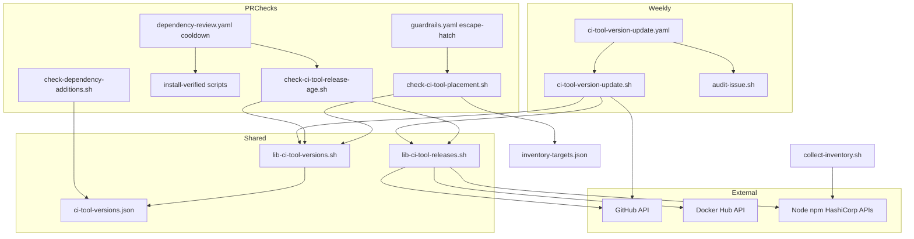
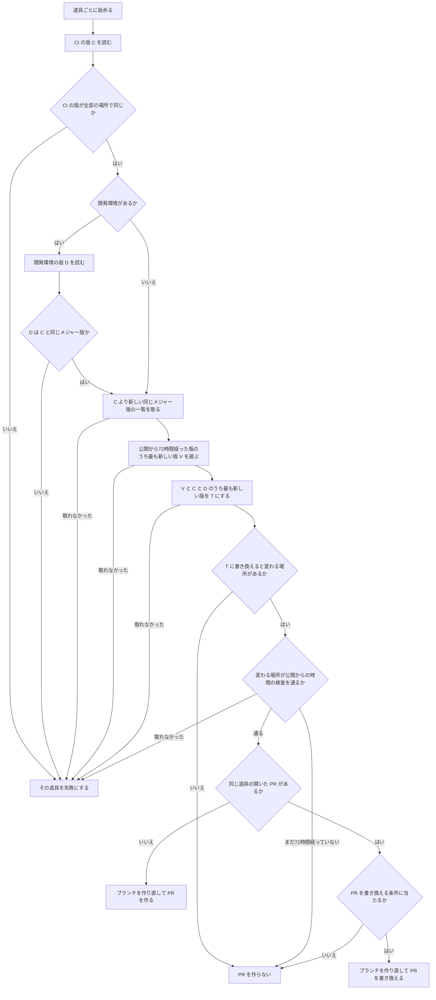

# 設計

## 概要

この設計は、Node.js、Trivy、Codex CLI、Terraform の CI の版を、週1回の実行のワークフローが新しい版に書き換え、更新の PR を作るようにする。Node.js と Terraform では、同じ PR が、開発環境の `FROM` の行も同じ版に書き換える。所有者は、毎週届く更新の PR を読んで承認するだけで、4つの道具の版を新しく保てる。

この設計は、版の書き場所を、新しいデータのファイル `.github/ci-tool-versions.json` に1つにまとめる。週1回の実行、公開からの時間の検査、版の書き場所の検査、ci-tool-fast-update のスキルは、どれもこのファイルを読む。この設計は、版の行を探す処理と書き換える処理をライブラリ `lib-ci-tool-versions.sh` に、配布元から版の一覧と公開日時を取る処理をライブラリ `lib-ci-tool-releases.sh` にまとめる。

この設計が今の仕組みに足すものは、「作るもの」の節に書く。

## 作るものと作らないもの

### 作るもの

- 版の書き場所の一覧のデータ `.github/ci-tool-versions.json`。このファイルは、4つの道具の CI の書き場所と、Node.js と Terraform の開発環境の書き場所と、自動で上げない版の一覧と理由を持つ
- 週1回の実行のワークフロー `ci-tool-version-update.yaml` と、版を選んで書き換え、更新の PR を作るスクリプト `ci-tool-version-update.sh`
- 公開からの時間の検査のスクリプト `check-ci-tool-release-age.sh` と、PR で変わった CI の版の署名を確かめるステップ
- 版の書き場所の検査のスクリプト `check-ci-tool-placement.sh`
- 2つのライブラリ `lib-ci-tool-versions.sh` と `lib-ci-tool-releases.sh`
- 既存の仕組みへの追加。この設計は、`dependency-gate` に検知を、`audit-issue.sh` に知らせの種類を、`dependabot.yml` に除外を、棚卸しに対象と最新の版の取り方を足す
- ci-tool-fast-update のスキルが版の書き場所を読む先を、新しいデータのファイルに替えること

### 作らないもの

- メジャー版の更新の PR。週1回の実行は、今の CI の版と同じメジャー版の中でしか版を選ばない
- 所有者の指示で72時間待たずに版を入れる手順と、記録の目印の行を書く処理。これらは spec `security-fix-cooldown-exception` の `verify-ci-tool.sh` と ci-tool-fast-update のスキルが持つ。この設計は、記録の目印の行を読むだけで、書かない
- 4つの道具を入れるときの署名の確認の処理。これは `install-verified-*.sh` と `verified-*` のアクションが持つ。この設計は、これらを呼ぶだけで、中身を変えない
- 既存の Trivy の版の検査 `check-trivy-version.sh` と `check-audit-trivy-version.sh`。この設計は、この2つを変えない
- この設計は、Java の版と、`uses:` の行のアクションの版と、frontend と backend が使う外部のパッケージの版を上げる処理を作らない。この設計は、開発環境のイメージの digest だけを新しくする更新の処理も作らない。digest とは、イメージの中身から計算した `sha256:` で始まる値で、同じタグでもイメージの中身が変わると変わる値である
- 週1回の実行が起動されなかったことに気づく仕組み(Issue #482)
- 必須の検査の一覧 `.github/audit/required-checks.json` と ruleset の変更
- `guardrails.yaml` の `npx --yes jscpd` に版を書くこと。この行は版を数字で書いていないので、版の書き場所の検査の対象にならない
- ワークフローとアクションのファイルの外に書いた版を調べること。たとえば、ワークフローが呼ぶ `.github/scripts/` のスクリプトの中の版である。版の書き場所の検査は、ワークフローとアクションのファイルに直接書いた版だけを調べる。版の書き場所の検査が見つける書き方は、`lib-ci-tool-versions.sh` の `civ_scan` に書く

## 使う既存の仕組み

- 署名を確かめて道具を入れるスクリプト `install-verified-node.sh` `install-verified-trivy.sh` `install-verified-codex.sh` `install-verified-terraform.sh`(Issue #644)。どれも `<版>` を1つ受け取り、`GITHUB_PATH` に置き場を足す
- 記録の目印の行 `<!-- ci-tool-cooldown-exception data=<base64> -->`(spec `security-fix-cooldown-exception`)。中身の JSON は `{"schema":1,"entries":[{"tool","version","published_at","owner_instruction","signature":{"result","method","signer","checked_at"}}]}` の形である
- spec `security-fix-cooldown-exception` の `verify-ci-tool.sh` が使う、公開日時の取り先。`lib-ci-tool-releases.sh` が同じ取り先を使うことは、その部品の節に書く
- 知らせの Issue を作るスクリプト `audit-issue.sh`
- 所有者の承認を求める `dependency-gate` と、`.github/` を所有者のものにする CODEOWNERS と、main の ruleset の `require_code_owner_review` と `dismiss_stale_reviews_on_push`
- PR を作ると自動マージを予約する `auto-merge.yaml`(`reserve-auto-merge.sh`)と、開いている PR のブランチを main の最新に合わせる `update-pr-branches.yaml`
- bot の PAT `secrets.BOT_GITHUB_TOKEN`。PAT は、GitHub のアカウントで作る、API と Git の操作に使うトークンである。この PAT の scope は、`repo` と `read:org` と `workflow` の3つである
- 棚卸しの表を作る `collect-inventory.sh` と、その対象の一覧 `inventory-targets.json`

依存の向きは、検査と週1回の実行が2つのライブラリを使い、2つのライブラリがデータのファイルを読む一方向に限る。2つのライブラリは、検査のスクリプトと週1回の実行のスクリプトを呼ばない。

## 設計を見直すきっかけ

- `ci-tool-versions.json` の形(`schema`)を変えたとき。週1回の実行、2つの検査、ci-tool-fast-update のスキルの4か所が同じ形を読むので、4か所を同時に確かめ直す
- 記録の目印の行の JSON の形を spec `security-fix-cooldown-exception` が変えたとき。公開からの時間の検査の例外の判定を確かめ直す
- 配布元が公開日時の取り先を変えたとき。たとえば、Docker Hub がタグの API の欄を変えたとき、npm が `time` を返さなくなったとき、HashiCorp が一覧の API を変えたときである
- `install-verified-*.sh` の引数か、`GITHUB_PATH` の扱いが変わったとき
- `dependency-review.yaml` のジョブ `cooldown` か、`guardrails.yaml` のジョブ `escape-hatch` が、必須の検査から外れたとき。新しい検査は、この2つのジョブの中で動くためである
- `BOT_GITHUB_TOKEN` の scope から `workflow` が外れたとき。週1回の実行は、ワークフローのファイルを変えたコミットを push できなくなる
- 5つ目の道具を自動で上がる対象に足すとき。データのファイルと2つのライブラリの道具ごとの取り先を足す

## プロジェクトの決まりを守っているか

- 品質チェックの設定: この設計は、`.github/` と `.claude/` の下のファイルを足して変える。Claude がこれらのファイルを置く手順は、「移行」の節に書く。この spec の承認が、所有者への提案の承認に当たる
- 新しいライブラリの追加: この設計は、外部から入れる新しいライブラリを足さない。スクリプトは、GitHub のランナーに入っている bash、jq、gh、curl、git だけを使う。この設計は、版を上げる道具の Renovate を採らない。Renovate は Node.js の公開日時に日付だけの値を使うので、72時間より早く版を通すことがある。比べた結果は research.md の「構成の案の比べ」にある
- 使う外部の機能がこのリポジトリで使えるか: このリポジトリは個人の持ち物(`owner.type: User`)で、公開されている。週1回の実行が使う GitHub Actions の `schedule` と `workflow_dispatch`、bot の PAT での push と PR の作成は、今の `frontend-vuln-fix.yaml` が同じ条件で動かしている。Claude は、Docker Hub のタグの API、HashiCorp の版の API、npm の registry、nodejs.org の版の一覧が認証なしで呼べることを、2026-11-03 に実際に呼んで確かめた。ただし、GitHub は、公開のリポジトリで60日のあいだ動きが無いと、`schedule` の実行を止める。このリポジトリには毎日 PR が入るので、GitHub は、このリポジトリの `schedule` の実行を止めない。止まったことに気づく仕組みは Issue #482 が扱う
- 関係のない項目: backend のコードを置く層、frontend の機能ごとの境界、frontend の状態の持ち方、データベースの表の形

## 全体の構成



この設計は、週1回の実行と PR の検査を、別々のスクリプトにする。週1回の実行は書き換える側で、PR の検査は確かめる側である。2つが同じライブラリで版を読み、同じライブラリで公開日時を取るので、週1回の実行が作った PR は、PR の検査でも同じ判定を受ける。

この設計は、新しい検査を、新しいワークフローではなく既存の必須の検査のステップにする。既存の必須の検査のステップにすれば、必須の検査の一覧と ruleset はそのままで済むためである。公開からの時間の検査を `dependency-review.yaml` のジョブ `cooldown` に置くのは、frontend と backend が使う外部のパッケージの72時間の待ちと同じジョブにまとめるためである。ジョブ `cooldown` は、検査の一覧に `dependency-cooldown` の名前で出る。`dependency-cooldown` は paths の絞り込みが無く、同じリポジトリのブランチから出たすべての PR で動く。版の書き場所の検査を `escape-hatch` に置くのは、このジョブが、すべての PR で actionlint とアクションの版の固定の検査を流しているためである。

版の書き場所を `trusted-signers.json` の `locations` から新しいデータのファイルに移すのは、書き場所の一覧を1つにするためである。今の `locations` は、Node.js の `frontend-vuln-fix.yaml` を書き漏らしている。

**使う技術**:
- 実行環境: GitHub Actions の `ubuntu-latest`。週1回の実行と2つの検査を動かす
- スクリプト: bash と jq と gh と curl と git。ランナーに入っている版を使う。版の大小は、bash の関数で数字ごとに比べる。`sort -V` は、GitHub のランナーと、テストを流す alpine のコンテナとで動きが違うので、スクリプトは `sort -V` を使わない
- 外部の API: GitHub の REST API(版の一覧、PR の操作)、Docker Hub のタグの API、nodejs.org の版の一覧、npm の registry、HashiCorp の版の API。取る値と URL は「部品」の節の `lib-ci-tool-releases.sh` に書く

## ファイルの構成

Claude が新しく作るファイル:

- `.github/ci-tool-versions.json`: 版の書き場所の一覧のデータ。形は「データの形」の節に書く
- `.github/scripts/lib-ci-tool-versions.sh`: ワークフローとアクションから版の行を探す関数、データのファイルを読む関数、版を書き換える関数、版を比べる関数
- `.github/scripts/lib-ci-tool-releases.sh`: 配布元から版の一覧と公開日時と変更点の文書の URL を取る関数と、Docker Hub からタグの digest と公開日時を取る関数
- `.github/scripts/ci-tool-version-update.sh`: 週1回の実行のスクリプト。道具ごとに書き換え先の版を決め、更新の PR を作るか書き換える
- `.github/workflows/ci-tool-version-update.yaml`: 週1回の実行のワークフロー
- `.github/scripts/check-ci-tool-placement.sh`: 版の書き場所の検査のスクリプト
- `.github/scripts/check-ci-tool-release-age.sh`: 公開からの時間の検査のスクリプト
- `.github/scripts/tests/test-lib-ci-tool-versions.sh`
- `.github/scripts/tests/test-lib-ci-tool-releases.sh`
- `.github/scripts/tests/test-ci-tool-version-update.sh`
- `.github/scripts/tests/test-check-ci-tool-placement.sh`
- `.github/scripts/tests/test-check-ci-tool-release-age.sh`

Claude が変えるファイル:

- `.github/workflows/dependency-review.yaml`: ジョブ `cooldown` のテストの繰り返しに2本のテストを足し、公開からの時間の検査のステップと署名の確認のステップを足す
- `.github/workflows/guardrails.yaml`: ジョブ `escape-hatch` に、3本のテストと版の書き場所の検査のステップを足す
- `.github/scripts/check-dependency-additions.sh`: 開発環境の Node.js と Terraform の `FROM` の版の変更を検知に足す
- `.github/scripts/tests/test-check-dependency-additions.sh`: 足した検知の場合を足す
- `.github/scripts/audit-issue.sh`: 知らせの種類 `ci-tool-update` を足す
- `.github/scripts/tests/test-audit-issue.sh`: 足した種類の場合を足す
- `.github/dependabot.yml`: docker の `ignore` に `node` と `hashicorp/terraform` を足す
- `.github/audit/inventory-targets.json`: Codex CLI の対象を足す
- `.github/scripts/collect-inventory.sh`: 最新の版の取り方 `npm` を足す
- `.github/scripts/tests/test-collect-inventory.sh`: 取り方 `npm` の場合を足す
- `.claude/scripts/ci-tool-signature/trusted-signers.json`: 4つの道具の `locations` を消す
- `.claude/scripts/ci-tool-signature/test-verify-ci-tool.sh`: テストの `trusted-signers.json` から `locations` を消す
- `.claude/skills/ci-tool-fast-update/SKILL.md`: Step 4 で読む書き場所を、`ci-tool-versions.json` の `ci` に替える
- `README.md`: ワークフローの一覧の表と Mermaid の図に `ci-tool-version-update.yaml` を足し、Dependabot の段落に、開発環境の Node.js と Terraform の版を Dependabot が上げないことを書く
- `doc/インフラ設計/Github Actions設計/ワークフロー設計.md`: `ci-tool-version-update.yaml` の行を足す
- `doc/開発フロー/監査手順.md`: 知らせの Issue の題名の表に `CI の道具の版の更新: 判定不能` を足す

## 処理の流れ

週1回の実行は、道具ごとに、次の流れで書き換え先の版を決める。



- Node.js と Terraform では、週1回の実行は、V を選ぶときに、版の公開から72時間経った版ごとに、その版の配布元のイメージのタグ `<image>:<版><tag_suffix>` も公開から72時間経っているかを確かめる。タグが72時間経っていない版は飛ばし、1つ前の版を確かめる
- Node.js と Terraform では、週1回の実行は、T を決めたあと、T の配布元のイメージのタグが公開から72時間経っているかを、開発環境の行が変わるかどうかによらず確かめる。経っていなければ、その週は PR を作らない。T が V ではなく C か D になるのは、上げる先の版が無く、古いほうの版を新しいほうにそろえるときである。このときも、週1回の実行は、この確認で、そろえる先のイメージの公開日時を確かめる
- 図の「変わる場所が公開からの時間の検査を通るか」の判定は、T が C か D と同じで、その版が72時間待たずに手で入れた版のときに意味を持つ
- 週1回の実行は、「まだ72時間経っていない」と「配布元から取れなかった」を分ける。前者では、その週は PR を作らない。後者では、その道具を「新しい版を調べられなかった」の失敗にし、知らせの Issue に書く。取れなかったときには、版の一覧の問い合わせの失敗、公開日時の問い合わせの失敗、イメージのタグの問い合わせの失敗、イメージのタグが無いこと、`ci_tool_age_check` の結果が `error` の行があることが当たる。イメージのタグが無いことを失敗にするのは、配布元が `tag_suffix` のタグを出さなくなったときに、所有者が気づけるようにするためである。週1回の実行は、版の公開から72時間経った版のタグだけを問い合わせるので、公開の直後でまだタグが無い版は、失敗にならない
## 部品

### ci-tool-versions.json(版の書き場所の一覧のデータ)

対応する要件: 4.1, 6.5, 6.6

**役割**: このファイルは、4つの道具ごとに、CI の版の書き場所と、Node.js と Terraform の開発環境の版の書き場所を持つ。このファイルは、4つの道具のほかに、ワークフローに直接書いた版のうち自動で上げない版の一覧(`excluded`)を、場所ごとの理由とともに持つ。このファイルは、版の値と行番号を持たない。版の値と行は、`lib-ci-tool-versions.sh` が、書き場所のファイルを読んで見つける。版の値を持たないので、週1回の実行が版を書き換えても、このファイルは変わらない。

**状態の持ち方**: 1つの書き場所は、ファイルと、版を書いた行の名前(`key`)の組で表す。1つの組は、そのファイルの中の、その名前の行のすべてを指す。`ci.yaml` には `node-version` の行が2つあるが、組は1つで足りる。この spec が main に入った時点の中身は、「データの形」の節に書く。

### lib-ci-tool-versions.sh(版の行を探して書き換えるライブラリ)

対応する要件: 1.1, 4.1, 6.1

**役割**: このライブラリは、版の行を探す関数、データのファイルを読む関数、版を書き換える関数、版を比べる関数を持つ。このライブラリは、外部に問い合わせない。週1回の実行と2つの検査は、版を読むときも書き換えるときも、このライブラリの関数だけを使う。版の読み方を1か所にまとめ、検査が通るのに週1回の実行が書き換えを漏らすことを防ぐためである。

**呼び出し方**: 呼ぶ側は `. "$(dirname "$0")/lib-ci-tool-versions.sh"` で読み込む。関数は次のとおりである。

- `civ_scan <根のフォルダ>`: `<根のフォルダ>/.github/workflows/*.yml` と `*.yaml`、`<根のフォルダ>/.github/actions/*/action.yml` と `action.yaml` を読み、版の行を1行に1つずつ `ファイル<TAB>行番号<TAB>名前<TAB>版` の形で標準出力に出す。ファイルは根のフォルダからの相対の形で出す。見つける行は次の5種類である
  - 名前が、大文字と小文字を区別せずに `version` か `tag` か `release` を含み、値が `^v?[0-9]+(\.[0-9]+)*$` に当たる `名前: 値` の行。値の前後の `'` と `"` は外して読む。名前は、その行の名前とする
  - `docker run`、`docker pull`、`docker create` の行と、名前が `image` か `container` の行にある、`<イメージ>:<タグ>` の形の語のすべて。タグは `^v?[0-9]+(\.[0-9]+)*` で始まるものに限る。`docker` の行では、値に `:` を書く引数の値だけを除く。除く引数は、`-p` `--publish` `-v` `--volume` `--mount` `-e` `--env` `--add-host` `--device` `--tmpfs` `--expose` `--link` `--security-opt` である。引数の値は、引数の次の語と、`--publish=8080:80` のように `=` のあとに書いた値の両方である。`-p 8080:80` の `8080:80` を版と読み違えないためである。この決まりは、イメージの位置の語だけを読む決まりにしない。名指ししていない引数(`--platform` など)の次の語をイメージと読み違えて、イメージのタグの版を見落とすと、版の書き場所の検査が通ってしまい、見落としに気づけないためである。除かない引数の値を版と読み違えたときは、版の書き場所の検査が失敗するので、開発者が気づける。`\` で次の行に続く `docker run` は、続きの行までを1つの行として読み、行番号は語のある行にする。名前は、イメージの名前(`rhysd/actionlint` など)とする
  - `npm` `npx` `pnpm` `yarn` `pip` `pipx` `go install` `gem` `cargo` `uvx` `bunx` で道具を入れる行にある、`<パッケージ>@<版>` か `<パッケージ>==<版>` の形の語。名前は、パッケージの名前とする
  - `apt-get install` `apt install` `apk add` `yum install` `dnf install` の行にある、`<パッケージ>=<版>` の形の語。版は `^v?[0-9]+(\.[0-9]+)*` で始まるものに限る。名前は、パッケージの名前とする
  - `curl` `wget` `gh release download` で配布物を取る行にある版。URL では、`/` で区切った1つの区切りが `^v?[0-9]+(\.[0-9]+)+$` に当たるものを版とし、名前は、`https://github.com/<持ち主>/<リポジトリ>/` の URL なら `<持ち主>/<リポジトリ>`、ほかの URL なら版の区切りより前のホストとパスとする。`gh release download` では、`--repo` か `-R` の次の語を名前とし、`^v?[0-9]+(\.[0-9]+)+$` に当たる語を版とする
  - 次の行は見つけない: `uses:` の行、`#` で始まるコメントの行、値に `${{` を含む行
- `civ_tool_versions <根のフォルダ> <道具>`: データのファイルの、その道具の `ci` の組ごとに、見つけた版を `ファイル<TAB>行番号<TAB>版` の形で出す。組に当たる行が1つも無いときは、`ファイル<TAB>-<TAB>-` を出す
- `civ_dev_from <根のフォルダ> <道具>`: その道具の開発環境の `FROM` の行から、版とタグと digest を `版<TAB>タグ<TAB>digest` の形で出す。`FROM` の行は、データのファイルの `image` で始まるものだけを読む。`docker/terraform/Dockerfile` の tflint の `FROM` の行は読まない。開発環境が無い道具では何も出さない
- `civ_rewrite_ci <根のフォルダ> <道具> <版>`: その道具の `ci` の組が指す行の値だけを、新しい版に書き換える。値を囲む引用符は残す
- `civ_rewrite_dev <根のフォルダ> <道具> <版> <digest>`: その道具の開発環境の `FROM` の行を、`FROM <image>:<版><tag_suffix>@<digest>` に書き換える。`AS` などの、digest のあとの文字は残す
- `civ_gt <版a> <版b>`: 版a が版b より新しければ 0 で、そうでなければ 1 で終わる。先頭の `v` を外し、`.` で分けた数字を左から比べる
- `civ_major <版>`: 先頭の `v` を外した版の、最初の数字を出す

書き換えの関数は、渡された版が `^[0-9]+\.[0-9]+\.[0-9]+$` に当たり、digest が `^sha256:[0-9a-f]{64}$` に当たるときだけ書き換える。当たらないときは、ファイルを変えずに 2 で終わる。

**失敗したとき**: データのファイルが無いか、JSON として読めないときは、どの関数も標準エラーに理由を出して 2 で終わる。

### lib-ci-tool-releases.sh(配布元から版と公開日時を取るライブラリ)

対応する要件: 1.2, 1.3, 2.2, 2.3, 4.2, 5.1, 5.3

**役割**: このライブラリは、配布元から、版の一覧、版ごとの公開日時、配布元のイメージのタグの digest と公開日時、変更点の文書の URL を取る。このライブラリは、取った日時が72時間経っているかを判定する関数と、変わった版をまとめて判定する関数 `ci_tool_age_check` も持つ。このライブラリは、ファイルを書き換えない。PR の本文の記録の目印の行も読まない。例外の判定は、`check-ci-tool-release-age.sh` が行う。

**使う部品**: 道具ごとの取り先は、次のとおりである。公開日時の取り先は、spec `security-fix-cooldown-exception` の `verify-ci-tool.sh` と同じにする。同じ版の公開日時が、記録と検査で食い違わないようにするためである。

- Node.js: 版の一覧は `https://nodejs.org/dist/index.json` から取る。公開日時は、GitHub の `repos/nodejs/node/releases/tags/v<版>` の `published_at` から取る。変更点の文書は `https://github.com/nodejs/node/releases/tag/v<版>` である
- Trivy: 版の一覧と公開日時は、GitHub の `repos/aquasecurity/trivy/releases` の `tag_name` と `published_at` から取る。変更点の文書は `https://github.com/aquasecurity/trivy/releases/tag/v<版>` である
- Codex CLI: 版の一覧と公開日時は、`https://registry.npmjs.org/@openai%2fcodex` の `time` から取る。変更点の文書は `https://github.com/openai/codex/releases/tag/rust-v<版>` である
- Terraform: 版の一覧と公開日時は、`https://api.releases.hashicorp.com/v1/releases/terraform?limit=20` の `version` と `timestamp_created` から取る。変更点の文書は `https://github.com/hashicorp/terraform/releases/tag/v<版>` である

このライブラリは、配布元のイメージのタグの `digest` と `tag_last_pushed` を、`https://hub.docker.com/v2/namespaces/<名前空間>/repositories/<名前>/tags/<タグ>` から取る。GitHub の API は `gh api` で呼び、ほかは `curl -fsS --max-time 120 --retry 2` で呼ぶ。

**呼び出し方**: 関数は次のとおりである。

- `ctr_list <道具> <今の版>`: 今の版より新しく、同じメジャー版の正式な版を、`版<TAB>公開日時` の形で、新しい順に出す。公開日時は `YYYY-MM-DDTHH:MM:SSZ` の形にそろえる。正式な版とは、`^[0-9]+\.[0-9]+\.[0-9]+$` に当たる版である。Trivy は、加えて `prerelease` と `draft` が `false` の版に、Terraform は `is_prerelease` が `false` の版に限る。道具ごとの取り方の違いは次のとおりである
  - Node.js: `index.json` から版を選び、選んだ版ごとに GitHub のリリースから公開日時を取る。`index.json` の `date` は使わない。日付だけの値で、公開より早いことがあるためである
  - Terraform: 一覧を `after=<最後の版の timestamp_created>` で20件ずつ前へたどり、今の版の公開日時より古い版に届いたら止める
- `ctr_published <道具> <版>`: その版の公開日時を1行で出す
- `ctr_notes_url <道具> <版>`: その版の変更点の文書の URL を出す
- `ctr_image <名前空間/名前> <タグ>`: タグの `digest` と `tag_last_pushed` を `digest<TAB>公開日時` の形で出す
- `ctr_age_ok <公開日時>`: 公開日時から今の時刻までが72時間以上なら 0 で、そうでなければ 1 で終わる。今の時刻は `date +%s` で取る。テストは、環境変数 `NOW_EPOCH` で今の時刻を与える
- `ctr_pass_at <公開日時>`: 公開日時に72時間を足した日時を出す
- `ci_tool_age_check <根のフォルダ> <道具> <CI の版か -> <開発環境の版か -> <開発環境の digest か ->`: 公開からの時間の検査と週1回の実行が使う。CI の版を渡したときは、その版の公開日時が72時間経っているかを調べる。開発環境の版を渡したときは、その版の公開日時に加えて、配布元のイメージのタグ `<版><tag_suffix>` の今の digest が渡された digest と同じかと、そのタグの `tag_last_pushed` が72時間経っているかを調べる。結果は、調べた場所ごとに `場所<TAB>版<TAB>公開日時<TAB>通る日時<TAB>結果<TAB>理由` の形で出す。場所は `ci` か `dev` である。結果は、`ok` と `ng` と `error` のどれかである。`ng` は、72時間経っていないか、digest が違うことを表す。`error` は、日時か digest を取れなかったか、イメージのタグが無いことを表す。`error` の行では、公開日時と通る日時の欄を `-` にし、理由に取れなかった理由を書く。1つでも `ng` か `error` があれば 1 で終わる

このライブラリは、テストが URL の先頭を環境変数で差し替えられる形にする。

**失敗したとき**: 問い合わせが失敗したとき、応答が JSON として読めないとき、欄が無いときは、どの関数も標準エラーに `<道具> <版>: <取り先> から <欄> を取れませんでした(<理由>)` の形で理由を出し、1 で終わる。理由には、HTTP の状態か、欄が無いことを書く。

### ci-tool-version-update.sh(週1回の実行のスクリプト)

対応する要件: 1.1, 1.2, 1.4, 1.5, 1.6, 1.7, 2.1, 2.2, 2.3, 2.4, 3.1, 3.3, 3.4, 4.1, 4.2, 4.3, 4.4, 8.3

**役割**: このスクリプトは、4つの道具ごとに、書き換え先の版を決め、更新の PR を作るか、開いている更新の PR を書き換える。書き換え先の版の決め方は、「処理の流れ」の節の図のとおりである。このスクリプトは、更新の PR を閉じない。マージもしない。そのため、検査が失敗した更新の PR は、開いたまま残る。自動マージの予約は、PR を作ったときに既存の `auto-merge.yaml` が付ける。

**権限**: このスクリプトは、push と PR の操作に、環境変数 `GH_TOKEN` に渡された bot の PAT を使う。bot の PAT で作った PR では、ほかの PR と同じワークフローがすべて動く。GitHub の標準のトークンで作った PR では、ほかのワークフローが動かないので、このスクリプトは標準のトークンを使わない。

**使う部品**: このスクリプトは、`lib-ci-tool-versions.sh` で版を読んで書き換え、`lib-ci-tool-releases.sh` で版の一覧と公開日時を取る。このスクリプトは、PR を作る前に、`lib-ci-tool-releases.sh` の判定の関数 `ci_tool_age_check` を呼び、自分が変える場所が公開からの時間の検査を通るかを調べる。このスクリプトは、記録の目印の行を読まない。そのため、72時間待たずに手で入れた版は、72時間経つまで、そろえる PR の書き換え先にならない。

**呼び出し方**: 使い方は `ci-tool-version-update.sh run` である。`plan` `rewrite` `body` の3つは、テストが呼ぶ。`run` は、環境変数 `GH_TOKEN` と `GITHUB_REPOSITORY` と、知らせの報告を書くファイルのパス `CI_TOOL_UPDATE_REPORT` を要る。

- ブランチ: 道具ごとに1つのブランチ `chore/ci-tool-version-update-<道具>` を使う。道具は `node` `trivy` `codex` `terraform` のどれかである
- 開いている PR の見つけ方: `gh pr list --head <ブランチ> --state open --json number,headRefOid,mergeable` で探す
- 開いている PR が無いとき: このスクリプトは、`origin/main` から作業の木を作り、書き換えてコミットし、`git push --force origin HEAD:refs/heads/<ブランチ>` で push し、`gh pr create --base main` で PR を作る。所有者が閉じた PR のブランチが残っていても、このスクリプトは、そのブランチを作り直して、新しい PR を作る
- 開いている PR があるとき: このスクリプトは、ブランチのファイルから PR の CI の版 P を読む。次の3つのどれかに当たるときだけ、`origin/main` から作り直し、`git push --force-with-lease=<ブランチ>:<headRefOid>` で push し、`gh pr edit` で題名と本文を書き換える
  - 書き換え先の版 T が P より新しい
  - T が P と同じで、ブランチの開発環境の `FROM` の行が、今書き換えると書く行と違う。配布元がタグを公開し直して digest が変わったときに当たる
  - GitHub が PR を `mergeable: CONFLICTING` と返す。Dependabot の digest だけの更新が main に入り、`FROM` の行がぶつかったときに当たる
- コミット: 作者は `keirekipro-ci-tool-update-bot` とし、メッセージは `frontend-vuln-fix.sh` と同じく `.commit_template` の形(`Changes:` `Reason:` `BREAKING CHANGE: N/A` `Related: N/A` `Refs: N/A`)にする
- 題名: CI の版が変わるときは `chore: CI の <名前> を <T> に上げる` とする。開発環境の版だけが変わるときは `chore: <名前> の開発環境の版を CI の版 <T> にそろえる` とする。名前は `ci-tool-versions.json` の `name` である
- 本文: 次の順で書き、最後の行を `Refs: N/A` にする
  1. `## 概要`: 週1回の実行のワークフローが作った PR であること
  2. `## 版`: 表で、CI の版の今の版と書き換え先の版を書く。Node.js と Terraform では、開発環境の版の今の版と書き換え先の版の行も書く
  3. `## 公開日時`: T の公開日時と取り先を書く。Node.js と Terraform では、配布元のイメージのタグ `<image>:<T><tag_suffix>` と、その digest と公開日時も書く
  4. `## 変更点`: 今の CI の版 C と今の開発環境の版 D の古いほうより新しく、書き換え先の版 T 以下の正式な版ごとに、変更点の文書のリンクを1行ずつ書く
  5. `## 本番に適用する Terraform の版`(Terraform のときだけ): `terraform-apply.yaml` の `TF_VERSION` が T に変わることと、新しい版が本番に使われるのは、マージのあとに誰かが `terraform-apply.yaml` を動かしたときであることを書く
  6. `## 承認`: この PR は `.github/` を変えるので、所有者の承認が済むまでマージされないこと
- このスクリプトが同じ入力で何度動いても、結果は同じになる。書き換え先の版が同じで、ブランチの中身も同じなら、このスクリプトは push しない

**失敗したとき**: このスクリプトは、1つの道具の失敗では止まらず、残りの道具を続ける。失敗した道具ごとに、`CI_TOOL_UPDATE_REPORT` のファイルに `- <名前>: <何に失敗したか>(<理由>)` の1行を書く。何に失敗したかは、「新しい版を調べられなかった」「更新の PR を作れなかった」「更新の PR を書き換えられなかった」の3つのどれかにする。CI の版が場所によって違うときと、開発環境の版のメジャー版が CI の版と違うときは、「新しい版を調べられなかった」とし、理由にそのことを書く。全部の道具を終えたあと、1つでも失敗があれば 1 で終わる。

### ci-tool-version-update.yaml(週1回の実行のワークフロー)

対応する要件: 1.1, 1.8, 8.1, 8.2

**役割**: このワークフローは、スクリプトのテストを流してから `ci-tool-version-update.sh run` を呼び、結果を `audit-issue.sh` に渡す。書き換え先の版はスクリプトが決め、ワークフローは決めない。

**権限**: ワークフローに与える権限は、`contents: read` と `issues: write` の2つに限る。`issues: write` は、`audit-issue.sh` が GitHub の標準のトークンで知らせの Issue を作るために使う。push と PR の操作には、`secrets.BOT_GITHUB_TOKEN` を、スクリプトを呼ぶステップの環境変数 `GH_TOKEN` にだけ渡す。checkout は `persist-credentials: false` と `fetch-depth: 0` で行う。

**いつ動くか**:
- 起動: 毎週月曜日の 09:23 JST(cron `'23 0 * * 1'`)と、手での起動(`workflow_dispatch`)。手での起動は、リポジトリに書き込める人だけが GitHub の画面から行える。どちらの起動でも、同じジョブが同じ手順で動く
- 同時実行: `ci-tool-version-update` の組で1つずつ動かす(`cancel-in-progress: false`)。ジョブ全体は20分で打ち切る

**呼び出し方**: 手順は次のとおりである。

1. ワークフローは、main を checkout する
2. ワークフローは、`test-lib-ci-tool-versions.sh` `test-lib-ci-tool-releases.sh` `test-ci-tool-version-update.sh` を流す。壊れたスクリプトで PR を作らないためである
3. ワークフローは、`id` が `update` のステップで、`ci-tool-version-update.sh run` を呼ぶ
4. ワークフローは、`if: always()` のステップで、知らせを出す。テストのステップかスクリプトのステップが失敗していれば、`audit-issue.sh ci-tool-update undecidable <報告のファイル>` を呼ぶ。どちらも成功していれば、`audit-issue.sh ci-tool-update none` を呼ぶ。テストが失敗して報告のファイルが空のときは、このステップが「スクリプトのテストが失敗した」の1行を報告のファイルに書いてから渡す

### audit-issue.sh の種類 ci-tool-update(週1回の実行の失敗の知らせ)

対応する要件: 8.1, 8.2

**役割**: この設計は、このスクリプトに、知らせの種類 `ci-tool-update` を足す。種類の名前は「CI の道具の版の更新」とし、Issue の題名は `CI の道具の版の更新: 判定不能` になる。結果が `undecidable` なら、このスクリプトは、今と同じく、Issue を作るか、開いている Issue に追記する。本文には、報告のファイルの行と、失敗した実行へのリンクが入る。結果が `none` なら、このスクリプトは、開いている Issue を閉じる。この種類は、結果 `deviation` を使わない。

**呼び出し方**: このスクリプトは、Issue の本文のやり直しの案内に、失敗した実行の「Re-run」と、新しく手で起動することの、どちらでやり直してもよいことを書く。外部の API の一時的な失敗は、どちらでも直るためである。

### check-ci-tool-placement.sh(版の書き場所の検査)

対応する要件: 6.1, 6.2, 6.3, 6.4, 6.5, 6.6, 7.1

**役割**: このスクリプトは、`civ_scan` が見つけたすべての版の行を、`ci-tool-versions.json` と照らす。このスクリプトは、外部に問い合わせない。

**いつ動くか**: `guardrails.yaml` のジョブ `escape-hatch` の、ステップ「Check action pinning」の次のステップとして動く。このジョブは、main に向けたすべての PR で動き、必須の検査である。所有者の承認では、この検査の結果は変わらない。

**呼び出し方**: 使い方は `check-ci-tool-placement.sh [<根のフォルダ>]` である。根のフォルダの既定は、今のフォルダである。このスクリプトは、次のどれかに当たると、当たった行ごとに `::error file=<ファイル>,line=<行番号>::<理由>` を出し、全部を調べてから 1 で終わる。

- 見つけた版の行の、ファイルと名前の組が、どの道具の `ci` にも `excluded` にも無い。このスクリプトは、理由に、その版を `ci-tool-versions.json` の `tools` か `excluded` に足す必要があることを書く
- 見つけた版の行の名前が、ある道具の `keys` に入っているのに、そのファイルがその道具の `ci` に無い。このスクリプトは、理由に、そのファイルをその道具の `ci` に足す必要があることを書く
- `excluded` の組の名前が、ある道具の `keys` に入っている。4つの道具の版を、対象外にさせないためである
- 1つの道具の `ci` の場所で、版が1種類でない。このスクリプトは、理由に、版ごとの場所を並べる
- `ci` か `excluded` の組が指す行が、ファイルに1つも無い
- `excluded` の組に `reason` が無いか、空である
- `inventory-targets.json` に、その道具の `inventory_name` の対象が無いか、対象の宣言のファイルが、その道具の `ci` と開発環境のファイルを全部は含まない

データのファイルか `inventory-targets.json` を読めないときは、このスクリプトは 2 で終わる。

### check-ci-tool-release-age.sh(公開からの時間の検査)

対応する要件: 5.1, 5.2, 5.3, 5.4, 5.5

**役割**: このスクリプトは、PR の base と head の分かれ目のコミットと head を比べ、4つの道具の CI の版と、Node.js と Terraform の開発環境の版のうち、変わった版を見つけて、公開から72時間経っているかを調べる。このスクリプトは、版を書き換えない。署名は、`dependency-review.yaml` の、PR で変わった CI の版の署名を確かめるステップが確かめる。

**権限**: このスクリプトは、PR の本文を読むために、GitHub の標準のトークンを `GH_TOKEN` で使う。ジョブ `cooldown` の今の権限(`contents: read` `pull-requests: write` `vulnerability-alerts: read`)のままで足りる。

**いつ動くか**: `dependency-review.yaml` のジョブ `cooldown` の、ステップ「Check dependency cooldown」の次のステップとして動く。このステップの条件は `if: ${{ !cancelled() && steps.cooldown_tests.outcome == 'success' }}` にする。frontend と backend が使う外部のパッケージの検査が失敗しても、この検査の結果を出すためである。テストのステップには `id: cooldown_tests` を付ける。

**使う部品**: このスクリプトは、`lib-ci-tool-versions.sh` で分かれ目と head の版を読み、`lib-ci-tool-releases.sh` で公開日時を取る。分かれ目のコミットとは、base と head の merge-base で、head のブランチを main から分けたときの main のコミットである。base の先頭と直接比べないのは、古い main から分けたブランチの PR で、main だけで変わった版を、その PR が変えた版と読み違えないためである。既存の `check-dependency-additions.sh` も merge-base で比べている。

このスクリプトは、分かれ目のコミットの SHA を、`gh api repos/<リポジトリ>/compare/<base>...<head>` の `merge_base_commit.sha` から取る。ジョブ `cooldown` の checkout は履歴の深さが1なので、`git merge-base` では求められないためである。このスクリプトは、そのコミットを `git fetch --no-tags --depth=1 origin <SHA>` で取り、head のデータのファイルの `ci` と `dev` のファイルを、`git show <SHA>:<ファイル>` で一時の根のフォルダに写す。このスクリプトは、その根のフォルダに head のデータのファイルを写してから、ライブラリの関数に渡す。分かれ目に無いファイルは、空のファイルとして扱う。

このスクリプトは、分かれ目の版も、head のデータのファイルの書き場所で読む。分かれ目のデータのファイルは読まない。この spec の PR と、この spec が main に入る前に main から分けたブランチの PR では、分かれ目にデータのファイルが無い。分かれ目のデータのファイルを読むと、これらの PR で、データのファイルを読めずにこのスクリプトが 2 で終わり、版を変えていない PR の `dependency-cooldown` が失敗するためである。PR が書き場所を足したときは、足した書き場所の分かれ目の版と head の版を比べるので、PR が足した版も調べられる。

**呼び出し方**: 使い方は `check-ci-tool-release-age.sh <base> <head>` である。このスクリプトを動かすには、環境変数 `GH_TOKEN` `GITHUB_REPOSITORY` `PR_NUMBER` と、変わった CI の版を書き出すファイルのパス `CI_TOOL_CHANGED_FILE` が要る。

- 判定: このスクリプトは、変わった版ごとに、`lib-ci-tool-releases.sh` の `ci_tool_age_check` を呼ぶ
- 変わった版の見つけ方: 道具ごとに、head の `ci-tool-versions.json` の `ci` の場所で、分かれ目の版と head の版が違う行を、CI の版の変更とする。開発環境の `FROM` の行は、タグの版が違うときだけ、開発環境の版の変更とする。digest だけが違うときは、変更としない
- 例外: このスクリプトは、`gh api repos/<リポジトリ>/pulls/<PR_NUMBER>` で PR の本文を読み、記録の目印の行をすべて読む。このスクリプトは、記録の `entries` に次の条件に当たる要素があれば、その道具の CI の版の変更を、公開からの時間を調べずに通す。条件は、`tool` と `version` が CI の版の変更の道具と版に一致し、`signature.result` が `verified` であることである。開発環境の版の変更と、記録に無い道具の変更は、例外にしない。記録の目印の行の形が違うときは、例外を1つも当てず、ほかの変更と同じく調べる
- 出力: 調べた変更ごとに、道具、場所、版、公開日時、検査が通るようになる日時、結果を表にして、`GITHUB_STEP_SUMMARY` に書く。止めた変更ごとに `::error::` の行を出す。日時を取れなかった変更では、通るようになる日時の欄に「取れなかった」と書き、取れなかった理由を `::error::` の行に書く
- このスクリプトは、変わった CI の版を、例外で通したものも含めて、`CI_TOOL_CHANGED_FILE` に `道具<TAB>版` の形で1行ずつ書く
- 終了コード: 止めた変更が無ければ 0、あれば 1、データのファイルを読めないか引数が違えば 2 で終わる
- 4つの道具の版が1つも変わらない PR では、このスクリプトは外部に問い合わせずに 0 で終わる

**失敗したとき**: 公開日時の問い合わせが失敗したときは、このスクリプトは、その変更を止める。検査が通るようになる日時を過ぎてから、開発者が GitHub の「Re-run」でジョブをやり直すと、同じ版で検査が通る。

### PR で変わった CI の版の署名の確認(dependency-review.yaml のステップ)

対応する要件: 3.1

**役割**: このステップは、公開からの時間の検査が書いた `CI_TOOL_CHANGED_FILE` の行ごとに、`install-verified-<道具>.sh <版>` を呼び、配布元の署名を確かめる。このステップは、道具を動かさない。今の4つのスクリプトは、配布物の署名を確かめて配布物を展開し、置き場を `GITHUB_PATH` に足すだけである。このステップは、`GITHUB_PATH` に、使い捨ての空のファイルを渡す。PR の検査で署名を確かめるのは、`terraform-apply.yaml` が PR では動かず、`codex-review.yml` と `container-scan.yaml` も条件によっては動かないためである。

**権限**: Codex CLI のスクリプトが `gh attestation verify` を呼ぶので、このステップは、`GH_TOKEN` に GitHub の標準のトークンを渡す。

**いつ動くか**: 公開からの時間の検査の次のステップとして、`if: ${{ !cancelled() && steps.ci_tool_age.outcome == 'success' }}` で動く。公開からの時間の検査のステップには `id: ci_tool_age` を付ける。変わった CI の版が無ければ、このステップは何もしない。

**失敗したとき**: 1つでも確かめられなければ、このステップは失敗し、ジョブ `dependency-cooldown` が失敗する。

### check-dependency-additions.sh の検知の追加(開発環境の版の変更に所有者の承認を求める)

対応する要件: 3.2

**役割**: この設計は、このスクリプトに、3つ目の検知として、開発環境の Node.js と Terraform の `FROM` の行のタグの版の変更を足す。このスクリプトは、対象のファイルと `FROM` の行を、head の `ci-tool-versions.json` の `dev` から読み、分かれ目のコミットと head のそれぞれで、そのファイルの `FROM` の行を比べる。分かれ目のコミットの `ci-tool-versions.json` は読まない。この spec の PR では、分かれ目のコミットにデータのファイルが無いためである。このスクリプトは、digest だけの変更を検知しない。Dependabot が中身だけを新しくする PR は、今と同じく承認を待たずにマージされる。

この検知は、開発環境の版だけを変える更新の PR に、所有者の承認を求めるために要る。この PR は `.github/` の下を変えないので、CODEOWNERS では所有者の承認が要らない。CI の版を変える更新の PR は、`.github/` の下を変えるので、今の CODEOWNERS と main の ruleset の `require_code_owner_review` が承認を求める。

**呼び出し方**: このスクリプトは、検知したときは、今の2つの検知と同じく、`detected` に「開発環境の Node.js か Terraform の版の変更」を足し、所有者の承認が無ければ `::error::` を出して 1 で終わる。所有者が承認すると、`pull_request_review` で `dependency-gate` が動き直して通る。

### dependabot.yml の除外(開発環境の版を CI と別に上げさせない)

対応する要件: 4.5

**役割**: この設計は、`dependabot.yml` の docker の `ignore` に、次の2つを足す。

```yaml
- dependency-name: "node"
  update-types: ["version-update:semver-minor", "version-update:semver-patch"]
- dependency-name: "hashicorp/terraform"
  update-types: ["version-update:semver-minor", "version-update:semver-patch"]
```

Dependabot は、今の `"*"` の除外があるので、メジャー版の更新の PR をすでに作らない。Dependabot は、版の更新を除いても、同じタグの digest だけが変わる PR を作り続ける。そのため、開発環境のイメージの中身だけを新しくする PR は、今と同じく届く。

### 棚卸しの対象と取り方 npm の追加(Codex CLI を棚卸しの表に載せる)

対応する要件: 7.1, 7.2, 7.3

**役割**: この設計は、`inventory-targets.json` に、次の対象を足す。

```json
{
  "name": "Codex CLI",
  "declarations": [
    {
      "files": [".github/workflows/codex-review.yml"],
      "pattern": "(?m)^[ \\t]*codex-version:[ \\t]*['\"]?(?<version>[0-9][0-9.]*)"
    }
  ],
  "latest": { "type": "npm", "package": "@openai/codex" },
  "support": null
}
```

この設計は、`collect-inventory.sh` に、最新の版の取り方 `npm` を足す。取り方 `npm` は、`https://registry.npmjs.org/<パッケージ>/latest` の `version` を最新の版にする。パッケージの名前の `/` は `%2f` にして URL に入れる。`collect-inventory.sh` は、取り方 `npm` でも、取り方 `pypi` と同じく、`_inv_fetch` と `_inv_pick` を使う。`github-release` を使わないのは、Codex CLI のタグが `rust-v0.166.0` の形で、版の比べ方が棚卸しの表のほかの対象と合わないためである。

`collect-inventory.sh` は、棚卸しの表に載せる使っている版を、宣言のファイルからその都度読む。そのため、更新の PR がマージされたあとの表は、新しい版を載せる。Node.js と Terraform の対象は、今と同じく CI と開発環境の両方のファイルを宣言している。版の書き場所の検査は、この宣言が `ci-tool-versions.json` の書き場所を全部含むかを確かめる。

### ci-tool-fast-update のスキルと trusted-signers.json(書き場所を新しいデータのファイルから読む)

対応する要件: 5.4

**役割**: Claude は、ci-tool-fast-update のスキルの Step 4 で、版を変える書き場所を、`trusted-signers.json` の `locations` ではなく、`.github/ci-tool-versions.json` のその道具の `ci` から読む。Claude は、`ci` の組ごとに、そのファイルの、その名前の行の版を変える。Claude は、このスキルの手順で、開発環境の版を変えない。開発環境の版は、配布元のイメージが公開から72時間経った週に、週1回の実行がそろえる。この設計は、`trusted-signers.json` から `locations` を消す。`locations` を読むのは、このスキルだけである。

## データの形

`ci-tool-versions.json` の形は次のとおりである。下の JSON は、この spec が main に入った時点の中身である。

```json
{
  "schema": 1,
  "tools": {
    "node": {
      "name": "Node.js",
      "inventory_name": "Node.js",
      "keys": ["node-version", "NODE_VERSION", "node"],
      "ci": [
        { "file": ".github/workflows/ci.yaml", "key": "node-version" },
        { "file": ".github/workflows/codex-review.yml", "key": "node-version" },
        { "file": ".github/workflows/frontend-vuln-fix.yaml", "key": "node-version" },
        { "file": ".github/workflows/guardrails.yaml", "key": "node-version" },
        { "file": ".github/workflows/mutation-report.yaml", "key": "node-version" }
      ],
      "dev": {
        "file": "docker/frontend/Dockerfile",
        "image": "node",
        "hub_repository": "library/node",
        "tag_suffix": "-bookworm-slim"
      }
    },
    "trivy": {
      "name": "Trivy",
      "inventory_name": "Trivy",
      "keys": ["trivy-version", "TRIVY_VERSION", "aquasec/trivy"],
      "ci": [
        { "file": ".github/workflows/container-scan.yaml", "key": "TRIVY_VERSION" },
        { "file": ".github/workflows/container-scan-scheduled.yaml", "key": "TRIVY_VERSION" }
      ]
    },
    "codex": {
      "name": "Codex CLI",
      "inventory_name": "Codex CLI",
      "keys": ["codex-version", "@openai/codex"],
      "ci": [
        { "file": ".github/workflows/codex-review.yml", "key": "codex-version" }
      ]
    },
    "terraform": {
      "name": "Terraform",
      "inventory_name": "Terraform",
      "keys": ["terraform-version", "TF_VERSION", "TERRAFORM_VERSION", "hashicorp/terraform"],
      "ci": [
        { "file": ".github/workflows/terraform-apply.yaml", "key": "TF_VERSION" }
      ],
      "dev": {
        "file": "docker/terraform/Dockerfile",
        "image": "hashicorp/terraform",
        "hub_repository": "hashicorp/terraform",
        "tag_suffix": ""
      }
    }
  },
  "excluded": [
    { "file": ".github/workflows/backend-vuln-fix.yaml", "key": "java-version", "reason": "Java はメジャー版だけを書き、CI が動くたびにそのメジャー版の最新のパッチ版を入れるため" },
    { "file": ".github/workflows/ci.yaml", "key": "java-version", "reason": "Java はメジャー版だけを書き、CI が動くたびにそのメジャー版の最新のパッチ版を入れるため" },
    { "file": ".github/workflows/dependency-graph.yaml", "key": "java-version", "reason": "Java はメジャー版だけを書き、CI が動くたびにそのメジャー版の最新のパッチ版を入れるため" },
    { "file": ".github/workflows/dependency-review.yaml", "key": "java-version", "reason": "Java はメジャー版だけを書き、CI が動くたびにそのメジャー版の最新のパッチ版を入れるため" },
    { "file": ".github/workflows/guardrails.yaml", "key": "java-version", "reason": "Java はメジャー版だけを書き、CI が動くたびにそのメジャー版の最新のパッチ版を入れるため" },
    { "file": ".github/workflows/mutation-report.yaml", "key": "java-version", "reason": "Java はメジャー版だけを書き、CI が動くたびにそのメジャー版の最新のパッチ版を入れるため" },
    { "file": ".github/workflows/guardrails.yaml", "key": "rhysd/actionlint", "reason": "検査の道具で、版を上げると検査の結果が変わるため、所有者が起票して個別に上げる" },
    { "file": ".github/workflows/guardrails.yaml", "key": "koalaman/shellcheck", "reason": "検査の道具で、版を上げると検査の結果が変わるため、所有者が起票して個別に上げる" }
  ]
}
```

- `keys`: その道具の版を書くときに使う名前の一覧
- `dev.image`: 開発環境の `FROM` の行のイメージの名前
- `dev.hub_repository`: Docker Hub のタグの API に渡す `<名前空間>/<名前>`。Docker Hub の公式のイメージの名前空間は `library` である
- `dev.tag_suffix`: 版のあとに付くタグの文字。Node.js は `-bookworm-slim` で、Terraform は空である
- `excluded`: この spec が main に入った時点で、`civ_scan` が見つける版の行のうち、4つの道具のほかの行は、上の8つである。`terraform-plan.yaml` の `docker run` は、版のタグの無いイメージ `keirekipro-terraform` を動かすので、版の行にならない

## 失敗したときの扱い

- 配布元の API が一時的に失敗したとき: 週1回の実行では、`lib-ci-tool-releases.sh` の関数が 1 で終わり、週1回の実行はその道具だけを失敗にして、知らせの Issue を作る。週1回の実行が失敗したときは、所有者か開発者が、失敗した実行の「Re-run」か手での起動でやり直す。PR の検査で止まったときのやり直し方は、`check-ci-tool-release-age.sh` の部品の節のとおりである
- PR を作る途中で止まったとき: ブランチを push したあとに `gh pr create` が失敗すると、ブランチだけが残る。次の実行は、開いている PR が無いので、ブランチを作り直して PR を作る
- 書き換えの push の前に、ほかのワークフローがブランチを更新していたとき: `update-pr-branches.yaml` が同じ時刻にブランチを更新すると、`--force-with-lease` が失敗する。週1回の実行は、その道具を「更新の PR を書き換えられなかった」として知らせる。次の実行で書き換え直す
- 配布元がタグを公開し直したとき: 開いている PR の `FROM` の digest がタグの今の digest と違うと、公開からの時間の検査はその PR を止める。次の週1回の実行は、digest を書き直して PR を書き換える。公開し直したタグが72時間経っていなければ、週1回の実行は1つ前の版を選ぶ。選んだ版は開いている PR の版より古いので、週1回の実行は PR を書き換えない。そのときは、タグが72時間経った週に、週1回の実行が書き換える
- 更新の PR を書き換えると、main の ruleset の `dismiss_stale_reviews_on_push` で、所有者の承認が外れる。所有者は、書き換えたあとの PR を承認し直す

## テストの方針

テストのファイルは、`.github/scripts/tests/` に置き、`bash "$SCRIPT"` の形でスクリプトを起動する。どのファイルも、環境変数 `KP_TEST_CASE` に場合の名前が入っていれば、その名前の場合だけを流す。外部の API は、`PATH` の先頭に置いた偽の `gh` と `curl` と、URL の先頭を差し替える環境変数で置き換える。Claude は、`.github/CLAUDE.md` のとおり、テストを alpine のコンテナに写し、写したファイルに `chmod -R a-x` をかけてから、テストを流す。

- 単体テスト(`test-lib-ci-tool-versions.sh`): `civ_scan` が、`名前: 値` の行、`\` で続く `docker run` のイメージのタグ、`npx <パッケージ>@<版>`、`apt-get install <パッケージ>=<版>`、`curl` の GitHub のリリースの URL の版、`gh release download` の版、`docker run --platform linux/amd64 <イメージ>:<タグ>` のイメージのタグを見つけ、`uses:` の行、コメントの行、`${{` を含む行、`docker run -p 8080:80` と `--publish=8080:80` の `8080:80` を見つけないこと(要件6の1)。`civ_rewrite_ci` が引用符を残して値だけを変えること(要件1の1)。`civ_rewrite_dev` が tflint の `FROM` の行を変えず、`AS` を残すこと(要件4の1)。`civ_gt` が `0.100.0` を `0.99.0` より新しいとすること
- 単体テスト(`test-lib-ci-tool-releases.sh`): `ctr_list` が、試作の版、Codex CLI の CPU ごとのパッケージの版、メジャー版の違う版を出さないこと(要件1の2と1の5)。Node.js の公開日時に `index.json` の `date` ではなく GitHub の `published_at` を使うこと(要件1の2)。Terraform の一覧を `after=` でたどり、今の版より古い版で止まること。`ctr_age_ok` が、公開からちょうど72時間で通り、71時間59分で通らないこと(要件1の3と5の1)。`ci_tool_age_check` が、72時間経っていない版に `ng` を、問い合わせの失敗とイメージのタグが無いことに `error` を出すこと(要件5の3と8の1)
- 単体テスト(`test-check-ci-tool-placement.sh`): どの一覧にも無い版で、ファイルと行を出して失敗すること(要件6の2)。4つの道具の名前の行が `ci` に無いファイルにあると失敗すること(要件6の3)。場所によって版が違うと、違う場所を並べて失敗すること(要件6の4)。`reason` の無い `excluded` で失敗すること(要件6の5)。棚卸しの宣言が書き場所を含まないと失敗すること(要件7の1)
- 単体テスト(`test-check-ci-tool-release-age.sh`): 4つの道具の版を変えない PR が外部に問い合わせずに通ること(要件5の5)。古い main から分けたブランチの PR で、main だけで変わった版を変更としないこと(要件5の5)。分かれ目にデータのファイルが無く、4つの道具の版を変えない PR が通ること(要件5の5)。72時間経っていない CI の版で、公開日時と通る日時を出して失敗すること(要件5の1と5の2)。開発環境のタグが72時間経っていないときと、digest がタグの今の digest と違うときに失敗すること(要件5の1と5の3)。digest だけの変更で通ること(要件5の5)。問い合わせの失敗で、理由を出して失敗すること(要件5の3)。記録の目印の行が、記録の道具の CI の版だけを通し、同じ PR のほかの道具と開発環境の変更を通さないこと(要件5の4)
- 単体テスト(既存のテストに足す場合): `test-check-dependency-additions.sh` で、開発環境の `FROM` のタグの変更を検知し、digest だけの変更と tflint の `FROM` の変更を検知しないこと(要件3の2)。分かれ目のコミットにデータのファイルが無く、`FROM` の行を変えない PR で検知しないこと(要件3の2)。`test-audit-issue.sh` で、種類 `ci-tool-update` の題名と、`none` で Issue を閉じること(要件8の1と8の2)。`test-collect-inventory.sh` で、取り方 `npm` が `version` を読むこと(要件7の1)
- 結合テスト(`test-ci-tool-version-update.sh`): 一時のフォルダに、bare のリモートと、今の main と同じ並びのファイルを置いたリポジトリを作り、`run` を流す。bare のリモートとは、作業フォルダを持たず、push を受けるためだけに置く Git のリポジトリである。偽の `gh` は、呼ばれた引数を記録し、PR の一覧の応答を場合ごとに返す。確かめることは次のとおりである
  - 72時間経った版のうち最も新しい版を選び、道具ごとに1つの PR を作ること(要件1の1と1の2と1の4)。72時間経っていない版しか無いと PR を作らないこと(要件1の3と1の5)
  - 開いている PR の版より新しい版があれば書き換え、同じ版なら push しないこと(要件1の6)。閉じた PR のブランチが残っていても、PR を作り直すこと(要件1の7)
  - 題名と本文に、道具の名前、版、公開日時、あいだの版の変更点の文書のリンク、Terraform の本番の適用の節が入ること(要件2の1から2の4)
  - Node.js で、イメージのタグが72時間経っていない版を飛ばすこと(要件4の2)。開発環境の版が上げる先の版より新しいとき、CI の版を開発環境の版に上げ、どちらも下げないこと(要件4の3)。上げる先の版が無く、開発環境と CI の版が違うとき、新しいほうにそろえる PR を作ること(要件4の4)
  - 1つの道具の問い合わせが失敗しても、ほかの道具の PR を作り、報告のファイルにその道具の1行を書いて 1 で終わること(要件8の3)
  - 版の一覧の問い合わせ、イメージのタグの問い合わせ、変わる場所の判定の問い合わせのそれぞれが失敗したときと、イメージのタグが無いときに、PR を作らずに、報告のファイルにその道具の「新しい版を調べられなかった」の1行を書くこと(要件8の1)
- 実際のリポジトリでの確認: `escape-hatch` のジョブが、この spec の PR の head で版の書き場所の検査を流し、通ること(要件6の6)。この spec の PR では、`escape-hatch` のジョブが、actionlint で新しいワークフローの書き方を確かめる

## 安全

- 想定する脅威: 配布元を乗っ取った者が出した悪意のある版が、CI に入ること。この設計は、公開からの72時間の待ちと配布元の署名の確認と所有者の承認の3つで、この脅威を止める
- 外部の応答をそのまま使わない: 週1回の実行は、配布元の API が返した版を `^[0-9]+\.[0-9]+\.[0-9]+$` で、digest を `^sha256:[0-9a-f]{64}$` で確かめてから、ファイルの書き換えと PR の本文と URL に使う。当たらない値は、その道具の失敗にする。応答に紛れ込んだ文字が、ワークフローのファイルや PR の本文に入るのを防ぐためである
- 週1回の実行は、取った配布物を動かさない。週1回の実行は、版の一覧と日時の JSON だけを読む
- bot の PAT を渡す先と checkout の設定は、`ci-tool-version-update.yaml` の部品の節の権限の欄のとおりである。この設定では、スクリプトを呼ぶステップのほかのステップは、PAT を読めない
- 公開からの時間の検査と版の書き場所の検査は、今の `dependency-cooldown` と同じく、PR の head のスクリプトを動かす。PR を作る人は、その PR でこれらのスクリプトを書き換えて、検査をすり抜けることができる。ただし、そのような PR は `.github/` を変えるので、所有者の承認が済むまでマージされない。この扱いは、今の検査と同じである

## 性能

- Node.js では、週1回の実行は、版の一覧を1回、GitHub のリリースを新しい版の数だけ、イメージのタグを数回問い合わせる。ほかの道具は数回である。npm の registry が返す Codex CLI の JSON は、約18MBある。週1回の実行は、この JSON を1回の実行で1回だけ取る
- 4つの道具の版を変えない PR での公開からの時間の検査と署名の確認の動きは、それぞれの部品の節のとおりである。そのため、ほとんどの PR で、`dependency-cooldown` の時間は変わらない

## 移行

この spec の PR がマージされると、`dependabot.yml` の除外がすぐに効く。そのあとの最初の月曜日に、週1回の実行が初めて動く。所有者が、月曜日を待たずに週1回の実行の動きを確かめるときは、所有者は、マージのあとに `ci-tool-version-update.yaml` を手で起動する。

最初の実行では、次の2つの更新の PR が届く見込みである。

- Node.js: 今の CI の版は 24.22.1、開発環境の版は 24.22.2 で、すでに違う。最初の PR は、CI の版を、少なくとも 24.22.2 に上げる
- Terraform: 今の CI の版は 1.9.0、開発環境の版は 1.17.1 である。最初の PR は、本番に適用する版を、少なくとも 1.17.1 まで、マイナー版で8つ分上げる。`terraform-apply.yaml` が新しい版の Terraform で一度本番に適用すると、古い版の Terraform は、本番の state のファイルを読めなくなる。`terraform-plan.yaml` は、開発環境のイメージの 1.17.1 で、書式と構文と静的な検査を流すだけで、本番の状態を読まない。本番の状態に対する plan を新しい版で初めて流すのは、マージのあとに所有者が動かす `terraform-apply.yaml` で、同じジョブが plan のすぐあとに適用まで進む。そのため、所有者は、この PR を承認する前に、1.9 から 1.17 までの変更点の文書と上げ方の文書を読み、本番の構成が使う書き方に影響が無いかを確かめる

`.github/` と `.claude/` の下のファイルは、Claude が完成品を scratchpad で作り、テストを流してから、所有者に `cp` のコマンドを渡して置いてもらう。置いたあと、Claude は `cmp` で完成品と同じかを確かめ、リポジトリの場所のままテストを流し直す。
