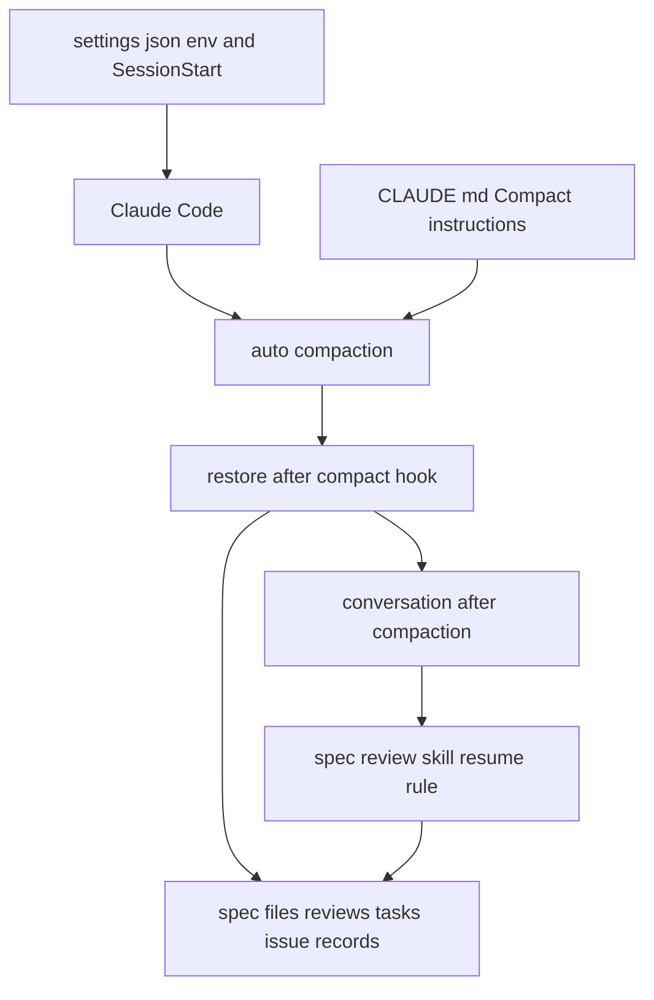
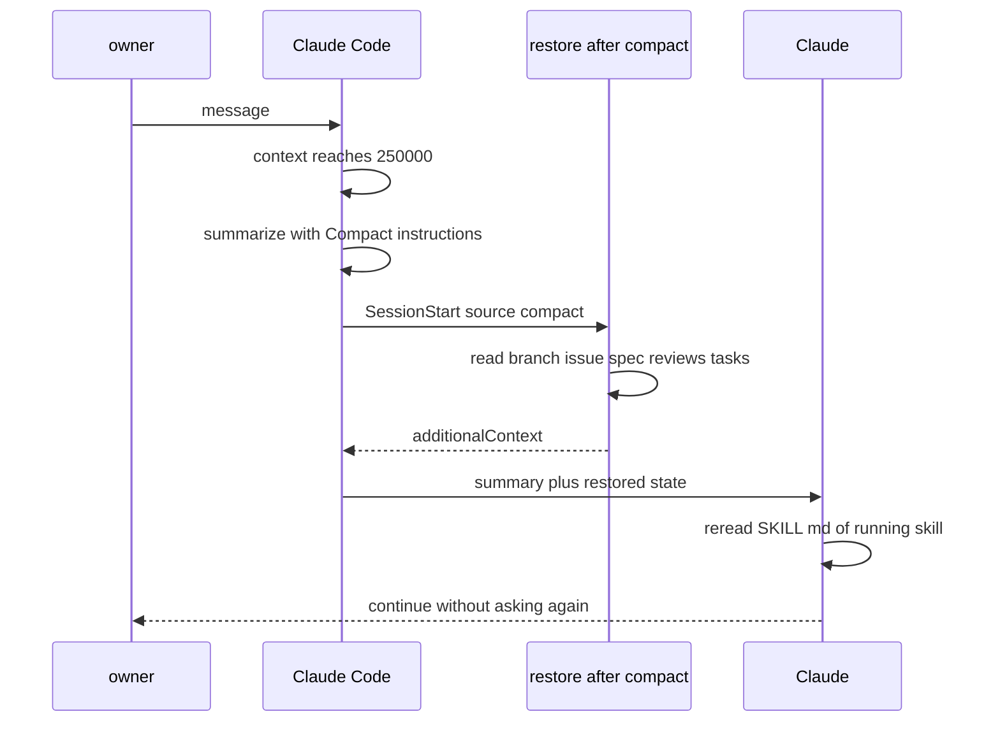

# 設計

## 概要

この設計は、Claude が1回の呼び出しで読み直す会話の量に上限を設ける。会話の量が上限に達したら、Claude Code は、自動の圧縮(会話を要約して縮めること)で会話を縮める。上限の値はリポジトリの `.claude/settings.json` に入るので、ターミナルの Claude Code でも Claude Desktop でも、参加者がリポジトリの最新を取り込むだけで上限が効く。

圧縮すると、Claude はそれまでの会話の一部を読み直せなくなる。そこで、この設計は3つの手当てを足す。1つ目に、CLAUDE.md の `# Compact instructions` の節で、要約に必ず残すことを Claude Code に指示する。2つ目に、圧縮の直後に動くフック `restore-after-compact.sh` が、Issue の番号・spec の段階・審査の往復・タスクの進み・ブランチをファイルから読み直し、会話に差し込む。3つ目に、この設計は、`/spec-review` の SKILL.md に、要約のあとに往復の位置をファイルから決め直す決まりを足す。

最後に、直し方が main に入ったあと、Claude は、ターミナルと Desktop の会話の記録を1回ずつ読み、上限が効いたことと、要約のあとに尋ね直しや手順のやり直しが無かったことを確かめる。この確かめのために、リポジトリに仕組みは足さない。試算では、全体の使う量は約2割減る見込みである(根拠は `## 性能`)。

## 作るものと作らないもの

### 作るもの

- `.claude/settings.json` の `env` に置く、1回の呼び出しの文脈の上限(`CLAUDE_CODE_AUTO_COMPACT_WINDOW`)
- `.claude/settings.json` の SessionStart に置く、matcher `compact` のフックの登録
- 圧縮の直後に、ファイルから作業の状態を読み直して会話に差し込むフック `restore-after-compact.sh` と、そのテスト
- CLAUDE.md の `# Compact instructions` の節(要約に残すことの指示)
- `/spec-review` の SKILL.md の、要約のあとに往復の位置を決め直す決まり
- 審査役の定義 `.claude/agents/spec-reviewer.md` の、審査役の会話が要約されたときの決まり
- 直し方が main に入ったあとに Claude が1回だけ行う、効き目の確かめの手順(この spec の tasks.md に書く)

### 作らないもの

- 段階ごとに新しい会話を開く仕組み(所有者の案)と、段階のコマンドを別の補助役の会話で動かす仕組み(`context: fork`)。比べた結果は research.md の「案の比べ方」にある
- モデル、考える深さ(effort)、審査と確認の回数、審査役に渡す材料の変更
- CLAUDE.md・auto memory・スキル本文を縮めること。Bash の出力の上限を変えること
- Claude の使う量を Issue ごとに集計し続け、蓄積する仕組み
- 会話にしか無い状態を、スキルごとにファイルへ書き出す決まり(`/spec-review` の往復の位置を除く)
- 参加者向けの手順書の変更。参加者が一度だけする設定は無い

## 使う既存の仕組み

- Claude Code の自動の圧縮と、環境変数 `CLAUDE_CODE_AUTO_COMPACT_WINDOW`(100000〜1000000 のトークン数。設定のキー `autoCompactWindow`・`/autocompact`・`--autocompact` より優先し、補助役の会話にも効く)
- Claude Code の SessionStart のフックの matcher `compact` と、`hookSpecificOutput.additionalContext`
- CLAUDE.md の `# Compact instructions` の節(圧縮の要約を作るときに Claude Code が読む)
- 並行作業の関数群 `.claude/scripts/parallel/lib.sh` の `kp_state_dir` と `kp_folder` と `kp_json_get`、Issue の記録 `issues/<N>.json`(`session.sh` が書く)
- spec の記録: spec.json、`reviews/{段階}-review.md`・`reviews/{段階}-response.md`・`reviews/{段階}-style.md`、tasks.md、`.claude/.state/spec-review/` の控え
- 依存の向き: `restore-after-compact.sh` は、`session-registry.sh` と `session.sh` の記録の形には触れない

## 設計を見直すきっかけ

- Claude Code が、環境変数 `CLAUDE_CODE_AUTO_COMPACT_WINDOW` の名前か意味か優先の順を変えたとき
- Claude Code が、圧縮のあとに戻すもの(スキルの本文の上限、最近のファイルの数)を変えたとき。基底(圧縮のあとも会話に残る、基本の指示・CLAUDE.md・要約・スキルの手順・最近のファイルの量で、約10万トークン)が変わり、上限の値の根拠が変わる
- SessionStart のフックの matcher `compact` か、`additionalContext` の扱いが変わったとき。SessionStart のフックが補助役の会話でも動くと公式文書に書かれたとき
- `reviews/{段階}-review.md` の見出し `## サイクル<N> 往復<M>`、`reviews/{段階}-response.md` の見出し `## サイクル<N> 往復<M> への対応`、Issue の記録 `issues/<N>.json` の欄の形が変わったとき
- Desktop の worktree の会話が、worktree の中の設定とフックを読むようになったとき(#539)。確かめの頼みの添え書きを変える

## プロジェクトの決まりを守っているか

- 品質チェックの設定: この spec は `.claude/settings.json`、`.claude/hooks/`、`.claude/skills/spec-review/SKILL.md` を変える。どれも `.claude/` の下で、CODEOWNERS により所有者の承認が要る PR になる。`.claude/settings.json` と `.claude/hooks/` は permissions の deny で Claude が書けない。この spec は、品質チェックの中身(検査の対象、しきい値、除外)を変えない
- 使う外部の機能がこのリポジトリで使えるか: 使う機能は、Claude Code の設定・フック・自動の圧縮で、契約のプランやリポジトリの属性によらず手元の Claude Code が動かす。`CLAUDE_CODE_AUTO_COMPACT_WINDOW` の最小の版は公式文書に書かれていないので、Claude は、効き目の確かめ(直し方が main に入ったあとに Claude が1回行う手順)で、上限が実際に効いたことを確かめる
- 関係のない項目: backend のコードを置く層、frontend の機能ごとの境界、frontend の状態の持ち方、データベースの表の形、新しいライブラリの追加

## 全体の構成

この設計は、Claude Code が持っている自動の圧縮をそのまま使い、新しく作るのはフック1つだけにする。会話を区切る仕組みを自分で作らないのは、圧縮なら同じ会話が続くので、並行作業の記録(`session-registry.sh`)が別の会話を作業中と見ることが無く、所有者への問いが増えないためである。

この設計は、`/spec-review` の往復の位置だけは、取り違えると審査のやり直しや飛ばしに直結するので、スキル本文に決め直しの手順を置く。ほかのスキル(`/kiro-impl` は毎回 tasks.md を読み直し、`/ship` はブランチから PR の番号を取る)は、今のままでファイルから読み直せる。

**使う技術**:
- 実行環境: Claude Code(ターミナルの Claude Code と Claude Desktop)。自動の圧縮、設定の `env`、SessionStart のフックを使う
- フック: bash と perl(JSON::PP)と git。既存のフックと同じで、jq には依存しない。Windows では Git for Windows がこれらを提供する

## ファイルの構成

Claude が新しく作るファイル:

- `.claude/hooks/restore-after-compact.sh`: 圧縮の直後に、ファイルから作業の状態を読み直し、`additionalContext` で会話に差し込むフック。permissions の deny で Claude が書けないため、Claude は scratchpad に作り、所有者が写す
- `.claude/hooks/tests/test-restore-after-compact.sh`: フックと `.claude/settings.json` の登録のテスト。一時的な git のリポジトリに spec・審査の記録・Issue の記録を作り、フックの出力と終了コードを確かめる。置き場所が `.claude/hooks/` の下なので、フックと同じく所有者が写す

Claude が変えるファイル:

- `.claude/settings.json`: `env` に `CLAUDE_CODE_AUTO_COMPACT_WINDOW` を足し、SessionStart に matcher `compact` の項目を足す。所有者が写す
- `CLAUDE.md`: 末尾に `# Compact instructions` の節を足す
- `.claude/skills/spec-review/SKILL.md`: `## 手順` の Step 1 の前に、「会話が要約されたあとに続けるとき」の節を足す
- `.claude/agents/spec-reviewer.md`: 審査役の会話が要約されたときの決まりを足す
- `.kiro/specs/claude-usage-reduction/tasks.md`: 効き目の確かめの手順を、最後のタスクとして書く(tasks の段階で作る)

## 処理の流れ

圧縮は、所有者の返事を待つあいだではなく、Claude が作業している途中でも起きる。

## 部品

### `.claude/settings.json` の上限とフックの登録(全員に同じく効く設定)

対応する要件: 1.1, 2.1, 2.2, 2.3, 4.1, 4.2, 4.4, 5.1, 5.2, 5.3

**役割**: Claude は、`.claude/settings.json` の `env` に `"CLAUDE_CODE_AUTO_COMPACT_WINDOW": "250000"` を足す。値は文字列で書く。Claude Code は、この値をもとに、親の会話(所有者と話す会話)と補助役の会話の両方で、文脈(1回の呼び出しで読み直す会話の量)が25万トークンに達したら自動で圧縮する。

この設計は、要件2の上限を、「25万トークンに、圧縮を起こした1回の呼び出しでその呼び出しが足した分を加えた量」とする。公式文書は、窓の値(`CLAUDE_CODE_AUTO_COMPACT_WINDOW` に書く、圧縮を始める文脈の大きさ)に対してどこで圧縮が起きるかを書いていない。過去の実測では、既定(約967K)の会話で、圧縮の直前の文脈は 973,048 トークンだった。圧縮を起こした呼び出しは、その呼び出しで足した分だけ窓を超えうるためである。それ以外の呼び出しは25万を超えない。所有者が長く離れたあとの最初の返事でキャッシュを書き直す量も、同じ上限を超えない。Claude は、`.claude/settings.json` にモデル(`model`)と考える深さ(`effortLevel`)のキーを足さず、`.claude/agents/*.md` の `model` も変えない。

あわせて、Claude は、`hooks.SessionStart` に、`"matcher": "compact"` の項目を1つ足す。Claude Code は、この項目で、`bash "${CLAUDE_PROJECT_DIR}/.claude/hooks/restore-after-compact.sh"` を `timeout` 10秒で呼ぶ。Claude は、今ある matcher の無い項目(`session-registry.sh`)を変えない。

**権限**: Claude は permissions の deny でこのファイルを書けない。Claude は、変更後の全文を scratchpad に作り、写すコマンドを所有者に示す。

**いつ動くか**: Claude Code は、会話を始めるときに `env` を読む。`env` の上限の値は、動いている会話には効かず、マージのあとに始めた会話から効く。

### restore-after-compact.sh(圧縮の直後に作業の状態を差し込むフック)

対応する要件: 3.1, 3.2, 3.3, 5.3, 5.4

**役割**: このフックは、圧縮の直後に、作業の状態をファイルから読み直して、会話に差し込む。フックはファイルを読むだけで書かず、ネットワークに出ない。並行作業の記録(`sessions/` と `issues/`)を書き換えず、所有者への問いを出さない。

フックが読み直すものは、次のとおりである。

- 作業フォルダ: 入力の `cwd` から `git -C <cwd> rev-parse --show-toplevel` で決める(`session-registry.sh` と同じ決め方)
- ブランチ: `git branch --show-current`
- Issue の番号: `lib.sh` の `kp_state_dir` の下の `issues/*.json` のうち、`folder` がいまの作業フォルダと同じ記録の `issue`。比べ方は `lib.sh` の比べ方(`kp_folder_id`)に合わせる
- spec: `.kiro/specs/*/spec.json` のうち、`issue` か `additional_issues` に Issue の番号を含むもの。Issue の番号が分からないときは、`git merge-base origin/main HEAD` からの変更と、コミットしていない変更のうち、`.kiro/specs/<feature>/` の下に触れた spec
- spec ごとに: `phase`、`approvals` の各段階の `generated` と `approved`、`review_model`
- 段階ごとに: `reviews/{段階}-review.md` の最後の `## サイクル<N> 往復<M>` の見出しと最終行、`reviews/{段階}-response.md` に同じ `## サイクル<N> 往復<M> への対応` の見出しがあるかどうか
- tasks.md があれば、`- [x]` と `- [ ]` の数

フックは、読み直した状態のあとに、Claude への次の決まりを足す。

1. 要約に実行中のスキルが書かれていれば、Claude は、そのスキルの `.claude/skills/<名前>/SKILL.md` を Read で全文読み直してから続ける。圧縮のあとは、スキルの本文が先頭の5,000トークンまでしか戻らないためである
2. Claude は、ここに書かれたことと要約に書かれたことを、所有者に尋ね直さない
3. 要約とここに書かれたことが食い違うときは、Claude はここに書かれたこと(ファイルの状態)を正とする
4. `/spec-review` の往復の途中なら、Claude は、`/spec-review` の「会話が要約されたあとに続けるとき」の節に従う

フックが、要約とファイルの状態が食い違うときはファイルの状態を正とする決まりを置くのは、ファイルが、要約よりあとまで書き換えられた最新の記録だからである。

**いつ動くか**: Claude Code の SessionStart で、入力の `source` が `compact` のとき(自動の圧縮と `/compact` のどちらのあとも)。フックは、念のため入力の `source` も見て、`compact` でなければ何も出さずに終わる。入力に `agent_id` があるとき(補助役の会話で動いたとき)も、フックは何も出さずに終わる。差し込む決まりは親の会話のスキルの進め方を前提にしているので、補助役に読ませないためである。

**呼び出し方**:
- 入力: Claude Code のフックの入力の JSON を標準入力で受ける。使う欄は `cwd` と `source` と `agent_id` である。`agent_id` は、公式文書の hooks のページの共通の入力の欄で、フックが補助役の会話の中で動いたときにだけ入る。同じ共通の欄の `agent_type` は、会話の全体を `--agent` で動かしたときにも入るので、補助役の会話の見分けには使わない
- 出力: 標準出力に、`{"hookSpecificOutput":{"hookEventName":"SessionStart","additionalContext":"<文>"}}` の JSON を1つ出す。`<文>` は、1行目を「[compact] 会話が要約された。ファイルから読み直した作業の状態は次のとおり。」とし、読み直した状態を1項目1行で並べ、最後に上の4つの決まりを置く
- 終了コード: いつも0。フックは圧縮を止めない

**失敗したとき**: 作業フォルダが git のリポジトリの外のときは、フックは何も出さずに終了コード0で終わる。spec.json を読めないとき、Issue の記録が無いとき、`origin/main` が無いときは、フックはその項目を飛ばし、飛ばしたことを `additionalContext` に1行書く。フックは、10秒の `timeout` を超えない量の読み込みに留める(読むのは、いまの作業フォルダの spec の下のファイルだけである)。

### CLAUDE.md の `# Compact instructions` の節(要約に残すことの指示)

対応する要件: 3.1, 3.2, 3.3, 4.3

**役割**: この節は、Claude Code が圧縮の要約を作るときに、要約に必ず残すことを並べる。この節は、会話にしか無く、ファイルから読み直せない状態を受け持つ。並べるものは、次のとおりである。

- 実行中のスキルの名前と、その手順のどこにいるか(Step の番号)
- 進めている Issue の番号、spec の名前と段階、作業のブランチ、作った PR の番号
- `/spec-review` の往復の途中なら、CYCLE(審査のサイクルの番号)と ROUND(往復の番号)と CHANGED(本文を直したあとの審査かどうか)、その往復で受け入れた指摘と却下した指摘の ID、まだ記録に書いていない「直さなかった外れ」、Fable 5.1 から Opus 5.5 に替えたかどうか
- `/kiro-impl` の途中なら、検査のコマンド一式、確認役が差し戻した(REJECTED)往復の数、debug の補助役を動かした回数
- `/ship` の途中なら、同じ失敗が続いた回数
- 所有者に尋ねて答えを待っている問いの全文と、所有者が答えた内容のうち、まだ Issue の本文か spec.json に書いていないもの
- 所有者が会話で伝えたことのうち、まだ作業に使っていないもの(たとえば、審査役のモデルの選び)
- 補助役の会話なら、依頼文に書かれた識別の欄の全部(FEATURE・STAGE・CYCLE・ROUND・REVIEW_FILE、タスクの番号など)と、その時点までに出した判定

この節は、要約のそれ以外の部分を短くするよう指示する。この節は、審査役・点検役・確認役に渡す材料(spec の本文、差分の全文)を要約で置き換えることを求めない。材料は、渡すときにファイルから読み直すためである。

**いつ動くか**: Claude Code が圧縮の要約を作るとき。CLAUDE.md は、圧縮のあとにディスクから読み直されるので、この節は圧縮のたびに効く。

### `/spec-review` の「会話が要約されたあとに続けるとき」の節(往復の位置を決め直す決まり)

対応する要件: 3.1, 3.2

**役割**: この節は、`/spec-review` の途中で会話が要約されたときに、Claude が往復の位置をファイルから決め直す手順を定める。

1. Claude は、`reviews/{STAGE}-review.md` の最後の `## サイクル<N> 往復<M>` の見出しから、CYCLE を N に、ROUND を M にする
2. `reviews/{STAGE}-response.md` に `## サイクル<CYCLE> 往復<ROUND> への対応` の見出しが無ければ、Claude は、その往復の Step 4(指摘への対応)から続ける
3. 見出しがあり、review.md の最終行が収束か未解決の終わり(`- 往復: <n>回で収束` か `- 往復: 3回 / 未解決: <n>件`)なら、Claude は Step 7(所有者への報告)から続ける
4. それ以外なら、Claude は ROUND を1増やし、Step 1.5(書き方の点検)から続ける
5. 却下した指摘の一覧は、Claude が response.md の、そのサイクルの処置が「却下」の行から作り直す
6. Claude は、審査の範囲(SCOPE)を、Step 2 の手順2のとおり、控え(`.reviewed.md`)があれば差分にし、無ければ全体にする。CHANGED の有無が要約から分からないまま往復1の審査役を起動するときは、Claude は SCOPE を全体にする。全体を審査すれば、見落としは増えないためである
7. その往復の点検の記録(`reviews/{STAGE}-style.md` の節)を書いたかどうかが分からないときは、Claude は Step 1.5 をやり直す

**いつ動くか**: `/spec-review` の途中で会話が要約されたあと、Claude が続きを始めるとき。フックが差し込む決まりのうち、`/spec-review` の往復の途中なら Claude はこの節に従うという決まりが、この節を指す。

### spec-reviewer.md の「会話が要約されたとき」の決まり(補助役の会話の圧縮の手当て)

対応する要件: 2.3, 3.2, 4.3

**役割**: この決まりは、審査役(spec-reviewer)の会話が25万に達して要約されたときに、審査役が判定の材料を短くしたまま審査しないようにする。審査役は、要約のあとに、依頼文の「## 前回からの差分」の差分の全文が会話に残っていなければ、審査の範囲を本文の全体にして審査し直し、記録にそのことを書く。全体を審査すれば、差分より広い範囲を見るので、材料を短くしたことにならない。審査役は、spec の本文と記録を、要約に頼らずファイルから読み直す。

**いつ動くか**: 審査役の会話が自動で圧縮されたあと。過去2週間では、補助役の会話579回のうち、文脈が25万を超えたのは6回(審査役160回のうち5回、general-purpose 209回のうち1回)だった。SessionStart のフックが補助役の会話でも動くかは公式文書に書かれていないので、この設計は、補助役の会話の手当てをフックに頼らず、この決まりと CLAUDE.md の要約の指示に任せる。ほかの補助役(実装役・確認役・点検役)は、タスクの説明と spec をファイルから読み直す今の進め方のままで続けられる。

### 効き目の確かめ(直し方が main に入ったあとに Claude が1回行う手順)

対応する要件: 1.2, 6.1, 6.2, 6.3, 6.4, 6.5, 6.6

**役割**: Claude は、この手順を、この spec の tasks.md の最後のタスクに書く。Claude は、リポジトリにスクリプトを足さない。Claude は、確かめるときに、会話の記録を読む使い捨てのスクリプトを scratchpad に作る。

- 頼み: Claude は、この spec の PR を出荷したことの報告に、次の頼みを1回だけ書く。「PR がマージされたあとに、本体の作業フォルダを最新の main にしてから、ターミナルの Claude Code と Claude Desktop のそれぞれで、1つの会話で着手から出荷まで進める Issue を1つずつ進めてください。進め終えたら、そのことを1回伝えてください。」
- 確かめる会話の選び方: Claude は、`~/.claude/projects/` の下の、このリポジトリの作業フォルダの会話の記録(`<セッションのID>.jsonl`)のうち、最初の記録の時刻が PR のマージの時刻よりあとで、`"type":"system","subtype":"compact_boundary"` の行を1つ以上持つものを選ぶ。ターミナルの会話か Desktop の会話かは、記録の `entrypoint` の欄で見分ける(Desktop は `claude-desktop`)。環境ごとに、条件に合う会話を1つ選ぶ
- 上限の確かめ: Claude は、選んだ会話の Claude の返事の記録ごとに、`message.usage` の `input_tokens`・`cache_read_input_tokens`・`cache_creation_input_tokens` の和を1回の呼び出しで読み直した量とし、同じ `message.id` と `requestId` の記録を1つに数える。Claude は、`compact_boundary` の行の直前の呼び出しを除いた、1回の呼び出しで読み直した量の最大が 250000 以下なら、上限が効いたとする。Claude は、除いた呼び出しが読み直した量と、`compact_boundary` の行ごとの `compactMetadata.preTokens` と `postTokens` を、判定に使わずに数として示す
- 尋ね直しとやり直しの確かめ: Claude は、`compact_boundary` の行ごとに、そのあとの Claude の返事と所有者の発言を読む。Claude が、要件3の1に並ぶこと(Issue の番号、spec の名前と段階、審査の往復と受け入れた指摘と退けた指摘、タスクの進み、ブランチと PR の番号、答えを待っている問い)を所有者に尋ねていないこと、所有者がそれらを説明し直していないこと、終わった手順をやり直さず、まだの手順を飛ばしていないことを確かめる
- 報告: Claude は、環境ごとに、確かめた会話のセッションのID、読み直した量の最大、圧縮の回数、尋ね直し・やり直し・飛ばしがあったかどうかを所有者に示す。上限を超えた呼び出しか、尋ね直し・やり直し・飛ばしがあったときは、記録の時刻と行を示す
- 会話が無かったとき: 条件に合う会話が無い環境については、Claude は、その環境の確かめを終えられなかったことと、理由(圧縮が起きなかった、マージより前に始めた会話しか無い、など)を示し、その環境の確かめを終わりにする

**いつ動くか**: 頼みは、この spec の PR の出荷の報告のとき。確かめは、所有者が「進め終えた」と伝えたとき。

## 失敗したときの扱い

- フックが動かないか失敗したとき: 圧縮はそのまま進み、Claude は要約だけで続ける。CLAUDE.md の要約の指示は、フックが動かなくても効く
- 上限が効かない環境(Claude Code の版が古いなど): 今の動き(約967Kで圧縮)のままで、使う量は減らない。効き目の確かめ(直し方が main に入ったあとに Claude が1回行う手順)でこの環境が見つかり、Claude はその環境を所有者に示す

## テストの方針

- 単体テスト(`test-restore-after-compact.sh`):
  - `source` が `compact` で、Issue の記録と spec があるとき、出力の `additionalContext` に、ブランチ、Issue の番号、spec の名前と段階、審査の最後の往復と対応の有無、タスクの完了の数、4つの決まりが入る
  - `source` が `startup` のとき、フックは何も出さず終了コード0で終わる
  - 作業フォルダが git のリポジトリの外のとき、フックは何も出さず終了コード0で終わる
  - spec.json が壊れているとき、フックは、その spec を飛ばしたことを1行書き、終了コード0で終わる
  - Issue の記録が無いとき、フックは、ブランチで変えた spec を出す
  - フックが、並行作業の記録(`sessions/` と `issues/`)を書き換えない
  - 入力に `agent_id` があるとき、`source` が `compact` でも、フックは何も出さず終了コード0で終わる
- 設定のテスト(同じファイル): `.claude/settings.json` の `env` の `CLAUDE_CODE_AUTO_COMPACT_WINDOW` が `"250000"` である。SessionStart に matcher `compact` で `restore-after-compact.sh` を呼ぶ項目があり、matcher の無い `session-registry.sh` の項目が残っている。`model` と `effortLevel` のキーが無い
- 静的な検査: CI の shellcheck(guardrails.yaml)が、新しいフックとテストを検査する
- 実地の確かめ: 要件6の確かめ(効き目の確かめの部品の節)で、ターミナルと Desktop の実際の会話で上限と続け方を確かめる。フックのテストは CI では流れないので、Claude は手元で流す

## 性能

- 目標: 親の会話の1回の呼び出しの文脈を、平均約31万トークンから、約17.5万トークン(基底約10万と上限25万の間)にする。全体の使う量は、API の料金の比率の重みで約2割減る見込みである。週次制限の数え方は公開されていないので、実際の減り方は所有者が Claude の画面で見る
- 上限の値の決め方: 過去2週間の会話の記録に上限を当てはめた試算では、全体の減り方は、上限15万で16.8%、20万で21.5%、25万で21.3%、30万で19.7%だった。上限を小さくしすぎると、基底(約10万)に近づき、圧縮の回数と圧縮の費用が増えて減り方が戻る。20万と25万は減り方がほぼ同じで、25万は圧縮の回数が約6割(84回に対して48回)になるので、圧縮のあとに Claude が作業の進み具合を取り違える危険が小さい25万にする
- フックの重さ: フックは圧縮のたびに1回だけ動く

## 移行

- 所有者は、Claude が scratchpad に作った `.claude/settings.json` と `.claude/hooks/` の2つのファイルを、示されたコマンドで1回だけ写す
- Claude Desktop の worktree の会話は、本体の作業フォルダの設定とフックを読む(#539)。そのため、所有者は、マージのあとに本体の作業フォルダを最新の main にしてから会話を始める。これは今の進め方と同じである
- 元に戻すときは、PR を取り消せば、上限もフックも要約の指示も無くなり、今の動きに戻る
