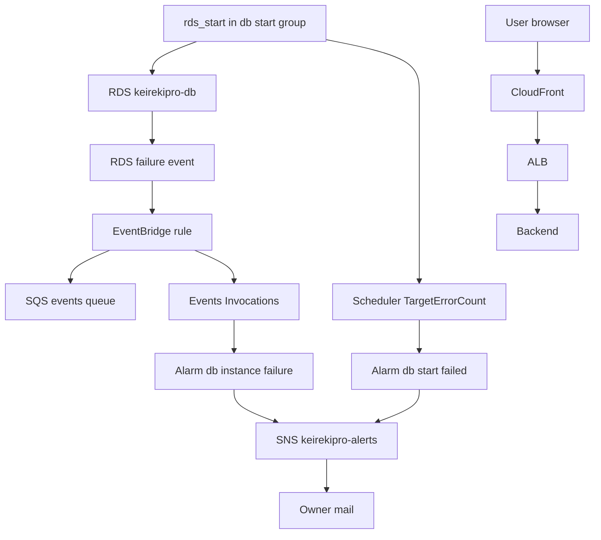

# 設計

## 概要

今の本番環境は、EventBridge Scheduler の `rds_start` が平日 7:50 に RDS の起動の API を呼ぶだけで、起動が失敗しても所有者に知らせが届かない。Claude は、コードを書かずに AWS の既存の機能を設定し、その機能が失敗を拾って既存の SNS のトピック `keirekipro-alerts` に知らせるようにする。起動の指令が断られる失敗(同期の失敗)は、Scheduler のメトリクスの CloudWatch のアラームが拾う。DBが異常の状態に入ったときに AWS が出す RDS のイベント(カテゴリ `failure`)は、EventBridge のルールが拾って、イベントを置いておくキューに送る。ルールがキューに送った数を見る CloudWatch のアラームが、そのトピックに知らせる。Claude は、Lambda のようなコードを書く仕組みを作らない。増える費用は0円である。

利用者の画面は、今は 503 のときだけメンテ画面に切り替わる。Claude は、frontend の通信の共通の処理 `axiosInterceptors` で、メンテ画面に切り替える応答のステータスを増やす。メンテ画面は、営業時間かどうかを決める関数 `isBusinessHours` の結果で案内を出し分ける。

## 作るものと作らないもの

### 作るもの

- DBの起動のスケジュールだけを入れるスケジュールグループ `keirekipro-db-start` と、そこへの `rds_start` の移し替え
- 同期の失敗を拾う CloudWatch のアラーム `keirekipro-db-start-failed`
- DBの異常のイベントに当たる EventBridge のルール `keirekipro-db-instance-failure`
- そのルールがイベントを置いておく SQS のキュー `keirekipro-db-instance-failure-events` と、そのキューのポリシー
- そのルールが送った数を見る CloudWatch のアラーム `keirekipro-db-instance-failure`
- frontend の通信の共通の処理で、502・504 をメンテ画面への切り替えに加えること
- メンテ画面の案内の出し分けと、営業時間かどうかを決める関数

### 作らないもの

- 起動に失敗したDBを起動し直す仕組み
- 既存の7本のアラームの変更
- 通知のメールの日本語の文面(AWS が送る英語の形のままにする)
- DB以外の定時の処理(ECS の起動と停止、DBの停止)の失敗の通知
- SNS のトピックとそのポリシーの変更

## 使う既存の仕組み

- SNS のトピック `keirekipro-alerts` と、そのメールの購読(`terraform/modules/cloudwatch/main.tf`)。2本のアラームは、このトピックへ知らせを送る
- `rds_start` のスケジュールと、その実行ロール(`terraform/modules/scheduler/main.tf`)
- RDS のインスタンス `keirekipro-db`(`module.rds.instance_identifier`)
- frontend の `paths.maintenance`(`/maintenance`)と `paths.serverError`(`/500`)

依存の向き: scheduler モジュールは、スケジュールグループの名前を出力する。cloudwatch モジュールは、その名前と RDS のインスタンスの識別子を受け取り、アラームとルールを作る。frontend の変更は、terraform の変更に依存しない。

## 設計を見直すきっかけ

- `keirekipro-db-start` のグループに `rds_start` 以外のスケジュールが入るとき。アラーム `keirekipro-db-start-failed` が、DBの起動以外の失敗でも鳴るようになる
- SNS のトピックが KMS で暗号化されるとき。CloudWatch がその鍵を使える鍵のポリシーが要る
- AWS が、起動のときの容量不足に当たる RDS のイベントIDを文書に足したとき。EventBridge のルールは、RDS のイベントをカテゴリではなくイベントIDで絞れるようになる
- バックエンドが、DBにつながらなくても起動できるように変わったとき。Claude は、メンテ画面に切り替わる条件(502・503・504)を見直す
- 営業時間の定義が変わったとき。Claude は、`isBusinessHours` を新しい営業時間の定義に合わせ直す

## プロジェクトの決まりを守っているか

- frontend の機能ごとの境界: 営業時間の関数は機能に依存しないので `src/utils/` に置く。メンテ画面は `src/pages/` のまま、通信の共通の処理は `src/lib/` のまま変える。どの feature も import しない
- 品質チェックの設定: 変えない。新しいリソースは checkov の既定のチェックを通る形で書く。`rds_start` は作り直しになるが、リソースのアドレス `module.scheduler.aws_scheduler_schedule.rds_start` は変わらないので、`terraform/.checkov.baseline` の凍結(CKV_AWS_297)はそのまま当たる。凍結とは、baseline のファイルに載せた既存の指摘を、checkov が失敗として扱わないことを指す
- 使う外部の機能がこのリポジトリで使えるか: 使う機能は、EventBridge Scheduler のスケジュールグループ、CloudWatch のアラーム、EventBridge のルール、SQS のキューで、どれも東京のリージョンで個人のアカウントに提供されている。CloudWatch のアラームは9本になり、無料の範囲(10本)に収まる
- 関係のない項目: backend のコードを置く層、frontend の状態の持ち方、データベースの表の形、新しいライブラリの追加

## 全体の構成

**使う技術**:
- 定期実行: EventBridge Scheduler(既存)。スケジュールグループで、DBの起動の失敗だけを数える
- 監視: CloudWatch のアラーム(標準の解像度)
- イベント: EventBridge の default のイベントバス(AWS のサービスのイベントは無料)と、イベントを置いておく SQS の標準のキュー(無料の範囲)
- 知らせ: 既存の SNS のトピック
- IaC: terraform、aws provider `~> 5.0`(既存)
- 画面: React 19、axios 1.20、vitest 4.1(既存)。新しいライブラリは足さない

## ファイルの構成

Claude が新しく作るファイル:

- `terraform/modules/scheduler/outputs.tf`: スケジュールグループの名前を出力する
- `frontend/src/utils/businessHours.ts`: 営業時間かどうかを決める関数
- `frontend/src/utils/__tests__/businessHours.test.ts`: 営業時間の関数のテスト
- `frontend/src/pages/__tests__/Maintenance.test.tsx`: メンテ画面の案内の出し分けのテスト

Claude が変えるファイル:

- `terraform/modules/scheduler/main.tf`: `aws_scheduler_schedule_group.db_start` を足し、`rds_start` に `group_name` を足す
- `terraform/modules/cloudwatch/main.tf`: アラーム `db_start_failed` と `db_instance_failure`、EventBridge のルールと送り先、SQS のキューとそのポリシーを足す
- `terraform/modules/cloudwatch/variables.tf`: `db_start_schedule_group_name` を足す
- `terraform/main.tf`: `module "cloudwatch"` に `db_start_schedule_group_name = module.scheduler.db_start_schedule_group_name` を渡す
- `frontend/src/lib/axiosInterceptors.ts`: 502 と 504 を、503 と同じくメンテ画面への切り替えにする
- `frontend/src/lib/__tests__/axiosInterceptors.test.ts`: 502 と 504 の場合を足す
- `frontend/src/pages/Maintenance.tsx`: 営業時間かどうかで案内を出し分ける
- `frontend/src/utils/index.ts`: 営業時間の関数を再公開する。再公開とは、`businessHours.ts` で定義した関数を `index.ts` からも export し直すことを指す
- `doc/インフラ設計/AWS設計/CloudWatch設計.md`: アラームの一覧に2本を足し、EventBridge のルールと SQS のキューを書き足す
- `doc/インフラ設計/Terraform設計/バックエンド・モジュール設計.md`: cloudwatch モジュールの入力に `db_start_schedule_group_name` を書き足し、アラームの名前の一覧とリソースの表に2本のアラームと EventBridge のルールと SQS のキューを足し、依存するモジュールに scheduler を足す
- `doc/インフラ設計/手順書/手動作業手順.md`: `keirekipro-github-actions-policy` の `TerraformFullAccess` の Action に `events:*` と `sqs:*` を足す

## 部品

### scheduler モジュールの変更(DBの起動のスケジュールを専用のグループに移す)

対応する要件: 1.1, 1.7, 4.4

**役割**: このモジュールは、スケジュールグループ `keirekipro-db-start` を作り、`rds_start` の `group_name` をそのグループにする。`rds_start` の `schedule_expression`(`cron(50 22 ? * SUN-THU *)`)、`schedule_expression_timezone`、`target` の `arn` と `input`、`retry_policy { maximum_retry_attempts = 2 }` は変えない。ほかの3本のスケジュールは default のグループに残す。

**呼び出し方**: このモジュールは、出力 `db_start_schedule_group_name` に、グループの名前を出す。

**失敗したとき**: `group_name` の変更で、terraform は `rds_start` を消してから作り直す。

### アラーム db_start_failed(起動の指令が断られた失敗を拾う)

対応する要件: 1.1, 1.2, 1.3, 1.4, 1.5, 1.6, 1.8, 4.2, 4.3

**役割**: このアラームは、`keirekipro-db-start` のグループのスケジュールが API のエラーを受けたら、SNS のトピックに知らせる。

- `namespace = "AWS/Scheduler"`、`metric_name = "TargetErrorCount"`、`dimensions = { ScheduleGroup = <グループの名前> }`、`statistic = "Sum"`
- `period = 60`、`evaluation_periods = 60`、`datapoints_to_alarm = 1`、`threshold = 1`、`comparison_operator = "GreaterThanOrEqualToThreshold"`、`treat_missing_data = "notBreaching"`
- `alarm_name = "keirekipro-db-start-failed"`、`alarm_description = "The scheduled start of the DB instance (weekdays 7:50 JST) failed."`
- `alarm_actions = [aws_sns_topic.alerts.arn]`。このアラームは、既存のアラームと同じく `ok_actions` を持たない

**根拠**:
- `TargetErrorCount` は、Scheduler が呼んだターゲットの API が例外を返したときに出る。次元(メトリクスを分けて数えるための名前と値の組)は `ScheduleGroup` だけである(https://docs.aws.amazon.com/scheduler/latest/UserGuide/monitoring-cloudwatch.html)
- StartDBInstance は、容量不足のときに `InsufficientDBInstanceCapacity` を返す(https://docs.aws.amazon.com/AmazonRDS/latest/APIReference/API_StartDBInstance.html)
- 期間が1分以上のアラームは毎分評価され、評価の範囲は期間と評価の期間の数で決まる。評価の期間の数と鳴らすのに要る点の数を別の値にすると、範囲の中の何点が閾値を超えれば鳴るかを決められる(https://docs.aws.amazon.com/AmazonCloudWatch/latest/monitoring/alarm-evaluation.html)。このアラームは、直前60分のうち1分でも失敗があれば ALARM になる。そのため、最初の失敗から数分で ALARM になり、最後の失敗から60分たつまで ALARM のまま残る
- Claude は、再試行の失敗が最初の失敗から60分の中に収まる前提で、このアラームが ALARM に変わる回数を1回、メールを1通とする。Scheduler の再試行の間隔は、文書では「指数的に延ばす」とだけ書かれ、値は書かれていない(https://docs.aws.amazon.com/scheduler/latest/APIReference/API_RetryPolicy.html)。2回の再試行が60分を超えて散らばると、メールは2通になる

**失敗したとき**:
- メトリクスの配信はベストエフォートと AWS の文書に書かれている。ベストエフォートとは、AWS がメトリクスを届けるよう努めるが、必ず届けるとは約束しないことを指す。メトリクスが欠けると、アラームは鳴らない。Claude は、メトリクスが欠けてアラームが鳴らないことを防ぐ仕組みを作らない
- 7:50 の時点でDBがすでに動いていると、起動の指令は `InvalidDBInstanceState` で断られ、このアラームが鳴る。このアラームがこの理由で鳴るのは、所有者が前の晩か朝にDBを手で起動した日に限られる。Claude は、7:50 の時点でDBがすでに動いている日にこのアラームが鳴ることを防ぐ仕組みを作らない

### EventBridge のルール db_instance_failure(DBの異常のイベントに当たる)

対応する要件: 1.1, 1.2, 1.6, 4.3

**役割**: このルールは、対象のDBの、カテゴリ `failure` の RDS のイベントに、時刻を問わず当たり、イベントを SQS のキュー `keirekipro-db-instance-failure-events` に送る。ルールがキューに送った数は、EventBridge が CloudWatch のメトリクス `Invocations` に残し、アラーム `db_instance_failure` がそれを見る。キューは、所有者があとでイベントの中身を見るための置き場で、どの仕組みもキューを読まない。

- 名前: `keirekipro-db-instance-failure`
- イベントパターン: `{"source":["aws.rds"],"detail-type":["RDS DB Instance Event"],"detail":{"SourceIdentifier":["keirekipro-db"],"EventCategories":["failure"]}}`
- 送り先: SQS のキュー `keirekipro-db-instance-failure-events`(`sqs_managed_sse_enabled = true`、`message_retention_seconds = 1209600`(14日))
- キューのポリシー: Principal `events.amazonaws.com`、Action `sqs:SendMessage`、Resource キューの ARN、条件 `ArnEquals` の `aws:SourceArn` = ルールの ARN。ARN とは、AWS がリソースごとに付ける、リソースを一意に指す名前を指す
- 毎晩の定時の停止で出る RDS-EVENT-0087(DB instance stopped)は、カテゴリが `notification` なので、このルールに当たらない

**根拠**:
- RDS のイベントは `source: aws.rds`、`detail-type: RDS DB Instance Event` で EventBridge に届き、detail に `EventCategories` `SourceIdentifier` を持つ(https://docs.aws.amazon.com/AmazonRDS/latest/UserGuide/rds-cloud-watch-events.html)。届くまでに最大5分かかることがある(https://docs.aws.amazon.com/AmazonRDS/latest/UserGuide/USER_Events.overview.html)
- DBが異常の状態に入ると、カテゴリ `failure` の RDS-EVENT-0031・0035・0036 などが出る。停止していたインスタンスは、起動のときに `incompatible-network` の状態になりうる(https://docs.aws.amazon.com/AmazonRDS/latest/UserGuide/USER_Events.Messages.html 、https://docs.aws.amazon.com/AmazonRDS/latest/UserGuide/CHAP_Troubleshooting.html)。起動のときの容量不足に当たるイベントIDは文書の表に無いので、このルールは RDS のイベントをイベントIDでは絞らない。容量不足で `failure` のイベントが出るかどうかは、文書から決まらない
- キューのポリシーの形は、EventBridge の文書の SQS の例のとおりである(https://docs.aws.amazon.com/eventbridge/latest/userguide/eb-use-resource-based.html)
- `Invocations` は、ルールがイベントに応えて送り先を呼んだ回数で、成功と失敗の両方を含み、次元に `RuleName` を持つ。0でないときだけ出る(https://docs.aws.amazon.com/eventbridge/latest/userguide/eb-monitoring.html)。キューへの送信が失敗しても、数は増える

### アラーム db_instance_failure(DBの異常のイベントを知らせる)

対応する要件: 1.1, 1.3, 1.4, 1.5, 4.2, 4.3

**役割**: このアラームは、ルール `keirekipro-db-instance-failure` が1回でも送り先を呼んだら、SNS のトピックに知らせる。

- `namespace = "AWS/Events"`、`metric_name = "Invocations"`、`dimensions = { RuleName = "keirekipro-db-instance-failure" }`、`statistic = "Sum"`
- `period = 60`、`evaluation_periods = 60`、`datapoints_to_alarm = 1`、`threshold = 1`、`comparison_operator = "GreaterThanOrEqualToThreshold"`、`treat_missing_data = "notBreaching"`
- `alarm_name = "keirekipro-db-instance-failure"`、`alarm_description = "The DB instance went into an abnormal state (RDS failure event). If this is in the morning, the scheduled start of the DB failed. See the SQS queue keirekipro-db-instance-failure-events for the event."`
- `alarm_actions = [aws_sns_topic.alerts.arn]`。このアラームは、`ok_actions` を持たない

**根拠**: アラーム `db_start_failed` と同じく、直前60分のうち1分でも送り先を呼べば ALARM になり、最後の呼び出しから60分たつまで ALARM のまま残る。1回の異常で `failure` のイベントが2つ以上出ても、60分の中なら ALARM に変わるのは1回で、メールは1通である。

**失敗したとき**: メトリクスが欠けたときの扱いは、アラーム `db_start_failed` と同じである。

### axiosInterceptors(通信の共通の処理)

対応する要件: 2.1, 2.2, 2.3, 4.1

**役割**: この処理は、応答のステータスが 502・503・504 のどれかなら、`window.location.assign(paths.maintenance)` で画面をメンテ画面に切り替える。応答が無いときは今のまま `paths.serverError` に切り替え、400・403・404・500 は今のまま扱う。バックエンドと通信しない画面は、この処理を通らないので、メンテ画面に切り替わらない。

**根拠**: ALB は、登録されたターゲットが無いと 503、ターゲットが接続を断つと 502、時間内に応答が無いと 504 を返す。ターゲットとは、ALB が要求を振り分ける先のバックエンドを指す。CloudFront は、オリジンに接続できなければ 502、時間内に応答が無ければ 504 を返す。オリジンとは、CloudFront が要求を取り次ぐ先のサーバーを指す(https://docs.aws.amazon.com/elasticloadbalancing/latest/application/load-balancer-troubleshooting.html 、https://docs.aws.amazon.com/AmazonCloudFront/latest/DeveloperGuide/HTTPStatusCodes.html)。

### isBusinessHours(営業時間かどうかを決める関数)

対応する要件: 3.1, 3.2, 3.3, 3.4, 3.5, 4.1

**役割**: この関数は、時刻を受け取り、日本時間で月曜から金曜の 8:00 以上 20:00 未満なら真を返す。祝日は区別しない。

**呼び出し方**: `isBusinessHours(now: Date): boolean`。この関数は、`now.getTime()` に9時間を足した値を `getUTCDay()` と `getUTCHours()` と `getUTCMinutes()` で読む。端末の時刻帯の設定にも、dayjs の時刻帯の拡張にも頼らない。

### Maintenance(メンテ画面)

対応する要件: 2.4, 3.1, 3.2, 3.6, 4.1

**役割**: この画面は、表示したときに `isBusinessHours(new Date())` を1回呼び、真なら障害の案内を、偽なら時間外の案内を出す。案内の見出しと本文は、requirements.md で障害の案内と時間外の案内として決めた文言のとおりで、アイコンは、障害の案内では `/icons-material` の `CloudOff` を、時間外の案内では今の `BuildIcon` を使う。この画面は、並び、大きさ、色を、今のメンテ画面と同じにする。この画面は、バックエンドがつながったかを確かめず、自分から元の画面に戻らない。

## テストの方針

- 単体テスト(vitest):
  - `businessHours.test.ts`: 月曜 7:59 と 8:00、金曜 19:59 と 20:00、土曜と日曜の昼、日本時間の月曜 8:00 が UTC では日曜 23:00 になること
  - `axiosInterceptors.test.ts`: 502 と 504 でメンテ画面に切り替わること。応答が無いときは `/500` に切り替わること(既存)。500 はトーストのままであること(既存)
  - `Maintenance.test.tsx`: `vi.setSystemTime` で、日本時間の平日 10:00 なら障害の案内の見出しと本文が出ること、平日 21:00 と土曜 10:00 なら時間外の案内が出ること
- terraform: 既存の品質チェック(fmt・validate・tflint・checkov)を通す。PR で動く terraform の plan の差分で、`rds_start` の作り直しの前と後で `schedule_expression` と `retry_policy` と `target` が同じであること、DBを起動するリソースが新しく足されていないこと、既存の7本のアラームに差分が無いことを確かめる
- 本番での確認: Claude は、PR本文に所有者の手順を書く
  1. 通知のメールの到着: 所有者は、`aws cloudwatch set-alarm-state --alarm-name keirekipro-db-start-failed --state-value ALARM --state-reason "manual test"` を実行し、メールが届くことを見る。続けて `--state-value OK` で戻す。アラーム `keirekipro-db-instance-failure` にも同じ手順をとる。DBの起動は失敗させない
  2. 起動できた日: 所有者は、次の平日の 8:00 すぎに、アラーム `keirekipro-db-start-failed` が OK のままで、起動の指令が断られたことの通知のメールが届いていないことを、AWS のコンソールとメールで見る

## 移行

- frontend の変更は、マージのあとの配備で本番に入る
- 所有者は、terraform の apply を 7:45〜7:55 を避けて実行する。apply は `rds_start` を作り直すので、その数秒のあいだに 7:50 が来ると、その日の朝はDBが起動しない
- apply に使うロールには、`scheduler:*`、`cloudwatch:*`、`events:*`、`sqs:*` の権限が要る。`doc/インフラ設計/手順書/手動作業手順.md` の `TerraformFullAccess` には `events:*` と `sqs:*` が無いので、所有者は apply の前に AWS の上のポリシーに `events:*` と `sqs:*` を足す
