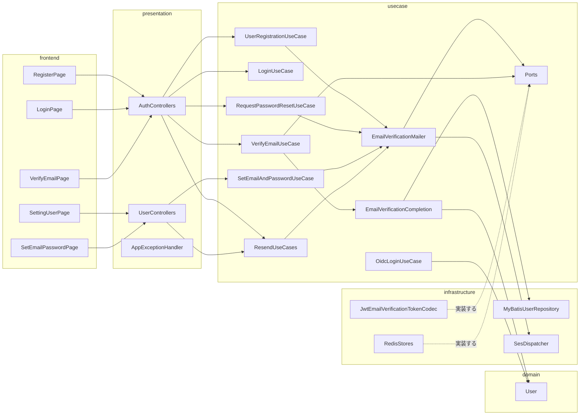
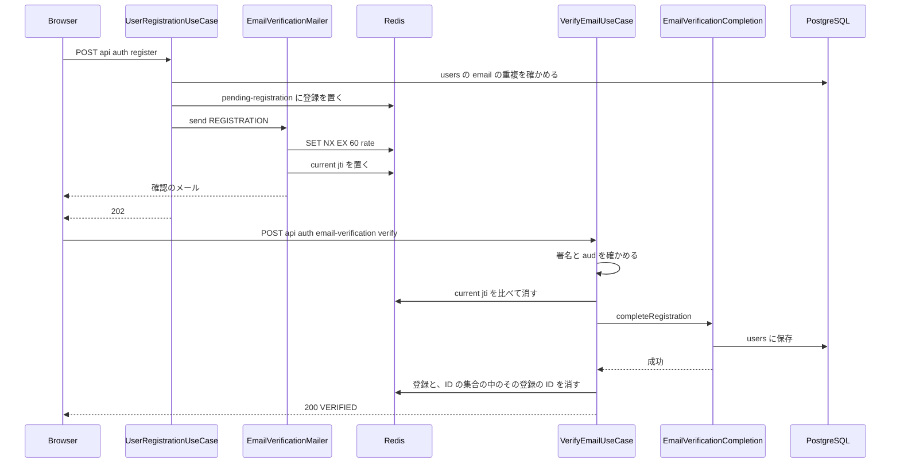
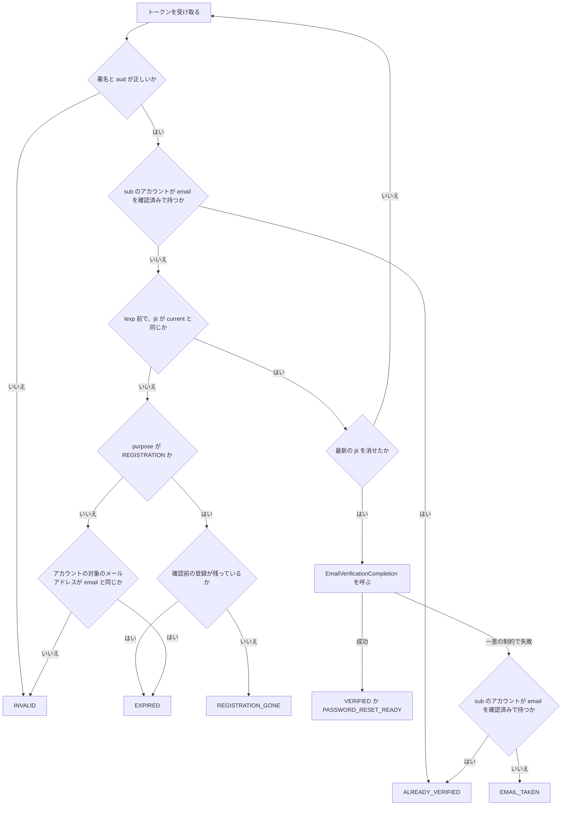
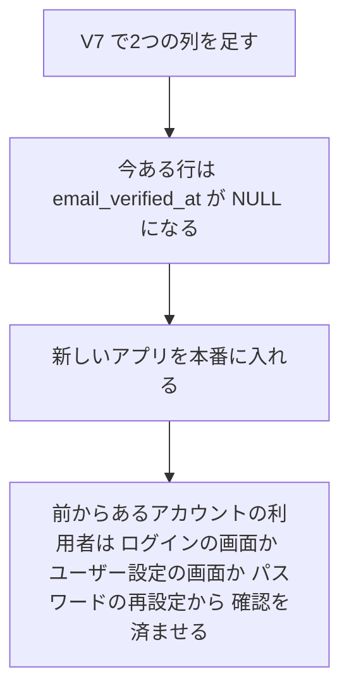

# 設計

## 概要

この設計は、メールアドレスとパスワードで登録する利用者と、あとからメールアドレスを設定する利用者に、確認のメールを届け、利用者がリンクを押したときにはじめてメールアドレスをアカウントに付ける仕組みを作る。利用者は、登録、ログイン、パスワードの再設定、ユーザー設定の各画面から、確認のメールを受け取り、確認のリンクの画面で確認を済ませる。

backend は、確認前の登録を users の表に入れず、Redis に有効期限付きで置く。backend は、利用者が確認を済ませた時点で、確認前の登録と同じ ID でアカウントを作る。確認のリンクには、java-jwt で署名したトークンを入れ、種類、対象、メールアドレス、リンクの期限をトークンに持たせる。users の表には、メールアドレスを確認した日時と、設定待ちのメールアドレスの2つの列を足す。ログイン、パスワードの再設定の要求、外部連携のログイン、メールアドレスとパスワードの設定の各ユースケースは、この2つの列を見て動きを分ける。

Claude は、frontend の、どのレイアウトにも属さない経路に、確認のリンクの画面を足す。ログインの画面、登録の画面、ユーザー設定の画面は、確認がまだであることと、確認のメールを送るボタンを出す。

## 作るものと作らないもの

### 作るもの

- 確認前の登録を Redis に置き、確認を済ませたときにアカウントを作る登録の流れ
- 確認のリンクのトークンの形と、トークンを作る部品と読む部品
- 確認のメールを送る部品と、同じメールアドレスへの送信を1分に1回に抑える部品
- 確認のリンクを受け付ける API、確認のメールを送り直す API、ログインの画面から確認のメールを送る API、ユーザー設定の画面から確認のメールを送る API
- users の表の列 `email_verified_at` と `pending_email`、それを読み書きするドメインのモデルとリポジトリの変更
- ログイン、パスワードの再設定の要求、外部連携のログイン、メールアドレスとパスワードの設定、退会、2段階認証の切り替え、外部連携の解除で、確認済みかどうかを見て動きを分ける変更
- 確認のリンクの画面と、ログイン、登録、ユーザー設定、メールアドレスとパスワードの設定の各画面の変更
- 確認のメールの文面のテンプレート
- ER図、Redis設計.md、クラス図、ログインのシーケンス図、画面遷移図の更新

### 作らないもの

- 確認を済ませたメールアドレスを別のメールアドレスに変える機能
- メールアドレスの大文字と小文字を同じものとみなす処理。この設計は、今と同じく、メールアドレスを入力されたとおりの文字列で比べる
- 管理者が利用者にメールやお知らせを送る機能。この機能は #444 で扱う
- メールの送り元の設定と、Amazon SES の設定。この設計は、今の `SesFreeMarkerNotificationDispatcher` と今の送り元をそのまま使う
- 確認前の登録を消す定期実行。確認前の登録は Redis の有効期限で消える
- 前からあるアカウントのメールアドレスを、この spec の変更を本番に入れるときに確認済みへ書き換えるデータの移行
- パスワードの再設定のリンクの形(`/password/reset/:token`)の変更。`RequestPasswordResetUseCase` は、確認を済ませたアカウントへのパスワードの再設定のメールを、今のまま送る

## 使う既存の仕組み

- `NotificationDispatcher` と `SesFreeMarkerNotificationDispatcher`: 確認のメールを送るために使う。Claude は、`SesFreeMarkerNotificationDispatcher` に通知の種類を1つ足す
- `PasswordResetTokenStore`(Redis の `password-reset:{token}`)と `ResetPasswordUseCase` と `POST /api/auth/password/reset`: 利用者が、パスワードの再設定を求めたときに届いた確認のメールのリンクで確認を済ませたあとに、パスワードを再設定するために使う。これらの部品は変えない
- java-jwt 4.6.2 と、設定の値 `jwt.secret`: 確認のリンクのトークンの署名に使う
- `RedisTemplate<String, Object>`: 確認前の登録と、最新のリンクの ID と、同じメールアドレスへ1分以内に確認のメールを送ったことの記録を置くために使う
- `UserEmailDuplicationCheckService`: 登録とメールアドレスの設定で、users の `email` の重複を確かめるために使う
- users の `email` の一意の制約: 2つの確認が同じメールアドレスで同時に通ったときに、2つ目の保存を断るために使う
- `UserRegisteredEventListener` と `UserDeletedEventListener`: 登録完了のお知らせと退会完了のお知らせを、今と同じく同期で送るために使う
- `GithubOidcProvider` と `GoogleOidcProvider` が返す `OidcUserInfoDto`: 外部連携が返すメールアドレスの受け口として使う
- frontend の `ResetPasswordForm`、`useResetPassword`、`ErrorBanner`、`useNotificationStore`: 確認のリンクの画面の中で、パスワードの再設定とエラーの表示に使う

## 設計を見直すきっかけ

- 確認のリンクのトークンの claim の `purpose`、`email`、`lexp` か、署名の鍵の導き方を変えるとき。claim は、トークンに入れて署名する項目である。送ったリンクがすべて読めなくなる
- `jwt.secret` を替えるとき。送ったリンクがすべて使えなくなる
- Redis のキー `pending-registration:*` `email-verification:*` の形か有効期限を変えるとき
- `POST /api/auth/email-verification/verify` の応答の `result` の値を足すか変えるとき。frontend の確認のリンクの画面が出し分けを変える必要がある
- ログインの 409 の応答の `kind` の値を足すか変えるとき。frontend の `LoginContainer` が `kind` の値ごとに文とボタンを出し分けているので、出し分けを変える必要がある
- users の `email_verified_at` と `pending_email` を消すか、意味を変えるとき。ログイン、パスワードの再設定の要求、外部連携のログイン、メールアドレスとパスワードの設定の各ユースケースがこの2つの列を見て動きを分けているので、各ユースケースの分け方を変える必要がある
- メールアドレスの大文字と小文字を同じものとみなす変更を入れるとき。重複の確認と、確認前の登録の ID の集合のキー `pending-registration:email:{email}` と、トークンの `email` の比べ方が変わる

## プロジェクトの決まりを守っているか

- backend のコードを置く層: ドメインのモデル `User` の変更は domain に置く。確認の流れのユースケースは `usecase/auth` に置き、Redis と JWT の受け口のインタフェースは `usecase/auth/store` と `usecase/auth/verification` に置く。Redis と java-jwt を使う実装は `infrastructure` に置く。controller は `handle` だけを公開し、ユースケースは `execute` だけを公開する。`*Command` は `usecase/auth/command` に置く。ArchUnit のルール `BackendArchitectureTest` に反する依存は作らない
- frontend の機能ごとの境界: 確認のリンクの画面とログインの画面の部品は `features/auth` に置き、ユーザー設定の画面の部品は `features/user` に置く。`features/user` は `features/auth` を import しない。ユーザー設定の画面から確認のメールを送るフックは `features/user` に置く。ページは `features/*/index.ts` からだけ import する
- frontend の状態の持ち方: 確認の API の結果は TanStack Query の `useQuery` に置く。ボタンで送る操作は `useMutation` にする。画面の中だけで持つ値は `useState` に置き、新しい Zustand のストアは作らない
- データベースの表の形: マイグレーション `V7__add_email_verification_columns.sql` を含む。このマイグレーションは、expand の段階だけで足り、contract の段階は無い。expand は、前の版のアプリが動いたままでも困らない列や表を足す段階で、contract は、前の版のアプリだけが使っていた列や表を消す段階である。このマイグレーションを含む PR は、所有者が承認するまでマージされない
- 新しいライブラリの追加: 新しいライブラリは足さない。トークンの署名には java-jwt 4.6.2、Redis の操作には Spring Data Redis を使う
- 品質チェックの設定: 品質チェックの設定ファイルは変えない
- 関係のない項目: 使う外部の機能がこのリポジトリで使えるか

## 全体の構成

図の `ResendUseCases` は、確認のメールを送り直す3つのユースケース(`ResendEmailVerificationUseCase`、`ResendEmailVerificationForLoginUseCase`、`SendAccountEmailVerificationUseCase`)をまとめて描いたものである。`Ports` は、usecase に置く4つのインタフェース(`EmailVerificationTokenCodec`、`PendingRegistrationStore`、`EmailVerificationCurrentTokenStore`、`EmailVerificationSendLimiter`)をまとめて描いたものである。`RedisStores` は、そのうち3つの Redis の実装をまとめて描いたものである。

確認のメールを送る場面は4つある。1つ目は利用者が登録したとき、2つ目は前からあるアカウントのメールアドレスを確認するとき、3つ目は設定待ちのメールアドレスを確認するとき、4つ目は利用者が確認前のメールアドレスでパスワードの再設定を求めたときである。この設計は、4つの場面を、トークンの `purpose` の違いだけで、1つの送る部品 `EmailVerificationMailer` と、1つの受け付ける API にまとめる。

Claude は、調べた経緯と比べた案を `research.md` に書いた。

**使う技術**:
- 画面: React 19.3、react-router 8.4.0、TanStack Query 5.104、MUI 9.5。確認のリンクの画面と、各画面のボタンと文を作る
- サーバー: Spring Boot 3.5.16、Java 21。確認の API とユースケースを作る
- トークン: java-jwt 4.6.2。確認のリンクのトークンを HMAC-SHA256 で署名し、読む
- データの保存: PostgreSQL と MyBatis(mybatis-spring-boot 3.0.5)。users の表に2つの列を足す。Flyway のマイグレーション V7 で足す
- 一時データの保存: Redis(Spring Data Redis)
- メール: Amazon SES と FreeMarker 2.3.35。確認のメールを送る

## ファイルの構成

この節は、backend の Java のファイルを、`backend/src/main/java/com/example/keirekipro/` からの相対のパスで書く。そのほかのファイルは、リポジトリの最上位からのパスで書く。

Claude が新しく作るファイル:

- `usecase/auth/verification/EmailVerificationPurpose.java`: トークンの種類の列挙型。`REGISTRATION` `ACCOUNT_EMAIL` `PENDING_EMAIL` `PASSWORD_RESET` とリンクの期限を持つ
- `usecase/auth/verification/EmailVerificationClaims.java`: トークンの中身を表す record
- `usecase/auth/verification/EmailVerificationTokenCodec.java`: トークンを作る部品と読む部品のインタフェース
- `usecase/auth/verification/EmailVerificationMailer.java`: 確認のメールを送る部品
- `usecase/auth/verification/EmailVerificationCompletion.java`: 確認を済ませたときの DB への書き込みを受け持つ部品
- `usecase/auth/verification/EmailVerificationResult.java`: 確認の結果の列挙型
- `usecase/auth/verification/EmailVerificationLinkClassifier.java`: リンクの状態を決める部品
- `usecase/auth/store/PendingRegistrationStore.java`: 確認前の登録の置き場所のインタフェース
- `usecase/auth/store/PendingRegistration.java`: 確認前の登録を表す record
- `usecase/auth/store/EmailVerificationCurrentTokenStore.java`: 最新のリンクの ID の置き場所のインタフェース
- `usecase/auth/store/EmailVerificationSendLimiter.java`: 1分の制限のインタフェース
- `usecase/auth/VerifyEmailUseCase.java`: 確認のリンクを受け付けるユースケース
- `usecase/auth/ResendEmailVerificationUseCase.java`: 使えなくなったリンクから確認のメールを送り直すユースケース
- `usecase/auth/ResendEmailVerificationForLoginUseCase.java`: ログインの画面から確認のメールを送るユースケース
- `usecase/user/SendAccountEmailVerificationUseCase.java`: ユーザー設定の画面から確認のメールを送るユースケース
- `usecase/auth/command/ResendEmailVerificationForLoginCommand.java`: ログインの画面から送るときの入力
- `usecase/auth/dto/VerifyEmailUseCaseDto.java`: 確認の結果と、パスワードの再設定のトークンを返す DTO
- `usecase/auth/notification/EmailVerificationNotification.java`: 確認のメールの通知の record
- `usecase/shared/exception/EmailNotVerifiedUseCaseException.java`: 確認がまだのときにログインを断る例外。`kind` を持つ
- `usecase/auth/oidc/UnverifiedEmailAccountUseCaseException.java`: 確認がまだのアカウントへ外部連携を結び付けないときの例外
- `infrastructure/auth/verification/JwtEmailVerificationTokenCodec.java`: java-jwt でトークンを作り、読む実装
- `infrastructure/store/auth/RedisPendingRegistrationStore.java`: 確認前の登録の Redis の実装
- `infrastructure/store/auth/RedisEmailVerificationCurrentTokenStore.java`: 最新のリンクの ID の Redis の実装
- `infrastructure/store/auth/RedisEmailVerificationSendLimiter.java`: 1分の制限の Redis の実装
- `presentation/auth/controller/VerifyEmailController.java`: `POST /api/auth/email-verification/verify`
- `presentation/auth/controller/ResendEmailVerificationController.java`: `POST /api/auth/email-verification/resend`
- `presentation/auth/controller/ResendEmailVerificationForLoginController.java`: `POST /api/auth/email-verification/resend-for-login`
- `presentation/user/controller/SendAccountEmailVerificationController.java`: `POST /api/users/me/email-verification`
- `presentation/auth/dto/EmailVerificationTokenRequest.java`: `{token}` の要求
- `presentation/auth/dto/ResendEmailVerificationForLoginRequest.java`: `{email, password}` の要求
- `presentation/auth/dto/VerifyEmailResponse.java`: `{result, passwordResetToken}` の応答
- `presentation/shared/EmailNotVerifiedErrorResponse.java`: 409 の応答。`ErrorResponse` の欄に `kind` を足した形
- `backend/src/main/resources/db/migration/V7__add_email_verification_columns.sql`: users の表に2つの列を足す
- `backend/src/main/resources/mail/email-verification.ftl`: 確認のメールの文面
- `frontend/src/pages/VerifyEmail.tsx`: 確認のリンクの画面のページ
- `frontend/src/features/auth/components/EmailVerificationContainer.tsx`: 確認のリンクの画面の中身
- `frontend/src/features/auth/components/EmailVerificationNotice.tsx`: ログインの画面に出す、確認がまだであることの文とボタン
- `frontend/src/features/auth/api/verifyEmail.ts` `frontend/src/features/auth/api/resendEmailVerification.ts` `frontend/src/features/auth/api/resendEmailVerificationForLogin.ts`: API を呼ぶ関数
- `frontend/src/features/auth/hooks/useVerifyEmail.ts` `frontend/src/features/auth/hooks/useResendEmailVerification.ts` `frontend/src/features/auth/hooks/useResendEmailVerificationForLogin.ts`: API を呼ぶフック
- `frontend/src/features/user/api/sendEmailVerification.ts` `frontend/src/features/user/hooks/useSendEmailVerification.ts`: ユーザー設定の画面から確認のメールを送る関数とフック
- `frontend/src/features/user/components/EmailVerificationStatus.tsx`: ユーザー設定の画面の、確認待ちの表示と送るボタン

Claude が変えるファイル:

- `domain/model/user/User.java`: 欄 `emailVerifiedAt` と `pendingEmail` と、確認に関わるメソッドを足す。2段階認証の切り替え、外部連携の解除、退会の判断を変える
- `infrastructure/repository/user/UserDto.java` `UserMapper.java` `UserMapper.xml` `MyBatisUserRepository.java`: 2つの列を読み書きする
- `usecase/auth/UserRegistrationUseCase.java`: 確認前の登録を置き、確認のメールを送る形に変える
- `usecase/auth/LoginUseCase.java`: 確認がまだのときに `EmailNotVerifiedUseCaseException` を投げる
- `usecase/auth/RequestPasswordResetUseCase.java`: 確認前のメールアドレスには、確認のメールを送る
- `usecase/auth/OidcLoginUseCase.java`: 確認済みかどうかで、結び付けと確認を分ける
- `usecase/auth/HandleOidcCallbackUseCase.java` `usecase/auth/oidc/OidcCallbackError.java`: 確認がまだのアカウントへの結び付けを断った失敗を足す
- `usecase/user/SetEmailAndPasswordUseCase.java`: メールアドレスを設定待ちにし、確認のメールを送る。パスワードを持つアカウントでは、今のパスワードを確かめる
- `presentation/user/dto/SetEmailAndPasswordRequest.java` `usecase/user/command/SetEmailAndPasswordCommand.java`: 欄 `currentPassword` を足す
- `usecase/user/GetUserInfoUseCase.java` `usecase/user/dto/UserInfoUseCaseDto.java`: `emailVerified` と `pendingEmail` を返す
- `infrastructure/auth/oidc/provider/GithubOidcProvider.java`: いつも `GET /user/emails` の、`primary` と `verified` がどちらも true の要素だけを使う
- `infrastructure/shared/notification/SesFreeMarkerNotificationDispatcher.java`: `EmailVerificationNotification` の分岐を足す
- `presentation/auth/controller/UserRegistrationController.java`: 応答を 202 にする
- `presentation/auth/controller/OidcCallbackController.java`: 確認がまだのアカウントへの結び付けを断ったときに、`/login?error=unverified_email` へ送る
- `presentation/user/dto/UserInfoResponse.java`: `emailVerified` と `pendingEmail` を足す
- `presentation/shared/AppExceptionHandler.java`: `EmailNotVerifiedUseCaseException` を 409 で返すハンドラを足す
- `frontend/src/config/paths.ts` `frontend/src/routes/AppRouter.tsx` `frontend/src/pages/index.ts`: 経路 `/email/verify` と、確認のリンクの画面のページを足す
- `frontend/src/types/user.ts`: `emailVerified` と `pendingEmail` を足す
- `frontend/src/features/auth/components/LoginContainer.tsx`: 409 の応答と、`error=unverified_email` を受けて、`EmailVerificationNotice` か決まった文を出す
- `frontend/src/features/auth/hooks/useUserRegister.ts`: 成功したときの文を、確認のメールを送ったことを伝える文に変える
- `frontend/src/features/auth/index.ts` `frontend/src/features/user/index.ts`: 新しい関数、フック、部品を公開する
- `frontend/src/features/user/hooks/useSetEmailAndPassword.ts`: 成功したときの文を、確認のメールを送ったことを伝える文に変える
- `frontend/src/features/user/types/userState.ts` `frontend/src/features/user/hooks/useUserState.ts`: 状態 `PASSWORD_WITH_PROVIDER` を足す
- `frontend/src/features/user/utils/userSettingRules.ts` `frontend/src/features/user/utils/userSettingMessages.ts`: 確認済みかどうかで判断し、文を出す
- `frontend/src/features/user/components/SettingUserContainer.tsx`: `isTwoFactorDisabled` と `isProviderRemovable` に、状態の代わりに `user` を渡す
- `frontend/src/features/user/components/ChangePasswordContainer.tsx`: 状態 `PASSWORD_WITH_PROVIDER` でもパスワードを変えられるようにする
- `frontend/src/features/user/components/SettingUserForm.tsx`: `EmailVerificationStatus` を出す
- `frontend/src/features/user/components/SetEmailAndPasswordContainer.tsx`: 状態 `PASSWORD_WITH_PROVIDER` でもメールアドレスを設定し直せるようにする
- `frontend/src/features/user/components/SetEmailAndPasswordForm.tsx` `frontend/src/features/user/api/setEmailAndPassword.ts`: 今のパスワードの入力欄と、送る欄 `currentPassword` を足す
- `doc/DB設計/ER図.pu` `doc/DB設計/Redis設計.md` `doc/クラス図/*.pu` `doc/シーケンス図/ログインシーケンス.puml` `doc/画面設計/画面遷移図.drawio`: この設計の変更を書き足す

## 処理の流れ

### 登録から確認まで

### 確認のリンクの結果の決め方

- 「アカウントの対象のメールアドレス」は、`purpose` が `PENDING_EMAIL` なら `pending_email`、`ACCOUNT_EMAIL` か `PASSWORD_RESET` なら `email` である
- `VerifyEmailUseCase` は、最新の `jti` を消せなかったときに、判定を最初から1回だけやり直す。2回目も消せなかったときは、`INVALID` を返す。同じリンクが同時に2回押されたときは、あとの要求が2回目の判定で `ALREADY_VERIFIED` になる
- `EmailVerificationCompletion` がトランザクションを取り消したときは、`VerifyEmailUseCase` は、消した最新の `jti` を戻さない。利用者は、そのリンクの画面で `EXPIRED` を見て、確認のメールを送り直せる

## 部品

### EmailVerificationTokenCodec と JwtEmailVerificationTokenCodec(確認のリンクのトークンを作り、読む部品)

対応する要件: 2.1, 2.2, 2.4, 2.5

**役割**: この部品は、確認のリンクに入れるトークンを作り、受け取ったトークンの署名を確かめて中身を返す。この部品は、リンクが期限内かどうかと、最新のリンクかどうかを判断しない。それは `VerifyEmailUseCase` が判断する。

**呼び出し方**:
- `String issue(EmailVerificationClaims claims)`: トークンを作る
- `Optional<EmailVerificationClaims> read(String token)`: 署名と `aud` が正しければ中身を返し、正しくなければ空を返す。リンクの期限が切れていても、署名が正しければ中身を返す
- `EmailVerificationClaims` の欄は、`jti`(UUID の文字列)、`subjectId`(UUID)、`purpose`(`EmailVerificationPurpose`)、`email`(文字列)、`linkExpiresAt`(`Instant`)である
- トークンの claim は、`aud` が `keirekipro-email-verification`、`jti`、`sub`、`purpose`、`email`、`lexp`(UNIX 秒)である。`aud` は、トークンをどの用途に使うかを示す値である。`jti` は、リンクごとに作る ID である。`sub` は、確認前の登録かアカウントの ID である。`issue` は、トークンに `exp` を付けない。java-jwt の `JWTVerifier` は、`exp` が無いトークンの期限を確かめない。そのため、`read` は、リンクの期限が切れたトークンの中身も返せる

**署名の鍵**: 署名の鍵は、`jwt.secret` を鍵にした HMAC-SHA256 で、文字列 `keirekipro-email-verification-v1` を署名した32バイトである。HMAC-SHA256 は、秘密の鍵とデータから、鍵を知る者だけが作れる32バイトの値を求める方式である。`JwtEmailVerificationTokenCodec` は、起動時に `@Value("${jwt.secret}")` を受けて鍵を1回導き、`Algorithm.HMAC256` に渡す。アクセストークンの検証は、この鍵で署名したトークンを受け付けない。

**失敗したとき**: `read` は、`JWTVerificationException` と、claim が欠けているか形が違うときを、どちらも空にして返す。例外を外に投げない。

### EmailVerificationPurpose(トークンの種類)

対応する要件: 2.1, 2.4

**役割**: この列挙型は、4つの種類と、種類ごとのリンクの期限を持つ。`REGISTRATION` `ACCOUNT_EMAIL` `PENDING_EMAIL` は24時間、`PASSWORD_RESET` は10分である。リンクの期限を決める部品は、この列挙型だけにする。

### PendingRegistrationStore と RedisPendingRegistrationStore(確認前の登録の置き場所)

対応する要件: 1.1, 1.4, 1.6, 2.4

**役割**: この部品は、確認前の登録を Redis に置き、読み、消す。この部品は、メールの送信と、users の表を扱わない。

**呼び出し方**:
- `void save(PendingRegistration registration, Duration ttl)`: 登録を置く。同じ ID の登録があれば上書きする
- `Optional<PendingRegistration> findById(UUID id)`
- `List<PendingRegistration> findByEmail(String email, int limit)`: そのメールアドレスの登録を、作った日時の新しい順に `limit` 件まで返す
- `void extend(UUID id, Duration ttl)`: 登録の有効期限を延ばす
- `void delete(PendingRegistration registration)`: 登録と、キー `pending-registration:email:{email}` に置いた、そのメールアドレスの登録の ID の集合の中の、その登録の ID を消す
- `PendingRegistration` の欄は、`id`(UUID)、`email`、`passwordHash`、`username`、`createdAt`(`Instant`)である

**状態の持ち方**:
- `findByEmail` は、集合の ID ごとに登録を読み、消えていた ID を集合から取り除いてから並べる
- 呼ぶ側は、`ttl` をいつも24時間にする。登録を受け付けたときと、確認のメールを送り直したときに、有効期限は、その時点から24時間になる。メールを送らずに受け付けた登録も、受け付けた時点から24時間で消える

**失敗したとき**: Redis への接続の失敗は、例外のまま呼ぶ側に返す。

### EmailVerificationCurrentTokenStore と RedisEmailVerificationCurrentTokenStore(最新のリンクの ID の置き場所)

対応する要件: 2.2, 2.3

**役割**: この部品は、対象(確認前の登録かアカウント)ごとに、最後に送ったリンクの `jti` を1つだけ持つ。この部品は、リンクの期限を判断しない。

**呼び出し方**:
- `void put(UUID subjectId, String jti, Duration ttl)`: 最新の `jti` を置き換える。`ttl` はそのリンクの期限までの時間である
- `Optional<String> find(UUID subjectId)`
- `boolean consume(UUID subjectId, String jti)`: 置いてある値が `jti` と同じときだけ消し、消せたら true を返す。比べることと消すことを、Redis の Lua スクリプト1つで行う。Lua スクリプトは Redis の中で動かす小さなプログラムで、Redis は、1つのスクリプトを、ほかの要求を間に挟まずに最後まで動かす
- `void clear(UUID subjectId)`: 値を消す

**状態の持ち方**: 値が無い対象のリンクは、どれも最新ではないものとして扱う。

### EmailVerificationSendLimiter と RedisEmailVerificationSendLimiter(同じメールアドレスへの確認のメールを1分に1回に抑える部品)

対応する要件: 2.6, 2.7, 4.6, 9.5

**役割**: この部品は、同じメールアドレスへの確認のメールを1分に1回までに抑える。この部品は、確認のメールのほかのメールには使わない。

**呼び出し方**:
- `boolean tryAcquire(String email)`: キー `email-verification:rate:{email}` を `SET NX EX 60` で置き、置けたら true を返す
- `void release(String email)`: キーを消す。メールの送信に失敗したときに、呼ぶ側が使う

**状態の持ち方**: この部品は、1つの命令で、送ってよいかの判定と、送ったことの記録を行う。そのため、サーバーが複数台で動いても、アプリが同じメールアドレスへ1分のうちに送る確認のメールは1通に限られる。

### EmailVerificationMailer(確認のメールを送る部品)

対応する要件: 1.1, 2.3, 2.4, 2.6, 2.7, 3.2, 4.1, 4.3, 4.6, 6.2, 9.1, 9.5

**役割**: この部品は、宛先と対象と種類を受け取り、1分の制限を確かめ、トークンを作り、最新の `jti` を置き、確認のメールを送る。この部品は、どの宛先に送るかと、送らなかったときに画面に何を出すかを判断しない。それは呼ぶ側のユースケースが判断する。

**使う部品**: `EmailVerificationSendLimiter`、`EmailVerificationTokenCodec`、`EmailVerificationCurrentTokenStore`、`NotificationDispatcher`

**呼び出し方**:
- `SendOutcome send(String email, UUID subjectId, EmailVerificationPurpose purpose)`: `SendOutcome` は `SENT` か `RATE_LIMITED` である
- 手順: `tryAcquire(email)` が false なら、何もせずに `RATE_LIMITED` を返す。true なら、`jti` を乱数の UUID で作り、`linkExpiresAt` を今から `purpose` の期限にし、トークンを作る。`put(subjectId, jti, purpose の期限)` で最新の `jti` を置き換える。リンク `frontend-base-url + "/email/verify#" + token` を作り、`EmailVerificationNotification` を `NotificationDispatcher` に渡す
- トークンを URL の `#` のあとに置くので、ブラウザは、トークンを、確認のリンクの画面の要求にも Referer にも載せない。Referer は、ブラウザが要求に添えて送る、その要求を出した画面の URL である

**失敗したとき**: `NotificationDispatcher` が例外を投げたら、この部品は、`release(email)` で、同じメールアドレスへ1分以内に送ったことの記録を消し、`clear(subjectId)` で最新の `jti` を消してから、例外を呼ぶ側に返す。

### UserRegistrationUseCase(登録を受け付けるユースケース)

対応する要件: 1.1, 1.4, 1.6, 1.7, 2.7

**役割**: このユースケースは、登録を受け付けて確認前の登録を置き、確認のメールを送る。このユースケースは、users の表に書き込まず、アカウントを作らない。トランザクションを持たない。

**呼び出し方**:
- `void execute(UserRegistrationCommand command)`。controller は `202 Accepted` を本体なしで返す
- 手順: `Email.create` でメールアドレスを確かめ、`UserEmailDuplicationCheckService` で users の `email` の重複を確かめる。重複していれば、今と同じ `DomainException` を投げ、400 になる。次に、`User.create` に入力を渡して入力の検査だけを行い、結果は捨てる。登録の ID を乱数の UUID で作り、`PendingRegistrationStore.save(registration, 24時間)` で置く。最後に `EmailVerificationMailer.send(email, id, REGISTRATION)` を呼ぶ。`RATE_LIMITED` でも、同じ 202 を返す
- 同じメールアドレスの確認前の登録があっても、このユースケースは断らない

**失敗したとき**: `send` が例外を投げたら、このユースケースは、置いた登録を `delete` で消し、例外をそのまま返す。`AppExceptionHandler` が 500 を返す。

### VerifyEmailUseCase(確認のリンクを受け付けるユースケース)

対応する要件: 1.2, 1.5, 2.2, 2.4, 2.5, 3.4, 4.2, 4.5, 9.2

**役割**: このユースケースは、トークンを読み、上の「確認のリンクの結果の決め方」の図のとおりに結果を決める。最新の `jti` を消せたときは、このユースケースは、`EmailVerificationCompletion` に DB への書き込みを任せる。このユースケースはトランザクションを持たない。このユースケースは、確認のメールを送らない。

**使う部品**: `EmailVerificationTokenCodec`、`EmailVerificationCurrentTokenStore`、`PendingRegistrationStore`、`UserRepository`、`EmailVerificationCompletion`、`PasswordResetTokenStore`、`EmailVerificationLinkClassifier`、`SecurityUtil`

**呼び出し方**:
- `VerifyEmailUseCaseDto execute(String token)`。欄は `result`(`EmailVerificationResult`)と `passwordResetToken` である。`passwordResetToken` は、`result` が `PASSWORD_RESET_READY` のときだけ値を持つ
- `EmailVerificationResult` の値は、`VERIFIED`、`PASSWORD_RESET_READY`、`ALREADY_VERIFIED`、`EXPIRED`、`REGISTRATION_GONE`、`EMAIL_TAKEN`、`INVALID` である
- `purpose` ごとの書き込み:
  - `REGISTRATION`: 確認前の登録を `findById(sub)` で読み、`completeRegistration(registration)` を呼ぶ。成功したら、`PendingRegistrationStore.delete` で、登録と、ID の集合の中のその登録の ID を消す
  - `ACCOUNT_EMAIL`: `verifyAccountEmail(sub, email)` を呼ぶ
  - `PENDING_EMAIL`: `promotePendingEmail(sub, email)` を呼ぶ
  - `PASSWORD_RESET`: `verifyAccountEmail(sub, email)` を呼ぶ。成功したら、`SecurityUtil.generateRandomToken()` で再設定のトークンを作り、`PasswordResetTokenStore.store(token, sub, lexp - 今)` で置き、`PASSWORD_RESET_READY` とトークンを返す
- `EMAIL_TAKEN` になった `REGISTRATION` の登録は、このユースケースは消さない。登録は、有効期限で消える

**失敗したとき**: `EmailVerificationCompletion` が `DataIntegrityViolationException` を投げたら、このユースケースは、トランザクションの外で `UserRepository.findById(sub)` を読み直す。トランザクションの外で読み直すのは、PostgreSQL が、失敗したトランザクションの中では読み直しを受け付けないためである。`REGISTRATION` では、そのアカウントがトークンの `email` を確認済みで持っていれば `ALREADY_VERIFIED`、そうでなければ `EMAIL_TAKEN` を返す。`PENDING_EMAIL` では `EMAIL_TAKEN` を返す。このユースケースは、そのほかの例外をそのまま呼ぶ側に返す。`AppExceptionHandler` は、その例外に 500 を返す。

### EmailVerificationCompletion(確認を済ませたときの書き込みを受け持つ部品)

対応する要件: 1.2, 1.3, 1.5, 3.4, 4.2, 4.5, 9.2

**役割**: この部品は、確認を済ませたときの DB への書き込みを、メソッドごとに1つのトランザクションで行う。この部品は、トークンを読まず、Redis を扱わない。

**呼び出し方**(すべて `@Transactional`):
- `void completeRegistration(PendingRegistration registration)`: `User.createWithVerifiedEmail` で、登録と同じ ID のアカウントを作り、`register()` を呼んで `UserRegisteredEvent` を積む。`save` し、`UserTokenVersionStore.initialize(id)` を呼び、イベントを発行する。同期のリスナー `UserRegisteredEventListener` が、登録完了のお知らせのメールを送る。users の `email` の一意の制約に当たったら、`DataIntegrityViolationException` が呼ぶ側に返る
- `void verifyAccountEmail(UUID userId, String email)`: アカウントの `email` がトークンの `email` と同じことを確かめ、`User.verifyEmail(now)` を呼んで保存する
- `void promotePendingEmail(UUID userId, String email)`: アカウントの `pending_email` がトークンの `email` と同じことを確かめ、`User.promotePendingEmail(now)` を呼んで保存する

**失敗したとき**: 登録完了のお知らせのメールの送信に失敗したら、この部品は、トランザクションを取り消す。アカウントは作られず、確認前の登録は残る。

### ResendEmailVerificationUseCase(使えなくなったリンクから送り直すユースケース)

対応する要件: 2.4, 2.6

**役割**: このユースケースは、使えなくなったリンクのトークンを受け取り、同じ宛先、同じ対象、同じ `purpose` で、新しい確認のメールを送る。

**呼び出し方**:
- `void execute(String token)`。controller は 204 を返す
- 手順: トークンを読み、`VerifyEmailUseCase` と同じ決め方で結果が `EXPIRED` になるかを確かめる。`EXPIRED` でなければ、`UseCaseException("このリンクでは確認のメールを送り直せません。")` を投げる。`EmailVerificationMailer.send(email, sub, purpose)` を呼ぶ。`send` が `SENT` を返し、`purpose` が `REGISTRATION` なら、`PendingRegistrationStore.extend(sub, 24時間)` を呼ぶ。`send` が `RATE_LIMITED` を返したときと例外を投げたときは、確認前の登録の有効期限を延ばさない。`RATE_LIMITED` なら `UseCaseException("確認のメールは1分に1回まで送れます。少し待ってからもう一度お試しください。")` を投げる
- このユースケースと `VerifyEmailUseCase` は、どちらも `EmailVerificationLinkClassifier` でリンクの状態を決める。2つのユースケースが同じ決め方を使うので、送り直せるリンクと、確認のリンクの画面で送り直すボタンが出るリンクは食い違わない

### EmailVerificationLinkClassifier(リンクの状態を決める部品)

対応する要件: 2.2, 2.3, 2.4, 2.5

**役割**: この部品は、読んだトークンの中身から、リンクが使えるか、確認が済んでいるか、期限切れか、確認前の登録が消えたか、使えないかを決める。この部品は書き込まない。最新の `jti` を消すことは、`VerifyEmailUseCase` が行う。

**呼び出し方**: `LinkState classify(EmailVerificationClaims claims)`。`LinkState` は、`USABLE`、`ALREADY_VERIFIED`、`EXPIRED`、`REGISTRATION_GONE`、`INVALID` である。この部品の決め方は、「確認のリンクの結果の決め方」の図の、署名と aud が正しいかの判定のあとから、最新の jti を消せたかの判定の前までである。

### ResendEmailVerificationForLoginUseCase(ログインの画面から送るユースケース)

対応する要件: 3.1, 3.2, 3.3, 2.6

**役割**: このユースケースは、ログインの画面で入力されたメールアドレスとパスワードを、アカウントか確認前の登録ともう一度照らし合わせ、合っていれば確認のメールを送る。

**呼び出し方**:
- `void execute(ResendEmailVerificationForLoginCommand command)`。欄は `email` と `password`。controller は 204 を返す
- 手順: `findByEmail(email)` でアカウントがあり、パスワードが合い、確認がまだなら、`send(email, userId, ACCOUNT_EMAIL)` を呼ぶ。アカウントが無ければ、`PendingRegistrationStore.findByEmail(email, 5)` の登録を、新しい順に、入力されたパスワードと照らし合わせ、最初に合った登録で `send(email, id, REGISTRATION)` を呼び、`send` が `SENT` を返したときだけ `extend(id, 24時間)` を呼ぶ。どれにも当たらなければ、ログインと同じ `UseCaseException("メールアドレスまたはパスワードが正しくありません。")` を投げる。`RATE_LIMITED` なら、`ResendEmailVerificationUseCase` と同じ文の `UseCaseException` を投げる

### SendAccountEmailVerificationUseCase(ユーザー設定の画面から送るユースケース)

対応する要件: 6.2, 2.6

**役割**: このユースケースは、ログインしている利用者のアカウントの、設定待ちのメールアドレスか確認前のメールアドレスに、確認のメールを送る。

**権限**: ログインしている利用者だけが呼べる。対象は、アクセストークンの利用者のアカウントに限る。

**呼び出し方**:
- `void execute(UUID userId)`。controller `POST /api/users/me/email-verification` は 204 を返す
- 手順: `pending_email` があれば `send(pendingEmail, userId, PENDING_EMAIL)` を呼ぶ。無く、`email` があって確認がまだなら、`send(email, userId, ACCOUNT_EMAIL)` を呼ぶ。どちらでもなければ、`UseCaseException("確認が必要なメールアドレスはありません。")` を投げる。`RATE_LIMITED` なら、`ResendEmailVerificationUseCase` と同じ文の `UseCaseException` を投げる

### LoginUseCase(ログインのユースケース)

対応する要件: 3.1, 3.2, 3.3, 3.4, 3.5

**役割**: Claude は、このユースケースの、今のメールアドレスとパスワードの照らし合わせ方に、確認がまだのときの分岐を足す。このユースケースは、確認のメールを送らない。

**呼び出し方**:
- アカウントがあり、パスワードが合わなければ、今と同じ `UseCaseException("メールアドレスまたはパスワードが正しくありません。")` を投げる
- アカウントがあり、パスワードが合い、`isEmailVerified()` が false なら、`EmailNotVerifiedUseCaseException(kind = UNVERIFIED_ACCOUNT_EMAIL)` を投げる。2段階認証が有効でも、このユースケースは2段階認証に進まない
- アカウントが無ければ、`PendingRegistrationStore.findByEmail(email, 5)` の登録を、新しい順に、入力されたパスワードと照らし合わせる。合えば `EmailNotVerifiedUseCaseException(kind = PENDING_REGISTRATION)` を投げ、合わなければ今と同じ `UseCaseException` を投げる
- `findByEmail` は users の `email` だけを探すので、設定待ちのメールアドレスではアカウントが見つからない
- 確認を済ませたアカウントでログインしたときは、controller は、今と同じく 200 か 202 を返す

### EmailNotVerifiedUseCaseException と AppExceptionHandler(確認がまだのときの 409)

対応する要件: 3.1, 3.2

**役割**: `EmailNotVerifiedUseCaseException` は `UseCaseException` を継ぎ、欄 `kind`(`PENDING_REGISTRATION` か `UNVERIFIED_ACCOUNT_EMAIL`)を持つ。`AppExceptionHandler` は、この例外を `@ResponseStatus(HttpStatus.CONFLICT)` のハンドラで受け、`EmailNotVerifiedErrorResponse{message, errors, kind}` を返す。Spring は、例外の型に最も近いハンドラを選ぶので、`BaseException` の 400 のハンドラより、このハンドラが先に選ばれる。`AppExceptionHandler` は、`message` を「メールアドレスの確認が済んでいません。」にする。

### RequestPasswordResetUseCase(パスワードの再設定を求めるユースケース)

対応する要件: 9.1, 9.3, 9.4, 9.5

**役割**: このユースケースは、`findByEmail` でアカウントを探し、確認済みなら今と同じパスワードの再設定のメールを送り、確認がまだなら `send(email, userId, PASSWORD_RESET)` を呼ぶ。アカウントが無ければ、何もしない。`RATE_LIMITED` でも、例外を投げない。controller は、どの場合も今と同じ 204 を返す。

### OidcLoginUseCase、HandleOidcCallbackUseCase、OidcCallbackController(外部連携のログイン)

対応する要件: 7.1, 7.2, 7.3, 7.4, 7.5, 8.1, 8.2, 8.3

**役割**: `OidcLoginUseCase` は、外部連携が返した `OidcUserInfo` の `email` を、外部連携が持ち主を確かめたメールアドレスとして扱う。`email` が null のときは、メールアドレスが無いものとして扱う。

**呼び出し方**(`OidcLoginUseCase.execute` の分岐):
- `findByProvider` でアカウントが見つかったら、今と同じくそのアカウントにログインさせる。ログインさせる前に、アカウントを次のとおりにする
  - そのアカウントの `email` が `OidcUserInfo.email` と同じで、確認がまだなら、`verifyEmail(now)` を呼んで保存する
  - アカウントが `email` を持たず、`pendingEmail` が `OidcUserInfo.email` と同じなら、`findByEmail(OidcUserInfo.email)` で、ほかのアカウントがそのメールアドレスを持っていないことを確かめる。ほかのアカウントが持っていなければ、`promotePendingEmail(now)` を呼んで保存する。ほかのアカウントが持っていれば、設定待ちのまま残す
  - `email` も `pendingEmail` も `OidcUserInfo.email` と違うときは、アカウントを変えない
- `findByProvider` で見つからず、`findByEmail(OidcUserInfo.email)` でアカウントが見つかったとき、そのアカウントが確認済みなら、今と同じく `addAuthProvider` で結び付ける。確認がまだなら、`UnverifiedEmailAccountUseCaseException` を投げ、結び付けない
- どちらでも見つからなければ、`email` があるときは `User.createWithVerifiedEmail` で、`email` が無いときは今と同じ `User.create` でアカウントを作る。同じメールアドレスの確認前の登録は見ない
- `HandleOidcCallbackUseCase` は、`UnverifiedEmailAccountUseCaseException` を、今の `catch (Exception e)` より先に受け、`OidcCallbackResult.Failure(OidcCallbackError.UNVERIFIED_ACCOUNT_EMAIL)` を返す
- `OidcCallbackController` は、`UNVERIFIED_ACCOUNT_EMAIL` のときだけ `{frontend-base-url}/login?error=unverified_email` へ送る。ほかの失敗の送り先は今のままにする

**失敗したとき**: `findByEmail` で確かめたあとに、ほかのアカウントが同じメールアドレスを確認済みにすると、保存が users の `email` の一意の制約に当たる。そのときは、`OidcLoginUseCase` のトランザクションが取り消され、`HandleOidcCallbackUseCase` が今と同じく `LOGIN_FAILED` を返す。利用者がもう一度ログインすると、`findByEmail` がほかのアカウントを見つけるので、アプリは設定待ちのまま残してログインさせる。

### GithubOidcProvider(GitHub が返すメールアドレスの受け口)

対応する要件: 7.3, 7.4

**役割**: `convertToStandardUserInfo` は、`GET /user` の `email` を使わず、いつも `GET /user/emails` を呼び、`primary` と `verified` がどちらも true の要素の `email` を返す。当てはまる要素が無いときと、`GET /user/emails` の呼び出しに失敗したときは、`email` を null にする。`GoogleOidcProvider` は、今と同じく `email_verified` が true のときだけ `email` を返す。そのため、Claude は `GoogleOidcProvider` を変えない。

**権限**: 外部連携に求める権限の範囲(scope)は、今の設定のまま使う。

### SetEmailAndPasswordUseCase(メールアドレスとパスワードを設定するユースケース)

対応する要件: 4.1, 4.3, 4.4, 4.6

**役割**: このユースケースは、入力されたメールアドレスを設定待ちのメールアドレスにし、パスワードを今と同じくその場で設定する。このユースケースは、アカウントの `email` を変えない。

**呼び出し方**:
- メールアドレスが入力されたら、`UserEmailDuplicationCheckService` で users の `email` の重複を確かめる。重複していれば、`DomainException("このメールアドレスは登録できません。")` を投げ、400 になる
- アカウントがすでにパスワードを持つときは、入力の `currentPassword` を、`PasswordEncoder.matches` で今のパスワードのハッシュと照らし合わせる。`currentPassword` が無いときと合わないときは、`UseCaseException("今のパスワードが正しくありません。")` を投げ、400 になる。このとき、このユースケースは何も保存しない。アカウントがパスワードを持たないときは、`currentPassword` を見ない
- `User.setPendingEmail(errorCollector, email)` で設定待ちにし、パスワードが入力されていれば `resetPassword` を呼び、1つのトランザクションで保存する
- 保存のあと、`EmailVerificationCurrentTokenStore.clear(userId)` で前のリンクを使えなくし、`send(email, userId, PENDING_EMAIL)` を呼ぶ。`RATE_LIMITED` でも、例外を投げない
- このユースケースは、今と同じく `@Transactional` を付けたまま、保存とメールの送信を1つのトランザクションの中で行う

**失敗したとき**: メールの送信に失敗したら、例外でトランザクションが取り消され、設定待ちのメールアドレスとパスワードは保存されない。`AppExceptionHandler` が 500 を返す。利用者は、同じ画面でもう一度設定できる。

### User(ユーザーのドメインのモデル)

対応する要件: 1.2, 3.4, 4.1, 4.2, 4.3, 5.1, 5.2, 7.2, 7.3, 10.1, 10.2, 10.3

**役割**: このモデルは、欄 `emailVerifiedAt`(`LocalDateTime`)と `pendingEmail`(`Email`)を持つ。`emailVerifiedAt` が null なら、メールアドレスは確認前である。`pendingEmail` が null なら、設定待ちのメールアドレスは無い。

**呼び出し方**:
- `boolean isEmailVerified()`: `email` と `emailVerifiedAt` がどちらも null でないときに true
- `static User createWithVerifiedEmail(ErrorCollector, UUID id, Email email, String passwordHash, Map<String, AuthProvider> providers, String profileImage, String username, LocalDateTime verifiedAt)`: 確認済みのメールアドレスでアカウントを作る
- `User verifyEmail(LocalDateTime now)`: `email` が null なら `DomainException` を投げる。`emailVerifiedAt` が null のときだけ `now` を入れる
- `User setPendingEmail(ErrorCollector, Email email)`: 呼ぶ側は、このメソッドを、`email` が null のアカウントにだけ呼べる。`email` があれば今の `setEmail` と同じ文で断る。`pendingEmail` を置き換える
- `User promotePendingEmail(LocalDateTime now)`: `email` が null で `pendingEmail` があるときだけ、`email` に `pendingEmail` を移し、`pendingEmail` を null にし、`emailVerifiedAt` に `now` を入れる
- `changeTwoFactorAuthEnabled`: 有効にする条件を、`isEmailVerified()` と `passwordHash` があることに変える。無効にする条件は変えない
- `removeAuthProvider`: 解除を断る条件を、「`isEmailVerified()` が false か `passwordHash` が無く、外部連携が1つだけ」に変える
- `delete()`: `isEmailVerified()` が true のときだけ `UserDeletedEvent` を積む。退会の処理そのものは、確認済みかどうかに関わらず今と同じに行う
- Claude は、使わなくなる `setEmail` を消す
- Claude は、`reconstruct` の検査を強めない。前からあるアカウントは、2段階認証が有効なまま確認前になるためである

### MyBatisUserRepository と UserMapper(ユーザーの保存)

対応する要件: 4.1, 4.2, 5.1, 5.2

**役割**: Claude は、`UserMapper.xml` の select と upsert に、`email_verified_at` と `pending_email` を足す。Claude は、`UserDto` に2つの欄を足す。`MyBatisUserRepository` は、`User.reconstruct` と保存のときに、その2つの欄を受け渡す。

### EmailVerificationNotification と email-verification.ftl(確認のメール)

対応する要件: 1.1, 4.1, 9.1, 10.1

**役割**: `EmailVerificationNotification` は、`to`、`verificationLink`、`linkLifetime`(「24時間」か「10分」)、`siteName`、`siteUrl` を持つ record である。`SesFreeMarkerNotificationDispatcher` は、件名「【{siteName}】メールアドレスの確認」と `email-verification.ftl` の文面で、確認のメールを送る。

### VerifyEmail ページと EmailVerificationContainer(確認のリンクの画面)

対応する要件: 1.2, 1.5, 2.4, 2.5, 3.4, 4.2, 4.5, 9.2

**役割**: この画面は、`location.hash` からトークンを取り、`useVerifyEmail` で `POST /api/auth/email-verification/verify` を1回だけ呼び、`result` ごとに文とボタンを出す。

**呼び出し方**:
- Claude は、経路 `paths.email.verify = "/email/verify"` を、`AppRouter` の、どのレイアウトにも属さない経路に、利用規約の画面と同じ形 `{ path, element, errorElement: <ErrorFallback /> }` で置く。loader を付けないので、ログインしている利用者がリンクを押しても、この画面が出る
- `useVerifyEmail` は `useQuery` を使い、`retry: false`、`staleTime: Infinity`、`gcTime: Infinity` にする。画面を出し直しても、同じトークンで2回呼ばない
- 画面は、トークンを読んだあと、`history.replaceState` で URL から `#` 以降を消す
- `result` ごとの表示:
  - `VERIFIED`: 確認が済んだことと、ログインの画面へ進むボタン
  - `PASSWORD_RESET_READY`: 確認が済んだことと、同じ画面の中の `ResetPasswordForm`。送信は `useResetPassword` で、`passwordResetToken` を使う
  - `ALREADY_VERIFIED`: 確認がすでに済んでいることと、ログインの画面へ進むボタン
  - `EXPIRED`: リンクが使えないことと、確認のメールを送り直すボタン。ボタンは `useResendEmailVerification` でトークンを送る
  - `REGISTRATION_GONE`: リンクが使えないことと、もう一度登録するよう案内する文と、登録の画面へのリンク
  - `EMAIL_TAKEN`: このメールアドレスは使えないこと
  - `INVALID`: リンクが正しくないこと
- 1分たつ前に送り直したときの 400 の文は、共通の `ErrorBanner` が出す

### LoginContainer と EmailVerificationNotice(ログインの画面)

対応する要件: 2.6, 3.1, 3.2, 3.3, 8.2

**役割**: `LoginContainer` は、`useLogin` の失敗が 409 のときに、応答の `kind` を読んで `EmailVerificationNotice` を出す。`PENDING_REGISTRATION` では確認がまだであることと送り直すボタンを、`UNVERIFIED_ACCOUNT_EMAIL` では確認がまだであることと確認のメールを送るボタンを出す。ボタンは、入力欄のメールアドレスとパスワードで `useResendEmailVerificationForLogin` を呼ぶ。送れたら、確認のメールを送ったことをトーストで出す。400 の文は、今と同じく共通の `ErrorBanner` が出す。

`LoginContainer` は、クエリ `error` の値が `unverified_email` のときだけ、そのメールアドレスのアカウントがあることと、メールアドレスとパスワードでログインして先に確認を済ませるよう案内する、決まった文を出す。クエリの文字列をそのまま画面に出さない。ほかの値のときは、今と同じく何も出さない。

### useUserRegister、useSetEmailAndPassword、useUserState、SetEmailAndPasswordContainer(登録の画面と、メールアドレスとパスワードの設定の画面)

対応する要件: 1.1, 2.7, 4.1, 4.3, 4.6

**役割**: `useUserRegister` は、成功したときに、確認のメールを送ったことと、メールの中のリンクを押すよう案内する文をトーストで出し、ログインの画面へ移る。`useSetEmailAndPassword` は、成功したときに、確認のメールを送ったことと、確認を済ませるまでメールアドレスは設定待ちであることをトーストで出し、ユーザー設定の画面へ移る。どちらも、1分の制限で送らなかったときも、同じ文を出す。

`useUserState` は、メールアドレスが無く、パスワードと外部連携がある状態を `PASSWORD_WITH_PROVIDER` として返す。`SetEmailAndPasswordContainer` は、`PROVIDER_ONLY` と `PASSWORD_WITH_PROVIDER` のときに、メールアドレスの入力欄を出す。`SetEmailAndPasswordContainer` は、`PASSWORD_WITH_PROVIDER` のときに、今のパスワードの入力欄も出し、入力を `currentPassword` で送る。利用者は、設定待ちのメールアドレスを、この画面でメールアドレスとパスワードを入れ直して置き換える。

### EmailVerificationStatus、userSettingRules、userSettingMessages、SettingUserContainer、ChangePasswordContainer(ユーザー設定の画面とパスワードの変更の画面)

対応する要件: 4.3, 6.1, 6.2, 10.2, 10.3

**役割**: `EmailVerificationStatus` は、`pendingEmail` があれば設定待ちのメールアドレスを、無く `emailVerified` が false で `email` があれば `email` を、確認待ちとして出し、確認のメールを送るボタンを出す。ボタンは `useSendEmailVerification` で `POST /api/users/me/email-verification` を呼び、送れたらトーストを出す。

`userSettingRules` の `isTwoFactorDisabled(user: User | null)` は、`user` の `emailVerified && hasPassword` が成り立たないときに true を返す。`isProviderRemovable(user: User | null)` は、`user` の `emailVerified && hasPassword` が成り立つか、`user` の外部連携が2つ以上のときに true を返す。backend の `User` も同じ条件で断るので、画面の判断と backend の判断は食い違わない。2つの関数は、今の `UserState` の引数を受け取らない。`SettingUserContainer` は、2つの関数に `useUserAuthStore` の `user` を渡す。

`userSettingMessages` の `createUserSettingMessages` は、状態 `PASSWORD_WITH_PROVIDER` のときに、ラベル「パスワードは設定済み、メールアドレスは確認待ち」と、案内の文「メールアドレスの設定はこちら」と、警告の表示と、リンク先 `paths.emailPassword.set` を返す。`createUserSettingMessages` は、メールアドレスの確認がまだのために外部連携を解除できないときに、「メールアドレスの確認が済んでいないため、連携を解除できません。」を出す。

`ChangePasswordContainer` は、今の `EMAIL_PASSWORD` と `EMAIL_PASSWORD_WITH_PROVIDER` に加えて、`PASSWORD_WITH_PROVIDER` のときもパスワードの変更の画面を出す。パスワードの変更は、メールアドレスを使わないためである。

### GetUserInfoUseCase と UserInfoResponse(ユーザーの情報)

対応する要件: 6.1, 10.2, 10.3

**役割**: Claude は、`UserInfoUseCaseDto` と `UserInfoResponse` に、`emailVerified`(boolean)と `pendingEmail`(文字列か null)を足す。`GetUserInfoUseCase` は、`email` に、確認前のメールアドレスも今と同じく入れて返す。Claude は、frontend の `User` の型にも同じ2つの欄を足す。

## データの形

### users の表

| 列 | 型 | 意味 |
|---|---|---|
| `email_verified_at` | `TIMESTAMP NULL` | `email` の確認を済ませた日時。NULL なら確認前 |
| `pending_email` | `VARCHAR(255) NULL` | 設定待ちのメールアドレス。一意の制約を付けない |

- Claude は、`email_verified_at` と `pending_email` に索引を足さない。`pending_email` で探す処理は無い
- アカウントの `pending_email` は、ほかのアカウントの設定待ちのメールアドレスと同じ値を持ってもよい。確認を済ませるときに、`email` の一意の制約が重複を断る

### Redis のキー

| キー | 値 | 有効期限 |
|---|---|---|
| `pending-registration:{id}` | `PendingRegistration` の JSON | 24時間 |
| `pending-registration:email:{email}` | 登録の ID の集合 | 24時間 |
| `email-verification:current:{subjectId}` | 最後に送ったリンクの `jti` | そのリンクの期限まで |
| `email-verification:rate:{email}` | `1` | 60秒 |

- `pending-registration:{id}` の有効期限は、確認のメールを送り直すたびに24時間に置き直す
- `pending-registration:email:{email}` の有効期限は、要素を足すか延ばすたびに24時間に置き直す

### API

| 経路 | 要求 | 応答 |
|---|---|---|
| `POST /api/auth/register` | 今と同じ | 202。本体なし |
| `POST /api/auth/login` | 今と同じ | 今の応答に加えて、409 `{message, errors, kind}` |
| `POST /api/auth/email-verification/verify` | `{token}` | 200 `{result, passwordResetToken}` |
| `POST /api/auth/email-verification/resend` | `{token}` | 204 |
| `POST /api/auth/email-verification/resend-for-login` | `{email, password}` | 204 |
| `POST /api/users/me/email-verification` | なし | 204 |
| `GET /api/users/me` | 今と同じ | 今の欄に加えて、`emailVerified` と `pendingEmail` |

- `POST /api/auth/email-verification/resend` は、送れないときに 400 を返す
- `POST /api/auth/email-verification/resend-for-login` は、メールアドレスとパスワードが合わないときと送れないときに 400 を返す
- `POST /api/users/me/email-verification` は、ログインが要り、送れないときに 400 を返す
- `/api/auth/email-verification/**` は、ログインを要らない経路として、今の `/api/auth/**` の扱いに入る
- Claude は、`EmailVerificationTokenRequest` の `token` に、`@NotBlank` と、長さを2048文字までに限る検査を付ける

## 失敗したときの扱い

- 利用者の誤り(400): 利用者が1分たつ前に送り直しを求めたときと、送り直せないリンクで送り直しを求めたときと、入力したメールアドレスとパスワードが合わないときは、ユースケースが `UseCaseException` を投げ、`AppExceptionHandler` が 400 を返す。frontend の共通の `ErrorBanner` が文を出す
- 確認がまだのログイン(409): `LoginContainer` が文とボタンを出す。共通のインタフェースの受け口は 409 を扱わないので、強制のログアウトもトーストも起きない
- `VerifyEmailController` は、確認のリンクの結果を、どの結果でも 200 で返す。frontend は `result` で出し分け、共通の `ErrorBanner` を使わない
- メールの送信の失敗(500): 利用者は、もう一度同じ操作をやり直せる。送信に失敗したときに消すものは、`EmailVerificationMailer` の節と `UserRegistrationUseCase` の節の「失敗したとき」の欄に書いた
- Redis の失敗(500): 確認前の登録と最新の `jti` を読めないので、登録、確認、送り直しは 500 になる。DB の users は変わらない
- ログ: 新しいユースケースの成功と失敗は、今の `UseCaseLoggingAspect` が記録する。この部品は引数を記録しないので、トークンとパスワードはログに出ない

## テストの方針

- 単体テスト:
  - `JwtEmailVerificationTokenCodec`: 作ったトークンを読めること。`lexp` を過ぎたトークンも読めること。署名を変えたトークン、`aud` の違うトークン、アクセストークンの鍵で署名したトークンを読まないこと
  - `EmailVerificationLinkClassifier`: 図の分岐ごとに、`USABLE` `ALREADY_VERIFIED` `EXPIRED` `REGISTRATION_GONE` `INVALID` を返すこと。`PASSWORD_RESET` の期限が10分であること
  - `ResendEmailVerificationUseCase` と `ResendEmailVerificationForLoginUseCase`: `send` が `SENT` を返したときだけ確認前の登録の有効期限を延ばし、`RATE_LIMITED` を返したときと例外を投げたときは延ばさないこと
  - `EmailVerificationMailer`: `RATE_LIMITED` のときにトークンも通知も作らないこと。送信に失敗したら、同じメールアドレスへ1分以内に送ったことの記録と最新の `jti` を消すこと
  - `User`: `setPendingEmail`、`promotePendingEmail`、`verifyEmail` を呼ぶ前と呼んだあとで、`email`、`pendingEmail`、`emailVerifiedAt` が「User」の節に書いたとおりに変わること。確認前のアカウントの2段階認証の有効化と外部連携の解除を断ること。確認前のアカウントの `delete()` が `UserDeletedEvent` を積まないこと
  - `LoginUseCase`: パスワードが違うときは、確認前でも、今と同じ `UseCaseException` を投げること。パスワードが合ったときは、`kind` ごとに `EmailNotVerifiedUseCaseException` を投げること。入力されたパスワードと照らし合わせる確認前の登録が、新しい順に5件までであること
  - `SetEmailAndPasswordUseCase`: パスワードを持つアカウントで、`currentPassword` が無いときと合わないときに `UseCaseException` を投げ、何も保存しないこと。`currentPassword` が合えば、設定待ちのメールアドレスを置き換え、パスワードを設定すること
  - `RequestPasswordResetUseCase`: 確認済みのアカウントにはパスワードの再設定のメールを送り、確認前のアカウントには `PASSWORD_RESET` の確認のメールを送り、アカウントが無いときは何も送らないこと。3つのどの場合も例外を投げないこと
  - `OidcLoginUseCase`: Google か GitHub が持ち主を確かめたメールアドレスを確認済みとして扱う分岐と、設定待ちのメールアドレスと同じときに確認済みのメールアドレスに移す分岐と、ほかのアカウントが持っているときに設定待ちのまま残す分岐と、確認前のメールアドレスのアカウントに Google か GitHub を結び付けない分岐で、それぞれ「OidcLoginUseCase、HandleOidcCallbackUseCase、OidcCallbackController」の節に書いたとおりの結果になること。`GithubOidcProvider` が `verified` の無い `primary` を返さないこと
  - frontend の `userSettingRules`: `isTwoFactorDisabled` と `isProviderRemovable` が、`emailVerified` と `hasPassword` の組み合わせごとに、「EmailVerificationStatus、userSettingRules、userSettingMessages、SettingUserContainer、ChangePasswordContainer」の節に書いた値を返すこと
  - frontend の `useUserState`: メールアドレスが無く、パスワードと外部連携があるときに `PASSWORD_WITH_PROVIDER` を返すこと
  - frontend の `userSettingMessages`: `createUserSettingMessages` が、`PASSWORD_WITH_PROVIDER` のときにメールアドレスとパスワードの設定の画面へのリンクを返すこと
  - frontend の `ChangePasswordContainer`: `PASSWORD_WITH_PROVIDER` のときにログインの画面へ移さないこと
- 結合テスト(Testcontainers の PostgreSQL と Redis):
  - 登録、確認のリンク、アカウントの作成、登録完了のお知らせの順に通ること。確認前の登録の段階では users に行が無いこと
  - 同じメールアドレスの2つの確認前の登録を同時に確認したときに、1つだけがアカウントになり、もう1つが `EMAIL_TAKEN` になること
  - 新しい確認のメールを送ったあとに、前のリンクが `EXPIRED` になり、送り直しで同じ `purpose` のリンクが届くこと
  - 前からあるアカウントのパスワードの再設定の要求から、確認、パスワードの再設定、ログインまでが通ること。再設定のトークンの有効期限が、リンクの期限までの残りであること
  - マイグレーション V7 のあとに、今ある行の `email_verified_at` が NULL であること
- 画面を通しで操作するテスト(Playwright): テストは、今の Playwright のテストと同じく backend を起こさず、`page.route` で API の応答を作り、画面の表示だけを確かめる。登録から確認、アカウントの作成、ログインまでを通して動かすテストは、結合テストで行う
  - 確認のリンクの画面が、`POST /api/auth/email-verification/verify` の `result` ごとに、決まった文とボタンを出すこと
  - ログインの画面が、`POST /api/auth/login` の 409 の `kind` ごとに、確認がまだである文とボタンを出すこと
  - ユーザー設定の画面が、`GET /api/users/me` の `emailVerified` と `pendingEmail` に応じて、確認待ちの表示とボタンを出すこと

## 安全

- トークンの漏れ: 防ぐ仕組みは、「EmailVerificationMailer」の節と「VerifyEmail ページと EmailVerificationContainer」の節に書いた
- トークンの偽造: 防ぐ仕組みは、「EmailVerificationTokenCodec と JwtEmailVerificationTokenCodec」の節に書いた。アクセストークンを確認のトークンとして出されても、鍵と `aud` が違うので受け付けない
- リンクの使い回し: 防ぐ仕組みは、「EmailVerificationCurrentTokenStore と RedisEmailVerificationCurrentTokenStore」の節と「VerifyEmailUseCase」の節に書いた
- アカウントの有無の漏れ: 防ぐ仕組みは、「LoginUseCase」の節と「RequestPasswordResetUseCase」の節と「UserRegistrationUseCase」の節に書いた
- 大量のメール: 防ぐ仕組みは、「EmailVerificationSendLimiter と RedisEmailVerificationSendLimiter」の節に書いた
- 外部連携の結び付け: 防ぐ仕組みは、「OidcLoginUseCase、HandleOidcCallbackUseCase、OidcCallbackController」の節と「GithubOidcProvider」の節に書いた
- ログインの画面のエラーの表示: 防ぐ仕組みは、「LoginContainer と EmailVerificationNotice」の節に書いた

## 性能

- ログインで入力されたパスワードと照らし合わせるパスワードのハッシュは、アカウント1つ分か、確認前の登録5件分までである。BCrypt の照らし合わせ1回の時間の5倍が、ログインの1回にかかる最大の時間になる。BCrypt は、パスワードのハッシュを、わざと時間をかけて計算する方式である
- `findByEmail` が確認前の登録を読むときは、ID の集合の要素数だけ Redis を読む。集合の要素は24時間で消える

## 移行

- マイグレーション V7 は、`ALTER TABLE users ADD COLUMN email_verified_at TIMESTAMP NULL` と `ALTER TABLE users ADD COLUMN pending_email VARCHAR(255) NULL` の2つだけを行う。既存の列は変えず、データも書き換えない
- 前からあるアカウントは、管理者のアカウントも含めて、すべて確認前になる。管理者は、ログインの画面で確認のメールを受け取り、確認を済ませてからログインする
- 前の版のアプリは、足した列を読まないので、V7 のあとも動く。新しいアプリを元に戻すときは、列を残したまま前の版を入れ直せばよい。確認前の登録は Redis に残る。前の版のアプリは、確認前の登録を読まない
