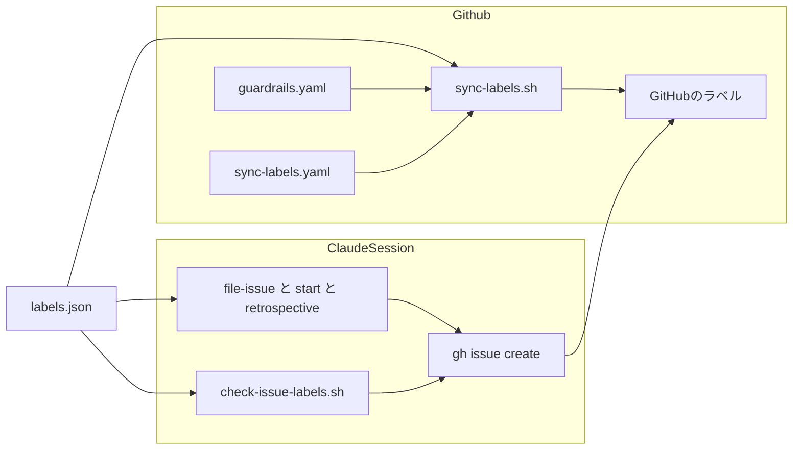
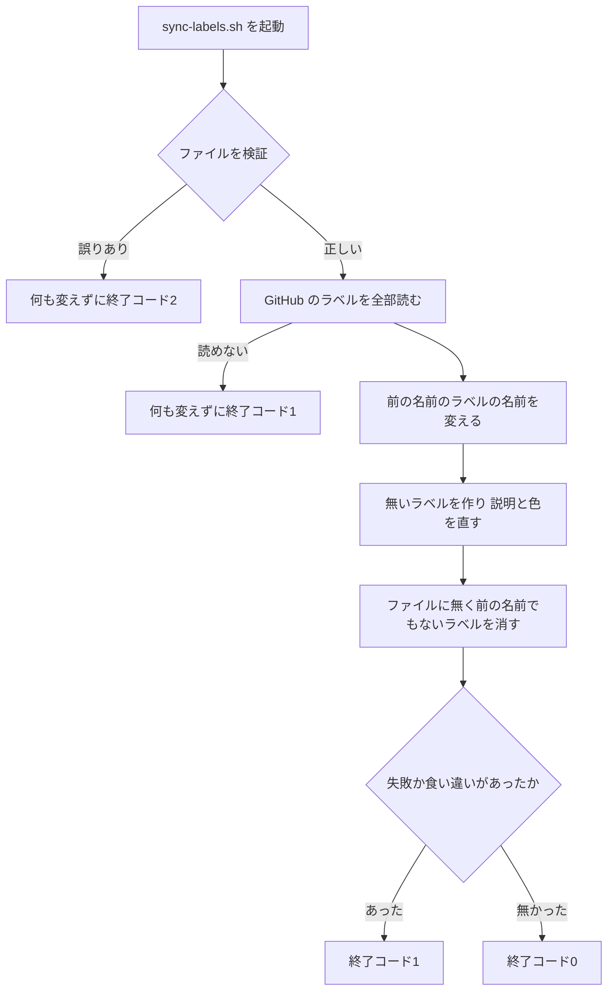

# 設計

## 概要

Claude は、GitHub のラベルの一覧をファイル `.github/labels.json` に置き、3つの仕組みがそのファイルを読むようにする。1つ目は、ファイルが main に入ったときに GitHub のラベルをファイルのとおりにするワークフロー `sync-labels.yaml` とスクリプト `sync-labels.sh` である。2つ目は、Claude が Bash で `gh issue create` を打つ前に、ファイルの決まりのとおりにラベルがそろっているかを確かめ、足りなければ止めるフック `check-issue-labels.sh` である。3つ目は、Claude が起票のたびにファイルを読んでラベルを選ぶ手順を書いた起票の決まり(`file-issue`)である。3つの仕組みはどれも、ラベルの名前や意味や選ぶときの決まりを持たず、ファイルから読む。

Claude は、今の仕組みのうち、起票の決まり(`file-issue`)・着手の手順(`start`)・振り返りの手順(`retrospective`)の起票のコマンドにラベルを足し、Claude の設定 `.claude/settings.json` の `PreToolUse` にフックを1つ足し、PR の検査 `guardrails.yaml` にファイルの検証とスクリプトのテストを足す。

## 作るものと作らないもの

### 作るもの

- ラベルの一覧のファイル `.github/labels.json` と、その形(各ラベルの名前・組・説明・色・前の名前・選ぶときの決まり、種類のラベルの場所のラベルが要るかどうか)
- ファイルを検証し、GitHub のラベルをファイルのとおりにするスクリプト `.github/scripts/sync-labels.sh` と、そのテスト
- スクリプトを main への push と手での起動で動かすワークフロー `.github/workflows/sync-labels.yaml`
- PR の時点でファイルを検証し、スクリプトのテストを流す、`guardrails.yaml` の手順
- Claude の `gh issue create` と、`gh api` で Issue を作るコマンドを、ラベルが足りないときに止めるフック `.claude/hooks/check-issue-labels.sh` と、そのテスト。フックを登録する `.claude/settings.json` の行
- 起票の決まり(`file-issue`)の、ラベルの選び方の節と、起票のコマンドと所有者に見せる案にラベルを入れる直し
- 着手の手順(`start`)の、分け方の案に部分ごとのラベルを入れる直し
- 振り返りの手順(`retrospective`)の、ラベルを作る手順を外し、ファイルの決まりに従って種類のラベルを付ける直し
- README のワークフローの一覧の表と Mermaid の図、`doc/インフラ設計/Github Actions設計/ワークフロー設計.md` の表への、`sync-labels.yaml` の行

### 作らないもの

- 今ある Issue へのラベルの付け直し(requirements の範囲の「決めないこと」)
- PR にラベルを付ける今の仕組み(Dependabot、`guardrails.yaml` の `migration-label`、`/review-loop`、カナリアPRを作るスクリプト)の変更
- ラベルが無いときだけ `gh label create` でラベルを作る今のスクリプト(`audit-issue.sh`、`container-scan-issue.sh`、`lib-ledger-issue.sh`)の変更。これらは、ファイルと同じ名前のラベルがあれば何もしない
- 月次の棚卸しのスクリプト `collect-inventory.sh` が、名前 `retrospective` で振り返りの Issue を数える作りの変更
- 定期実行のワークフローが作る Issue へのラベルの強制
- 既存のフック `block-full-test-in-implementer.sh` と `protect-main.sh` の変更。Claude は、コマンドを区切る作りをこれらのフックから新しいフックに写し、共通の部品には切り出さない
- 必須チェックの追加と、期待一覧 `.github/audit/required-checks.json` の変更。Claude は、新しい手順を、すでに必須チェックである `guardrails.yaml` の中に足す

## 使う既存の仕組み

- GitHub のラベルの REST API(`GET/POST /repos/{owner}/{repo}/labels`、`PATCH/DELETE /repos/{owner}/{repo}/labels/{name}`)。gh の `gh api` で呼ぶ
- ワークフローの `github.token`。権限は `issues: write`
- Claude Code の `PreToolUse` のフック。終了コード2で Bash の実行を止め、標準エラーの文を Claude に渡す
- 既存のフック `block-full-test-in-implementer.sh` の、perl の `Text::ParseWords` でコマンドを区切る作り(写して使う)
- 既存のスクリプトのテストの作り(gh を偽物に置き換え、ネットワークを使わない。例: `.github/scripts/tests/test-close-linked-issues.sh`)
- CODEOWNERS による `.github/` と `.claude/` の保護。ファイル `.github/labels.json` の変更は、所有者が承認するまでマージされない

## 設計を見直すきっかけ

- ファイル `.github/labels.json` の形(欄の名前、`group` の値、`area_required` と `selection_rule` の意味)を変えるとき。フック・スクリプト・起票の決まりの3つが同じ形を読んでいるので、3つとも確かめ直す
- Claude の起票の手順が `gh issue create` 以外の手段(GitHub の MCP など)を使うようになったとき。フックが止められない起票の経路が増える
- `gh issue create` のラベルの受け取り方(`-l` / `--label`、カンマ区切り)や別名(`new`)が変わったとき
- 所有者がファイルで `retrospective` の名前を変えるとき。月次の棚卸しのスクリプト `collect-inventory.sh` は、この名前で振り返りの Issue を数えている
- GitHub のラベルの API の権限や、名前を変えたときの扱いが変わったとき
- Claude Desktop の worktree のセッションが、本体の作業フォルダのフックを使う不具合が直ったとき。フックがファイルを読む場所を見直せる

## プロジェクトの決まりを守っているか

- 新しいライブラリの追加: 足さない。スクリプトは bash と gh と jq(GitHub Actions の ubuntu-latest に入っている)で、フックは bash と perl の標準の部品(JSON::PP、Text::ParseWords)で書く。既製のアクション `crazy-max/ghaction-github-labeler` と比べた結果は research.md にある
- 品質チェックの設定: `.github/` と `.claude/` の下のファイルを足し、変える。これは所有者への提案であり、PR は CODEOWNERS により所有者が承認するまでマージされない。Claude はこれらのファイルに書き込めない設定(`.claude/settings.json` の `deny`)なので、Claude が scratchpad に作った内容を、所有者が写す。変えるのは `.github/workflows/guardrails.yaml`(手順を2つ足す)と `.claude/settings.json`(フックを1行足す)で、既存の検査を緩める変更は無い
- 使う外部の機能がこのリポジトリで使えるか: ラベルの API は、個人の持ち物の公開リポジトリでも使える。ワークフローの `github.token` に `issues: write` を与えれば呼べることを、公式の説明書で確かめた(research.md)。GitHub の「Issue の種類」の機能は組織向けで使えないので、使わない
- 関係のない項目: backend のコードを置く層、frontend の機能ごとの境界、frontend の状態の持ち方、データベースの表の形

## 全体の構成



ファイル `.github/labels.json` だけがラベルの一覧を持ち、ほかの部品はどれもこのファイルを読むだけで書かない。依存の向きは、ファイル → スクリプトとフックと起票の決まり → GitHub のラベル、の一方向である。

スクリプト `sync-labels.sh` は、ファイルの検証と GitHub のラベルの合わせ込みの両方を受け持つ。検証をスクリプトに置くのは、PR の時点の検査(`guardrails.yaml`)と main に入ったときの実行(`sync-labels.yaml`)で、同じ検証を使うためである。ワークフローは、起動の条件と権限だけを持つ。

**使う技術**:
- GitHub Actions の実行環境: `ubuntu-latest` の bash、gh、jq。ラベルの API を呼び、ファイルを読む
- Claude のフックの実行環境: 所有者の PC の bash(Windows では Git for Windows)と perl(JSON::PP、Text::ParseWords)。jq には依存しない(CLAUDE.md の Git規約の前提)
- データの形式: JSON。フックの perl と、スクリプトの jq の両方が読める

## ファイルの構成

Claude が新しく作るファイル:

- `.github/labels.json`: ラベルの一覧。形は「データの形」の節
- `.github/scripts/sync-labels.sh`: ファイルの検証と、GitHub のラベルの合わせ込み
- `.github/scripts/tests/test-sync-labels.sh`: `sync-labels.sh` のテスト。gh を偽物に置き換える
- `.github/workflows/sync-labels.yaml`: `sync-labels.sh` を main への push と手での起動で動かす
- `.claude/hooks/check-issue-labels.sh`: ラベルが足りない起票を止めるフック
- `.claude/hooks/tests/test-check-issue-labels.sh`: `check-issue-labels.sh` のテスト

Claude が変えるファイル:

- `.claude/settings.json`: `PreToolUse` の `Bash` のフックの一覧に `check-issue-labels.sh` を足す
- `.github/workflows/guardrails.yaml`: ジョブ `escape-hatch` に、ファイルの検証(`sync-labels.sh --check`)とテスト(`test-sync-labels.sh`)の手順を足す
- `.claude/skills/file-issue/SKILL.md`: ラベルの選び方の節を足し、起票の案とコマンドにラベルを入れる
- `.claude/skills/start/SKILL.md`: 「Issueを分ける」の分け方の案に、部分ごとのラベルを入れる
- `.claude/skills/retrospective/SKILL.md`: ラベルを作る手順を外し、起票のコマンドに種類と場所のラベルを足し、起票のあとに付けたラベルを示す
- `README.md`: ワークフローの一覧の表に `sync-labels.yaml` の行を足し、Mermaid の図に、ラベルの一覧が main に入ったら GitHub のラベルを合わせる流れを足す
- `doc/インフラ設計/Github Actions設計/ワークフロー設計.md`: ワークフローの表に `sync-labels.yaml` の行を足す

## 処理の流れ



名前の変更、作成と直し、削除の順に行うのは、名前を変えるはずのラベルを、ファイルに無いラベルとして先に消さないためである。

## 部品

### labels.json(ラベルの一覧のファイル)

対応する要件: 1.1, 1.2, 1.3, 1.4, 1.5, 1.6, 3.3, 4.4

**役割**: このファイルは、GitHub のラベルをすべて持ち、ラベルごとの選ぶときの決まりと、種類のラベルごとの場所のラベルが要るかどうかも持つ。Claude は、ファイルの形を「データの形」の節に書く。Claude は、ファイルの初めの中身を次のとおりにする。説明・場所のラベルが要るかどうか・選ぶときの決まりは、requirements の要件1の表の列の文と値にする。

- 種類のラベル(`group` が `kind`): `kind/bug`(色 `d73a4a`、前の名前 `bug`)、`kind/feature`(色 `0e8a16`)、`kind/enhancement`(色 `a2eeef`、前の名前 `enhancement`)、`kind/cleanup`(色 `c5def5`)、`kind/dependency`(色 `bfd4f2`)、`kind/documentation`(色 `0075ca`、前の名前 `documentation`)は、`area_required` を `true` にする。`retrospective`(色 `0e8a16`)は、`area_required` を `false` にする。`retrospective` の説明と色は、今の振り返りの手順の `gh label create` と同じである。`selection_rule` は、`kind/documentation` と `retrospective` にだけ書く
- 場所のラベル(`group` が `area`): `area/app`(色 `f9d0c4`)、`area/infra`(色 `fef2c0`)、`area/dev-platform`(色 `d4c5f9`)
- そのほかのラベル(`group` が `other`): `blocked`、`audit`、`container-vuln`、`canary`、`pre-merge-check`、`migration`、`codex-overruled`、`dependencies`、`java`、`javascript`、`python`、`docker`、`github_actions` は、2026-10-13 の GitHub の説明と色のまま書く

Claude は、ファイルに `duplicate`、`invalid`、`wontfix`、`good first issue`、`help wanted`、`question` を書かない。前の名前の欄にも書かない。

### sync-labels.sh(ファイルを検証し、GitHub のラベルを合わせるスクリプト)

対応する要件: 2.1, 2.2, 2.3, 2.4, 2.5, 2.6

**役割**: このスクリプトは、ファイルを検証し、検証に通れば GitHub のラベルをファイルのとおりにする。どのラベルを作り、直し、名前を変え、消すかの判定はすべてこのスクリプトが持つ。スクリプトは、Issue と PR のラベルの付け外しをしない。消したラベルが Issue と PR から外れるのは、GitHub がラベルを消したときの動きである。

**呼び出し方**:

- `sync-labels.sh --check [--file <パス>]`: ファイルの検証だけを行う。GitHub の API を呼ばない。既定のパスは `.github/labels.json`
- `sync-labels.sh [--file <パス>]`: 検証に通ったら、環境変数 `GITHUB_REPOSITORY`(`<owner>/<repo>`)のリポジトリのラベルを合わせる。gh は環境変数 `GH_TOKEN` で認証する
- 終了コード: 0 は成功。1 は、GitHub のラベルを読めなかったか、書き込みが1件以上失敗したか、前の名前と新しい名前のラベルが両方あった。2 は、ファイルの検証に通らなかった(GitHub のラベルを1つも変えていない)。64 は、引数の誤り

**検証の決まり**: スクリプトは、次のどれかに当たれば、ファイルを誤りとし、どこが誤りかを標準エラーに1行ずつ出して終了コード2で終わる。

- ファイルが無い、読めない、JSON として読めない
- 最上位に配列 `labels` が無い、または `labels` が空
- ラベルに `name`・`group`・`description`・`color` のどれかが無い、または文字列でない
- `group` が `kind`・`area`・`other` のどれでもない
- `color` が6桁の16進数でない(先頭の `#` は誤りとする)
- `description` が100文字を超える(GitHub の上限)
- `previous_names` があって、文字列の配列でない
- `selection_rule` があって、空でない文字列でない
- `group` が `kind` のラベルに `area_required` が無いか、真偽値でない。`group` が `kind` でないラベルに `area_required` がある
- 名前が重なる。名前と前の名前のすべてを、大文字と小文字を区別せずに比べ、2回以上出てくる名前があれば誤りとする
- `group` が `kind` のラベルが1つも無い。または、`area_required` が `true` の種類のラベルがあるのに、`group` が `area` のラベルが1つも無い。どちらのときも、フックが起票を止め続けてしまうためである

**合わせ込みの決まり**: スクリプトは、GitHub のラベルを `gh api --paginate "repos/$GITHUB_REPOSITORY/labels?per_page=100"` で全部読んでから、名前を大文字と小文字を区別せずに比べて、次の順に書き込む。名前を経路に入れるときは、jq の `@uri` で符号化する(`kind/bug` は `kind%2Fbug`)。

1. 名前の変更: ファイルのラベルのうち、その名前のラベルが GitHub に無く、`previous_names` のどれか1つの名前のラベルが GitHub にあるものは、`PATCH /repos/{owner}/{repo}/labels/{前の名前}` に `new_name`・`description`・`color` を渡して名前を変える
2. 前の名前と新しい名前の食い違い: ファイルのラベルの名前のラベルと、その `previous_names` の名前のラベルが、GitHub に両方あるときは、スクリプトは前の名前のラベルの名前を変えず、消さない。スクリプトは、「前の名前 <古い名前> と新しい名前 <新しい名前> のラベルが両方ある。前の名前のラベルが付いた Issue と PR を新しい名前に付け替えてから、前の名前のラベルを GitHub の画面で消す」という文を標準エラーと実行の要約(`$GITHUB_STEP_SUMMARY`)に出し、最後に終了コード1で終わる
3. 作成と直し: ファイルのラベルのうち、GitHub に無いものは `POST /repos/{owner}/{repo}/labels` で作る。ただし、その実行で名前を変える対象にしたラベル(手順1で、前の名前のラベルが GitHub にあったもの)は、名前の変更に失敗したものも含めて作らない。作ると、次の実行から前の名前と新しい名前のラベルが両方ある状態になり、名前を変えられなくなるためである。GitHub にあるかどうかは、最初に読んだ GitHub のラベルで判定する。GitHub にあって説明か色が違うもの、または名前の大文字と小文字だけが違うものは、`PATCH` で直す
4. 削除: GitHub のラベルのうち、ファイルのどのラベルの名前とも、どの `previous_names` とも一致しないものは、`DELETE /repos/{owner}/{repo}/labels/{名前}` で消す

スクリプトは、作った・直した・名前を変えた・消したラベルを、1件ずつ標準出力と実行の要約に書く。

**失敗したとき**: GitHub のラベルを読めなかったときは、スクリプトは書き込みを1回も呼ばずに終了コード1で終わる。書き込みが失敗したときは、スクリプトは失敗したラベルと gh の文を標準エラーに出し、残りの書き込みを続け、最後に終了コード1で終わる。gh の1回の呼び出しは60秒で打ち切る。

### sync-labels.yaml(ファイルが main に入ったら GitHub のラベルを合わせるワークフロー)

対応する要件: 2.1, 2.6, 2.7

**役割**: このワークフローは、`sync-labels.sh` のテストを流してから、`sync-labels.sh` を1回呼ぶ。何を作り何を消すかはスクリプトが判定し、ワークフローは判定しない。

**権限**: ワークフローに与える権限は、`contents: read`(コードを checkout するため)と `issues: write`(ラベルを作り、直し、消すため)の2つに限る。トークンは `github.token` を使い、シークレットを使わない。`github.token` によるラベルの変更は、ほかのワークフローを起動しない。

**いつ動くか**:
- 起動するイベント: `push`(ブランチ `main`、パス `.github/labels.json`、`.github/scripts/sync-labels.sh`、`.github/workflows/sync-labels.yaml`)と、手での起動(`workflow_dispatch`)
- 動かす条件: `github.ref` が `refs/heads/main` であること。手での起動で main 以外のブランチを選んだときは、ジョブを動かさない
- 同時実行: `sync-labels` の組で1つずつ動かす。あとから起動したものは、先に動いているものを止めずに待つ(`cancel-in-progress: false`)
- 時間の上限: ジョブ全体を10分で打ち切る

**手順**: ワークフローは、main を、認証情報を残さない設定(`persist-credentials: false`)で checkout する。Claude は、ワークフローが使うアクションを、コミットの SHA で固定する(既存の `actions/checkout` の固定と同じ版)。次に、ワークフローは `bash .github/scripts/tests/test-sync-labels.sh` を流し、テストが落ちたらスクリプトを呼ばずにジョブを失敗にする。最後に `GH_TOKEN: ${{ github.token }}` を渡して `bash .github/scripts/sync-labels.sh` を呼ぶ。スクリプトが0以外で終わったら、ジョブは失敗として終わる。

### guardrails.yaml の手順(PR の時点でファイルを検証する手順)

対応する要件: 2.5

**役割**: Claude は、必須チェックであるジョブ `escape-hatch` に、次の2つの手順を足す。1つ目は `bash .github/scripts/tests/test-sync-labels.sh` で、スクリプトのテストを流す。2つ目は `bash .github/scripts/sync-labels.sh --check` で、PR のファイルを検証する。Claude は、2つの手順を、既存の手順 `Test close linked issues` のあと、`Check owner approval` の前に置く。承認待ちで失敗する手順(`Run escape hatch check`)より前に置くことで、`.github/` を変える PR でも、所有者の承認を待たずに検証が動く。どちらの手順も GitHub の API を呼ばず、新しい権限を使わない。

### check-issue-labels.sh(ラベルが足りない起票を止めるフック)

対応する要件: 4.1, 4.2, 4.3, 4.4, 4.5, 4.6, 4.7

**役割**: このフックは、Claude が Bash で打つコマンドの中に Issue を作るコマンドがあれば、ラベルの一覧のファイルと照らして、止めるかどうかを判定する。止めるときは、終了コード2で終わり、理由を標準エラーに出す。ラベルを選ぶことと、コマンドを書き換えることはしない。

**いつ動くか**: Claude は、このフックを、`.claude/settings.json` の `PreToolUse` の `matcher: "Bash"` に、既存の2つのフックに続けて登録する。時間の上限は15秒。このフックは、メインのセッションとサブエージェントのどちらのコマンドでも動く。所有者が自分の端末で打つコマンドと、ワークフローが作る Issue には関わらない。

**コマンドの読み方**: フックは、`block-full-test-in-implementer.sh` と同じく、perl の `Text::ParseWords` でコマンドを `&&` `||` `;` `|` `&` 改行で区切り、`sh -c '...'` と `bash -c '...'` の中も読む。区切った1つのコマンドについて、フックは次のとおりに読む。

- 語が `NAME=$(` で始まるときは、`NAME=` と `$(` を外した残りを語として読む。語の頭の `$(`、`(`、`` ` `` と、語の末尾の `)`、`` ` `` を外す(`url=$(gh issue create ... --label area/app)` の形を読むため)。そのあとで、先頭に残った `NAME=value` の形の語(環境変数の指定)を飛ばす
- 最初の語の名前(パスと `.exe` を外したもの)が `gh` で、続く語が `issue` と `create`、または `issue` と `new`(`create` の別名)なら、Issue を作るコマンドとみなす
- 最初の語が `gh` で、続く語が `api` なら、次のどちらかのときに Issue を作るコマンドとみなす。1つは、経路の語が `repos/<owner>/<repo>/issues`(先頭の `/` と末尾の `/` は問わない)で、`-f` `-F` `--field` `--raw-field` `--input` のどれかか、`-X POST` / `--method POST` があるとき。ただし、`-X` / `--method` に `POST` 以外が書かれているときは、Issue を作るコマンドとみなさない。もう1つは、`graphql` の呼び出しの語のどれかに `createIssue` を含むとき
- `gh issue edit` や `gh issue comment` など、Issue を作らないコマンドは見ない

**止める決まり**: Issue を作るコマンドが見つかったら、フックは次の順に判定し、最初に当たったもので止める。

1. `gh api` で Issue を作るコマンドなら止める。理由は「Issue は `gh issue create` で `--label` を付けて起票する」とする
2. `-R` / `--repo` があり、その値がこのリポジトリでなければ、止めずに通す。このリポジトリは、`cwd` の `git remote get-url origin` の `<owner>/<repo>` で決める。大文字と小文字は区別しない
3. `--template` / `-T`、`--recover`、`--web` / `-w`、`--editor` / `-e` のどれかがあれば止める。理由は「コマンドに書かれていないラベルが付くか、ラベルを確かめられない形である」とする
4. ラベルの一覧のファイルを読めないか、JSON として読めないか、`group` が `kind` のラベルが1つも無ければ止める。理由は「ラベルの一覧のファイルを読めないので起票を止めた」とする
5. `-l` / `--label` の値(`--label=値` の形を含む)をすべて集め、カンマで分け、前後の空白を外す。ファイルの `group` が `kind` のラベルの名前と、大文字と小文字を区別せずに比べ、一致する数が1でなければ止める
6. 一致した種類のラベルの `area_required` が `true` で、ファイルの `group` が `area` のラベルの名前と一致する数が0なら止める。`area_required` が `false` なら、場所のラベルの有無を見ない

フックは、ラベルの名前を持たない。どのラベルが種類で、どの種類が場所のラベルを要るかは、すべてファイルの `group` と `area_required` で決める。

**ラベルの一覧のファイルを読む場所**: フックは、入力の `cwd` で `git rev-parse --show-toplevel` を呼び、その下の `.github/labels.json` を読む。`cwd` が無いか、リポジトリの中でなければ、環境変数 `CLAUDE_PROJECT_DIR` の下の `.github/labels.json` を読む。フック自身の置き場所からはたどらない。Claude Desktop の worktree のセッションが本体の作業フォルダのフックを使ったときに、本体の作業フォルダの古いファイルを読まないためである。

**止めたときに出す文**: フックは、標準エラーに次を出す。

- 止めた理由(上の決まりのどれに当たったか。種類のラベルの数が違うときは、見つかった数)
- ファイルの `group` が `kind` のラベルの名前・説明・場所のラベルが要るかどうか・選ぶときの決まりの一覧
- ファイルの `group` が `area` のラベルの名前と説明の一覧
- ラベルの選び方は起票の決まり(`.claude/skills/file-issue/SKILL.md` の「ラベルの選び方」)に従うこと

**失敗したとき**: フックの入力が JSON として読めないときと、コマンドの欄が無いときは、フックは止めずに通す(既存のフックと同じ)。Issue を作るコマンドを見つけたあとでファイルを読めないときは、止める(上の決まりの4)。

### file-issue の直し(起票の決まり)

対応する要件: 3.1, 3.2, 3.3, 3.4, 3.5, 3.6, 3.7

**役割**: Claude は、起票の決まり `.claude/skills/file-issue/SKILL.md` に、「## ラベルの選び方」の節を足す。この節は、Claude がどの起票の経路でも従うラベルの選び方の手順を1か所にまとめる。この節には、ラベルの名前と、ラベルごとの選ぶときの決まりを書かない。節に書く手順は次のとおりである。

- Claude は、起票のたびに、作業フォルダの `.github/labels.json` を読む
- Claude は、`group` が `kind` のラベルの `description` と `selection_rule` を読み、Issue に当たるものを1つ選ぶ。2つ以上に当たりそうなときは、本文の「どうなれば解決か」の一番の目的で選び、その節が無ければ「やりたいこと」、それも無ければ「困っていること」の一番の目的で選ぶ
- 選んだ種類のラベルの `area_required` が `true` なら、Claude は `group` が `area` のラベルの `description` を読み、Issue が変える場所に当たるものをすべて選ぶ。`false` なら、場所のラベルを選ばない
- 所有者がラベルを直すよう言ったら、Claude は言われたラベルに直す

Claude は、起票の決まりの手順を、次のとおり直す。

- 「Step 3: 案を書く」に、ラベルの選び方の節に従ってラベルを選ぶことを足す
- 「Step 4: 所有者に見せる」の、チャットに出すものに、付けるラベルを足す
- 「Step 5: 起票する」のコマンドを `gh issue create --title "<題名>" --body-file <本文のファイル> --label <種類のラベル> --label <場所のラベル>`(場所のラベルが2つ以上なら `--label` を重ね、場所のラベルを選ばなかったら場所の `--label` を書かない)にする
- 「分けた部分のIssue」のコマンドに、同じく `--label` を足す。部分ごとに、ラベルの選び方の節に従って選ぶ
- 「実装の途中で小さく分けるとき」の、起票したあとに番号と題名を示す箇条に、付けたラベルも示すことを足す
- 冒頭の「監査の通知と振り返りのIssueは対象外」の行は残す。Claude は、振り返りの手順で起票するときは、振り返りの手順の様式に従い、起票の決まりのうちラベルの選び方の節だけを使う

### start の直し(着手の手順)

対応する要件: 3.5, 3.6

**役割**: Claude は、着手の手順 `.claude/skills/start/SKILL.md` の「Issueを分ける」の書式の「分けた部分のIssueの案」に、部分ごとに「ラベル: <種類のラベル>、<場所のラベル>」の行を足す。この行は書式の欄であり、Claude は、この行にラベルの名前を書かない。Claude は、ラベルを起票の決まりのラベルの選び方の節に従って選ぶ。所有者が分け方を了承したら、Claude は、了承された案のラベルのとおりに起票する。

### retrospective の直し(振り返りの手順)

対応する要件: 3.5

**役割**: Claude は、振り返りの手順 `.claude/skills/retrospective/SKILL.md` から、「ラベルが無ければ作成する」の手順と `gh label create retrospective` のコマンドを外す。振り返りのラベルは `.github/labels.json` が持ち、ワークフローが作るためである。Claude は、起票のコマンドを `gh issue create --label <種類のラベル> [--label <場所のラベル>] --title ... --body ...` にし、ラベルを起票の決まりのラベルの選び方の節に従って選ぶことを書く。手順には、ラベルの名前 `retrospective` を書かない。ファイルの初めの中身では、`retrospective` の `selection_rule` が振り返りの手順の Issue を指し、`area_required` が `false` なので、Claude は `retrospective` だけを付ける。起票したあとに、Claude は、Issue の番号と付けたラベルを所有者に示す。

## データの形

ファイル `.github/labels.json` は、次の形の JSON である。

```json
{
  "labels": [
    {
      "name": "kind/bug",
      "group": "kind",
      "description": "今ある機能が本来の動きをしていないので、本来の動きに直す",
      "color": "d73a4a",
      "area_required": true,
      "previous_names": ["bug"]
    },
    {
      "name": "retrospective",
      "group": "kind",
      "description": "ゲートすり抜けの振り返り(月次監査の棚卸し対象)",
      "color": "0e8a16",
      "area_required": false,
      "selection_rule": "振り返りの手順(/retrospective)で起票する Issue にだけ付ける"
    },
    {
      "name": "area/app",
      "group": "area",
      "description": "利用者が使う画面・API・データベースの中身",
      "color": "f9d0c4"
    }
  ]
}
```

| 欄 | 必須か | 意味 |
|---|---|---|
| `name` | 必須 | GitHub のラベルの名前 |
| `group` | 必須 | `kind`(種類のラベル)、`area`(場所のラベル)、`other`(そのほかのラベル)のどれか |
| `description` | 必須 | GitHub の画面に出す説明。100文字まで |
| `color` | 必須 | 先頭の `#` を付けない6桁の16進数 |
| `area_required` | 種類のラベルだけに必須 | 真偽値。`true` なら、このラベルを付ける Issue に場所のラベルが1つ以上要る。種類のラベル以外には書かない |
| `selection_rule` | 任意 | Claude がこのラベルを付けるかどうかを決めるときの決まり。GitHub には送らない。字数の上限は無い |
| `previous_names` | 任意 | このラベルの前の名前の配列。GitHub にこの名前のラベルがあり、`name` のラベルが無ければ、スクリプトが名前を変える |

スクリプトは、`area_required` と `selection_rule` を GitHub に送らない。GitHub に送るのは `name`・`description`・`color` だけである。

ラベルの並び順に意味は無い。所有者が読みやすいよう、`kind`、`area`、`other` の順に並べる。

## 失敗したときの扱い

- ファイルの誤り: PR の時点で `guardrails.yaml` の `escape-hatch` が赤になり、マージされない。main に入ったあとで見つかったときは、ワークフローが失敗する
- ラベルの書き込みの失敗: 所有者は Actions の画面で失敗を見て、原因を直したあと、ワークフローを手で起動し直す。スクリプトは何度動いても同じ結果になるので、やり直しの実行で、前の実行で書き込みに失敗したラベルもファイルのとおりになる
- 起票を止めたとき: Claude はフックの文を読み、ラベルを選び直して起票し直す。ラベルの一覧のファイルを読めずに止めたときは、Claude は起票せずに、そのことを所有者に伝える

Claude は、ワークフローの失敗を所有者に Issue で知らせる仕組みを作らない(requirements の要件2で、所有者はワークフローの失敗を GitHub の Actions の画面で見ると決めたため)。

## テストの方針

- スクリプトのテスト(`test-sync-labels.sh`。gh を偽物に置き換え、偽物が受けた呼び出しを記録して確かめる)
  - 検証: 空の `labels`、`group` の誤り、`#` 付きの色、101文字の説明、名前と前の名前の重なり(大文字と小文字の違いを含む)、種類のラベルの `area_required` の欠け、種類でないラベルの `area_required`、空の `selection_rule`、`kind` が無いファイル、`area_required` が `true` の種類があるのに `area` が無いファイルを、それぞれ終了コード2で退け、API を呼ばないこと(要件2の、ファイルを読めないときやラベルが1つも書かれていないときは GitHub のラベルを1つも変えずに失敗として終わる受入基準)
  - 合わせ込み: GitHub に無いラベルを作り、説明の違うラベルを直し、ファイルに無いラベル(`question` など)を消すこと(要件2の、GitHub のラベルをファイルのとおりに作り・直し・消す受入基準、所有者が手で足したラベルも消す受入基準、消したラベルが Issue と PR から外れる受入基準)
  - 名前の変更: GitHub に `bug` だけがあるときは `bug` の名前を `kind/bug` に変え、`bug` を消さないこと。GitHub に `bug` と `kind/bug` が両方あるときは、`bug` を変えず消さず、終了コード1で終わること。`bug` の名前の変更が失敗したときは、同じ実行で `kind/bug` を作らず、終了コード1で終わること。2回続けて動かしたとき、2回目は何も書き込まないこと(要件2の、古い名前のラベルを消して作り直さずに名前だけを変える受入基準)
  - 失敗: ラベルを読めないときに書き込まないこと。書き込みの1件が失敗しても残りを続け、終了コード1で終わること(要件2の、ワークフローが失敗として終わったら所有者が Actions の画面で失敗を見られる受入基準)
  - 符号化: `kind/bug` と `good first issue` の経路が `kind%2Fbug` と `good%20first%20issue` になること
  - 送る欄: 作成と直しで GitHub に送る欄が `name`(または `new_name`)・`description`・`color` だけで、`area_required` と `selection_rule` を送らないこと
- フックのテスト(`test-check-issue-labels.sh`。フックに Bash の入力の JSON を渡し、終了コードと標準エラーを確かめる。テスト用のリポジトリを一時フォルダに作り、`.github/labels.json` を置く)
  - 止める形: ラベル無し、種類のラベルが2つ(`--label kind/bug,kind/feature` と `--label` の重ね書きの両方)、場所のラベル無し、`--web`、`--template`、`gh api repos/o/r/issues -f title=x`、`gh api graphql -f query='mutation{createIssue...}'`、`gh issue new` のラベル無し、`url=$(gh issue create ...)` のラベル無し、`sh -c 'gh issue create ...'`、ファイルが無いとき、ファイルが壊れているとき(要件4の、種類のラベルが無いか2つ以上の起票、場所のラベルが無い起票、ラベルの一覧のファイルを読めないときの起票を止める受入基準)
  - 通す形: 種類のラベル1つと場所のラベル1つ以上、大文字の違い、`--label=kind/bug` の形、`url=$(gh issue create ... --label kind/bug --label area/app)`、`area_required` が `false` の種類のラベル(`retrospective`)だけの起票、`-R other/repo` の起票、`gh api repos/o/r/issues -X GET -f state=open`、`gh issue edit --add-label`、`gh issue list`、入力が JSON でないとき(要件4の、止める対象にしない Issue と PR を挙げた受入基準と、すでにある Issue のラベルの付け替えを止めない受入基準)
  - ファイルに従うこと: ファイルに種類のラベル `kind/test` を足したテスト用のファイルでは、`--label kind/test` の起票を通すこと。`kind/bug` の `area_required` を `false` に変えたテスト用のファイルでは、場所のラベルの無い `--label kind/bug` の起票を通すこと(要件4の、起票を止める判定がそのときのラベルの一覧のファイルで決まる受入基準)
  - 止めたときの文に、種類のラベルの一覧(場所のラベルが要るかどうかと選ぶときの決まりを含む)と場所のラベルの一覧が出ること
- 手順の確かめ: 起票の決まり・着手の手順・振り返りの手順の本文に、ラベルの名前(`kind/`・`area/` で始まる名前と `retrospective`)が、例のほかに書かれていないことを、Claude が実装のときに grep で確かめる(要件3の、起票の手順にラベルごとの選ぶときの決まりを書かない受入基準)
- 名前の変更の確かめ(マージの前): 名前を変えたラベルが Issue から外れないことは、公式の説明書に明記が無い。Claude は、所有者の了承を得て作る使い捨てのリポジトリで、ラベルを付けた Issue を作り、`PATCH` でラベルの名前を変えたあとも Issue にラベルが付いていることを確かめる。外れたときは、マージせずに設計を見直す(要件2の、名前を変えたラベルが付いていた Issue と PR に付いたまま残る受入基準)
- 手での確かめ(マージのあと、所有者が Actions の画面で行う)
  - 初めての実行で、`bug`・`enhancement`・`documentation` の名前が変わり、今それらが付いている Issue に新しい名前のラベルが付いていること。`duplicate` など6つが消えていること(要件1の、`bug`・`enhancement`・`documentation` を名前を変えたラベルとして書く受入基準と、`duplicate` など6つをファイルに書かない受入基準)

フックのテストは、ほかのフックのテストと同じく、コンテナの中か Git Bash で手で流す。CI には足さない。

## 安全

- ラベルを消す変更は、付いていた Issue と PR からラベルを外し、戻せない。そのため、Claude は、ファイルを `.github/` の下に置く
- ワークフローは main のファイルとスクリプトだけを動かし、PR のコードを書き込みの権限つきで動かさない。トークンは `github.token` で、権限は `issues: write` に限る
- フックは、Claude が自分の作業のブランチで `.github/labels.json` を書き換えて判定を緩めることを防げない。ただし、Claude は `.github/` の下に書き込めない設定である

## 移行

この spec の PR がマージされると、`sync-labels.yaml` が初めて動き、GitHub のラベルを次のとおり変える。

1. `bug`・`enhancement`・`documentation` の名前を `kind/bug`・`kind/enhancement`・`kind/documentation` に変える
2. `kind/feature`・`kind/cleanup`・`kind/dependency`・`retrospective`(種類のラベル)・`area/app`・`area/infra`・`area/dev-platform` を作る
3. `duplicate`・`invalid`・`wontfix`・`good first issue`・`help wanted`・`question` を消す

フック `check-issue-labels.sh` は、`.claude/settings.json` への登録がマージされた時点から、新しく開いたセッションで働く。マージから初めての実行が終わるまでの間に Claude が `kind/...` のラベルで起票すると、GitHub にまだそのラベルが無いので、gh が起票に失敗する。そのときは、Claude はワークフローの実行が終わるのを待って起票し直す。
