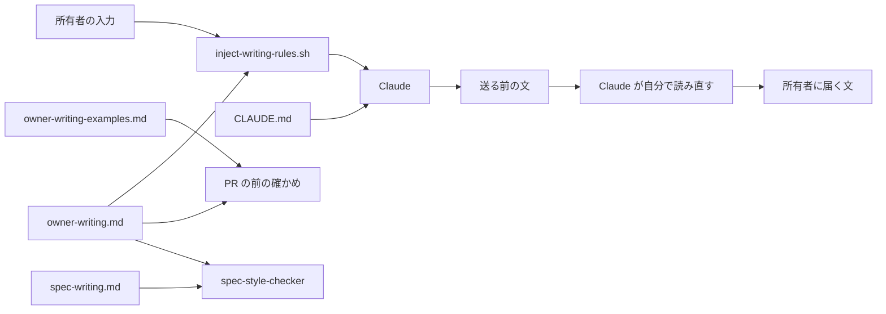

# 設計

## 概要

Claude は、所有者に送る文の書き方の決まりを、`.kiro/settings/rules/owner-writing.md` の1つのファイルにまとめる。所有者は、Claude の報告・問い・spec・Issue・PR の文を読んで作業を進めるかどうかを決める。

Claude が決まりを読み忘れないように、Claude は、決まりの要点を Claude に渡す新しいフック `inject-writing-rules.sh` を作る。

## 作るものと作らないもの

### 作るもの

- 書き方の決まりのファイル `owner-writing.md` と、その組み立ての決まり(決まりごとの見出し、1文の決まり、外れた文の例、直した文の例)
- 例の一覧 `owner-writing-examples.md` と、一覧を使って Claude が自分で確かめる手順
- 決まりの名前と1文の決まりを Claude に渡すフック `inject-writing-rules.sh` と、そのテスト
- CLAUDE.md の、決まりのファイルを読み、送る前に読み直すことを Claude に指示する1行
- `spec-writing.md` から7つの決まりを移す直し
- `spec-style-checker` が決まりのファイルでも spec の本文を点検する直し
- `/start` の Step 6 と `/spec-review` の Step 7 の報告の書式の直し
- メモリにある書き方の決まりを移し、マージのあとにメモリから消す作業

### 作らないもの

- 送る文を別のエージェントに読ませる仕組み
- 送る前の読み直しが行われたかを機械で確かめる仕組み。文がわかりやすいかは機械では判定できないためである
- `spec-writing.md` を名指しで読む 22 のファイルのうち、`spec-style-checker` の定義のほかのファイルの書き換え。Claude は、理由を research.md の「spec-writing.md を読むスキルを書き換えない」に書いた

## 使う既存の仕組み

- `.claude/settings.json` の `UserPromptSubmit` のフック: フックが終了コード0で標準出力に書いた文は、所有者の入力と一緒に Claude に渡る。今は `notify-spec-review.sh` と `session-registry.sh` が使っている
- `/spec-review` の Step 1.5: 審査役を起動する前に、点検役 `spec-style-checker` に spec の本文を点検させる工程。Claude は、この工程のうち点検役の定義だけを直す
- `.github/CODEOWNERS`: `/.claude/` と `/.github/` を直す PR は、所有者が承認するまでマージされない。`/.kiro/` と `CLAUDE.md` は含まれない
- `.branch_name_template` と `.commit_template`: 例を足す PR のブランチ名とコミットメッセージの決まり

## 設計を見直すきっかけ

- 決まりのファイルの見出しの組み立て(`## 決まり` の節と、その下の `### ` の見出し、見出しの直後の1文)を変えるとき。フックはこの組み立てで決まりを抜き出す
- Claude Code の `UserPromptSubmit` のフックが標準出力を Claude に渡す動きや、渡せる文の長さの上限が変わったとき
- 決まりのファイルか例の一覧の置き場所を、`.github/CODEOWNERS` に書かれた場所に移すとき。例を足す PR が所有者の承認を待つようになる

## プロジェクトの決まりを守っているか

- 品質チェックの設定: この spec は、`.claude/settings.json` `.claude/hooks/` `.claude/agents/` `.claude/skills/` を変える。これは所有者への提案であり、この spec の PR は、`.github/CODEOWNERS` により所有者が承認するまでマージされない。Claude は、品質チェックの中身(検査の対象、しきい値、除外)を変えない
- 新しいライブラリの追加: 足さない
- 関係のない項目: backend のコードを置く層、frontend の機能ごとの境界、frontend の状態の持ち方、データベースの表の形、使う外部の機能がこのリポジトリで使えるか

## 全体の構成



Claude は、決まりの本文を `owner-writing.md` の1か所にだけ書く。決まりの本文が1か所にしか無いので、決まりと例を足す PR は `owner-writing.md` と `owner-writing-examples.md` だけを直す。

Claude は、決まりを2つの経路で受け取る。CLAUDE.md の1行は、会話の始めに読み込まれ、決まりのファイルの場所と、送る前に読み直すことを Claude に伝える。フックは、所有者が入力するたびに決まりの要点を渡し、会話が長くなっても、Claude が返事を書く直前に決まりが目に入るようにする。Claude は、比べた案を research.md の「比べた案」に書いた。

**使う技術**:
- フック: bash と perl(JSON::PP)。今あるフックと同じく jq には頼らない
- 決まりと例: Markdown

## ファイルの構成

Claude が新しく作るファイル:

- `.kiro/settings/rules/owner-writing.md`: 書き方の決まりのファイル
- `.kiro/settings/rules/owner-writing-examples.md`: 例の一覧
- `.claude/hooks/inject-writing-rules.sh`: 決まりの要点を渡すフック(所有者が写す)
- `.claude/hooks/tests/test-inject-writing-rules.sh`: フックのテスト(所有者が写す)

Claude が変えるファイル:

- `.claude/settings.json`: `UserPromptSubmit` に `inject-writing-rules.sh` を足す(所有者が写す)
- `CLAUDE.md`: 作業規約の節に、決まりのファイルを指す1行を足す
- `.kiro/settings/rules/spec-writing.md`: 7つの決まりを消し、冒頭に決まりのファイルを指す文を足す
- `.claude/agents/spec-style-checker.md`: 点検に決まりのファイルを加える
- `.claude/skills/start/SKILL.md`: Step 6 の理由の表の書式を直す
- `.claude/skills/spec-review/SKILL.md`: Step 7 の報告の見本を直す

Claude がリポジトリの外で変えるもの:

- 所有者の PC の Claude Code のメモリのファイルと目次(MEMORY.md)

## 部品

### owner-writing.md(書き方の決まりのファイル)

対応する要件: 1.1, 1.2, 1.3, 1.4, 1.5, 1.6, 1.8, 2.1, 2.2, 2.3, 2.4, 3.5, 4.1, 4.2, 4.3, 4.4

**役割**: このファイルは、所有者に送る4つの文に共通の書き方の決まりを持つ。Claude は、このファイルを次の組み立てで書く。

- 冒頭の節: このファイルを読む人と読む時(所有者に送る文を書く前)を書く。続けて、Claude が送る前に自分で読み直す3つの文(チャットの報告と問い、Issue の本文、PR の本文)と、読み直す時を書く。読み直す時は、チャットでは所有者に見せる前、Issue では本文の案を所有者に見せる前と起票する前と本文に書き足す前、PR では作る前と本文を書き換える前である。spec の本文は点検役 `spec-style-checker` が点検するので、Claude の読み直しの対象にしないことも書く。あわせて、読み直しに別のエージェントを使わないことと、読み直したことをそのたびに報告しないことを書く。決まりの例外(画面の名前、ファイル名とコマンドと設定の名前、引用した部分、「ラベル: 内容」の形の箇条書き)と、例に書かないもの(まだ直していないセキュリティの穴の中身、秘密の値)も、この節に書く
- `## 決まり` の節: 決まりごとに `### <決まりの名前>` の見出しを置く。見出しの直後の段落の1文目に、決まりを1文で書く。その下に、外れた文の例と直した文の例を、差し戻された前後の文も含めたまとまりで書く。所有者が差し戻した文がどこにも残っていない決まりでは、Claude は外れた文の例を作り、Claude が作った例であることを書き添える
- `## 決まりに入れない書き方` の節: 所有者がわかりにくい文に入れないと決めた4つの書き方を並べる。Claude は、これらを `## 決まり` の節に入れない
- `## 決まりと例を足すとき` の節: 所有者がわかりにくいと指摘したときの手順と、決まりを変える PR での確かめの手順を書く(下の「決まりと例を足す手順」)

`## 決まり` の節に置く決まりは、次の出どころから集める。

- 元の要望の「やりたいこと」の、所有者が差し戻した7つの種類
- 元の要望の「壁打ちで決めた、わかりにくい文の種類」で、わかりにくい文に入れると決めた16の種類
- メモリと会話の記録で所有者が差し戻した文の種類のうち、上の2つに無いもの
- `spec-writing.md` から移す7つの決まり

出どころが違っても同じことを決めている決まりは、Claude は1つの見出しにまとめる。たとえば、壁打ちの5回目で、spec の本文から所有者に送る4つの文すべてに広げると決めた4つの決まりは、`spec-writing.md` から移す7つの決まりに含まれるので、Claude は移した決まりの見出しに壁打ちの例を足す。

**決まりと例を足す手順**: Claude は、`## 決まりと例を足すとき` の節に、次の手順を書く。

1. 所有者が、Claude が送った文をわかりにくいと指摘したら、Claude は、その文を書き直して送り直す
2. Claude は、`git fetch origin` のあと、`git worktree add <scratchpad のフォルダ> -b docs/<短い説明> origin/main` で、そのとき進めている作業のブランチとは別のブランチと作業フォルダを作る
3. Claude は、その作業フォルダで、指摘された文と書き直した文を、`owner-writing.md` の当たる決まりの例と、`owner-writing-examples.md` に足す。当たる決まりが無いときは、Claude は新しい `### ` の見出しを足す
4. Claude は、`owner-writing-examples.md` のすべての文で、例の一覧での確かめ(下の owner-writing-examples.md の節)をやり直し、結果を PR の本文に書く
5. Claude は、コミットし、push し、`gh pr create` で PR を作る。Claude は、PR を作ったことを、PR の番号を添えてチャットに1文で書く。そのあと、Claude は `git worktree remove` で作業フォルダを消す

`.claude/` と `.github/` のファイルを直さないので、この PR は所有者の承認を待たずにマージされる。

### owner-writing-examples.md(例の一覧)

対応する要件: 3.1, 3.2, 3.3, 3.4, 3.5, 3.6

**役割**: このファイルは、所有者がこれまでに差し戻した文と、Claude が書き直した文の組を持つ。Claude は、1つの組を `### <番号> <出どころ>` の見出しで書き、その下に「差し戻された文」「書き直した文」「当たる決まり」の3つの欄を置く。出どころには、メモリのファイル名、会話の日付、spec のファイル名のどれかを書く。

**確かめの手順**: この spec の PR を作る前と、決まりのファイルの決まりを変える PR を作る前に、Claude は次のとおりに確かめる。

1. Claude は、組ごとに、差し戻された文を、引用ではなく自分が送る文として読み、`owner-writing.md` のどの決まりから外れるかを書く
2. Claude は、組ごとに、書き直した文が、どの決まりからも外れないことを確かめる
3. 外れる決まりを挙げられない差し戻された文か、決まりから外れる書き直した文があれば、Claude は、`owner-writing.md` の決まりと例を直し、1から確かめ直す
4. Claude は、組ごとの結果(外れる決まりの名前と、書き直した文が外れないこと)を、PR の本文の表に書く

### inject-writing-rules.sh(決まりの要点を渡すフック)

対応する要件: 1.1, 2.1

**役割**: このフックは、`owner-writing.md` の `## 決まり` の節から、`### ` の見出しと、見出しの直後の段落の1文目(最初の「。」まで)を抜き出し、標準出力に書く。フックは、決まりの本文と例を持たない。フックは、所有者の入力の中身を読まず、判定もしない。

**いつ動くか**: このフックは、`.claude/settings.json` の `UserPromptSubmit` で、所有者が入力するたびに動く。Claude は、このフックの打ち切りの時間を10秒にする。

**呼び出し方**:

- 入力: 標準入力のフックの入力は読み捨てる。決まりのファイルは `${CLAUDE_PROJECT_DIR}/.kiro/settings/rules/owner-writing.md` から読む。`CLAUDE_PROJECT_DIR` が無いときは、今の作業フォルダを使う
- 出力: 次の形の文を標準出力に書く

  ```text
  [writing] 所有者に送る文は、次の決まりで書き、送る前に自分で読み直す。例は .kiro/settings/rules/owner-writing.md にある。
  - <決まりの名前>: <1文の決まり>
  - ...
  ```

- 長さ: 抜き出した文が9千字を超えたら、フックは超えた分の行を書かず、最後に「残りの決まりは owner-writing.md を開いて読む」の1行を書く。`notify-spec-review.sh` の注記では、Claude Code がフックの標準出力として受け取る文の上限は1万字である。字数は、バイトではなく文字で数える
- 終了コード: どの場合も0で終わる。フックは所有者の入力を止めない

**権限**: `.claude/settings.json` の permissions の deny により、Claude は `.claude/hooks/` の下のファイルと `.claude/settings.json` を書けない。Claude は、フックとそのテストと、変更後の `.claude/settings.json` の全文を scratchpad に作り、所有者に、作業フォルダに写すコマンドを示す。所有者が写したあとに、Claude はテストを動かし、コミットする。

**失敗したとき**: 決まりのファイルが無いときと、`## 決まり` の節が無いときは、フックは「[writing] 書き方の決まりのファイル .kiro/settings/rules/owner-writing.md を読めない」の1行だけを書き、0で終わる。

### CLAUDE.md の作業規約の1行(決まりのファイルを指す指示)

対応する要件: 1.1, 2.1, 2.2, 2.3, 4.1

**役割**: Claude は、作業規約の節の、日本語で書く決まりの行の近くに、1行を足す。この1行は、Claude に、次の3つを指示する。1つ目は、所有者に送る4つの文を書く前に `owner-writing.md` を読むこと。2つ目は、チャットの報告と問い、Issue の本文、PR の本文の3つを、送る前に `owner-writing.md` の決まりと照らして自分で読み直すこと。3つ目は、所有者がわかりにくいと指摘したら `owner-writing.md` の「決まりと例を足すとき」の手順に従うこと。Claude は、この1行に決まりの本文を写さず、`owner-writing.md` を指す文だけを書く。

### spec-writing.md の直し(7つの決まりを移す)

対応する要件: 1.6

**役割**: Claude は、`spec-writing.md` の「文の書き方」「design.md の書き方」「繰り返しの扱い」の節から、次の7つの見出しと、その本文と例を消す。

- 文ごとに主語と目的語を書く
- 番号だけで別の箇所を指さない
- 指すものを文の中で言い切る
- 実際に動く人や物を主語にする
- 英語の定型文を使わず、見出しと欄を日本語で書く
- 専門用語の意味を書き添える
- 1つの文書で同じ決めごとを繰り返さない

Claude は、消した決まりの例と例外を、`owner-writing.md` の同じ決まりの見出しの下に移す。「文ごとに主語と目的語を書く」の例外(「ラベル: 内容」の形の箇条書き)は、`owner-writing.md` の冒頭の例外に移す。「対応の行だけは要件の番号で書く」は spec の本文にだけある例外なので、Claude は `spec-writing.md` に残し、「`owner-writing.md` の『番号だけで別の箇所を指さない』の例外である」と書き添える。

Claude は、`spec-writing.md` の冒頭に、spec の本文には `owner-writing.md` の決まりも当てはまることと、`owner-writing.md` を先に読むことを書く。Claude は、`spec-writing.md` に、移した決まりの本文を写さず、`owner-writing.md` を指す文だけを書く。

### spec-style-checker.md の直し(点検役の定義)

対応する要件: 2.5

**役割**: Claude は、点検役の手順の「`spec-writing.md` を最初から最後まで読む」の項目に、`owner-writing.md` も最初から最後まで読むことを足す。Claude は、点検役が当てはめる決まりに、`owner-writing.md` の `## 決まり` の節の決まりを、requirements.md・design.md・tasks.md のすべてに当てはめることを足す。Claude は、点検役が外れを返すときの決まりの名前に `owner-writing.md` の `### ` の見出しの文字を使うことを、点検役の定義に足す。点検役は、`owner-writing.md` の「決まりに入れない書き方」を外れとして挙げない。Claude は、点検役がいつ動くかを変えない。Claude は、点検役の定義に決まりの本文を写さず、`owner-writing.md` を指す文だけを書く。

### 報告の書式の直し(/start と /spec-review)

対応する要件: 1.7

**役割**: Claude は、次の2つの書式を直す。

- `/start` の Step 6 の「理由」の表: 表の列を「観点」と「当たるか」の2つにする。Claude は、観点ごとの根拠を、表の下に観点ごとの段落で書く書式にする
- `/spec-review` の Step 7 の報告の見本: 件数を斜線でつながず、1行に1つずつ書く。「往復」「レビュー役」「審査の範囲」のような作業の中の呼び名を、所有者に分かる言葉(「審査を何回したか」「審査したエージェント」など)に置き換える

Claude は、実装のときに、ほかのスキルの手順の報告の書式も `owner-writing.md` の決まりと照らす。外れる書式を見つけたら、Claude は、同じ PR で直し、直した書式を PR の本文に並べる。

### メモリの移し替え(マージのあとの作業)

対応する要件: 5.1, 5.2, 5.3

**役割**: Claude は、所有者の PC の Claude Code のメモリにある書き方の決まりを、`owner-writing.md` に移し、マージのあとにメモリから消す。

- 移すとき(この spec の PR の中): Claude は、メモリの目次(MEMORY.md)の行ごとにメモリのファイルを読み、どんな言葉を使うか、何を書くか、どの順で書くかの決まりを、`owner-writing.md` の決まりに入れる。Claude は、移した決まりと、そのメモリのファイルの名前の対応を、PR の本文に表で書く
- 消すとき(この spec の PR がマージされたあと): この spec の PR は所有者の承認を待つので、Claude はマージの時点で PR を見ていない。そのため、Claude は、所有者が PR のマージを Claude に伝えたときに、この作業を始める。Claude は、所有者に、マージしたら Claude に伝えてほしいことを、出荷の報告と PR の本文に1回ずつ書いて頼む。Claude は、`gh pr view <PR番号> --json state` でマージ済みであることを確かめてから消す。tasks では、このタスクを PR を出したあとに回す。Claude は、移した決まりだけを書いたメモリのファイルを消し、MEMORY.md のその行も消す。書き方の決まりのほかのこと(作業の進め方など)も書いたファイルでは、Claude は、書き方の決まりの部分だけを消し、MEMORY.md の行の説明を残った中身に合わせて直す
- 示すとき: Claude は、消したファイルの一覧と、一部を残したファイルの一覧を、チャットで所有者に示す

**権限**: メモリのファイルは所有者の PC にだけあるので、この作業は所有者の PC で動く Claude だけが行う。

## 失敗したときの扱い

- フックが決まりのファイルを読めないとき: Claude は、CLAUDE.md の1行に従って `owner-writing.md` を自分で開く
- 例の一覧での確かめで、外れる決まりを挙げられない文が残るとき: 同じ文で3回直しても挙げられないときは、CLAUDE.md の「同一の失敗が3回続いたら停止して人間に報告する」に従い、Claude は止まって所有者に知らせる

## テストの方針

- 単体テスト(`test-inject-writing-rules.sh`)。テストは、`CLAUDE_PROJECT_DIR` を一時のフォルダに向け、そこに決まりのファイルを置いてフックを動かす:
  - 決まりが3つある決まりのファイルを置き、フックが3つの決まりの名前と1文目だけを書くことと、例の文を書かないことを確かめる。所有者が入力するたびに、決まりの要点が Claude に届くことの確かめにあたる
  - 決まりのファイルが無いときと、`## 決まり` の節が無いときに、フックが読めないことの1行だけを書き、0で終わることを確かめる
  - 抜き出した文が9千字を超える決まりのファイルを置き、フックの出力が1万字を超えず、最後に残りを開くよう促す1行があることを確かめる
  - `.claude/settings.json` の `UserPromptSubmit` に `inject-writing-rules.sh` が登録されていることを確かめる
- 文書の確かめ(実装のときに Claude が行う):
  - `owner-writing.md` の `## 決まり` の節に、元の要望で決めた種類と、`spec-writing.md` から移した7つの決まりが、すべて見出しとしてあることを確かめる
  - `spec-writing.md` に、移した7つの見出しが残っていないことを確かめる。7つの決まりが2か所に書かれていないことの確かめにあたる

## 安全

- このリポジトリは公開されている。Claude は、`owner-writing.md` と `owner-writing-examples.md` に、会話の記録から写した文を書く前に、その文にまだ直していないセキュリティの穴の中身と秘密の値(パスワード、トークンなど)が無いかを読む。あれば、Claude はその部分を伏せるか、その文を例に使わない
- フックは、外部に何も送らない
