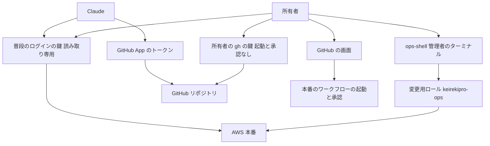
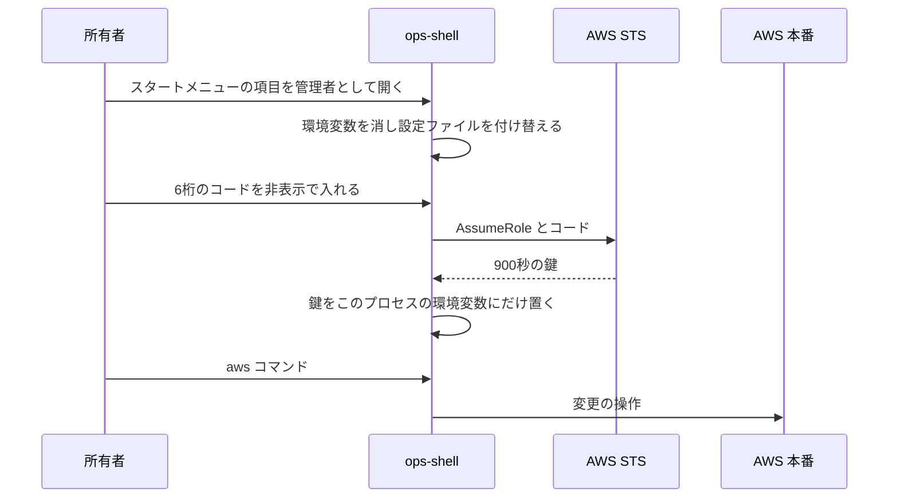
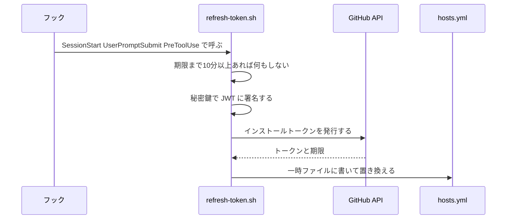
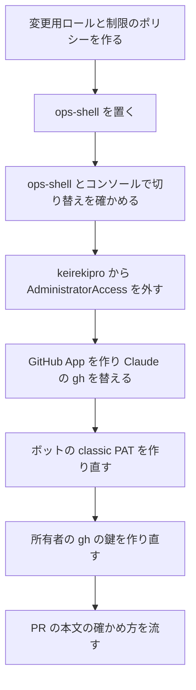

# 設計

## 概要

この設計は、Claude の手が届く鍵から、本番を変える権限そのものを外す。Claude は所有者と同じ Windows のユーザーで動くので、所有者のPCの中で鍵を隠しても、Claude はそれを読める。そこで、AWS と GitHub が、鍵の権限を判定するときに、本番を変える操作を拒む。AWS と GitHub は、Claude がどのプログラムからどう呼んでも、鍵の権限だけで判定するので、コマンドの書き方によらず同じ結果になる。

AWS では、所有者が、IAM ユーザー `keirekipro` を読み取り専用にし、秘密の値と terraform の state を読めないようにする。AWS を変える権限は、新しい変更用ロール `keirekipro-ops` にだけ持たせる。所有者は、障害のときに、管理者のターミナルを開くスクリプト `ops-shell.ps1` か、マネジメントコンソールのスイッチロールで、変更用ロールに切り替える。スイッチロールとは、マネジメントコンソールにサインインしたまま、別のロールの権限に切り替える AWS の機能を指す。

GitHub では、Claude の手元の gh の鍵を、ボットの classic PAT から GitHub App のインストールトークンに替える。classic PAT とは、権限を大まかな範囲でしか選べない、GitHub の従来の個人の鍵を指す。インストールトークンとは、GitHub App がインストール先のリポジトリを操作するために GitHub から発行を受ける、1時間で切れる鍵を指す。所有者は、この App に、ワークフローの起動と承認の権限を与えない。所有者の gh の鍵も、ワークフローの起動と承認の権限の無い fine-grained PAT に作り直す。fine-grained PAT とは、対象のリポジトリと権限を1つずつ選んで作る、GitHub の個人の鍵を指す。ブラウザについては、Claude が、Claude の振る舞いの決まりを CLAUDE.md に書き、所有者の設定を手順書に書く。AWS と GitHub の鍵の作り直しは、所有者が最初に1回だけ行う。

## 作るものと作らないもの

### 作るもの

- IAM ユーザー `keirekipro` に付ける読み取りの制限のポリシー `keirekipro-readonly-guard` の JSON と、所有者がそれを付ける手順
- 変更用ロール `keirekipro-ops` の信頼ポリシーとインラインポリシーの JSON と、所有者がロールを作る手順。信頼ポリシーとは、誰がどの条件でそのロールに切り替えてよいかを定めるポリシーを指す。インラインポリシーとは、1つの利用者かロールにだけ直接付けるポリシーを指す
- 所有者が管理者のターミナルで変更用ロールに切り替えるスクリプト `ops-shell.ps1` と、所有者がそれを置く手順
- Claude の手元の gh に GitHub App のインストールトークンを入れるスクリプト `refresh-token.sh` と、そのテスト
- `refresh-token.sh` を呼ぶフック `refresh-github-app-token.sh` と、`.claude/settings.json` へのフックの登録(所有者が置く)
- 所有者が GitHub App を作り、ボットの classic PAT と所有者の gh の鍵を作り直す手順
- 障害のときに所有者が AWS を変える手順書
- AWS と GitHub に操作を拒まれたときと、ブラウザで github.com と AWS のコンソールを操作するときの、Claude の振る舞いの決まり(CLAUDE.md)
- 所有者が準備を終えたあとに一度だけ行う確かめ方(PR の本文)

### 作らないもの

- 本番を変えるワークフロー(`release.yaml`、`frontend-rollback.yaml`、`terraform-apply.yaml`、`backend-deploy.yaml`、`frontend-deploy.yaml`)の中身の変更
- 仕組みが `BOT_GITHUB_TOKEN` で動かすワークフロー(`auto-merge.yaml`、`canary.yaml`、`dependabot-auto-merge.yaml`、`update-pr-branches.yaml`)の変更。これらは今のまま、作り直したボットの classic PAT を使う
- GitHub のワークフローが本番の AWS に入るときのロール(`keirekipro-github-actions-role` と plan のロール)の権限の見直し。#557 で扱う。Claude がワークフローのファイルを足して push し、そのワークフローに本番のワークフローを起動させる道と、リポジトリの秘密を読ませる道を塞ぐことも、#557 で扱う
- `.claude/settings.json` の禁止の一覧の変更。禁止の一覧は、うっかりの操作を早く止める補助として今のまま残す
- Windows の別のユーザー、本番専用の GitHub アカウント、CloudShell への切り替え

## 使う既存の仕組み

- `aws login`(AWS CLI 2.32 以上)と、所有者の IAM ユーザー `keirekipro` の仮想 MFA `arn:aws:iam::<ACCOUNT_ID>:mfa/authenticator-app`。仮想 MFA とは、スマホの認証アプリが6桁のコードを出す、AWS の多要素認証の機器を指す
- AWS 管理ポリシー `ReadOnlyAccess`、`SignInLocalDevelopmentAccess`、`PowerUserAccess`。AWS 管理ポリシーとは、AWS が作って保守し、どの利用者やロールにも付けられるポリシーを指す
- GitHub の production の環境の承認(required reviewer は DogisRiki)とブランチの制限。この設計は、この承認とブランチの制限を変えない
- Claude の gh の設定の置き場 `GH_CONFIG_DIR`(`.claude/settings.local.json` の `env` で `%USERPROFILE%\.gh-bot` を指す)と、git の資格情報ヘルパー `gh auth git-credential`。資格情報ヘルパーとは、git が push のときに鍵を受け取るために呼ぶプログラムを指す
- Claude Code のフック(SessionStart、UserPromptSubmit、PreToolUse)と、`perl` の `JSON::PP` と `openssl`(Git for Windows に入っている)
- `.claude/scripts/parallel/tests/` のシェルのテストと同じ流し方(ホストの Git Bash で `bash <テストのファイル>` を打つ)。`refresh-token.sh` はホストの Git Bash で動くので、テストもホストの Git Bash で流す

## 設計を見直すきっかけ

- AWS が `aws login` の鍵に付ける多要素認証の情報の扱いを変えたとき。変更用ロールの信頼ポリシーの条件を試験し直す
- 所有者の MFA を仮想 MFA からパスキーやセキュリティキーに替えるとき。STS の API に6桁を渡せなくなるので、`ops-shell.ps1` の作りを見直す。STS とは、AWS で一時的な鍵を発行するサービスを指す
- GitHub App の権限の表で、ワークフローの起動か承認に要る権限が変わったとき
- Claude の作業に、ワークフローの手での起動・再実行・取り消しが要る手順を足すとき
- 本番を変えるワークフローを足すとき、または入口を `workflow_dispatch` 以外に変えるとき
- Claude Code の実行環境が、Windows のネイティブから WSL2 などの sandbox の使える環境に移るとき

## プロジェクトの決まりを守っているか

- 品質チェックの設定: `.claude/settings.json` にフックの登録を足し、`.claude/hooks/` にフックを足す。どちらもゲートの設定なので、Claude は scratchpad に用意し、所有者がコマンドで置く。PR は CODEOWNERS の承認を待つ。ワークフロー、`eslint.config.js`、`vite.config.ts`、`quality.gradle` は変えない
- 使う外部の機能がこのリポジトリで使えるか: GitHub App は個人のアカウントでも作れ、個人のリポジトリにインストールできる。KeirekiPro のリポジトリは所有者が持つリポジトリなので、所有者は fine-grained PAT を所有者の gh に使える。`aws login` と仮想 MFA は所有者の AWS アカウントで使えることを、2026-10-12 の試験で確かめた
- 新しいライブラリの追加: 足さない。`refresh-token.sh` は Git for Windows の `openssl`、`curl`、`perl` だけを使う
- 関係のない項目: backend のコードを置く層、frontend の機能ごとの境界、frontend の状態の持ち方、データベースの表の形

## 全体の構成

この設計は、鍵ごとに権限の上限を決める。上限は AWS の IAM と GitHub の App と PAT の設定にあり、どれも所有者が Web かルートユーザーで変える。Claude は所有者のPCのファイルと設定を書けるが、これらの上限は書き換えられない。

Claude が手にできる鍵は3つある。普段のログインの鍵、GitHub App のトークン、所有者の gh の鍵である。どの鍵にも本番を変える権限は無い。Claude の手元の鍵から本番を変える道は無くなり、所有者の道が2つ残る。所有者が6桁を入れて変更用ロールに切り替える道と、所有者が GitHub の画面で本番のワークフローを起動して承認する道である。ただし、「作らないもの」の節に書いた、#557 で扱う道は残る。

**使う技術**:
- AWS の権限: IAM の管理ポリシー `ReadOnlyAccess`、`SignInLocalDevelopmentAccess`、`PowerUserAccess` と、インラインポリシー。条件キー `aws:MultiFactorAuthPresent` と `aws:MultiFactorAuthAge`
- 所有者のPC: Windows PowerShell 5.1(`powershell.exe`)と AWS CLI 2.37。`ops-shell.ps1` を動かす
- GitHub の認証: GitHub App のインストールトークン(1時間で切れる)と fine-grained PAT
- Claude の手元: Git Bash の `openssl`(JWT の署名)、`curl`(トークンの発行)、`perl` の `JSON::PP`(応答の読み取り)。JWT とは、GitHub App が自分であることを GitHub に示すための、署名つきの短い文字列を指す

## ファイルの構成

Claude が新しく作るファイル:

- `doc/インフラ設計/AWS設計/運用者の権限/keirekipro-readonly-guard.json`: IAM ユーザー `keirekipro` に付けるインラインポリシー
- `doc/インフラ設計/AWS設計/運用者の権限/keirekipro-ops-trust.json`: 変更用ロールの信頼ポリシー
- `doc/インフラ設計/AWS設計/運用者の権限/keirekipro-ops-guard.json`: 変更用ロールのインラインポリシー
- `doc/インフラ設計/手順書/ops-shell/ops-shell.ps1`: 所有者が `C:\Program Files\KeirekiPro\` に置くスクリプト
- `doc/インフラ設計/手順書/ops-shell/aws-config`: 所有者が `C:\Program Files\KeirekiPro\` に置く AWS CLI の設定ファイル
- `doc/インフラ設計/手順書/障害時の本番操作手順.md`: 障害のときに所有者が AWS を変える手順書
- `.claude/scripts/github-app/refresh-token.sh`: Claude の手元の gh にインストールトークンを入れるスクリプト
- `.claude/scripts/github-app/tests/test-refresh-token.sh`: `refresh-token.sh` のテスト
- `.claude/hooks/refresh-github-app-token.sh`: `refresh-token.sh` を呼ぶフック(所有者が置く)
- `.claude/hooks/tests/test-refresh-github-app-token.sh`: フックのテスト(所有者が置く)

Claude が変えるファイル:

- `.claude/settings.json`: SessionStart、UserPromptSubmit、PreToolUse(Bash)に `refresh-github-app-token.sh` を登録する(所有者が置く)
- `CLAUDE.md`: 「自律動作の境界」に、拒まれたときとブラウザを操作するときの決まりを足す
- `doc/開発フロー/基盤構築手順.md`: 所有者の準備の手順を足す(中身は「手順書と PR の本文」の節に書く)
- `doc/開発フロー/参加者セットアップ手順.md`: 所有者の準備の手順を足す(中身は「手順書と PR の本文」の節に書く)
- `doc/インフラ設計/手順書/手動作業手順.md`: 所有者の準備の手順を足し、AWS を変える既存の手順を直す(中身は「手順書と PR の本文」の節に書く)
- `doc/インフラ設計/AWS設計/IAMロール・ポリシー設計.md`: IAM ユーザー `keirekipro` と変更用ロール `keirekipro-ops` を足す

## 処理の流れ

### 所有者が障害のときに CLI で AWS を変える

- 15分を過ぎると aws コマンドは `ExpiredToken` で失敗する。所有者は `ops-renew` を打ってコードを入れ直す

### Claude の手元の gh のトークンを入れ替える

## 部品

### keirekipro-readonly-guard(普段のログインの権限の制限)

対応する要件: 1.1, 1.2, 1.3, 1.4, 2.1, 2.2, 3.4

**役割**: このポリシーは、IAM ユーザー `keirekipro` に付けるインラインポリシーである。所有者は、`keirekipro` に付ける権限を、このポリシーと、管理ポリシー `ReadOnlyAccess` と `SignInLocalDevelopmentAccess` の3つだけにし、`AdministratorAccess` を外す。このポリシーは、`ReadOnlyAccess` が許す読み取りのうち、次を明示の Deny で止める。明示の Deny とは、ポリシーの文の Effect を Deny と書くことを指し、ほかのポリシーが許していても、AWS はその操作を拒む。
- `s3:GetObject`、`s3:GetObjectVersion`、`s3:GetObjectAttributes`(対象: `arn:aws:s3:::keirekipro-terraform-state/*`)
- `secretsmanager:GetSecretValue`、`secretsmanager:BatchGetSecretValue`(対象: すべて)
- `kms:Decrypt`(対象: すべて)

このポリシーは、次を許す。
- `sts:AssumeRole`(対象: `arn:aws:iam::<ACCOUNT_ID>:role/keirekipro-ops`)
- `iam:ChangePassword`(対象: `arn:aws:iam::<ACCOUNT_ID>:user/keirekipro`)。このポリシーがこの操作を許すのは、所有者がマネジメントコンソールのパスワードを変えるためである

このポリシーは、`s3:ListBucket` と `s3:GetBucket*` を止めない。所有者と Claude は、state バケットがあることと設定は見られるが、中身は読めない。

**権限**: 所有者が、まだ `AdministratorAccess` を持っているあいだに、`aws iam put-user-policy` でこのポリシーを `keirekipro` に付ける。付けたあとは、`keirekipro` は自分のポリシーを変えられない(`ReadOnlyAccess` に IAM の書き込みが無い)。

**失敗したとき**: 所有者が `AdministratorAccess` を外したあとに、このポリシーの誤りに気づいたら、所有者はルートユーザーでマネジメントコンソールにサインインして直す。

### keirekipro-ops(変更用ロール)

対応する要件: 1.6, 1.7, 3.1, 3.2, 3.5, 3.6

**役割**: このロールは、AWS を変える権限を持つ唯一の運用者のロールである。所有者は、このロールの権限を、管理ポリシー `PowerUserAccess` とインラインポリシー `keirekipro-ops-guard` の2つにする。`PowerUserAccess` は、IAM、Organizations、アカウントの設定を変える操作を含まない。`keirekipro-ops-guard` は、`sts:AssumeRole` をすべて Deny し、このロールからほかのロールへ渡り歩けないようにする。`PowerUserAccess` は、サービスにひもづくロールを作る `iam:CreateServiceLinkedRole` と消す `iam:DeleteServiceLinkedRole` を許すので、`keirekipro-ops-guard` はこの2つも Deny する。こうして、このロールは IAM のロールを作ることも消すこともできない。所有者は、このロールに `iam:PassRole` を与えない。障害の対応で新しいタスク定義が要るときは、所有者は、terraform apply のワークフローで新しいタスク定義を作る。

**権限**: 信頼ポリシー `keirekipro-ops-trust.json` は、次の1文だけを持つ。
- 主体: `arn:aws:iam::<ACCOUNT_ID>:user/keirekipro`
- 操作: `sts:AssumeRole`
- 条件: `Bool` の `aws:MultiFactorAuthPresent` が `true`、かつ `NumericLessThan` の `aws:MultiFactorAuthAge` が `60`

`aws:MultiFactorAuthAge` が無いとき、`NumericLessThan` は偽になるので、AWS は切り替えを拒む。所有者は、ロールの最大のセッションの長さを3600秒(既定)にする。マネジメントコンソールのスイッチロールは、この長さで続く。

**いつ動くか**: 所有者が `ops-shell` で6桁を入れたとき、または所有者がマネジメントコンソールにサインインし直してから60秒以内にスイッチロールしたとき。`aws login` でブラウザから新しくサインインした直後の60秒は、`keirekipro` の普段の鍵でも条件を満たす。

### ops-shell.ps1(所有者が管理者のターミナルで変更用ロールに切り替えるスクリプト)

対応する要件: 3.1, 3.2, 3.3

**役割**: このスクリプトは、所有者が6桁のコードを入れると、変更用ロールの900秒の鍵を、このスクリプトが動く PowerShell のプロセスの環境変数にだけ置く。このスクリプトは、鍵をファイルに書かない。このスクリプトは、Claude が書ける設定を読まずに動く。そのため、スクリプトは次の順で動く。
1. プロセスが管理者として動いていなければ、理由を表示して終える
2. 環境変数のうち、名前が `AWS_` で始まるものと、`HTTP_PROXY`、`HTTPS_PROXY`、`ALL_PROXY`、`NO_PROXY`、`REQUESTS_CA_BUNDLE`、`SSL_CERT_FILE`、`CURL_CA_BUNDLE` と、名前が `PYTHON` で始まるものを消す
3. `PATH` を、`%SystemRoot%\System32`、`%SystemRoot%`、`%SystemRoot%\System32\WindowsPowerShell\v1.0`、`C:\Program Files\Amazon\AWSCLIV2` の4つだけにする
4. `AWS_CONFIG_FILE` を `C:\Program Files\KeirekiPro\aws-config` に、`AWS_SHARED_CREDENTIALS_FILE` を `C:\Program Files\KeirekiPro\empty-credentials` に向ける。どちらも管理者だけが書ける場所である
5. 作業の場所を `C:\Program Files\KeirekiPro` にする
6. 6桁のコードを `Read-Host -AsSecureString` で受け、画面に出さない
7. `C:\Program Files\Amazon\AWSCLIV2\aws.exe` を絶対のパスで呼び、`sts assume-role --profile source --role-arn arn:aws:iam::<ACCOUNT_ID>:role/keirekipro-ops --role-session-name ops-<日時> --serial-number arn:aws:iam::<ACCOUNT_ID>:mfa/authenticator-app --token-code <コード> --duration-seconds 900 --output json` を打つ
8. 応答の鍵を `AWS_ACCESS_KEY_ID`、`AWS_SECRET_ACCESS_KEY`、`AWS_SESSION_TOKEN` に置き、`AWS_REGION` を `ap-northeast-1` にし、鍵の期限を表示する
9. 関数 `ops-renew` を定める。`ops-renew` は、6桁のコードを受けるところから、変更用ロールに切り替えて鍵を環境変数に置き、鍵の期限を表示するところまでをやり直す

`aws-config` の `source` のプロファイルは、`login_session = arn:aws:iam::<ACCOUNT_ID>:user/keirekipro` と `region = ap-northeast-1` を持つ。`ops-shell.ps1` が呼ぶ AWS CLI は、切り替えの元の鍵に、所有者の普段の `aws login` の鍵(`%USERPROFILE%\.aws\login\cache`)を使う。この鍵は読み取り専用なので、Claude が読めても、Claude が中身を差し替えても、6桁なしで変更用ロールに切り替える力は増えない。

Claude は、このスクリプトを ASCII の文字だけで書く。Windows PowerShell 5.1 は、BOM の無い UTF-8 のファイルを、日本語の Windows では Shift_JIS として読むためである。BOM とは、ファイルの先頭に置いて文字コードが UTF-8 であることを示す印を指す。

**権限**: 所有者は、このスクリプトと `aws-config` と空の `empty-credentials` を `C:\Program Files\KeirekiPro\` に置き、全利用者のスタートメニュー `C:\ProgramData\Microsoft\Windows\Start Menu\Programs\` に項目「KeirekiPro ops」を作る。項目の起動の内容は `C:\Windows\System32\WindowsPowerShell\v1.0\powershell.exe -NoProfile -NoExit -ExecutionPolicy Bypass -File "C:\Program Files\KeirekiPro\ops-shell.ps1"` である。所有者は、この項目に「管理者として実行」を付ける。どの場所も、管理者として昇格したプロセスしか書けない。

**失敗したとき**: STS がコードを拒んだら、スクリプトは aws コマンドの誤りの文を表示し、鍵を置かない。所有者は `ops-renew` で入れ直す。`aws login` の鍵が切れていたら、スクリプトは「普段のターミナルで aws login してから ops-renew を打つ」と表示する。

### refresh-token.sh(Claude の手元の gh にインストールトークンを入れるスクリプト)

対応する要件: 4.1, 4.2, 4.3, 4.4, 4.9, 6.1, 6.2, 6.4

**役割**: このスクリプトは、GitHub App の秘密鍵からインストールトークンを発行し、Claude の gh の設定 `$GH_CONFIG_DIR/hosts.yml` に書く。git の push は、資格情報ヘルパー `gh auth git-credential` を通して同じトークンを使う。このスクリプトは、トークンの権限を決めない。権限の上限は、所有者が Web で設定した App の権限で決まる。

所有者が App に与える権限は、次のとおりである。
- Contents: Read and write
- Pull requests: Read and write
- Issues: Read and write
- Workflows: Read and write
- Actions: Read-only
- Checks: Read-only
- Commit statuses: Read-only
- Metadata: Read-only

所有者は、App に、Actions の write、Deployments、Environments、Administration、Secrets の権限を与えない。所有者は、App を KeirekiPro のリポジトリにだけインストールする。

**呼び出し方**: `refresh-token.sh [--force]`
- 入力: `$GH_CONFIG_DIR/github-app.env`。中身は `APP_CLIENT_ID`、`INSTALLATION_ID`、`PRIVATE_KEY_FILE` の3行である
- 状態: `$GH_CONFIG_DIR/github-app-token.expires` に、トークンの期限を UNIX 時刻で持つ
- 手順: `GH_CONFIG_DIR` が無いか、`github-app.env` が無ければ、何もせずに終了コード0で終える。期限まで600秒以上あり、`--force` も無ければ、何もせずに終了コード0で終える。そうでなければ、`iat` を60秒前、`exp` を540秒後、`iss` を `APP_CLIENT_ID` にした JWT に `openssl dgst -sha256 -sign` で署名し、`POST https://api.github.com/app/installations/<INSTALLATION_ID>/access_tokens` を `curl --max-time 20` で呼ぶ。応答の `token` と `expires_at` を `perl` の `JSON::PP` で読み、`hosts.yml` と期限のファイルを、一時ファイルに書いてから置き換える
- `hosts.yml` の形: `github.com:` の下に `oauth_token: <トークン>`、`git_protocol: https`、`user: <App の名前>[bot]` を書く
- 終了コード: 0 は成功か何もしなかったとき。1 は発行に失敗したとき(標準エラーに理由を出す。`hosts.yml` は書き換えない)。64 は呼び方の誤り
- `refresh-token.sh` は、期限の前なら、何度呼ばれても同じ結果を残す。複数のセッションが同時に呼んでも、置き換えは1つのファイルの名前の付け替えなので、`hosts.yml` が途中で壊れない

**失敗したとき**: 発行に失敗したら、`refresh-token.sh` は古いトークンをそのまま残す。古いトークンが切れていれば、gh は 401 で失敗し、Claude は gh が 401 で失敗したことを所有者に伝える。

### refresh-github-app-token.sh(トークンを入れ替えるフック)

対応する要件: 6.1, 6.4

**役割**: このフックは、`refresh-token.sh` を呼ぶだけである。このフックは、Claude の操作を止めない。終了コードはいつも0にする。
- SessionStart と UserPromptSubmit: 発行に失敗したら、「GitHub App のトークンを入れ替えられなかった」と理由を標準出力に出し、Claude の会話に載せる
- PreToolUse(Bash): フックは、`refresh-token.sh` を `--force` を付けずに呼ぶ。長い作業の途中でトークンが切れないようにするためである

**いつ動くか**: `.claude/settings.json` の SessionStart、UserPromptSubmit、PreToolUse(matcher は `Bash`)。打ち切りの時間は30秒にする。

### CLAUDE.md の決まり(Claude の振る舞い)

対応する要件: 1.5, 4.6, 5.1, 5.2

**役割**: Claude は、「自律動作の境界」の節に、次の決まりを足す。
- AWS か GitHub に操作を拒まれたら、Claude は別の書き方、別の鍵、別のプログラムで同じ操作を試さず、何をしようとして拒まれたかを所有者に伝える
- Claude は、AWS を変える操作、変更用ロールへの切り替え、ワークフローの手での起動・再実行・取り消し・承認を試さない
- Claude は、所有者の GitHub の鍵(gh の既定の設定、資格情報マネージャー、環境変数)を使わない。`GH_CONFIG_DIR` を外して gh を打たない
- Claude は、Claude in Chrome で github.com か AWS のコンソールを操作する前に、どのページで何をするかを所有者に伝える。所有者が許可しなければ、その操作をしない

### 所有者の GitHub の鍵(fine-grained PAT)

対応する要件: 4.5, 4.7, 4.8

**役割**: 所有者は、gh の鍵を fine-grained PAT に作り直す。対象は所有者のすべてのリポジトリにし、権限は Contents、Issues、Workflows の Read and write と、Pull requests、Actions、Metadata の Read-only にする。Workflows の write は、所有者がワークフローを変えたコミットを push するために付ける。Claude はこの PAT を読めるが、Claude の App も Contents と Workflows の write を持つので、push について Claude にできることは増えない。Pull requests を Read-only にするのは、Claude がこの PAT で所有者の名義の PR の承認を出せないようにするためである。所有者の名義の承認は、CODEOWNERS と、承認を確かめるワークフロー(`pre-merge-check.yaml`、`guardrails.yaml`、`dependency-gate.yaml`)が人間の承認として扱う。Claude がこの PAT で所有者の名義の PR の承認を出す道は要件の範囲の外だが、所有者は、この PAT の権限の選び方でこの道も一緒に塞ぐと決めた。所有者は、PR の承認を GitHub の画面で行う。所有者が今まで端末の `gh pr review --approve` で PR を承認していたときは、その承認の操作が GitHub の画面の操作に変わる。対象をすべてのリポジトリにするのは、所有者がほかのリポジトリに push するときにも、git がこの PAT を使い、資格情報マネージャーに広い権限の鍵を作り直さないようにするためである。所有者は、この PAT に、Actions の write、Deployments、Environments、Administration、Secrets の権限を付けない。所有者は、この PAT で gh にログインし直し(`gh auth login --with-token`)、前の OAuth の鍵を GitHub の画面から取り消す。所有者は、資格情報マネージャーにある github.com の git の資格情報と、ユーザーの環境変数にある GitHub の鍵を消す。所有者は、git の全体の設定で、github.com の資格情報ヘルパーを `gh auth git-credential` にする(`git config --global credential.https://github.com.helper ""` のあとに `git config --global --add credential.https://github.com.helper "!gh auth git-credential"`)。こうすると、所有者がどのリポジトリで push しても、git は資格情報マネージャーではなく gh の PAT を使う。

所有者が本番のワークフローを起動し、承認するときは、GitHub の画面で行う。今と同じ手順である。所有者は、この PAT の期限を、GitHub が選ばせる最も長い期間にする。期限の前に GitHub が PAT の期限が近いことを所有者にメールで知らせるので、所有者はそのとき PAT を作り直す。前の OAuth の鍵には期限が無かったので、この作り直しは、所有者の作業が増える例外になる。

**状態の持ち方**: 所有者の gh の鍵は、今と同じく資格情報マネージャーに入る。

### 手順書と PR の本文(所有者の準備と障害のときの手順)

対応する要件: 5.1, 6.3, 7.1, 7.2, 7.3

**役割**: Claude は、所有者の準備と障害のときの手順を、次の文書に分けて書く。
- `doc/インフラ設計/手順書/手動作業手順.md`: 変更用ロールと制限のポリシーを作り、`AdministratorAccess` を外す手順を足す。「1.2 AWS CLIの認証設定」の節に、普段のログインは読み取り専用であることを書き足す。所有者の普段のログインでは AWS を変えられないので、「3. Terraformバックエンド用リソース作成」の章には `ops-shell` で行うことを、IAM を変える「4. GitHub Actions用OIDC設定」の章にはルートユーザーで行うことを書き足す
- `doc/開発フロー/基盤構築手順.md`: GitHub App を作ってインストールする手順、ボットの classic PAT を作り直して `BOT_GITHUB_TOKEN` を置き換える手順、所有者の gh の鍵を fine-grained PAT に作り直す手順と、git の資格情報ヘルパーの設定。「botのPATが期限切れになったときの復旧」の節は、Claude の手元の鍵が App に替わるので、`BOT_GITHUB_TOKEN` だけを置き換える手順に直す。「App の秘密鍵を作り直すとき」の節を足す。所有者の前提(Claude in Chrome で github.com と AWS のコンソールに「常に許可」を出さない、Claude Desktop の中のブラウザで GitHub と AWS にサインインしない、Claude Desktop を管理者として起動しない)もここに書く
- `doc/開発フロー/参加者セットアップ手順.md`: Claude の gh を GitHub App で動かす設定(`github-app.env` と秘密鍵の置き場)と、その確かめ方。「2-2」の、ボットの classic PAT でログインして `gh api user` と `hosts.yml` の平文を確かめる手順は、インストールトークンでは成り立たないので、`refresh-token.sh --force` のあとに `gh auth status` と `gh repo view DogisRiki/KeirekiPro` で確かめる手順に置き換える。あわせて、`ops-shell` を `C:\Program Files\KeirekiPro\` に置いてスタートメニューの項目を作る手順
- `doc/インフラ設計/手順書/障害時の本番操作手順.md`: 障害のときに所有者が開く1つの文書。`ops-shell` で AWS を変える手順、マネジメントコンソールでスイッチロールする手順、切り替えられないときの手順を書く
- PR の本文: 「テストの方針」の結合テストの項目を、所有者の準備のあとに一度だけ行う確かめ方として書く。手順書には書かない

Claude の品質チェック(frontend、backend、terraform)は、AWS の鍵を使わずにコンテナの中で動く(terraform のコンテナにはダミーの鍵しか渡していない)。この設計は、品質チェックの動かし方を変えない。

## 失敗したときの扱い

- 所有者が `AdministratorAccess` を外したあとに、変更用ロールに切り替えられなかったら: 所有者はルートユーザーでマネジメントコンソールにサインインし、`keirekipro-ops` の信頼ポリシーか `keirekipro-readonly-guard` を直す。Claude は、この手順を `doc/インフラ設計/手順書/障害時の本番操作手順.md` の「切り替えられないとき」の手順に書く
- GitHub App のトークンを発行できず、Claude の gh が止まったら: 所有者は、`doc/開発フロー/基盤構築手順.md` の「App の秘密鍵を作り直すとき」の節のとおり、App の秘密鍵を作り直して `PRIVATE_KEY_FILE` を置き換える
- 所有者の fine-grained PAT が切れたら: 所有者の gh が 401 で失敗する。所有者は、基盤構築手順の手順のとおり、同じ権限で PAT を作り直す
- `ops-shell` で切り替えたあと、AWS の操作が `AccessDenied` になったら: その操作は `PowerUserAccess` に無い操作(IAM の変更など)である。所有者は、その操作を terraform apply のワークフローかルートユーザーで行う

## テストの方針

- 単体テスト(`test-refresh-token.sh`。ホストの Git Bash で流す。ネットワークにつながず、テストの中で作った鍵と偽の `curl` を使う)
  - `github-app.env` が無ければ、`hosts.yml` を書かずに終了コード0で終える
  - 期限まで600秒以上あれば、`curl` を呼ばずに終了コード0で終える
  - 期限が近ければ、テスト用に作った鍵で署名した JWT を偽の `curl` に渡し、偽の応答のトークンと期限を `hosts.yml` と期限のファイルに書く。JWT のヘッダーと中身(`iss`、`iat`、`exp`)を確かめ、署名をテスト用の公開鍵で検証する
  - 偽の `curl` が失敗したら、終了コード1で終え、前の `hosts.yml` を書き換えない
  - `--force` があれば、期限の前でも発行する
- 結合テスト(所有者の準備のあと、PR の本文の確かめ方で1回)
  - AWS: Claude の普段の鍵で、`aws sts get-caller-identity` が通る。`aws s3api get-object` で state のオブジェクトを読むと拒まれる。`aws secretsmanager get-secret-value` が拒まれる。`aws login` から2分以上たってから `aws sts assume-role`(6桁なし)が拒まれる。`aws iam simulate-principal-policy` で、`keirekipro` に `rds:StartDBInstance` が許されていないことを見る
  - AWS: 所有者が `ops-shell` で6桁を入れると、`aws sts get-caller-identity` が `keirekipro-ops` を返す。`aws iam simulate-principal-policy` で、`keirekipro-ops` に `rds:StartDBInstance` が許され、`iam:CreateUser`、`iam:CreateRole`、`iam:CreateServiceLinkedRole`、`iam:DeleteServiceLinkedRole`、`iam:PutRolePolicy` が拒まれることを見る。15分後に `ExpiredToken` になる
  - AWS: Claude が `%USERPROFILE%\.aws` を探しても、`ops-shell` の鍵は見つからない。`ops-shell` の鍵はファイルに書かれていない
  - AWS: 所有者がマネジメントコンソールにサインインし直し、1分以内にスイッチロールできる。1分を過ぎると拒まれる
  - GitHub: Claude の gh で `gh api -X POST repos/DogisRiki/KeirekiPro/actions/workflows/auto-merge.yaml/dispatches -f ref=main` が 403 になり、`gh run list --workflow auto-merge.yaml --limit 1` に新しい実行が無い。`gh workflow run auto-merge.yaml` と `curl` でも同じである。`auto-merge.yaml` は `workflow_dispatch` を持ち、本番を変えないので、確かめに使う
  - GitHub: Claude の gh で、完了した `ci.yaml` の実行の `gh run rerun` と `gh api -X POST .../actions/runs/<番号>/cancel` が 403 になる
  - GitHub: 所有者が GitHub の画面で `terraform-apply.yaml` を起動し、production の承認を待っているあいだに、Claude の gh で `gh api -X POST .../actions/runs/<番号>/pending_deployments` を打つと 403 になる。そのあと所有者が画面で Reject する。承認を待つあいだはジョブが始まらないので、本番は変わらない
  - GitHub: `env -u GH_CONFIG_DIR gh workflow run auto-merge.yaml` が 403 になり、同じ待ちの実行に対する `env -u GH_CONFIG_DIR gh api -X POST .../pending_deployments` も 403 になる(所有者の PAT)
  - GitHub: Claude が、ワークフローのファイルのコメントだけを変えたブランチを push して PR を作れる。所有者の PAT で、その PR に `env -u GH_CONFIG_DIR gh pr review --approve` を打つと 403 になる。確かめたあと、Claude は PR を閉じてブランチを消す
  - GitHub: Claude がブランチを push し、PR を作り、`gh run watch` でチェックを見られる。ワークフロー `auto-merge.yaml` が PR に自動マージを予約し、マージのあとに後続のワークフローが動く

## 安全

- 想定する脅威: Claude が、本番を変える操作を、別の書き方・別のプログラム・手元の別の鍵で試すこと
- 想定しない脅威: Claude が、所有者のPCの Windows の設定、ブラウザの Cookie、Windows の脆弱性を意図して突くこと(requirements.md で、Claude が Windows の設定に細工したときは管理者のターミナルの鍵を守りきれないとした例外)
- 残るすき: 「keirekipro-ops」の節の「いつ動くか」に書いた60秒。変更用ロールは IAM を変えられないので、すきを突かれても、権限そのものは広がらない
- 公開のリポジトリに置くもの: ポリシーの JSON とスクリプトには、AWS のアカウントの番号を書かず `<ACCOUNT_ID>` と書く。所有者は、ポリシーの JSON とスクリプトを置くときに、手順書のコマンドで `<ACCOUNT_ID>` をアカウントの番号に置き換える

## 移行

- 所有者は、`AdministratorAccess` を外す前に、変更用ロールへの切り替えが `ops-shell` とマネジメントコンソールの両方で通ることを確かめる。切り替えられないまま外すと、所有者はルートユーザーでしか戻せなくなるからである
- この PR がマージされても、所有者が準備を始めるまでは今のまま動く
- ボットの classic PAT は、Claude の手元から消したあとも、仕組みのワークフローの `BOT_GITHUB_TOKEN` に残る。Claude が手元で前に読めた値を使えないよう、所有者は PAT を作り直して、`BOT_GITHUB_TOKEN`(Actions と Dependabot の両方)を新しい値にする
