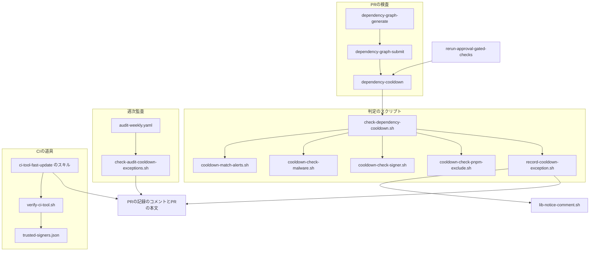
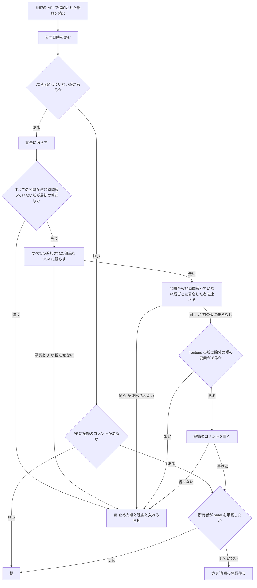
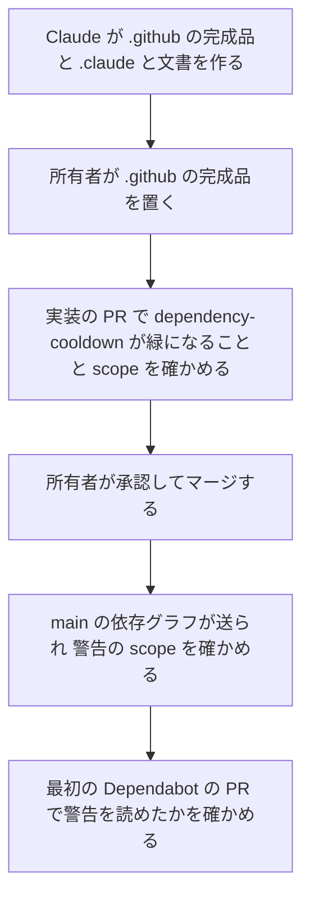

# 設計

## 概要

今は、PR の検査`dependency-cooldown` が、backend の部品だけについて、公開から72時間経っていない版を止めている。PR の検査は、frontend の部品を見ていない。frontend の部品の、公開から72時間経っていない版は、pnpm の設定 `minimumReleaseAge` が install のときに止めている。また、`dependency-cooldown` は Dependabot の PR を対象から外しているので、Dependabot のセキュリティの更新は72時間の待ちを受けていない。

この設計では、`frontend/pnpm-workspace.yaml` の `minimumReleaseAgeExclude` の欄を「除外の欄」と呼ぶ。この設計は、「作るもの」の節に挙げたものを足す。判定の順番は、処理の流れの節にある。

## 作るものと作らないもの

### 作るもの

- `dependency-cooldown` の判定: `dependency-cooldown` は、frontend と backend の部品に72時間の待ちを効かせ、72時間待たずに入れてよい版かを判定する。72時間待たずに入れる版には、`dependency-cooldown` は、悪意のある部品の確認、署名した者の確認、除外の欄の確認、所有者の承認の確認を行う。`dependency-cooldown` は、変更を止めたときに、止めた理由を報告する
- 72時間待たずに入れた版の記録のコメントと、その形
- backend の依存グラフに scope を付ける設定。scope とは、部品が本番で動くか、開発のときだけ使うかの区別である
- 週次監査の新しい項目 `cooldown-exceptions`
- CI の道具の版を72時間待たずに変える Claude の手順(スキル)と、配布元の署名を確かめるスクリプトと、信頼する署名した者のデータのファイル
- actionlint の設定ファイル。actionlint とは、CI の `guardrails` がワークフローの書き方を調べる道具である。この設定ファイルは、actionlint が `vulnerability-alerts` の権限を知らないことによる1件の指摘だけを無視させる
- 上の変更に合わせた文書の更新。更新する文書は、README のワークフローの一覧の表と図、ワークフロー設計.md、監査手順.md、tech.md、`frontend/pnpm-workspace.yaml` のコメント、CLAUDE.md の1行である

### 作らないもの

- 脆弱性を直す PR を作る仕組み(Issue #630、Issue #643)。この設計は、Dependabot の frontend の PR に除外の欄の要素を誰が足すかを決めず、足す手順も作らない
- 脆弱性の警告を所有者に届ける仕組み(Issue #642)
- CI が道具を入れるたびに署名を確かめる仕組み(Issue #644)
- CI の道具の版を自動で上げる仕組みと、CI の道具の版に72時間の待ちを機械で効かせる仕組み(Issue #640)
- 開発環境の Docker イメージ。この設計は、`docker/terraform/Dockerfile` の `hashicorp/terraform` のイメージを開発環境の Docker イメージとして扱い、この設計が扱う CI の道具の Terraform には含めない。この設計が扱う CI の道具の Terraform は、`terraform-apply.yaml` の `TF_VERSION` で版を決める Terraform である
- 除外の欄に要素を足す変更を、`dependency-cooldown` で止めること。`dependency-cooldown` は部品の配布元が返す公開日時で判定するので、除外の欄の中身は判定を変えない。除外の欄を変える PR は、今と同じく `dependency-gate` が所有者の承認を求める
- 古くなった除外の欄の要素を消す仕組み。1つの版だけを指す要素は、その版の公開から72時間経つと効き目が無くなるので、残っても困らない

## 使う既存の仕組み

- 依存グラフの比較の API(`repos/{owner}/{repo}/dependency-graph/compare/{base}...{head}`)と、それを支える `dependency-review.yaml` の `generate` `submit` ジョブと、main の `dependency-graph.yaml`
- Dependabot の警告の API(`repos/{owner}/{repo}/dependabot/alerts`)
- `lib-notice-comment.sh` の `notice_post` と `notice_last_kind`。`record-cooldown-exception.sh` は、この2つの関数を、記録のコメントを書くことと、記録のコメントがあるかを読むことに使う
- `dependency-gate.yaml` の、所有者の承認の読み方。`dependency-gate.yaml` は、reviews の API を jq で読み、所有者が head に付けた最後の判定を見る。head とは、PR のブランチの最新のコミットである
- `rerun-approval-gated-checks.yaml`。このワークフローは、所有者の承認のあとに、失敗した実行を再実行する
- `audit-weekly.yaml` の `run_check` と `audit-issue.sh`。`run_check` と `audit-issue.sh` は、項目のスクリプトの終了コード 0・1・2 に応じて、Issue「週次監査: 逸脱あり」か「週次監査: 判定不能」を作るか、書き足す。
- `check-audit-skipped-required.sh` の、窓の求め方。窓とは、週次監査の項目が調べる期間である。`check-audit-skipped-required.sh` は、自分のワークフローの直近の実行の `created_at` を窓の始まりにし、直近の実行が無ければ7日前を窓の始まりにする
- 外部のサービス: npm registry と Maven Central と Gradle Plugin Portal からは、部品の公開日時と署名を読む。OSV(`api.osv.dev`)からは、悪意のある部品として公表されているかを読む。keyserver.ubuntu.com からは、Maven の署名の公開鍵を取る。Node.js と Trivy と Terraform の配布元からは、CI の道具の署名を取る
- `/ship`。Claude は、CI の道具の版を変える PR を `/ship` で出荷する

## 設計を見直すきっかけ

- GitHub が、依存グラフの比較の API か Dependabot の警告の API の欄の形を変えたとき
- `dependency-graph.yaml` と `dependency-review.yaml` の `generate` ジョブが GitHub に送った依存グラフの scope が、Dependabot の警告の `dependency.scope` に載らないと分かったとき。このときは、backend の版が72時間待たずに入らない。そのため、この設計は、本番で動く部品に high か critical の警告が出たときに最初の修正版を72時間待たずに入れる決まりを、backend で満たせない
- pnpm が `minimumReleaseAgeExclude` の書き方か、`--frozen-lockfile` の install での検査を変えたとき
- npm が来歴(SLSA の provenance)の形か置き場を変えたとき。来歴とは、その版をどのリポジトリのどの組み立ての設定で作ったかを、組み立てたサービスが署名して残した記録である
- Maven Central が署名の決まりを変えたとき
- CI の道具の配布元が、署名のしかたか、署名した者の身元を変えたとき
- `required-checks.json` の `dependency-cooldown` の扱い(`approval_gated`)を変えたとき。`rerun-approval-gated-checks.yaml` の対象の一覧と、`check-audit-dependabot-stuck.sh` の承認待ちの見分け方と合わせて直す
- 週次監査の結果の受け渡し(終了コード 0・1・2 と `audit-issue.sh`)が変わったとき
- actionlint が `vulnerability-alerts` の権限を知る版を出したとき(rhysd/actionlint#713、rhysd/actionlint#666)。このときは、`guardrails.yaml` の actionlint の版を上げ、`.github/actionlint.yaml` の無視の設定を消す

## プロジェクトの決まりを守っているか

- 新しいライブラリの追加: ライブラリを足さない。CI のジョブは、ubuntu-latest に入っている `gh` `jq` `curl` `gpg` `openssl` を使う。CI の道具の署名を確かめるときは、`verify-ci-tool.sh` が、1回きりの Docker のコンテナで `gpg` と `cosign` を動かす
- 品質チェックの設定: `.github/` の5つのファイル(`dependency-review.yaml` `dependency-graph.yaml` `rerun-approval-gated-checks.yaml` `audit-weekly.yaml` `required-checks.json`)と `.github/scripts/` を変え、`.github/actionlint.yaml` を足す。`.github/actionlint.yaml` は、actionlint の指摘を1件だけ無視させる設定なので、品質チェックの対象から外す設定に当たる。この設定は、ツールが新しい権限を知らないことによる誤った指摘だけを無視し、ワークフローの誤りを隠さない。理由は部品の「actionlint.yaml」の節にある。Claude は、変えたファイルの完成品を所有者への提案として作り、所有者が、移行の節の手順でそれらのファイルを置く。CODEOWNERS と escape-hatch が承認を求める。`frontend/pnpm-workspace.yaml` のコメントを変えるので、`dependency-gate` も承認を求める
- 使う外部の機能がこのリポジトリで使えるか: 使う外部の機能について、次の4つが分かっている。
  - このリポジトリは公開で、所有者は User(DogisRiki)である
  - Dependabot の警告は有効で、API で読めることを確かめた(警告の番号209〜211)
  - 依存グラフの比較の API は、PR #637 と PR #670 で npm と maven の部品を返すことを確かめた
  - ワークフローの標準のトークンの `vulnerability-alerts: read` は、2026年9月から使える。Dependabot の PR の実行でこの権限が通るかは、移行の節で確かめる
- 関係のない項目: backend のコードを置く層、frontend の機能ごとの境界、frontend の状態の持ち方、データベースの表の形

## 全体の構成



この設計は、判定を `dependency-cooldown` の1か所に集める。止めた理由を1つの検査の結果にすべて出せることと、frontend と backend で同じ判定にすることを優先した。比べた案は research.md にある。`check-dependency-cooldown.sh` は、判定の順番と報告を受け持つ。この設計は、外部のサービスに問い合わせる確認を、確認の種類ごとに別のスクリプトに分ける。分けたスクリプトは、それぞれの外部のサービスをスタブにして単独でテストできる。スタブとは、テストのときに外部のサービスの代わりに決まった答えを返す、偽物のコマンドである。

`dependency-cooldown` は、所有者の承認を、`escape-hatch` と同じ型で求める。`dependency-cooldown` は、承認が無ければ赤になる。所有者が承認すると、`rerun-approval-gated-checks.yaml` が、失敗した実行を再実行する。再実行した `dependency-cooldown` は、reviews の API を読み直して緑になる。

**使う技術**:
- PR の検査と週次監査: GitHub Actions のワークフロー(ubuntu-latest)と bash のスクリプト。`gh` で GitHub の API を呼び、`jq` で JSON を読む
- 依存グラフ: `gradle/actions/dependency-submission` v6.4.0 と、その中の github-dependency-graph-gradle-plugin。環境変数 `DEPENDENCY_GRAPH_RUNTIME_INCLUDE_CONFIGURATIONS` で scope を付ける
- 悪意のある部品の一覧: OSV の `POST /v1/querybatch` と `GET /v1/vulns/{id}`
- npm の来歴の検証: `gh attestation verify`(ubuntu-latest の gh)と `openssl asn1parse`
- Maven の署名の検証: `gpg`(ubuntu-latest の GnuPG)
- CI の道具の署名の検証: 開発者の PC の bash と Docker、コンテナの中の `gpg` と `cosign`、開発者の PC の `gh attestation verify`

## ファイルの構成

Claude が新しく作るファイル:

- `.github/scripts/cooldown-match-alerts.sh`: 公開から72時間経っていない版の一覧を受け取り、版ごとに、72時間待たずに入れてよいかと、その理由になった警告か、入れてはいけない理由を返す
- `.github/scripts/cooldown-check-malware.sh`: 部品の一覧を OSV に照らし、部品ごとに、悪意のある部品として公表されているかを返す
- `.github/scripts/cooldown-check-signer.sh`: 1つの部品の前の版と新しい版の署名した者を比べる
- `.github/scripts/cooldown-check-pnpm-exclude.sh`: `frontend/pnpm-workspace.yaml` の除外の欄に、渡された版の要素があるかを返す
- `.github/scripts/record-cooldown-exception.sh`: 記録のコメントを書くことと、PR に記録のコメントがあるかを読むことを受け持つ
- `.github/scripts/check-audit-cooldown-exceptions.sh`: 週次監査の項目。窓の中でマージされた PR の記録を読み、一覧を報告する
- `.github/actionlint.yaml`: actionlint が `dependency-review.yaml` の `vulnerability-alerts` の権限について出す1件の指摘だけを無視させる設定
- `.github/scripts/tests/test-cooldown-match-alerts.sh`、`test-cooldown-check-malware.sh`、`test-cooldown-check-signer.sh`、`test-cooldown-check-pnpm-exclude.sh`、`test-record-cooldown-exception.sh`、`test-check-audit-cooldown-exceptions.sh`: 上のスクリプトのテスト
- `.claude/skills/ci-tool-fast-update/SKILL.md`: CI の道具の版を72時間待たずに変える Claude の手順
- `.claude/scripts/ci-tool-signature/verify-ci-tool.sh`: CI の道具の1つの版を、配布元の署名で確かめ、PR の本文に書く記録を出す
- `.claude/scripts/ci-tool-signature/trusted-signers.json`: CI の道具ごとの、信頼する署名した者と、版を書く場所
- `.claude/scripts/ci-tool-signature/Dockerfile`: `gpg` を動かす1回きりのコンテナのイメージ
- `.claude/scripts/ci-tool-signature/test-verify-ci-tool.sh`: `verify-ci-tool.sh` のテスト

Claude が変えるファイル:

- `.github/scripts/check-dependency-cooldown.sh`: Claude は、このスクリプトを、npm の部品を見るように広げ、判定の順番を新しくする。変えたあとのスクリプトは、新しいスクリプトを呼び、止めた理由と入るようになる時刻を報告する
- `.github/scripts/tests/test-check-dependency-cooldown.sh`: 新しい判定の場合を足し、`KP_TEST_CASE` で場合を選んで流せる形にする
- `.github/workflows/dependency-review.yaml`: `cooldown` ジョブの条件から Dependabot の除外を外し、権限と所有者の承認の読み取りと新しいテストを足す。`generate` ジョブに scope の環境変数を足す
- `.github/workflows/dependency-graph.yaml`: 依存グラフを作るステップに scope の環境変数を足す
- `.github/workflows/rerun-approval-gated-checks.yaml`: 再実行の対象の一覧に `dependency-cooldown` を足す
- `.github/workflows/audit-weekly.yaml`: 自己テストと `run_check` に `cooldown-exceptions` を足し、冒頭の項目の説明に1行足す
- `.github/audit/required-checks.json`: `dependency-cooldown` の `approval_gated` を `true` にする
- `.github/scripts/check-audit-dependabot-stuck.sh`: `dependency-cooldown` の赤を、PR に記録のコメントがあるときだけ承認待ちに数え、無いときは滞留に数える
- `.github/scripts/tests/test-check-audit-dependabot-stuck.sh`: `dependency-cooldown` の赤の見分けの場合を足す
- `.claude/skills/ship/SKILL.md`: 手順7の4の5の承認待ちのゲートの検査の一覧に `dependency-cooldown` を足し、`dependency-cooldown` の赤を記録のコメントで見分ける手順と、72時間の待ちで止まったときの報告を足す
- `frontend/pnpm-workspace.yaml`: `minimumReleaseAgeExclude` の使い方のコメントを、72時間待たずに入れる版の要素を書く使い方に書き直す。設定の値は変えない
- `CLAUDE.md`: 「自律動作の境界」に、CI の道具の版を変える決まりの1行を足す
- `README.md`: ワークフローの一覧の表の `dependency-review.yaml` と `audit-weekly.yaml` の行と、Mermaid の図の週次監査の節を更新する
- `doc/インフラ設計/Github Actions設計/ワークフロー設計.md`: 「自動チェックの一覧」の表の `dependency-cooldown` の行と、frontend の `minimumReleaseAge` の行と、Dependabot の PR と fork の PR を `dependency-cooldown` の対象から外すことを書いた注3を、新しい判定に合わせて書き直す
- `doc/開発フロー/監査手順.md`: 週次監査の `cooldown-exceptions` の項目の読み方と、Dependabot の PR が `dependency-cooldown` で止まったときの扱いを足す
- `.kiro/steering/tech.md`: 主要な技術的意思決定の4つ目の「バージョンカタログを承認境界にする」に、72時間待たずに入れる例外を足す

## 処理の流れ



- 判定の時点: `dependency-cooldown` は、動いた時点(`NOW_EPOCH`)で判定する。PR の push と再実行のたびに判定し直す
- 公開日時を読めない部品が1つでもあれば、`dependency-cooldown` は、今と同じく赤になる
- 公開から72時間経っていない版のうち1つでも最初の修正版でなければ、`dependency-cooldown` は、悪意のある部品の確認と署名した者の確認を行わずに赤になる。どのみち変更は入らないので、外部への問い合わせを減らす。報告には、最初の修正版でない公開から72時間経っていない版をすべて出し、最初の修正版である公開から72時間経っていない版は「この版は条件を満たすが、ほかの版を待つ」と出す
- `dependency-cooldown` は、悪意のある部品の確認で、公開から72時間経っていない版だけでなく、比較の API で `added` になったすべての部品を OSV に照らす
- `dependency-cooldown` は、記録のコメントを、悪意のある部品の確認と署名した者の確認と除外の欄の確認を通ったあとにだけ書く。止めた変更には記録が無い。止めた変更は、すべての版が72時間経つと、記録が無いまま今の決まりで入る
- 記録のコメントは head ごとに1つである。同じ head で再実行しても、`record-cooldown-exception.sh` は記録のコメントを重ねて書かない
- PR に記録のコメントが1つでもあれば、その後の head で公開から72時間経っていない版が無くなっても、`dependency-cooldown` は所有者の承認を求める。記録のコメントが今の head ではなく前の head に対して書かれたものでも、`dependency-cooldown` は所有者の承認を求める
- `dependency-cooldown` は、所有者の承認のあとに再実行されたときも、その時点で判定をやり直す。同じ head の記録のコメントはすでにあるので、そのときに、記録に載せた版が公開から72時間経っていても、承認があれば緑になる

## 部品

### dependency-review.yaml の cooldown ジョブ(PR の検査 dependency-cooldown を動かすジョブ)

対応する要件: 1.2, 1.7, 5.2, 7.1

**役割**: このジョブは、判定のスクリプトのテストを流してから、`check-dependency-cooldown.sh` を呼ぶ。72時間待たずに入れてよいかは、スクリプトが判定し、ジョブは判定しない。ジョブは、所有者が今の head を承認したかを reviews の API で読み、結果を環境変数でスクリプトに渡す。

**権限**: ジョブに与える権限は、`contents: read`(スクリプトを checkout するため)、`pull-requests: write`(記録のコメントを書くことと、レビューを読むため)、`vulnerability-alerts: read`(Dependabot の警告を読むため)の3つに限る。トークンはワークフローの標準のトークン `github.token` を使う。`pull-requests: write` は PR の head のスクリプトを動かすジョブに付く。同じリポジトリのブランチから PR を出す者は、その PR で、どのワークフローにも同じ権限を足せる。そのため、このジョブに `pull-requests: write` を付けても、ワークフロー設計.md の「受容した残余リスク」の4つ目の、PR で追加されたワークフローがマージの前に動くというリスクの範囲に収まる。

**いつ動くか**:
- 起動するイベント: 今と同じく main に向けた `pull_request`。`needs: [generate, submit]`
- 動かす条件: `!cancelled()`、PR が同じリポジトリのブランチから出されていること、`generate` と `submit` が成功していること。今の条件の `github.event.pull_request.user.login != 'dependabot[bot]'` は外す。要件1の7が、最初の修正版に上げる変更を、誰が作ったかによらず同じ決まりで判定するよう求めるためである
- Dependabot の PR の扱い: Dependabot の版の更新の PR は、今も Dependabot の既定で、公開から3日経つまで開かない(`.github/dependabot.yml` の冒頭のコメント)。Dependabot のセキュリティの更新の PR と、PR に一緒に入る推移的な部品は、今は72時間の待ちを受けていない。推移的な部品とは、PR が直接上げる部品が使っていて、その部品と一緒に入る部品である。この設計から、それらも `dependency-cooldown` の判定にかかる
- 打ち切り: ジョブ全体を `timeout-minutes: 30` で打ち切る
- 同時実行: 今と同じく、ワークフローの `dependency-review-<PR番号>` の組で、新しい実行が古い実行を止める

**手順**:
1. このジョブは、今と同じく、PR の head を checkout する
2. このジョブは、テストを流す。流すテストは、`test-check-dependency-cooldown.sh`、`test-cooldown-match-alerts.sh`、`test-cooldown-check-malware.sh`、`test-cooldown-check-signer.sh`、`test-cooldown-check-pnpm-exclude.sh`、`test-record-cooldown-exception.sh`、`test-lib-notice-comment.sh` の7本である。1本でも落ちれば、このジョブは赤になる
3. このジョブは、所有者の承認を読む。このジョブは、`dependency-gate.yaml` の「Check owner approval」と同じ jq の式で、所有者(`github.repository_owner`)が今の head(`github.event.pull_request.head.sha`)に付けた最後の判定を読み、`APPROVED` なら `approved=true` を出す
4. このジョブは、`check-dependency-cooldown.sh <base_sha> <head_sha>` を、環境変数 `GH_TOKEN` `GITHUB_REPOSITORY` `GITHUB_REPOSITORY_OWNER` `PR_NUMBER` `OWNER_APPROVED` で呼ぶ

**失敗したとき**: 承認を読む API が失敗したら、ステップを失敗にしてジョブを赤にする。承認があるかを確かめられないまま緑にしないためである。

### actionlint.yaml(actionlint が知らない権限の指摘を1件だけ無視させる設定)

対応する要件: 1.1

**役割**: CI の `guardrails` は、`rhysd/actionlint:1.7.12` でワークフローを調べる。actionlint の1.7.12は最新の版だが、`vulnerability-alerts` の権限を知らない。そのため、actionlint は、cooldown ジョブの権限の `vulnerability-alerts: read` を「unknown permission scope」として指摘し、`guardrails` が赤になる。Claude は、2026-11-02 に、手元の 1.7.12 でこの指摘が出ることを確かめた。この権限に対応する actionlint の変更は出されているが、取り込まれていない(rhysd/actionlint#713、rhysd/actionlint#666)。そこで、Claude は、`.github/actionlint.yaml` を足し、この1件の指摘だけを無視させる。

```yaml
paths:
  .github/workflows/dependency-review.yaml:
    ignore:
      - 'unknown permission scope "vulnerability-alerts"'
```

- 無視するのは、`dependency-review.yaml` の、`vulnerability-alerts` の権限を知らないという指摘だけである。ほかのファイルの指摘と、`dependency-review.yaml` のほかの種類の指摘は、今と同じく `guardrails` を赤にする
- actionlint は、リポジトリの `.github/actionlint.yaml` を自動で読む。Claude は、`guardrails.yaml` の actionlint の呼び出しを変えない。Claude は、手元の 1.7.12 で、この設定を置くと、この指摘だけが消えることを確かめた
- このファイルは `.github/` の下にあるので、CODEOWNERS と escape-hatch が所有者の承認を求める
- actionlint が `vulnerability-alerts` の権限を知る版を出したときの見直しは、設計を見直すきっかけの節に書いた

### check-dependency-cooldown.sh(72時間の待ちと、72時間待たずに入れる版を判定するスクリプト)

対応する要件: 1.1, 1.2, 1.3, 1.7, 1.8, 2.1, 2.2, 3.1, 3.2, 4.1, 4.5, 5.2, 5.5, 7.1, 7.2, 7.3, 7.4

**役割**: このスクリプトは、処理の流れの図の順に判定し、止めた理由を報告する。警告との照らし合わせ、悪意のある部品の確認、署名した者の確認、除外の欄の確認、記録は、それぞれのスクリプトに任せ、このスクリプトは結果を組み合わせる。このスクリプトは、すべての版が72時間経っている変更に、新しい判定を行わない。ただし、このスクリプトは、警告の API を読めるかの確認だけは、公開から72時間経っていない版の有無によらず1回行う。Dependabot の PR の実行で警告の API が使えることを、公開から72時間経っていない版が無い PR でも確かめるためである。

**使う部品**:
- 依存グラフの比較の API: `change_type == "added"` で、`ecosystem` が `npm` か `maven` の部品を読む。前の版は、同じ `ecosystem` と同じ名前で `change_type == "removed"` の部品のうち、最も高い版とする
- 公開日時: このスクリプトは、maven の部品の公開日時を、今と同じく Maven Central の POM の `Last-Modified` から読み、Maven Central が 404 を返したときは Gradle Plugin Portal から読む。このスクリプトは、npm の部品の公開日時を、registry の部品の文書(`GET <NPM_REGISTRY_BASE>/<名前>`。スコープ付きの名前の `/` は `%2f` にする)の `time["<版>"]` から読む
- `cooldown-match-alerts.sh`、`cooldown-check-malware.sh`、`cooldown-check-signer.sh`、`cooldown-check-pnpm-exclude.sh`、`record-cooldown-exception.sh`
- 警告の API を読めるかの確認: `GET repos/{repo}/dependabot/alerts?per_page=1` を1回呼ぶ。読めたら報告に「脆弱性の警告を読めた」の1行を書く。読めなければ、`::warning::` の行と、報告に「脆弱性の警告を読めなかった(HTTP の状態の番号)」の1行を書く。この確認の結果は、緑か赤かを変えない

**呼び出し方**:
- 使い方: `check-dependency-cooldown.sh <base_sha> <head_sha>`
- 必須の環境変数: `GH_TOKEN` `GITHUB_REPOSITORY` `GITHUB_REPOSITORY_OWNER` `PR_NUMBER`
- 任意の環境変数: `OWNER_APPROVED`(既定 `false`)、`COOLDOWN_HOURS`(既定72)、`NOW_EPOCH`、`MAVEN_CENTRAL_BASE`、`PLUGIN_PORTAL_BASE`、`NPM_REGISTRY_BASE`(既定 `https://registry.npmjs.org`)、`PNPM_WORKSPACE_FILE`(既定 `frontend/pnpm-workspace.yaml`)
- 終了コード: 0 = 緑、1 = 赤。今と同じく2つだけにする
- 出力: `$GITHUB_STEP_SUMMARY` に報告の表を書き、止めた部品ごとに、部品と版と入るようになる時刻を書いた `::error::` の行を標準出力に出す。報告の形はデータの形の節にある

**失敗したとき**: 比較の API を読めないとき、スナップショットの警告のヘッダがあるとき、公開日時を読めないときは、今と同じく赤にする。分けたスクリプトが「調べられなかった」を返したときも赤にする。外部のサービスの失敗は、報告で「外部のサービスに問い合わせられなかった」と分けて書き、入るようになる時刻も書く。変更を作った人が自分で直せないことを示すためである。

### cooldown-match-alerts.sh(公開から72時間経っていない版を脆弱性の警告に照らすスクリプト)

対応する要件: 1.1, 1.3, 1.4, 1.5, 1.6, 2.1

**役割**: このスクリプトは、公開から72時間経っていない版の一覧を受け取り、版ごとに、72時間待たずに入れてよいかを判定する。判定は、開いている警告の中に、次の5つを満たす警告が1つでもあるかで決める。満たす警告が2つ以上あれば、すべてを理由の警告として返す。

- `state` が `open`
- `dependency.package.ecosystem` と `dependency.package.name` が、公開から72時間経っていない版の部品と同じ
- `security_advisory.severity` が `high` か `critical`
- `dependency.scope` が `runtime`
- `security_vulnerability.first_patched_version.identifier` が、公開から72時間経っていない版と同じ

警告は main の依存に対して開くので、開いている警告があることが、このリポジトリが今その部品の脆弱な版を使っていることを示す。このスクリプトは、警告の `vulnerable_version_range` を読まない。

**権限**: 呼び出す側のトークン(`GH_TOKEN`)で、`vulnerability-alerts: read` の権限を使う。

**使う部品**: Dependabot の警告の API の `GET repos/{repo}/dependabot/alerts?state=open&ecosystem=<npm|maven>&package=<名前>&per_page=100`。公開から72時間経っていない版の部品ごとに1回呼び、`--paginate --slurp` で全部を読む。`scope` と `severity` は API で絞らずに読み、入れてはいけない理由を分けるのに使う。

**呼び出し方**:
- 使い方: `cooldown-match-alerts.sh <入力のファイル>`。入力は公開から72時間経っていない版の JSON の配列 `[{"ecosystem","name","version"}]`
- 出力: 標準出力に、入力と同じ順の JSON の配列を出す。要素は `{"ecosystem","name","version","eligible":true|false,"alerts":[{"number","ghsa_id","severity","html_url"}],"reason":"<理由の種類>","first_patched":["<版>"]}` である
- 理由の種類: `eligible`(入れてよい)、`no-alert`(開いている警告が無い)、`low-severity`(high か critical の警告が無い)、`development`(警告が開発のときだけ使う部品を示す)、`no-scope`(警告に scope が載っていない)、`not-first-patched`(最初の修正版ではない。`first_patched` に警告の最初の修正版を入れる)、`alerts-unreadable`(警告を読めなかった)。1つの部品に条件を満たさない警告がいくつかあるときは、最初の修正版の一致に最も近い理由を返す。近い順は `not-first-patched`、`no-scope`、`development`、`low-severity`、`no-alert` である
- 終了コード: 0 = 判定できた(`alerts-unreadable` を含む)、2 = 引数か入力の誤り

**失敗したとき**: 警告の API が失敗したら、その部品を `alerts-unreadable` にして続ける。`alerts-unreadable` の版は72時間待たずには入らないので、警告の API が失敗しても、その版は公開から72時間経つまで入らない。

### cooldown-check-malware.sh(部品を悪意のある部品の一覧に照らすスクリプト)

対応する要件: 3.1, 3.2, 7.3

**役割**: このスクリプトは、部品の一覧を OSV に照らし、部品ごとに、悪意のある部品として公表されているかを返す。悪意のある部品とは、OSV の項目の ID が `MAL-` で始まるか、項目の `database_specific.cwe_ids` に `CWE-506` を含む部品である。このスクリプトは、変更を止めるかどうかを判定しない。止めるかどうかは、`check-dependency-cooldown.sh` が結果を組み合わせて決める。

**使う部品**:
- `POST <OSV_API_BASE>/v1/querybatch`(既定 `https://api.osv.dev`)。要素は `{"package":{"ecosystem":"npm"|"Maven","name"},"version"}`。maven の名前は `groupId:artifactId` のまま渡す。1回に送る要素は1000までにし、超えたら分けて送る。`next_page_token` が付いた要素は、`page_token` を付けてその要素だけ送り直す
- `GET <OSV_API_BASE>/v1/vulns/{id}`。このスクリプトは、querybatch が返したすべての ID について、この API を呼ぶ。`MAL-` で始まらない ID では、`CWE-506` を含むかを読む。どの ID でも、公表の記載として `summary` と、`references` の最初の URL を読む。`references` が空なら、URL は `https://osv.dev/vulnerability/<ID>` にする。`MAL-` で始まる ID も呼ぶのは、止めた理由の報告に、公表の記載の要約と URL を出すためである

**呼び出し方**:
- 使い方: `cooldown-check-malware.sh <入力のファイル>`。入力は部品の JSON の配列 `[{"ecosystem","name","version"}]`
- 出力: 標準出力に、入力と同じ順の JSON の配列を出す。要素は `{"ecosystem","name","version","result":"clean"|"malicious"|"unknown","advisories":[{"id","summary","url"}]}` である
- 終了コード: 0 = 判定できた(`unknown` を含む)、2 = 引数か入力の誤り

**失敗したとき**: このスクリプトは、1つの問い合わせの打ち切りを30秒にし、再試行を1回にする。querybatch が失敗したら、その回で送った要素をすべて `unknown` にする。`MAL-` で始まらない ID の `vulns/{id}` が失敗したら、その ID を持つ部品を `unknown` にする。`MAL-` で始まる ID の `vulns/{id}` が失敗しても、このスクリプトは、その ID を持つ部品を `malicious` のままにし、公表の記載の要約を空にし、URL を `https://osv.dev/vulnerability/<ID>` にする。`MAL-` の ID は、querybatch の答えだけで悪意のある部品と分かるためである。

### cooldown-check-signer.sh(前の版と新しい版の署名した者を比べるスクリプト)

対応する要件: 4.1, 4.2, 4.3, 4.4, 4.5

**役割**: このスクリプトは、1つの部品の前の版と新しい版の署名した者を比べ、結果を1つ返す。npm の registry の署名(`dist.signatures`)と、npm の publish attestation は、どの部品にも同じ鍵で付く。publish attestation とは、npm の registry が、その版が npm に公開されたことを示して署名した記録である。そのため、このスクリプトは、この2つを読まない。

**npm のとき**:
- このスクリプトは、来歴として、`<NPM_REGISTRY_BASE>/-/npm/v1/attestations/<名前>@<版>` の `attestations[]` のうち、`predicateType` が `https://slsa.dev/provenance/v1` のものを使う。404 か SLSA の来歴が無ければ、その版には署名が無い
- 署名した者は、来歴の証明書の3つの欄の組である。このスクリプトは、証明書を `bundle.verificationMaterial.certificate.rawBytes` から取り、そこに無ければ `bundle.verificationMaterial.x509CertificateChain.certificates[0].rawBytes` から取る。来歴の bundle の版によって、証明書の置き場所が違うためである。bundle とは、来歴の記録と、その署名と、署名に使った証明書をまとめた JSON である。このスクリプトは、証明書の拡張を `openssl asn1parse` で読む。`openssl x509 -text` は、名前の無い拡張の値を、UTF8String の頭の2バイトを含む形で出すためである。UTF8String とは、証明書の中で文字列を入れるときの型である。3つの欄は、OIDC の発行元(拡張 1.3.6.1.4.1.57264.1.8)、元のリポジトリの ID(1.15)、組み立ての設定の URI(1.18)の `@` より前の部分である。OIDC の発行元とは、組み立てを動かした CI に、その CI の身元を示す証明を出したサービスである。`@` より後ろはタグごとに変わるので、このスクリプトは `@` より後ろを比べない
- このスクリプトは、新しい版の来歴の bundle を `gh attestation verify <tgz> --bundle <bundle> --digest-alg sha512 --repo <前の版の元のリポジトリ>` で検証する。前の版の元のリポジトリは、前の版の証明書の拡張 1.3.6.1.4.1.57264.1.12 にある、元のリポジトリの URI から読む。3つの欄が前の版と違うときは、このスクリプトは、tgz を取る前に `different` を返す。tgz とは、npm の部品の中身を1つにまとめて圧縮したファイルである。検証できても、署名した者が違うことは変わらないためである。このスクリプトは、tgz を部品の文書の `dist.tarball` の URL から取り、`dist.integrity` の値と照らす。このスクリプトは、前の版の来歴を、registry から読んだまま使う。前の版はすでにこのリポジトリが使っている版なので、検証の対象は新しい版である

**maven のとき**:
- このスクリプトは、署名として、`<配布元>/<group のパス>/<artifact>/<版>/<artifact>-<版>.pom.asc` を使う。配布元は、公開日時を読んだのと同じ配布元(Maven Central か Gradle Plugin Portal)である。404 なら、その版には署名が無い。Gradle Plugin Portal は `.pom` と `.pom.asc` を別の URL へ転送して返すので、このスクリプトは転送を追う
- このスクリプトは、公開鍵を、`gpg --list-packets` で署名から読んだ発行者の指紋で、`<KEYSERVER_BASE>/pks/lookup?op=get&options=mr&search=0x<指紋>`(既定 `https://keyserver.ubuntu.com`)から取り、使い捨ての `GNUPGHOME` に入れる
- 署名に発行者の指紋が無く、発行者の鍵 ID だけがあるときは、このスクリプトは、鍵 ID で `search=0x<鍵 ID>` から公開鍵を取る。鍵 ID とは、指紋の後ろの16桁である。backend の部品には、postgresql や archunit のように、署名に鍵 ID だけを持つものがある。鍵サーバが同じ鍵 ID の別の鍵を返しても、このスクリプトは、署名を検証できた鍵の主鍵の指紋で、前の版と新しい版の署名した者を比べるので、別の者を同じ者とみなさない
- このスクリプトは、`gpg --status-fd 1 --verify <pom.asc> <pom>` の `VALIDSIG` の行の最後の欄にある主鍵の指紋を、署名した者とする。このスクリプトは、公開元が副鍵を替えても主鍵が同じなら、同じ者とみなす

**呼び出し方**:
- 使い方: `cooldown-check-signer.sh <ecosystem> <名前> <前の版> <新しい版>`
- 出力: 標準出力に1行で `result=<結果>` と、2行目に `detail=<理由の説明>` を出す
- 結果: `same`(同じ者)、`no-prior-signature`(前の版に署名が無い)、`different`(違う者)、`no-new-signature`(前の版に署名があり、新しい版に無い)、`unknown`(調べられなかった)。`no-prior-signature` は、`check-dependency-cooldown.sh` が変更を止める理由にならない
- 終了コード: 0 = 判定できた(`unknown` を含む)、2 = 引数の誤り

**失敗したとき**: 問い合わせの打ち切りは60秒にし、tgz の取得の打ち切りは300秒にし、再試行は1回にする。このスクリプトは、次の4つのときに結果を `unknown` にする。取得に失敗したとき、`gh attestation verify` が失敗したとき、`gpg --verify` が `VALIDSIG` を出さないとき、署名から発行者の指紋も鍵 ID も読めないときである。`gh attestation verify` の失敗は、署名が中身と合わないことを含むので、`different` ではなく `unknown` にする。このスクリプトが `different` と `unknown` のどちらを返しても、`check-dependency-cooldown.sh` はその版を公開から72時間経つまで止めるので、その版が入るかどうかは変わらない。

### cooldown-check-pnpm-exclude.sh(除外の欄に版の要素があるかを確かめるスクリプト)

対応する要件: 1.8

**役割**: このスクリプトは、`frontend/pnpm-workspace.yaml` の `minimumReleaseAgeExclude` に、渡された npm の版ごとに、その版を指す要素があるかを返す。版を指す要素とは、`<名前>@<版>` か、`<名前>@<版1> || <版2>` の形で版の1つが一致する要素である。名前だけの要素と名前のパターンの要素は、版を指す要素に数えない。版を指す要素は、マージのあとの `pnpm install --frozen-lockfile` がその版を入れられるようにするために要る。

**呼び出し方**:
- 使い方: `cooldown-check-pnpm-exclude.sh <pnpm-workspace.yaml> <入力のファイル>`。入力は npm の版の JSON の配列 `[{"name","version"}]`
- 読み方: `minimumReleaseAgeExclude:` の行の下の、`- ` で始まる行を、次のキーの行まで読む。要素を囲む `'` と `"` は外す。要素が、`- ` で始まる行ではなく `[...]` の中に並べて書かれていたら、読めないとして扱う
- 出力: 標準出力に、入力と同じ順の JSON の配列 `[{"name","version","present":true|false,"line":"  - '<名前>@<版>'"}]` を出す。`line` は、足すべき1行である
- 終了コード: 0 = 読めた、2 = ファイルを読めない、`[...]` の中に並べて書かれている、引数の誤り

**失敗したとき**: 終了コード 2 のとき、`check-dependency-cooldown.sh` は、frontend の公開から72時間経っていない版をすべて止め、理由を「除外の欄を読めなかった」とする。

この設計は、backend には、このスクリプトに当たるものを作らない。backend の72時間の待ちは、PR の検査 `dependency-cooldown` だけが効かせている。Gradle の組み立ては、部品の公開日時を見ない。72時間待たずに入れた backend の版は、マージのあとに作られる PR では比較の API の `added` に出ないので、`dependency-cooldown` もその版を止めない。

### record-cooldown-exception.sh(記録のコメントを書き、読むスクリプト)

対応する要件: 1.2, 5.1, 5.2, 5.4

**役割**: このスクリプトは、72時間待たずに入れる版の記録を、PR のコメントに書く。また、PR に記録のコメントがあるかを返す。コメントの書き込みと読み取りは、`lib-notice-comment.sh` の関数に任せる。コメントを書く者は `github-actions[bot]` である。このスクリプトは、ほかの者が書いた同じ目印のコメントを数えない。記録のコメントは消さない。PR のコメントは、PR がマージされたあとも、版の公開から72時間経ったあとも残る。

**権限**: 呼び出す側のトークン(`GH_TOKEN`)の `pull-requests: write` を使う。

**呼び出し方**:
- `record-cooldown-exception.sh post <PR番号> <head_sha> <記録のファイル>`: 目印 `<!-- cooldown-exception-record kind=exception head=<head_sha> -->` のコメントが無ければ、`notice_post` で書く(mention は `no`)。記録のファイルは、データの形の節の記録の JSON である。終了コード 0 = 書けた、または既にあった、1 = 書けなかった
- `record-cooldown-exception.sh exists <PR番号>`: `notice_last_kind <PR番号> cooldown-exception-record` で、記録のコメントがあるかを読む。標準出力に `exists=true` か `exists=false` を出す。終了コード 0 = 読めた、1 = 読めなかった

**失敗したとき**: `post` が書けなかったら、`check-dependency-cooldown.sh` は赤にする。記録が残らないまま72時間待たずに入れないためである。`exists` が読めなかったら、`check-dependency-cooldown.sh` は赤にする。記録があるのに承認を求めずに緑にしないためである。

### dependency-graph.yaml と dependency-review.yaml の generate ジョブ(backend の依存グラフに scope を付ける設定)

対応する要件: 1.5, 1.6

**役割**: この2つのワークフローは、backend の依存グラフを作り、GitHub に送る。Claude は、依存グラフを作るステップ(`gradle/actions/dependency-submission`)に、環境変数 `DEPENDENCY_GRAPH_RUNTIME_INCLUDE_CONFIGURATIONS: productionRuntimeClasspath` を足す。github-dependency-graph-gradle-plugin は、この Gradle の configuration で解決された部品を `runtime` にし、ほかを `development` にする。configuration とは、Gradle が、コンパイルや実行などの用途ごとに解決する部品の組である。`productionRuntimeClasspath` は、Spring Boot の Gradle プラグインが作る configuration で、本番の jar に入る部品を持つ。組み立ての道具(Spotless、SpotBugs、PIT など)とテストの部品は `development` になる。main の依存グラフ(`dependency-graph.yaml`)から作られる警告に scope が載ることで、`cooldown-match-alerts.sh` が backend の警告を判定できる。Claude は、PR の依存グラフ(`generate` ジョブ)にも同じ設定を足し、PR と main で scope の付け方をそろえる。

**使う部品**: `dependency-review` の `fail-on-scopes: runtime,development` は両方の scope を見るので、scope を付けても脆弱性の検査は変わらない。

### rerun-approval-gated-checks.yaml(所有者の承認のあとに失敗した検査を再実行するワークフロー)

対応する要件: 1.2

**役割**: このワークフローは、所有者の承認のあとに、対象の一覧にある検査の失敗した実行を再実行する。Claude は、再実行の対象の名前の一覧 `["escape-hatch","dependency-gate","pre-merge-check"]` に `"dependency-cooldown"` を足し、冒頭のコメントの対象の一覧にも足す。このワークフローは、今と同じく `rerun-failed-jobs` で実行の単位ごとに再実行するので、`Dependency Review` の実行では、失敗した `dependency-cooldown` のジョブだけが動き直す。

### required-checks.json(必須チェックの期待一覧)

対応する要件: 1.2

**役割**: このファイルは、週次監査が照らす必須チェックの一覧と、それぞれの扱いを持つ。Claude は、`dependency-cooldown` の要素を `{ "context": "dependency-cooldown", "mode": "conditional", "state": "active", "approval_gated": true }` にする。`dependency-cooldown` は fork の PR で動かないので、Claude は `mode` を今と同じ `conditional` のままにする。

`approval_gated` を `true` にするのは、`/ship` が、所有者の承認待ちの `dependency-cooldown` の赤を、直す対象ではなく承認待ちとして扱うためである。`/ship` は、`approval_gated: true` の検査の赤を承認待ちに数える。ただし、`/ship` は、`dependency-cooldown` の赤だけを、ship のスキルの節のとおりに見分ける。

### check-audit-dependabot-stuck.sh(週次監査で、止まっている Dependabot の PR を見つけるスクリプト)

対応する要件: 1.2, 1.7

**役割**: このスクリプトは、今は `approval_gated: true` の検査の赤を、すべて承認待ちに数え、滞留に数えない。`dependency-cooldown` の赤には、所有者の承認待ちの赤と、72時間経っていない版で止めた赤の2つがある。72時間経っていない版で止めた赤は、72時間経っても再実行しなければ赤のまま残る。Claude は、このスクリプトを、`dependency-cooldown` の赤だけは PR の記録のコメントで見分けるように変える。

- PR に記録のコメントがあれば、このスクリプトは、`dependency-cooldown` の赤を承認待ちに数える。所有者の承認を待つ赤は、記録のコメントがある PR にしか出ないためである
- PR に記録のコメントが無ければ、このスクリプトは、`dependency-cooldown` の赤を滞留に数え、終了コード 1 にする
- 記録のコメントを読めなければ、このスクリプトは、判定不能として終了コード 2 にする

記録のコメントがある PR で、新しい head が72時間経っていない版で止まったときも、このスクリプトは、`dependency-cooldown` の赤を承認待ちに数える。この PR は、承認待ちの一覧に毎週出るので、止まったまま誰にも気づかれないことは無い。

**使う部品**: `record-cooldown-exception.sh exists <PR番号>`

### check-audit-cooldown-exceptions.sh(週次監査で、72時間待たずに入れた版の一覧を報告するスクリプト)

対応する要件: 5.6, 5.7, 5.8

**役割**: このスクリプトは、窓の中でマージされた PR を読み、記録を一覧にして報告する。窓は、前の回の週次監査の実行の `created_at` から、今の時刻までである。前の回は、`check-audit-skipped-required.sh` と同じく、`audit-weekly.yaml` の実行の一覧から今の実行を除いた直近の実行とし、無ければ7日前とする。このスクリプトは記録を書き換えない。

**権限**: `audit-weekly.yaml` の今の権限(`pull-requests: read` と `issues: write`)の中で読む。新しい権限は足さない。

**いつ動くか**: `audit-weekly.yaml` の `run_check cooldown-exceptions "72時間待たずに入れた版の一覧" .github/scripts/check-audit-cooldown-exceptions.sh` で、ほかの項目のあとに動く。Claude は、`audit-weekly.yaml` の自己テストの一覧に `test-check-audit-cooldown-exceptions` を足す。

**使う部品**:
- マージされた PR の一覧: `gh api "search/issues?q=repo:<repo>+is:pr+is:merged+merged:>=<窓の始まりの日付>&per_page=100"` を `--paginate --slurp` で読み、PR ごとに `repos/<repo>/pulls/<番号>` の `merged_at` と `head.sha` と `body` を読む。`merged_at` が窓の中の PR だけを残す。検索の `total_count` が1000を超えたら、読めなかったとして扱う
- frontend と backend の記録: PR のコメントのうち、`github-actions[bot]` が書いた、目印 `<!-- cooldown-exception-record kind=exception head=<その PR の head.sha> -->` のコメントの記録の JSON。マージした head 以外の head の記録は数えない
- CI の道具の記録: PR の本文の目印 `<!-- ci-tool-cooldown-exception data=<base64> -->` の記録の JSON

**呼び出し方**:
- 使い方: `check-audit-cooldown-exceptions.sh`
- 必須の環境変数: `GH_TOKEN` `GITHUB_REPOSITORY` `GITHUB_RUN_ID`
- 任意の環境変数: `NOW_EPOCH`
- 出力: 一覧に載せる版が1つでもあれば、`$GITHUB_STEP_SUMMARY` に、見出し「72時間待たずに入れた版」と、版ごとの表を書く。表の列は、部品か道具の名前、版、公開日時、理由、署名を確かめた結果、PR、マージの日時である。理由の列には、frontend と backend の版では警告の番号と GHSA の ID と深刻度と URL を書き、CI の道具の版では所有者が指示したことを書く。署名を確かめた結果の列は、CI の道具の版だけに書く
- 終了コード: 0 = 一覧に載せる版が無い(報告に何も書かない)、1 = 一覧に載せる版がある、2 = 記録を読めなかった(読めなかった PR の番号と理由を報告に書く)

終了コード 1 のとき、`audit-issue.sh` は今の決まりで Issue「週次監査: 逸脱あり」を作るか書き足す。72時間待たずに入れた版は、決まりから外れたものではない。それでも、この設計は、所有者を担当者にした Issue で所有者に届く今の経路を使って、一覧を所有者に届ける。次の回に載せる版が無く、ほかの項目にも逸脱が無ければ、`audit-issue.sh` は今の決まりでその Issue を閉じる。

**失敗したとき**: 1つの PR の記録の JSON を読めないとき(base64 か JSON が壊れているとき)は、その PR を読めなかったとして終了コード 2 にする。API の失敗も終了コード 2 にする。

### ci-tool-fast-update のスキル(CI の道具の版を72時間待たずに変える Claude の手順)

対応する要件: 5.3, 6.1, 6.2, 6.3, 6.4, 6.5

**役割**: このスキルは、所有者が会話で、CI の Node.js、Trivy、Codex CLI、Terraform のどれかを、公開から72時間経っていない版に変えるよう指示したときの Claude の手順を決める。Claude は、スキルの description に、この4つの道具の名前と「72時間」「脆弱性」を書く。Claude は、所有者の指示を受けたときに、このスキルを起動する。

**手順**:
1. Claude は、所有者の指示がこの会話にあることを確かめる。指示が無ければ、版を変えない
2. Claude は、`bash .claude/scripts/ci-tool-signature/verify-ci-tool.sh <道具> <版> <所有者の指示の要約>` を動かす。所有者の指示の要約には、所有者が指示した日付と、指示の中身を1行で書く
3. 確かめられなかったら(終了コード 1 か 2)、Claude は版を変えない。Claude は、版を変えなかったことと、スクリプトが出した理由を、所有者への返事に書く
4. 確かめられたら、Claude は、`trusted-signers.json` の `locations` に書いたすべての場所の版を変える。Claude は、`.github/` の中の場所については、変えたファイルの完成品を scratchpad に作り、所有者に置いてもらう
5. Claude は、`/ship` で PR を作る。PR の本文には、スクリプトが出した、署名を確かめた結果の文と、記録の目印の行を書く

**使う部品**: `verify-ci-tool.sh`、`/ship`

### verify-ci-tool.sh(CI の道具の版を配布元の署名で確かめるスクリプト)

対応する要件: 5.3, 6.3, 6.4, 6.5

**役割**: このスクリプトは、CI の道具の1つの版を、配布元の署名で確かめ、版の公開日時を読み、PR の本文に書く文と記録の目印の行を出す。信頼する署名した者は `trusted-signers.json` から読み、スクリプトには書かない。このスクリプトは、ファイルの版を書き換えない。

**道具ごとの確かめ方**:
- Node.js: このスクリプトは、`https://nodejs.org/dist/v<版>/SHASUMS256.txt.asc` が、`trusted-signers.json` の Node.js のリリースの担当者の鍵の指紋のどれかで署名されていることを、`gpg --verify` で確かめる。次に、このスクリプトは、`node-v<版>-linux-x64.tar.gz` のハッシュを、`SHASUMS256.txt.asc` に書かれた値と照らす。CI の setup-node が入れるのは、`actions/node-versions` が詰め直した tarball である。そこで、このスクリプトは、`https://raw.githubusercontent.com/actions/node-versions/main/versions-manifest.json` からその版の `download_url` を読み、詰め直した tarball の `bin/node` のハッシュが、確かめた tarball の `bin/node` のハッシュと同じことも確かめる。公開日時は、`actions/node-versions` のそのリリースの `published_at` とする
- Trivy: `trivy_<版>_Linux-64bit.tar.gz` と `<同じ名前>.sigstore.json` を GitHub のリリースから取り、`cosign verify-blob --bundle <bundle> --certificate-oidc-issuer https://token.actions.githubusercontent.com --certificate-identity <身元>` で確かめる。身元は、`trusted-signers.json` の `identity_template` の `{version}` に版を入れた `https://github.com/aquasecurity/trivy/.github/workflows/reusable-release.yaml@refs/tags/v<版>` である。公開日時は、リリースの `published_at` とする
- Codex CLI: `@openai/codex@<版>` と `@openai/codex@<版>-linux-x64` の2つの tgz を registry から取り、それぞれの来歴の bundle を `gh attestation verify <tgz> --bundle <bundle> --digest-alg sha512 --repo openai/codex --signer-workflow openai/codex/.github/workflows/rust-release.yml` で確かめる。公開日時は、npm の `time["<版>"]` とする
- Terraform: `terraform_<版>_SHA256SUMS` と `terraform_<版>_SHA256SUMS.sig` と `terraform_<版>_linux_amd64.zip` を releases.hashicorp.com から取り、`trusted-signers.json` の HashiCorp の鍵の指紋で `gpg --verify` し、zip のハッシュを照らす。公開日時は、`https://api.releases.hashicorp.com/v1/releases/terraform/<版>` の `timestamp_created` とする

**権限**: 開発者の PC の `gh` のログイン(GitHub の API を読むため)を使う。書き込みはしない。

**使う部品**: `gpg` は、`Dockerfile` から作る1回きりのコンテナで動かす。このコンテナのイメージは、Debian の slim のイメージを digest で固定し、`gnupg` を入れて作る。digest とは、イメージの中身から計算した値で、中身が変わると値も変わる。`cosign` は、`ghcr.io/sigstore/cosign/cosign` のイメージを digest で固定して `docker run --rm` で動かす。digest はスクリプトの定数に書く。取得したファイルは、毎回新しく作る空の作業フォルダに置き、スクリプトの置き場とは分ける。このスクリプトは、取得したファイルの中のスクリプトを動かさない。

**呼び出し方**:
- 使い方: `verify-ci-tool.sh <node|trivy|codex|terraform> <版> <所有者の指示の要約>`。スクリプトは、3つ目の引数の所有者の指示の要約を、記録の `owner_instruction` の欄に入れる。3つ目の引数が無いか空なら、スクリプトは終了コード 2 で止まる
- 任意の環境変数: `TRUSTED_SIGNERS_FILE`(既定 `.claude/scripts/ci-tool-signature/trusted-signers.json`)。テストは、この環境変数で、テストの中で作った鍵を書いたファイルを渡す
- JSON の読み方: 開発者の PC には `jq` が無いことがあるので、このスクリプトは、JSON を `perl -MJSON::PP` で読む。GitHub の API の答えは `gh` の組み込みの `--jq` で読む
- 出力: 標準出力の最初の行に `result=verified` か `result=unverified` か `result=unknown` を出し、次に PR の本文に書く Markdown の文(道具、版、公開日時、公開から72時間経っているか、確かめ方、署名した者、確かめた日時)と、記録の目印の行 `<!-- ci-tool-cooldown-exception data=<base64> -->` を出す。記録の目印の行は、公開から72時間経っていないときだけ出す
- 終了コード: 0 = 確かめられた、1 = 署名が中身と合わない、署名が無い、署名した者が信頼する者と違う、2 = 取りに行けなかった、Docker が動かない、引数の誤り

**失敗したとき**: 1つの取得の打ち切りは300秒にし、再試行は1回にする。

### trusted-signers.json(CI の道具ごとの信頼する署名した者のデータのファイル)

対応する要件: 6.3

**役割**: このファイルは、道具ごとに、信頼する署名した者と、版を書く場所を持つ。配布元が鍵や身元を替えたときは、このファイルだけを直す。

**状態の持ち方**: 形はデータの形の節にある。このファイルは `.claude/scripts/` の下にある。そのため、このファイルを変える PR には、CODEOWNERS が所有者の承認を求める。

### CLAUDE.md の「自律動作の境界」の1行(CI の道具の版を変える決まりを Claude に守らせる1行)

対応する要件: 6.1, 6.2

**役割**: Claude は、この1行に従い、スキルが呼ばれないときにも、所有者の指示が無いまま CI の道具の版を変えない。Claude は、次の1行を足す。「CI の Node.js・Trivy・Codex CLI・Terraform の版を、公開から72時間経っていない版に変えるのは、所有者が会話で指示したときだけにし、`ci-tool-fast-update` のスキルに従う」。足す1行の大きさは約250バイトである。この1行を足したあとも、CLAUDE.md は上限の21000バイトに収まる。

### ship のスキル(`/ship` が `dependency-cooldown` の赤を見分ける手順)

対応する要件: 1.2, 7.1

**役割**: `/ship` の手順7の4の5は、今は、`approval_gated: true` の検査の赤を、すべて所有者の承認待ちに数える。`dependency-cooldown` の赤のうち、72時間経っていない版で止めた赤は、所有者が承認しても緑にならない。そのため、Claude は、`/ship` の手順を次のように変える。

- Claude は、手順7の4の5の承認待ちのゲートの検査の一覧に、`dependency-cooldown` を足す
- `/ship` は、`dependency-cooldown` の赤を、PR に記録のコメントがあるときだけ、所有者の承認待ちに数える。`/ship` は、`github-actions[bot]` が書き、本文に目印 `<!-- cooldown-exception-record kind=exception` を含むコメントだけを、記録のコメントに数える。この見分け方は、`record-cooldown-exception.sh exists` の見分け方と同じである
- PR に記録のコメントが無いときは、`/ship` は、所有者に承認を求めない。`/ship` は、`gh run view <実行の番号> --log-failed` の `::error::` の行から、止めた部品と版と入るようになる時刻を読み、報告に書いて、見届けを終える。Claude は、報告の「見届けを終えた理由」の欄の選択肢に「72時間の待ち」を足す
- 所有者が、入るようになる時刻のあとに、会話で再実行を頼むと、Claude は、`gh run rerun <実行の番号> --failed` で失敗したジョブを再実行し、手順7の見届けを続ける。`/ship` は、見届けを終えたあとは自分では動かない。そのため、Claude は、再実行を所有者の依頼で始める
- `/ship` は、記録のコメントを読めなかったときは、承認待ちに数えない。`/ship` は、読めなかったことを報告に書いて、見届けを終える

**使う部品**: `gh api --paginate repos/{owner}/{repo}/issues/<PR番号>/comments --jq '.[] | select(.user.login == "github-actions[bot]" and (.body | contains("<!-- cooldown-exception-record kind=exception"))) | .id'`。`/ship` は、このコマンドが何か1行でも出せば、記録のコメントがあるとみなす。`/ship` は、このコマンドが 0 以外の終了コードで終われば、記録のコメントを読めなかったとみなす。`gh` の `--jq` は `gh` に組み込まれているので、このコマンドは、jq の無い開発者の PC でも動く。`/ship` は、`record-cooldown-exception.sh` を開発者の PC で動かさない。このスクリプトが使う `lib-notice-comment.sh` は、jq が無いと失敗するためである

## データの形

### 記録のコメント(frontend と backend)

コメントの本文は、所有者が読む表と、機械が読む記録の JSON の行と、目印の行からなる。

```markdown
### 公開から72時間待たずに入れる版

この PR は、次の版を、脆弱性の修正のために72時間待たずに入れます。所有者の承認のあとにマージされます。

| 部品 | 版 | 公開日時 | 理由になった警告 |
|---|---|---|---|
| `<名前>` | `<版>` | `<ISO 8601>` | [#<警告の番号> <GHSA の ID>(<深刻度>)](<警告の URL>) |

<!-- cooldown-exception-data data=<記録の JSON を base64 にしたもの> -->
<!-- cooldown-exception-record kind=exception head=<head_sha> -->
```

`record-cooldown-exception.sh` は、記録の JSON を base64 にしてコメントに書く。base64 とは、どんなデータも英字と数字と `+` `/` `=` だけの文字列に置き換える書き方である。部品の名前や警告の文に `-->` が入っても、HTML のコメントが途中で閉じないようにするためである。

```json
{
  "schema": 1,
  "pr": 123,
  "head": "<head_sha>",
  "recorded_at": "<ISO 8601>",
  "entries": [
    {
      "ecosystem": "npm",
      "name": "<名前>",
      "version": "<版>",
      "published_at": "<ISO 8601>",
      "alerts": [
        { "number": 210, "ghsa_id": "GHSA-xxxx-xxxx-xxxx", "severity": "high", "html_url": "<URL>" }
      ]
    }
  ]
}
```

`record-cooldown-exception.sh` は、PR がマージされた日時を記録に書かない。週次監査が、PR がマージされた日時を、GitHub の PR の `merged_at` から読む。記録を書く時点では、マージの日時がまだ決まっていないためである。

### CI の道具の記録(PR の本文)

```json
{
  "schema": 1,
  "entries": [
    {
      "tool": "trivy",
      "version": "<版>",
      "published_at": "<ISO 8601>",
      "owner_instruction": "<所有者が指示した日付と、指示の中身の要約>",
      "signature": {
        "result": "verified",
        "method": "cosign verify-blob",
        "signer": "<署名した者の身元か鍵の指紋>",
        "checked_at": "<ISO 8601>"
      }
    }
  ]
}
```

Claude は、PR の本文に、この JSON を base64 にした `<!-- ci-tool-cooldown-exception data=<base64> -->` の行を書く。

### trusted-signers.json

```json
{
  "node": {
    "fingerprints": ["<40桁の指紋>"],
    "locations": [".github/workflows/ci.yaml", ".github/workflows/codex-review.yml", ".github/workflows/guardrails.yaml", ".github/workflows/mutation-report.yaml"]
  },
  "trivy": {
    "oidc_issuer": "https://token.actions.githubusercontent.com",
    "identity_template": "https://github.com/aquasecurity/trivy/.github/workflows/reusable-release.yaml@refs/tags/v{version}",
    "locations": [".github/workflows/container-scan.yaml", ".github/workflows/container-scan-scheduled.yaml"]
  },
  "codex": {
    "repo": "openai/codex",
    "signer_workflow": "openai/codex/.github/workflows/rust-release.yml",
    "packages": ["@openai/codex@{version}", "@openai/codex@{version}-linux-x64"],
    "locations": [".github/workflows/codex-review.yml"]
  },
  "terraform": {
    "fingerprints": ["C874011F0AB405110D02105534365D9472D7468F"],
    "locations": [".github/workflows/terraform-apply.yaml"]
  }
}
```

Claude は、Node.js の `fingerprints` に、`nodejs/release-keys` の README にある、今の担当者の8つの主鍵の指紋を書く。

### 検査の報告(`$GITHUB_STEP_SUMMARY`)

`check-dependency-cooldown.sh` は、変更を止めたときは、見出し「72時間の待ちで止めた部品」の下に、止めた部品ごとに1行の表を書く。列は、部品、版、公開日時、止めた理由、入るようになる時刻である。入るようになる時刻は、公開日時に72時間を足した時刻である。悪意のある部品のときは、`check-dependency-cooldown.sh` は、入るようになる時刻の欄に「入らない」と書き、公表の記載の ID と要約と URL を理由の欄に書く。除外の欄の要素が無いときは、理由の欄に足すべき1行を書く。所有者の承認を待つときは、見出し「所有者の承認待ち」の下に、72時間待たずに入れる版と理由になった警告の表を書く。

止めた理由の文は次のとおりにする。

| 理由の種類 | 報告の文 |
|---|---|
| 公開から72時間経っていない版で例外に当たらない | 公開から72時間経っていない |
| `no-alert` | 開いている脆弱性の警告が無い |
| `low-severity` | 警告の深刻度が high でも critical でもない |
| `development` | 警告が、開発のときだけ使う部品を示している |
| `no-scope` | 警告に、本番で動くかが載っていない |
| `not-first-patched` | 警告の最初の修正版ではない |
| `alerts-unreadable` | 脆弱性の警告を読めなかった |
| `malicious` | 悪意のある部品として公表されている |
| `malware-unknown` | 悪意のある部品の一覧に照らせなかった |
| `different` | 署名した者が前の版と違う |
| `no-new-signature` | 前の版にある署名が、この版に無い |
| `signer-unknown` | 署名を調べられなかった |
| `no-prior-version` | 前の版が見つからない |
| `pnpm-exclude-missing` | 除外の欄に、この版の要素が無い |
| `waiting-others` | この版は条件を満たすが、ほかの版を待つ |

## 失敗したときの扱い

- 外部のサービスに問い合わせられないときは、どの確認でも、`dependency-cooldown` はその変更を、すべての版が公開から72時間経つまで入れない。変更を作った人は、検査の報告に出た入るようになる時刻のあとか、外部のサービスが戻ったあとに、`dependency-cooldown` を再実行する
- 所有者の承認を待って赤になった検査が、所有者の承認のあとも赤のままのときは、`rerun-approval-gated-checks.yaml` の実行が赤になる。所有者は、`Dependency Review` の実行を手で再実行する。この扱いは今の `escape-hatch` と同じである
- Dependabot の PR が、72時間経っていない推移的な部品で止まり、72時間経っても再実行されないときは、週次監査の `dependabot-stuck` の項目が滞留として見つける
- Claude が作った PR が72時間経っていない版で止まったときの `/ship` の扱いは、ship のスキルの節にある

## テストの方針

シェルのテストは、どのファイルも、環境変数 `KP_TEST_CASE` に場合の名前が入っていればその名前の場合だけを流し、空ならすべての場合を流す。テストのファイルは、外部のサービスを、`gh` と `curl` のスタブと、配布元の URL の環境変数で差し替え、ネットワークを使わない。テストのファイルは、時刻を `NOW_EPOCH` で固定する。

- 単体テスト(`test-cooldown-match-alerts.sh`):
  - high の警告の最初の修正版と同じ版は `eligible` になり、理由の警告が返る(要件1の1)
  - 1つの部品に high と critical の警告が2つあり、版がどちらかの最初の修正版なら `eligible` になり、満たす警告がすべて返る(要件1の3)
  - medium の警告だけなら `low-severity`、scope が `development` なら `development`、scope が `null` なら `no-scope` になる(要件1の4、1の5、1の6)
  - 最初の修正版より新しい版は `not-first-patched` になり、最初の修正版が返る(要件2の1)
  - 警告の API が失敗したら `alerts-unreadable` になる
- 単体テスト(`test-cooldown-check-malware.sh`):
  - `MAL-` の ID が返った部品は `malicious` になり、公表の記載が返る(要件3の1と7の3)
  - `MAL-` の ID の `vulns/{id}` が失敗しても、その部品は `malicious` のままになる(要件3の1)
  - `GHSA-` の ID で `CWE-506` を含む部品は `malicious` になり、含まない部品は `clean` になる
  - querybatch が失敗したら、送った部品がすべて `unknown` になる。`next_page_token` が付いた要素だけが送り直される(要件3の2)
- 単体テスト(`test-cooldown-check-signer.sh`):
  - npm で、前の版と新しい版の3つの欄が同じなら `same`、元のリポジトリの ID が違えば `different`、組み立ての設定の URI の `@` より後ろだけが違えば `same` になる(要件4の1と4の2)
  - npm で前の版に SLSA の来歴が無ければ `no-prior-signature`、前の版にあり新しい版に無ければ `no-new-signature` になる(要件4の1と4の4)
  - registry の署名だけがある版は、署名が無いものとして扱われる(要件4の3)
  - maven で主鍵の指紋が同じなら `same`、違えば `different`、鍵を取れなければ `unknown` になる(要件4の1と4の5)
  - maven で署名に発行者の指紋が無く鍵 ID だけがあるときは、`cooldown-check-signer.sh` は、鍵 ID で公開鍵を取り、主鍵の指紋で前の版と新しい版の署名した者を比べる(要件4の2)
  - `gh attestation verify` が失敗したら `unknown` になる(要件4の5)
- 単体テスト(`test-cooldown-check-pnpm-exclude.sh`):
  - `name@1.2.3` と `name@1.2.3 || 1.2.4` の要素は `present` になり、名前だけの要素とパターンの要素は `present` にならない(要件1の8)
  - `[...]` の中に並べて書かれていたら終了コード 2 になる
- 単体テスト(`test-record-cooldown-exception.sh`):
  - 同じ head で2回呼んでもコメントは1つである。ほかの者が書いた同じ目印のコメントは数えない(要件5の1)
  - 書けなかったら終了コード 1 になる(要件5の2)
- 結合テスト(`test-check-dependency-cooldown.sh`。分けたスクリプトは本物を使い、外部のサービスだけをスタブにする):
  - すべての版が72時間経っていて記録のコメントが無ければ緑になり、警告の API を1回だけ読み、OSV と署名には問い合わせない(範囲の「決めないこと」と要件5の5)
  - すべての版が72時間経っていれば、警告の API を読めなくても緑になり、`::warning::` の行と報告の1行が出る
  - 公開から72時間経っていない版がすべて72時間待たずに入れてよい条件を満たし、確認がすべて通れば、記録のコメントが書かれ、承認が無ければ赤で「所有者の承認待ち」が出て、承認があれば緑になる(要件1の1と1の2と5の2)
  - Dependabot が作った PR でも同じ判定になる(要件1の7)
  - 72時間待たずに入れる版と一緒に、ほかの公開から72時間経っていない版があれば赤になり、両方の版が報告に出る(要件2の2と7の4)
  - 72時間待たずに入れる版と一緒に入る72時間経った部品が悪意のある部品なら赤になる(要件3の1)
  - 記録のコメントがあり公開から72時間経っていない版が無い head では、承認が無ければ赤になる(要件1の2)
  - frontend の72時間待たずに入れる版に除外の欄の要素が無ければ赤になり、足すべき1行が出る(要件1の8)
  - 止めた報告に、部品と版と理由と入るようになる時刻が出る。悪意のある部品のときは時刻の代わりに公表の記載が出る(要件7の1と7の2と7の3)
  - 記録のコメントを書けなかったら赤になる(要件5の2)
- 単体テスト(`test-check-audit-dependabot-stuck.sh`。`gh` をスタブにする):
  - `dependency-cooldown` が赤で、PR に記録のコメントがあれば、承認待ちの一覧に出て、終了コード 0 になる(要件1の2)
  - `dependency-cooldown` が赤で、PR に記録のコメントが無ければ、滞留の一覧に出て、終了コード 1 になる(要件1の7)
  - 記録のコメントを読めなければ、終了コード 2 になる
  - `escape-hatch` などほかの `approval_gated: true` の検査の赤は、記録のコメントによらず今と同じく承認待ちに数える
- 結合テスト(`test-check-audit-cooldown-exceptions.sh`):
  - 窓の中でマージされた PR の、マージした head の記録と、PR の本文の CI の道具の記録が、すべての欄とともに一覧に出て終了コード 1 になる(要件5の6)
  - 窓の外でマージされた PR と、マージした head ではない head の記録は載らない。載せる版が無ければ何も書かずに終了コード 0 になる(要件5の6と5の7)
  - 記録の JSON が壊れていれば終了コード 2 になり、PR の番号が報告に出る(要件5の8)
- 単体テスト(`test-verify-ci-tool.sh`。`docker` と `curl` と `gh` をスタブにする):
  - 4つの道具ごとに、署名が合えば終了コード 0 になり、本文の文と記録の目印の行が出る(要件6の3と6の5)
  - 署名が合わない、署名が無い、取得できないときは、終了コード 1 か 2 になり、理由が出る(要件6の4)
  - Node.js で、詰め直しの tarball の `bin/node` が違えば終了コード 1 になる
  - 記録の目印の行の `owner_instruction` に、3つ目の引数の所有者の指示の要約が入る。3つ目の引数が無いか空なら、終了コード 2 になる(要件5の3)
- Claude が実際の環境で確認すること。Claude は、この確認を、実装の PR で1回だけ行う:
  - 実装の PR の `dependency-cooldown` が、すべての版が72時間経った変更として緑になる
  - 実装の PR の依存グラフの比較で、`org.springframework:spring-core` が `runtime`、`com.diffplug.spotless:spotless-lib` が `development` になる
  - 実装の PR の `guardrails` が緑になる。actionlint は、`.github/actionlint.yaml` を読み、`vulnerability-alerts` の権限を指摘しない

## 安全

- 想定する脅威は、公開元を乗っ取った者が出した悪意のある版が、72時間の待ちを経ずに入ることである。手当ては、最初の修正版だけに絞ること、OSV に照らすこと、署名した者を比べること、所有者の承認を求めることの4つである
- 記録のコメントに数えるのは、`github-actions[bot]` が書いたコメントだけである。承認に数えるのは、所有者のアカウントのレビューだけである。第三者が同じ目印を書いても、記録にも承認にもならない
- 同じリポジトリのブランチから PR を出す者は、PR の head の `.github/scripts/` を変えて、`dependency-cooldown` の判定を変えられる。`.github/` を変える PR には、CODEOWNERS と escape-hatch が所有者の承認を求める。そのため、PR の head の `.github/scripts/` を変えて判定を変えられることは、ワークフロー設計.md の「受容した残余リスク」の4つ目の、PR で追加されたワークフローがマージの前に動くというリスクの範囲に収まる
- PR の本文の CI の道具の記録は、書き込みの権限を持つ者なら書ける。偽の記録は週次監査の一覧に余計な行を足すだけで、記録を消すことにはならない
- 外部へ送るデータは、次の2つだけである。部品の名前と版は、npm registry、Maven Central、Gradle Plugin Portal、OSV へ送る。鍵の指紋か鍵 ID は、keyserver.ubuntu.com へ送る。どれも公開のリポジトリの lockfile から分かる情報である。リポジトリの外へデータを送る変更なので、所有者の承認が要る。この変更は `.github/` を含むので、CODEOWNERS が承認を求める

## 性能

- `dependency-cooldown` は、公開から72時間経っていない版が無い PR では、今の問い合わせ(公開日時)のほかに、記録のコメントの一覧と警告の API をそれぞれ1回読むだけである
- 公開から72時間経っていない版がある PR では、`dependency-cooldown` は、警告の API を公開から72時間経っていない版の部品ごとに1回呼び、OSV を部品1000件ごとに1回呼び、署名の確認の問い合わせを公開から72時間経っていない版ごとに数回呼ぶ。npm の来歴の検証は tgz を取るので、大きな部品では数分かかる

## 移行



- Claude は、`.github/` の変えるファイルと足すファイル(`.github/actionlint.yaml` を含む)の完成品を scratchpad に作り、所有者がそれを置く。`.claude/` と文書と CLAUDE.md と `frontend/pnpm-workspace.yaml` は Claude が書く
- 元に戻す条件: `dependency-cooldown` が、すべての版が72時間経った PR を赤にしたとき。戻すときは、`dependency-review.yaml` と `check-dependency-cooldown.sh` を前の版に戻す PR を作る
- 警告の scope について確認すること: マージのあと、`gh api "repos/{owner}/{repo}/dependabot/alerts?ecosystem=maven&per_page=5"` の `dependency.scope` が `runtime` か `development` になっていることを確かめる。新しい警告が無いときは、次に backend の警告が出たときに確かめる。載らなければ、設計を見直すきっかけに当たるので所有者に報告する。
- 警告の API を読めるかについて確認すること: 実装の PR の `dependency-cooldown` の報告に「脆弱性の警告を読めた」の行が出ることを確かめる。次の Dependabot の PR の `dependency-cooldown` の報告でも、同じ行が出ることと、記録のコメントの一覧を読めたことを確かめる。公開から72時間経っていない版が無い PR でも、`check-dependency-cooldown.sh` は警告の API を1回読むので、この行で確かめられる。72時間待たずに入れる版がある最初の Dependabot の PR では、記録のコメントを書けたことも確かめる。どれかが 403 なら、設計を見直すきっかけに当たるので所有者に報告する
