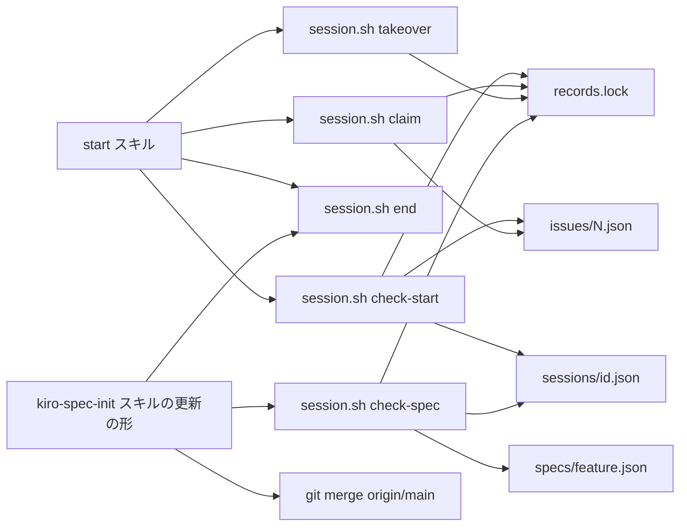
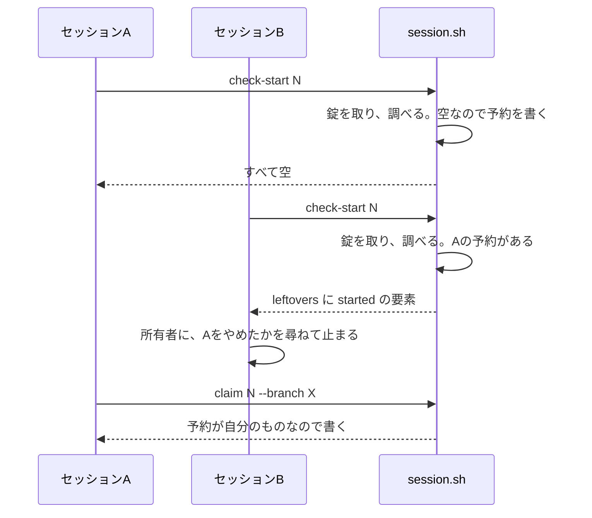
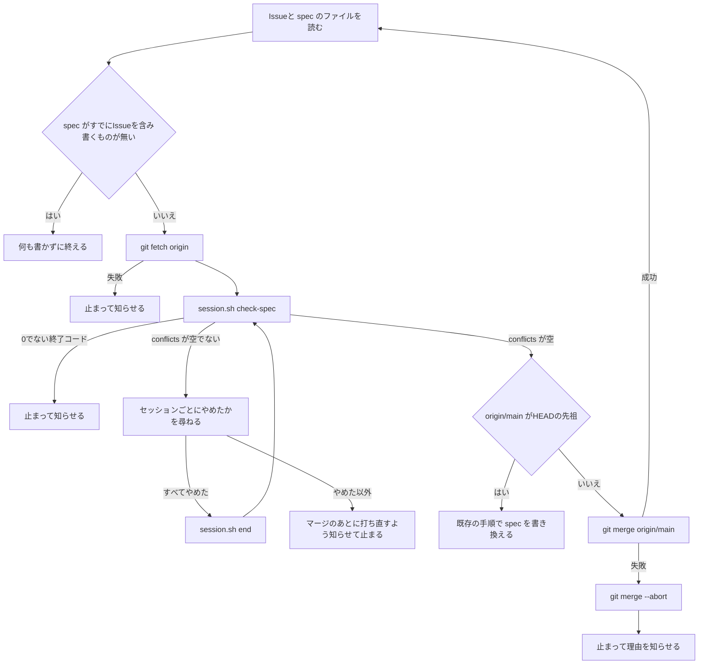

# 設計

## 概要

今は、`/start` の最初の調べ(`session.sh check-start`)は、調べた結果を返すだけで何も記録しない。Issueの記録 `issues/<N>.json` を書くのは、Claude がIssueの本文とコードを調べ終えてブランチを作った直後の `session.sh claim` だけである。そのため、先のセッションがIssueを調べている間、ほかのセッションからは着手が見えない。また、既存の spec を新しいIssueのために直すコマンド(`/kiro-spec-init #<N> <feature>`)は、ほかの作業フォルダを見ない。

Claude は、`check-start` に着手の予約の書き込みを足し、`claim` に、記録がほかのセッションのものかどうかの判定を足す。Claude は、`session.sh` に新しいサブコマンド `check-spec` を足し、`/kiro-spec-init` の更新の形に、spec を書き換える前の手順を足す。

この設計は、spec `parallel-sessions` で作った `session.sh` と `/start` の動きを広げる。

## 作るものと作らないもの

### 作るもの

- `session.sh check-start` の変更: 錠の中での調べと予約の書き込み、作りかけの種類 `started` の返し方
- `session.sh claim` の変更: 錠の中での書き込みと、ほかのセッションの記録を書き直さずに断ること
- `session.sh takeover` の変更: Issueの記録を書き直すときに錠を取ること
- `session.sh check-spec`(新しいサブコマンド): ほかの作業中のセッションが同じ spec を直しているかの調べと、spec の予約 `specs/<feature>.json` の書き込み
- `session.sh prune` の変更: 古くなった spec の予約の片付け
- `/start` の変更: 予約が書かれることと、`started` だけの作りかけの問いと答えの扱い
- `/kiro-spec-init` の更新の形の変更: spec を書き換える前の、`check-spec` の呼び出しと、`origin/main` の取り込み
- README の `/kiro-spec-init` の行の書き足し
- `test-session.sh` への場合の追加

### 作らないもの

- spec `parallel-sessions` の本文(requirements.md・design.md・tasks.md)の変更。Claude は、承認済みの段階の本文を、このIssueのために承認を取り消して直すことはしない
- `/start` の Step 5 と Step 6(判断の段階)で、ほかのセッションが同じ spec を直しているかを調べること
- spec の各段階のコマンド(`/kiro-spec-requirements` `/kiro-spec-design` `/kiro-spec-tasks` `/spec-review` `/kiro-impl`)への調べの追加
- 新しい spec を作る形の `/kiro-spec-init`(名前の重なりは今の `spec-names` のまま)
- セッションの記録のフック `session-registry.sh` と `settings.json` の変更
- PRで走るチェック(GitHub Actions)の変更

## 使う既存の仕組み

- spec `parallel-sessions` の記録(本体の `.git/keirekipro-parallel/` の `sessions/` `issues/`)と、作業中のセッションの見分け方(`sessions/` の記録のうち、`issues/` に同じ `session_id` か同じ `folder` の記録があり、`folder` の作業フォルダが無くなっていないもの)
- `lib.sh` の `_kp_lock`(`mkdir` で取る錠。取れるまで0.1秒ごとに最大150回試し、60秒より古い錠は壊して取り直す)、`kp_state_dir` `kp_folder` `kp_session_id` `kp_json_get` `kp_json_write` `kp_live_folders` `kp_folder_gone`
- `session.sh` の `end`(所有者が「やめた」と答えたセッションの記録を消す)と `takeover`
- `/start` の Step 1.5 の表(JSON の欄ごとの問いと、答えに応じて呼ぶサブコマンド)
- git の `apply --cached --check -R --unidiff-zero`、`diff -U0`、`merge-base`、`read-tree`、`add -A`、`write-tree`、`commit-tree`、`merge`
- 依存の向き: スキルは `session.sh` を呼ぶ。`session.sh` は `lib.sh` を読み込む。`session.sh` はスキルとフックを呼ばない

## 設計を見直すきっかけ

- PRのマージのしかたが squash(PRのコミットを1つにまとめた新しいコミットとして main に載せるマージ)から変わったとき。`check-spec` が中身で判定する理由が変わる
- `issues/<N>.json` か `sessions/<id>.json` の欄、または作業中のセッションの見分け方が変わったとき。`started` の判定と `check-spec` の作業中の判定が合わなくなる
- `/kiro-spec-init` の更新の形の手順の並びが変わったとき。spec を書き換える前に調べる位置がずれる
- `lib.sh` の `_kp_lock` の待ち時間か古い錠を壊すまでの秒数が変わったとき。錠を待つ時間と、spec の予約が切れるまでの10分の釣り合いが変わる
- `/start` の Step 1.5 の表の行の並びが変わったとき。`started` だけの行を既存の作りかけの行より先に扱う決めごとが崩れる

## プロジェクトの決まりを守っているか

- 新しいライブラリの追加: 足さない。`session.sh` は、今と同じく `bash` と `perl`(`JSON::PP`)と `git` だけを使う。この設計で使う git のコマンドはどれも、`lib.sh` の冒頭に書いた前提の版(2.31)より前からある
- 品質チェックの設定: 品質チェックの設定ファイルを変えない。`.claude/hooks/` と `.claude/settings.json` も変えない。変えるのは `.claude/scripts/parallel/` と `.claude/skills/` の下のファイルである
- 使う外部の機能がこのリポジトリで使えるか: 使うのは作業PCの git だけである。`/kiro-spec-init` の `git fetch origin` は、今の `/start` と `/ship` と同じリモートを使う
- 関係のない項目: backend のコードを置く層、frontend の機能ごとの境界、frontend の状態の持ち方、データベースの表の形

## 全体の構成

選んだ構成: 同じIssueの調べと同じ spec の調べを、どちらも `session.sh` のサブコマンドに置く。どちらの調べも、ほかの作業フォルダの記録と git の状態を読み、所有者とはやり取りしない。所有者への問いと答えの扱いは、今と同じくスキル(`/start` と `/kiro-spec-init`)が受け持つ。

錠を1つにした理由: `check-start` `claim` `takeover` `check-spec` は、どれも本体の `.git/keirekipro-parallel/` の記録を読んでから書く。読んでから書くまでの間に、ほかのセッションが同じ記録を書くと、片方の書き込みが消える。錠を1つにすれば、記録を読み書きするサブコマンドが同時に1つしか動かない。どのサブコマンドも錠を持つ時間は数秒なので、錠を分けても待ちはほとんど減らない。錠のディレクトリは `.git/keirekipro-parallel/records.lock` に置く。

Claude は、予約を `check-start` に置いた理由と、spec の判定に差分を逆向きに当てる方法を選んだ理由を、research.md の「設計の判断」と「比べた案」に書いた。

**使う技術**:
- 実行環境: 作業PCの Git Bash(Windows)か bash(macOS / Linux)、perl の `JSON::PP`、git 2.31 以上。今の `session.sh` と同じである

## ファイルの構成

Claude が変えるファイル:

- `.claude/scripts/parallel/session.sh`: 部品「session.sh check-start の変更」「session.sh claim と takeover の変更」「session.sh check-spec」「session.sh prune の変更」を置く。冒頭の使い方の注記に、`check-spec` と、`check-start` が予約を書くことと、`claim` が断ることを書き足す
- `.claude/scripts/parallel/tests/test-session.sh`: 「テストの方針」の場合を足す。偽物のリモート(裸のリポジトリ)は、既存の `takeover --branch` のテストと同じ作り方で用意する。裸のリポジトリとは、作業フォルダを持たない git のリポジトリを指す
- `.claude/skills/start/SKILL.md`: 部品「start スキルの変更」
- `.claude/skills/kiro-spec-init/SKILL.md`: 部品「kiro-spec-init スキルの変更」
- `README.md`: `/kiro-spec-init` の行(コマンドの一覧の表の2行目)に、ほかのセッションが同じ仕様書を直しているときは書き換えずに止まることを書き足す

## 処理の流れ

### `/start` の最初の調べ(同じIssue)

流れの上の決めごと:

- 2つの `check-start` が同じ時に呼ばれても、錠のために片方は待つ。先に錠を取ったほうが予約を書き、あとのほうはその予約を `started` として返す
- 所有者がBで「やめた」と答えたら、Bの Claude は `session.sh end <Aのセッションのid>` を呼んでから `check-start` を呼び直す。Aのセッションの記録が消えるので、Bの `check-start` は、Aの予約を作業中のものに数えなくなり、Bの予約を書く。そのあとでAの Claude が `claim` を呼ぶと、`claim` は断る(終了コード1)

### spec を直すコマンド(同じ spec)

## 部品

### session.sh check-start の変更(同じIssueの調べと着手の予約)

対応する要件: 1.1, 1.2, 1.3, 1.5, 1.6, 3.1

**役割**: `check-start` は、今の調べに、作りかけの種類 `started` を足す。`check-start` は、調べの結果の `folder_conflict` `leftovers` `branch_only` がすべて空のときに、Issue #N の予約を書く。`check-start` は、所有者とやり取りしない。

**呼び出し方**: `check-start <N> [--session <ID>]`(今と同じ)。標準出力の JSON の形は今と同じで、`leftovers` の要素の `kinds` に `started` が入ることがある。`kinds` の並びは `started` `spec` `changes` `branch` の順にする。

**`started` の判定**: Issueの記録 `issues/<N>.json` があり、次のすべてに当たるとき、`check-start` は、記録の `folder` の作業フォルダの `leftovers` の要素の `kinds` に `started` を入れる。

1. 記録の `session_id` が空でない
2. 記録の `session_id` が、このセッションのID(`kp_session_id` の返すID)と違う
3. `sessions/<記録の session_id>.json` があり、その記録の `folder` の作業フォルダが無くなっていない(`kp_folder_gone` が「無くなった」を返さない)
4. 記録の `folder` が、今の作りかけの見つけ方で数える作業フォルダ(ディレクトリがあり bare でない worktree。bare とは、作業フォルダを持たない git のリポジトリを指す)の1つで、Issueの記録の `handed_over_from` に入っていない

`started` を入れた要素の `active_session` には、`check-start` は、`sessions/<記録の session_id>.json` の `session_id` `started_at` `last_seen` を入れる。`started` 以外の種類が無い作業フォルダでも、`check-start` は要素を作る。

**予約の書き込み**: `check-start` は、`prune` を終えたあとに `records.lock` を取り、錠の中で調べと予約を行い、錠を返してから JSON を出す。予約は次のとおりに書く。時刻 `updated_at` は UNIX 秒である。

- Issueの記録が無いとき: `issue` `folder`(いまの作業フォルダ)`branch`(空)`session_id`(このセッションのID。無ければ空)`updated_at` `handed_over_from`(空の配列)を持つ記録を作る
- Issueの記録の `folder` がいまの作業フォルダで、`session_id` がこのセッションのIDと同じとき(同じセッションの打ち直し): `updated_at` だけを書き直す
- それ以外のとき(閉じたセッションの予約や、片付けを待つ記録): `folder` `session_id` `updated_at` を書き直し、`branch` を空にする。`handed_over_from` は残す。この場合に当たるのは、記録のブランチがどの作業フォルダでも開かれておらず、ローカルにもリモートにも無いときだけである。ブランチがあれば、`leftovers` か `branch_only` が空にならないので、`check-start` は予約を書かない

**失敗したとき**: `records.lock` を取れなかったとき(15秒待っても取れないとき)と、予約を書けなかったときは、`check-start` は JSON を出さずに、理由を `[parallel]` で始まる文で標準エラーに出し、終了コード69で終わる。`/start` は、今の決まりのとおり、0でない終了コードで止まって所有者に伝える。

### session.sh claim と takeover の変更(着手の記録の書き直しを断る)

対応する要件: 1.3, 1.4

**役割**: `claim` は、`records.lock` の中で、Issueの記録を読んでから書く。記録がほかのセッションのものなら、`claim` は記録を書き直さずに断る。`takeover` は、手順7(Issueの記録を書き直す手順)を `records.lock` の中で行う。`takeover` は、記録の持ち主を確かめない。所有者が引き継ぐと答えたあとに呼ばれるからである。

**呼び出し方**: `claim <N> --branch <ブランチ> [--session <ID>]`(今と同じ)。`claim` は、次のどちらかに当たる記録を、ほかのセッションの記録とみなす。

- 記録の `folder` が空でなく、いまの作業フォルダと違う(比べるときは `core.ignorecase` に従う)
- 記録の `session_id` が空でなく、このセッションのIDも空でなく、2つが違う

ほかのセッションの記録のとき、`claim` は、`[parallel] 着手できない: Issue #<N> は、別のセッション(作業フォルダ <folder>、セッション <session_id>)が着手したものとして記録されている。` で始まる文を標準エラーに出し、終了コード1で終わる。記録が無いとき、記録の `folder` と `session_id` が空のとき(`prune` が残した記録)、記録がこのセッションのものとき、`claim` は今と同じく書く。

**失敗したとき**: `records.lock` を取れなかったときは、`claim` と `takeover` は、記録を書かずに終了コード69で終わる。

### session.sh check-spec(同じ spec を直しているほかのセッションの調べ)

対応する要件: 2.1, 2.2, 2.3, 2.5, 2.6, 3.1

**役割**: `check-spec` は、ほかの作業中のセッションが spec `<feature>` を直しているかを調べ、結果を JSON で返す。ほかのセッションが直していなければ、`check-spec` は spec の予約を書く。`check-spec` は、所有者とやり取りせず、spec のファイルと作業フォルダの中身を変えない。

**いつ動くか**: `/kiro-spec-init` の更新の形から、`git fetch origin` のあとに呼ばれる。

**呼び出し方**: `check-spec <feature> --issue <N> [--session <ID>]`

- `<feature>` は、英小文字・数字・ハイフンだけの名前でなければならない。名前が違えば、`check-spec` は終了コード64で終わる。`--issue` が無いか数でないときも、`check-spec` は終了コード64で終わる
- `check-spec` は、標準出力に、`{"conflicts":[...]}` の形の JSON を1行出し、終了コード0で終わる。要素は、直しているほかの作業中のセッションごとに1つで、`folder`(作業フォルダ)`session_id` `started_at` `last_seen` `issue`(そのセッションが着手しているIssueの番号。`issues/` の記録の `session_id` が同じものを先に、無ければ `folder` が同じものを引く。どちらも無ければ `null`)`reason`(`changes` か `starting`)を持つ。`check-spec` は、要素を `started_at` の古い順に並べる

**手順**:

1. `check-spec` は、`refs/remotes/origin/main` を読む。無ければ、`[parallel] 調べられない: origin/main が手元に無い` を標準エラーに出し、終了コード69で終わる
2. `check-spec` は `records.lock` を取る
3. `check-spec` は、`git worktree list --porcelain` の作業フォルダのうち、ディレクトリがあり bare でなく、いまの作業フォルダでないものを1つずつ調べる。その作業フォルダの作業中のセッション(spec `parallel-sessions` の見分け方で作業中のもの。このセッションのIDの記録は除く)が無ければ、`check-spec` はその作業フォルダを飛ばす。要件2の受入基準6(作業中のセッションの無い作業フォルダでは止まらない)は、この飛ばし方で満たす
4. 作業中のセッションがある作業フォルダ W について、`check-spec` は、W が spec `<feature>` を直しているかを次のとおりに判定する
   1. W の `.kiro/specs/<feature>` が、W の作業フォルダにも W の HEAD の木にも無ければ、W は直していない。HEAD の木とは、W の HEAD のコミットが持つディレクトリとファイルの一覧を指す
   2. `check-spec` は、W の git のディレクトリに置いた一時的な索引(`GIT_INDEX_FILE`)に W の HEAD を読み込み(`read-tree`)、`add -A -- .kiro/specs/<feature>` で spec のディレクトリだけを載せ、`write-tree` と `commit-tree -p <W の HEAD>` で一時的なコミット S を作る。索引とは、git が次のコミットに載せる中身を置く場所を指す。W の索引と中身は変えない。S はどのブランチにも載せない
   3. `check-spec` は、S と `origin/main` の分かれ目 M(`git merge-base origin/main S`)を求め、`git diff -U0 --binary --no-renames M S -- .kiro/specs/<feature>` で差分 P を取る。P が空なら、W は直していない
   4. `check-spec` は、いまの作業フォルダの git のディレクトリに置いた一時的な索引に `origin/main` を読み込み、`git apply --cached --check -R --unidiff-zero` で P を逆向きに当てる。当てられれば、W の変更はすべて main に中身として入っているので、W は直していない。当てられなければ、W は直している(`reason` は `changes`)
   5. `check-spec` は、一時的な索引と P のファイルを消す
5. `check-spec` は、`specs/<feature>.json`(spec の予約)を読む。予約の `folder` が W で、予約の `session_id` が W の作業中のセッションのIDで、`updated_at` から600秒たっていなければ、W は直している(`reason` は `starting`)。4と5の両方に当たるときは、`check-spec` は `reason` を `changes` にする
6. 直している作業フォルダ W ごとに、`check-spec` は、W の作業中のセッションをすべて要素にする
7. 要素が1つも無ければ、`check-spec` は、`specs/<feature>.json` に `feature` `folder`(いまの作業フォルダ)`session_id`(このセッションのID)`issue` `updated_at` を書く。要素があれば、`check-spec` は予約を書かない
8. `check-spec` は錠を返し、JSON を出す

**状態の持ち方**: spec の予約 `specs/<feature>.json` は、spec ごとに1つで、最後に調べを通ったセッションのものである。予約が意味を持つのは、書いてから600秒の間だけである。600秒は、`/kiro-spec-init` が spec.json と requirements.md を書き終えるまでの時間に余裕を見た長さである。書き終えたあとは、手順4の差分の判定が止める。

**失敗したとき**: 手順4のどこかで git のコマンドが失敗したときと、錠を取れなかったときと、予約を書けなかったときは、`check-spec` は、JSON を出さずに、どの作業フォルダで何が失敗したかを `[parallel] 調べられない:` で始まる文で標準エラーに出し、一時的な索引を消して、終了コード69で終わる。ただし、手順4で P を逆向きに当てられないことは、`check-spec` は git のコマンドの失敗に数えない。

### session.sh prune の変更(古くなった spec の予約の片付け)

対応する要件: 2.5

**役割**: `prune` は、今の片付けに加えて、`specs/` の下の予約のうち、`updated_at` から600秒たったものと、`updated_at` が数でないもの(壊れた記録)を消す。消したときは、`[parallel] 片付け: spec の予約 <ファイル名> を消した` を標準出力に出す。

### start スキルの変更(予約と `started` の扱い)

対応する要件: 1.2, 1.4, 1.5, 1.6, 3.1

**役割**: Claude は、`/start` の Step 1.5 を次のとおり直す。

- 手順2の説明に、`check-start` は、`folder_conflict` `leftovers` `branch_only` がすべて空のときに、Issue #N の着手の予約を書くことを書き足す。予約は、ほかのセッションの `check-start` に `started` の作りかけとして見える
- 表の `folder_conflict` の行の次に、`leftovers` の要素の `kinds` が `started` だけのときの行を足す。問いは「やめたか」、答えが「やめた」なら呼ぶのは `session.sh end <active_session の session_id>` である。`kinds` に `started` のほかの種類もある要素は、今の表の行(`active_session` が `null` でないので「やめたか」、「やめた」なら `takeover --from <folder>`)で扱う。どちらの行も、問いは1つの要素につき1回である
- 問いに添えることに、`started` だけの要素では、作業フォルダの場所(`folder`)と、そのセッションを始めた時刻と最後に操作された時刻(`active_session` の `started_at` と `last_seen` を読める日時にしたもの)と、そのセッションがまだブランチを作っていないことを書き足す

Claude は、Step 7 の「spec を作らずに実装する」の手順1に、`claim` が終了コード1で終わったときは、ほかのセッションが同じIssueに着手したことを表すので、ブランチを使わずに止まり、標準エラーの文を所有者に伝えることを書き足す。

### kiro-spec-init スキルの変更(spec を書き換える前の調べと取り込み)

対応する要件: 2.1, 2.2, 2.3, 2.4, 2.7, 3.1

**役割**: Claude は、`/kiro-spec-init` の Update Mode Steps の手順2(ファイルを読み、何を書くかを決める手順)と手順3(spec.json を書く手順)の間に、次の手順を足す。足す手順は、既存の手順と同じく英語で書く。Claude は、足した手順が終わるまで、spec のファイルを1つも書き換えない。

- 手順2で、spec がすでに Issue #N を含んでいて何も書かずに終えると決まったときは、Claude は足した手順を行わない
- 手順2で、requirements.md の書き足しだけをやり直す経路(手順4と手順5だけを行う経路)に決まったときも、Claude は手順4の前に足した手順を行う
- 足した手順の4で `git merge origin/main` を打ったときは、spec のファイルが変わることがあるので、Claude は手順2をやり直してから、手順2が決めた経路で進む

1. Claude は `git fetch origin` を単独のコマンドとして打つ。失敗したら、Claude は、失敗したことと git の文を所有者に伝え、何も書かずに止まる
2. Claude は、`bash .claude/scripts/parallel/session.sh check-spec <feature> --issue <N> --session <ID>` を単独のコマンドとして打つ。セッションのIDは、`/start` と同じく、SessionStart のフックが渡した `[parallel] このセッションのID: <ID>` の文から取る。文が見つからなければ、Claude は `--session` を付けない。終了コードが0でなければ、Claude は、終了コードと標準エラーの文を所有者に伝え、何も書かずに止まる
3. `conflicts` が空でなければ、Claude は、spec の名前と、要素ごとの作業フォルダ・Issueの番号・始めた時刻と最後に操作された時刻(読める日時にしたもの)を示し、要素ごとに「そのセッションをやめたか」を尋ねて止まる。Claude は、問いを AskUserQuestion にせず、チャットの本文に書く
   - すべての要素で所有者が「やめた」と答えたら、Claude は、要素ごとに `session.sh end <session_id>` を呼び、手順2からやり直す
   - 1つでも「やめた」以外の答えがあれば、Claude は、何も書かずに止まる。Claude は、そのセッションのPRがマージされたあとに同じコマンドを打ち直すよう、所有者に知らせる
4. `conflicts` が空なら、Claude は、`git merge-base --is-ancestor origin/main HEAD` で、ブランチが main の最新を含むかを確かめる。含まなければ、Claude は `git merge origin/main` を単独のコマンドとして打つ。`git merge` が失敗したら、Claude は、マージの途中の状態が残っていれば(`git rev-parse -q --verify MERGE_HEAD` が成功すれば)`git merge --abort` を打ち、取り込めなかった理由(git の文)を所有者に伝え、何も書かずに止まる

### README の変更(所有者向けのコマンドの一覧)

対応する要件: 2.2, 2.4

**役割**: Claude は、README のコマンドの一覧の `/kiro-spec-init` の行に、「ほかのセッションが同じ仕様書を直しているときは、AIは仕様書を書き換えずに止まり、そのセッションをやめたかを尋ねる」ことを書き足す。

## データの形

### 論理的なデータの形

記録は、今と同じく本体の `.git/keirekipro-parallel/` の下に置き、時刻を UNIX 秒で持つ。この設計で変わる記録は次のとおりである。

| 記録 | パス | 書く部品 | 中身 |
|---|---|---|---|
| Issue | `issues/<N>.json` | `check-start`(予約)、`claim`、`takeover` | 欄は今と同じ(`issue` `folder` `branch` `session_id` `updated_at` `handed_over_from`)。`check-start` の予約は、`branch` が空の記録である |
| spec の予約 | `specs/<feature>.json` | `check-spec`(書く)、`prune`(消す) | `feature` `folder` `session_id` `issue` `updated_at` |
| 記録の錠 | `records.lock`(ディレクトリ) | `check-start` `claim` `takeover` `check-spec` | 中身は無い。ディレクトリがあるあいだ、ほかのサブコマンドは待つ |

`/start` と `prune` は、`branch` が空の予約を、今の決まりのままでも扱える。`/start` の Step 7 の手順1は、記録の `branch` が空なら新しいブランチを作るので、予約のあとに `claim` が `branch` を書く。`prune` は、`folder` の作業フォルダが無くなった予約を、`branch` が空なので消す。

## 失敗したときの扱い

- 調べを終えられないとき(錠、記録の読み書き、git のコマンドの失敗): `check-start` と `check-spec` は終了コード69で終わる。`/start` と `/kiro-spec-init` は、0でない終了コードを受けたら、spec もブランチも作らず、spec のファイルも書き換えずに止まり、終了コードと標準エラーの文を所有者に伝える
- 錠が残ったとき: `session.sh` が錠を持ったまま落ちると、`records.lock` が残る。所有者は錠を手で消さず、少し待ってからコマンドを打ち直す
- 予約したセッションが閉じたとき: SessionEnd のフックがセッションの記録を消すので、予約は `started` に数えなくなる

## テストの方針

Claude は、`test-session.sh` に次の場合を足す。どれも、一時的な本体と worktree 2つ、偽物の `docker` を使う今の作りの中で流す。

- 単体テスト(`check-start` の予約):
  - 何も見つからないとき、`check-start` が `issues/<N>.json` に、いまの作業フォルダとこのセッションのIDと空のブランチの予約を書く(要件1の受入基準1: 最初の調べを終えた時点から、このセッションをIssue #N に着手したセッションとして扱う)
  - ほかの worktree の作業中のセッションの予約があると、`leftovers` に `kinds` が `["started"]` で `active_session` にそのセッションが入った要素が出て、予約は書き換わらない(要件1の受入基準2: Issue #N に着手した作業中のセッションがほかにあれば、あとのセッションは止まる)
  - 予約したセッションの記録が無いとき(閉じたとき)、`leftovers` は空で、予約がこのセッションのものに書き換わる(要件1の受入基準5: 先のセッションが閉じていて作りかけも無ければ、所有者に尋ねずに続ける)
  - 同じセッションで `check-start` を打ち直すと、`leftovers` は空で、予約の `updated_at` だけが変わる(要件1の受入基準6: 同じセッションでの打ち直しでは、そのセッション自身を理由に止まらない)
  - `end` で予約したセッションの記録を消したあとの `check-start` は、`leftovers` が空になり、予約がこのセッションのものに書き換わる(要件1の受入基準4: 所有者が「やめた」と答えたら、あとのセッションが着手したセッションになる)
  - 予約の `session_id` が空のときは、`started` を出さない
  - `records.lock` がほかに持たれたままのとき(60秒より新しい錠のディレクトリを置いたとき)、`check-start` は終了コード69で終わり、予約を書かない(要件3の受入基準1: 調べを終えられなければ進まない)
- 結合テスト(同時の `check-start`): 2つの worktree から、別々のセッションのIDで `check-start` を同時に(バックグラウンドで)呼ぶと、片方の `leftovers` だけが空で、もう片方は `started` の要素を返し、予約は空を返したほうのセッションのものである(要件1の受入基準3: 最初の調べが同じ時に重なっても、片方だけを着手したセッションとして扱う)。Claude は、この場合を10回くり返して、毎回成り立つことを確かめる
- 単体テスト(`claim`):
  - ほかの作業フォルダの予約があると、`claim` は終了コード1で `[parallel] 着手できない:` の文を出し、記録を書き換えない(要件1の受入基準4: 所有者が「やめた」と答えたら、あとのセッションが着手したセッションになる)
  - 自分の予約があると、`claim` は `branch` を書く。記録が無いとき、`folder` と `session_id` が空の記録のときも、`claim` は書く
- 単体テスト(`check-spec`)。偽物のリモートの `main` を用意し、`refs/remotes/origin/main` を手で動かして main の進み具合を作る:
  - ほかの worktree に作業中のセッションがあり、その worktree が spec にコミットしていない変更を持つと、`conflicts` に `reason` が `changes` の要素が出る(要件2の受入基準1と2: main にまだ入っていない spec の変更を持つほかの作業中のセッションがあれば、spec を書き換えずに止まって尋ねる)
  - その変更をコミットしても(マージしていなければ)、要素が出る(要件2の受入基準1: main にまだ入っていない変更は、コミットしたがマージされていない変更も含む)
  - 同じ中身を別のコミットとして `origin/main` に入れたあと(squash でのマージを真似たもの)は、`conflicts` が空になる。そのあと `origin/main` で隣の行がさらに変わっても空のままである(要件2の受入基準1と4: 変更が main に中身として入っていれば止まらず、マージのあとに打ち直せば続けられる)
  - ほかの worktree が spec を変えておらず、ブランチが古い main から作られていて、`origin/main` が spec を変えているときは、`conflicts` が空である(要件2の受入基準1: そのセッションが加えた変更だけを数える)
  - 変更を持つ worktree に作業中のセッションが無いときは、`conflicts` が空である(要件2の受入基準6: 作業中のセッションの無い作業フォルダにだけ変更があるときは止まらない)
  - ほかのセッションの600秒以内の spec の予約があると、`reason` が `starting` の要素が出る。600秒より古い予約は、`check-spec` が無視する(要件2の受入基準5: 2つの調べが同じ時に重なっても、片方だけに spec を書き換えさせる)
  - `conflicts` が空のときだけ、`specs/<feature>.json` にこのセッションの予約が書かれる(要件2の受入基準5: 2つの調べが同じ時に重なっても、片方だけに spec を書き換えさせる)
  - 作業中のセッションが2つある worktree では、要素が2つ出る(要件2の受入基準2: 直しているセッションが2つ以上あれば、すべてを示してセッションごとに尋ねる)
  - `end` でセッションの記録を消したあとの `check-spec` は、そのセッションの要素を出さない(要件2の受入基準3: 所有者が「やめた」と答えたら、そのセッションを除いて調べ直す)
  - `origin/main` が無いと終了コード69、名前に大文字か `/` を含むと終了コード64で終わる(要件3の受入基準1: 調べを終えられなければ進まない)
  - 調べのあと、ほかの worktree の索引(`git status --porcelain` の出力)と中身が変わっていない
- 単体テスト(`prune`): 600秒より古い spec の予約を消し、新しい予約を残す
- スキルの変更(`/start` と `/kiro-spec-init`)は、スクリプトのテストでは確かめられない。Claude は、PRの本文に、Issueの「確かめ方」の2つ(2つのセッションで同じIssueに数秒差で `/start` を打つこと、同じ spec を直す別々のIssueで両方のセッションで spec を直すコマンドを打つこと)を、マージのあとに所有者が行う実地の確かめとして書く

## 性能

`check-spec` は、作業中のセッションがある worktree ごとに、一時的な索引への読み込み、spec のディレクトリの載せ直し、差分、逆向きの当てはめを行う。`check-spec` は spec のディレクトリだけを載せ直すので、`check-spec` の調べにかかる時間は、worktree 1つにつき数秒の範囲である。錠を持つのはこの調べの間だけで、ほかのセッションの `check-start` はその間待つ。

## ほかの spec との食い違い

この設計は、spec `parallel-sessions` の design.md の部品「session.sh」と「start スキルの変更」に書かれた動き(`check-start` は記録を書かない、`claim` は記録があれば書き直す、Step 1.5 の表の行)を変える。Claude は、spec `parallel-sessions` の本文を直さず、このPRの本文に、`/ship` の「食い違う spec:」の行の形で、変えた動きを書く。spec `parallel-sessions` をあとで開き直すとき、`/kiro-spec-requirements` と `/kiro-spec-design` は、この形の行をマージ済みのPRの本文から拾う。

- 食い違う spec: `.kiro/specs/parallel-sessions/design.md` 部品「session.sh」。`check-start` は調べるだけで記録を書かない を、`check-start` は調べの結果が空のときに着手の予約を書き、ほかのセッションの予約を作りかけの種類 `started` として返す に変えた
- 食い違う spec: `.kiro/specs/parallel-sessions/design.md` 部品「session.sh」。`claim` は記録があれば書き直す を、`claim` は記録がほかのセッションのものなら書き直さずに終了コード1で断る に変えた
- 食い違う spec: `.kiro/specs/parallel-sessions/design.md` 部品「start スキルの変更」。Step 1.5 の表 を、`started` だけの作りかけの行(「やめた」なら `end`)を足した表 に変えた
