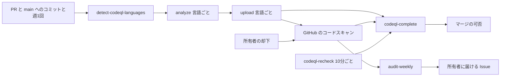
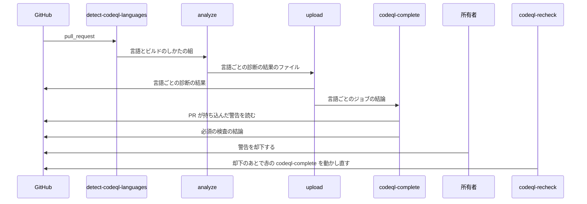

# 設計

## 概要

この設計は、CodeQL の診断を GitHub Actions のワークフロー `codeql.yaml` として足す。このワークフローは、PR と main へのコミットと週1回の定期実行で、リポジトリのファイルから CodeQL が対応する言語を見つけ、見つけた言語ごとに CodeQL を動かす。このワークフローは、診断の結果を GitHub のコードスキャンに送る。

PR のマージは、ワークフローの最後のジョブ `codeql-complete` が止める。このジョブは、必須の検査として ruleset に載る。

所有者が警告を却下したあとは、定期実行のワークフロー `codeql-recheck.yaml` が、赤のままの `codeql-complete` を動かし直す。今ある週次監査(`audit-weekly.yaml`)は、main に残った警告と、main の診断が止まっていないかを調べる。週次監査は、調べた結果を、警告の中身を書かずに、所有者に届ける Issue に書く。

## 作るものと作らないもの

### 作るもの

- 診断のワークフロー `codeql.yaml` と、診断する言語を見つけるスクリプトと、言語の対応表
- PR が持ち込んだ警告を数えてマージを止めるスクリプトと、所有者の却下のあとにそのスクリプトを動かし直す定期実行のワークフロー
- 週次監査の判定スクリプト1本の追加と、ワークフローの直近の成功が決まった日数より前かを判定する今あるスクリプトへの引数の追加
- 必須の検査の期待一覧への登録と、所有者が ruleset に必須の検査を足す手順
- Claude が警告を却下しないことと、警告で止まったときの扱いを書いた、`/ship` のスキルと CLAUDE.md の追記

### 作らないもの

- main に残った警告を直す仕組み。Claude は、この仕組みを Issue #725 で作る
- 開発者の PC で動かす診断。この設計は、`run-check.sh` と `/verify-*` のスキルを変えない
- シェルのスクリプトと Terraform のファイルの診断
- CodeQL のクエリを自分で書くこと。クエリとは、CodeQL がソースコードの中から脆弱性の疑いを探すときの、探し方を書いたプログラムである。この設計は、GitHub が配る標準のクエリの組(`default`)だけを使う
- GitHub の ruleset の `code_scanning` 規則
- Claude のアカウントのトークンの権限を絞ること。GitHub の文書は、公開のリポジトリでは、`public_repo` のスコープでも警告の却下の API を使えると書いている。そのため、トークンを絞っても、Claude は警告を却下できる

## 使う既存の仕組み

- 週次監査 `audit-weekly.yaml` と、監査の Issue を書く `audit-issue.sh`。この設計で足す週次監査の判定スクリプト `check-audit-codeql-alerts.sh` は、週次監査が終了コードを 0(逸脱なし)、1(逸脱あり)、2(判定不能)と読む今の決まりに合わせて、終了コードを返す
- ワークフローの直近の成功が決まった日数より前かを判定する `check-audit-scan-freshness.sh`
- スキップのままのマージを見つける `check-audit-skipped-required.sh` と、期待一覧 `.github/audit/required-checks.json`
- action の版を SHA で固定する検査 `check-action-pinning.sh` と、Dependabot の `github-actions` の更新
- `ci.yaml` が使う `actions/setup-java` の版と JDK の設定。`codeql.yaml` の `analyze` のジョブは、Java のビルドで、`ci.yaml` と同じ `actions/setup-java` の版と JDK の設定を使う
- CODEOWNERS の `/.github/` の行。Claude は、診断の対象を変える設定を `.github/` の下に置く。そのため、診断の対象を変える PR は、CODEOWNERS により、所有者が承認するまでマージされない

## 設計を見直すきっかけ

- GitHub が、コードスキャンの API の警告の状態か却下した人の項目を変えたとき
- CodeQL が対応する言語が増えたとき、または言語の名前やビルドのしかたが変わったとき。Claude は、言語の対応表を直す
- backend を Python と Django、または Go に移すとき。Claude は、言語の対応表に、その言語がビルドのしかたとともに載っているかを確かめる
- 所有者がリポジトリを非公開にするとき、または所有者がリポジトリを Organization に移すとき。コードスキャンを追加の契約なしで使えるかが変わる

## プロジェクトの決まりを守っているか

- 品質チェックの設定: この設計は、`.github/` と `.claude/` の下のファイルを足して変える。そのため、この spec の PR は、全体が所有者への提案になり、CODEOWNERS により所有者の承認を待つ。ruleset の必須の検査は、リポジトリのファイルではないので、所有者が GitHub の画面で足す。Claude は、PR の本文に、所有者が ruleset に足す中身を書く
- 新しいライブラリの追加: ライブラリは足さない。action の `github/codeql-action` の `init` と `analyze` を、SHA で固定して使う
- 使う外部の機能がこのリポジトリで使えるか: Claude は、次の5つを確かめた。
  - 2026-11-06 に `gh api repos/:owner/:repo` で、所有者が個人のアカウント(`owner.type` が `User`)であることを確かめた
  - 同じ日に、同じ API で、リポジトリが公開(`visibility` が `public`)であることを確かめた。公開のリポジトリでは、コードスキャンと CodeQL を追加の契約なしで使える
  - 同じ日に、協力者が所有者(`admin`)と Claude のアカウント(`write`)の2つだけであることを確かめた
  - 2026-11-07 に、警告の却下の API の文書が「公開のリポジトリだけなら `public_repo` のスコープでもよい」と書いていることを確かめた
  - 同じ日に、失敗したジョブを動かし直す API を、今ある `rerun-approval-gated-checks.yaml` が `actions: write` の `GITHUB_TOKEN` で使っていることを確かめた
- 関係のない項目: backend のコードを置く層、frontend の機能ごとの境界、frontend の状態の持ち方、データベースの表の形

## 全体の構成

この設計は、診断の言語を `codeql.yaml` に固定の一覧で書かない。`detect-codeql-languages.sh` が、PR のファイルから診断の言語を毎回見つける。言語を固定の一覧で書くと、言語を足した PR で Claude が一覧を直し忘れたときに、その言語が診断されない。`detect-codeql-languages.sh` が言語を毎回見つければ、Claude が言語の一覧を直す作業そのものが無くなる。

この設計は、マージを止めるかどうかを、ruleset の `code_scanning` 規則に任せず、`check-codeql-pr-alerts.sh` で決める。GitHub の文書は、`code_scanning` 規則が却下した人を区別するとは書いていない。Claude のアカウントは警告を却下できるので、規則に任せると、Claude が却下した警告でマージが止まらないおそれがある(要件4.3)。

**使う技術**:
- 実行環境: GitHub Actions の `ubuntu-latest`。診断の言語ごとに1つのジョブを動かす
- 診断: `github/codeql-action` の v4 系(`init` と `analyze`)。クエリの組は `default`
- Java のビルド: `actions/setup-java` と Gradle の `testClasses`
- マージの判定: `check-codeql-pr-alerts.sh` と、コードスキャンの警告の一覧の API(`GET /repos/{owner}/{repo}/code-scanning/alerts`)
- スクリプト: bash と、GitHub の API を呼ぶ `gh`。JSON の読み取りは `gh` の `--jq` を使い、jq に依存しない

## ファイルの構成

Claude が新しく作るファイル:

- `.github/workflows/codeql.yaml`: 診断のワークフロー。`detect-codeql-languages` と `analyze` と `upload` と `codeql-complete` の4つのジョブを持つ
- `.github/workflows/codeql-recheck.yaml`: 所有者が警告を却下したあとに、赤のままの `codeql-complete` を動かし直す定期実行のワークフロー
- `.github/scripts/detect-codeql-languages.sh`: リポジトリのファイルから CodeQL が対応する言語を見つけ、言語とビルドのしかたの組を JSON で出す
- `.github/codeql/languages.tsv`: 拡張子と CodeQL の言語とビルドのしかたの対応表
- `.github/scripts/check-codeql-pr-alerts.sh`: PR が持ち込んだ重さが「中」以上の警告のうち、所有者が却下していないものを数える
- `.github/scripts/check-audit-codeql-alerts.sh`: 週次監査で、main の警告の数と、所有者のほかの人の却下を数える
- `.github/scripts/tests/test-detect-codeql-languages.sh` `test-check-codeql-pr-alerts.sh` `test-check-audit-codeql-alerts.sh`: 上の3本のスクリプトのテスト

Claude が変えるファイル:

- `.github/workflows/audit-weekly.yaml`: `security-events: read` の権限を足す。また、CodeQL の警告を数える `check-audit-codeql-alerts.sh` の段と、main の診断が止まっていないかを確かめる `check-audit-scan-freshness.sh` の段の2つを足す。判定の前に流す自己テストの一覧に、`test-check-audit-codeql-alerts` を足す
- `.github/scripts/check-audit-scan-freshness.sh`: 数える実行を1つのブランチの実行に絞る4つ目の引数を足す。今の呼び出しは引数を渡さないので、今の判定は変わらない
- `.github/audit/required-checks.json`: `detect-codeql-languages` と `codeql-complete` の2つの検査を登録する
- `.claude/skills/ship/SKILL.md`: CodeQL の警告で止まったときの扱いを書く
- `CLAUDE.md`: 自律動作の境界に、警告を却下しないことを1行足す
- `README.md`: ワークフローの一覧表と Mermaid の図に、`codeql.yaml` と `codeql-recheck.yaml` を足す
- `doc/開発フロー/監査手順.md`: 所有者が CodeQL の警告を却下する手順と、却下のあと10分ほどでマージに進むことを書く

## 処理の流れ

## 部品

### codeql.yaml(診断のワークフロー)

対応する要件: 1.1, 2.1, 2.2, 2.3, 3.1, 3.4, 7.1

**役割**: このワークフローは、CodeQL でソースコードを診断し、結果をコードスキャンに送り、最後のジョブでマージの可否を決める。Claude は、このワークフローに、診断の対象からファイルやクエリを外す設定(`paths-ignore` `query-filters`)を書かない。

**権限**: ワークフローの権限は `contents: read` に限る。`upload` のジョブだけに、`security-events: write` と `actions: read` を足す。`codeql-complete` のジョブには、`security-events: read` を足す。`analyze` のジョブは、PR のコード(Gradle のビルドのスクリプト)を動かす。そのため、Claude は、`analyze` のジョブに書き込みの権限を持たせない。`analyze` のジョブの `actions/checkout` には `persist-credentials: false` を付け、PR のコードからトークンを読めないようにする。

**いつ動くか**: main に向けた `pull_request` の `opened` `synchronize` `reopened`、main への `push`、`schedule` の `cron: '41 3 * * 0'`(毎週日曜 03:41 UTC)、`workflow_dispatch` で動く。Claude は、`on` に `paths` と `paths-ignore` を書かない。`concurrency` は `codeql-${{ github.ref }}` とし、`cancel-in-progress` は `false` にする。取り消された実行が `cancelled` で残ると、必須の検査が成功にならないためである。

**使う部品**:
- `detect-codeql-languages` のジョブは、`test-detect-codeql-languages.sh` を流してから、`detect-codeql-languages.sh` を呼び、出力を `matrix` として次のジョブに渡す。テストが落ちたら、このジョブは赤になる
- `analyze` のジョブは、`matrix` を `strategy.matrix.include` に `fromJSON` で渡し、言語ごとに `github/codeql-action/init` と `github/codeql-action/analyze` を呼ぶ。`init` には `languages` と `build-mode` を渡し、`queries` は渡さない。`queries` を渡さなければ、CodeQL は既定の組で診断する。`init` は `queries` の値の `default` を組の名前として読まないため、`default` を渡すと診断が失敗する。`github/codeql-action/analyze` には `category: /language:${{ matrix.language }}` と `upload: never` を渡し、診断の結果のファイルを成果物(`actions/upload-artifact`)に残す。`strategy.fail-fast` は `false` にする
- `upload` のジョブは、同じ `matrix` で言語ごとに動き、成果物を受け取って `github/codeql-action/upload-sarif` で送る。このジョブは、PR のコードを動かさない。`upload-sarif` は、既定で、GitHub が結果を取り込み終えるまで待つ
- ビルドのしかたが `manual` の言語では、`analyze` のジョブは、`github/codeql-action/init` と `github/codeql-action/analyze` のあいだで、対応表に書いたビルドの命令を動かす。Java では、`ci.yaml` と同じ版の `actions/setup-java` で JDK 21 を入れ、`backend/` で `./gradlew --no-daemon testClasses` を動かす。GitHub の文書は、「ビルドなしでは、ビルドのときに作られるコードを解析しない」と書いている。backend が使う Lombok は、コンパイルのときにコードを作る。そのため、この設計は `build-mode: none` を使わない
- `codeql-complete` のジョブは、`needs: [detect-codeql-languages, analyze, upload]` と `if: always()` で動く。このジョブは、3つのジョブの結論がどれも `success` でなければ赤になる。どれも `success` なら、`pull_request` の実行では、`test-check-codeql-pr-alerts.sh` を流してから `check-codeql-pr-alerts.sh <PR の番号>` を呼び、スクリプトが終了コード0で終わったときだけ成功する。`push` と `schedule` と `workflow_dispatch` の実行では、スクリプトを呼ばない
### detect-codeql-languages.sh(診断する言語を見つけるスクリプト)

対応する要件: 1.1, 7.1

**役割**: このスクリプトは、`git ls-files` で追跡されているファイルを全部読み、拡張子と置き場所を `languages.tsv` と照らして、CodeQL の言語を見つける。`.github/workflows/` の下の `*.yml` と `*.yaml` は、`actions` の言語として数える。このスクリプトは、テストのコードを外さない。

**呼び出し方**: `detect-codeql-languages.sh <対応表のパス>` で呼ぶ。標準出力に `[{"language":"java-kotlin","build-mode":"manual","build-command":"…"}, …]` の形の JSON を1行で出し、`$GITHUB_OUTPUT` の `matrix` に書く。2026-11-06 の時点で、このリポジトリからは `actions` `java-kotlin` `javascript-typescript` の3つが出る。終了コードは、0 が成功、1 が対応表でビルドのしかたが空の言語のファイルを見つけたとき、2 がそれ以外の失敗である。

**状態の持ち方**: Claude は、`languages.tsv` の1行に、「拡張子」「CodeQL の言語」「ビルドのしかた」「ビルドの命令」の4つをタブで区切って書く。CodeQL が対応する全部の言語を、今このリポジトリに無い言語も含めて載せる。Java の行には、ビルドのしかたの `manual` と、`backend/` で `./gradlew --no-daemon testClasses` を動かすビルドの命令を載せる。TypeScript と JavaScript とワークフローと Python の行には、ビルドのしかたの `none` を載せる。ビルドのしかたが空の行は「CodeQL は対応するが、このリポジトリで動かし方を決めていない言語」を表す。Go の行のビルドの命令は、backend を Go に移したあとのコードの作りで決まる。そのため、Claude は、Go の行を、ビルドのしかたを空にして載せる。

**失敗したとき**: 見つかった言語の行のビルドのしかたが空なら、スクリプトは、その言語と、その言語のファイルの例を1つ出して、終了コード1で終わる。このとき `codeql-complete` は赤になり、PR はマージされない(要件7.1)。Claude は、対応表にビルドのしかたを書き足して直す。対応表は `.github/` の下にあるので、その PR は所有者の承認を待つ。

### check-codeql-pr-alerts.sh(PR が持ち込んだ警告でマージを止める判定)

対応する要件: 3.1, 3.2, 3.3, 4.2, 4.3

**役割**: このスクリプトは、PR が持ち込んだ重さが「中」以上の警告のうち、所有者が却下していないものを数える。スクリプトは、次の2つの一覧を、コードスキャンの警告の一覧の API で `tool_name=CodeQL` を付けて読む。

- main の一覧: `ref=refs/heads/main` の警告。このうち、`most_recent_instance.state` が `fixed` でない警告を、main にすでにある警告とする
- PR の一覧: `ref=refs/pull/<PR の番号>/merge` の警告

スクリプトは、PR の一覧の警告のうち、次の4つにすべて当てはまる警告を、マージを止める警告として数える。

- main にすでにある警告ではない(要件3.2)
- `rule.security_severity_level` が `critical` `high` `medium` のどれか(要件3.1、3.3)
- 所有者が却下した警告ではない。所有者が却下した警告とは、警告の `state` が `dismissed` で、`dismissed_by.login` が所有者の警告である。スクリプトは、この条件を `most_recent_instance.state` より先に見る。却下は、警告の番号に付く状態である。GitHub の文書は、却下のあとに `most_recent_instance.state` が変わるかを書いていない。スクリプトがこの条件を先に見るのは、このためである(要件4.2)
- 警告の `state` が `dismissed` である。または、`most_recent_instance.state` が `open` である(要件4.3)

所有者は、`check-audit-codeql-alerts.sh` と同じく、CODEOWNERS の `/.github/` の行に書かれたアカウントとする。

**呼び出し方**: `check-codeql-pr-alerts.sh <PR の番号>` で呼ぶ。マージを止める警告が0件なら、終了コード0で終わる。1件以上なら、警告の番号と重さだけを標準出力に1行ずつ書き、終了コード1で終わる。API が失敗したら、終了コード2で終わる。GitHub Actions の実行の記録は誰でも読めるので、スクリプトは、ファイルの名前、行、規則の名前、警告の説明を出さない。

### codeql-recheck.yaml(所有者の却下のあとに判定し直すワークフロー)

対応する要件: 4.2

**役割**: このワークフローは、所有者が警告を却下したあとに、赤のままの `codeql-complete` を動かし直す。GitHub Actions は警告の却下で起動できないので、このワークフローは定期実行で動く。

**いつ動くか**: `schedule` の `cron: '*/10 * * * *'` と `workflow_dispatch` で動く。GitHub の定期実行は、混んでいるときに遅れる。

**権限**: `actions: write` `checks: read` `pull-requests: read` `security-events: read` を持つ。PR のコードを取り出さず、動かさない。

**処理**: このワークフローは、開いている PR のうち、同じリポジトリのブランチから作られた PR ごとに、次のことをする。

1. PR の先頭のコミットの `codeql-complete` の検査を読む。結論が `failure` でなければ、その PR では何もしない
2. `ref=refs/pull/<PR の番号>/merge` の警告のうち、所有者が却下し、`dismissed_at` が検査の終わった時刻よりあとの警告があるかを読む。無ければ、その PR では何もしない
3. あれば、検査の実行を `POST /repos/{owner}/{repo}/actions/runs/{run_id}/rerun-failed-jobs` で動かし直す。動かし直した `codeql-complete` は、新しい時刻で終わる。そのため、このワークフローは、同じ却下で2回は動かし直さない

**失敗したとき**: このワークフローが止まっても、PR は止まったままで、マージされない。所有者は、`codeql-complete` を画面の「Re-run failed jobs」で動かし直せる。

### check-audit-codeql-alerts.sh(週次監査の警告の数え方)

対応する要件: 5.1, 5.2, 5.3

**役割**: このスクリプトは、main の CodeQL の警告を数えて、週次監査の報告を書く。報告には、開いたままの警告の数を `rule.security_severity_level` の `critical` `high` `medium` `low` ごとに書き、直近7日に `created_at` がある警告の数と、`https://github.com/<owner>/<repo>/security/code-scanning?query=is:open+tool:CodeQL+branch:main` へのリンクを書く。却下した人(`dismissed_by.login`)が CODEOWNERS の `/.github/` の行の所有者でない警告は、番号と却下した人のアカウントの名前だけを書く。このスクリプトは、ファイルの名前、行、クエリの ID、規則の名前、警告の説明を報告に書かない。

**呼び出し方**: 引数なしで呼ぶ。`GET /repos/{owner}/{repo}/code-scanning/alerts?ref=refs/heads/main&tool_name=CodeQL&state=open` と `state=dismissed` を `--paginate` で読む。開いたままの警告が0件で、所有者のほかの人の却下も0件なら、終了コード0で終わる。どちらかが1件以上なら、報告を書いて終了コード1で終わる。API が失敗したら、終了コード2で終わる。

### check-audit-scan-freshness.sh の4つ目の引数(週次監査で main の診断が止まっていないかを確かめる段)

対応する要件: 6.1

**役割**: 週次監査は、`check-audit-scan-freshness.sh codeql.yaml 8 ソースコードの診断 main` を呼ぶ。スクリプトの4つ目の引数は、数える実行を `branch=main` の実行に絞る。PR の実行の成功を数えると、main の診断が止まっていても、スクリプトは、直近の成功が8日より前ではないと判定するためである。4つ目の引数を省いたときは、スクリプトは、今と同じくブランチで実行を絞らない。

### required-checks.json と ruleset(マージを止める必須の検査)

対応する要件: 3.4, 6.2

**役割**: Claude は、期待一覧に `detect-codeql-languages` と `codeql-complete` を、`mode` を `always`、`approval_gated` を `false` にして登録する。所有者は、ruleset の必須の検査に `detect-codeql-languages` と `codeql-complete` を足す。所有者は、ruleset に `code_scanning` の規則を足さない。

`analyze` と `upload` の言語ごとの検査は、言語が増えると名前が増える。そのため、所有者は、言語ごとの検査を ruleset の必須の検査に足さない。Claude も、言語ごとの検査を期待一覧に足さない。言語ごとの結論は `codeql-complete` がまとめる。

### /ship のスキルと CLAUDE.md の追記(警告で止まったときの Claude の扱い)

対応する要件: 1.2, 3.5, 3.6, 4.1

**役割**: Claude は、`/ship` の CI を見届ける段に、次の扱いを書き足す。

- CodeQL の警告でマージが止まったら、Claude は、`codeql-complete` の実行の記録から警告の番号を読み、警告の中身を `gh api repos/{owner}/{repo}/code-scanning/alerts/<番号>` で読む。PR の注記は、警告の場所が PR の差分の外にあると出ないので、Claude は注記に頼らない。Claude は、脆弱性を直すコードを同じ PR に足す
- Claude が誤検知だと判断したら、Claude は、PR を止めたまま、警告の番号と場所と理由を、Claude Code の会話の返事に書いて会話の相手に示す。Claude は、その理由を、PR の本文とコメント、Issue の本文とコメント、コミットのメッセージのような、誰でも読める場所に書かない
- 会話の相手が所有者でないときは、Claude は、Claude Code の会話の返事に、会話の相手が所有者へ警告の却下を頼むよう書く。Claude は、同じ返事に、会話の相手が所有者に頼むときに誰でも読める場所を使わないよう書く
- Claude は、警告を却下しない。Claude は、診断の結果を自分で送る API と、検査の結果を作る API と、コードスキャンの解析を消す API を呼ばない

Claude は、CLAUDE.md の自律動作の境界に、「CodeQL の警告を却下しない。却下は所有者だけが行う」を足す。

## 失敗したときの扱い

- 診断が失敗したとき: Claude は、`/ship` の同じ失敗の数え方に従い、3回続いたら止まって報告する
- GitHub のコードスキャンの API が失敗したとき: 週次監査の2つの判定は判定不能(終了コード2)を返す。週次監査は、今の決まりのとおり、判定できなかったことを「週次監査: 判定不能」の Issue に書く
- 所有者が却下を取り消したとき: 次に `codeql-complete` が動いたときに、`check-codeql-pr-alerts.sh` が、警告を開いたものとして数え直す。すでにマージされた PR は戻らないので、main に入った警告は、週次監査が数える

## テストの方針

- 単体テスト: Claude は、`.github/scripts/tests/` のシェルのテストで、次のことを確かめる。テストは、`gh` を偽の関数に替えて、スクリプトを動かす。
  - `detect-codeql-languages.sh` が、Java と TypeScript とワークフローのファイルから3つの言語を出し、テストのコードの置き場所のファイルも数えること(要件1.1)
  - `detect-codeql-languages.sh` が、`.py` のファイルが足されたときに `python` を `none` で出し、`.go` のファイルでは終了コード1になること(要件7.1)
  - `check-audit-codeql-alerts.sh` が、重さごとの数と直近7日の数とリンクを書き、ファイルの名前と行と規則の名前を報告に出さないこと(要件5.1、5.3)。所有者のほかの人の却下の番号と名前を書くこと(要件5.2)
  - `check-codeql-pr-alerts.sh` が、PR が持ち込んだ重さが「中」以上の開いた警告で終了コード1になり、重さが「低」だけの警告と main にすでにある警告では終了コード0になること(要件3.1、3.2、3.3)
  - `check-codeql-pr-alerts.sh` が、所有者が却下した警告を数えず、Claude のアカウントと `github-actions[bot]` と却下した人の無い却下を数えること(要件4.2、4.3)。警告の `state` が `dismissed` で却下した人が所有者なら、`most_recent_instance.state` が `open` のままでも数えないこと(要件4.2)。出力に、警告の番号と重さのほかを出さないこと
  - `check-audit-scan-freshness.sh` が、4つ目の引数で main の実行だけを数え、引数を省くと今と同じ報告を出すこと(要件6.1)
- 単体テストを流す場所: `audit-weekly.yaml` は、自己テストの一覧に載せた `test-check-audit-codeql-alerts.sh` と、`check-audit-scan-freshness.sh` のテストを流す
- 結合テスト: 所有者が ruleset に必須の検査を足したあとに、Claude は、見本の PR で次のことを確かめる。Claude は、見本の PR を下書きで作る。下書きの PR には auto-merge の予約が付かないので、見本の PR はマージされない。Claude は、合否を `codeql-complete` の結論で決め、確かめ終えたら見本の PR を閉じる
  - 重さが「中」以上の警告を持ち込む見本の PR で `codeql-complete` が赤になり、警告を直すと緑になること(要件3.1、3.5)
  - 警告の場所が PR の差分の外にある見本の PR でも、`codeql-complete` が赤になり、Claude が警告の番号から中身を読めること(要件3.5)
  - main にすでにある警告だけでは `codeql-complete` が赤にならないこと(要件3.2)
  - 所有者が見本の PR の警告を却下すると、ほかの操作なしに、`codeql-recheck.yaml` が動いたあとに `codeql-complete` が緑になること(要件4.2)
  - `analyze` を失敗させた見本の PR で `codeql-complete` が赤になること(要件3.4)
  - `ref=refs/pull/<PR の番号>/merge` の一覧で、`most_recent_instance.state` が、その PR での警告の状態を表すこと。GitHub の文書は、この項目が ref ごとの状態を表すかを書いていない

## 安全

- 想定する脅威: 公開のリポジトリなので、まだ直していない警告の中身を、Issue と PR のコメントとコミットのメッセージに書くと、攻撃の手がかりを公開することになる
- Claude が警告を却下する経路: Claude のアカウントが警告を却下できる経路は2つある。1つ目は、Claude がトークンで直に却下の API を呼ぶ経路である。2つ目は、Claude が `security-events: write` を求めるワークフローを使い捨てのブランチに push し、そのワークフローが `GITHUB_TOKEN` で却下の API を呼ぶ経路である。どちらの経路でも却下した人は所有者にならないので、`check-codeql-pr-alerts.sh` はその警告を数え、マージは止まったままになる(要件4.3)
- 残る経路: この設計は、次の3つの経路を止めない。所有者は、この3つを知ったうえで設計を承認する
  - Claude が診断の結果を自分で送る API を呼ぶと、Claude は診断の結果を作れる。Claude が検査の結果を作る API を呼ぶと、Claude は `codeql-complete` の結論を作れる。この経路は、今ある全部の必須の検査にも同じくあり、検査の結果を偽ることにあたる
  - `upload` のジョブが送る結果のファイルは、PR のコードが動いた `analyze` のジョブが作る。`analyze` のジョブでは `backend/gradlew` と Gradle のビルドのスクリプトが動くので、PR のコードは、結果のファイルが成果物に残る前に、そのファイルを書き換えられる。この設計が `upload` のジョブを `analyze` のジョブと分けたので、PR のコードは、`upload` のジョブのトークンを読めない。ただし、PR のコードは、結果のファイルを書き換えられる。この経路は、今ある必須の検査で PR のコードがテストの結果を偽れるのと同じ種類である
  - Claude は、Claude のトークンで、コードスキャンの解析を消す API(`DELETE /repos/{owner}/{repo}/code-scanning/analyses/{analysis_id}`)を呼べる。Claude が PR の ref `refs/pull/<PR の番号>/merge` の解析を消してから `codeql-complete` を動かし直すと、PR の一覧から警告が消え、`check-codeql-pr-alerts.sh` は0件と読むおそれがある。ref とは、Git でブランチのようにコミットを指す名前である
- Claude がワークフローから `on.pull_request` を外す経路は、期待一覧と週次監査のスキップの検知が見つける
- 外部のコードの実行: `pull_request` で動くワークフローは、`pull_request_target` を使わない

## 移行

所有者は、導入の PR がマージされ、main への `push` の診断が成功したあとに、ruleset の必須の検査に `detect-codeql-languages` と `codeql-complete` を足す。

所有者が必須の検査を導入の PR のあとに足すのは、導入の PR の時点では main に診断の結果が無く、今のソースコードの警告が全部、導入の PR の警告として数えられるためである。導入の PR では `codeql-complete` が赤になるが、まだ必須の検査ではないので、導入の PR のマージは止まらない。main の診断が成功すると、今のソースコードの警告は main の警告として記録される。週次監査は、それらの警告の数を、所有者に届ける Issue に書く。
