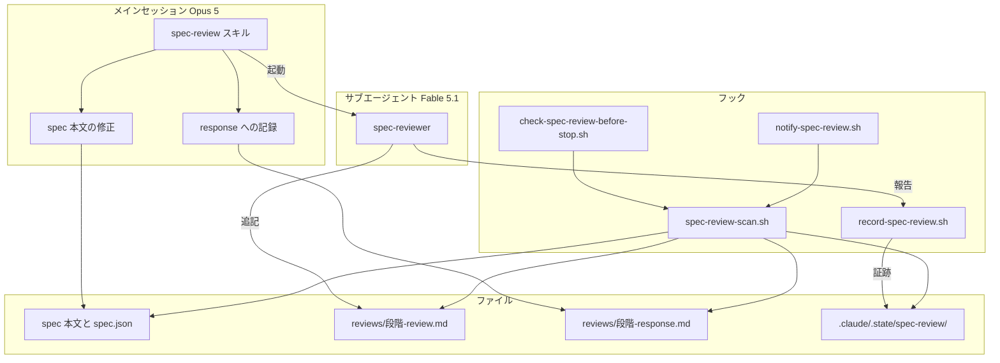
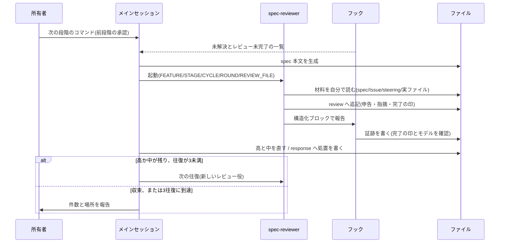
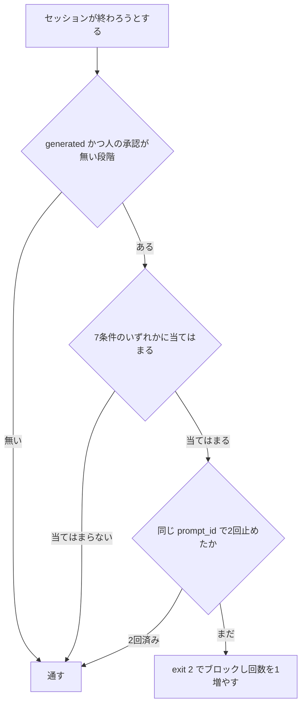
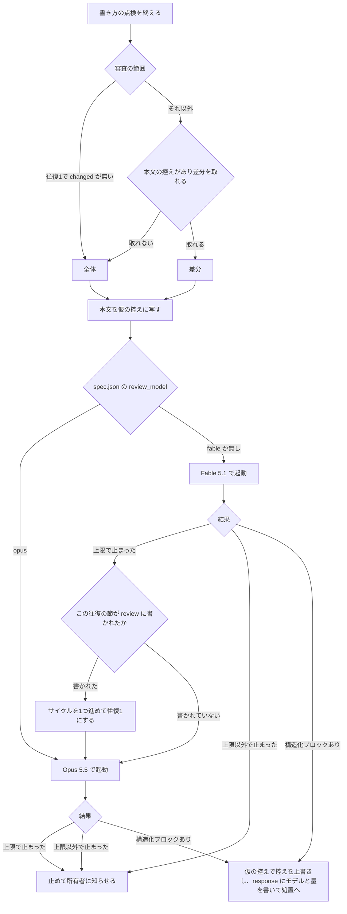

# 設計

## 概要

この設計は、spec の文書を、書いたモデルとは別のモデルに審査させ、指摘と対応を記録として残す。この設計により、所有者が承認する時点で、本文と指摘の両方が所有者の手元にある。

この設計の利用者は、spec を承認するリポジトリ所有者と、spec を生成する実装セッションである。

この設計は、cc-sdd の生成の流れを変えない。この設計は、生成の直後にレビューの工程を差し込み、レビューの実施をフックで強制する。あわせて、この設計は、既存フック4本と `CLAUDE.md` の Git規約の実行前提を、新規フックと揃える(要件8.5〜8.7)。

Issue #559 のために、この設計は、次の4つを足す。1つ目に、実装セッションは、所有者が選び、実装セッションが spec.json に記録したモデルでレビュー役を起動する。2つ目に、Fable 5.1 が上限に達してレビュー役が動かないときは、実装セッションは Opus 5.5 でレビュー役を起動し直す。3つ目に、実装セッションは、前回レビュー役を起動したときの本文を控えておき、本文を直したあとのレビューでは、控えとの差分をレビュー役に渡す。4つ目に、実装セッションは、往復ごとのレビュー役のモデルと使った量を response のファイルに書く。(#559)

## 作るものと作らないもの

### 作るもの

この設計は、次のことを目指す。

- spec の各段階で、別モデルによるレビューを自動で走らせる
- 観点を段階ごとにファイルで固定する
- 指摘と対応をファイルに残し、承認の根拠と効果の測定に使えるようにする
- レビューの未実施を機械で止める
- 所有者が spec ごとに選んだモデルでレビューを走らせ、Fable 5.1 が上限に達してもレビューを止めない(#559)
- 本文を直したあとのレビューを、直した箇所と影響を受ける箇所に絞り、レビュー役が使う量を減らす(#559)

この spec は、次のものを持つ。

- レビューの起動・往復・収束の手順(`spec-review` スキル)
- レビュー役の定義と、その制約(`spec-reviewer` エージェント)
- 段階ごとの観点(`rules/` 配下)
- レビューの実施の検査と強制(`.claude/hooks/` の4本)
- レビューの記録(`.kiro/specs/<feature>/reviews/`)
- レビュー役のモデルの記録(spec.json の `review_model`)と、モデルの切り替えの手順(`spec-review` スキル)(#559)
- 前回レビュー役を起動したときの本文の控え(`.claude/.state/spec-review/`)と、控えとの差分による審査の範囲の決め方(`spec-review` スキルと `spec-reviewer` エージェント)(#559)
- **既存フック4本(`check-encoding.sh` / `check-verify-before-stop.sh` / `protect-main.sh` / `record-gate-run.sh`)と `CLAUDE.md` の Git規約を、新規フックと同じ前提(bash と perl の JSON::PP、jq に依存しない)へ揃えること。** 新規フックだけを OS 非依存にしても、同じディレクトリの既存フックが GNU 固有の書き方のままでは、リポジトリとしての前提が揃わない。この spec のレビューは、`check-verify-before-stop.sh` の更新時刻の取得が macOS で失敗し、品質ゲートの未実行を無言で通す経路があることを見つけた。そのため、この spec は、その経路の修正も持つ

### 作らないもの

この設計は、次のことを目指さない。

- 実装コードのレビュー(PR の段階の codex-review が担う)
- spec の生成そのもの(cc-sdd が担う)
- 別ベンダーのモデルの導入(将来の判断として Issue #193 に残す)
- 承認そのものの偽装の防止(この設計は、証跡と同じ水準の限界を受け入れる)
- 審査役以外での Fable 5.1 の使い方(所有者が頼む壁打ちや調査)(#559)

この spec は、次のものを持たない。

- cc-sdd のスキル本体(`.claude/skills/kiro-*/`)の変更
  - この設計は、所有者がモデルを選ぶ場所も、cc-sdd のスキルの外に置く。この設計は、`/kiro-spec-init` に、所有者がモデルを選ぶ手順を足さない(#559)
- `codex-review.yml` の判定のロジック(`research.md` と `brief.md` の混入は #341 で別に扱う)
- spec の生成と、承認のフラグの書き込みの規則(cc-sdd の既定に従う)

## 使う既存の仕組み

- Claude Code のフックの機構(`UserPromptExpansion` / `UserPromptSubmit` / `SubagentStop` / `PostToolUse` / `Stop`)
- Agent ツールによるサブエージェントの起動とモデルの指定
- bash と perl(JSON::PP)、awk / sed / grep、sha256 を計算できるコマンド(`sha256sum` / `shasum` / 無ければ `cksum` で代わりにする)。フックは jq に依存しない。Windows では Git for Windows がこれらのコマンドを提供し、macOS と Linux は標準でこれらのコマンドを持つ
- `gh issue view`(レビュー役が Issue の本文を取得する)
- Agent ツールの `model` 引数の別名 `opus` と `fable`。起動時の `model` 引数は、定義ファイルの `model:` より優先される(#559)
- Agent ツールの結果。サブエージェントが API の失敗で止まったときは、結果の本文に `Agent terminated early due to an API error:` の行があり、同じ行のそのあとに失敗の詳細が続く。途中まで出力していたときは、その行のあとに `Everything below is PARTIAL output` と途中の出力が続く。結果の末尾の `<usage>` には、サブエージェントが使ったトークンの数 `subagent_tokens` が載る(#559)
- `git diff --no-index`(作業ツリーの外のファイルどうしを比べる)(#559)

## 設計を見直すきっかけ

次の変更があったら、この設計を確かめ直す。

- フックの入力の項目が変わったとき(とくに `last_assistant_message` と `agent_transcript_path`)
- `SubagentHandback` の提供の条件が変わったとき
- cc-sdd の承認のフラグの書き方が変わったとき(`approved_by` の値の規則)
- `codex-review.yml` が連結する対象が変わったとき
- Agent ツールの別名 `opus` と `fable` が指すモデルが変わったとき。証跡のフックが受け入れるモデルIDも合わせて直す(#559)
- サブエージェントが上限で止まったときの Agent ツールの結果の文面が変わったとき(#559)
- Agent ツールの結果から `<usage>` の `subagent_tokens` が無くなったとき(#559)
- Fable 5.1 か Opus 5.5 が、もっと新しい版に置き換わったとき(#559)

## プロジェクトの決まりを守っているか

- 新しいライブラリの追加: この設計は、新しいライブラリを足さない。bash / perl / awk / sed / grep とハッシュを計算するコマンドは、どのOSでも、標準か Git の導入で満たされる既存の前提である。`gh` は許可リストに登録済みである
- 品質チェックの設定: **この設計は、ゲート設定の変更を必要とする。** この設計の成果物そのものが、`.claude/hooks/` への追加、**既存フック4本の修正(そのうち `check-verify-before-stop.sh` は動作の変更を含む)**、`.claude/settings.json` へのフックの登録、`.claude/skills/` と `.claude/agents/` への追加、`CLAUDE.md` の Git規約の変更である。これらの変更は、CODEOWNERS(`/.claude/` は所有者が持つ)と `check-escape-hatches.sh` により、所有者の Approve を経る。`.claude/hooks/**` と `.claude/settings.json` は書き込みが禁止されているため、所有者がこれらのファイルを手で足す
- 使う外部の機能がこのリポジトリで使えるか: Claude は、2026-09-26 にこのリポジトリで実測した。Claude は、`UserPromptSubmit` の発火(会話の中で出力を確認した)、`SubagentStop` と `PostToolUse(SubagentHandback)` を経由した証跡の記録、定義ファイルでのフルモデルIDの指定(サブエージェントの記録に `"model":"claude-fable-5-1"` が残ることを確認した)、Stop フックが2回止めて3回目に通ること、を確認した。**`UserPromptExpansion` の発火は確認できていない**(所有者が `/kiro-spec-design` を入力したときに、`UserPromptSubmit` の出力は確認できたが、`UserPromptExpansion` の出力は観測していない)。承認の時点で未解決とレビュー未完了の一覧を示す要件7.9 は、`UserPromptSubmit` の経路だけでも満たせる。そのため、Claude は未確認のまま進め、テストの方針の項目として残す。これらの結果は、公式ドキュメント(code.claude.com の hooks / sub-agents / tools-reference)の記載とも一致する
- 使う外部の機能がこのリポジトリで使えるか(#559): Claude は、2026-10-13 にこのリポジトリで次のことを実測した。Agent ツールで `model: opus` を指定して起動したレビュー役と点検役の記録には、`"model":"claude-opus-5-5"` が残った。Agent ツールの結果の末尾には、`<usage>subagent_tokens: 135100` のように、使ったトークンの数が載った。Opus 5.5 で動いたレビューでは、証跡のフックが証跡を書かなかった(いまのフックは `claude-fable-5-1` だけを受け入れるため)。**Claude は、上限に達したときの結果の文面を実測していない。** 上限は狙って起こせないためである。この設計は、公式ドキュメント(https://code.claude.com/docs/en/errors.md)の文面と、未修正の issue(https://github.com/anthropics/claude-code/issues/82829)に載った実物の文面を根拠にする。その issue によれば、上限で止まったサブエージェントの結果は、成功と同じ状態で返り、本文の文面でしか上限と見分けられない。別名 `opus` が Opus 5.5 を、`fable` が Fable 5.1 を指すことと、起動時の指定が定義ファイルより優先されることは、公式ドキュメント(https://code.claude.com/docs/en/sub-agents.md と https://code.claude.com/docs/en/model-config.md)に書かれている
- 関係のない項目: backend のコードを置く層(backend のコードを変更しない)、frontend の機能ごとの境界(frontend のコードを変更しない)、frontend の状態の持ち方、データベースの表の形(マイグレーションを含まない)

## 全体の構成

**使う技術**: この設計で使う技術は、次の表のとおりである。

| 層 | 選んだものと版 | この機能での役割 | 備考 |
|---|---|---|---|
| スキル | Claude Code のスキル(Markdown) | レビューの手順 | `.claude/skills/spec-review/` |
| レビュー役 | Claude Fable 5.1(`claude-fable-5-1`)か Claude Opus 5.5(`claude-opus-5-5`) | spec の審査 | 定義ファイルの既定は Fable 5.1。Opus 5.5 のときは起動時に `model: opus` を指定する(#559 で変更) |
| 実装役 | メインセッションのモデル | 本文の修正と記録 | 起動のときにモデルを指定しない |
| フック | bash + perl(JSON::PP) | 記録と検査 | OSに依存しない実装。Windows は Git for Windows で満たす |
| 記録 | Markdown | 指摘と対応 | `.kiro/specs/<feature>/reviews/` |
| 証跡 | テキスト(key=value) | 実施の事実 | `.claude/.state/spec-review/`(gitignore 済み) |



- 選んだ型: この設計は、実装役とレビュー役を別のサブエージェントに分ける。フックがレビューの実施の事実を記録し、別のフックがその事実を検査する。この設計は、`kiro-impl` の実装役・レビュー役・デバッグ役の往復と、`record-gate-run.sh` と `check-verify-before-stop.sh` の記録と検査の組み合わせを、spec の段階へ持ち込む
- 部品の責任の分け方: **書く側(実装セッション)は review のファイルを書けず、レビュー役は spec の本文と response のファイルを書けない。** 同じファイルに両者が書ける構成にすると、指摘を弱めたことを機械で検出できない
- 守る既存の作り: フックはすべて bash で実装し、JSON を perl の JSON::PP で解析し、状態を `.claude/.state/` に置く。フックは jq に依存しない(既存フック4本と同じ)
- 新しい部品が要る理由: cc-sdd には、レビューの手順を差し込む仕組みが無い(公式のカスタマイズはテンプレートとルールだけである)。この設計は、本家に手を入れず、レビューの手順を外側に独立したスキルとして置く

## ファイルの構成

### 新しく作るファイル

```
.claude/
├── agents/
│   └── spec-reviewer.md                  レビュー役の定義。モデル固定・書き込み制約・報告の形式
├── skills/spec-review/
│   ├── SKILL.md                          起動・往復・収束・差し戻しの手順
│   └── rules/
│       ├── common.md                     レベル・申告・指摘ID・記録の書式・処置の5種類
│       ├── requirements.md               requirements の観点
│       ├── design.md                     design の観点
│       └── tasks.md                      tasks の観点
└── hooks/
    ├── spec-review-scan.sh               走査の共通ライブラリ(source される)
    ├── record-spec-review.sh             証跡の記録(SubagentStop / PostToolUse)
    ├── check-spec-review-before-stop.sh  停止のブロック(Stop)
    └── notify-spec-review.sh             未解決とレビュー未完了の提示(2イベント)
```

### 変えるファイル

- `.claude/settings.json`: フックを5か所に登録する。所有者が手で追記する
- `CLAUDE.md`: 生成の直後のレビュー、承認を求める順序、**承認済みの段階を再生成または修正する前の承認の取り消し**、`/kiro-validate-design` を使わないこと、`/kiro-validate-gap` が事前調査であることを書く
- `README.md`: 仕様づくりの表と、カスタムスキルの表を直す
- `CLAUDE.md` の Git規約: 実行前提を「bash と perl(JSON::PP)。jqには依存しない」に揃える(要件8.5)
- `.claude/hooks/check-encoding.sh` / `protect-main.sh` / `record-gate-run.sh`: 冒頭の前提のコメントだけを直す(動作は変えない)
- `.claude/hooks/check-verify-before-stop.sh`: 冒頭の前提のコメントに加えて、**更新時刻の取得の動作を変える**(GNU と BSD の両方の書式を順に試し、値が数字であることを確かめる。要件8.6、8.7)
- `.claude/skills/spec-review/SKILL.md`: モデルの選択、上限のときの切り替え、本文の控えと差分、往復ごとのモデルと量の記録、報告の書式を足す(#559)
- `.claude/agents/spec-reviewer.md`: 差分を受け取ったときの審査の範囲と、材料の読み方を足す。`model: claude-fable-5-1` は変えない(#559)
- `.claude/skills/spec-review/rules/common.md`: review の節の書式に「審査の範囲」の小見出しを足す(#559)
- `.claude/hooks/record-spec-review.sh`: 受け入れるモデルに `claude-opus-5-5` を足す。所有者が手で直す(#559)
- `.claude/hooks/tests/test-record-spec-review.sh`: 新しく作る。モデルごとに証跡を書くかどうかを確かめる。所有者が手で置く(#559)
- `CLAUDE.md`: spec 駆動開発の Phase 1 の「別モデル(Fable 5.1)」の文を、所有者がモデルを選べることに合わせて直す(#559)

`.claude/hooks/**` と `.claude/settings.json` は書き込みが禁止されているため、所有者がこれらのファイルを手で直す。

### 実行時に作られるファイル

- `.kiro/specs/<feature>/reviews/<段階>-review.md`: レビュー役だけが書く
- `.kiro/specs/<feature>/reviews/<段階>-response.md`: メインセッションだけが書く
- `.claude/.state/spec-review/<feature>__<段階>.evidence`: 証跡
- `.claude/.state/spec-review/block-counter.txt`: ブロックの回数
- `.claude/.state/spec-review/<feature>__<段階>.reviewed.md`: 本文の控え(#559)
- `.claude/.state/spec-review/<feature>__<段階>.pending.md`: 本文の仮の控え(#559)
- spec.json の `review_model`: 所有者が選んだモデル。spec と一緒にコミットされる(#559)

## 処理の流れ

### レビュー1回分



### 停止の検査



### レビュー役の起動1回分(#559)



## 部品

各部品の節の「呼び出し方の種類」の欄は、部品がどの形で使われるかを示す。「サービス」は、ほかの部品や実装セッションに呼ばれて手順や判定を行う形を指す。「状態」は、ほかの部品が読む内容を持つ形を指す。「一括処理」は、起動されて1回実行し、終了する形を指す。

### spec-review スキル(レビューの手順を定めるスキル)

対応する要件: 1, 3, 4, 5, 6, 9.1, 9.2, 9.3, 9.4, 9.5, 9.6, 9.7, 9.8, 10.1, 10.2, 10.3, 11.1, 11.2, 11.3, 11.5, 11.6, 12.1, 12.2(#559 で変更)

**役割**: このスキルは、レビューの手順を定める。実装セッションは、このスキルの `SKILL.md` に従って、レビュー役の起動、往復、収束、差し戻しを進める。

**呼び出し方の種類**: サービス

**呼び出し方(引数)**: このスキルの引数は `<feature> <段階> [changed]` である。3つ目の `changed` は、前回のレビューのあとに本文を直したことを示す。cc-sdd の生成のスキルは、生成の直後に `changed` を付けずにこのスキルを呼ぶ。実装セッションは、本文を直したあとにこのスキルを呼ぶとき(未解決を残した段階を所有者が直すことにしたとき、所有者が承認の前に本文を直したとき、承認済みの段階を所有者の指示で直したとき)に `changed` を付ける。(#559)

**モデルを選ぶ手順**: この設計は、実装セッションが spec.json の `review_model` を書く手順を、`CLAUDE.md` の spec 駆動開発の節(下の「CLAUDE.md の spec 駆動開発の節」)に置く。所有者がモデルを伝える時点(`/start` や `/kiro-spec-init` の会話)では、このスキルはまだ読み込まれていないが、`CLAUDE.md` はどのセッションでも読み込まれているためである。このスキルは、`review_model` を読むだけで、書かない。(#559)

**レビュー役を起動するたびの手順**(Step 2 の前に毎回行う)(#559)

1. 実装セッションは、spec.json の `review_model` を読み直す。値が無ければ `fable` とみなす。`fable` と `opus` のどちらでもない値があれば、実装セッションは往復を止め、値を直すよう所有者に頼む。実装セッションは、毎回読み直すので、所有者が往復の途中で選び直したモデルは、次の起動から使われる
2. 実装セッションは、審査の範囲を決める。往復1で引数に `changed` が無ければ、範囲は「全体」である。それ以外(往復2以降、`changed` 付きの往復1、差し戻しで直したあとの新しいサイクル)は、実装セッションは `git diff --no-index --no-color <控え> <本文>` で差分を取り、範囲を「差分」にする。控えが無いとき、または `git diff` の終了コードが2以上のときは、範囲は「全体」である。`git diff --no-index` は、差分があると終了コード1を返すので、実装セッションは1を失敗とみなさない
3. 実装セッションは、本文を仮の控え(`.claude/.state/spec-review/<feature>__<段階>.pending.md`)に写す。レビュー役の結果に構造化ブロックがあったときだけ、実装セッションは、仮の控えで控え(`.claude/.state/spec-review/<feature>__<段階>.reviewed.md`)を上書きする。実装セッションは、往復を止めるときだけ仮の控えを消し、控えを前のまま残す。Fable 5.1 が上限で止まって Opus 5.5 で起動し直すときは、実装セッションは仮の控えを消さず、この手順の1〜3をやり直さない。起動し直したレビュー役に構造化ブロックがあれば、実装セッションは、残しておいた仮の控えで控えを上書きする。止まったレビューのあとに起動し直しても、控えは止まる前のままなので、前回の審査のあとに本文で直された箇所は差分に残る
4. 実装セッションは、`review_model` が `fable` なら `model` を指定せずに(定義ファイルの `claude-fable-5-1` を使わせる)、`opus` なら `model: opus` を指定して、レビュー役を起動する。範囲が「差分」のときは、実装セッションは、差分の出力を要約せず、そのまま起動の文に入れる。差分が空のとき(却下だけで本文を直さなかった往復)は、実装セッションは、差分が空であることを起動の文に書く

**上限のときの切り替え**(#559)

- 実装セッションは、レビュー役の結果を次の順に判定する。(1) 結果に構造化ブロック(`- STATUS:` の行)があれば、レビュー役は最後まで動いたとみなし、上限の判定をしない。(2) 構造化ブロックが無く、結果に `Agent terminated early due to an API error:` で始まる行があれば、実装セッションは、その1行の中の、この語句よりあとの部分(失敗の詳細)だけを見る。詳細が `limit` の語を含み、`529` と `Overloaded` のどちらも含まなければ、実装セッションは上限で止まったとみなす。詳細がそれ以外なら、上限以外の理由で止まったとみなす。実装セッションは、`Everything below is PARTIAL output` よりあとの途中の出力を、判定に使わない。(3) 構造化ブロックも `Agent terminated early` の行も無ければ、構造化ブロックの形が違うだけとみなす。公式の失敗の詳細の例は `You've hit your session limit` と `weekly limit` である
- Fable 5.1 のレビュー役が上限で止まったら、実装セッションは、所有者に尋ねずに、`model: opus` で同じ材料のレビュー役を起動し直す。起動し直す前に、実装セッションは、review のファイルに今回の `## サイクル<N> 往復<M>` の節が書かれていないかを確かめる。書かれていたら、実装セッションは、サイクルの番号を1つ進め、往復1として起動し直す。このとき、実装セッションは、止まったサイクルで却下した指摘の一覧を、新しいサイクルのレビュー役にも渡す。新しいサイクルの往復の上限は3回である。実装セッションがサイクルを進めるのは、同じサイクルと往復の節が review のファイルに2つ残り、指摘の番号が重なるのを避けるためである。往復の番号と、SKILL.md の Step 5 の往復の上限の判定と、review のファイルの最終行の往復の数は、今までどおり同じ数を指す
- 実装セッションは、上限で切り替えても spec.json の `review_model` を書き換えない。次の起動では、手順1のとおり、`review_model` のモデルからまた試す
- Opus 5.5 のレビュー役が上限で止まったら(所有者が Opus 5.5 を選んだときも、Fable 5.1 から替えたときも)、実装セッションは往復を止め、レビュー役が上限で動かないことと結果の文面を所有者に知らせる
- 上限以外の理由で止まったら(結果に `529` か `Overloaded` を含むとき、通信の失敗のとき、所有者が止めたときなど)、実装セッションはモデルを替えず、往復を止め、止まった理由と結果の文面を所有者に知らせる。構造化ブロックの形が違うだけのとき(レビュー役は最後まで動いた)は、実装セッションは、モデルを切り替えず、「失敗したときの扱い」の節の「報告の形式が違うか、値が不正なとき」のとおりにする

**往復ごとに response に書くこと**(#559): 実装セッションは、Step 4 で response に足す節の表の前に、次の3行を書く。量は、レビュー役の結果の末尾の `<usage>` にある `subagent_tokens` の値である。値が結果に無ければ、実装セッションは「不明」と書く。

```markdown
- レビュー役のモデル: Fable 5.1 | Opus 5.5(所有者が選んだ) | Opus 5.5(Fable 5.1 が上限に達したため替えた)
- レビュー役が使った量: <数> トークン
- 審査の範囲: 全体 | 前回からの差分
```

Fable 5.1 が上限で止まった起動の量が結果に載っていれば、実装セッションは「- 上限で止まった Fable 5.1 の起動が使った量: <数> トークン」の行も足す。

**所有者への報告**(#559): Step 7 の報告に、実装セッションは、往復ごとのモデルと量と審査の範囲を1行ずつ足す。Fable 5.1 から Opus 5.5 に替えた往復があれば、実装セッションは、替えたことと、Fable 5.1 が上限に達していたことを報告に書く。

**量の比較**(#559): 変更の前と後のレビュー1回あたりの量の比較(要件12.2)は、この変更を出荷するときに1回だけ行う作業である。そのため、この設計は、比較をスキルの手順に入れない。比べ方は、テストの方針の項目21に書く。

### spec-reviewer(レビュー役の定義)

対応する要件: 1.2, 2, 5.2, 11.2, 11.4, 11.6(#559 で変更)

**役割**: この定義は、レビュー役の制約を定める。

**審査の範囲**(#559): 起動の文に差分が入っているとき、レビュー役は、差分の行と、その差分で影響を受ける箇所だけを審査する。レビュー役は、差分の語(要件の番号、部品の名前、ファイル名)で本文と前の段階の本文を検索し、影響を受ける箇所を探す。レビュー役は、影響を受けない箇所を読み直さず、指摘しない。起動の文が差分を空と示すときは、レビュー役は、前の往復で却下された指摘の理由が事実として正しいかだけを確かめる。レビュー役は、どちらのときも、Issue の本文と観点のファイル(`rules/`)を読む。起動の文に差分が無いときは、レビュー役は今までどおり本文の全体を審査する。spec-reviewer の定義は、審査の範囲の決まりをモデルごとに分けない。

**呼び出し方の種類**: サービス

**呼び出し方(レビュー役の報告の構造化ブロック)**: レビュー役は、最終応答に、次の構造化ブロックを必ず出す。証跡を記録するフック `record-spec-review.sh` は、このブロックを読んで証跡を書く。

```
- FEATURE: <feature名>
- STAGE: requirements|design|tasks
- CYCLE: <数字>
- ROUND: <数字>
- REVIEW_FILE: .kiro/specs/<feature>/reviews/<段階>-review.md
- STATUS: converged|unresolved
```

- 報告の前に成り立つ条件: レビュー役が review のファイルへの追記を終えている
- 報告のあとに成り立つ条件: フックが証跡を書くか、フックの検証に落ちて証跡が書かれないかのどちらかである
- 常に成り立つ条件: `REVIEW_FILE` は、`FEATURE` と `STAGE` から導ける値と一致する

### rules/ 配下(観点・レベル・書式を定めるルールのファイル)

対応する要件: 2, 3.1, 5.3, 11.4(#559 で変更)

**役割**: このファイル群は、段階ごとの観点、指摘のレベル、記録の書式を持つ。この設計は、`common.md` の review の節の書式に、`### 審査の範囲` の小見出しを置く。レビュー役は、この小見出しの下に、「全体」か「差分」かと、差分のときは影響を受けると判断した箇所とその理由を書く。(#559)

**呼び出し方の種類**: 状態

### record-spec-review.sh(証跡を記録するフック)

対応する要件: 7.1, 7.2, 7.3, 7.4, 10.4(#559 で変更)

**役割**: このフックは、レビュー役の報告を読み、レビューの証跡を記録する。

**受け入れるモデル**(#559): サブエージェントの記録にモデル名が残る経路では、このフックは、記録に `"model":"claude-fable-5-1"` か `"model":"claude-opus-5-5"` があるときだけ証跡を書く(`grep -qE '"model":"claude-(fable-5-1|opus-5-5)"'`)。このフックは、所有者が spec.json で選んだモデルと一致するかまでは確かめない。上限で Opus 5.5 に替えた往復も、証跡を書く必要があるためである

**いつ動くか**: レビュー役の報告は、2つの経路で届く。`SubagentStop` では `last_assistant_message` で届き、`SubagentHandback` を使う環境では `PostToolUse` の `tool_input.message` で届く。この設計は、同じスクリプトを両方のイベントに登録し、このフックはどちらの経路でも報告を拾う。

**呼び出し方の種類**: 一括処理

### spec-review-scan.sh(走査の共通ライブラリ)

対応する要件: 7.5, 7.7, 7.8

**役割**: このライブラリは、spec の段階を走査し、ブロックの理由を判定する。Stop フックと通知フックの両方がこのライブラリの関数を使い、2つのフックの判定がずれないようにする。

**呼び出し方の種類**: サービス

**呼び出し方**: `spec_review_scan <project_dir>` は、段階ごとに1行1件で、次の形を出力する。

```
<feature>|<stage>|<ブロック理由のカンマ区切り>|<未解決の件数>
```

ブロックの理由が空の行は、停止の対象ではない。

**対象の判定**(要件7.7、7.8): このライブラリは、次のとおりに判定の対象を決める。

- このライブラリは、`phase` が `initialized` の spec を対象から外す(`/kiro-spec-init` の直後)
- このライブラリは、段階ごとに、`approvals.<段階>.generated` が true の段階だけを見る
- このライブラリは、次のすべてを満たす段階を「人の承認あり」として対象から外す
  - `approved` が true
  - `approved_by` が空でない
  - `approved_by` が `:` を含まない(`auto:-y` / `auto:batch` / `unknown:pre-existing` はどれも `:` を含むため、このライブラリはこれらを未承認として扱う)

### check-spec-review-before-stop.sh(停止をブロックするフック)

対応する要件: 1.3, 7.5, 7.6

**役割**: このフックは、セッションが終わろうとするときに、走査のライブラリの結果に基づいてセッションの終了をブロックする。

**いつ動くか**: `Stop`

**呼び出し方の種類**: 一括処理

### notify-spec-review.sh(承認の時点で一覧を示すフック)

対応する要件: 7.9

**役割**: このフックは、承認にあたる入力の時点で、未解決の指摘とレビュー未完了の段階の一覧を示す。

**いつ動くか**: `UserPromptSubmit` と `UserPromptExpansion` の2つのイベント

**呼び出し方の種類**: 一括処理

**出力の形**: このフックは、素のテキストを標準出力へ書く。`UserPromptSubmit` と `UserPromptExpansion` では、標準出力が Claude の読む文脈として追加されるため、このフックは JSON を組み立てない。出力には1万字の上限があるので、このフックは出力を件数と指摘の識別子の要約にとどめる。

### 既存フック4本(この設計が実行前提を揃える既存のフック)

対応する要件: 8.5, 8.6, 8.7

**役割**: この設計は、既存フック4本(`check-encoding.sh` / `check-verify-before-stop.sh` / `protect-main.sh` / `record-gate-run.sh`)の実行前提を、新規フックと揃える。

**呼び出し方の種類**: 一括処理

### CLAUDE.md の spec 駆動開発の節(所有者がモデルを選べることと、選んだモデルを記録する手順を示す規約)(#559)

対応する要件: 9.1, 9.2, 9.3, 9.4

**役割**: この設計は、`CLAUDE.md` の Phase 1 の「別モデル(Fable 5.1)のサブエージェントが審査し」の文を、「審査役のサブエージェントが審査する。審査役のモデルは、既定では Fable 5.1 で、所有者が spec ごとに Opus 5.5 を選べる。所有者は、spec を始めるときに、選んだモデルを会話で伝える」に直す。あわせて、この設計は、同じ節に、実装セッションが `review_model` を書く手順を置く。所有者が会話で審査役のモデルを伝えたら、実装セッションは、その spec の spec.json の `review_model` に `fable` か `opus` を書き、書いた値を所有者に1行で示す。spec.json がまだ無いとき(`/kiro-spec-init` の前)は、実装セッションは、`/kiro-spec-init` が spec.json を作った直後に `review_model` を書く。所有者が spec の途中で選び直したときも、実装セッションは同じく `review_model` を書き換える。所有者が選んでいない spec では、実装セッションは `review_model` を書かない。この節は、上限のときの切り替えの手順を書かない(切り替えの手順は spec-review スキルが持つ)。

**呼び出し方の種類**: 状態

## データの形

### 証跡(`.claude/.state/spec-review/<feature>__<段階>.evidence`)

```
recorded_at=<epoch秒>
feature=<feature名>
stage=<段階>
cycle=<数字>
round=<数字>
status=converged|unresolved
review_hash=<review ファイルの sha256>
```

`review_hash` は、レビューの完了後に review のファイルが書き換えられたことを見つけるために使う。これは、レビュー役が書く記録ファイルがレビューの完了後に変わっていればブロックする条件(要件7.5)の判定にあたる。

### ブロックの回数(`.claude/.state/spec-review/block-counter.txt`)

```
prompt_id=<UUID>
count=<0から2>
```

`prompt_id` が変われば、停止をブロックするフックは回数を数え直す。このファイルは初期化の処理を持たない(要件7.6)。

### 審査役のモデル(spec.json の `review_model`)(#559)

```json
{
  "review_model": "opus"
}
```

- 値: `fable`(Fable 5.1)か `opus`(Opus 5.5)。この値は、Agent ツールの `model` 引数の別名と同じ綴りである
- 書く主体: 実装セッションだけが書く。書く時点は、「CLAUDE.md の spec 駆動開発の節」の部品の節のとおりである。cc-sdd のスキルはこのキーを読まず、書き換えない。cc-sdd の更新の形(`/kiro-spec-init #N <feature>`)は spec.json のほかのキーを残すので、このキーも残る

### 本文の控え(`.claude/.state/spec-review/<feature>__<段階>.reviewed.md`)(#559)

- 中身: レビュー役が最後まで審査した(結果に構造化ブロックがあった)起動の時点の、その段階の本文の写し
- 置き場所: 作業フォルダごとの `.claude/.state/`(gitignore 済み)。そのため、別の作業フォルダで続きを進めると、控えは無い

### 指摘の識別子

指摘の識別子の形は `{段階}{サイクル}-{往復}-{連番}` である。段階は `R` / `D` / `T` で書く。たとえば、`R2-1-3` は、requirements のサイクル2、往復1の3件目の指摘を指す。review と response が別のファイルなので、実装セッションは、この識別子で指摘と処置を突き合わせる。

## 失敗したときの扱い

### 方針

フックは、判定できないときは「証跡を書かない」側に倒す。証跡が無ければ Stop フックがセッションの終了を止めるため、セッションが誤って通ることはない。

### 失敗の種類ごとの扱い

- **報告の形式が違うか、値が不正なとき**: フックは証跡を書かない。実装セッションは、spec-review スキルに従い、レビュー役にブロックだけを出力させる再起動を1回行う
- **`REVIEW_FILE` が規則に合わないか、`..` を含むか、実在しないとき**: フックは証跡を書かない
- **モデルが指定と違うとき(モデルを確認できる経路)**: フックは証跡を書かない
- **モデルを確認できない経路のとき**: フックは証跡を記録する。この設計は、指定と異なるモデルを検出できないことを制約として受け入れる(要件7.4)
- **`prompt_id` が入力に無いとき**: フックは `prompt_id` の代わりに `session_id` を使う
- **走査のライブラリが見つからないとき**: フックは何もせずに通す。この設計は、フックが無いことを理由にセッションを止めない
- **レビュー役が上限で止まったとき**: 実装セッションは、spec-review スキルの節の「上限のときの切り替え」のとおりにする。実装セッションは、上限かどうかを結果の文面だけで判定するので、文面が変わると、実装セッションは上限を「上限以外の失敗」とみなし、モデルを替えずに止まる。この設計は、誤って替えるより止まる側に倒す(#559)
- **控えと本文を比べられないとき**: 実装セッションは、spec-review スキルの節の「レビュー役を起動するたびの手順」の、審査の範囲を決める手順のとおりにする。全体を審査すれば見落としは増えないので、この設計は、比べられないことを理由に止めない(#559)
- **spec.json の `review_model` が `fable` と `opus` のどちらでもないとき**: 実装セッションは、spec-review スキルの節の「レビュー役を起動するたびの手順」の、`review_model` を読み直す手順のとおりにする。実装セッションは、値を推し量ってモデルを選ばない(#559)

### 見張り

記録ファイルには、往復の回数と未解決の件数が残る。所有者は、`grep '^- 往復' .kiro/specs/*/reviews/*-review.md` でこれらを実測でき、モデルの配分やレベルの基準を見直す材料にできる。

## テストの方針

`.claude/hooks/` には、シェルスクリプトのテストの器が無い。また、フックは入力(JSON)と副作用(ファイル)を伴う。そのため、この設計は、自動テストの代わりに、**捨て spec と模擬の入力による実機確認**を行う。Claude は、次の項目を確かめる。

### 実機確認(フック)

1. 本物のリポジトリで、走査が何も出さないこと(全段階が人の承認済み)
2. レビュー未実施、完了の印が無い、対応の記録が無い、処置漏れ、review の改変、本文が新しい、の各状態で、フックが止めること
3. 収束済みで、対応と証跡がそろえば、フックが通すこと
4. 同じ `prompt_id` で、フックが2回止め、3回目で通すこと。`prompt_id` が変われば、フックが数え直すこと
5. 報告のパスに `..` を含む場合、未知の段階の場合、ブロックが無い場合に、フックが証跡を書かないこと
6. `SubagentStop` と `PostToolUse(SubagentHandback)` の両方の経路で、フックが証跡を書けること
7. モデル名が指定と違う記録では、フックが証跡を書かないこと

### 実機確認(スキルとレビュー役)

8. 通知フックが、承認にあたる入力の時点で一覧を出すこと(`UserPromptSubmit` は確認済み。`UserPromptExpansion` は未確認)
9. 実際の spec でレビューが走り、review への追記と構造化ブロックの出力が行われること
10. 高と中を直したあとに、再レビューが要求されること(処置「修正」が最新の往復に残る状態の検知)
11. 3往復で収束しない場合に、未解決として記録され、本文が直されないこと
12. 所有者が修正を選んだときに、新しいサイクルとして往復が数え直されること

### 実機確認(既存フックの修正)

13. `check-verify-before-stop.sh` の更新時刻の取得が、この環境で epoch 秒を返すこと
14. GNU の書式を失敗させた場合に、数字でない値が弾かれること(GNU の `stat -f` は別の意味になり、数字以外を返して成功するため)
15. `.claude/hooks/` の8本に、OS ごとに失敗して握りつぶされる箇所がほかに無いこと(Claude は `stat` の使用箇所を全数確認する。要件8.7)

### 確認(#559 で足したもの)

16. `test-record-spec-review.sh`(新しく作る)で、記録のモデル名が `claude-fable-5-1` のときと `claude-opus-5-5` のときに `record-spec-review.sh` が証跡を書き、`claude-sonnet-5-5` のときに書かないことを確かめられること。モデル名が記録に無い経路では、`record-spec-review.sh` が今までどおり証跡を書くこと。テストは、模擬の入力(JSON)と模擬のサブエージェントの記録をファイルで渡す
17. spec.json に `review_model: opus` を書いた捨て spec で、実装セッションが `model: opus` でレビュー役を起動し、response に「レビュー役のモデル: Opus 5.5(所有者が選んだ)」と量の行が書かれること
18. `review_model` が無い捨て spec で、実装セッションが `model` を指定せずに起動し、レビュー役の記録に `claude-fable-5-1` が残ること
19. 本文を1か所直して往復2に進んだとき、実装セッションが控えとの差分を起動の文に入れ、レビュー役の review の節の「審査の範囲」に差分と影響を受ける箇所が書かれること。控えを消してから同じことをすると、範囲が「全体」になること
20. 上限の判定: 公式の文面(`Agent terminated early due to an API error: You've hit your weekly limit`)を含む結果を上限とみなし、`Repeated 529 Overloaded errors` を含む結果を上限とみなさないこと。上限は狙って起こせないので、Claude は、SKILL.md の判定の決まりをこの2つの文面に当てはめて確かめる。実際に上限で切り替わったときの確認は、切り替えが初めて起きた往復の response と報告で行う
22. 上限で切り替えたときの控え: Fable 5.1 の起動が上限で止まった体にして(結果の文面を手で与える)、実装セッションが仮の控えを消さずに Opus 5.5 で起動し直し、構造化ブロックが返ったあとに控えが仮の控えで上書きされること。次の往復の範囲が「差分」になること
21. 量の比べ方(要件12.2): 比べる元は、この spec の requirements のサイクル5 往復2(Opus 5.5、全体の審査、126,457 トークン)である。その往復の直前の直しは、要件9の5と6(Fable 5.1 が上限に達したら Opus 5.5 でレビュー役を起動し直すことと、Opus 5.5 に替えるのをそのときの起動に限ること)の2項目である(`research.md` の「量を比べるための見本」に差分を残す)。Claude は、同じ差分を入れた起動の文で、範囲を差分にした Opus 5.5 のレビュー役を1回動かし、`subagent_tokens` を比べる。Claude は、この試しのレビュー役の `REVIEW_FILE` を scratchpad のファイルにし、spec の記録を汚さない。Claude は、比べた結果を、この変更を出荷するPRの本文に書く

Claude は、これらの確認を捨て spec(`.kiro/specs/zz-hook-probe/` など)で行い、確認のあとに捨て spec を削除して、コミットに含めない。

## 要件との対応

要件の受入基準と、それを受け持つ部品の対応は、次の表のとおりである。

| 要件 | 要約 | 部品 |
|---|---|---|
| 1.1, 1.4 | 生成直後の自動起動。所有者は打たない | CLAUDE.md の規定 / spec-review スキル |
| 1.2 | 所有者が選んだモデル | spec-review スキル(review_model を読んで起動)/ spec-reviewer 定義(既定の `model: claude-fable-5-1`)(#559 で変更) |
| 1.3 | 未起動での終了をブロック | check-spec-review-before-stop.sh |
| 1.5 | レビュー完了まで承認を求めない | CLAUDE.md の規定 |
| 2.1, 2.2 | 観点をファイルで保持し毎回読む | rules/ 配下4ファイル / spec-reviewer 手順2 |
| 2.3, 2.4, 2.5, 2.6 | 段階ごとの観点 | rules/requirements.md / design.md / tasks.md |
| 2.7, 2.8, 2.9 | 申告と段階ごとの対象 | rules/common.md / 各段階の観点 |
| 2.10 | 材料を自分で読む | spec-reviewer 手順3 / SKILL.md Step 2 |
| 3.1, 3.2 | 高中低の分類と基準 | rules/common.md |
| 3.3, 3.4, 3.5 | 高と中だけ直す。処置を記録 | SKILL.md Step 4 |
| 4.1, 4.2, 4.3, 4.4, 4.5 | 収束・サイクル・上限・未解決・新サイクル | SKILL.md Step 1, 5, 6(未解決を残した段階を所有者が直すことにしたあとの新しいサイクルは、`changed` 付きで始める)(#559 で変更) |
| 4.6, 4.7 | 直前1往復と却下一覧。蒸し返しの禁止 | SKILL.md Step 2 / spec-reviewer 審査の姿勢 |
| 5.1, 5.2 | 書く主体の分離 | spec-reviewer 絶対の制約 / SKILL.md 役割の分担 |
| 5.3, 5.4 | 追記式と最終行 | rules/common.md 記録の書式 |
| 5.5 | 判定基準への混入を避ける | reviews/ サブディレクトリ |
| 6.1, 6.2, 6.3, 6.4 | 差し戻しの記録と報告 | rules/common.md / SKILL.md Step 6 |
| 6.5, 6.6, 6.7 | 承認の取り消しと再レビュー | SKILL.md Step 6 / CLAUDE.md の規定(差し戻しで直したあとの再レビューは、前回のレビューからの差分の範囲で行う)(#559 で変更) |
| 7.1, 7.2, 7.3, 7.4 | 証跡の記録の条件 | record-spec-review.sh(レビュー役が動いたモデルを確認できるときは、Fable 5.1 と Opus 5.5 のレビューを受け入れる)(#559 で変更) |
| 7.5 | 7条件でのブロック | spec-review-scan.sh / check-spec-review-before-stop.sh |
| 7.6 | 2回まで | check-spec-review-before-stop.sh(prompt_id をキーにした回数) |
| 7.7, 7.8 | 対象の範囲と自動承認の扱い | spec-review-scan.sh |
| 7.9 | 承認時点の提示 | notify-spec-review.sh |
| 8.1, 8.2, 8.3 | 本家に触らない。既存スキルの整理 | CLAUDE.md の規定 |
| 8.4 | PR 段階は spec を審査しない | 変更しない(現状維持) |
| 8.5 | 既存と新規のフックを同じ実行前提で動かし、前提を同じ文言で書く | フック8本の冒頭コメント / CLAUDE.md の Git規約 |
| 8.6 | GNU 系と BSD 系で書式が異なる場合は両方を試し、値の形式を確かめる | check-verify-before-stop.sh(更新時刻)/ record-spec-review.sh と spec-review-scan.sh(ハッシュ) |
| 8.7 | 無言で通る失敗を直す | check-verify-before-stop.sh の更新時刻の取得 |
| 9.1 | spec を始めるときに選ぶ | CLAUDE.md の spec 駆動開発の節(モデルを選ぶことと、review_model を書く手順)(#559) |
| 9.2, 9.3, 9.4 | 既定、セッションをまたぐ記録、選び直し | spec.json の `review_model` / spec-review スキル(起動のたびに読み直す)(#559) |
| 9.5, 9.6, 9.7, 9.8 | 上限のときの切り替えと、替えないとき | spec-review スキル(上限のときの切り替え)(#559) |
| 10.1, 10.2, 10.3 | モデルを記録と報告に書く | spec-review スキル(往復ごとに response に書くこと、所有者への報告)(#559) |
| 10.4 | Opus 5.5 でも同じ操作で承認できる | record-spec-review.sh(受け入れるモデル)(#559) |
| 11.1, 11.2, 11.3, 11.5 | 範囲の決め方と差分の渡し方 | spec-review スキル(起動のたびの手順2〜4)(#559) |
| 11.4, 11.6 | 影響を受ける箇所の記録。モデルによらない | spec-reviewer 定義(審査の範囲)/ rules/common.md(#559) |
| 12.1 | 量を記録する | spec-review スキル(往復ごとに response に書くこと)(#559) |
| 12.2 | 前後の量の比較をPRに載せる | テストの方針の21(#559) |

## 参考にした資料

- 設計の決定の経緯は、Issue #193 のコメント4本にある。判断の理由(なぜ別モデルか、なぜ独立スキルか、なぜ2経路か)は、そのコメントに書かれている
- `research.md` は、調査の過程と、採らなかった案を記録している
