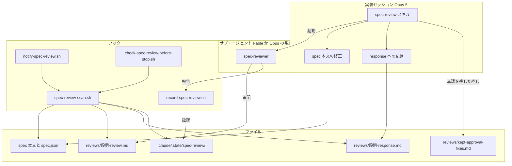
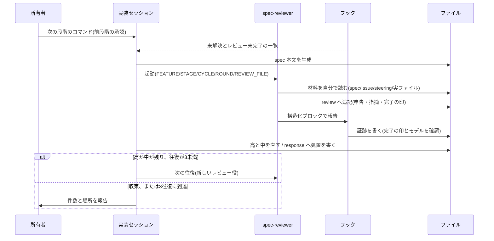
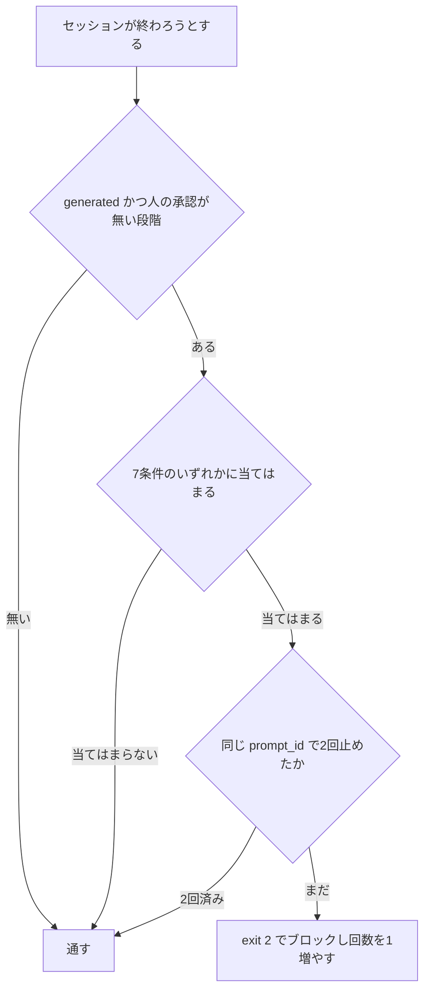
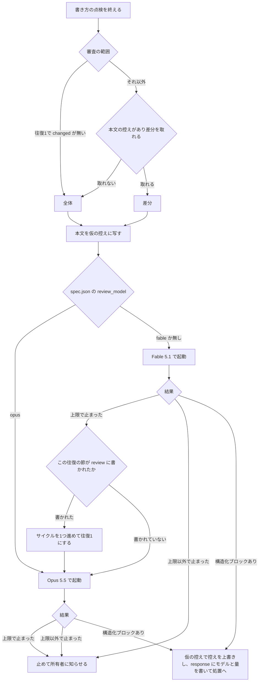
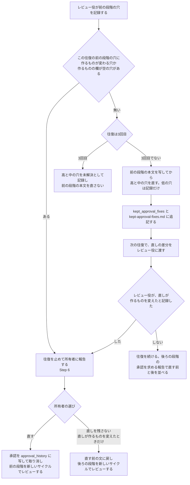

# 設計

## 概要

この設計は、spec の文書を、書いたモデルとは別のモデルにレビューさせ、指摘と、指摘ごとの処置を記録として残す。この設計により、所有者が承認する時点で、本文と指摘の両方が所有者の手元にある。

この設計の利用者は、spec を承認するリポジトリ所有者と、spec を生成する実装セッションである。

この設計は、cc-sdd の生成の流れを変えない。この設計は、生成の直後にレビューの工程を差し込み、レビューの実施をフックで強制する。

Issue #559 のために、この設計は、「作るもの」の節で「(#559)」を付けたものを足す。

Issue #900 のために、この設計は、「作るもの」の節で「(#900)」を付けたものを足す。

## 作るものと作らないもの

### 作るもの

この設計は、次のことを目指す。

- spec の各段階で、別モデルによるレビューを自動で走らせる
- 観点を段階ごとにファイルで固定する
- 指摘と、指摘ごとの処置をファイルに残し、承認の根拠と効果の測定に使えるようにする
- レビューの未実施を機械で止める
- 所有者が spec ごとに選んだモデルでレビューを走らせ、Fable 5.1 が上限に達してもレビューを止めない(#559)
- 本文を直したあとのレビューを、直した箇所と影響を受ける箇所に絞り、レビュー役が使う量を減らす(#559)
- 作るものが変わらない前の段階の穴では、前の段階の承認を取り消さずに直し、所有者が前の段階の承認と後ろの段階のコマンドをやり直さなくて済むようにする(#900)

この spec は、次のものを持つ。

- レビューの起動・往復・収束の手順(`spec-review` スキル)
- レビュー役の定義と、その制約(`spec-reviewer` エージェント)
- 段階ごとの観点(`rules/` 配下)
- レビューの実施の検査と強制(`.claude/hooks/` の4本)
- レビューの記録(`.kiro/specs/<feature>/reviews/`)
- レビュー役のモデルの記録(spec.json の `review_model`)と、モデルの切り替えの手順(`spec-review` スキル)(#559)
- 前回レビュー役を起動したときの本文の控え(`.claude/.state/spec-review/`)と、控えとの差分による審査の範囲の決め方(`spec-review` スキルと `spec-reviewer` エージェント)(#559)
- **既存フック4本(`check-encoding.sh` / `check-verify-before-stop.sh` / `protect-main.sh` / `record-gate-run.sh`)と `CLAUDE.md` の Git規約を、新規フックと同じ前提(bash と perl の JSON::PP、jq に依存しない)へ揃えること。** 新規フックだけを OS 非依存にしても、同じディレクトリの既存フックが GNU 固有の書き方のままでは、リポジトリとしての前提が揃わない。この spec のレビューは、`check-verify-before-stop.sh` が macOS で更新時刻の取得に失敗し、品質ゲートが流れていないことを何も知らせずに見逃す箇所があることを見つけた。そのため、この spec は、その箇所の修正も持つ
- 前の段階の穴ごとの、作るものが変わるかどうかとレベルの記録の決まり(`rules/common.md` と `spec-reviewer` エージェント)(#900)
- 前の段階の承認を残して本文を直す手順と、その直しのレビューと、所有者への見せ方(`spec-review` スキル)(#900)
- 承認を残して直した記録(spec.json の `kept_approval_fixes` と `reviews/kept-approval-fixes.md`)と、その直しがレビューされるまでセッションの終了を止める判定(`spec-review-scan.sh`)(#900)
- 前の段階の記録が後ろの段階に回した食い違いを、後ろの段階のレビュー役が出し直さない決まり(`rules/common.md`)(#900)
- 承認を取り消す規約(`CLAUDE.md`)への、承認を残して直す例外(#900)

### 作らないもの

この設計は、次のことを目指さない。

- 実装コードのレビュー(PR の段階の codex-review が担う)
- spec の生成そのもの(cc-sdd が担う)
- 別ベンダーのモデルの導入(将来の判断として Issue #193 に残す)
- 承認そのものの偽装の防止(この設計は、証跡と同じ水準の限界を受け入れる)
- レビュー役以外での Fable 5.1 の使い方(所有者が頼む壁打ちや調査)(#559)

この spec は、次のものを持たない。

- cc-sdd のスキル本体(`.claude/skills/kiro-*/`)の変更
  - この設計は、所有者がモデルを選ぶ場所も、cc-sdd のスキルの外に置く。この設計は、`/kiro-spec-init` に、所有者がモデルを選ぶ手順を足さない(#559)
- `codex-review.yml` の判定のロジック。`research.md` と `brief.md` の混入は、#341 で別に扱う
- spec の生成と、承認のフラグの書き込みの規則(cc-sdd の既定に従う)
- レビュー役のモデルの版の選び方、起動のときのモデルの指定、レビュー役が実際に動いた版の読み方と記録への書き方。これらは spec `spec-reviewer-latest-model` が決める。この設計のうち、#559 のために書いた版の名前(Fable 5.1、Opus 5.5)は、#559 の時点の版を指す(#900)
- design と tasks のレビューの観点を足すこと。この設計は、前の段階への指摘の記録の仕方と、後ろの段階に回した食い違いの扱いだけを変える(#900)
- tasks のレビュー役が design を読むのを止めること(#900)
- design のファイルの構成とテストの方針を無くすこと(#900)
- 3段階の承認を変えること(#900)
- 往復の上限の数を変えること(#900)
- 後ろの段階が承認されたあとに、前の段階の本文を承認を残して直すこと。後ろの段階が承認されたあとは、実装セッションは、今までどおり承認を取り消してから直す(#900)
- 承認を残して直した前の段階の本文の、書き方の点検(`spec-style-checker`)。点検役 `spec-style-checker` は、今は、いまの段階の本文だけを点検する。この設計は、点検の対象を前の段階に広げない。実装セッションは、直す文を `.kiro/settings/rules/spec-writing.md` に従って書き、レビュー役がその直しをレビューする(#900)

## 使う既存の仕組み

- Claude Code のフックの機構。この設計が使うのは、`UserPromptExpansion`、`UserPromptSubmit`、`SubagentStop`、`PostToolUse`、`Stop` である
- Agent ツール。実装セッションは、Agent ツールでサブエージェントを起動し、起動するときにモデルを指定する
- bash と perl の JSON::PP、awk、sed、grep と、sha256 を計算できるコマンド。`record-spec-review.sh` と `spec-review-scan.sh` は、sha256 を計算するコマンドに `sha256sum` か `shasum` を使い、どちらも無ければ `cksum` を代わりに使う。フックは jq に依存しない。Windows では Git for Windows がこれらのコマンドを提供し、macOS と Linux は標準でこれらのコマンドを持つ
- `gh issue view`(レビュー役が Issue の本文を取得する)
- Agent ツールの `model` 引数の別名 `opus` と `fable`。起動時の `model` 引数は、定義ファイルの `model:` より優先される(#559)
- Agent ツールの結果。サブエージェントが API の失敗で止まったときは、結果の本文に `Agent terminated early due to an API error:` の行があり、同じ行のそのあとに失敗の詳細が続く。途中まで出力していたときは、その行のあとに `Everything below is PARTIAL output` と途中の出力が続く。結果の末尾の `<usage>` には、サブエージェントが使ったトークンの数 `subagent_tokens` が載る(#559)
- `git diff --no-index`(作業ツリーの外のファイルどうしを比べる)(#559)
- 走査のライブラリの `_sr_targets`。`_sr_targets` は、全部の spec.json を1回の perl(JSON::PP)で読み、判定の対象の段階を選ぶ(#900)
- 走査のライブラリの「修正後の再レビューがない」の判定。この判定は、最新の往復の指摘の処置が「修正」のまま残っていれば、セッションの終了を止める。前の段階への指摘のIDも、後ろの段階の記号で振られるので、この判定に入る(#900)
- spec.json の `approval_history` と、spec-review スキルの Step 6 の、前の段階へ差し戻すときに承認を取り消す手順(#900)

## 設計を見直すきっかけ

次の変更があったら、この設計を確かめ直す。

- フックの入力の項目が変わったとき(とくに `last_assistant_message` と `agent_transcript_path`)
- `SubagentHandback` の提供の条件が変わったとき
- cc-sdd の承認のフラグの書き方が変わったとき(`approved_by` の値の規則)
- `codex-review.yml` が連結する対象が変わったとき
- Agent ツールの別名 `opus` と `fable` が指すモデルが変わったとき。証跡のフックが受け入れるモデルIDも合わせて直す(#559)
- サブエージェントが上限で止まったときの Agent ツールの結果の文面が変わったとき(#559)
- Agent ツールの結果から `<usage>` の `subagent_tokens` が無くなったとき(#559)
- Fable 5.1 か Opus 5.5 が、もっと新しい版に置き換わったとき(#559)
- cc-sdd のスキルが、spec.json を書くときに、知らないキー(`kept_approval_fixes`)を消すようになったとき。走査のライブラリが承認を残した直しを見つけられなくなる(#900)
- `CLAUDE.md` の、承認済みの段階を直す前に承認を取り消す規約が変わったとき(#900)
- 走査のライブラリが、判定の対象の段階の選び方か、本文が新しいかの比べ方(ファイルの変更日時)を変えたとき(#900)

## プロジェクトの決まりを守っているか

- 新しいライブラリの追加: この設計は、新しいライブラリを足さない。bash / perl / awk / sed / grep とハッシュを計算するコマンドは、どのOSでも、標準か Git の導入で満たされる既存の前提である。`gh` は許可リストに登録済みである
- 品質チェックの設定: **この設計は、ゲート設定の変更を必要とする。** この設計の成果物そのものが、`.claude/hooks/` への追加、**既存フック4本の修正**、`.claude/settings.json` へのフックの登録、`.claude/skills/` と `.claude/agents/` への追加、`CLAUDE.md` の Git規約の変更である。既存フック4本の修正のうち、**`check-verify-before-stop.sh` の修正は動作の変更を含む**。CODEOWNERS は `/.claude/` を所有者の持ち物と定めている。そのため、これらの変更は、CODEOWNERS と `check-escape-hatches.sh` により、所有者の Approve を経る。
- 使う外部の機能がこのリポジトリで使えるか: Claude は、2026-09-26 にこのリポジトリで実測した。Claude は、`UserPromptSubmit` が発火し、会話の中に出力が出ることを確認した。Claude は、`SubagentStop` と `PostToolUse(SubagentHandback)` を経由して証跡が記録されることを確認した。Claude は、定義ファイルでフルモデルIDを指定すると、サブエージェントの記録に `"model":"claude-fable-5-1"` が残ることを確認した。Claude は、Stop フックが2回止めて3回目に通すことを確認した。**`UserPromptExpansion` の発火は確認できていない**。所有者が `/kiro-spec-design` を入力したときに、Claude は、`UserPromptSubmit` の出力を確認できたが、`UserPromptExpansion` の出力を観測していない。承認の時点で未解決とレビュー未完了の一覧を示す要件7.9 は、`UserPromptSubmit` の経路だけでも満たせる。そのため、Claude は未確認のまま進め、テストの方針の項目として残す。これらの結果は、公式ドキュメント(code.claude.com の hooks / sub-agents / tools-reference)の記載とも一致する
- 使う外部の機能がこのリポジトリで使えるか(#559): Claude は、2026-10-13 にこのリポジトリで次のことを実測した。Agent ツールで `model: opus` を指定して起動したレビュー役と点検役の記録には、`"model":"claude-opus-5-5"` が残った。Agent ツールの結果の末尾には、`<usage>subagent_tokens: 135100` のように、使ったトークンの数が載った。Opus 5.5 で動いたレビューでは、証跡のフックが証跡を書かなかった。いまのフックが `claude-fable-5-1` だけを受け入れるためである。**Claude は、上限に達したときの結果の文面を実測していない。** 上限は狙って起こせないためである。この設計は、公式ドキュメント(https://code.claude.com/docs/en/errors.md)の文面と、未修正の issue(https://github.com/anthropics/claude-code/issues/82829)に載った実物の文面を根拠にする。その issue によれば、上限で止まったサブエージェントの結果は、成功と同じ状態で返り、本文の文面でしか上限と見分けられない。別名 `opus` が Opus 5.5 を、`fable` が Fable 5.1 を指すことと、起動時の指定が定義ファイルより優先されることは、公式ドキュメント(https://code.claude.com/docs/en/sub-agents.md と https://code.claude.com/docs/en/model-config.md)に書かれている
- 品質チェックの設定(#900): この設計は、`.claude/hooks/spec-review-scan.sh` と `.claude/hooks/tests/test-spec-review-scan.sh` の変更、`.claude/skills/spec-review/` と `.claude/agents/spec-reviewer.md` の変更を含む。これらはゲート設定ファイルにあたり、所有者の Approve を経る。この設計は、`.claude/settings.json` を変えない。フックの登録は今のままである。この設計は、`CLAUDE.md` を変えるが、必須のチェック `claude-md-size` の上限の値を変えず、上限に収める(「CLAUDE.md の spec 駆動開発の節のルール」の節)
- 関係のない項目: backend のコードを置く層(backend のコードを変更しない)、frontend の機能ごとの境界(frontend のコードを変更しない)、frontend の状態の持ち方、データベースの表の形(マイグレーションを含まない)

## 全体の構成

**使う技術**: この設計で使う技術は、次の表のとおりである。

| 層 | 選んだものと版 | この機能での役割 | 備考 |
|---|---|---|---|
| スキル | Claude Code のスキル(Markdown) | レビューの手順 | `.claude/skills/spec-review/` |
| レビュー役 | Fable か Opus の系統の Claude | spec のレビュー | 定義ファイルの既定は `model: fable`。起動のたびに `model: fable` か `model: opus` を指定する。版の選び方は spec `spec-reviewer-latest-model` が決める(#900 で変更) |
| 実装セッション | 実装セッションのモデル | 本文の修正と記録 | 起動のときにモデルを指定しない |
| フック | bash + perl(JSON::PP) | 記録と検査 | OSに依存しない |
| 記録 | Markdown | 指摘と処置 | `.kiro/specs/<feature>/reviews/` |
| 証跡 | テキスト(key=value) | 実施の事実 | `.claude/.state/spec-review/`(gitignore 済み) |



- 選んだ型: この設計は、役割を、実装セッション(本体の会話)と、サブエージェントのレビュー役に分ける。フックがレビューの実施の事実を記録し、別のフックがその事実を検査する。この設計は、次の2つの組み合わせを、spec の段階へ持ち込む。1つ目は、`kiro-impl` で、タスクを実装するエージェントと、実装を確かめるエージェントと、失敗の原因を調べるエージェントを往復させる組み合わせである。2つ目は、`record-gate-run.sh` と `check-verify-before-stop.sh` の、記録と検査の組み合わせである。
- 部品の責任の分け方: **実装セッションは review のファイルを書けず、レビュー役は spec の本文と response のファイルを書けない。** 同じファイルに両者が書ける構成にすると、実装セッションがレビュー役の指摘を書き換えて弱めても、そのことを機械で見つけられない
- 守る既存の作り: フックはすべて bash で実装し、JSON を perl の JSON::PP で解析し、状態を `.claude/.state/` に置く。フックは jq に依存しない(既存フック4本と同じ)
- 新しい部品が要る理由: cc-sdd には、レビューの手順を差し込む仕組みが無い。cc-sdd が公式に認める変え方は、テンプレートとルールを変えることだけである。この設計は、cc-sdd のスキル本体を変えずに、レビューの手順を、cc-sdd の外の独立したスキルとして置く

## ファイルの構成

### 新しく作るファイル

```
.claude/
├── agents/
│   └── spec-reviewer.md                  レビュー役の定義。モデル固定・書き込み制約・報告の形式
├── skills/spec-review/
│   ├── SKILL.md                          起動・往復・収束・差し戻しの手順
│   └── rules/
│       ├── common.md                     レベル・申告・指摘ID・記録の書式・処置の5種類
│       ├── requirements.md               requirements の観点
│       ├── design.md                     design の観点
│       └── tasks.md                      tasks の観点
└── hooks/
    ├── spec-review-scan.sh               走査の共通ライブラリ(source される)
    ├── record-spec-review.sh             証跡の記録(SubagentStop / PostToolUse)
    ├── check-spec-review-before-stop.sh  停止のブロック(Stop)
    └── notify-spec-review.sh             未解決とレビュー未完了の提示(2イベント)
```

### 変えるファイル

- `.claude/settings.json`: フックを5か所に登録する。所有者が手で追記する
- `CLAUDE.md`: 生成の直後のレビュー、承認を求める順序、**承認済みの段階を再生成または修正する前の承認の取り消し**、`/kiro-validate-design` を使わないこと、`/kiro-validate-gap` が事前調査であることを書く
- `README.md`: 仕様づくりの表と、カスタムスキルの表を直す
- `CLAUDE.md` の Git規約: 実行前提を「bash と perl(JSON::PP)。jqには依存しない」に揃える(要件8.5)
- `.claude/hooks/check-encoding.sh` / `protect-main.sh` / `record-gate-run.sh`: 冒頭の前提のコメントだけを直す。これらのフックの動作は変えない
- `.claude/hooks/check-verify-before-stop.sh`: 冒頭の前提のコメントに加えて、**更新時刻の取得の動作を変える**。このフックは、GNU と BSD の両方の書式を順に試し、得た値が数字であることを確かめる(要件8.6、8.7)
- `.claude/skills/spec-review/SKILL.md`: モデルの選択、上限のときの切り替え、本文の控えと差分、往復ごとのモデルと量の記録、報告の書式を足す(#559)
- `.claude/agents/spec-reviewer.md`: 差分を受け取ったときの審査の範囲と、材料の読み方を足す(#559)。定義の `model` の値は、spec `spec-reviewer-latest-model` が `fable` に変えた。この設計は `model` の値を変えない(#900 で変更)
- `.claude/skills/spec-review/rules/common.md`: review の節の書式に「審査の範囲」の小見出しを足す(#559)
- `.claude/hooks/record-spec-review.sh`: 受け入れるモデルに `claude-opus-5-5` を足す。所有者が手で直す(#559)。モデルの確かめ方は、spec `spec-reviewer-latest-model` が、版によらず系統で確かめる形に変えた(#900 で変更)
- `.claude/hooks/tests/test-record-spec-review.sh`: 新しく作る。モデルごとに証跡を書くかどうかを確かめる。所有者が手で置く(#559)
- `CLAUDE.md`: spec 駆動開発の Phase 1 の「別モデル(Fable 5.1)」の文を、所有者がモデルを選べることに合わせて直す(#559)
- `.claude/skills/spec-review/rules/common.md`: 「前の段階への指摘」の節に、作るものが変わるかどうかの決め方、レベル、往復の件数への数え方、後ろの段階に回した食い違いの扱いを足す。記録の書式の前の段階への指摘の表に列を足し、`### 承認を残して直した前の段階の審査` の小見出しを足す。処置の表の使う場面を直す(#900)
- `.claude/skills/spec-review/rules/design.md` の観点9と `rules/tasks.md` の観点8: 前の段階への指摘の記録の仕方を `common.md` に従わせる一文を、作るものが変わるかどうかとレベルも書くことに合わせて直す(#900)
- `.claude/agents/spec-reviewer.md`: 起動の文の `## 承認を残して直した前の段階の差分` のレビュー、`STATUS` の数え方、前の段階の記録の読み方を足す(#900)
- `.claude/skills/spec-review/SKILL.md`: Step 2、Step 4、Step 5、Step 6、Step 7 と、会話が要約されたあとに続けるときの手順に、承認を残して直す手順を足す(#900)
- `.claude/hooks/spec-review-scan.sh`: 承認を残して直した本文がレビューされたかの判定を足す。所有者が手で直す(#900)
- `.claude/hooks/tests/test-spec-review-scan.sh`: 場合の名前で選んで流す形にし、承認を残して直した本文の判定の場合を足す。所有者が手で直す(#900)
- `CLAUDE.md`: spec 駆動開発の節のルールの、承認済みの段階を直す前に承認を取り消す決まりに、承認を残して直す例外を足す。量の上限に収めるため、`approval_history` の要素の欄を並べた行を消す(#900)

所有者が、`.claude/hooks/**` と `.claude/settings.json` のファイルを手で足すか直す。

### 実行時に作られるファイル

- `.kiro/specs/<feature>/reviews/<段階>-review.md`: レビュー役だけが書く
- `.kiro/specs/<feature>/reviews/<段階>-response.md`: 実装セッションだけが書く
- `.claude/.state/spec-review/<feature>__<段階>.evidence`: 証跡
- `.claude/.state/spec-review/block-counter.txt`: ブロックの回数
- `.claude/.state/spec-review/<feature>__<段階>.reviewed.md`: 本文の控え(#559)
- `.claude/.state/spec-review/<feature>__<段階>.pending.md`: 本文の仮の控え(#559)
- spec.json の `review_model`: 所有者が選んだモデル。spec と一緒にコミットされる(#559)
- spec.json の `kept_approval_fixes`: 承認を残して前の段階の本文を直した記録。spec と一緒にコミットされる(#900)
- `.kiro/specs/<feature>/reviews/kept-approval-fixes.md`: 承認を残して直した前の段階の、直す前の文と直した後の文と差分(#900)
- `.claude/.state/spec-review/<feature>__<段階>.kept-fix-before.md`: 承認を残して直す直前の、前の段階の本文の写し。差分を取るためだけに使う(#900)

## 処理の流れ

### レビュー1回分



### 停止の検査



### レビュー役の起動1回分(#559)



### 前の段階の穴が見つかった往復(#900)



## 部品

各部品の節の「呼び出し方の種類」の欄は、部品がどの形で使われるかを示す。「サービス」は、ほかの部品や実装セッションに呼ばれて手順や判定を行う形を指す。「状態」は、ほかの部品が読む内容を持つ形を指す。「一括処理」は、起動されて1回実行し、終了する形を指す。

### spec-review スキル(レビューの手順を定めるスキル)

対応する要件: 1, 3, 4, 5, 6, 9.1, 9.2, 9.3, 9.4, 9.5, 9.6, 9.7, 9.8, 10.1, 10.2, 10.3, 11.1, 11.2, 11.3, 11.5, 11.6, 12.1, 12.2, 13.3, 13.4, 13.5, 13.6, 13.7, 13.8, 13.10, 14.2, 14.3, 14.4, 14.5, 14.6, 16(#900 で変更)

**役割**: このスキルは、レビューの手順を定める。実装セッションは、このスキルの `SKILL.md` に従って、レビュー役の起動、往復、収束、差し戻しを進める。

**呼び出し方の種類**: サービス

**呼び出し方(引数)**: このスキルの引数は `<feature> <段階> [changed]` である。3つ目の `changed` は、前回のレビューのあとに本文を直したことを示す。cc-sdd の生成のスキルは、生成の直後に `changed` を付けずにこのスキルを呼ぶ。実装セッションは、本文を直したあとにこのスキルを呼ぶときに、`changed` を付ける。本文を直したあととは、未解決を残した段階を所有者が直すことにしたとき、所有者が承認の前に本文を直したとき、承認済みの段階を所有者の指示で直したときである。(#559)

**モデルを選ぶ手順**: この設計は、実装セッションが spec.json の `review_model` を書く手順を、`CLAUDE.md` の spec 駆動開発の節(下の「CLAUDE.md の spec 駆動開発の節」)に置く。所有者がモデルを伝える時点(`/start` や `/kiro-spec-init` の会話)では、このスキルはまだ読み込まれていないが、`CLAUDE.md` はどのセッションでも読み込まれているためである。このスキルは、`review_model` を読むだけで、書かない。(#559)

**レビュー役を起動するたびの手順**(Step 2 の前に毎回行う)(#559)

1. 実装セッションは、spec.json の `review_model` を読み直す。値が無ければ `fable` とみなす。`fable` と `opus` のどちらでもない値があれば、実装セッションは往復を止め、値を直すよう所有者に頼む。実装セッションは、毎回読み直すので、所有者が往復の途中で選び直したモデルは、次の起動から使われる
2. 実装セッションは、審査の範囲を決める。往復1で引数に `changed` が無ければ、範囲は「全体」である。それ以外(往復2以降、`changed` 付きの往復1、差し戻しで直したあとの新しいサイクル)は、実装セッションは `git diff --no-index --no-color <控え> <本文>` で差分を取り、範囲を「差分」にする。控えが無いとき、または `git diff` の終了コードが2以上のときは、範囲は「全体」である。`git diff --no-index` は、差分があると終了コード1を返すので、実装セッションは1を失敗とみなさない
3. 実装セッションは、本文を仮の控え(`.claude/.state/spec-review/<feature>__<段階>.pending.md`)に写す。レビュー役の結果に構造化ブロックがあったときだけ、実装セッションは、仮の控えで控え(`.claude/.state/spec-review/<feature>__<段階>.reviewed.md`)を上書きする。実装セッションは、往復を止めるときだけ仮の控えを消し、控えを前のまま残す。Fable 5.1 が上限で止まって Opus 5.5 で起動し直すときは、実装セッションは仮の控えを消さず、この手順の1〜3の、`review_model` を読み直すことと、審査の範囲を決めることと、本文を仮の控えに写すことをやり直さない。起動し直したレビュー役に構造化ブロックがあれば、実装セッションは、残しておいた仮の控えで控えを上書きする。止まったレビューのあとに起動し直しても、控えは止まる前のままなので、前回のレビューのあとに本文で直された箇所は差分に残る
4. 実装セッションは、`review_model` が `fable` なら、`model` を指定せずにレビュー役を起動し、定義ファイルの `claude-fable-5-1` を使わせる。`review_model` が `opus` なら、実装セッションは、`model: opus` を指定してレビュー役を起動する。範囲が「差分」のときは、実装セッションは、差分の出力を要約せず、そのまま起動の文に入れる。差分が空のとき(却下だけで本文を直さなかった往復)は、実装セッションは、差分が空であることを起動の文に書く

**上限のときの切り替え**(#559)

- 実装セッションは、レビュー役の結果を次の順に判定する
  1. 結果に構造化ブロック(`- STATUS:` の行)があれば、実装セッションは、レビュー役が最後まで動いたとみなし、上限の判定をしない
  2. 構造化ブロックが無く、結果に `Agent terminated early due to an API error:` で始まる行があれば、実装セッションは、その1行の中の、この語句よりあとの部分(失敗の詳細)だけを見る。詳細が `limit` の語を含み、`529` と `Overloaded` のどちらも含まなければ、実装セッションは上限で止まったとみなす。詳細がそれ以外なら、上限以外の理由で止まったとみなす。実装セッションは、`Everything below is PARTIAL output` よりあとの途中の出力を、判定に使わない。公式の失敗の詳細の例は `You've hit your session limit` と `weekly limit` である
  3. 構造化ブロックも `Agent terminated early` の行も無ければ、実装セッションは、構造化ブロックの形が違うだけとみなす
- Fable 5.1 のレビュー役が上限で止まったら、実装セッションは、所有者に尋ねずに、`model: opus` で同じ材料のレビュー役を起動し直す。起動し直す前に、実装セッションは、review のファイルに今回の `## サイクル<N> 往復<M>` の節が書かれていないかを確かめる。書かれていたら、実装セッションは、サイクルの番号を1つ進め、往復1として起動し直す。このとき、実装セッションは、止まったサイクルで却下した指摘の一覧を、新しいサイクルのレビュー役にも渡す。新しいサイクルの往復の上限は3回である。実装セッションがサイクルを進めるのは、同じサイクルと往復の節が review のファイルに2つ残り、指摘の番号が重なるのを避けるためである。往復の番号と、SKILL.md の Step 5 の往復の上限の判定と、review のファイルの最終行の往復の数は、今までどおり同じ数を指す
- 実装セッションは、上限で切り替えても spec.json の `review_model` を書き換えない。次の起動では、手順1のとおり、`review_model` のモデルからまた試す
- Opus 5.5 のレビュー役が上限で止まったら、実装セッションは往復を止め、レビュー役が上限で動かないことと結果の文面を所有者に知らせる。所有者が Opus 5.5 を選んだときも、実装セッションが Fable 5.1 から Opus 5.5 に替えたときも、実装セッションは同じようにする
- レビュー役が上限以外の理由で止まったら、実装セッションはモデルを替えず、往復を止め、止まった理由と結果の文面を所有者に知らせる。上限以外の理由とは、結果に `529` か `Overloaded` を含むとき、通信が失敗したとき、所有者が止めたときなどである。構造化ブロックの形が違うだけのときは、レビュー役は最後まで動いている。そのため、実装セッションは、モデルを切り替えず、「失敗したときの扱い」の節の「報告の形式が違うか、値が不正なとき」のとおりにする

**往復ごとに response に書くこと**(#559): 実装セッションは、Step 4 で response に足す節の表の前に、次の3行を書く。量は、レビュー役の結果の末尾の `<usage>` にある `subagent_tokens` の値である。値が結果に無ければ、実装セッションは「不明」と書く。

```markdown
- レビュー役のモデル: Fable 5.1 | Opus 5.5(所有者が選んだ) | Opus 5.5(Fable 5.1 が上限に達したため替えた)
- レビュー役が使った量: <数> トークン
- 審査の範囲: 全体 | 前回からの差分
```

Fable 5.1 が上限で止まった起動の量が結果に載っていれば、実装セッションは「- 上限で止まった Fable 5.1 の起動が使った量: <数> トークン」の行も足す。

**所有者への報告**(#559): Step 7 の報告に、実装セッションは、往復ごとのモデルと量と審査の範囲を1行ずつ足す。Fable 5.1 から Opus 5.5 に替えた往復があれば、実装セッションは、替えたことと、Fable 5.1 が上限に達していたことを報告に書く。

**量の比較**(#559): 変更の前と後のレビュー1回あたりの量の比較(要件12.2)は、この変更を出荷するときに1回だけ行う作業である。そのため、この設計は、比較をスキルの手順に入れない。比べ方は、テストの方針の項目21の、変更の前と後のレビュー1回あたりの量を比べる確認に書く。

**レビュー役を起動する手順の今の形**(#900): 上の「レビュー役を起動するたびの手順」の4の、レビュー役を起動するときのモデルの指定の仕方は、#559 の時点の形である。spec `spec-reviewer-latest-model` が Step 2 を変えたので、今の Step 2 では、実装セッションは、`review_model` が `fable` なら `model: fable` を、`opus` なら `model: opus` を、起動のたびに指定する。この設計は、起動のときのモデルの指定を変えない。

**前の段階の穴の分け方**(#900): 実装セッションは、Step 4 で、今回の往復の review の節の `### 前の段階への指摘` の表を、行ごとに読む。

- 実装セッションは、次の行を、作るものが変わる穴とみなす。表の「作るもの」の欄が `変わる` の行、欄が空の行、欄に `変わる` と `変わらない` のどちらでもない値がある行である。「作るもの」の欄が無い表(#900 より前の書式)の行も、作るものが変わる穴とみなす
- 実装セッションは、表の「作るもの」の欄を書き換えず、自分で穴を分け直さない
- 実装セッションは、表の「レベル」の欄が空の行を、高とみなす
- 1行でも作るものが変わる穴があれば、その往復は「作るものが変わる穴を含む往復」である。すべての行が `変わらない` なら、その往復は「作るものが変わらない穴だけの往復」である

**作るものが変わらない穴だけの往復**(#900): 実装セッションは、Step 4 で、往復を止めずに次のとおりにする。

1. `ROUND` が3のときは、実装セッションは前の段階の本文を直さない。高と中の穴の処置を「未解決」に、低の穴の処置を「記録のみ」にする。Step 7 の報告で、実装セッションは、未解決の穴と、後ろの段階が承認される前なら所有者がこれらの穴を承認を残して直すことを選べることを書く
2. `ROUND` が3より小さいときは、実装セッションは、高と中の穴を、いまの段階の指摘と同じく、直すか、誤検知なら根拠を書いて却下する。低の穴は、事実の誤りであっても直さず、処置を「記録のみ」にする
3. 直す穴がある前の段階ごとに、実装セッションは、次の順に行う
   1. `mkdir -p .claude/.state/spec-review` のあと、前の段階の本文を `.claude/.state/spec-review/{FEATURE}__{前の段階}.kept-fix-before.md` に `cp` で写す(前の写しがあれば上書きする)
   2. 前の段階の本文を直す。実装セッションは、spec.json の前の段階の `approved` `approved_by` `approved_at` を変えない
   3. 作業フォルダの最上位で `git diff --no-index --no-color <写し> <前の段階の本文>` を実行し、差分を取る
   4. `reviews/kept-approval-fixes.md` の末尾に、直した記録の節を1つ足す。ファイルが無ければ作る。節の書式は「データの形」の節のとおりにする
   5. spec.json の `kept_approval_fixes` に、要素を1つ追記する。配列が無ければ作る。要素の書式は「データの形」の節のとおりにする
   6. 写し(`.kept-fix-before.md`)を消す。会話が要約されたあとに、実装セッションが、写しが残っているかどうかで直しの途中かを見分けるためである
4. 実装セッションは、response の処置の表に、直した穴の処置を「修正」と書き、内容に、直した箇所と、kept-approval-fixes.md の節の番号を書く
5. 直した穴がある往復では、レビュー役は、spec-reviewer の節の「STATUS の数え方」のとおり、高と中の穴を数える。そのため、`STATUS` は `unresolved` になり、実装セッションは次の往復に進む

**承認を残した直しのレビュー**(#900): 実装セッションは、Step 2 で、spec.json の `kept_approval_fixes` のうち、`found_in` が `STAGE` で、まだレビューされていない要素を探す。まだレビューされていない要素とは、`reviews/{STAGE}-review.md` のどの `### 承認を残して直した前の段階の審査` の小見出しにも、その要素の `no` が書かれていない要素である。ただし、実装セッションは、`fixed_at` が、`approval_history` のうち `stage` がその要素の `stage` の要素の、いちばん新しい `revoked_at` より前の要素を選ばない。その直しのあとに直した段階の承認を取り消して本文を直し直したので、直しは、直し直した本文のレビューで見られているためである。実装セッションは、`review_cycle` と `review_round` を、要素を選ぶのに使わない。会話が要約されたあとの手順と、`/spec-review` の打ち直しで、往復の番号が見込みとずれても、直しの差分がレビュー役に渡るようにするためである。要素があれば、実装セッションは、要素ごとに、`reviews/kept-approval-fixes.md` のその番号の節の差分を、要約せず、起動の文の最後(`## 前回からの差分` があればそのあと)に、次の形で置く。

````markdown
## 承認を残して直した前の段階の差分

### 1. design(もとになった穴: T1-1-4, T1-1-5)

```diff
...(kept-approval-fixes.md の節の差分の全部)
```
````

- 実装セッションは、`SCOPE` が「全体」のときも、この見出しを置く
- 差分の中に spec 本文のコードブロックの区切りが入るときは、今の `## 前回からの差分` と同じく、差分の中のどの区切りよりも長いバッククォートの並びで囲む
- 上限で Opus のレビュー役に替えて起動し直すときは、実装セッションは、同じ起動の文を渡す(Step 3 の「同じ材料」に入る)

**直しが作るものを変えていたとき**(#900): レビュー役が、承認を残した直しが作るものを変えていたと判断して、`### 前の段階への指摘` の表に作るものが `変わる` の行を足したときは、その往復は作るものが変わる穴を含む往復になる。実装セッションは、Step 6 の報告に、所有者が選べることとして、次の2つを並べる。1つ目は、直しを残し、前の段階の承認を取り消すことである。2つ目は、直しを残さず、直す前の文に戻すことである。

- 所有者が直しを残すことを選んだら、実装セッションは、Step 6 の3のとおり、承認を `approval_history` に写してから取り消す
- 所有者が直しを残さないことを選んだら、実装セッションは、次の順に行う
  1. kept-approval-fixes.md のその直しの節の「直した後」の文を、それぞれ「直す前」の文に置き換える。実装セッションは、置き換える前の本文を、「作るものが変わらない穴だけの往復」の3の1と同じく、`.claude/.state/spec-review/{FEATURE}__{前の段階}.kept-fix-before.md` に写しておく
  2. 「作るものが変わらない穴だけの往復」の3の3から3の5と同じく、差分を取り、kept-approval-fixes.md に戻した記録の節を足し、`kept_approval_fixes` に `kind` が `revert` の要素を追記する。`review_cycle` は今の `CYCLE` に1を足した数、`review_round` は1にする
  3. もとになった穴の処置を、response に「却下」と書き、内容に「所有者が直しを残さないことを選んだ」と書く。次のサイクルのレビュー役には、この穴を却下した指摘の一覧に入れて渡す。レビュー役が同じ穴を出し直し、実装セッションがまた直す繰り返しを避けるためである
  4. 後ろの段階について、`CYCLE` を1増やし、`ROUND` を1にし、`CHANGED` を「あり」にして、Step 1.5 の書き方の点検からやり直す

**作るものが変わる穴を含む往復**(#900 で変更): 実装セッションは、今までどおり Step 6 に進む。実装セッションは、Step 6 で、次のとおりにする。

- 実装セッションは、その往復の前の段階への指摘のすべての処置を「所有者判断待ち」にする。作るものが変わらない穴も含む
- 戻る段階は、その往復の前の段階への指摘の「対象」のうち、いちばん前の段階である。作るものが変わらない穴だけがある段階も含む
- 所有者が直すと判断したら、実装セッションは、承認を取り消したあとに、作るものが変わる穴と変わらない穴を一緒に直す

**差し戻しの回数の数え方**(#900 で変更): 実装セッションは、Step 6 の報告に書く差し戻しの回数を、その spec の `reviews/` の全部の response のファイルで、処置が「所有者判断待ち」の行を持つ `## サイクル<N> 往復<M> への対応` の節の数で数える。今回の往復の節も数える。承認を残して直した往復は、「所有者判断待ち」の行を持たないので、数に入らない。

**承認を残した直しに所有者が同意しないとき**(#900): 所有者が、後ろの段階の承認の前か後に、承認を残した直しに同意せず、前の段階の承認を取り消して直し直すことを選んだら、実装セッションは、Step 6 の3のとおり、承認を `approval_history` に写してから取り消し、前の段階の本文を直し直す。`revoked_for` には、「所有者が、承認を残して直した <前の段階> の直し(kept-approval-fixes.md の <番号>)に同意せず、承認を取り消して直し直すことにした」と書く。

**3往復目のあとに所有者が直すことを選んだとき**(#900): 3往復目で未解決として記録した作るものが変わらない穴を、所有者があとで直すことを選んだときは、実装セッションは、後ろの段階の承認がまだ無いことを spec.json で確かめる。

- 承認が無ければ、実装セッションは、上の「作るものが変わらない穴だけの往復」の3のとおりに前の段階の本文を直す。`review_cycle` は後ろの段階の今の `CYCLE` に1を足した数、`review_round` は1にする。そのあと、実装セッションは、後ろの段階について `changed` を付けてこのスキルを流し直す
- 後ろの段階が承認されていれば、実装セッションは、承認を残して直さない。`CLAUDE.md` の規約どおり、承認を取り消してから直す

**後ろの段階に回した食い違いの書き方**(#900): 実装セッションは、Step 4 で、後ろの段階で書くことを理由に指摘を却下するか記録のみにするとき、response の内容の欄を `<design|tasks> で書く: <後ろの段階で何をどう書くか>` で書き出す。後ろの段階のレビュー役が、前の段階の記録を後ろの段階の名前で検索して見つけられるようにするためである。

**後ろの段階の承認を求める報告**(#900): 実装セッションは、Step 7 の報告に、spec.json の `kept_approval_fixes` の要素のうち、次の3つを満たす要素をすべて載せる。1つ目は、`found_in` が `STAGE` であることである。2つ目は、`fixed_at` が、`approval_history` のうち `stage` が `STAGE` の要素の、いちばん新しい `revoked_at` より後であることである。3つ目は、`fixed_at` が、`approval_history` のうち `stage` がその要素の `stage`(直した段階)の要素の、いちばん新しい `revoked_at` より後であることである。`approval_history` に当てはまる要素が無いときは、実装セッションは、その条件を満たしたものとする。3つ目の条件を置くのは、直したあとに直した段階の承認を取り消して本文を直し直すと、直しの「直す前」と「直した後」の文が今の本文と合わなくなり、所有者が古い文を読んで承認することになるためである。実装セッションは、要素ごとに、kept-approval-fixes.md のその番号の節の「直す前」と「直した後」の文を、要約せずに並べ、節の場所(ファイルと番号)を添える。

**会話が要約されたあとに続けるとき**(#900): 実装セッションは、承認を残した直しの途中で会話が要約されたら、spec.json の `kept_approval_fixes` と kept-approval-fixes.md を読んで、どこまで済んだかを決め直す。実装セッションは、今回の往復で直す穴がある前の段階ごとに、その段階の直しがどこまで済んだかを、次のとおりに見分ける。段階ごとに見分けるのは、requirements と design の両方に直す穴がある往復では、片方の段階の直しを終えたところで会話が要約されることがあるためである。実装セッションが段階ごとに見分けないと、もう片方の段階の直しが抜ける。

- その前の段階の本文の写し(`.kept-fix-before.md`)があれば、その段階の直しは途中である。実装セッションは、その段階について、「作るものが変わらない穴だけの往復」の3の2の、前の段階の本文を直す手順から続け、直し終えた穴は直し直さない。写しは直す前の本文なので、実装セッションが3の3で写しと前の段階の本文から取る差分には、要約の前と後の直しの両方が入る
- 次の2つがどちらも成り立てば、その段階の直しは済んでいる。1つ目は、その前の段階の写しが無いことである。2つ目は、`kept_approval_fixes` に、`stage` がその前の段階で、`finding_ids` に今回の往復の穴のIDを持つ要素があることである。実装セッションは、その段階を直し直さない
- その前の段階の写しも要素も無ければ、その段階の直しは始まっていない。実装セッションは、その段階の3の1の、前の段階の本文を写す手順から始める。3の1の写しは、実装セッションが本文を直す前に作るものだからである

実装セッションは、直す穴があるすべての前の段階の直しが済んでから、「作るものが変わらない穴だけの往復」の4の、response に書く手順に進む。

### spec-reviewer(レビュー役の定義)

対応する要件: 1.2, 2, 5.2, 11.2, 11.4, 11.6, 13.1, 13.2, 13.3, 14.1, 14.2, 15.1, 15.2(#900 で変更)

**役割**: この定義は、レビュー役の制約を定める。

**審査の範囲**(#559): 起動の文に差分が入っているとき、レビュー役は、差分の行と、その差分で影響を受ける箇所だけをレビューする。レビュー役は、差分の語(要件の番号、部品の名前、ファイル名)で本文と前の段階の本文を検索し、影響を受ける箇所を探す。レビュー役は、影響を受けない箇所を読み直さず、指摘しない。起動の文が差分を空と示すときは、レビュー役は、前の往復で却下された指摘の理由が事実として正しいかだけを確かめる。レビュー役は、どちらのときも、Issue の本文と観点のファイル(`rules/`)を読む。起動の文に差分が無いときは、レビュー役は今までどおり本文の全体をレビューする。spec-reviewer の定義は、審査の範囲の決まりをモデルごとに分けない。

**前の段階の穴の記録**(#900): レビュー役は、前の段階の穴を見つけたら、`rules/common.md` の「前の段階への指摘」の決まりのとおりに、穴ごとに、作るものが変わるかどうかとレベルを決めて、`### 前の段階への指摘` の表に書く。レビュー役は、記録する前に、前の段階の review と response のファイルを後ろの段階の名前で検索し、後ろの段階に回した食い違いかどうかを確かめる。この定義は、レビュー役が自分で読む材料を挙げた手順3に、前の段階の review と response のファイルを足す。

**承認を残した直しのレビュー**(#900): 起動の文に `## 承認を残して直した前の段階の差分` の見出しがあれば、レビュー役は、その差分の行と、その差分で影響を受ける箇所を、今の「審査の範囲」の差分と同じやり方でレビューする。影響を受ける箇所は、直した前の段階の本文と、その後ろの段階の本文(いまの段階を含む)から探す。レビュー役は、結果を、review の節の `### 承認を残して直した前の段階の審査` に書く(書式は `rules/common.md`)。レビュー役は、直しが作るものを変えていると判断したら、`### 前の段階への指摘` の表に、作るものが `変わる` の行を足す。直しが穴を埋めていなかったら、レビュー役は、埋まっていない穴を、作るものが変わるかどうかを決め直して、同じ表に新しい行として足す。

**STATUS の数え方**(#900 で変更): レビュー役は、`STATUS` と、review の節の最後の `- 往復:` の行の件数に、いまの段階の指摘の高と中に加えて、作るものが `変わらない` 前の段階の穴の高と中を数える。作るものが `変わる` 前の段階の穴は数えない。作るものが変わる穴があれば、実装セッションが往復を止めて所有者に報告する。そのため、作るものが変わる穴は、往復を終えるかどうかの判定に要らない。

**呼び出し方の種類**: サービス

**呼び出し方(レビュー役の報告の構造化ブロック)**: レビュー役は、最終応答に、次の構造化ブロックを必ず出す。証跡を記録するフック `record-spec-review.sh` は、このブロックを読んで証跡を書く。

```
- FEATURE: <feature名>
- STAGE: requirements|design|tasks
- CYCLE: <数字>
- ROUND: <数字>
- REVIEW_FILE: .kiro/specs/<feature>/reviews/<段階>-review.md
- STATUS: converged|unresolved
```

- 報告の前に成り立つ条件: レビュー役が review のファイルへの追記を終えている
- 報告のあとに成り立つ条件: フックが証跡を書くか、フックの検証に落ちて証跡が書かれないかのどちらかである
- 常に成り立つ条件: `REVIEW_FILE` は、`FEATURE` と `STAGE` から導ける値と一致する

### rules/ 配下(観点・レベル・書式を定めるルールのファイル)

対応する要件: 2, 3.1, 5.3, 11.4, 13.1, 13.2, 13.3, 13.5, 14.1, 14.2, 15.1, 15.2(#900 で変更)

**役割**: このファイル群は、段階ごとの観点、指摘のレベル、記録の書式を持つ。この設計は、`common.md` の review の節の書式に、`### 審査の範囲` の小見出しを置く。レビュー役は、この小見出しの下に、「全体」か「差分」かと、差分のときは影響を受けると判断した箇所とその理由を書く。(#559)

**呼び出し方の種類**: 状態

**前の段階への指摘の決まり**(#900): この設計は、`common.md` の「前の段階への指摘」の節に、次の決まりを置く。

- 作るものが変わる穴は、受入基準、外から見える動き、権限、方式の選び直しのどれかに関わる穴である。作るものが変わらない穴は、前の段階の文が古い、足りない、節どうしで数や名前が合わない、のどれかに当たり、受入基準、外から見える動き、権限、方式の選び直しのどれにも関わらない穴である
- 両方の説明に当たる穴と、どちらか決められない穴は、作るものが変わる穴として記録する
- レビュー役は、前の段階の穴にも、「レベル」の節のとおりに高・中・低を付ける。事実の誤りを低にしない決まりも、前の段階の穴に当てはまる。レビュー役は、前の段階の今あるものについての文が実ファイルと食い違えば、その穴を中以上にする
- `STATUS` と最終行の件数の数え方は、spec-reviewer の節の「STATUS の数え方」と同じ決まりを、`common.md` にも置く
- レビュー役は、前の段階の穴を記録する前に、前の段階の `<前の段階>-review.md` と `<前の段階>-response.md` を、いまの段階の名前(`design` か `tasks`)で検索する。食い違いを後ろの段階で書くと記録されていて、後ろの段階の本文にそのとおりに書かれていれば、レビュー役は、その食い違いを記録しない。記録されているのに後ろの段階の本文にそのとおりに書かれていなければ、レビュー役は、その食い違いを `### 指摘` の表に、いまの段階の指摘として書く。内容の欄には、前の段階の記録の指摘のIDを書く
- この設計は、`common.md` 60行の「メインセッションはこれを直さず、所有者に報告する。」という今の文を、作るものが変わる穴に限る文に直す。作るものが変わらない穴は、実装セッションが前の段階の承認を残して直す。直す手順は、spec-review スキルの Step 4 にある

**記録の書式**(#900 で変更): この設計は、`common.md` の記録の書式を、次のとおりに変える。

- `### 前の段階への指摘` の表を、`| ID | 対象 | レベル | 作るもの | 該当箇所 | 内容 | 直し方の案 |` にする。「作るもの」の欄には `変わる` か `変わらない` を書く。実装セッションは、作るものが変わらない穴を直すときに、「直し方の案」の欄を手がかりにする
- `### 承認を残して直した前の段階の審査` の小見出しを、`### 前の段階への指摘` の後ろ、最終行の前に足す。レビュー役は、この小見出しを、起動の文に `## 承認を残して直した前の段階の差分` があったときだけ書く。中身は、もとになった穴のIDごとに1行で、`- 直しの番号 <no>: <もとになった穴のID>: 埋まった | 埋まっていない(<新しい行のID>) / 作るもの: 変わらない | 変わる(<新しい行のID>)` の形にする。直しの番号は、起動の文の `### <no>. <段階>(もとになった穴: …)` の見出しの番号である。実装セッションは、この番号で、まだレビューされていない直しを見分ける
- 新しい小見出しにも、行頭が `## ` の行と、行頭が `- 往復:` の行を書かない決まりを当てはめる

**処置の表**(#900 で変更): この設計は、`common.md` の処置の表を、次のとおりに直す。

| 処置 | 使う場面 |
|---|---|
| 修正 | 高・中の指摘を直した。作るものが変わらない前の段階の穴で、高・中のものを前の段階の承認を残して直した |
| 却下 | 指摘が誤検知である(理由を書く)。所有者が承認を残した直しを残さないことを選んだ |
| 記録のみ | 低の指摘と、作るものが変わらない前の段階の穴のうち低のもので、事実の誤りでないもの。直さない |
| 未解決 | 3往復に達し、高か中が残った。3往復目で見つかった、作るものが変わらない前の段階の穴の高と中も含む |
| 所有者判断待ち | 作るものが変わる前の段階の穴を含む往復の、前の段階への指摘のすべて |

**観点のファイル**(#900): この設計は、`rules/design.md` の観点9と `rules/tasks.md` の観点8の「`common.md` の規則に従い、別の節に書く」の文を、「`common.md` の規則に従い、作るものが変わるかどうかとレベルを決めて、別の節に書く」に直す。`rules/tasks.md` の観点8の、どちらに戻るのかを明記する決まりは、表の「対象」の欄で満たすので変えない。


### record-spec-review.sh(証跡を記録するフック)

対応する要件: 7.1, 7.2, 7.3, 7.4, 10.4(#559 で変更)

**役割**: このフックは、レビュー役の報告を読み、レビューの証跡を記録する。

**受け入れるモデル**(#559): サブエージェントの記録にモデル名が残る経路では、このフックは、記録に `"model":"claude-fable-5-1"` か `"model":"claude-opus-5-5"` があるときだけ証跡を書く(`grep -qE '"model":"claude-(fable-5-1|opus-5-5)"'`)。このフックは、所有者が spec.json で選んだモデルと一致するかまでは確かめない。上限で Opus 5.5 に替えた往復も、証跡を書く必要があるためである

**いつ動くか**: レビュー役の報告は、2つの経路で届く。`SubagentStop` では `last_assistant_message` で届き、`SubagentHandback` を使う環境では `PostToolUse` の `tool_input.message` で届く。この設計は、同じスクリプトを両方のイベントに登録する。このフックは、どちらの経路でも報告を拾う。

**呼び出し方の種類**: 一括処理

### spec-review-scan.sh(走査の共通ライブラリ)

対応する要件: 7.5, 7.7, 7.8, 14.7(#900 で変更)

**役割**: このライブラリは、spec の段階を走査し、ブロックの理由を判定する。停止をブロックするフックと通知フックの両方がこのライブラリの関数を使い、2つのフックの判定がずれないようにする。

**呼び出し方の種類**: サービス

**呼び出し方**: `spec_review_scan <project_dir>` は、段階ごとに1行1件で、次の形を出力する。

```
<feature>|<stage>|<ブロック理由のカンマ区切り>|<未解決の件数>
```

ブロックの理由が空の行は、停止の対象ではない。

**対象の判定**(要件7.7、7.8): このライブラリは、次のとおりに判定の対象を決める。

- このライブラリは、`phase` が `initialized` の spec を対象から外す(`/kiro-spec-init` の直後)
- このライブラリは、段階ごとに、`approvals.<段階>.generated` が true の段階だけを見る
- このライブラリは、次のすべてを満たす段階を「人の承認あり」として対象から外す
  - `approved` が true
  - `approved_by` が空でない
  - `approved_by` が `:` を含まない。`auto:-y`、`auto:batch`、`unknown:pre-existing` はどれも `:` を含むので、このライブラリはこれらを未承認として扱う

**承認を残して直した段階の判定**(要件14.7)(#900): このライブラリは、人の承認ありとして対象から外した段階も、次のとおりに判定する。

- `_sr_targets` の perl は、spec.json の `kept_approval_fixes` の要素ごとに、`stage`(直した段階)と `found_in`(見つけた段階)の組を読む。直した段階が人の承認ありで、見つけた段階が生成済み(`approvals.<見つけた段階>.generated` が true)で人の承認ありでない組だけを残す。同じ組が2つ以上あれば、このライブラリは1つにまとめる
- `_sr_targets` は、出力の行に3つ目の欄を足し、`<feature>|<stage> <stage> ...|<直した段階>:<見つけた段階> <直した段階>:<見つけた段階> ...` の形にする。組が無い spec では、3つ目の欄は空である。今の `_sr_targets` は、対象の段階がある spec だけを出力する。組を残す条件では、見つけた段階が対象の段階に入る。そのため、組がある spec は、`_sr_targets` に必ず出力される
- `spec_review_scan` は、`_sr_targets` の行を `IFS='|' read -r feature stages kept` で読み、今の段階ごとの判定のあとに、`kept` の組ごとの判定を行う
- このライブラリは、残した組ごとに、`.kiro/specs/<feature>/reviews/<見つけた段階>-review.md` が無いか、直した段階の本文(`<直した段階>.md`)が `<見つけた段階>-review.md` より新しい(`-nt`)ときに、`<feature>|<直した段階>|承認を残して直したあとの審査がない(<見つけた段階> の審査)|0` の1行を出す
- 理由: 承認を残した直しは、次の往復で 見つけた段階のレビュー役がレビューする(spec-review スキルの「承認を残した直しのレビュー」)。レビュー役は、レビューの結果を `<見つけた段階>-review.md` に追記する。そのため、直した段階の本文を直したあとに見つけた段階のレビューが済めば、`<見つけた段階>-review.md` は直した段階の本文より新しくなる
- このライブラリは、見つけた段階が人の承認ありになった組を判定しない。見つけた段階の承認を求める報告で、所有者が直す前と後の文を読んだあとだからである
- この行の出力の形は、今の行と同じである。そのため、停止をブロックするフックと通知フックは、今のままでこの行を読む

この判定は、直した段階の本文の更新時刻だけを見る。そのため、この判定は、承認を残した直しのあとに所有者が直した段階の本文を手で直したときも、セッションの終了を止める。この設計は、手で直した本文も 見つけた段階のレビューで見るべきものとして受け入れる。

### check-spec-review-before-stop.sh(停止をブロックするフック)

対応する要件: 1.3, 7.5, 7.6

**役割**: このフックは、セッションが終わろうとするときに、走査のライブラリの結果に基づいてセッションの終了をブロックする。

**いつ動くか**: `Stop`

**呼び出し方の種類**: 一括処理

### notify-spec-review.sh(承認の時点で一覧を示す通知フック)

対応する要件: 7.9

**役割**: このフックは、承認にあたる入力の時点で、未解決の指摘とレビュー未完了の段階の一覧を示す。

**いつ動くか**: `UserPromptSubmit` と `UserPromptExpansion` の2つのイベント

**呼び出し方の種類**: 一括処理

**出力の形**: このフックは、素のテキストを標準出力へ書く。`UserPromptSubmit` と `UserPromptExpansion` では、標準出力が Claude の読む文脈として追加されるため、このフックは JSON を組み立てない。出力には1万字の上限があるので、このフックは出力を件数と指摘の識別子の要約にとどめる。

### 既存フック4本(この設計が実行前提を揃える既存のフック)

対応する要件: 8.5, 8.6, 8.7

**役割**: この設計は、既存フック4本(`check-encoding.sh` / `check-verify-before-stop.sh` / `protect-main.sh` / `record-gate-run.sh`)の実行前提を、新規フックと揃える。

**呼び出し方の種類**: 一括処理

### CLAUDE.md の spec 駆動開発の節(所有者がモデルを選べることと、選んだモデルを記録する手順を示す規約)(#559)

対応する要件: 9.1, 9.2, 9.3, 9.4

**役割**: この設計は、`CLAUDE.md` の Phase 1 の「別モデル(Fable 5.1)のサブエージェントが審査し」の文を、「審査役のサブエージェントが審査する。審査役のモデルは、既定では Fable 5.1 で、所有者が spec ごとに Opus 5.5 を選べる。所有者は、spec を始めるときに、選んだモデルを会話で伝える」に直す。あわせて、この設計は、同じ節に、実装セッションが `review_model` を書く手順を置く。所有者が会話で審査役のモデルを伝えたら、実装セッションは、その spec の spec.json の `review_model` に `fable` か `opus` を書き、書いた値を所有者に1行で示す。spec.json がまだ無いとき(`/kiro-spec-init` の前)は、実装セッションは、`/kiro-spec-init` が spec.json を作った直後に `review_model` を書く。所有者が spec の途中で選び直したときも、実装セッションは同じく `review_model` を書き換える。所有者が選んでいない spec では、実装セッションは `review_model` を書かない。この節は、上限のときの切り替えの手順を書かない。切り替えの手順は、spec-review スキルが持つ。

**呼び出し方の種類**: 状態

### CLAUDE.md の spec 駆動開発の節のルール(承認を残して直す例外を示す規約)(#900)

対応する要件: 13.9

**役割**: この設計は、`CLAUDE.md` の spec 駆動開発の節のルールの、承認済みの段階の本文を再生成または修正する前にその段階と後続の段階の承認を取り消す決まり(129〜130行目)の、130行目の末尾に「。」を足し、そのすぐ下に、次の例外の1行を足す。「ただし、後ろの段階の審査で見つかった前の段階の穴がすべて作るものが変わらない穴のときと、その直しを戻すときは、承認を残す(手順は `/spec-review` のスキル)」。例外の文は、直しを残さないときに直す前の文に戻す往復にも当てはまる。その往復では、レビュー役が直しを作るものが変わると記録しているので、穴の条件だけでは承認を取り消す決まりに当たるためである。この設計は、例外の中身(分け方、記録、レビュー、直しを残さないときに直す前の文に戻すこと)を `CLAUDE.md` に書かず、スキルに置く。`CLAUDE.md` はどの会話でも読み込まれるので、例外があることだけを示せば、承認を取り消す決まりと食い違わないためである。

**CLAUDE.md の量の上限に収める**: 必須のチェック `claude-md-size` は、`CLAUDE.md` の量を `.github/workflows/guardrails.yaml` の `CLAUDE_MD_SIZE_LIMIT`(21,700 バイト)と比べる。今の `CLAUDE.md` は 21,688 バイトで、例外の1行を足すだけでは上限を超える。そのため、この設計は、承認を `approval_history` に追記する決まり(131〜133行目)のうち、要素の欄を並べた132行目を消す。同じ欄の一覧は、承認を取り消すときに実装セッションが従う2つの手順、`/spec-review` の Step 6 と `/kiro-spec-init` の更新の形に書いてある。133行目は、その2つの手順を指している。そのため、132行目を消しても、実装セッションが `approval_history` に書く中身は変わらない。2つの直しのあとの `CLAUDE.md` は約 21,682 バイトで、上限に収まる。この設計は、上限の値を変えない。上限を上げる変更は所有者の承認が要り、文を縮めれば上限に収まるためである。

**呼び出し方の種類**: 状態

## データの形

### 証跡(`.claude/.state/spec-review/<feature>__<段階>.evidence`)

```
recorded_at=<epoch秒>
feature=<feature名>
stage=<段階>
cycle=<数字>
round=<数字>
status=converged|unresolved
review_hash=<review ファイルの sha256>
```

走査のライブラリ `spec-review-scan.sh` は、`review_hash` を、レビューの完了後に review のファイルが書き換えられたことを見つけるために使う。これは、レビュー役が書く記録ファイルがレビューの完了後に変わっていればブロックする条件(要件7.5)の判定にあたる。

### ブロックの回数(`.claude/.state/spec-review/block-counter.txt`)

```
prompt_id=<UUID>
count=<0から2>
```

`prompt_id` が変われば、停止をブロックするフックは回数を数え直す。このファイルは初期化の処理を持たない(要件7.6)。

### レビュー役のモデル(spec.json の `review_model`)(#559)

```json
{
  "review_model": "opus"
}
```

- 値: `fable`(Fable 5.1)か `opus`(Opus 5.5)。この値は、Agent ツールの `model` 引数の別名と同じ綴りである
- 書く主体: 実装セッションだけが書く。書く時点は、「CLAUDE.md の spec 駆動開発の節」の部品の節のとおりである。cc-sdd のスキルはこのキーを読まず、書き換えない。cc-sdd の更新の形(`/kiro-spec-init #N <feature>`)は spec.json のほかのキーを残すので、このキーも残る

### 本文の控え(`.claude/.state/spec-review/<feature>__<段階>.reviewed.md`)(#559)

- 中身: レビュー役が最後までレビューした(結果に構造化ブロックがあった)起動の時点の、その段階の本文の写し
- 置き場所: 作業フォルダごとの `.claude/.state/`(gitignore 済み)。そのため、別の作業フォルダで続きを進めると、控えは無い

### 指摘の識別子

指摘の識別子の形は `{段階}{サイクル}-{往復}-{連番}` である。段階は `R` / `D` / `T` で書く。たとえば、`R2-1-3` は、requirements のサイクル2、往復1の3件目の指摘を指す。review と response が別のファイルなので、実装セッションは、この識別子で指摘と処置を突き合わせる。

### 承認を残した直しの一覧(spec.json の `kept_approval_fixes`)(#900)

```json
{
  "kept_approval_fixes": [
    {
      "no": 1,
      "kind": "fix",
      "stage": "design",
      "found_in": "tasks",
      "finding_ids": ["T1-1-4", "T1-1-5"],
      "fixed_at": "2026-11-17T10:00:00Z",
      "review_cycle": 1,
      "review_round": 2
    },
    {
      "no": 2,
      "kind": "revert",
      "reverts": 1,
      "stage": "design",
      "found_in": "tasks",
      "finding_ids": ["T1-2-3"],
      "fixed_at": "2026-11-17T11:00:00Z",
      "review_cycle": 2,
      "review_round": 1
    }
  ]
}
```

- `no`: 1から始める通し番号。`reviews/kept-approval-fixes.md` の節の番号と同じ
- `kind`: `fix`(承認を残して直した)か `revert`(所有者が直しを残さないことを選び、直す前の文に戻した)
- `reverts`: `kind` が `revert` のときだけ持つ。戻した直しの `no`
- `stage`: 直した前の段階。`requirements` か `design`
- `found_in`: 穴を見つけた後ろの段階。`design` か `tasks`
- `finding_ids`: もとになった穴のID。`revert` のときは、直しが作るものを変えたと記録した行のID
- `fixed_at`: 本文を直した時刻(ISO 8601、UTC)
- `review_cycle` `review_round`: 直しをレビューする予定の、後ろの段階の往復。所有者が記録を読むための値である。実装セッションは、起動の文に差分を入れるかを、この2つで決めない。review のファイルに `no` が書かれているかで決める(spec-review スキルの節の「承認を残した直しのレビュー」)
- 書く主体: 実装セッションだけが書く。実装セッションは、要素を追記するだけにし、書いてある要素を書き換えたり消したりしない(要件14.3)
- cc-sdd のスキルはこのキーを読まない。cc-sdd の更新の形(`/kiro-spec-init #N <feature>`)は spec.json のほかのキーを残すので、`review_model` と同じく、このキーも残る

### 承認を残した直しの記録(`.kiro/specs/<feature>/reviews/kept-approval-fixes.md`)(#900)

このファイルは、所有者が、会話を終えたあとや別の会話からも、直す前と直した後の文を並べて読むためのファイルである(要件14.5)。実装セッションだけが書き、節を足すだけにする。

````markdown
# 承認を残して直した前の段階の記録

## 1. design を承認を残して直した(2026-11-17T10:00:00Z)

- 直した段階: design
- 見つけたレビュー: tasks のサイクル1 往復1
- もとになった穴: T1-1-4, T1-1-5
- 直しをレビューする往復: tasks のサイクル1 往復2

### design.md「ファイルの構成」の「変えるファイル」

直す前:

> <直す前の文。要約せずに写す>

直した後:

> <直した後の文。要約せずに写す>

### 差分

```diff
<git diff --no-index --no-color の出力の全部>
```
````

- 戻した記録の節の見出しは、`## <no>. <段階> の直し(<戻した直しの no>)を直す前の文に戻した(<時刻>)` にする。中身は直した記録の節と同じ形である
- 直す前と直した後の文の組は、直した箇所ごとに1つ置く。小見出しには、直した本文のファイルと節を書く
- 差分の中に spec 本文のコードブロックの区切りが入るときは、実装セッションは、差分の中のどの区切りよりも長いバッククォートの並びで差分を囲む
- このファイルは `reviews/` にあるので、`.kiro/specs/` の監査証跡としてコミットされる。走査のライブラリは、このファイルを読まない。走査のライブラリが読むのは spec.json の `kept_approval_fixes` だけである

### 直す前の本文の写し(`.claude/.state/spec-review/<feature>__<段階>.kept-fix-before.md`)(#900)

- 中身: 承認を残して直す直前の、前の段階の本文の写し
- 作る時点と消す時点: spec-review スキルの「作るものが変わらない穴だけの往復」の3の1で作り、3の6で消す。写しが残っていれば、直しの途中である
- 置き場所: 作業フォルダごとの `.claude/.state/`(gitignore 済み)

## 失敗したときの扱い

### 方針

フックは、判定できないときは、証跡を書かないほうを選ぶ。証跡が無ければ、停止をブロックするフックがセッションの終了を止めるため、セッションが誤って通ることはない。

### 失敗の種類ごとの扱い

- **報告の形式が違うか、値が不正なとき**: フックは証跡を書かない。実装セッションは、spec-review スキルに従い、レビュー役に構造化ブロックだけを出力させる再起動を1回行う
- **`REVIEW_FILE` が規則に合わないか、`..` を含むか、実在しないとき**: フックは証跡を書かない
- **モデルが指定と違うとき(モデルを確認できる経路)**: フックは証跡を書かない
- **モデルを確認できない経路のとき**: フックは証跡を記録する。この設計は、指定と異なるモデルを検出できないことを制約として受け入れる(要件7.4)
- **`prompt_id` が入力に無いとき**: フックは `prompt_id` の代わりに `session_id` を使う
- **走査のライブラリが見つからないとき**: フックは何もせずに通す。この設計は、フックが無いことを理由にセッションを止めない
- **レビュー役が上限で止まったとき**: 実装セッションは、spec-review スキルの節の「上限のときの切り替え」のとおりにする。実装セッションは、上限かどうかを結果の文面だけで判定するので、文面が変わると、実装セッションは上限を「上限以外の失敗」とみなし、モデルを替えずに止まる。この設計は、誤ってモデルを替えるより、止まるほうを選ぶ(#559)
- **控えと本文を比べられないとき**: 実装セッションは、spec-review スキルの節の「レビュー役を起動するたびの手順」の、審査の範囲を決める手順のとおりにする。全体をレビューすれば見落としは増えないので、この設計は、比べられないことを理由に止めない(#559)
- **spec.json の `review_model` が `fable` と `opus` のどちらでもないとき**: 実装セッションは、spec-review スキルの節の「レビュー役を起動するたびの手順」の、`review_model` を読み直す手順のとおりにする。実装セッションは、値を推し量ってモデルを選ばない(#559)
- **承認を残して直すときに差分を取れないとき**: `git diff --no-index` の終了コードが2以上なら、実装セッションは、kept-approval-fixes.md と `kept_approval_fixes` を書かずに往復を止め、直した本文と写しを残したまま、失敗の文面を所有者に知らせる。記録の無い直しを残すと、所有者が直す前と後の文を読めないためである(#900)
- **前の段階の穴の「作るもの」の欄が無いか読めないとき**: 実装セッションは、spec-review スキルの「前の段階の穴の分け方」のとおり、作るものが変わる穴とみなす。この設計は、承認を残して直すより、所有者に尋ねるほうを選ぶ(#900)
- **作業フォルダを取り直したとき**: `git clone` や `git checkout` のあとは、本文と review のファイルの更新時刻が、書いた順と合わないことがある。走査のライブラリの「承認を残して直したあとの審査がない」の判定は、今の「本文がレビューより新しい」の判定と同じく、更新時刻で比べるので、レビューが済んでいても止めることがある。この設計は、今の判定と同じく、これを受け入れる。停止をブロックするフックがセッションの終了を止めたときは、実装セッションが後ろの段階のレビューを流し直せば、フックはセッションの終了を通す(#900)
- **spec.json の `kept_approval_fixes` が配列でないか、要素の `stage` か `found_in` が段階の名前でないとき**: 走査のライブラリは、その要素を読み飛ばす。今の `_sr_targets` が、読めない spec.json と JSON として読めない spec.json を飛ばすのと同じく、判定できないものでセッションを止めない(#900)

### 往復の回数と未解決の件数を所有者が数える方法

記録ファイルには、往復の回数と未解決の件数が残る。所有者は、`grep '^- 往復' .kiro/specs/*/reviews/*-review.md` でこれらを実測でき、モデルの配分やレベルの基準を見直す材料にできる。

## テストの方針

`.claude/hooks/` には、シェルスクリプトのテストを動かす仕組みが無い。また、フックは入力(JSON)と副作用(ファイル)を伴う。そのため、この設計は、自動テストの代わりに、**捨て spec と模擬の入力による実機確認**を行う。捨て spec とは、確認のためだけに作り、確認のあとに消す spec である。Claude は、次の項目を確かめる。

### 実機確認(フック)

1. 本物のリポジトリで、走査が何も出さないこと(全段階が人の承認済み)
2. レビュー未実施、完了の印が無い、処置の記録が無い、処置漏れ、review の改変、本文が新しい、の各状態で、フックが止めること
3. 収束済みで、対応と証跡がそろえば、フックが通すこと
4. 同じ `prompt_id` で、フックが2回止め、3回目で通すこと。`prompt_id` が変われば、フックが数え直すこと
5. 報告のパスに `..` を含む場合、未知の段階の場合、ブロックが無い場合に、フックが証跡を書かないこと
6. `SubagentStop` と `PostToolUse(SubagentHandback)` の両方の経路で、フックが証跡を書けること
7. モデル名が指定と違う記録では、フックが証跡を書かないこと

### 実機確認(スキルとレビュー役)

8. 通知フックが、承認にあたる入力の時点で一覧を出すこと(`UserPromptSubmit` は確認済み。`UserPromptExpansion` は未確認)
9. 実際の spec でレビューが走り、review への追記と構造化ブロックの出力が行われること
10. 高と中を直したあとに、再レビューが要求されること(処置「修正」が最新の往復に残る状態の検知)
11. 3往復で収束しない場合に、未解決として記録され、本文が直されないこと
12. 所有者が修正を選んだときに、新しいサイクルとして往復が数え直されること

### 実機確認(既存フックの修正)

13. `check-verify-before-stop.sh` の更新時刻の取得が、この環境で epoch 秒を返すこと。epoch 秒とは、1970年1月1日 0時(UTC)からの秒数である
14. GNU の書式を失敗させた場合に、数字でない値が弾かれること(GNU の `stat -f` は別の意味になり、数字以外を返して成功するため)
15. `.claude/hooks/` の8本に、特定の OS でだけ失敗し、その失敗が無視されて検査が何も知らせずに通る箇所が、ほかに無いこと。Claude は、`stat` を使っているすべての箇所を確かめる(要件8.7)

### 確認(#559 で足したもの)

16. `test-record-spec-review.sh`(新しく作る)で、記録のモデル名が `claude-fable-5-1` のときと `claude-opus-5-5` のときに `record-spec-review.sh` が証跡を書き、`claude-sonnet-5-5` のときに書かないことを確かめられること。モデル名が記録に無い経路では、`record-spec-review.sh` が今までどおり証跡を書くこと。テストは、模擬の入力(JSON)と模擬のサブエージェントの記録をファイルで渡す
17. spec.json に `review_model: opus` を書いた捨て spec で、実装セッションが `model: opus` でレビュー役を起動し、response に「レビュー役のモデル: Opus 5.5(所有者が選んだ)」と量の行が書かれること
18. `review_model` が無い捨て spec で、実装セッションが `model` を指定せずに起動し、レビュー役の記録に `claude-fable-5-1` が残ること
19. 本文を1か所直して往復2に進んだとき、実装セッションが控えとの差分を起動の文に入れ、レビュー役の review の節の「審査の範囲」に差分と影響を受ける箇所が書かれること。控えを消してから同じことをすると、範囲が「全体」になること
20. 上限の判定: 公式の文面(`Agent terminated early due to an API error: You've hit your weekly limit`)を含む結果を上限とみなし、`Repeated 529 Overloaded errors` を含む結果を上限とみなさないこと。上限は狙って起こせないので、Claude は、SKILL.md の判定の決まりをこの2つの文面に当てはめて確かめる。実際に上限で切り替わったときの確認は、切り替えが初めて起きた往復の response と報告で行う
22. 上限で切り替えたときの控え: Fable 5.1 の起動が上限で止まった体にして(結果の文面を手で与える)、実装セッションが仮の控えを消さずに Opus 5.5 で起動し直し、構造化ブロックが返ったあとに控えが仮の控えで上書きされること。次の往復の範囲が「差分」になること
21. 量の比べ方(要件12.2): 比べる元は、この spec の requirements のサイクル5 往復2(Opus 5.5、全体のレビュー、126,457 トークン)である。その往復の直前の直しは、要件9の5と6(Fable 5.1 が上限に達したら Opus 5.5 でレビュー役を起動し直すことと、Opus 5.5 に替えるのをそのときの起動に限ること)の2項目である(`research.md` の「量を比べるための見本」に差分を残す)。Claude は、同じ差分を入れた起動の文で、範囲を差分にした Opus 5.5 のレビュー役を1回動かし、`subagent_tokens` を比べる。Claude は、この試しのレビュー役の `REVIEW_FILE` を scratchpad のファイルにし、spec の記録を汚さない。Claude は、比べた結果を、この変更を出荷するPRの本文に書く

Claude は、これらの確認を捨て spec(`.kiro/specs/zz-hook-probe/` など)で行い、確認のあとに捨て spec を削除して、コミットに含めない。

項目16から22は、#559 を出荷するときに行った確認である。#900 の変更を出荷するときは、Claude はこれらを流し直さない。

### 確認(#900 で足したもの)

**フックのテスト**: 所有者が `.claude/hooks/tests/test-spec-review-scan.sh` を直す。所有者は、今の場合に名前を付け、`KP_TEST_CASE` に空白で区切って書いた名前の場合だけを流せるようにする。形は `.claude/scripts/spec-review/tests/test-agent-model.sh` と同じにする。場合の名前は、`t_` で始まる関数の名前にする。`KP_TEST_CASE` に知らない名前があれば、テストは場合を1つも流さずに失敗する。`.github/workflows/guardrails.yaml` は `.claude/hooks/tests/**` を CI で流さない。そのため、所有者が `test-spec-review-scan.sh` を直したあとに、Claude が手元でこのテストを流す。足す場合は次のとおりである。

23. `t_kept_fix_unreviewed`: design が人の承認ありで、tasks が生成済みで承認なしで、`kept_approval_fixes` に `stage: design` `found_in: tasks` の要素があり、design.md が tasks-review.md より新しいとき、走査が `<feature>|design|承認を残して直したあとの審査がない(tasks の審査)|0` の行を出すこと(要件14.7)
24. `t_kept_fix_reviewed`: `t_kept_fix_unreviewed` の状態のうち、design.md と tasks-review.md の新しさだけを逆にし、tasks-review.md が design.md より新しいとき、走査が design の行を出さないこと
25. `t_kept_fix_no_review_file`: `t_kept_fix_unreviewed` の状態から tasks-review.md だけを無くしたとき、走査が design の行を出すこと
26. `t_kept_fix_later_approved`: `t_kept_fix_unreviewed` の状態から tasks だけを人の承認ありにしたとき、走査が design の行を出さないこと
27. `t_kept_fix_earlier_unapproved`: `t_kept_fix_unreviewed` の状態から design だけを承認なしにしたとき、走査が design の行を「承認を残して直したあとの審査がない」の理由で出さないこと(今の段階ごとの判定だけが動く)
28. `t_no_kept_fixes`: `kept_approval_fixes` が無い spec と、配列でない spec で、走査の出力が今と変わらないこと
29. `t_kept_fix_two_stages`: requirements と design の両方の要素がある spec で、走査が段階ごとに1行ずつ出し、同じ組の要素が2つあっても1行にまとめること
30. `t_kept_fix_hooks`: `t_kept_fix_unreviewed` と同じ状態で、停止をブロックするフックが終了を止め、通知フックが一覧に design の行を出すこと

**スキルとレビュー役の確認**: Claude は、捨て spec(`.kiro/specs/zz-kept-fix-probe/`)を作り、requirements と design を人の承認ありにして、次のことを確かめる。確かめたあとに捨て spec を削除し、コミットに含めない。

31. design に作るものが変わらない穴(節どうしでファイルの名前が合わない)を1つ仕込んで tasks のレビューを流すと、レビュー役が `### 前の段階への指摘` に作るもの `変わらない` とレベルを書き、実装セッションが design の承認を残して直し、kept-approval-fixes.md の節と `kept_approval_fixes` の要素を書くこと。次の往復の起動の文に `## 承認を残して直した前の段階の差分` が入り、レビュー役が `### 承認を残して直した前の段階の審査` を書くこと。Step 7 の報告に直す前と直した後の文が並ぶこと。直した直後に会話を終えようとすると、停止をブロックするフックが止めること(要件13.1、13.5、13.7、14.1、14.3、14.4、14.5、14.7)
32. design に作るものが変わる穴(受入基準を満たさない方式)を1つ仕込んで tasks のレビューを流すと、実装セッションが往復を止め、Step 6 の報告を出すこと。同じ往復に作るものが変わらない穴もあれば、その処置も「所有者判断待ち」になること。報告の差し戻しの回数に、31で design の承認を残して直した往復が入らないこと(要件13.6、13.7)
33. 31で design の承認を残して直すときに、直しで受入基準の数を変え、レビュー役がその直しを作るものを変えたと記録する状態を作る。所有者が直しを残さないことを選んだ体で進めると、実装セッションが直す前の文に戻し、`kind` が `revert` の要素と戻した記録の節を書き、tasks を新しいサイクルでレビューすること(要件14.2)
34. 3往復目で作るものが変わらない穴を仕込むと、実装セッションが前の段階を直さず未解決にすること。所有者が直すことを選んだ体で進めると、実装セッションが承認を残して直し、新しいサイクルの往復1で直しがレビューされること(要件13.5、13.10)
35. 31で design の承認を残して直す途中の、写しを作って本文を直したところで会話の要約を起こした体で、スキルの「会話が要約されたあとに続けるとき」のとおりに、実装セッションが直しの続きから進めること
36. design の記録に「tasks で書く」と記録した食い違いを置き、tasks の本文にそのとおり書いたときは、tasks のレビュー役が前の段階の穴として出さないこと。tasks の本文に書かなかったときは、tasks の指摘として出すこと(要件15.1、15.2)

次の40から46も、Claude は、31から36の確認に使う捨て spec `.kiro/specs/zz-kept-fix-probe/` で確かめる。

40. tasks のレビューの記録の `### 前の段階への指摘` の表に、「作るもの」の欄が空の行を置いた状態と、「作るもの」の欄が無い表(#900 より前の書式)を置いた状態のそれぞれで、実装セッションが、その行を作るものが変わる穴として扱い、往復を止めて Step 6 の報告を出すこと。実装セッションが「作るもの」の欄を書き換えないこと(要件13.3、13.4)
41. requirements と design を人の承認ありにし、requirements に作るものが変わらない穴を1つ仕込んで tasks のレビューを流すと、実装セッションが requirements の承認を残して直すこと。requirements に作るものが変わる穴を仕込んだときは、戻る段階を requirements として Step 6 の報告を出すこと(要件13.8)
42. 33と同じく、承認を残した design の直しをレビュー役が作るものを変えたと記録した状態で、所有者が直しを残すことを選んだ体で進めると、実装セッションが、design の承認を `approval_history` に写してから取り消し、Step 6 の3のとおり tasks の作り直しを所有者に頼むこと(要件14.2)
43. 31で design の承認を残して直したあとに、所有者が直しに同意しない体で進めると、実装セッションが design の承認を `approval_history` に写してから取り消し、`revoked_for` に「所有者が、承認を残して直した design の直し(kept-approval-fixes.md の <番号>)に同意せず、承認を取り消して直し直すことにした」の文を書くこと(要件14.6)
44. 31で design の承認を残して直したあとに、tasks の review のファイルの最後の節を `- 往復:` の行で終わらない形にしてから、会話が要約されたあとの手順で続けた体で進めると、実装セッションがサイクルの番号を1増やしても、次の起動の文に `## 承認を残して直した前の段階の差分` が入ること。`/spec-review` を打ち直してサイクルの番号が増えたときも、同じく入ること(要件14.1)
45. 44で、承認を残した直しの差分を入れて起動したレビューが済んだあと、次の起動の文には、レビューが済んだ直しの差分が入らないこと(要件14.1)
46. 43で design の承認を取り消したあとに、design を直し直して人の承認ありにし、tasks を作り直してレビューと Step 7 の報告まで進めた体で、実装セッションが、起動の文に `## 承認を残して直した前の段階の差分` を入れず、報告にもその直しを載せないこと。対照として、requirements の承認を残して直したあとに design の承認だけを取り消して進めた体で、実装セッションが requirements の直しを報告に載せること(要件14.1、14.4)

**過去の回に当てる確認**(要件16): Claude は、この確認を、この変更を出荷するときに1回だけ行う。

37. Claude は、tasks のレビューが design の承認を取り消した過去の回ごとに、直した `spec-reviewer` の定義と `rules/common.md` で、レビュー役を1回起動する。起動の文には、`FEATURE` にその回の spec の名前を、`STAGE` に `tasks` を、`REVIEW_FILE` に scratchpad のファイルを書き、対象の穴のIDを並べる。証跡のフックは、`REVIEW_FILE` が `.kiro/specs/` の規則に合わないので証跡を書かない。レビュー役のモデルは、その spec の spec.json の `review_model` に従う。レビュー役は、作業ツリーにある、その回の tasks-review.md と tasks-response.md、spec.json の `approval_history`、design の次のサイクルの review と response、今の requirements.md と design.md を読み、並べた穴だけを、作るものが変わるかどうかとレベルで分け直す。Claude は、分け直さない(要件16.4)
38. 対象の回: spec `backend-go-users` の tasks のサイクル1 往復1(T1-1-4、T1-1-5。#771)、spec `backend-go-master-resumes` の tasks のサイクル1 往復1(T1-1-6、T1-1-7)とサイクル3 往復1(T3-1-4、T3-1-5)(#772)、#725 の spec の回。#725 の spec が出荷の時点で main に無ければ、Claude は、確かめられなかったことと理由をPRの本文に書く。合否は所有者が決める
39. Claude は、PRの本文に、`| 回 | 穴 | レベル | 作るもの | 理由 | design の承認の取り消し |` の表を書く。回のすべての穴が作るもの `変わらない` なら「取り消さない」、1つでも `変わる` なら「取り消す」と書く(要件16.1、16.2、16.3)

## 要件との対応

要件の受入基準と、それを受け持つ部品の対応は、次の表のとおりである。

| 要件 | 要約 | 部品 |
|---|---|---|
| 1.1, 1.4 | 生成直後の自動起動。所有者は打たない | CLAUDE.md の規定 / spec-review スキル |
| 1.2 | 所有者が選んだモデル | spec-review スキル(review_model を読んで起動)/ spec-reviewer 定義(既定の `model: claude-fable-5-1`)(#559 で変更) |
| 1.3 | 未起動での終了をブロック | check-spec-review-before-stop.sh |
| 1.5 | レビュー完了まで承認を求めない | CLAUDE.md の規定 |
| 2.1, 2.2 | 観点をファイルで保持し毎回読む | rules/ 配下4ファイル / spec-reviewer 手順2 |
| 2.3, 2.4, 2.5, 2.6 | 段階ごとの観点 | rules/requirements.md / design.md / tasks.md |
| 2.7, 2.8, 2.9 | 申告と段階ごとの対象 | rules/common.md / 各段階の観点 |
| 2.10 | 材料を自分で読む | spec-reviewer 手順3 / SKILL.md Step 2 |
| 3.1, 3.2 | 高中低の分類と基準 | rules/common.md |
| 3.3, 3.4, 3.5 | 高と中だけ直す。処置を記録 | SKILL.md Step 4 |
| 4.1, 4.2, 4.3, 4.4, 4.5 | 収束・サイクル・上限・未解決・新サイクル | SKILL.md Step 1, 5, 6(未解決を残した段階を所有者が直すことにしたあとの新しいサイクルは、`changed` 付きで始める)(#559 で変更) |
| 4.6, 4.7 | 直前1往復と却下一覧。蒸し返しの禁止 | SKILL.md Step 2 / spec-reviewer レビューの姿勢 |
| 5.1, 5.2 | 書く主体の分離 | spec-reviewer 絶対の制約 / SKILL.md 役割の分担 |
| 5.3, 5.4 | 追記式と最終行 | rules/common.md 記録の書式 |
| 5.5 | 判定基準への混入を避ける | reviews/ サブディレクトリ |
| 6.1, 6.3, 6.4 | 差し戻しの記録と報告 | rules/common.md / SKILL.md Step 6 |
| 6.2 | 前の段階の穴を直さず報告する。作るものが変わらない穴だけなら直す | SKILL.md Step 4(前の段階の穴の分け方、作るものが変わらない穴だけの往復)/ SKILL.md Step 6(#900 で変更) |
| 6.5, 6.6, 6.7 | 承認の取り消しと再レビュー | SKILL.md Step 6 / CLAUDE.md の規定(差し戻しで直したあとの再レビューは、前回のレビューからの差分の範囲で行う)(#559 で変更) |
| 6.7(#900 で変更) | 作るものが変わらない穴だけで直すときは承認を取り消さない | SKILL.md Step 4 / SKILL.md Step 6(直しが作るものを変えていたとき)/ CLAUDE.md の spec 駆動開発の節のルール(承認を残して直す例外) |
| 7.1, 7.2, 7.3, 7.4 | 証跡の記録の条件 | record-spec-review.sh(レビュー役が動いたモデルを確認できるときは、Fable 5.1 と Opus 5.5 のレビューを受け入れる)(#559 で変更) |
| 7.5 | 7条件でのブロック | spec-review-scan.sh / check-spec-review-before-stop.sh |
| 7.6 | 2回まで | check-spec-review-before-stop.sh(prompt_id をキーにした回数) |
| 7.7, 7.8 | 対象の範囲と自動承認の扱い | spec-review-scan.sh |
| 7.9 | 承認時点の提示 | notify-spec-review.sh |
| 8.1, 8.2, 8.3 | 本家に触らない。既存スキルの整理 | CLAUDE.md の規定 |
| 8.4 | PR 段階は spec をレビューしない | 変更しない(現状維持) |
| 8.5 | 既存と新規のフックを同じ実行前提で動かし、前提を同じ文言で書く | フック8本の冒頭コメント / CLAUDE.md の Git規約 |
| 8.6 | GNU 系と BSD 系で書式が異なる場合は両方を試し、値の形式を確かめる | check-verify-before-stop.sh(更新時刻)/ record-spec-review.sh と spec-review-scan.sh(ハッシュ) |
| 8.7 | 無言で通る失敗を直す | check-verify-before-stop.sh の更新時刻の取得 |
| 9.1 | spec を始めるときに選ぶ | CLAUDE.md の spec 駆動開発の節(モデルを選ぶことと、review_model を書く手順)(#559) |
| 9.2, 9.3, 9.4 | 既定、セッションをまたぐ記録、選び直し | spec.json の `review_model` / spec-review スキル(起動のたびに読み直す)(#559) |
| 9.5, 9.6, 9.7, 9.8 | 上限のときの切り替えと、替えないとき | spec-review スキル(上限のときの切り替え)(#559) |
| 10.1, 10.2, 10.3 | モデルを記録と報告に書く | spec-review スキル(往復ごとに response に書くこと、所有者への報告)(#559) |
| 10.4 | Opus 5.5 でも同じ操作で承認できる | record-spec-review.sh(受け入れるモデル)(#559) |
| 11.1, 11.2, 11.3, 11.5 | 範囲の決め方と差分の渡し方 | spec-review スキル(起動のたびの手順2〜4)(#559) |
| 11.4, 11.6 | 影響を受ける箇所の記録。モデルによらない | spec-reviewer 定義(審査の範囲)/ rules/common.md(#559) |
| 12.1 | 量を記録する | spec-review スキル(往復ごとに response に書くこと)(#559) |
| 12.2 | 前後の量の比較をPRに載せる | テストの方針の21(#559) |
| 13.1, 13.2, 13.3 | 穴ごとに作るものが変わるかとレベルを記録する。決められなければ変わる | spec-reviewer 定義(前の段階の穴の記録)/ rules/common.md(前の段階への指摘の決まり、記録の書式)(#900) |
| 13.4 | 変わると記録された穴を実装セッションが変えない | SKILL.md Step 4(前の段階の穴の分け方)(#900) |
| 13.5 | 変わらない穴だけなら承認を残して直し、高と中を往復の件数に入れる | SKILL.md Step 4(作るものが変わらない穴だけの往復)/ spec-reviewer 定義(STATUS の数え方)/ rules/common.md(#900) |
| 13.6 | 変わる穴が1つでもあれば止めて報告し、変わらない穴も一緒に直す | SKILL.md Step 6(作るものが変わる穴を含む往復)(#900) |
| 13.7 | 承認を残した直しを差し戻しの回数に数えない | SKILL.md Step 6(差し戻しの回数の数え方)(#900) |
| 13.8 | 前の段階は、いまの段階より前の承認済みの段階すべて | SKILL.md Step 4(作るものが変わらない穴だけの往復の3は、直す穴がある前の段階ごとに行う)/ SKILL.md Step 6(戻る段階)(#900) |
| 13.9 | 承認を取り消す規約に例外を書く | CLAUDE.md の spec 駆動開発の節のルール(#900) |
| 13.10 | 3往復目の未解決をあとで直すときも承認を残す | SKILL.md(3往復目のあとに所有者が直すことを選んだとき)(#900) |
| 14.1 | 承認を残した直しを差分に限ってレビューする | SKILL.md Step 2(承認を残した直しのレビュー)/ spec-reviewer 定義(承認を残した直しのレビュー)(#900) |
| 14.2 | 直しが作るものを変えていたら止め、残すか戻すかを所有者が選ぶ | spec-reviewer 定義 / SKILL.md Step 6(直しが作るものを変えていたとき)(#900) |
| 14.3 | 直した段階、時刻、穴のIDを追記だけの記録に残す | spec.json の `kept_approval_fixes` / SKILL.md Step 4(#900) |
| 14.4 | 後ろの段階の承認を求める報告に直す前と後を並べる | SKILL.md Step 7(後ろの段階の承認を求める報告)(#900) |
| 14.5 | 会話のあとも記録のファイルで読める | `reviews/kept-approval-fixes.md`(#900) |
| 14.6 | 所有者が同意しなければ承認を取り消して直し直す | SKILL.md Step 6(承認を残した直しに所有者が同意しないとき)(#900) |
| 14.7 | 承認を残した直しがレビューされるまで終了を止める | spec-review-scan.sh(承認を残して直した段階の判定)/ check-spec-review-before-stop.sh(#900) |
| 15.1, 15.2 | 後ろの段階に回した食い違いを出し直さない。書かれていなければいまの段階の指摘にする | rules/common.md(前の段階への指摘の決まり)/ spec-reviewer 定義(前の段階の穴の記録)/ SKILL.md Step 4(後ろの段階に回した食い違いの書き方)(#900) |
| 16.1, 16.2, 16.3, 16.4 | 過去の回に当てた結果をPRに載せる | テストの方針の37〜39(#900) |

## 参考にした資料

- 設計の決定の経緯は、Issue #193 のコメント4本にある。判断の理由(なぜ別モデルか、なぜ独立スキルか、なぜ2経路か)は、そのコメントに書かれている
- `research.md` は、調査の過程と、採らなかった案を記録している
