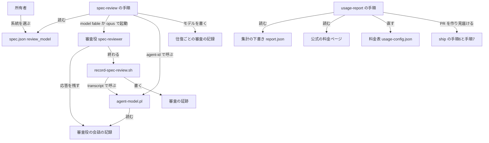
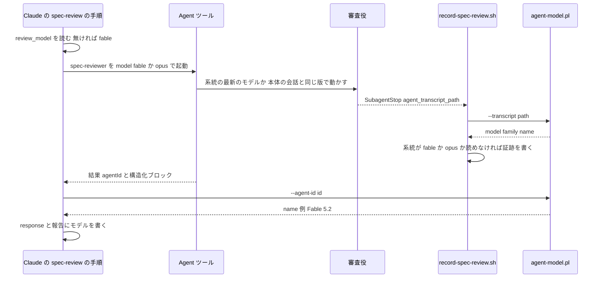
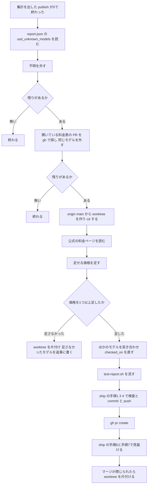

# 設計

## 概要

この設計は、spec の審査役が、版の番号ではなく、Fable と Opus の系統の名前で起動されるようにする。Claude は、審査役の定義のファイルと `/spec-review` の手順に、系統の別名(`fable` `opus`)だけを書く。審査役がどの版で動くかは、Claude Code が決める。Claude Code の版が上がって新しいモデルを使えるようになると、次に起動する審査役から新しいモデルで動く。所有者と Claude は、ファイルを直さなくてよい。

審査役がどの版で動くかは、Claude が審査役を起動するまで分からなくなる。そこで、この設計は、審査役が実際に動いたモデルを、審査役の会話の記録から読む小さなスクリプトを足す。審査が済んだことを記録するフックは、このスクリプトで系統を確かめ、版によらず Fable と Opus の審査を記録する。`/spec-review` は、同じスクリプトで読んだモデルを、往復ごとの審査の記録と所有者への報告に「Fable 5.2」の形で書く。

あわせて、この設計は、作業の集計の料金表に Fable 5.2 の価格を足す。新しいモデルが出たときのために、この設計は、集計のスキル `usage-report` に、料金表に価格を足す PR を作る手順を足す。

## 作るものと作らないもの

### 作るもの

- 審査役の定義(`.claude/agents/spec-reviewer.md`)の `model` を、系統の別名 `fable` にする。
- 審査役が実際に動いたモデルを、審査役の会話の記録から読むスクリプト `agent-model.pl` と、そのテスト。
- 記録のフック(`record-spec-review.sh`)の、モデルの確かめ方の変更と、そのテストの場合の追加。
- `/spec-review` の手順の変更。変えるのは、審査役の起動のしかたと、使用量の上限で審査役が止まったときの切り替えと、往復ごとの審査の記録と所有者への報告に書くモデルの書き方の3つである。
- CLAUDE.md の、審査役のモデルの決まりの文と、会話の要約に残すことの決まりの文の変更。あわせて、その文を確かめるテスト(`test-restore-after-compact.sh`)の期待の値の変更。
- 作業の集計の料金表(`usage-config.json`)への Fable 5.2 の価格の追加と、料金表のほかのモデルの価格の突き合わせ。あわせて、料金表を読む集計のテスト(`test-report.sh`)の場合の変更と追加。
- 集計のスキル(`.claude/skills/usage-report/SKILL.md`)の、料金表に価格を足す PR を作る手順。

### 作らないもの

- この設計は、審査役が何を審査するか、往復の上限の数、指摘の扱い、審査の記録のファイルの形を変えない。これらは spec `spec-review` が決めている。
- この設計は、審査役でない会話のモデルを変えない。審査役でない会話とは、本文を書く会話と、点検役 `spec-style-checker` や確認役のような、審査役のほかの補助役である。
- この設計は、承認の前の審査の確認(`spec-review-scan.sh`、`check-spec-review-before-stop.sh`)と、記録のフックが書く証跡の形を変えない。
- この設計は、作業の集計の表の形、所見の書き方、集計を作るスクリプト(`report.pl` `usage.sh` `extract.pl`)を変えない。これらは spec `ai-work-usage-report` が決めている。
- この設計は、GitHub にすでに出した集計を、料金表を直したあとに出し直す仕組みを作らない。
- この設計は、`.claude/settings.json` を変えず、フックの登録とコマンドの許可の一覧を今のままにする。

## 使う既存の仕組み

- Claude Code の補助役の定義の `model` と、Agent ツールの起動時の `model` の指定。Claude Code は、どちらに書かれた系統の別名 `fable` `opus` も受け付け、別名を、その Claude Code で使える最新のモデルに解決する。解決とは、Claude Code が、別名を、実際に動かすモデルの版に読み替えることである。ただし、別名が本体の会話のモデルと同じ系統のときは、Claude Code は、別名の解決先ではなく、本体の会話のモデルで補助役を動かす。起動時の指定は、定義の `model` と環境変数 `CLAUDE_CODE_SUBAGENT_MODEL` より優先される。環境変数 `CLAUDE_CODE_SUBAGENT_MODEL_FORCE` を1にしたときだけは、環境変数 `CLAUDE_CODE_SUBAGENT_MODEL` が、起動時の指定と定義の `model` より優先される。
- Claude Code が補助役ごとに残す会話の記録 `~/.claude/projects/<project>/<sessionId>/subagents/agent-<agentId>.jsonl`。assistant の行の `message.model` に、応答したモデルの ID が入る。
- Claude Code の SubagentStop のフックの入力の `agent_transcript_path` と、Agent ツールの結果の文の `agentId`。
- 記録のフックが今使っている JSON の読み方(perl の JSON::PP)と、フックが自分の置き場所からスクリプトを探す形。フックが自分の置き場所からスクリプトを探す形は、`restore-after-compact.sh` が `$(dirname "$0")/../scripts/parallel/lib.sh` を読む形と同じである。
- 作業の集計が下書きに書く `report.json` の `totals.usd_unknown_models`(価格が分からないモデルの ID の一覧)。
- 出荷のスキル `/ship` の手順1(verify と push の前の検査)、手順3(commit)、手順4(push)、手順6(自動マージの予約の確認)、手順7(CI の見届けと承認待ち)。
- Stop フック `check-ship-watch-before-stop.sh`。このフックは、Claude が返答を終えようとしたときに、cwd の git の最上位のいまのブランチで PR の見届けが残っていれば、Claude を止める。cwd とは、Claude が今コマンドを動かしているフォルダである。
- GitHub の CLI `gh`(PR の一覧と作成)と、`git worktree`。

依存の向きの決まり: 新しいスクリプト `agent-model.pl` は、ほかのスクリプトを読み込まない。記録のフックと `/spec-review` の手順が `agent-model.pl` を呼び、`agent-model.pl` はどちらも呼ばない。集計のスキルは、集計のスクリプトの出力を読むだけで、集計のスクリプトを直さない。

## 設計を見直すきっかけ

- Claude Code が、系統の別名 `fable` `opus` の意味を変えたとき、または別名を受け付けなくなったとき。
- Claude Code が、別名が本体の会話のモデルと同じ系統のときに補助役を本体の会話のモデルで動かす動きを変えたとき。`/spec-review` の手順と CLAUDE.md に書いた、審査役が本体の会話と同じ版で動くことの文が、実際の動きと食い違う。
- Claude Code が、補助役の会話の記録の置き場所か、assistant の行の `message.model` の形を変えたとき。`agent-model.pl` が会話の記録を読めなくなり、往復ごとの審査の記録のモデルが「読み取れなかった」になる。
- Claude Code が、SubagentStop と PostToolUse(SubagentHandback)のフックの入力の欄を変えたとき。
- 所有者が、環境変数 `ANTHROPIC_DEFAULT_FABLE_MODEL` や `ANTHROPIC_DEFAULT_OPUS_MODEL` のように、別名の解決先を固定する設定を入れたとき。審査役はその版で動く。Claude は、往復ごとの審査の記録に、その版を書く。
- 所有者が、環境変数 `CLAUDE_CODE_SUBAGENT_MODEL_FORCE` を1にし、`CLAUDE_CODE_SUBAGENT_MODEL` にモデルを入れたとき。審査役は、起動時の指定によらず、その環境変数のモデルで動く。
- spec `spec-review` が、往復ごとの審査の記録の形か、審査役の起動のしかたを変えたとき。
- spec `ai-work-usage-report` が、料金表の形か、`report.json` の `totals.usd_unknown_models` の意味を変えたとき。
- 公式の料金ページの場所か、価格の示し方が変わったとき。
- `/ship` の手順6の自動マージの予約の確認か、手順7の CI の見届けと承認待ちのしかたが変わったとき。

## プロジェクトの決まりを守っているか

- 新しいライブラリの追加: 足さない。新しいスクリプトは、フックと集計の仕組みがすでに前提にしている perl の標準のモジュール(JSON::PP、File::Spec)だけを使う。
- 品質チェックの設定: この設計は、次の6つを守る。
  - この設計で変えるファイルは、すべて `.claude/` の下か CLAUDE.md にある。`.claude/` の下を変える PR は、CODEOWNERS により、所有者が承認するまでマージされない。
  - 料金表の PR も同じく、所有者が承認するまでマージされない。
  - この設計は、`.claude/settings.json` と `.github/` を変えない。
  - `.claude/hooks/` の下の3つのファイルは Claude が書けないので、「ファイルの構成」の節の置き方で所有者が写す。
  - 既存のテストの期待の値を変えるので、Claude は、PR の本文に `Test-Change-Justification` を書く。
  - 実装の差分は200行を超えうる。Claude は、PR の本文に `Spec: .kiro/specs/spec-reviewer-latest-model` を書く。そのため、この PR は size-check を通る。
- 使う外部の機能がこのリポジトリで使えるか: Claude は、2026-11-13 にこのリポジトリで `model: fable` と `model: opus` を指定して補助役を起動し、補助役が `claude-fable-5-2` と `claude-opus-5-5` で動いたことで、系統の別名で補助役を起動できることを確かめた。公式の料金ページは認証なしで読める。
- 関係のない項目: backend のコードを置く層、frontend の機能ごとの境界、frontend の状態の持ち方、データベースの表の形

## 全体の構成



このリポジトリのファイルは、系統だけを持つ。審査役の定義と `/spec-review` の起動の両方に系統を書くのは、定義だけが古いまま残っても、審査役の系統が変わらないようにするためである。

Agent ツールの起動時の指定には版を書けないので、この設計は、本体の会話が審査役と同じ系統で動いているときに審査役が本体の会話と同じ版で動く動きを変えない。この設計は、この動きを、`/spec-review` の手順の冒頭の説明と CLAUDE.md の審査役のモデルの決まりに書く。

この設計は、実際に動いたモデルを読む規則を、`agent-model.pl` の1か所に置く。記録のフックは系統を使い、`/spec-review` は表示の名前を使う。`agent-model.pl` は、系統と表示の名前を、どちらも同じ ID から作る。Claude が読み方を2か所に書くと、片方だけを直したときに、記録のフックが証跡を書いた審査のモデルの系統と、`/spec-review` が往復ごとの審査の記録に書いたモデルが食い違う。

料金表の PR は、集計のスクリプトではなく、集計のスキルの手順として Claude が作る。この設計は、公式の料金ページから価格を読むことと、倍率で示された価格を求めることを、スクリプトにしない。この2つは、ページの形に左右されるためである。この設計は、PR の見届けのために新しい仕組みを作らない。PR の見届けには、Claude が、`/ship` の手順6の自動マージの予約の確認と、手順7の CI の見届けと承認待ちと、cwd のブランチの PR を見る Stop フックを、そのまま使う。

**使う技術**:
- スクリプト: perl 5(JSON::PP、File::Spec)。審査役の会話の記録を読み、モデルの ID と系統と表示の名前を出す。
- フック: bash(macOS の bash 3.2 でも動く書き方)。記録のフックの中で `agent-model.pl` を呼ぶ。
- 手順書: Claude Code のスキル(Markdown)と CLAUDE.md。Claude が読んで動く。
- 外部: Claude Code の Agent ツールとフック、GitHub の CLI `gh`、git の worktree、公式の料金ページ。

## ファイルの構成

Claude が新しく作るファイル:

- `.claude/scripts/spec-review/agent-model.pl`: 補助役の会話の記録から、最後に応答したモデルの ID と系統と表示の名前を読んで出す。
- `.claude/scripts/spec-review/tests/test-agent-model.sh`: `agent-model.pl` のテスト。一時フォルダに偽の会話の記録を作り、出力と終了コードを確かめる。

Claude が変えるファイル:

- `.claude/agents/spec-reviewer.md`: frontmatter の `model: claude-fable-5-1` を `model: fable` にする。frontmatter は、ファイルの先頭の `---` で囲んだ、設定を書く部分である。
- `.claude/hooks/record-spec-review.sh`: 83-93行のモデルの確認を、`agent-model.pl --transcript` で系統を読む形に替える。冒頭のコメントのモデルの説明を直す。
- `.claude/hooks/tests/test-record-spec-review.sh`: 場合を `run_test` と `KP_TEST_CASE` で選んで流せる形にし、新しい版のモデルと、系統の判定の場合を足す。
- `.claude/skills/spec-review/SKILL.md`: 12行、Step 2 の手順1と手順4、Step 3 の上限のときの切り替え、Step 4 の往復ごとの審査の記録(response)の書き方と見本、Step 7 の報告の書き方と見本を、系統と `agent-model.pl` で読んだモデルで書く形に直す。
- `CLAUDE.md`: 112-114行の審査役のモデルの決まりと、142行の会話の要約に残すことの決まりを直す。
- `.claude/hooks/tests/test-restore-after-compact.sh`: 535行の審査役の定義の `model` の期待の値を `fable` に、542行の要約の決まりの言葉を新しい言葉に、582行のテストの名前を直す。
- `.claude/scripts/usage/usage-config.json`: `claude-fable-5-2` の価格を足し、料金表のほかのモデルの価格を公式の料金ページと突き合わせ、`prices.checked_on` を読んだ日にする。
- `.claude/scripts/usage/tests/test-report.sh`: 場合 #2003 の価格の無いモデルを架空の ID `claude-fable-9-9` に替え、Fable 5.2 の通常の行と速い出力の行の使用料を確かめる場合を足す。
- `.claude/skills/usage-report/SKILL.md`: 「集計を出す手順」から呼ぶ「料金表に価格を足す手順」の節を足す。

`.claude/hooks/` の下の3つのファイル(`record-spec-review.sh`、`test-record-spec-review.sh`、`test-restore-after-compact.sh`)は、`.claude/settings.json` の permissions の deny(`Edit(.claude/hooks/**)` と `Write(.claude/hooks/**)`)により、Claude が書けない。Claude は、この3つを、次の順で置く。

1. Claude は、3つのファイルの完成版を、作業フォルダの `.claude/.state/spec-reviewer-latest-model/place/.claude/hooks/` の下に、本来の場所と同じ並びで作る。`.claude/.state/` は git の管理外で、deny の対象に当たらない。
2. Claude は、作業フォルダを `git archive HEAD` で scratchpad の一時フォルダに写す。Claude は、その写しに、作業フォルダで変えたファイルと新しく作ったファイルと、`place/` の3つのファイルを、本来のパスで重ねる。重ねるファイルには、commit の前の `agent-model.pl` と `test-agent-model.sh` も含める。`git archive HEAD` は commit したファイルしか写さないためである。Claude は、その写しで、`test-agent-model.sh`、`test-record-spec-review.sh`、`test-restore-after-compact.sh` の3つのテストを流す。フックとテストは自分の置き場所から `agent-model.pl` と CLAUDE.md を探すので、写しの中のファイルを読む。
3. Claude は、写すコマンドを所有者に1つだけ示す。所有者は、作業フォルダの最上位で `cp -r .claude/.state/spec-reviewer-latest-model/place/.claude/hooks/. .claude/hooks/` を打つ。
4. 所有者が写したあと、Claude は、本来の場所で `test-record-spec-review.sh` と `test-restore-after-compact.sh` をもう一度流す。

## 処理の流れ

### 審査役の起動とモデルの記録



Fable の審査役が使用量の上限で止まったときは、Claude は、止まった起動の結果の `agentId` で `agent-model.pl` を呼んで止まったモデルを読み、`model: opus` で同じ材料の審査役を起動し直す。起動し直した審査役の結果の `agentId` で、審査を最後まで行ったモデルを読む。Claude は、どちらの起動でも、往復の番号と審査の範囲を変えない。

### 料金表に価格を足す PR



Claude は、価格が分からないモデルの一覧を、集計を作った作業フォルダの料金表ではなく、origin/main から作った worktree の料金表と比べる。`usage.sh draft` は、集計を作った作業フォルダの写しの料金表を読む。そのため、その作業フォルダが main より古いと、価格が分からないモデルの一覧に、main にはすでに価格があるモデルが並ぶ。

## 部品

### spec-reviewer.md(審査役の定義)

対応する要件: 1.1, 1.3

**役割**: Claude は、審査役の定義の frontmatter の `model` を `model: fable` にする。こうすると、起動時にモデルが指定されなかったときにも、審査役は Fable の系統で動く。定義は版の番号を持たない。Claude は、定義の本文(審査の決まり)と使える道具(Read、Grep、Glob、Write、Bash)を変えない。

### agent-model.pl(審査役が実際に動いたモデルを読むスクリプト)

対応する要件: 1.3, 4.1, 4.3, 4.4, 5.1, 5.2, 5.3

**役割**: このスクリプトは、補助役の会話の記録を1つ読み、最後に応答したモデルの ID と、その系統と、表示の名前を出す。スクリプトは記録を書き換えない。モデルを推し量らず、記録に書かれた ID だけから系統と名前を作る。スクリプトは、どの系統を受け入れるかを判定しない。その判定は、スクリプトを呼ぶ側が行う。

**いつ動くか**: 記録のフックは、SubagentStop の入力に `agent_transcript_path` があるときに、このスクリプトを呼ぶ。Claude は、`/spec-review` の Step 4 で往復ごとの審査の記録を書く前と、Step 3 で Fable の審査役が使用量の上限で止まったときに、このスクリプトを呼ぶ。

**使う部品**: perl の JSON::PP と File::Spec。ほかのスクリプトは読み込まない。

**呼び出し方**:
- `perl .claude/scripts/spec-review/agent-model.pl --transcript <記録のファイルのパス>`: そのファイルを読む。
- `perl .claude/scripts/spec-review/agent-model.pl --agent-id <agentId>`: 会話の記録の置き場所の候補の下の `*/*/subagents/agent-<agentId>.jsonl` を探して読む。候補は、`$HOME/.claude/projects` と、Windows では `$USERPROFILE/.claude/projects` である。2つの候補が同じフォルダなら、1つに数える。見つかったファイルが1つのときだけ読む。スクリプトは、英数字と `_` と `-` だけでできた `agentId` を受け付ける。
- 読む行: 記録の各行を JSON として読み、`type` が `assistant` で、`message.model` が文字列で、`<synthetic>` でない行のうち、最後の行の `message.model` を ID とする。JSON として読めない行は飛ばす。
- 系統と名前: ID が `claude-<系統>-<数>(-<数>)*` の形のときは、スクリプトは、末尾の `-<8桁の日付>` と `[...]` を外す。次に、スクリプトは、系統を英小文字の語にし、版を、数を `.` でつないだものにする。たとえば、`5-2` は `5.2` に、`5` は `5` になる。スクリプトは、名前を、系統の先頭を大文字にした語と、空白と、版をつないだものにする。たとえば、名前は `Fable 5.2` や `Opus 5.6` になる。ID がこの形でないときは、スクリプトは、系統を空にし、名前を ID のままにする。
- 出力: 標準出力に `model=<ID>`、`family=<系統>`、`name=<名前>` の3行を、この順で出す。読み取れなかったときは、3行とも値を空にして出す。読み取れなかったときとは、ファイルが無いとき、ファイルを読めないとき、当てはまる行が無いとき、`--agent-id` で見つかったファイルが0か2以上のときである。
- 終了コード: 読み取れたときと、読み取れなかったときは0。引数が足りない、知らない引数、`agentId` の形が違うときは2で、標準エラーに理由を1行出す。

**失敗したとき**: スクリプトは、読み取れないことを失敗にせず、値の空の3行で返す。読み取れないときにどうするか(証跡を書くか、「読み取れなかった」と書くか)は、呼ぶ側が決める。

### record-spec-review.sh(審査が済んだことを記録するフック)

対応する要件: 5.1, 5.2, 5.3

**役割**: このフックは、今までどおり審査役の報告の構造化ブロックと完了の印を確かめて、証跡を `.claude/.state/spec-review/<feature>__<stage>.evidence` に書く。この設計で変えるのは、審査役のモデルの確かめ方だけである。フックは、版の番号を持たない。この設計は、証跡の形(recorded_at、feature、stage、cycle、round、status、review_hash の7行)と、SubagentStop(matcher `spec-reviewer`)と PostToolUse(matcher `SubagentHandback`)への登録を変えない。

**いつ動くか**: 今までどおり、審査役が終わったときの SubagentStop と、SubagentHandback の PostToolUse で動く。timeout は20秒のままである。

**使う部品**: `agent-model.pl` を `perl "$(dirname "$0")/../scripts/spec-review/agent-model.pl" --transcript "$agent_transcript"` で呼ぶ。フックは、自分の置き場所から `agent-model.pl` を探す。そのため、テストが `CLAUDE_PROJECT_DIR` を一時フォルダに向けても、フックは同じリポジトリの `agent-model.pl` を呼ぶ。

**呼び出し方**: フックは、モデルの確認を、次の順に行う。
1. 入力に `agent_transcript_path` が無いか、そのファイルが無ければ、フックは確認を省いて証跡を書く。これは今までどおりの動きで、SubagentHandback の経路がこれに当たる。
2. `agent-model.pl` が0でない終了コードで終わったら、フックは、判定できないものとして、証跡を書かずに終わる。
3. 出力の `model=` の値が空なら、フックは確認を省いて証跡を書く。これは今までどおりの動きで、会話の記録にモデルが無いときがこれに当たる。
4. `family=` の値が `fable` か `opus` なら、フックは証跡を書く。それ以外(`sonnet`、`haiku`、空)なら、フックは証跡を書かずに終わる。

**失敗したとき**: この設計は、フックが判定できないときに証跡を書かない形を変えない。証跡が無ければ、承認の前の審査の確認が Claude を止める。

### spec-review の手順(.claude/skills/spec-review/SKILL.md)

対応する要件: 1.1, 1.2, 1.3, 1.5, 2.1, 3.1, 3.2, 3.3, 4.1, 4.2, 4.3, 4.4, 4.5, 4.6, 8.1

**役割**: Claude は、この手順に従って、審査役を系統の別名で起動し、実際に動いたモデルを `agent-model.pl` で読んで書く。この設計は、この手順のうち、審査の範囲の決め方、往復の上限、指摘の扱い、`review_model` を読むだけで書かない決まりを変えない。

**冒頭の説明(12行)**: Claude は、冒頭の説明に、次の4つの文を書く。
- 審査役のモデルは、`review_model` で決まる系統の、その Claude Code で使える最新のモデルである。既定は Fable の系統で、所有者は spec ごとに Opus の系統を選べる。
- ただし、本体の会話が審査役と同じ系統で動いているときは、審査役は本体の会話と同じ版で動く。本体の会話がその系統の最新でない版で動いていると、審査役も最新でない版で動く。
- 審査役が最新でない版で動いても、Claude は往復を止めず、所有者に尋ねない。所有者は、審査役が実際に動いた版を、往復ごとの審査の記録で確かめる。
- Fable の審査役が使用量の上限で止まったときは、Claude は、審査役を Opus の系統に替えて審査を続ける(Step 3)。

**Step 2 の手順1**: Claude は、「上限で Opus 5.5 に替えたときも書き換えない」を「上限で Opus の審査役に替えたときも書き換えない」にする。

**Step 2 の手順4**: Claude は、`review_model` が `fable` なら `model: fable` を、`opus` なら `model: opus` を、審査役を起動するたびに Agent ツールに指定する。起動時の指定は、定義の `model` と環境変数 `CLAUDE_CODE_SUBAGENT_MODEL` より優先されるので、審査役は指定した系統で動く。ただし、環境変数 `CLAUDE_CODE_SUBAGENT_MODEL_FORCE` が1のときは、`CLAUDE_CODE_SUBAGENT_MODEL` のモデルが起動時の指定より優先される。Claude は、この例外も手順4の文に書く。Claude は、手順4に、次の3つを足す。
- 審査役のモデルが前の往復と違っても、Claude は往復を止めず、所有者に尋ねない。
- Claude は、審査の範囲(`SCOPE`)を、手順2の決め方だけで決め、モデルが替わったことでは変えない。前回からの差分を渡す往復では、モデルが替わっても差分を渡す。
- Claude は、モデルが替わったことを理由に、承認済みの段階に `/spec-review` を起動し直さない。

**Step 3 の上限のときの切り替え**: Claude は、Step 3 の上限のときの切り替えを、次の4つのとおり直す。
- Claude は、次の5か所の言葉を置き換える。
  - 「Fable 5.1 のレビュー役」を「Fable のレビュー役」にする。
  - 「Opus 5.5 に替えても」を「Opus のレビュー役に替えても」にする。
  - 「(値が無ければ Fable 5.1)」を「(値が無ければ Fable)」にする。
  - 「Fable 5.1 がまだ上限に達していれば」を「Fable のレビュー役がまだ上限に達していれば」にする。
  - 「Opus 5.5 のレビュー役が上限で止まったら(所有者が Opus 5.5 を選んだときも、Fable 5.1 から替えたときも)」を「Opus のレビュー役が上限で止まったら(所有者が Opus を選んだときも、Fable から替えたときも)」にする。
- 起動し直すときは、Claude は `model: opus` を指定し、審査役をその時点の Opus の最新のモデルで動かす。
- 本体の会話が Opus の系統で動いているときは、起動し直した審査役は本体の会話と同じ版で動く。Claude は、Step 3 の文に、このことを冒頭の説明を指して書く。
- 起動し直す前に、Claude は、使用量の上限で止まった起動の結果の `agentId` で `agent-model.pl --agent-id` を呼び、出力の `name` を、使用量の上限で止まった Fable のモデルとして覚える。結果に `agentId` が無ければ、読み取れなかったものとする。

**Step 4 の、往復ごとの審査の記録(response)の書き方**: Claude は、構造化ブロックが返った起動の結果の `agentId` で `agent-model.pl --agent-id` を呼び、出力の `name` を、その往復の審査を最後まで行ったモデルとする。結果に `agentId` が無いか、`name` が空なら、読み取れなかったものとする。節の表の前の行は、次のとおり書く。
- `- レビュー役のモデル: <name>`。Opus の系統のとき(`family` が `opus`)は、続けて理由を `(所有者が選んだ)` か `(Fable のレビュー役が上限に達したため替えた)` で書く。読み取れなかったときは `読み取れなかった` と書き、Claude が Opus で起動した往復なら、続けて同じ理由を書く。
- `- レビュー役が使った量: <subagent_tokens> トークン`(今までどおり。無ければ「不明」)。
- Fable の審査役が使用量の上限で止まった往復では、Claude は、`- 上限で止まった Fable のレビュー役のモデル: <name か 読み取れなかった>` を書く。止まった起動の量が結果にあれば、Claude は、`- 上限で止まった Fable のレビュー役が使った量: <数> トークン` も書く。
- `- 審査の範囲: <全体 か 前回からの差分>`(今までどおり)。

Claude は、見本を、`Opus 5.6(Fable のレビュー役が上限に達したため替えた)`、`上限で止まった Fable のレビュー役のモデル: Fable 5.2` の形に直す。Claude は、手順に、次の決まりを書く。この spec より前の往復の記録に書いた `Fable 5.1` と `Opus 5.5` は、その往復で実際に動いたモデルなので、Claude は書き換えない。

**Step 7 の報告**: Claude は、往復ごとのモデルの行を、Step 4 で往復ごとの審査の記録(response)に書いたのと同じ名前と理由で書く。Claude は、見本の2行を、`1回目の審査: Fable 5.2。…` と `2回目の審査: Opus 5.6。Fable のレビュー役が使える量の上限に達したため、Claude が替えた。上限で止まった Fable のレビュー役のモデルは Fable 5.2。…` の形に直す。

**失敗したとき**: `agent-model.pl` が終了コード2で終わったときは、Claude は、往復を止めず、モデルを「読み取れなかった」と書き、標準エラーの理由を所有者への報告に1行足す。

### CLAUDE.md(審査役のモデルの決まりと、会話の要約の決まり)

対応する要件: 1.4, 1.5, 8.1, 8.2

**役割**: Claude は、CLAUDE.md の112行のうち、審査役のモデルの決まりの文「審査役のモデルは、既定では Fable 5.1 で、所有者が spec ごとに Opus 5.5 を選べる。」を、次の2つの文に替える。112行の残りの文「所有者は、spec を始めるときに、選んだモデルを会話で伝える。」は、Claude は変えずに残す。
- 審査役のモデルは、Fable と Opus のどちらかの系統で選び、審査役はその系統の、その Claude Code で使える最新のモデルで動く。既定は Fable の系統で、所有者は spec ごとに Opus の系統を選べる。
- ただし、本体の会話が審査役と同じ系統で動いているときは、審査役は本体の会話と同じ版で動く。審査役が実際に動いた版は、往復ごとの審査の記録に残る。

Claude は、113-114行の `review_model` の書き方(`fable` か `opus`、所有者が選んでいない spec では書かない)を変えない。Claude は、所有者が版を付けて審査役のモデルを伝えたときの扱いを、次の文で CLAUDE.md に足す。
- 所有者が「Fable 5.1」のように版を付けて審査役のモデルを伝えたときは、実装セッションは、その版の系統(`fable` か `opus`)を `review_model` に書く。実装セッションは、書いた値を示す1行に添えて、次の3つを返事に書く。1つ目は、版は選べないことである。2つ目は、その spec の審査役がその系統の最新のモデルで動くことである。3つ目は、本体の会話が同じ系統で動いているときは、審査役が本体の会話と同じ版で動くことである。

Claude は、142行の要約の決まりの「Fable 5.1 から Opus 5.5 に替えたかどうか」を、「Fable の審査役から Opus の審査役に替えたかどうか」にする。

### 料金表(.claude/scripts/usage/usage-config.json)

対応する要件: 6.1, 6.2, 7.3

**役割**: Claude は、料金表に、`claude-fable-5-2` の価格 `{"in": 8, "cw5": 10, "cw1h": 16, "cr": 0.2, "out": 40, "fast": {"in": 16, "cw5": 20, "cw1h": 32, "cr": 0.4, "out": 80}}` を足す。この値は、2026-11-13 に公式の料金ページで読んだ値である。`fast` のキャッシュの3つの値は、ページが示す倍率(5分の書き込み1.25倍、1時間の書き込み2倍、読み込み0.025倍)を、速い出力の入力の価格16に掛けて求めた値である。実装の日に、Claude はページを読み直し、Fable 5.2 の値と、料金表のほかのモデルのうちページに載っているモデルの値を突き合わせる。値が違えばページの値に直し、`prices.checked_on` を読んだ日にする。ページの場所が `prices.source` と違えば、`prices.source` も読んだページの場所にする。ページに載っていないモデル(例 `claude-3-5-haiku`)の価格は変えない。

料金表に価格が入ると、集計の `report.pl` は、`price_of` でその価格を引き、Fable 5.2 の行の使用料を求め、全体の合計に入れる。

### usage-report の手順(.claude/skills/usage-report/SKILL.md の「料金表に価格を足す手順」)

対応する要件: 7.1, 7.2, 7.3, 7.4, 7.5, 7.6, 7.7, 7.8

**役割**: Claude は、この手順に従って、集計を GitHub に出したあとに、価格が分からないモデルの価格を公式の料金ページから料金表に足す PR を作り、PR がマージされるか閉じられるまで見届ける。Claude は、この手順で、集計のスクリプトと集計の表を変えない。Claude は、この手順で、Issue を起票しない。Claude は、この手順で、所有者に PR の承認のほかの作業を頼まない。

**いつ動くか**: 「集計を出す手順」の3で `usage.sh publish` が終了コード0で終わり、4(案の扱い)を終えたあと。`usage.sh draft` が出した下書きの場所(`draft` の値)を使う。

**使う部品**: 下書きの `report.json`、`gh pr list` と `gh pr create`、`git worktree`、公式の料金ページ(WebFetch で読む)、`test-report.sh`、`/ship` の手順1の verify と push の前の検査、手順3の commit、手順4の push、手順6の自動マージの予約の確認、手順7の CI の見届けと承認待ち。

**呼び出し方**: Claude は、次の順に進める。
1. 対象のモデルを決める: 下書きの `report.json` を読み、`totals.usd_unknown_models` から「不明」を外した ID を対象にする。対象が無ければ、手順を終える。
2. 開いている PR を確かめる: モデルごとに `gh pr list --state open --limit 200 --json number,body --jq '[.[] | select(.body | contains("- 料金表に価格を足したモデル: `<ID>`")) | .number]'` を実行し、番号が返ったモデルを対象から外す。対象が無くなれば、手順を終える。`gh` が失敗したら、PR を作らずに、失敗したことと理由を返事に書いて手順を終える。
3. worktree を作る: 作業フォルダの最上位(`git rev-parse --show-toplevel`)を覚え、`git fetch origin main` のあと、最上位で `git worktree add -b chore/usage-prices-<YYYYMMDD> .claude/worktrees/usage-prices-<YYYYMMDD> origin/main` を実行する。同じ名前のブランチか worktree があれば、名前の末尾に `-2`、`-3` を付ける。次に、`cd` の単独のコマンドでその worktree に移る。
4. 公式の料金ページ `https://platform.claude.com/docs/en/about-claude/pricing` を読み、読んだ日を覚える。
5. 料金表を直す: worktree の `.claude/scripts/usage/usage-config.json` に、次のとおり書く。
   - Claude は、モデルの ID の末尾の `-<8桁の日付>` を外した名前を、料金表のキーにする。`price_of` が、日付を外した名前でも価格を引くためである。Claude は、ID を、系統と版で、ページのモデルの名前に読み替える。たとえば、Claude は `claude-fable-5-2` を「Fable 5.2」に読み替える。
   - 料金表に無いモデルには、Claude は、ページに載っている種類の価格をすべて足す。足す種類は、`in` `cw5` `cw1h` `cr` `out` と、ページに速い出力の価格があれば `fast` と、ページに入力の長さで価格が変わる段があれば `long_input` である。料金表にあるモデルには、Claude は、ページに載っていて料金表に無い種類の価格だけを足す。
   - ページが値で載せている価格には、Claude は、その値を使う。ページが倍率で示している価格(速い出力のキャッシュ)には、Claude は、ページに書かれた倍率を速い出力の入力の価格に掛けた値を使う。
   - ページに載っていないモデルについては、Claude は、料金表に何も足さず、そのモデルを「価格が見つからなかったモデル」として覚える。
   - ページにモデルが載っていても、料金表に無い種類の価格がページに無いモデルについては、Claude は、料金表に何も足さず、そのモデルを「料金表とページを突き合わせても足す価格が無かったモデル」として覚える。origin/main の料金表にすでに価格があるモデルと、集計に要る種類の価格がページに無いモデルが、これに当たる。
6. 価格を1つも足さなかったときは、Claude は、料金表のほかのモデルの突き合わせと `prices.checked_on` の書き換えをせず、PR を作らない。Claude は、作業フォルダの最上位に `cd` で戻り、`git worktree remove <worktree>` と `git branch -D <ブランチ>` を実行し、価格が見つからなかったモデルと、突き合わせても足す価格が無かったモデルの名前を返事に書いて、手順を終える。価格を1つ以上足したときは、Claude は、料金表に次の2つを書く。
   - 料金表にあるほかのモデルのうち、ページに載っているモデルの価格をページと突き合わせ、違う値をページの値に直す。直したモデルと種類と前後の値を覚える。ページに載っていないモデルの価格は変えない。
   - `prices.checked_on` を読んだ日にする。ページの場所が `prices.source` と違えば、`prices.source` を読んだ場所にする。
7. 確かめる: worktree で `bash .claude/scripts/usage/tests/test-report.sh` を流す。価格を直したために既存の場合の期待の値が外れたら、Claude は、期待の値を新しい価格で求め直した値に直し、直したことを PR の本文の `Test-Change-Justification` に書く。続けて、`/ship` の手順1(verify と push の前の3つの検査)を worktree で行う。
8. commit と push: `/ship` の手順3と手順4のとおり、worktree を cwd にして、単独の `git commit -F <scratchpad のメッセージのファイル>` と `git push -u origin <ブランチ>` を実行する。メッセージは `.commit_template` に従い、prefix を `chore`、`Refs: N/A` にする。
9. PR を作る: `gh pr create --base main --head <ブランチ> --title "chore: 作業の集計の料金表に <モデルの名前> の価格を足す" --body-file <scratchpad の本文のファイル>` を実行する。本文の形は「データの形」の節のとおりである。本文に `Closes` は書かない。
10. 見届ける: worktree を cwd にしたまま、`/ship` の手順6(自動マージの予約の確認)と手順7(CI の見届け)を行う。手順7の4の5(所有者の承認待ち)では、`wait-approval.sh` を裏で動かし、承認を待っていることを報告する。CI が赤になったら、Claude は worktree で直して push する。同じ失敗が3回続いたら止めて報告する。
11. 片付ける: PR がマージされたか、所有者が閉じたら、作業フォルダの最上位に `cd` で戻り、`git worktree remove <worktree>` と `git branch -D <ブランチ>` を実行する。所有者が閉じた PR は作り直さない。次の集計でそのモデルの価格がまだ分からなければ、Claude は、その集計のときに、この手順に従って PR をもう一度作る。
12. 返事: PR の URL、足したモデル、価格が見つからなかったモデル、突き合わせても足す価格が無かったモデルの名前を返事に書く。

**状態の持ち方**: Claude は、この手順の状態をファイルに持たない。Claude は、同じモデルの PR が開いているかを、そのたびに GitHub の PR の本文から読む。

**失敗したとき**: 料金ページを読めなかったときは、PR を作らず、worktree を片付け、読めなかったことを返事に書く。`git worktree add` が失敗したときは、PR を作らず、失敗の理由を返事に書く。

## データの形

### agent-model.pl の出力

```text
model=claude-fable-5-2
family=fable
name=Fable 5.2
```

読み取れなかったときは、`model=`、`family=`、`name=` の3行を値なしで出す。

### 料金表の PR の本文

```markdown
## 概要

作業の集計で価格が分からなかったモデルの公表価格を、公式の料金ページから料金表に足す。

## 足した価格

- 料金表に価格を足したモデル: `claude-fable-5-3`
  - 入力 8、5分のキャッシュの書き込み 10、1時間のキャッシュの書き込み 16、キャッシュの読み込み 0.2、出力 40(100万トークンあたりの米ドル)
  - 速い出力: 入力 16、5分のキャッシュの書き込み 20、1時間のキャッシュの書き込み 32、キャッシュの読み込み 0.4、出力 80(キャッシュの3つは、ページの倍率で求めた)

## 直した価格

- `claude-opus-5-5` の出力: 20 → 18

## 読んだ公式の料金ページ

- 場所: https://platform.claude.com/docs/en/about-claude/pricing
- 読んだ日: 2026-12-01

## 価格が見つからなかったモデル

- `claude-xxx-9`(ページに載っていない)

Refs: N/A
```

Claude は、価格を1つ以上足したときだけ PR を作るので、「足した価格」の節はいつも1つ以上のモデルを持つ。直した価格が無いときは、Claude は「直した価格」の節に「無し」と書く。価格が見つからなかったモデルが無いときは、Claude は「価格が見つからなかったモデル」の節に「無し」と書く。`- 料金表に価格を足したモデル: ` の行は、手順2で開いている PR を探すときの目印なので、モデルごとに1行ずつ、この形のまま書く。

## 失敗したときの扱い

- 審査役のモデルを読み取れないとき: 記録のフックは証跡を書き、`/spec-review` は往復ごとの審査の記録に「読み取れなかった」と書く。どちらも往復を止めない。モデルを読み取れないのは、会話の記録の形が変わったときか、使用量の上限で止まった起動の会話の記録に応答の行が無いときである。往復を止めないのは、どちらのときも審査そのものは済んでいるためである。
- 審査役が Fable でも Opus でもない系統で動いたと読めたとき: 記録のフックは証跡を書かない。承認の前の審査の確認が Claude を止めるので、Claude は所有者に報告する。
- 料金表の PR の途中で失敗したとき: 集計はすでに GitHub に出ているので、集計には影響しない。料金表の PR は、次の集計のときに、Claude が、料金表に価格を足す手順に従ってもう一度作る。worktree が残ったときは、Claude は、次の集計で worktree を作るときに、名前の末尾に番号を付けて別の worktree を作る。

## テストの方針

Claude は、シェルのテストを、`run_test` と環境変数 `KP_TEST_CASE` で、場合の名前(関数の名前)を選んで流せる形にする。選んで流す形は、`.claude/hooks/tests/test-check-verify-before-stop.sh` の64-75行と同じにする。テストのファイルは、知らない名前が選ばれたら、何も流さずに失敗する。Claude は、どのテストも、ホストの Git Bash から `bash <テストのファイル>` で流す。CI はこれらのテストを流さない。

- `test-agent-model.sh`(新しく作る。単体テスト)
  - `agent-model.pl` は、`--transcript` で、`claude-fable-5-2` の assistant の行がある記録から、`model=claude-fable-5-2`、`family=fable`、`name=Fable 5.2` を出す。この場合で確かめるのは、要件4の1(往復ごとの審査の記録に、実際に動いたモデルを系統の名前と版の番号で書く)と要件5の1(Fable か Opus の系統のモデルの審査を、版によらず記録する)である。
  - `agent-model.pl` は、まだ無い版の `claude-opus-5-6` と `claude-fable-6` の記録から、`Opus 5.6` と `Fable 6` を出す。この場合で確かめるのは、要件1の3(新しいモデルを使えるようになったら、仕組みのファイルを直さずに、次の審査役から新しいモデルで動かす)と要件5の2(新しいモデルの審査も、仕組みのファイルを直さずに記録する)である。
  - 複数の assistant の行があるとき、`agent-model.pl` は、最後の `<synthetic>` でない行のモデルを出す。最後の行が `<synthetic>` なら、その前の行のモデルを出す。この場合で確かめるのは、要件4の1(往復ごとの審査の記録に、実際に動いたモデルを系統の名前と版の番号で書く)と要件4の3(使用量の上限で止まった Fable の審査役のモデルを書く)である。
  - `agent-model.pl` は、`claude-sonnet-5-5` の記録から `family=sonnet` を出す。この場合で確かめるのは、要件5の3(Fable でも Opus でもない系統のモデルの審査を記録しない)である。末尾の日付と `[1m]` を外す。
  - 記録が無い、JSON でない、assistant の行が無いときは、`agent-model.pl` は、3行とも値なしで出して、終了コード0で終わる。この場合で確かめるのは、要件4の4(実際に動いたモデルを読み取れなかったときは、推し量らずに、読み取れなかったことを書く)である。
  - `agent-model.pl` は、`--agent-id` で、一時的な `HOME` の下の `projects/<p>/<s>/subagents/agent-<id>.jsonl` を見つける。見つからないときと2つあるときは値なしで0で終わる。引数が誤っているときと、`agentId` の形が違うときは、スクリプトは終了コード2で終わる。
- `test-record-spec-review.sh`(変える。結合テスト。フックに入力の JSON を渡す)
  - Claude は、今の5つの場合を `run_test` の形にして残す。これらの場合で確かめるのは、要件4の6(この spec より前の往復の記録に書いたモデルを書き換えない)と要件5の1(Fable か Opus の系統のモデルの審査を、版によらず記録する)である。5つの場合は、Fable 5.1 の記録で証跡を書く場合、Opus 5.5 の記録で証跡を書く場合、Sonnet 5.5 の記録で証跡を書かない場合、SubagentHandback の経路で証跡を書く場合、モデルの無い記録で証跡を書く場合である。
  - フックは、`claude-fable-5-2`、`claude-opus-5-6`、`claude-fable-6` の記録で証跡を書く。この場合で確かめるのは、要件5の1(Fable か Opus の系統のモデルの審査を、版によらず記録する)と要件5の2(新しいモデルの審査も、仕組みのファイルを直さずに記録する)である。
  - フックは、`claude-haiku-5-5` の記録で証跡を書かない。この場合で確かめるのは、要件5の3(Fable でも Opus でもない系統のモデルの審査を記録しない)である。
  - 記録の最後の assistant の行が Sonnet なら、フックは、前の行が Fable でも証跡を書かない。
  - フックを `agent-model.pl` の無い一時フォルダの `.claude/hooks/` に写して流すと、フックは、モデルの記録がある入力で証跡を書かない。スクリプトが0でない終了コードで終わるためである。
- `test-restore-after-compact.sh`(期待の値だけを変える)
  - このテストは、審査役の定義の `model` が `fable` であることを確かめる。この場合で確かめるのは、要件1の1(所有者がモデルを選んでいない spec と Fable を選んだ spec では、Fable の最新のモデルで審査役を起動する)である。
  - このテストは、CLAUDE.md の要約の決まりの行が「Opus の審査役に替えたかどうか」を含むことを確かめる。この場合で確かめるのは、要件8の2(会話の要約に残すことの決まりが、Fable の審査役から Opus の審査役に替えたかどうかを、版の番号を書かずに残すよう求める)である。
  - このファイルは `run_test` の形を持つが、`KP_TEST_CASE` で選ぶ形を持たない。この spec は期待の値を変えるだけなので、選ぶ形は足さない。
- `test-report.sh`(場合を変え、足す。結合テスト。本物の料金表を読む)
  - Claude は、場合 #2003 の価格の無いモデルを `claude-fable-9-9` に替える。この場合は、価格の無いモデルの使用料が「価格が分からない」になり、合計に入らないことを今までどおり確かめる。
  - Claude が新しく足す場合は、Fable 5.2 の、入力100万と出力100万の通常の行が48ドル、同じ量の速い出力の行が96ドルになり、全体の合計に入ることを確かめる。この場合で確かめるのは、要件6の1(作業の集計の Fable 5.2 の行に、公表価格で換算した使用料が載る)と要件6の2(全体の使用料の合計に Fable 5.2 の使用料が入る)である。
  - このファイルは、場合を関数に分けずに上から順に流す形である。このファイルを、場合を選んで流す形に作り替えるのは、この spec の範囲を超える書き換えになる。そのため、Claude は、既存の形のまま、場合を変えて足す。
- 手順書の文で確かめること: Claude は、実装の確認で、次の3つを確かめる。
  - Claude は、CLAUDE.md を `grep -n 'Fable 5\.1\|Opus 5\.5'` で探し、見つかる行が、所有者が版を付けて審査役のモデルを伝えたときの扱いの文の1行だけであることを確かめる。この文の「Fable 5.1」は、所有者が伝える言葉の例であり、審査役のモデルの版ではない。この確認で確かめるのは、要件8の1(CLAUDE.md と `/spec-review` の手順に、審査役のモデルを、版の番号ではなく系統の最新のモデルとして書く)と要件8の2(会話の要約に残すことの決まりが、Fable の審査役から Opus の審査役に替えたかどうかを、版の番号を書かずに残すよう求める)である。
  - Claude は、`/spec-review` の SKILL.md も同じ grep で探し、見つかる行が、この spec より前の往復の記録を書き換えない決まりの1行だけであることを確かめる。この確認で確かめるのは、要件4の6(この spec より前の往復の記録に書いたモデルを書き換えない)と要件8の1(CLAUDE.md と `/spec-review` の手順に、審査役のモデルを、版の番号ではなく系統の最新のモデルとして書く)である。
  - Claude は、SKILL.md の冒頭の説明と CLAUDE.md の決まりに、本体の会話と同じ系統のときは本体の会話と同じ版で動くことの文があることを読んで確かめる。この確認で確かめるのは、要件1の5(本体の会話が審査役と同じ系統で動いているときは、審査役が本体の会話と同じ版で動く)と要件8の1(CLAUDE.md と `/spec-review` の手順に、審査役のモデルを、版の番号ではなく系統の最新のモデルとして書く)である。
- 実物の記録で確かめること: `/spec-review` と集計のスキルの手順は Claude が読んで動くので、テストでは確かめられない。実装の確認で、Claude は、実装の会話で動かした補助役の `agentId` で `agent-model.pl --agent-id` を呼び、Claude Code が実際に書いた記録から名前(例 `Fable 5.2`)を読めることを確かめる。この確認で確かめるのは、要件4の1(往復ごとの審査の記録に、実際に動いたモデルを系統の名前と版の番号で書く)である。Claude が料金表の PR の手順に従って初めて動くのは、次に価格の分からないモデルが集計に出たときである。
