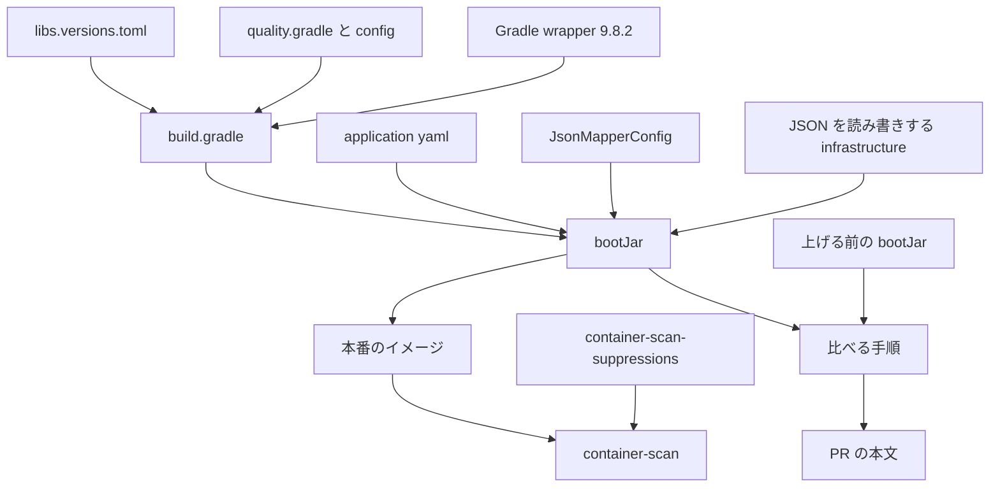
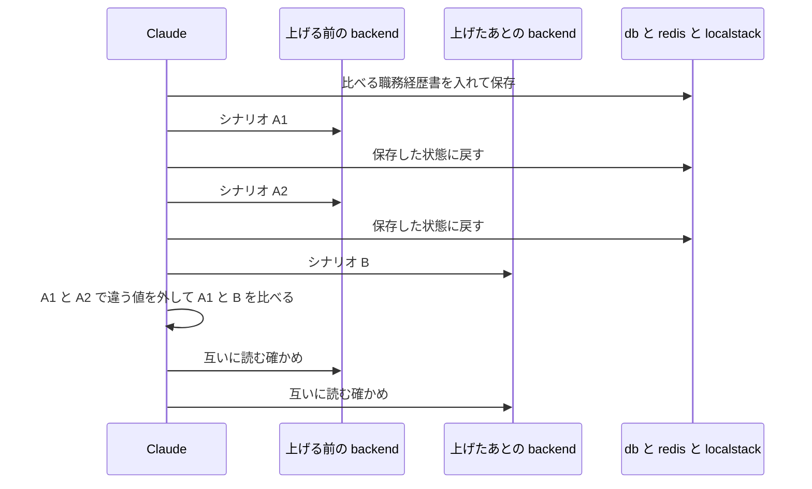
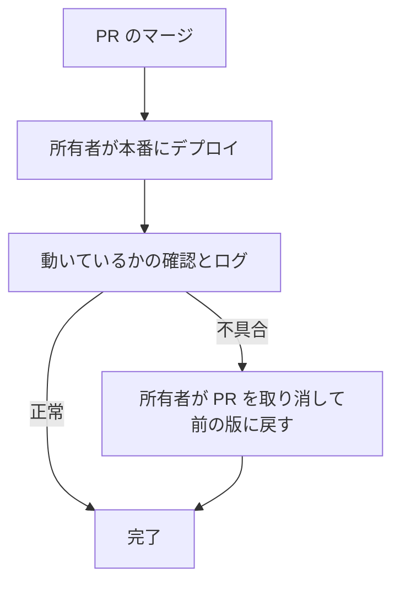

# 設計

## 概要

この設計は、backend の Spring Boot を 3.5.16 から 4.1.2 に上げ、あわせて backend のほかの部品、Gradle、品質チェックの道具を、2026-10-29 に決めた版に上げる。上げる対象は、版の一覧 `backend/gradle/libs.versions.toml`、組み立ての設定 `backend/build.gradle`、Gradle の wrapper、品質チェックの設定、アプリの設定のファイル、JSON を読み書きする Java のクラスとテストである。frontend と terraform は変えない。

Spring Boot 4 は、JSON を読み書きする部品を Jackson 2(`com.fasterxml.jackson`)から Jackson 3(`tools.jackson`)に替え、いくつかの既定の動きを変える。この設計は、Jackson 3 に移ったうえで、JSON の書き方、本番の動いているかの確認の応答、`X-Forwarded-*` のヘッダの扱い、追跡の記録を送らない設定を、アプリの設定のファイルのプロパティと1つの設定のクラスで上げる前の動きに戻す。プロパティとは、Spring Boot がアプリの設定のファイルから読む設定の項目である。`X-Forwarded-*` のヘッダとは、利用者とアプリの間で要求を中継する機械が、元の要求の送り元や https かどうかを伝えるために付けるヘッダである。この設計は、一時的な保存先(Redis)に書く値の形も、上げる前と同じにする。

上げる前と同じであることは、今のテストだけでは確かめられない。そこで Claude は、上げる前の backend と上げたあとの backend を開発用のコンテナのネットワークの上で並べて動かし、同じ要求と同じ職務経歴書で応答と出力を比べる。

## 作るものと作らないもの

### 作るもの

- `backend/gradle/libs.versions.toml` の版と部品の名前の書き換え、`backend/build.gradle` の依存と上書きの整理
- Gradle の wrapper の 9.8.2 への作り直し
- 品質チェックの設定の完成品。完成品は、`backend/gradle/quality.gradle` と `backend/config/checkstyle/google_checks.xml` と、書き方が変わったときの `backend/config/pmd/ruleset.xml` である。所有者が、この完成品を置く
- 脆弱性の抑制のファイル `.github/container-scan-suppressions.json` から2件を消した完成品。所有者が、この完成品を置く
- Spring Boot 4 の既定の動きを上げる前に戻す、アプリの設定のファイルのプロパティ
- JSON の書き出しを上げる前に合わせる設定のクラス `JsonMapperConfig`
- Jackson 2 を使う infrastructure のクラスと、使う側のテストの Jackson 3 への書き換え
- 新しい版の品質チェックの道具が出した指摘に合わせた、動きを変えないコードの直し
- 上げる前と上げたあとを比べる使い捨ての手順と、その結果を書いた PR の本文
- 版の名前を書いた文書(`README.md`、`.kiro/steering/tech.md`)の書き換え
- `backend/CLAUDE.md` から、`build.gradle` から消す `ext['junit-jupiter.version']` の行を説明する文を消す直し

### 作らないもの

- Java の版の変更。開発用のコンテナ、本番のイメージ、CI の Java は 21 のまま
- frontend と terraform の部品の版の変更
- 本番へのデプロイ。デプロイは所有者が行う
- 2件のほかの脆弱性を見逃す設定。足すかどうかは所有者が決める
- データベースのマイグレーションの追加と変更
- 比べる手順のリポジトリへの追加と、CI での比べる手順の実行
- Spring Boot 4 の新しい機能の利用。使わない機能には、probes と、OTLP の環境変数の読み込みがある。probes は、backend が動いているかと要求を受けられるかを、別々の URL で返す機能である。OTLP は、追跡の記録を外部に送るときの決まった形式である
- `.github/workflows/` のワークフローの変更。CI の Java の版とコマンドは今のままで動く
- `docker/` の Dockerfile の変更。本番のイメージの組み立ては今の `./gradlew bootJar` のまま動く

## 使う既存の仕組み

- `bash .claude/scripts/parallel/run-check.sh backend <コマンド>`: Claude は、組み立て、テスト、品質チェック、`dependencyInsight` と `buildEnvironment` を、この1回きりのコンテナで動かす
- 開発用のコンテナのネットワーク(`compose.yaml` の `db` `redis` `localstack`): 上げる前と上げたあとの backend を同じデータベースと保存先と偽物の AWS につなぐ
- CI の `ci.yaml`(`./gradlew check`)、`guardrails.yaml`(`pmdTest` と wrapper の検査)、`mutation-report.yaml`(`./gradlew pitest`)、`dependency-graph.yaml`、`container-scan.yaml`: 変えずに、上げたあとの PR で動かす
- 依存の検査(`dependency-review`、`dependency-cooldown`、`gradle-wrapper`)と、所有者の承認を待つ検査(`dependency-gate`、CODEOWNERS): `build.gradle` とゲートのファイルの変更を所有者の承認まで止める

## 設計を見直すきっかけ

- Spring Boot の 4.1 系の新しい版を入れるとき。`use-jackson2-defaults` と書き出しの機能の扱い、probes と `X-Forwarded-*` のヘッダの既定が変わっていないかを確かめ直す
- Jackson 2 の代わりの部品か `use-jackson2-defaults` が Spring Boot から消えるとき。この設計は、JSON の書き方をプロパティで上げる前に戻せなくなる
- springdoc-openapi が Jackson 3 に移るとき。Jackson 2 がクラスパスから消え、Jackson 2 の版の管理が要らなくなる
- 本番の動く場所が AWS ECS から変わるとき。`X-Forwarded-*` のヘッダの扱いと Cookie の Secure の付き方を確かめ直す
- 一時的な保存先に、文字列でない値を書く部品を足すとき。Redis の値の書き方の設定を見直す

## プロジェクトの決まりを守っているか

- backend のコードを置く層: 新しく作る `JsonMapperConfig` は `infrastructure/shared/json` に置く。Jackson 3 の型は infrastructure と usecase の `SecretReader` の戻り値にだけ現れ、今と同じ層の依存の向きを保つ。domain は Jackson に依存しない。presentation は Spring Boot が作る JSON の変換器を通してだけ Jackson を使う。ArchUnit のテストのファイルは変えない
- データベースの表の形: マイグレーションを足さず、変えない。Flyway の履歴の表は、Spring Boot の BOM が版を決める Flyway 12.4.0 が、今の形のまま読み書きする。BOM とは、Spring Boot が、組み合わせて動くことを確かめた部品の版をまとめて決める一覧である
- 新しいライブラリの追加: 新しく足すのは Spring Boot 4 が分けた部品だけである。`spring-boot-starter-aspectj`(旧 `-aop`)、`spring-boot-starter-flyway`、`spring-boot-starter-freemarker`、`spring-boot-micrometer-tracing-opentelemetry`、テスト用の `spring-boot-starter-webmvc-test` `-data-redis-test` `-security-test` である。どれも、上げる前に Spring Boot の1つの部品が持っていた機能である。これらの機能を使い続けるには、これらの部品を足すほかに選びようが無い。版は BOM が決めるので、`libs.versions.toml` に版を書かない。`build.gradle` を変えるので、PR は所有者が承認するまでマージされない。`libs.versions.toml` と `gradle-wrapper.properties` の変更は、`dependency-review`、`dependency-cooldown`、`gradle-wrapper` が確かめる
- 品質チェックの設定: 道具の版と `google_checks.xml` を変える必要がある。この変更は、下の部品「品質チェックの設定の完成品」で所有者への提案として分けて書く。脆弱性の抑制のファイルも同じく所有者が置く
- 使う外部の機能がこのリポジトリで使えるか: 新しく使う外部のサービスは無い。Maven Central と Gradle の配布元は今と同じである
- 関係のない項目: frontend の機能ごとの境界、frontend の状態の持ち方

## 全体の構成

- 部品の版を決める場所は、`libs.versions.toml` と Spring Boot の BOM の2か所だけである
- Claude は、上げる前の動きに戻すために、プロパティで戻せる動きを `application.yaml` と `application-prod.yaml` に書き、プロパティで戻せない JSON の書き出しの機能だけを `JsonMapperConfig` に書く

**使う技術**:
- サーバー: Java 21、Spring Boot 4.1.2(Spring Framework 7.0.10、Spring Security 7.1.2)。backend は、これらの上で動く
- JSON: Jackson 3.1.7(`tools.jackson`)。backend は、API と Redis と OIDC の JSON を、Jackson 3 で読み書きする。Jackson 2.21.7 は springdoc-openapi 3.2.0 のためにクラスパスに残る
- データの保存: PostgreSQL JDBC 42.7.14、MyBatis Spring Boot 4.1.0、Flyway 12.4.0(起動時のマイグレーション)、spring-data-redis 4.1.2 と Lettuce 7.5.2
- 外部とのつなぎ込み: Spring Cloud AWS 4.2.0(S3、SES、Secrets Manager)
- 出力: Thymeleaf 3.1.5、openhtmltopdf 1.0.10(pdfbox 2.0.24)、FreeMarker 2.3.35
- 運用: Micrometer Tracing 1.7.2 と OpenTelemetry 1.62.0。この2つは、追跡の番号をログに付ける。この2つは、追跡の記録を外部に送らない
- 組み立て: Gradle 9.8.2、spotless 8.10.4、spotbugs のプラグイン 6.5.13、pitest のプラグイン 1.19.0、Flyway のプラグイン 13.11.1
- 品質チェック: checkstyle 14.3.0、spotbugs 4.10.5、pmd 7.28.0、jacoco 0.8.15、pitest-junit5-plugin 1.2.3
- テスト: JUnit Jupiter 6.0.3、Mockito 5.23.0、Testcontainers 2.0.5、ArchUnit 1.5.1(`archunit-junit6`)

## ファイルの構成

Claude が新しく作るファイル:

- `backend/src/main/java/com/example/keirekipro/infrastructure/shared/json/JsonMapperConfig.java`: JSON の書き出しの機能を上げる前に合わせる設定のクラス
- `backend/src/test/java/com/example/keirekipro/unit/infrastructure/shared/json/JsonMapperConfigTest.java`: Spring Boot が作る `JsonMapper` が上げる前と同じ形で書くことを確かめるテスト
- `backend/src/test/java/com/example/keirekipro/unit/infrastructure/shared/redis/RedisConfigTest.java`: Redis の値の書き方が上げる前と同じ形であることを確かめるテスト

Claude が変えるファイル:

- `backend/gradle/libs.versions.toml`: 版の書き換えと、上書きの版の行の削除、部品の名前の変更
- `backend/build.gradle`: 起動の部品の名前の変更と追加、`ext` の上書きと不要な制約の削除、`commons-logging` の除外の削除
- `backend/gradle/wrapper/gradle-wrapper.properties`、`backend/gradle/wrapper/gradle-wrapper.jar`、`backend/gradlew`、`backend/gradlew.bat`: Gradle 9.8.2 の wrapper
- `backend/src/main/resources/application.yaml`: Jackson のプロパティと、追跡のプロパティの名前
- `backend/src/main/resources/application-prod.yaml`: probes と `X-Forwarded-*` のヘッダのプロパティ
- `backend/src/main/java/com/example/keirekipro/infrastructure/shared/RestClientConfig.java`: OIDC の呼び出しの JSON の変換器
- `backend/src/main/java/com/example/keirekipro/infrastructure/shared/redis/RedisConfig.java`: Redis の値の書き方
- `backend/src/main/java/com/example/keirekipro/usecase/shared/secret/SecretReader.java` と、`infrastructure/auth/oidc/` の `OidcClient.java` `provider/OidcProvider.java` `provider/GithubOidcProvider.java`、`infrastructure/shared/aws/secrets/SecretsManagerSecretReader.java`、`infrastructure/query/resume/MyBatisResumeBackupQuery.java`、`infrastructure/store/auth/RedisPendingRegistrationStore.java` `RedisTwoFactorAuthChallengeStore.java`: Jackson 3 への書き換え。パスは、すべて `backend/src/main/java/com/example/keirekipro/` の下にある
- 新しい版の checkstyle、spotbugs、pmd が指摘した `backend/src/main/java/` と `backend/src/test/java/` のファイル: 動きを変えない書き方の直し。どのファイルかは道具を動かして決まる
- `backend/src/test/java/com/example/keirekipro/unit/` の下のテスト: Jackson 3 の型、テストの注釈の置き場所、Testcontainers 2 のクラスへの書き換え。書き換えるファイルの数は、Jackson 3 の型が約35、テストの注釈の置き場所が約61、Testcontainers 2 のクラスが5である。ArchUnit のテスト `unit/architecture/BackendArchitectureTest.java` は変えない
- `README.md`: 技術の表の Spring Boot と JUnit の版
- `.kiro/steering/tech.md`: 技術の表の Spring Boot と JUnit の版
- `backend/CLAUDE.md`: `ext['junit-jupiter.version']` の行を説明する2か所の削除

所有者が置くファイルは、次のとおりである。Claude は、これらのファイルの完成品を作業用のフォルダで作って確かめる。

- `backend/gradle/quality.gradle`: 品質チェックの道具の版
- `backend/config/checkstyle/google_checks.xml`: checkstyle 14.3.0 の配布元のファイルを土台にした置き換え
- `backend/config/pmd/ruleset.xml`: pmd 7.28.0 で書き方が変わったときだけ
- `.github/container-scan-suppressions.json`: 2件の抑制を消したファイル

コミットしないファイルは、次のとおりである。Claude は、これらのファイルをリポジトリの外の作業用のフォルダに置く。

- `compare/`: 上げる前と上げたあとを比べる手順。シナリオの台本、比べる職務経歴書のデータ、OIDC の偽物の応答、比べた結果
- PR の本文: `/ship` が PR を作るときに渡す本文。版の表と、`compare/` の比べた結果の要約を書く

## 処理の流れ

- Claude は、main の bootJar を組み立てて、上げる前の backend として動かす。Claude は、作業のブランチの bootJar を、上げたあとの backend として動かす
- 保存した状態に戻すとは、データベースを `pg_dump` の結果から戻し、Redis を空にすることである。Claude は、どのシナリオも同じ状態から始める

## 部品

### libs.versions.toml(部品と道具の版の一覧)

対応する要件: 1.1, 1.2, 1.3, 1.4, 1.5, 1.6, 1.10, 1.11, 1.12

**役割**: このファイルは、Spring Boot が版を決めない部品と、Gradle のプラグインの版を決める。Claude は、Spring Boot が版を決める部品の版を、このファイルに書かない。版を決めた日は 2026-10-29 である。Claude は、2026-10-26 04:00(UTC)より前に公開された正式版のうち、最も新しい版を選ぶ。

`[versions]` の書き換え:

| 名前 | 上げる前 | 上げたあと |
|---|---|---|
| spring-boot | 3.5.16 | 4.1.2 |
| spring-dependency-management | 1.1.7 | 1.1.7 |
| spotless | 7.2.1 | 8.10.4 |
| spotbugs | 6.5.13 | 6.5.13 |
| pitest | 1.19.0 | 1.19.0 |
| flyway | 10.22.0 | 13.11.1 |
| mybatis-spring-boot | 3.0.5 | 4.1.0 |
| archunit | 1.5.1 | 1.5.1 |
| springdoc | 2.9.1 | 3.2.0 |
| openhtmltopdf | 1.0.10 | 1.0.10 |
| java-jwt | 4.6.2 | 4.6.2 |
| spring-cloud-aws | 3.4.2 | 4.2.0 |
| commons-validator | 1.11.0 | 1.11.0 |
| mybatis-postgresql-typehandlers | 1.0.2 | 1.0.2 |

`[versions]` から消す行: `testcontainers`、`freemarker`、上書きの `netty` `postgresql` `tomcat` `opentelemetry` `log4j2` `commons-compress` `plexus-utils`。`testcontainers` の版は BOM が 2.0.5 に決め、`freemarker` の版は BOM が 2.3.35 に決める。Claude は、`jackson-bom` `commons-lang3` `httpclient5` `httpcore5` の行を、`build.gradle` の buildscript の制約のうち、その行を使う制約をすべて消したときだけ消す。制約を残すときは、Claude は、その制約が使う行を残す。`jackson-bom` の行を残すときは、Claude は、Jackson 2 の版であることが分かるように、名前を `jackson2` に改める。

`[libraries]` の書き換え: `archunit-junit5` を `archunit-junit6`(`com.tngtech.archunit:archunit-junit6`)に替える。`testcontainers-bom` と `freemarker` の行を消す。

- `flyway` の版は、Flyway の Gradle プラグインと、buildscript の `flyway-database-postgresql` の2か所が使う。アプリの起動時のマイグレーションは BOM の Flyway 12.4.0 が行い、この版を使わない

**失敗したとき**: 最も新しい版では動かない部品を、組み合わせて動く版のうち最も新しい版に止めるときは、Claude は、動くかどうかを、組み立てとテストと下の比べる手順で決める。動くかを特に確かめる組み合わせは、spring-cloud-aws 4.2.0 と Spring Boot 4.1.2、archunit-junit6 1.5.1 と JUnit 6.0.3、Flyway のプラグイン 13.11.1 と開発用のデータベースの3つである。上書きの行を消したあと、`dependencyInsight` で既知の脆弱性のある版が引き込まれていると分かったときは、Claude は、その部品の行を直した版で残し、注記に脆弱性の番号と外す条件を書く。

### build.gradle(組み立ての設定)

対応する要件: 1.3, 1.4, 1.6, 3.3, 4.3, 6.1, 6.4, 7.3

**役割**: このファイルは、どの部品をどの範囲で使うかを宣言する。版は書かない。

依存の書き換え:

- Claude は、`spring-boot-starter-web` を `spring-boot-starter-webmvc` に、`spring-boot-starter-oauth2-client` を `spring-boot-starter-security-oauth2-client` に替える
- Claude は、`spring-boot-starter-aop` を `spring-boot-starter-aspectj` に替える
- Claude は、`org.flywaydb:flyway-core` を `spring-boot-starter-flyway` に替える。`flyway-database-postgresql` は残す
- Claude は、`libs.freemarker` を `spring-boot-starter-freemarker` に替える。メールの文面を作る `SesFreeMarkerNotificationDispatcher` が受け取る FreeMarker の `Configuration` の Bean は、Spring Boot 4 では `spring-boot-freemarker` の自動設定が作るためである
- Claude は、`org.springframework.boot:spring-boot-micrometer-tracing-opentelemetry` を足す。`micrometer-tracing-bridge-otel` と `opentelemetry-exporter-otlp` は残す。`spring-boot-starter-opentelemetry` は使わない
- Claude は、テスト用に `spring-boot-starter-webmvc-test`、`spring-boot-starter-data-redis-test`、`spring-boot-starter-security-test` を足す。`spring-boot-starter-test` は残す
- Claude は、Testcontainers の `platform(libs.testcontainers.bom)` を消し、`org.testcontainers:testcontainers-junit-jupiter`、`testcontainers-postgresql`、`testcontainers-localstack` に替える
- Claude は、`libs.archunit.junit5` を `libs.archunit.junit6` に替える

消すもの:

- `ext['junit-jupiter.version']` と、`ext['netty.version']` から `ext['httpcore5.version']` までの上書きの9行と、その注記。これらを消すのは、上げる前の上書きが、どれも BOM 4.1.2 の版と同じか古く、残すと Jackson と JUnit と Netty と Tomcat の系統を下げて組み立てを壊すためである
- buildscript の `constraints` の `jackson-databind` `commons-lang3` `httpclient5` `httpcore5` `httpcore5-h2` の制約。Claude は、制約ごとに、`./gradlew -q buildEnvironment` で、制約を外したときにプラグインが引き込む版を確かめる。Claude は、その版に既知の脆弱性が無い制約だけを消す。既知の脆弱性がある制約は、直した版を指すように残す
- `testImplementation` の `commons-compress` の制約と、`checkstyle` の `plexus-utils` の制約。Claude は、消したあと、`dependencyInsight --configuration testRuntimeClasspath --dependency commons-compress` と `dependencies --configuration checkstyle` で、既知の脆弱性のある版が引き込まれないことを確かめる
- `configurations.configureEach` の `exclude group: 'commons-logging'`。Spring Framework 7 は spring-jcl を外した。Spring Framework 7 の spring-core は commons-logging に依存する。そのため、除外を残すと、backend は起動できない

変えないもの: `apply from: 'gradle/quality.gradle'` の行、`flyway { }` の接続先、`sourceSets` の設定、`bootRun` と `test` の設定。

**呼び出し方**: 開発用のコンテナでの起動は今と同じ `./gradlew bootRun`、品質チェックは `./gradlew check`、本番のイメージは `docker/backend/Dockerfile.prod` の `./gradlew bootJar --no-daemon -x test` のまま動く。

**失敗したとき**: Gradle 9 は、テストが1つも見つからないテストのタスクを失敗にする。そうなったときは、Claude は、テストの部品が JUnit 6 の engine を見つけているかを確かめて直し、失敗を消す設定は足さない。

### Gradle wrapper(Gradle の版を決めるファイル)

対応する要件: 1.5, 1.11, 6.1, 6.2, 6.3

**役割**: wrapper は、開発用のコンテナ、CI、本番のイメージの組み立ての全部で、同じ Gradle 9.8.2 を使わせる。

**呼び出し方**: Claude は `./gradlew wrapper --gradle-version 9.8.2 --gradle-distribution-sha256-sum 21bd5da2de49b642904077f38c0efdc7778e92b3ed0889392dca61b97e389607` で `gradle-wrapper.properties`、`gradle-wrapper.jar`、`gradlew`、`gradlew.bat` を作り直す。作り直した jar の SHA-256 が、配布元が公表した `3b8a25775a69158b5ad2b1d17a80a88dc7b40a352a73eb27d06c612a7ce68e98` と同じことを確かめる。CI の `guardrails.yaml` の wrapper の検査も、配布元の値と照らす。

**状態の持ち方**: 設定のキャッシュ(configuration cache)は有効にしない。今の設定に無く、`quality.gradle` の SpotBugs のクラスの読み込み方と合わないおそれがあるためである。

### 品質チェックの設定の完成品(所有者に置いてもらうゲートのファイル)

対応する要件: 1.7, 1.8, 1.9, 6.2, 6.5, 7.1, 7.2

**役割**: Claude は、ゲートのファイルの新しい中身を、作業用のフォルダに完成品として作る。Claude は、その完成品を作業のブランチの写しに置いて `./gradlew check` と `./gradlew pitest` を動かし、通ることを確かめてから所有者に渡す。Claude は、ゲートのファイルを作業フォルダの中で直接変えない。

`backend/gradle/quality.gradle` の変更:

| 設定 | 上げる前 | 上げたあと |
|---|---|---|
| `checkstyle.toolVersion` | 10.26.1 | 14.3.0 |
| `jacoco.toolVersion` | 0.8.12 | 0.8.15 |
| `spotbugs.toolVersion` | 4.8.6 | 4.10.5 |
| `pmd.toolVersion` | 7.27.0 | 7.28.0 |
| `pitest.junit5PluginVersion` | 1.2.1 | 1.2.3 |

- Claude は、カバレッジの下限(LINE 0.93、BRANCH 0.73、INSTRUCTION 0.93)、spotbugs の `effort` と `reportLevel`、pmd の `ignoreFailures`、`check` が頼るタスク、pitest の対象のクラスとテストを変えない
- Claude は、spotless の `eclipse()` で版を固定しない。spotless 8.10.4 の既定の Eclipse JDT 4.41 で `spotlessApply` をかけ直し、整形が変わったファイルはそのまま PR に入れる
- Claude は、`pitestVersion` を書かず、PIT 本体の版を pitest のプラグイン 1.19.0 の既定に従わせる
- `./gradlew pitest` が JUnit Platform の launcher の版の食い違い(`NoSuchMethodError`)で落ちたときだけ、Claude は、`pitest { }` に `addJUnitPlatformLauncher = false` を足す。`build.gradle` には `testRuntimeOnly 'org.junit.platform:junit-platform-launcher'` がすでにある

`backend/config/checkstyle/google_checks.xml` の置き換え:

- 土台は checkstyle 14.3.0 の配布元の `google_checks.xml` である
- Claude は、このリポジトリが写したあとに加えた変更を入れ直す。入れ直す変更は、次の7つである
  - LineLength 120
  - Indentation の basicOffset・braceAdjustment・caseIndent 4 と arrayInitIndent 8
  - 入れ子の SLIST の SuppressionXpathSingleFilter
  - RightCurlySame の抑制の削除
  - RightCurlyAlone の LITERAL_CATCH の削除
  - CustomImportOrder と SummaryJavadoc と JavadocParagraph の停止
  - 日本語の名前を許すメソッド名の型
- Claude は、配布元が 14.3.0 で外した規則のうち、RightCurly、空のブロックの RegexpSinglelineJava、MemberName の3つを、上げる前の設定のまま残す。RightCurly は、RightCurlySame と RightCurlyAlone の2つの手直しを付けたまま残す。配布元がこの3つの代わりに足した GoogleRightCurly、WhitespaceBeforeEmptyBody、GoogleNonConstantFieldName は、配布元が新しく足した規則として加える。上げる前の規則と新しく足した規則が同じ箇所を重ねて検査しても、検査は緩くならない
- 上げる前の規則と新しく足した規則が、同じ箇所に逆の書き方を求め、どちらにも合う書き方が無いことがある。そのときは、Claude は、どちらの規則も外さずに止まり、食い違う箇所と2つの規則を所有者に示す。片方の規則を外すと、上げる前のファイルにあった規則を残すとした要件1の8か、品質チェックの基準を上げる前より緩めないとした要件7の1から外れるためである
- 配布元の GoogleMethodName が日本語の名前を許さないので、Claude は、メソッド名の検査に GoogleMethodName を使わず、上げる前の `MethodName` の規則と型を残す
- Claude は、module-info の BeforeExecutionExclusionFileFilter と CustomImportOrder の tokens を、上げる前の書き方のまま残す。14.3.0 が受け付けないときは、同じ働きの書き方に替え、替えられないときは理由を PR の本文に書く
- Claude は、配布元が値を緩めた規則に、上げる前の厳しい値を残す。配布元が値を厳しくした規則と、新しく足した規則は、そのまま使う
- Claude は、規則ごとに、上げる前の値、配布元の値、選んだ値を表にして PR の本文に書く

`backend/config/pmd/ruleset.xml` と `backend/config/spotbugs/exclude.xml`: pmd 7.28.0 で書き方が変わったときだけ `ruleset.xml` を書き直す。`exclude.xml` には除外を足さない。

**権限**: 所有者が、これらの完成品を置く。`backend/gradle/quality.gradle` と `backend/config/` は CODEOWNERS が守り、所有者の承認が要る。

**呼び出し方**: Claude は、所有者に、作業フォルダの最上位へ移る `cd` のコマンドと、完成品を置く `cp` のコマンドを1つの手順にまとめて示す。所有者が、完成品を置いたと返事をしたら、Claude は、所有者が置いたファイルが完成品と同じ中身かを `cmp` で確かめ、品質チェックを動かし直す。

**失敗したとき**: 新しい版の道具が今のコードに新しい指摘を出したときは、Claude は、要件7の2のとおり、アプリの動きを変えずにコードの書き方を直して、指摘を無くす。書き方を直すと動きが変わるおそれがある指摘は、直さずに所有者に示す。

### アプリの設定(application.yaml と application-prod.yaml)

対応する要件: 2.1, 2.3, 2.5, 4.1, 4.2, 4.3, 4.4, 4.5, 5.1, 5.2

**役割**: この2つのファイルは、Spring Boot 4 が変えた既定の動きを、プロパティで上げる前の動きに戻す。

`application.yaml` に足すプロパティと変えるプロパティ:

- `spring.jackson.use-jackson2-defaults: true`: 項目を宣言の順に並べ、JSON のあとの余分な文字と基本型への null を上げる前と同じく受け付け、列挙を名前で書く
- `management.otlp.tracing.export.enabled: false` を `management.tracing.export.otlp.enabled: false` に改める。`management.opentelemetry.tracing.export.otlp.endpoint` は書かない。書かなければ、送り出しの Bean は作られない
- `management.opentelemetry.map-environment-variables: false`: 環境変数 `OTEL_*` を読まない。本番の環境に `OTEL_*` が入っても送り出しを始めないようにするためである
- `management.tracing.sampling.probability: 1.0`、`logging.structured.format.console: ecs`、`traceId` を `trace.id` に、`spanId` を `span.id` に名前を替える `logging.structured.json.rename`、`spring.flyway` の設定、`spring.web.locale` は変えない

`application-prod.yaml` に足すプロパティ:

- `management.endpoint.health.probes.enabled: false`: `/actuator/health` の応答を `{"status":"UP"}` のままにし、`/actuator/health/liveness` と `/actuator/health/readiness` を増やさない
- `server.forward-headers-strategy: none`: AWS ECS の上でも `X-Forwarded-*` のヘッダを読まず、Cookie の属性、HSTS のヘッダの有無、要求元の IP アドレスを上げる前と同じにする。HSTS のヘッダとは、ブラウザに、そのサイトへ https だけでつなぐよう指示するヘッダである
- `server.shutdown: graceful` と `spring.lifecycle.timeout-per-shutdown-phase: 90s`、Secrets Manager の読み込み、Redis の SSL、`management.endpoints.web.exposure.include: health`、`management.endpoint.health.show-details: never` は変えない

**いつ動くか**: backend が起動するときに Spring Boot が読む。

**失敗したとき**: Spring Boot 4 で名前が変わったプロパティを見落とすと、そのプロパティは黙って無視される。Claude は、比べる手順の間だけ `spring-boot-properties-migrator` を `runtimeOnly` で足して起動し、名前が変わったプロパティの警告が出ないことを確かめる。この部品は PR に入れない。

### JsonMapperConfig(JSON の書き出しを上げる前に合わせる設定のクラス)

対応する要件: 2.1, 2.3, 2.4

**役割**: このクラスは、プロパティで戻せない Jackson 3 の既定を、Spring Boot が作る `JsonMapper` に設定する。設定するのは、UTF-8 で書くときに絵文字のようなサロゲートの対をそのまま書く機能 `COMBINE_UNICODE_SURROGATES_IN_UTF8` の無効化である。Jackson 2 はこの機能を持たず、サロゲートの対を `\uXXXX\uXXXX` の形で書いていた。このクラスは、`JsonMapper` を新しく作らない。

**使う部品**: このクラスは、Spring Boot の `JsonMapperBuilderCustomizer` を Bean として返す。`JsonMapperBuilderCustomizer` は、Spring Boot 4.1.2 の `org.springframework.boot.jackson.autoconfigure` にある。Claude は、実装の最初に、この置き場所をコンパイルで確かめる。Spring Boot は、この Bean を、API の応答の変換器と、ほかのクラスが受け取る `JsonMapper` の両方に当てる。

**呼び出し方**: `@Configuration` のクラスで、`@Bean JsonMapperBuilderCustomizer surrogateCompatibleJsonMapperCustomizer()` を1つ持つ。返す処理は、`builder.disable(<COMBINE_UNICODE_SURROGATES_IN_UTF8 の列挙>)` だけである。列挙の型は Jackson 3.1.7 の `JsonWriteFeature` を使う。

- 比べる手順で `DETECT_PARAMETER_NAMES` の違いによる差が見つかったときだけ、Claude は、このクラスに `builder.enable(MapperFeature.DETECT_PARAMETER_NAMES)` を足す。`DETECT_PARAMETER_NAMES` は、引数の名前からコンストラクタを見つけるかどうかを決める機能である。差が無ければ足さない

**失敗したとき**: Jackson 3.1.7 にこの機能の列挙が無いときは、Claude は、`JsonFactory` の作り方で同じ書き方にする方法を調べ、調べた結果を research.md に足す。同じ書き方にできないときは、Claude は、確かめた結果が要件に届かないときの決まりである要件9の3に従って、同じ書き方にできないことを所有者に示す。

### JSON を読み書きする infrastructure のクラス(Jackson 3 への書き換え)

対応する要件: 2.1, 2.6, 5.3, 5.4

**役割**: このまとまりのクラスは、Jackson 2 の `ObjectMapper` の代わりに、Spring Boot が作る `tools.jackson.databind.json.JsonMapper` の Bean を受け取る。Spring Boot 4 は、Jackson 2 の `ObjectMapper` の Bean を作らないためである。Bean とは、Spring Boot が作って管理し、ほかのクラスに渡すオブジェクトである。これで、API の応答、Redis の値、OIDC の応答の読み取りが、同じ設定の JSON で動く。読み書きする JSON の中身は変えない。

- `SecretReader`(usecase): 戻り値を `tools.jackson.databind.JsonNode` に替える。`SecretsManagerSecretReader` が実装する
- `OidcProvider`、`GithubOidcProvider`、`OidcClient`: 秘密の値の読み取りを `JsonNode.asString()` に替える。`GithubOidcProvider` の `readValue` は `JsonMapper` と `tools.jackson.core.type.TypeReference` で行う
- `MyBatisResumeBackupQuery`: `readTree` と `JsonNode` のたどり方を Jackson 3 の名前に替える
- `RedisPendingRegistrationStore`、`RedisTwoFactorAuthChallengeStore`: 保存する値を `JsonMapper.writeValueAsString` で文字列にし、読むときは `readValue` で戻す。書く文字列の項目の順と日付の書き方は、`use-jackson2-defaults` で上げる前と同じにする
- 今 `JsonProcessingException`(検査例外)を受け止めている箇所は、`tools.jackson.core.JacksonException`(非検査例外)を受け止める。受け止めたあとの扱い(エラーの応答、ログ、戻り値)は変えない

**使う部品**: Spring Boot が作る `JsonMapper` の Bean。注釈は `com.fasterxml.jackson.annotation` のまま使う。

**失敗したとき**: 書き換えたクラスのテストが、上げる前に書いた値の見本を読めないときは、Claude は、`use-jackson2-defaults` で戻らない差を探し、`JsonMapperConfig` に足すか、所有者に示す。

### RestClientConfig(OIDC の呼び出しに使う RestClient の設定)

対応する要件: 2.6

**役割**: このクラスは、OIDC の認可サーバを呼ぶ `RestClient` を作る。上げたあとは、JSON の変換器に、Spring Boot が作る `JsonMapper` を使う `JacksonJsonHttpMessageConverter` を明示して渡す。Spring Framework 7 の `RestClient.builder()` は、変換器を何も渡されないと、Spring Boot の設定を使わない Jackson 3 の変換器を選ぶ。その変換器では、知らない項目の扱いが上げる前と食い違うおそれがある。このクラスが変換器を明示して渡すのは、このためである。今の `defaultStatusHandler` と、10秒の接続と読み取りの打ち切りは変えない。

**呼び出し方**: `@Bean RestClient restClient(JsonMapper jsonMapper)`。変換器の一覧の渡し方は、Spring Framework 7.0.10 で非推奨でない `RestClient.Builder` のメソッドを使う。フォームの送信に使う変換器は既定のまま残す。

**失敗したとき**: 認可サーバの応答が知らない項目を含んでも、上げる前と同じく読み飛ばす。トークンの応答が読めないときの扱い(`server_error` を返す)は `OidcClient` が持ち、変えない。

### RedisConfig(一時的な保存先の値の書き方の設定)

対応する要件: 5.3, 5.4

**役割**: このクラスは `RedisTemplate<String, Object>` を作る。キーとハッシュのキーは今と同じ `StringRedisSerializer` で書く。このクラスは、値とハッシュの値を、非推奨の `Jackson2JsonRedisSerializer` に替えて、spring-data-redis 4.1.2 の `JacksonJsonRedisSerializer<Object>` で書く。このクラスは、`JacksonJsonRedisSerializer<Object>` に、Spring Boot が作る `JsonMapper` の Bean を渡す。今の自前の `new ObjectMapper()` と `JavaTimeModule` の登録はやめる。各 store が保存する値は、各 store があらかじめ文字列にした JSON か、ただの文字列である。そのため、このクラスは、値を書くときに、日付を書く部品の `JavaTimeModule` を使わない。

**状態の持ち方**: Redis に書く値は、上げる前と同じく、文字列を JSON の文字列として書いたもの(`"..."`)である。

**失敗したとき**: `RedisConfigTest` が、上げる前の版で書いた見本と1バイトでも違う値を書いたときは、Claude は、違いの原因を `JsonMapperConfig` で直す。

### テストの書き換え(新しい版の部品の書き方に合わせる)

対応する要件: 6.2, 7.3

**役割**: Claude は、テストのコードを、新しい版の部品の名前と置き場所に合わせて書き換える。テストが確かめる内容、アサーション、テストの数は変えない。

- Jackson: `ObjectMapper` を受け取るテストは、`JsonMapper` を受け取る。テストの中で JSON を作る `new ObjectMapper()` は `JsonMapper.builder().build()` か Spring Boot の Bean に替える
- 注釈の置き場所: `@WebMvcTest` と `@AutoConfigureMockMvc` は `org.springframework.boot.webmvc.test.autoconfigure`、`@DataRedisTest` は `org.springframework.boot.data.redis.test.autoconfigure` に替える。`SecretsManagerDottedKeyTest` が使う `RedisProperties` は Spring Boot 4.1.2 の新しい置き場所に替える
- Testcontainers: `org.testcontainers.containers.PostgreSQLContainer` を、Testcontainers 2 の新しい置き場所の `org.testcontainers.postgresql.PostgreSQLContainer` に替える。`GenericContainer`、`DockerImageName`、`@Testcontainers` と `@Container` は、コンパイルで置き場所を確かめ、移っていれば替える。`spring-boot-testcontainers` は残す
- `@MockitoBean` と `MockMvc` の使い方は今のまま
- ArchUnit のテスト `BackendArchitectureTest.java` は変えず、`archunit-junit6` の engine で動かす

**失敗したとき**: 書き換えのあとにテストが落ちたときは、Claude は、テストを飛ばす設定やアサーションの削除をせず、本番のコードかテストの書き方を直す。テストのアサーションを変えるコミットには、`Test-Change-Justification:` の行で理由を書く。

### 脆弱性の抑制のファイル(所有者に置いてもらうゲートのファイル)

対応する要件: 8.1, 8.2, 8.3

**役割**: Claude は、`.github/container-scan-suppressions.json` から CVE-2026-47884(#525)と CVE-2026-47890(#562)の2件を消し、`{"suppressions": []}` にした完成品を作る。`check-container-scan.sh` は、`suppressions` が空の配列でも読める。

**権限**: 所有者が、このファイルの完成品を置く。`.github/` は CODEOWNERS が守る。

**呼び出し方**: 品質チェックの設定の完成品と同じ `cp` の手順にまとめて所有者に渡す。所有者がこのファイルを置いたあとの PR で、`container-scan` は、2件を抑制せずに本番のイメージを調べる。Claude は、`container-scan` の実行をキャンセルしない。

**失敗したとき**: `container-scan` が2件のほかの脆弱性を見つけたときは、Claude は、2件のほかの脆弱性を見つけたときの決まりである要件8の3に従う。

### 上げる前と比べる手順(上げる前と同じかを確かめる、使い捨ての手順)

対応する要件: 2.1, 2.2, 2.3, 2.4, 2.5, 2.6, 2.7, 3.1, 3.2, 3.3, 4.1, 4.2, 4.3, 4.4, 4.5, 5.1, 5.2, 5.3, 5.4, 9.2

**役割**: Claude は、この手順で、上げる前の backend と上げたあとの backend に同じ要求を送り、応答と出力と保存した値を比べる。Claude は、この手順をリポジトリの外の作業用のフォルダ `compare/` に置き、コミットしない。

**いつ動くか**: Claude が、上げる変更が品質チェックを通ったあと、PR を作る前に、この手順を1回動かす。比べた結果に差が出て設定やコードを直したときは、もう一度動かす。

**使う部品**: 開発用のコンテナのネットワーク、`pg_dump` と `psql`、`redis-cli`、`curl`、`diff`、`pdftoppm`(PDF を画像にする)、ImageMagick の `compare`(画像を比べる)、LocalStack の `GET http://localstack:4566/_aws/ses`(送ったメールの一覧)

**呼び出し方**:

- 起動: 2つの bootJar を、Java 21 のコンテナで開発の設定(`dev`)で起動する。本番の設定を確かめるときは、Claude は、`prod` の設定に、手元のデータベースと Redis と LocalStack へ向ける上書きを足して起動する
- API: frontend が呼ぶ全部の URL と HTTP メソッドについて、成功する要求と、断られる要求(値が空の項目、JSON のあとの余分な文字、型の違う値、権限の無い要求)を送る。状態コード、応答のヘッダ、本文をバイトで比べる。`/v3/api-docs` と `/swagger-ui.html` も比べる
- 変わる値: 上げる前の backend で同じシナリオを2回流したときに違った値は、値そのものを比べない。そうした値には、`Date` のヘッダ、Cookie の値、署名付きの一時的な URL がある。Cookie は、名前と属性を比べる。比べる属性には、`Expires` があるかどうかと `Max-Age` の値を含める。`Expires` の値は比べない。一時的な URL は、行き先のファイルと、取得できることを比べる。そのほかの値は、項目と値の形を比べる
- URL の一覧: `dev` で `/actuator/mappings` の URL と HTTP メソッドの組の集まりを比べる
- 他のサイトからの呼び出し: 許す送り元と許さない送り元から、`Origin` を付けた要求と、ブラウザが本来の要求の前に送る `OPTIONS` の要求を送り、CORS のヘッダを比べる。CORS のヘッダとは、ほかのサイトの画面からの呼び出しを許すかどうかを、backend がブラウザに伝えるヘッダである
- ログインの流れ: メールとパスワードのログイン、2段階の認証、OIDC のログイン、ログアウトを流す。OIDC は、トークンと利用者の情報の URL を偽物の応答に向ける
- PDF と Markdown: 比べる職務経歴書は、すべての項目を埋めたものと、埋めなくてよい項目を空にしたものの2つである。両方とも、2つの書体(Noto Sans JP と Noto Serif JP)と、既定と違う文字の大きさと見出しの色で出す。PDF は、ページの数と、`pdftoppm` で作ったページごとの画像を `compare` で比べる。作成日時は比べない。Markdown はバイトで比べる。職務経歴書の文には、絵文字、空の配列、日付を含める
- メール: LocalStack の SES に届いたメールの差出人、件名、本文を比べる。本文の中の確認の番号とリンクの中の値は、形だけを比べる
- ログ: Claude は、ログを、`prod` の設定で起動した2つの backend で比べる。`application-dev.yaml` は構造化ログを止めているので、`dev` で起動した backend のログでは、ログの項目名と形式が上げる前と同じかを確かめられないためである。Claude は、同じ要求で出たログの行について、入れ子を含む項目の道筋の集まりと、`trace.id` と `span.id` が値を持って出ることを比べる。項目の道筋とは、`log.level` のような、入れ子をたどった項目の名前である
- 追跡: Claude は、ネットワークの上の通信を見て、OTLP の送り先である 4317 番と 4318 番のポートへの通信が無いことを確かめる
- 本番の設定: `prod` で起動できること、`/actuator/health` の応答、`/actuator/health/liveness` が 404 であることを比べる。`AWS_EXECUTION_ENV=AWS_ECS_FARGATE` と `X-Forwarded-Proto: https` を付けた要求で、Cookie の属性と HSTS のヘッダが上げる前と同じことを確かめる
- 止まり方: 時間のかかる要求の途中で `SIGTERM` を送り、要求が終わってから止まることを確かめる
- データ: 上げたあとの backend が起動したあと、`flyway_schema_history` の中身が上げる前と同じことを確かめる。上げる前、上げたあと、上げる前の順に backend を入れ替え、同じ Cookie でログインのまま使えること、片方が送った2段階の認証の番号をもう片方が受け付けること、Redis の値を互いに読めることを確かめる

**状態の持ち方**: 比べた結果は `compare/` に置き、PR の本文には方法と結果だけを書く。

**失敗したとき**: 差が見つかったときは、Claude は、差の原因を直してからもう一度比べる。直せない差が残ったときは、Claude は、確かめた結果が要件に届かないときの決まりである要件9の3に従う。

### PR の本文(版と確かめた結果の記録)

対応する要件: 1.2, 1.10, 1.12, 8.3, 9.1, 9.3

**役割**: Claude は、`/ship` が作る PR の本文に、次のことを書く。

- `Spec: .kiro/specs/spring-boot-4-upgrade` と `Refs: #662`
- 版を決めた日(2026-10-29)
- 版を変えた部品と道具ごとの、上げる前の版と上げたあとの版の表。Spring Boot の BOM が決める主な部品の版も含める
- 最も新しい版に上げなかった部品と道具ごとの、止めた版と止めた理由
- `google_checks.xml` の規則ごとの、上げる前の値、配布元の値、選んだ値
- 上げる前と同じにすると決めた動きごとの、確かめた方法と結果
- 確かめた結果が要件に届かないときの、届かない要件と、上げる前との違いと、その違いでも Issue の目的を満たすと考える理由

**失敗したとき**: 届かない要件があるときは、Claude は、確かめた結果が要件に届かないときの決まりである要件9の3に従う。

### 版の名前を書いた文書(README と steering)

対応する要件: 1.1

**役割**: Claude は、`README.md` の技術の表の「Spring Boot 3.4」を「Spring Boot 4.1」に、「JUnit 5」を「JUnit 6」に替える。`.kiro/steering/tech.md` の「Spring Boot 3.5系」を「Spring Boot 4.1系」に、「JUnit 5」を「JUnit 6」に替える。

### backend/CLAUDE.md(backend の作業の決まり)

対応する要件: 1.4

**役割**: `backend/CLAUDE.md` は、「依存とプラグインのバージョン」の節で、`ext['junit-jupiter.version']` を `build.gradle` に残す例外を説明している。「テスト方針」の節では、Spring Boot を上げるときに、この行がまだ要るかを確かめるよう決めている。Claude は、`build.gradle` からこの行を消すので、この2か所を消す。Claude がこの2か所を残すと、以後に `backend/CLAUDE.md` を読むセッションが、`build.gradle` にもう無い行を探すことになるためである。Claude は、`backend/CLAUDE.md` のほかの文を変えない。

## 失敗したときの扱い

- 組み立てとテストの失敗: Claude は、原因を直してから `./gradlew check` を動かし直す。同じ失敗が3回続いたら、Claude は止まって所有者に報告する
- 動かない部品: 部品の節「libs.versions.toml」の失敗したときに従って版を止め、PR の本文に書く
- 比べた結果の差: 部品の節「上げる前と比べる手順」の失敗したときに従う
- CI の失敗: `dependency-gate` と CODEOWNERS の検査は、所有者が承認するまで成功にならない。それ以外のジョブの失敗は、Claude が原因を直す
- 本番での不具合: 所有者が PR を取り消して前の版に戻す

## テストの方針

- 単体テスト:
  - `JsonMapperConfigTest`: Spring Boot が作る `JsonMapper` で書いた JSON が、上げる前の main で同じ入力を書いた見本と1文字も違わないこと。入力には、宣言の順と名前の順が違う項目、null の項目、空の配列、`LocalDate` と `LocalDateTime`、列挙、絵文字を含める。読み取りでは、JSON のあとの余分な文字と、基本型への null を、上げる前と同じく扱うこと
  - `RedisConfigTest`: `RedisTemplate` の値の書き方で、JSON の文字列と絵文字を含む文字列を書いたバイトが、上げる前の main で書いた見本と同じこと。見本のバイトを読んで、元の文字列に戻ること
  - `OidcClientTest`: 認可サーバのトークンと利用者の情報の応答に知らない項目があっても読めること
  - `RedisPendingRegistrationStoreTest` と `RedisTwoFactorAuthChallengeStoreTest`: 上げる前の main で書いた値の見本を読めること
- 結合テスト:
  - 今の Testcontainers のテスト(MyBatis の Mapper、Redis の store)が、PostgreSQL と Redis の実物で通ること。Flyway が空のデータベースに今のマイグレーションを当てられること
  - 今の `@WebMvcTest` のテストが、エラーの応答の日本語の文言と状態コードを今のまま確かめること
  - ArchUnit のテストが `archunit-junit6` の engine で全部の規則を動かすこと
  - `./gradlew pitest` が、`domain` と `usecase` の対象のクラスについて結果を出すこと
- 上げる前と比べる手順: 部品の節「上げる前と比べる手順」のとおり。API、PDF、Markdown、メール、ログ、本番の設定、止まり方、データを互いに読むことを比べる
- 本番のイメージ: `docker/backend/Dockerfile.prod` でイメージを組み立て、Java 21 の実行のイメージで起動すること。`container-scan` が2件を検出しないこと

## 安全

- 本番の backend は、XSRF-TOKEN の Cookie とログインの Cookie に Secure を付けるかどうかを、今と同じく設定 `cookie.secure` で決め、`X-Forwarded-*` のヘッダでは決めない
- 認可の URL の型(`/api/auth/**`、`/actuator/**`、`/api/admin/**` など)は、Spring Security 7 の PathPattern でも同じ範囲に当たる。PathPattern とは、Spring Security 7 が、要求の URL を型と照らし合わせる仕組みである。Claude は、認可の URL の型を変えない
- 追跡の記録とログを外部に送り始めない

## 移行

- 所有者が前の版に戻しても、データベースを戻す作業は要らない。この変更は、データベースの表の形も、Flyway の履歴の表の形も変えないためである
- この設計は、本番の環境の変数とシークレットを変えない。デプロイの前に所有者がすることは無い
